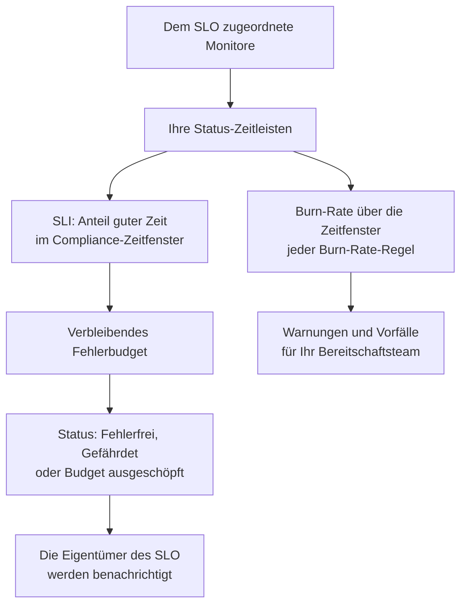

# SLOs – Übersicht

Ein Service Level Objective (SLO) ist ein Zuverlässigkeitsziel für das, was Sie überwachen, etwa „99,9 % der Zeit verfügbar über rollierende 30 Tage“. OneUptime misst jedes SLO alle 5 Minuten an seinem Ziel. Statt „Läuft es gerade?“ beantworten Sie damit „Waren wir zuverlässig genug, über ein Zeitfenster, das unseren Nutzern wichtig ist, und wie viel Spielraum für Ausfälle bleibt?“

:::cards
- [Ein SLO erstellen](#ein-slo-erstellen): Ein Name und ein Ziel. Alles andere startet mit einem Standardwert.
- [Monitore und Monitor-Regeln](/docs/slo/monitor-rules): Wählen Sie die Monitore, die ein SLO misst.
- [Fehlerbudgets](/docs/slo/error-budget): Wie viel Ausfallzeit ein Ziel erlaubt und wie sie zurückkommt.
- [Burn-Rate-Warnungen und -Vorfälle](/docs/slo/burn-rate-alerts): Alarmieren Sie Ihr Team, wenn das Budget zu schnell verbrennt.
:::

## So funktioniert es

Ein SLO liest die Status-Zeitleisten der Monitore, die ihm zugeordnet sind: dieselben Daten, die Ihre Statusseiten zeigen. Daraus berechnet OneUptime, welcher Anteil des Compliance-Zeitfensters gute Zeit war, wie viel Fehlerbudget übrig ist und wie schnell es verbraucht wird.

## Grundbegriffe

| Begriff | Bedeutung |
| --- | --- |
| **SLI** (Service Level Indicator) | Die Messung: der Prozentsatz des Compliance-Zeitfensters, in dem die Monitore des SLO verfügbar waren. |
| **SLO** (Service Level Objective) | Ein Ziel für den SLI, zum Beispiel „mindestens 99,9 % in den letzten 30 Tagen“. |
| **Fehlerbudget** | Die Ausfallzeit, die das Ziel erlaubt: `(100% − target) × window`. Bei 99,9 % über 30 Tage sind das 43 Minuten und 12 Sekunden. |
| **Burn-Rate** | Wie schnell das Budget verbraucht wird, verglichen mit einem gleichmäßigen Tempo. Bei einer Burn-Rate von 1 ist das Budget genau am Ende des Zeitfensters aufgebraucht. |

Ein Fehlerbudget macht Zuverlässigkeit zu etwas, das Sie ausgeben können. Ist viel übrig, liefern Sie schneller aus und gehen Risiken ein; ist wenig übrig, treten Sie kürzer und investieren in Stabilität. Das SLO gibt diesem Gespräch eine Zahl, die alle sehen.

## Ein SLO erstellen

Sie brauchen eine Rolle, die SLOs erstellen darf: Project Owner, Project Admin oder eine eigene Rolle mit der Berechtigung Create Service Level Objective.

:::steps
### SLOs öffnen

Öffnen Sie **SLOs** über das Menü **Produkte** in der oberen Leiste. Es steht in der ersten Gruppe, neben Monitoren und Vorfällen. Klicken Sie auf **Service Level Objective erstellen**.

### Name und Ziel festlegen

Geben Sie einen **Name** ein, zum Beispiel „API Availability“, und ein **Ziel (%)**: den Anteil der Zeit, in dem seine Monitore verfügbar sein müssen. Das Ziel beginnt bei `99.9`. Es muss größer als 0 und höchstens 99,999 sein, denn ein Ziel von 100 % lässt kein Fehlerbudget übrig, das sich verfolgen ließe.

### Die Standardwerte unter Weitere Felder prüfen

**Weitere Felder** ist eingeklappt, mit einer Zeile, die sagt, was die Standardwerte bewirken: Das SLO wird über ein rollierendes 30-Tage-Zeitfenster gemessen und wird gefährdet, sobald weniger als 20 % seines Fehlerbudgets übrig sind. Klappen Sie es auf, um eines der Felder aus der Tabelle unten zu ändern.

### Das SLO speichern

Klicken Sie auf **Service Level Objective erstellen**. OneUptime öffnet das neue SLO. Seine **Übersicht** zeigt **Wählen Sie, was dieses SLO misst**, denn ein neues SLO hat noch keine Monitore.

### Monitore zuordnen

Klicken Sie auf **Monitor-Regel erstellen**, um jeden passenden Monitor zuzuordnen, jetzt und später, oder auf **Monitore hinzufügen**, um sie von Hand auszuwählen. Siehe [Monitore und Monitor-Regeln](/docs/slo/monitor-rules).

### Die ersten Zahlen abwarten

OneUptime wertet aktivierte SLOs alle 5 Minuten aus. SLI, Fehlerbudget und das Burn-down-Diagramm erscheinen nach der ersten Auswertung, die Monitore zu messen hat.
:::

Die Felder unter **Weitere Felder**:

| Feld | Was Sie festlegen | Standard |
| --- | --- | --- |
| **Beschreibung** | Wofür das SLO da ist. | Leer |
| **Risikoschwellenwert (%)** | Der Anteil des verbleibenden Fehlerbudgets, bei dem das SLO **Gefährdet** wird. Eine ganze Zahl von 0 bis 100. | 20 |
| **Typ des Zeitfensters** | **Rollierend**: die letzten N Tage, die sich erholen, während alte Ausfallzeit aus dem Fenster fällt. **Calendar Month**: jeder Monat für sich, zurückgesetzt am 1. | **Rollierend** |
| **Zeitfenster (Tage)** | Nur rollierende Zeitfenster: wie viele Tage zurückgeschaut wird, von 1 bis 366. Üblich sind 28 oder 30. | 30 |
| **Zeitzone** | Nur Kalendermonate: die Zeitzone, in der jeder Monat beginnt und endet. | UTC |
| **Beschriftungen** | Beschriftungen, um SLOs zu ordnen und zu filtern. | Keine |

Alles, was bestimmt, wie das SLO misst, startet mit einem Standardwert, den Sie später ändern:

| Einstellung | Ein neues SLO startet mit | Ändern unter |
| --- | --- | --- |
| Monitore | Keinen | **Monitore** oder **Monitor-Regeln** |
| Ausfall-Status | Jedem nicht betriebsbereiten Status des Projekts | **Einstellungen** → **Berechnung der Ausfallzeit** |
| Multi-Monitor-Modus | **Any Monitor Down** | **Einstellungen** → **Berechnung der Ausfallzeit** |
| Auswertung | Ein | **Einstellungen** → **Auswertung** |
| Burn-Rate-Regeln | Einer Regel **Fast burn** und einer Regel **Slow burn**, an das Zeitfenster angepasst | **Burn-Rate-Regeln** |

## Woraus ein SLO besteht

| Teil | Was er festlegt |
| --- | --- |
| Monitore | Woher der SLI kommt. Ordnen Sie sie von Hand oder mit Monitor-Regeln zu: siehe [Monitore und Monitor-Regeln](/docs/slo/monitor-rules). |
| Ziel | Der Anteil guter Zeit, den das SLO verspricht, größer als 0 und höchstens 99,999. |
| Compliance-Zeitfenster | Der Zeitraum, über den SLI und Budget gemessen werden: ein rollierendes Fenster von 1 bis 366 Tagen oder ein Kalendermonat. |
| Risikoschwelle | Der Anteil des verbleibenden Budgets, bei dem das SLO **Gefährdet** wird. |
| Ausfall-Status | Welche Monitorstatus als Ausfallzeit zählen. |
| Multi-Monitor-Modus | Wie sich Ausfallzeit mehrerer Monitore zusammensetzt. |

### Welche Status als Ausfallzeit zählen

Jedes SLO hat seine eigene Liste von Monitorstatus, die als Ausfallzeit zählen. Ein neues SLO beginnt mit jedem Status des Projekts, der nicht als betriebsbereit markiert ist, etwa Degraded und Offline, so wie Ihre Statusseiten. Ändern Sie die Liste unter **Einstellungen** → **Berechnung der Ausfallzeit**. Lassen Sie sie leer, damit jeder nicht betriebsbereite Status zählt, auch Status, die dem Projekt später hinzugefügt werden.

> [!TIP]
> Messen Sie dieselben Monitore auf zwei Arten mit zwei SLOs: ein strenges Verfügbarkeits-SLO, bei dem Degraded und Offline zählen, und ein lockereres Totalausfall-SLO, bei dem nur Offline zählt.

### Compliance-Zeitfenster

| Fenstertyp | Wie es sich verhält |
| --- | --- |
| **Rollierend** | Schaut eine feste Zahl von Tagen ab jetzt zurück. Alte Ausfallzeit fällt aus dem Fenster, also kommt das Budget nach und nach zurück. |
| **Calendar Month** | Misst ab dem Ersten des Monats, in der Zeitzone des SLO (standardmäßig UTC). Das ganze Budget kommt zu Beginn jedes Monats zurück. |

### Mehrere Monitore in einem SLO

Misst ein SLO mehr als einen Monitor, entscheidet sein **Multi-Monitor-Modus**, wie sich deren Ausfallzeit zusammensetzt. Ein neues SLO verwendet **Any Monitor Down**.

| Modus | Wie Ausfallzeit zählt | Geeignet, wenn |
| --- | --- | --- |
| **Any Monitor Down** | Jeder Moment, in dem mindestens ein Monitor ausgefallen ist, zählt als Ausfallzeit für das ganze SLO. Überlappende Ausfälle zählen einmal. | Die Monitore zusammen sind ein Dienst: Fällt einer aus, merken es die Nutzer. |
| **Monitor Seconds Average** | Die Ausfallzeit jedes Monitors zählt für sich, gemittelt über die gesamte überwachte Zeit: SLI = 1 − (Ausfallsekunden aller Monitore ÷ überwachte Sekunden aller Monitore). | Die Monitore sind eine Flotte gleichartiger Ressourcen, und teilweise Auswirkungen sollen teilweise zählen. |

Zum Beispiel ist Monitor A von 10:00 bis 11:00 ausgefallen, während Monitor B verfügbar bleibt. **Any Monitor Down** erfasst 60 Minuten Ausfallzeit; **Monitor Seconds Average** erfasst das Äquivalent von 30 Minuten, weil einer von zwei Monitoren eine Stunde lang ausgefallen war. In diesem Modus wird auch das Budget in Monitorsekunden gezählt: siehe [Fehlerbudgets](/docs/slo/error-budget).

## SLO-Status

OneUptime gibt jedem ausgewerteten SLO einen Status:

| Status | Bedeutung |
| --- | --- |
| **Fehlerfrei** | Es ist mehr als die Risikoschwelle des Budgets übrig. |
| **Gefährdet** | Das verbleibende Budget ist auf die Risikoschwelle oder darunter gefallen: standardmäßig 20 %. |
| **Budget ausgeschöpft** | Das Budget ist vollständig oder mehr als vollständig verbraucht. |
| **Falsch konfiguriert** | Das SLO kann nicht gemessen werden: Es hat keine Monitore, seine Monitore existieren nicht mehr oder haben in seinem Zeitfenster noch keinen Status erfasst, oder sein Ziel liegt außerhalb des zulässigen Bereichs. |
| **Pausiert** | Jeder Monitor, den es misst, ist archiviert oder hat die aktive Überwachung abgeschaltet, von Hand, durch einen manuellen Vorfall oder durch geplante Wartung. Es läuft von selbst weiter, sobald einer davon wieder überwacht wird. |

Ein abgeschaltetes oder archiviertes SLO wird nicht ausgewertet, sein Status bleibt also, wo er war; die SLO-Liste zeigt stattdessen eine Kennzeichnung **Deaktiviert** oder **Archiviert**. Die Eigentümer eines SLO werden benachrichtigt, wenn sich der Status zu **Gefährdet** oder **Budget ausgeschöpft** ändert: siehe [Fehlerbudgets](/docs/slo/error-budget).

## Die SLO-Liste

Die Seite **SLOs** listet jedes nicht archivierte SLO mit Status, SLI, verbleibendem Budget, Burn-Rate, Ziel, Zeitfenster, Monitoren, Beschriftungen und Eigentümern.

- Die Kacheln über der Liste zählen SLOs nach Status: **Fehlerfrei**, **Gefährdet**, **Budget ausgeschöpft**, **Falsch konfiguriert**, **Pausiert** und **Deaktiviert**. Klicken Sie auf eine Kachel, um nur diese SLOs anzuzeigen, und erneut, um wieder alle zu sehen.
- Wählen Sie SLOs aus, um auf einmal Beschriftungen und Eigentümer hinzuzufügen oder zu entfernen, sie zu archivieren oder zu löschen.
- Der Bereich **Einstellungen** des Seitenmenüs enthält **Beschriftungsregeln** und **Eigentümerregeln**, die neue SLOs beschriften und ihnen Eigentümer geben: siehe [Beschriftungs- und Eigentümerregeln](/docs/slo/label-and-owner-rules).
- Der Bereich **Erweitert** des Seitenmenüs enthält **Archiviert**, die Liste der archivierten SLOs.

## Die Seiten eines SLO

Öffnen Sie ein SLO, um seine Seiten im Seitenmenü zu sehen:

| Seite | Was sie zeigt |
| --- | --- |
| **Übersicht** | Den Status, die wichtigsten Kennzahlen, das Fehlerbudget-Burn-down, die neueste Aktivität, offene Warnungen und Vorfälle sowie die Burn-Rate-Regeln. |
| **Metriken** | Die `oneuptime.slo.*`-Metriken des SLO, seinen langfristigen Fehlerbudget-Verlauf und Metriken der Vorfälle und Warnungen, die es betreffen. Siehe [SLO-Metriken und -Dashboards](/docs/slo/metrics). |
| **Vorfälle** | Die Vorfälle, die seine Burn-Rate-Regeln gemeldet haben. Das Badge zählt die offenen. |
| **Warnungen** | Die Warnungen, die seine Burn-Rate-Regeln ausgelöst haben. Das Badge zählt die offenen. |
| **Feed** | Was mit dem SLO passiert ist, als Zeitleiste. Siehe [SLO-Feed und Audit-Protokolle](/docs/slo/feed-and-audit-logs). |
| **Monitore** | Die Monitore, die es misst, und ob eine Person oder eine Regel jeden davon zugeordnet hat. |
| **Monitor-Regeln** | Die Regeln, die passende Monitore zuordnen. |
| **Burn-Rate-Regeln** | Die Regeln, die Warnungen auslösen und Vorfälle melden, wenn das Budget zu schnell verbrennt. |
| **Eigentümer** | Die Benutzer und Teams, die von seinen Statusänderungen erfahren. |
| **Einstellungen** | Das Ziel, den Compliance-Zeitraum, die Berechnung der Ausfallzeit, den Schalter für die Auswertung und die Archivkarte. |
| **Audit-Protokolle** | Wer das SLO, seine Regeln und seine Eigentümer geändert hat, und wann. |
| **SLO löschen** | Löscht das SLO endgültig und löst die Burn-Rate-Warnungen und -Vorfälle auf, die es offen hatte. |

**Monitore**, **Monitor-Regeln** und **Burn-Rate-Regeln** stehen im Bereich **Konfiguration**, **Eigentümer**, **Einstellungen**, **Audit-Protokolle** und **SLO löschen** im Bereich **Verwaltung**. Beide sind anfangs eingeklappt, ebenso ein Bereich **Entwickler**, um das SLO per Code zu verwalten: Klicken Sie auf den Titel eines Bereichs, um ihn zu öffnen.

Wenn etwas ein SLO am Messen hindert, sagt ein Banner oben auf jeder seiner Seiten, was nicht stimmt, und verlinkt die Seite, auf der Sie es beheben: siehe [Fehlerbehebung](#fehlerbehebung).

### Die Übersicht

Die **Übersicht** beantwortet „Sind wir im Budget?“, von oben nach unten:

- **Die Zusammenfassung**: der Status, ein Satz dazu, was er bedeutet, und die Beschreibung. Daneben stehen **Aktualisieren** und wann das SLO zuletzt ausgewertet wurde. Darunter stehen das Ziel, das **Compliance-Zeitfenster** (mit einem Füllstand-Chip, solange sich ein junges rollierendes Fenster füllt: siehe [Junge SLOs und die Füllstandsanzeige des Zeitfensters](#junge-slos-und-die-füllstandsanzeige-des-zeitfensters)), die Zahl der Monitore und die Eigentümer.
- **Die wichtigsten Kennzahlen**:
  - **SLI**: der Anteil guter Zeit im Zeitfenster und wie weit er über oder unter dem Ziel liegt.
  - **Verbleibendes Fehlerbudget**: ein Prozentsatz, eine Dauer wie "12m 30s left of 43m 12s" und ein Balken mit einer Markierung an der Risikoschwelle. Ist das Budget überzogen, zeigt die Kachel **Budget exceeded** und um wie viel.
  - **Burn-Rate**: wie schnell das Budget in den letzten 60 Minuten verbraucht wird, dem Rückblick, den die standardmäßige Fast-Burn-Regel verwendet. Sie wird über 1× gelb und rot, mit **Regelschwellenwert erreicht**, beim niedrigsten Schwellenwert der aktivierten Burn-Rate-Regeln des SLO.
  - **Budget-Reichweite**: wie lange das Budget bei diesem Tempo reicht. Siehe [Fehlerbudgets](/docs/slo/error-budget#budget-reichweite).
- **Fehlerbudget-Burn-down**: das verbleibende Budget über das aktuelle Zeitfenster. Siehe [Fehlerbudgets](/docs/slo/error-budget#fehlerbudget-burn-down).
- **Neueste Aktivität**: die letzten Einträge im Feed des SLO.
- **SLO-Details**: Name, Beschreibung und Beschriftungen, die einzigen Einstellungen, die auf der Übersicht bearbeitet werden.
- **Offene Warnungen & Vorfälle**: was die Burn-Rate-Regeln gerade offen haben.
- **Burn-Rate-Regeln**: der Schwellenwert jeder aktivierten Regel neben der aktuellen Burn-Rate und was die Regel meldet.

### Einstellungen

Die Seite **Einstellungen** enthält, wie ein SLO misst, je eine Karte:

| Karte | Was Sie ändern | Gut zu wissen |
| --- | --- | --- |
| **Ziel** | **Ziel (%)** und **Risikoschwellenwert (%)**, mit **Ziel bearbeiten**. | Zeigt die Ausfallzeit, die das Ziel erlaubt, zum Beispiel „43m 12s Ausfallzeit pro 30-Tage-Zeitfenster“. |
| **Compliance-Zeitraum** | **Typ des Zeitfensters**, **Zeitfenster (Tage)** und **Zeitzone**, mit **Zeitraum bearbeiten**. | Burn-Rate-Regeln behalten ihre Schwellenwerte, wenn sich das Zeitfenster ändert, prüfen Sie sie also danach. |
| **Berechnung der Ausfallzeit** | **Multi-Monitor-Modus** und **Ausfallzeit-Monitorstatus**, mit **Berechnung der Ausfallzeit bearbeiten**. | Leere Status zählen jeden nicht betriebsbereiten Status, auch später hinzugefügte. |
| **Auswertung** | Der Schalter **Dieses SLO auswerten**, der sofort speichert, wenn Sie ihn umlegen. | Beim Ausschalten fragt er zuerst, denn das löst auch die offenen Burn-Rate-Warnungen und -Vorfälle des SLO auf. |
| **Archive SLO** | **Archivieren** oder **Aus Archiv entfernen**. | Siehe [Ein SLO archivieren](#ein-slo-archivieren). |

Nach einer Änderung an Ziel, Zeitraum oder Berechnung der Ausfallzeit wertet OneUptime das SLO beim nächsten Lauf neu aus.

## Ein SLO archivieren

Archivieren Sie ein SLO, das Sie nicht mehr messen, aber behalten möchten, etwa für einen stillgelegten Dienst oder das Ziel des letzten Jahres. Archivieren Sie es unter **Einstellungen** → **Archive SLO**, oder wählen Sie SLOs in der SLO-Liste aus und dann **Archivieren**.

Ein archiviertes SLO:

- ist aus der SLO-Liste, ihren Statuskacheln sowie den SLO-Auswahlen und -Listen auf Dashboards ausgeblendet;
- wird nicht ausgewertet: Seine Zahlen bleiben auf dem Stand der letzten Auswertung, seine Burn-Rate-Regeln lösen nicht aus, und es sendet keine Metriken;
- bekommt seine offenen Burn-Rate-Warnungen und -Vorfälle aufgelöst;
- behält Einstellungen, Verlauf, Regeln und Eigentümer. Seine Monitor-Regeln halten die Monitorliste aktuell, sodass es mit den richtigen Monitoren weitermacht.

Archivierte SLOs stehen auf der Seite **Archiviert**, unter **Erweitert** im Seitenmenü der SLO-Liste. Wählen Sie sie dort aus und dann **Aus Archiv entfernen**, um sie zurückzuholen: Beim nächsten Lauf werden sie wieder ausgewertet, mit SLI und Budget neu berechnet aus dem Verlauf ihrer Monitore.

Archivieren und das Ausschalten der Auswertung sind getrennte Schalter. Ein SLO, das vor dem Archivieren ausgeschaltet war, bleibt nach dem Zurückholen ausgeschaltet: Schalten Sie es mit **Auswertung einschalten** in seinem Banner wieder ein oder mit **Dieses SLO auswerten** unter **Einstellungen** → **Auswertung**.

| Sie möchten | Tun Sie dies |
| --- | --- |
| Eine Weile nicht messen und es in der Liste behalten | Auswertung ausschalten |
| Es stilllegen, aber Verlauf und Einstellungen behalten | Archivieren |
| Es endgültig entfernen | Löschen |

## SLOs bei Warnungen, Vorfällen und Monitoren

Jede Warnung und jeder Vorfall, den eine Burn-Rate-Regel erzeugt, ist mit ihrem SLO verknüpft:

- Die Seite der Warnung oder des Vorfalls listet das SLO unter **Betroffene Ressourcen**, mit einem Link dorthin.
- Listen von Warnungen und Vorfällen zeigen das SLO unter den betroffenen Ressourcen, und der Filter **Betroffene Ressourcen** grenzt eine Liste auf ein SLO ein.
- Die Seiten **Warnungen** und **Vorfälle** des SLO listen sie, und ihre Badges im Seitenmenü zählen die offenen.

OneUptime setzt diese Verknüpfung, wenn eine Regel die Warnung oder den Vorfall erzeugt; Sie können sie nicht von Hand hinzufügen, und das Bearbeiten der Warnung oder des Vorfalls entfernt sie nie.

Auch das Seitenmenü eines Monitors hat eine Seite **SLOs**: die SLOs, die diesen Monitor messen, damit Sie wissen, welche Ziele von ihm abhängen, bevor Sie ihn pausieren oder ändern.

## Junge SLOs und die Füllstandsanzeige des Zeitfensters

Ein SLO mit rollierendem Zeitfenster, das jünger ist als sein Fenster, wird über die bisher vorhandenen Daten gemessen: Ein 30-Tage-SLO, das gestern erstellt wurde, hat einen Tag Daten. Sein Fehlerbudget beginnt klein und wächst, während sich das Fenster füllt, daher schwanken seine ersten Zahlen stärker als später.

Solange das so ist, sagt die **Übersicht** es: Die Zusammenfassung zeigt einen Chip **Window 23% full** (**Window under 1% full** am ersten Tag), und die Kachel **Verbleibendes Fehlerbudget** wiederholt ihn unter ihrer Zahl. Beide verschwinden, sobald das Fenster voll ist. Kalendermonat-SLOs zeigen sie nie, weil ihr Budget vom ersten Tag an den ganzen Monat abdeckt, und SLOs im Modus **Monitor Seconds Average** ebenfalls nicht, weil ihr Budget über Monitore hinweg gezählt wird.

## Fehlerbehebung

Ein Banner oben auf den Seiten des SLO sagt, was es am Messen hindert:

| Banner | Bedeutung | Was zu tun ist |
| --- | --- | --- |
| **No monitors attached** | Das SLO hat keine Monitore, es gibt also nichts zu messen. | Monitore zuordnen oder eine Monitor-Regel erstellen. |
| **Waiting for SLO evaluation** | Monitore sind zugeordnet, aber die letzte Auswertung hatte keine Statusdaten von ihnen. | Prüfen Sie, ob die Monitore geprüft werden. Zahlen erscheinen nach der nächsten Auswertung mit Daten. |
| **Measurement is paused** | Jeder Monitor, den es misst, ist archiviert oder hat die aktive Überwachung abgeschaltet. | Schalten Sie die Überwachung für mindestens einen Monitor wieder ein, oder warten Sie, bis die Wartung endet. |
| **The target is out of range** | Das Ziel ist nicht größer als 0 und kleiner als 100. | Legen Sie ein Ziel wie 99,9 unter **Einstellungen** → **Ziel** fest. |
| **This SLO is disabled** | Die Auswertung ist aus. | Klicken Sie auf **Auswertung einschalten**. |
| **This SLO is archived** | Das SLO ist archiviert. | Holen Sie es unter **Einstellungen** aus dem Archiv. |
| **Noch nicht ausgewertet** | Das SLO wurde gerade erstellt. | Warten Sie auf die erste Auswertung, höchstens ein paar Minuten. |

## Nächste Schritte

:::cards
- [Monitore und Monitor-Regeln](/docs/slo/monitor-rules): Monitore von Hand oder mit Regeln zuordnen.
- [Fehlerbudgets](/docs/slo/error-budget): Die Budgetrechnung, die Reichweite und wie das Budget zurückkommt.
- [Burn-Rate-Warnungen und -Vorfälle](/docs/slo/burn-rate-alerts): Ihr Bereitschaftsteam alarmieren, wenn das Budget zu schnell verbrennt.
- [SLO-Metriken und -Dashboards](/docs/slo/metrics): SLOs als Diagramm darstellen und ein SLO-Dashboard bauen.
:::
