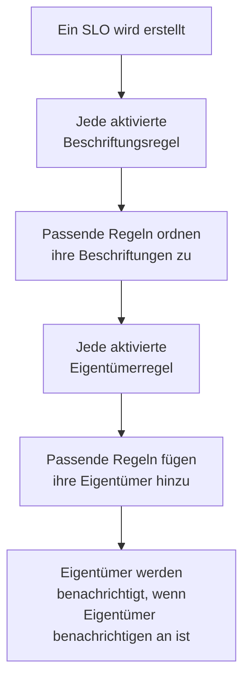

# Beschriftungs- und Eigentümerregeln

Beschriftungsregeln und Eigentümerregeln ordnen Ihre SLOs für Sie. Eine **Beschriftungsregel** ordnet jedem neuen SLO, auf das sie passt, Beschriftungen zu, und eine **Eigentümerregel** fügt ihm Eigentümer-Benutzer und -Teams hinzu, sodass ein neues Checkout-SLO die Beschriftung _Checkout_ bekommt und dem Checkout-Team gehört, ohne dass jemand daran denken muss. Beide funktionieren wie die Beschriftungs- und Eigentümerregeln jedes anderen Produkts: siehe [Beschriftungs- und Eigentümerregeln](/docs/configuration/label-and-owner-rules) für das, was sie gemeinsam haben.

## So funktioniert es

Regeln laufen, wenn ein SLO erstellt wird, über das Dashboard oder die API. Beschriftungsregeln laufen zuerst, damit eine Eigentümerregel auf eine Beschriftung passen kann, die eine Beschriftungsregel gerade zugeordnet hat.

Beide gelten für das ganze Projekt. Sie finden sie im Seitenmenü der SLO-Liste unter **Einstellungen**: **Beschriftungsregeln** und **Eigentümerregeln**. Der Bereich **Einstellungen** ist anfangs eingeklappt; klicken Sie auf seinen Titel, um ihn zu öffnen.

## Eine Regel erstellen

:::steps
### Die Regelliste öffnen

Öffnen Sie **SLOs**, dann im Seitenmenü **Einstellungen** → **Beschriftungsregeln** oder **Einstellungen** → **Eigentümerregeln**, und klicken Sie auf **Beschriftungsregel für SLOs erstellen** oder **Eigentümerregel für SLOs erstellen**.

### Festlegen, worauf die Regel passt

Klicken Sie im Schritt **Übereinstimmung** für jede Bedingung, die ein SLO erfüllen muss, auf **Bedingung hinzufügen** (siehe [Übereinstimmungskriterien](#übereinstimmungskriterien)). Bei zwei oder mehr wählen Sie **Alle müssen zutreffen** oder **Eine muss zutreffen**. Eine Regel ohne Bedingungen passt auf jedes neue SLO.

### Festlegen, was die Regel hinzufügt

Der zweite Schritt einer Beschriftungsregel ist **Beschriftungen**, in dem Sie die **Hinzuzufügende Beschriftungen** auswählen. Der einer Eigentümerregel ist **Eigentümer**, in dem Sie die hinzuzufügenden **Eigentümer** auswählen — Personen und Teams, ausgewählt aus einer Liste mit **Eigentümer hinzufügen**. Eine Regel muss mindestens eine Beschriftung oder einen Eigentümer hinzufügen.

### Den Namen und die eingeklappten Felder prüfen

Der **Name** wird aus Ihrer Auswahl gefüllt, etwa _Checkout, Production hinzufügen_ oder _Checkout team als Eigentümer hinzufügen_, und folgt Ihrer Auswahl, bis Sie einen eigenen Namen eingeben. **Weitere Felder** enthält die optionale **Beschreibung** und, bei einer Eigentümerregel, **Eigentümer benachrichtigen**.

### Die Regel speichern

Klicken Sie im letzten Schritt erneut auf **Beschriftungsregel für SLOs erstellen** oder **Eigentümerregel für SLOs erstellen**. Die Regel ist anfangs aktiviert.
:::

**Eigentümer benachrichtigen** (unter **Weitere Felder**) ist standardmäßig eingeschaltet: Die Eigentümer, die eine Eigentümerregel hinzufügt, bekommen dieselbe Benachrichtigung „Sie wurden als Eigentümer hinzugefügt“ wie ein von Hand hinzugefügter Eigentümer. Schalten Sie es aus, um Eigentümer still hinzuzufügen.

Um eine Regel zu pausieren, ohne sie zu löschen, schalten Sie **Aktiviert** in ihrem Bearbeitungsformular aus. Das Bearbeitungsformular verlangt nie Beschriftungen oder Eigentümer: Eine ältere Regel, die nichts hinzufügt, lässt sich weiterhin umbenennen, ausschalten oder löschen, und die Liste kennzeichnet sie mit **Fügt nichts hinzu**.

Wenn eine Regel auf ein SLO passt:

- Eine Beschriftungsregel ordnet jede Beschriftung aus **Hinzuzufügende Beschriftungen** zu. Beschriftungen, die das SLO schon hat, werden nicht doppelt hinzugefügt, und wenn mehrere Regeln passen, bekommt das SLO alle ihre Beschriftungen.
- Eine Eigentümerregel fügt jeden Benutzer und jedes Team der Regel als Eigentümer hinzu. Eigentümer, die das SLO schon hat, werden übersprungen, und wenn mehrere Regeln passen, bekommt das SLO alle ihre Eigentümer. Ein Benutzer, der nicht mehr Mitglied des Projekts ist, oder ein Team aus einem anderen Projekt wird nie hinzugefügt; die übrigen Eigentümer der Regel schon.

SLO-Eigentümer sind die Menschen, die von den Statusänderungen des SLO erfahren: siehe [Fehlerbudgets](/docs/slo/error-budget).

## Übereinstimmungskriterien

Jede Bedingung vergleicht ein Feld des SLO:

| Feld | Verglichen mit | Operatoren |
| --- | --- | --- |
| **SLO-Beschriftungen** | Den Beschriftungen des SLO. | **Hat eines von**, **Hat alle von**, **Hat keines von** |
| **SLO-Name** | Dem Namen des SLO. | **Enthält**, **Enthält nicht**, **Gleich**, **Ungleich**, **Beginnt mit**, **Endet mit**, **Entspricht Muster**, **Entspricht nicht dem Muster** |
| **SLO-Beschreibung** | Der Beschreibung des SLO. | Dieselben wie **SLO-Name** |

Eine neue Bedingung auf Name oder Beschreibung beginnt mit **Enthält**. Ein Muster ist ein regulärer Ausdruck, etwa `^checkout-.*`, oder ein `*`-Platzhalter, etwa `*checkout*`, und ignoriert Groß- und Kleinschreibung. Ein Muster, das keines von beiden ist, etwa `checkout-(01`, wird beim Speichern abgelehnt, statt stillschweigend auf nichts zu passen.

| Sie möchten | Bedingungen |
| --- | --- |
| Jedes SLO des Checkout-Dienstes | **SLO-Name** enthält `checkout` |
| Jedes Produktions-SLO | **SLO-Beschriftungen** hat eines von _Production_ |
| Checkout-SLOs, aber nicht die für Staging | **Alle müssen zutreffen**: **SLO-Name** enthält `checkout`, und **SLO-Beschriftungen** hat keines von _Staging_ |

## Wann Regeln laufen

- **Wenn ein SLO erstellt wird**, über das Dashboard oder die API: jede aktivierte Beschriftungsregel, dann jede aktivierte Eigentümerregel.
- **Wenn Sie eine Regel ausführen**, mit **Jetzt ausführen**: siehe unten.

Das Bearbeiten eines SLO wendet die Regeln nicht erneut an, und eine Regel entfernt nie etwas: weder Beschriftungen oder Eigentümer, die jemand von Hand hinzugefügt hat, noch solche, die sie selbst hinzugefügt hat. Eine ausgeschaltete Regel tut nichts.

## Eine Regel auf vorhandene SLOs anwenden

Eine Regel, die Sie heute schreiben, gilt für SLOs, die danach erstellt werden. Um sie auf die SLOs anzuwenden, die Sie schon haben, klicken Sie in der Zeile der Regel auf **Jetzt ausführen** oder auf **Ansehen** und dann auf der eigenen Seite der Regel auf **Jetzt ausführen**. Sie können auch mehrere Regeln auswählen und sie über die Massenaktionen der Tabelle ausführen.

Eine Ausführung prüft jedes SLO des Projekts, archivierte eingeschlossen, und meldet, auf wie viele sie gepasst hat und wie viele sie geändert hat. Eigentümer, die eine Ausführung hinzufügt, werden nur benachrichtigt, wenn Sie das im Ausführungsdialog wählen und **Eigentümer benachrichtigen** bei der Regel eingeschaltet ist. Siehe [Regeln für bestehende Ressourcen ausführen](/docs/configuration/run-rules-now).

Beschriftungsregeln lassen sich auch zwischen Projekten kopieren: siehe [Beschriftungsregeln importieren und exportieren](/docs/configuration/label-rule-import-export).

## Verlauf

Immer wenn eine Regel ein SLO ändert, hält der **Feed** des SLO fest, welche Regeln es waren. Jeder Eigentümer, den eine Regel hinzufügt, bekommt außerdem seinen eigenen Feed-Eintrag „als Eigentümer hinzugefügt“, der Feed sagt also, wer hinzugefügt wurde und warum. Siehe [SLO-Feed und Audit-Protokolle](/docs/slo/feed-and-audit-logs).

## Berechtigungen

| Um | Brauchen Sie |
| --- | --- |
| Mit Beschriftungsregeln zu arbeiten | **Create SLO Label Rule**, **Edit SLO Label Rule**, **Delete SLO Label Rule** oder **Read SLO Label Rule** |
| Mit Eigentümerregeln zu arbeiten | **Create SLO Owner Rule**, **Edit SLO Owner Rule**, **Delete SLO Owner Rule** oder **Read SLO Owner Rule** |
| Eine Beschriftungsregel auszuführen | **Edit SLO Label Rule** und **Edit Service Level Objective** |
| Eine Eigentümerregel auszuführen | **Edit SLO Owner Rule**, **Edit Service Level Objective**, **Create SLO User Owner** und **Create SLO Team Owner** |

Diese Berechtigungen stehen in der Gruppe SLO einer Rolle, und die Rollen Project Owner und Project Admin haben sie alle. Eine Ausführung ändert jedes SLO des Projekts, daher reicht eine Berechtigung, die auf einige Beschriftungen oder auf Ihre eigenen SLOs beschränkt ist, nicht aus, um eine Regel auszuführen.

## Nächste Schritte

:::cards
- [Beschriftungs- und Eigentümerregeln](/docs/configuration/label-and-owner-rules): Wie die Beschriftungs- und Eigentümerregeln jedes Produkts funktionieren.
- [Regeln für bestehende Ressourcen ausführen](/docs/configuration/run-rules-now): Wie Jetzt ausführen bei jeder Art von Regel funktioniert.
- [SLOs – Übersicht](/docs/slo/introduction): Jede Seite, die ein SLO hat, und die SLO-Liste.
:::
