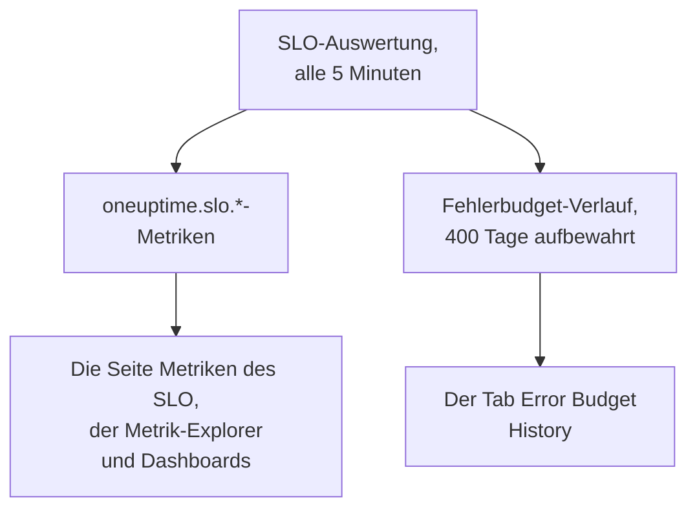

# SLO-Metriken und -Dashboards

Jedes Mal, wenn OneUptime ein SLO auswertet, alle 5 Minuten, schreibt es die Ergebnisse als Metriken mit dem Namen `oneuptime.slo.*`. Sie liegen im selben Metrikspeicher wie Ihre Monitormetriken, Sie können ein SLO also auf seiner Seite **Metriken** als Diagramm darstellen, es im Metrik-Explorer öffnen und auf jedes Dashboard legen, gefiltert und gruppiert wie jede andere Reihe.

:::cards
- [Die Metriken](#die-metriken): Sechs Reihen, ihre Einheiten und wie man sie aggregiert.
- [Die Seite Metriken](#die-seite-metriken): Diagramme, Verlauf und Vorfall- und Warnungsmetriken eines SLO.
- [SLOs auf Dashboards](#slos-auf-dashboards): Das SLO-Widget und die Vorlage SLO Dashboard.
:::

## So funktioniert es

## Die Metriken

| Metrik | Einheit | Aggregation | Was sie enthält |
| --- | --- | --- | --- |
| `oneuptime.slo.sli.percent` | `%` | Avg | Der SLI über das Compliance-Zeitfenster des SLO: der Anteil der gemessenen Zeit, der gut war. |
| `oneuptime.slo.target.percent` | `%` | Avg | Das Ziel des SLO, mit jeder Auswertung gesendet, damit ein Diagramm es über dem SLI zeichnen kann. |
| `oneuptime.slo.error.budget.remaining.percent` | `%` | Avg | Anteil des Fehlerbudgets, der im Zeitfenster noch nicht verbraucht ist. Negativ, sobald das Budget überzogen ist. |
| `oneuptime.slo.error.budget.remaining.seconds` | `seconds` | Avg | Ausfallzeit, die das SLO noch aufnehmen kann, bevor es verletzt ist. Negativ, sobald das Budget überzogen ist. |
| `oneuptime.slo.burn.rate` | `x` | Max | Wie schnell das Budget verbraucht wird, über die letzten 60 Minuten. 1x verbraucht das Budget genau über das Zeitfenster. |
| `oneuptime.slo.status` | — | Max | Der Status des SLO bei jeder Auswertung: `0` ist Fehlerfrei, `1` ist Gefährdet, `2` ist Budget ausgeschöpft. |

Die Aggregation bestimmt, wie die eigenen Diagramme des SLO und die Vorlage SLO Dashboard die Punkte zusammenfassen, die in einen Diagrammabschnitt fallen. Prozentwerte und Dauern werden gemittelt. Burn-Rate und Status nehmen das Maximum, damit eine kurze Verbrauchsspitze oder ein kurzer Ausflug in Budget ausgeschöpft nicht weggemittelt wird.

Bei einem SLO im Modus **Monitor Seconds Average** zählt `oneuptime.slo.error.budget.remaining.seconds` Monitorsekunden, summiert über seine Monitore, so wie sein Fehlerbudget: siehe [Fehlerbudgets](/docs/slo/error-budget).

### Wann kein Punkt geschrieben wird

- Ein abgeschaltetes oder archiviertes SLO wird nicht ausgewertet und sendet daher nichts.
- Ein SLO im Status **Pausiert** oder **Falsch konfiguriert** misst nichts und sendet daher nur `oneuptime.slo.target.percent`, das Konfiguration ist und keine Messung. Seine Diagramme für SLI, Budget, Burn-Rate und Status zeigen eine Lücke.
- Ein Wert, der keine echte Zahl ist, etwa eine Burn-Rate über ein Zeitfenster ohne Daten, wird übersprungen, nie als 0 geschrieben.

### Attribute

Jeder Punkt trägt diese Attribute:

| Attribut | Wert |
| --- | --- |
| `sloId` | ID des SLO. Die eigenen Seiten des SLO filtern danach, ein Umbenennen des SLO teilt seine Diagramme also nie auf. |
| `sloName` | Name des SLO zum Zeitpunkt, als der Punkt geschrieben wurde. |
| `projectId` | ID des Projekts. |
| `oneuptime.label.<key>` | Ein Attribut pro Beschriftung des SLO. Eine Beschriftung namens `Tier 1` wird zu `oneuptime.label.tier_1` = `true`, und eine Beschriftung namens `product:checkout` wird zu `oneuptime.label.product` = `checkout`. Schlüssel werden kleingeschrieben, Leerzeichen und Satzzeichen werden zu `_`. |

Die Reihen gehören zum SLO, nicht zu einem seiner Monitore, und zählen nicht zur Telemetrienutzung.

Vorfall- und Warnungsmetriken tragen zwei passende Attribute, `serviceLevelObjectiveIds` und `serviceLevelObjectiveNames`: kommagetrennte Listen der SLOs, die der Vorfall oder die Warnung betrifft.

### Aufbewahrung

`oneuptime.slo.*`-Metriken werden so lange aufbewahrt wie Monitormetriken: standardmäßig **30 Tage**. In einer selbst gehosteten Installation kann ein Master-Admin das mit **Monitor Metric Retention (Days)** in den Einstellungen **Datenaufbewahrung** des Admin Dashboard ändern.

Das begrenzt nicht den Tab **Error Budget History** der Seite **Metriken** des SLO. Dieser Verlauf wird getrennt gespeichert und 400 Tage aufbewahrt.

## Die Seite Metriken

Die Seite **Metriken** eines SLO hat vier Tabs:

| Tab | Was er zeigt |
| --- | --- |
| **SLO Metrics** | Die `oneuptime.slo.*`-Reihen in drei Karten mit einem gemeinsamen Zeitraum, standardmäßig dem letzten Tag: **Ziel** (der SLI mit dem Ziel darüber und das verbleibende Budget), **Burn** (Burn-Rate und verbleibende Budgetzeit) und **Status**. |
| **Error Budget History** | SLI, verbleibendes Budget und Burn-Rate über den langfristigen Verlauf, mit Linien beim Ziel, bei den Grenzen für gefährdet und ausgeschöpft und beim Schwellenwert jeder aktivierten Burn-Rate-Regel. |
| **Vorfallmetriken** | Anzahl, Zeit bis zur Bestätigung, Zeit bis zur Auflösung und Dauer der Vorfälle, die dieses SLO betreffen, standardmäßig der letzten Woche. Vorfälle, die seine Burn-Rate-Regeln gemeldet haben, sind enthalten. |
| **Warnungsmetriken** | Dasselbe für Warnungen. Warnungen, die seine Burn-Rate-Regeln ausgelöst haben, sind enthalten. |

Die Tabs **SLO Metrics**, **Vorfallmetriken** und **Warnungsmetriken** lesen den Metrikspeicher, wofür die Berechtigung zum Lesen von Telemetrie nötig ist. Eine eigene Rolle, die SLOs, aber keine Telemetrie lesen darf, sieht diese Tabs leer, während **Error Budget History** weiter funktioniert.

## SLOs auf Dashboards

### Jede SLO-Metrik als Diagramm darstellen

:::steps
#### Ein Diagramm hinzufügen

Fügen Sie im Bearbeitungsmodus eines Dashboards ein Diagramm- oder Wert-Widget hinzu und wählen Sie eine der `oneuptime.slo.*`-Metriken.

#### Gruppieren oder filtern

Gruppieren Sie nach `sloName` und `sloId` für eine Linie pro SLO; `sloId` hält zwei gleichnamige SLOs auseinander. Oder filtern Sie nach `sloName` oder nach einem `oneuptime.label.*`-Attribut.

#### Die Aggregation wählen

Verwenden Sie die Aggregation aus der Tabelle oben: Avg für die Prozentwerte und Dauern, Max für Burn-Rate und Status.
:::

### Das SLO-Widget

Das [SLO-Widget](/docs/dashboards/widgets#slo) zeigt den SLI, das verbleibende Budget oder die Burn-Rate eines SLO als Kachel oder Diagramm. Es bekommt sein SLO auf eine von zwei Arten:

| Einstellung | Wie es sich verhält |
| --- | --- |
| **Service Level Objective** | Heftet das Widget an ein SLO. Die Auswahl listet SLOs, die nicht archiviert sind. |
| **Follow SLO Variable** | Zeigt das SLO, das in einer Dashboard-Variablen gewählt ist: einer Variablen **Telemetry Attribute** auf dem Schlüssel `sloName`. Wird ignoriert, solange ein SLO angeheftet ist. |

Auf einem [öffentlichen Dashboard](/docs/dashboards/sharing) lässt ein Widget, das einer Variablen folgt, Betrachter jedes nicht archivierte SLO des Projekts nach Namen wählen. Ein angeheftetes Widget zeigt immer nur sein eigenes SLO und zeigt die letzten Zahlen eines SLO, das später archiviert wurde, weiter an.

### Die Vorlage SLO Dashboard

Wählen Sie beim Erstellen eines Dashboards die Vorlage **SLO Dashboard** für eine fertige Übersicht aller SLOs des Projekts, in drei Bändern:

1. **Service Level Objectives**: eine Liste jedes nicht archivierten SLO, mit Status, SLI im Vergleich zum Ziel, Budgetbalken und Burn-Rate sowie einer Zählung der SLOs nach Status. Aktivierte SLOs kommen zuerst, das mit dem geringsten Budget zuerst; ein abgeschaltetes SLO kommt zuletzt als **Deaktiviert**, seine letzten Zahlen ausgegraut.
2. **Error Budget & Burn Rate**: die Kacheln **Lowest Error Budget Remaining**, **Least Error Budget Time Left** und **Peak Burn Rate** sowie die Diagramme **Error Budget Remaining by SLO** und **Burn Rate by SLO** mit einer Linie pro SLO, gruppiert nach `sloName` und `sloId`.
3. **Selected SLO**: die Kacheln **SLI**, **Error Budget Remaining** und **Burn Rate** sowie die Diagramme **SLI History**, **Error Budget History** und **Burn Rate History** eines SLO.

Eine SLO-Variable in der Werkzeugleiste grenzt die ganze Übersicht ein. Sie ist eine Variable vom Typ Telemetry Attribute auf `sloName`, ihre Optionen sind also die SLO-Namen, die in den Metriken vorkommen. Die Wahl eines SLO grenzt die Liste darauf ein, beschränkt Diagramme und Kacheln des Bands und füllt die Widgets von **Selected SLO**, die der Variablen folgen. Bis Sie eines wählen, bitten diese Sie, in der Werkzeugleiste ein SLO zu wählen.

## Fehlerbehebung

:::details Ein SLO fehlt in der SLO-Auswahl der Werkzeugleiste
Die Auswahl listet die SLO-Namen, die am letzten Tag gesendet wurden. Ein neues SLO erscheint nach seiner ersten Auswertung; ein SLO im Status **Pausiert** oder **Falsch konfiguriert** bleibt wählbar, weil es weiterhin sein Ziel sendet; ein abgeschaltetes oder archiviertes SLO verschwindet etwa einen Tag nach seinem letzten Punkt.
:::

:::details Die Wahl eines Namens zeigt zwei SLOs
Zwei SLOs haben diesen Namen. Liste und Diagramme zeigen beide, und die Widgets von **Selected SLO** sagen, dass der Name mehrdeutig ist. Geben Sie SLOs eindeutige Namen.
:::

:::details Der Tab SLO Metrics ist leer
Ihre Rolle darf keine Telemetrie lesen, oder das SLO wurde noch nicht ausgewertet. **Error Budget History** liest das SLO selbst und funktioniert weiter.
:::

## Nächste Schritte

:::cards
- [Dashboard-Widgets](/docs/dashboards/widgets): Jedes Widget, das SLO-Widget eingeschlossen.
- [Dashboard-Variablen](/docs/dashboards/variables): Eine ganze Übersicht mit einer Auswahl eingrenzen.
- [Fehlerbudgets](/docs/slo/error-budget): Was die Budgetzahlen bedeuten.
:::
