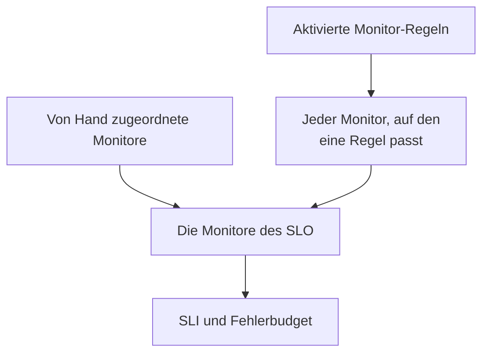

# Monitore und Monitor-Regeln

Ein SLO misst die Verfügbarkeit der Monitore, die ihm zugeordnet sind. Ordnen Sie sie von Hand zu, lassen Sie Monitor-Regeln jeden passenden Monitor zuordnen, oder beides. Diese Seite behandelt die Seiten **Monitore** und **Monitor-Regeln** eines SLO, beide unter **Konfiguration** in seinem Seitenmenü.

:::cards
- [Monitore von Hand auswählen](#monitore-von-hand-zuordnen): Am besten für eine kleine, feste Auswahl.
- [Monitore mit einer Regel zuordnen](#monitore-mit-einer-regel-zuordnen): „Jeder Monitor mit der Beschriftung Production“, für Sie aktuell gehalten.
- [Übereinstimmungskriterien](#übereinstimmungskriterien): Die Felder und Operatoren, auf die eine Regel prüfen kann.
:::

## Welche Monitore ein SLO misst

Ein SLO misst die Vereinigung der Monitore, die Sie von Hand zugeordnet haben, und jedes Monitors, auf den mindestens eine seiner aktivierten Monitor-Regeln passt.

Ein neues SLO hat keine Monitore, denn das Erstellungsformular fragt nicht danach. Bis es einen hat, kann es nicht ausgewertet werden: Seine Seiten zeigen **No monitors attached**, und seine **Übersicht** bietet beide Wege an, Monitore zuzuordnen.

## Monitore von Hand zuordnen

Sie brauchen die Berechtigung, das SLO zu bearbeiten.

:::steps
### Die Seite Monitore öffnen

Öffnen Sie das SLO und gehen Sie zu **Monitore**.

### Die Monitore auswählen

Klicken Sie auf **Monitore hinzufügen** und wählen Sie Monitore des Projekts aus. Aufgelistet werden nur Monitore, die noch nicht zugeordnet sind.

### Die Auswahl speichern

Klicken Sie auf **Monitore hinzufügen**. Die Monitore erscheinen in der Liste mit der Quelle **Manuell** und zählen ab der nächsten Auswertung zum SLI.
:::

Um einen Monitor vom SLO zu nehmen, klicken Sie in seiner Zeile auf **Entfernen**. Der Monitor selbst ändert sich nicht; er zählt nur nicht mehr zum SLI und Fehlerbudget des SLO.

Die Seite **Monitore** zeigt für jeden Monitor:

| Spalte | Was sie zeigt |
| --- | --- |
| **Aktueller Status** | Den aktuellen Status des Monitors, oder **Archiviert**, **Deaktiviert**, **Sonden nicht aktiviert**, **Sonden getrennt** oder **Unbekannt**, wenn er nicht geprüft wird oder noch nichts gemeldet hat. |
| **Quelle** | **Regel**, wenn eine der Monitor-Regeln des SLO ihn zugeordnet hat, **Manuell**, wenn ihn jemand von Hand zugeordnet hat. |
| **Beschriftungen** | Die Beschriftungen des Monitors. |

## Monitore mit einer Regel zuordnen

Eine Monitor-Regel beschreibt die Monitore, die ein SLO messen soll, etwa „jeder Monitor mit der Beschriftung Production“ oder „jeder Monitor, dessen Name mit api- beginnt“. Jeder passende Monitor wird zugeordnet, jetzt und immer dann, wenn Monitore erstellt werden oder sich ändern, sodass niemand an den Monitor denken muss, den jemand nächsten Monat hinzufügt.

:::steps
### Monitor-Regeln öffnen

Öffnen Sie das SLO, gehen Sie zu **Monitor-Regeln** und klicken Sie auf **Monitor-Regel für SLOs erstellen**.

### Die Regel benennen

Geben Sie unter **Grundinformationen** einen **Name** ein und optional eine **Beschreibung**, warum diese Monitore zu diesem SLO gehören.

### Festlegen, worauf sie passt

Klicken Sie unter **Übereinstimmungskriterien** auf **Bedingung hinzufügen**, wählen Sie ein Feld und einen Operator, und geben Sie den Wert ein oder wählen Sie ihn aus. Bei zwei oder mehr Bedingungen wählen Sie **Alle müssen zutreffen** oder **Eine muss zutreffen**. Eine Monitor-Regel braucht mindestens eine Bedingung.

### Die Regel speichern

Klicken Sie auf **Monitor-Regel für SLOs erstellen**. Die Regel ist anfangs aktiviert, und die Monitore des SLO werden sofort neu bewertet: Jeder passende Monitor wird mit der Quelle **Regel** zugeordnet.
:::

Die Regeltabelle zeigt für jede Regel den Namen, die Übereinstimmungskriterien in Worten und ob sie aktiviert ist. Um eine Regel zu pausieren, schalten Sie **Aktiviert** in ihrem Bearbeitungsformular aus. **Monitore anzeigen** öffnet die Seite **Monitore** des SLO.

### Übereinstimmungskriterien

Jede Bedingung vergleicht ein Feld eines Monitors:

| Feld | Verglichen mit | Operatoren |
| --- | --- | --- |
| **Überwachungs-Beschriftungen** | Den Beschriftungen des Monitors. | **Hat eines von**, **Hat alle von**, **Hat keines von** |
| **Monitortyp** | Dem Typ des Monitors, aus der Liste der Typen gewählt. | **Gleich**, **Ungleich** |
| **Überwachungsname** | Dem Namen des Monitors. | **Enthält**, **Enthält nicht**, **Gleich**, **Ungleich**, **Beginnt mit**, **Endet mit**, **Entspricht Muster**, **Entspricht nicht dem Muster** |
| **Überwachungsbeschreibung** | Der Beschreibung des Monitors. | Dieselben wie **Überwachungsname** |

Ein Muster ist ein regulärer Ausdruck, etwa `^api-.*`, oder ein `*`-Platzhalter, etwa `*checkout*`, und ignoriert Groß- und Kleinschreibung. Ein Muster, das keines von beiden ist, etwa `api-(01`, wird beim Speichern abgelehnt, statt stillschweigend auf nichts zu passen. Um jeden Monitor des Projekts zuzuordnen, fügen Sie eine Bedingung auf **Überwachungsname** hinzu, die auf das Muster `.*` passt.

| Sie möchten | Bedingungen |
| --- | --- |
| Jeden Produktionsmonitor | **Überwachungs-Beschriftungen** hat eines von _Production_ |
| Jeden API-Monitor | **Monitortyp** gleich _API_ |
| Jeden Monitor außer manuellen | **Monitortyp** ungleich _Manual_ |
| Jeden Monitor, dessen Name mit api- beginnt | **Überwachungsname** entspricht dem Muster `^api-` |
| Checkout-Monitore, aber keine Staging-Monitore | **Alle müssen zutreffen**: **Überwachungsname** entspricht dem Muster `*checkout*`, und **Überwachungs-Beschriftungen** hat keines von _Staging_ |

### Wann Regeln laufen

- Wenn Sie eine Regel erstellen, bearbeiten, einschalten, ausschalten oder löschen, werden die Monitore des SLO sofort neu bewertet.
- Wenn ein Monitor erstellt wird oder sich seine Beschriftungen, sein Name oder seine Beschreibung ändern, prüft ihn jede Monitor-Regel des Projekts, einschließlich der Beschriftungen, die ihm Ihre Monitor-Beschriftungsregeln geben.
- Wenn eine Beschriftung gelöscht wird, werden die SLOs, deren Regeln sie verwendet haben, neu bewertet.
- Regeln halten die Monitorliste eines SLO aktuell, auch während das SLO ausgeschaltet oder archiviert ist, sodass es mit den richtigen Monitoren weitermacht.

Regeln synchronisieren sich bei jedem Speichern neu, **Jetzt ausführen** ist also dafür da, etwas nachzuholen, das dem SLO entgangen ist. Es steht in jeder Zeile, auf der eigenen Seite der Regel (**Ansehen**) und in den Massenaktionen der Tabelle. Das Ausführen einer Regel bewertet alle aktivierten Monitor-Regeln des SLO gemeinsam neu, und der Dialog sagt danach, wie viele Monitore zugeordnet und gelöst wurden. Zum Ausführen einer Regel brauchen Sie die Berechtigung, SLO-Monitor-Regeln zu bearbeiten. Siehe [Regeln für bestehende Ressourcen ausführen](/docs/configuration/run-rules-now).

### Welche Monitore einer Regel gehören

- Ein Monitor bleibt zugeordnet, solange irgendeine aktivierte Regel auf ihn passt, und wird gelöst, sobald keine mehr passt.
- Das Ausschalten oder Löschen einer Regel löst nur die Monitore, auf die keine andere aktivierte Regel mehr passt.
- Regeln lösen immer nur Monitore, die eine Regel zugeordnet hat. Ein von Hand zugeordneter Monitor wird nie von einer Regel übernommen, die zufällig auf ihn passt, und nie gelöst, wenn er nicht mehr passt. Seine Quelle bleibt **Manuell**.

## Von Hand auswählen, während Regeln aktiv sind

Solange mindestens eine Regel aktiviert ist, verwalten die Regeln die Monitore des SLO:

- Monitore können nicht von Hand hinzugefügt werden: **Monitore hinzufügen** ist abgeschaltet, und ein Banner sagt **Die Monitore dieses SLO werden durch seine Monitorregeln verwaltet**, mit einem Link **Monitor-Regeln verwalten**;
- Monitore, die eine Regel zugeordnet hat, können nicht von Hand entfernt werden, weil die Regel sie wieder zuordnen würde: Ihre Schaltfläche **Entfernen** ist gesperrt, und ihr Tooltip sagt, warum;
- Monitore, die von Hand zugeordnet wurden, bevor die Regeln eingeschaltet wurden, lassen sich weiterhin entfernen.

Das gilt auch für die API. Schalten Sie jede Regel aus, um Monitore wieder selbst auszuwählen.

## Die SLOs, zu denen ein Monitor zählt

Die eigene Seite eines Monitors listet die SLOs, die ihn messen: Öffnen Sie den Monitor und gehen Sie in seinem Seitenmenü zu **SLOs**. Prüfen Sie das, bevor Sie einen Monitor pausieren oder ändern, um zu sehen, welche Ziele von ihm abhängen. Archivierte SLOs fehlen dort, weil sie nicht ausgewertet werden.

## Umstieg von Auto-Add Monitors With Labels

Frühere Versionen hatten im SLO-Formular eine Einstellung **Auto-Add Monitors With Labels**. Beim Upgrade bekommt jedes SLO, das sie verwendet hat, eine aktivierte Monitor-Regel namens **Auto-add monitors with labels**, die auf dieselben Beschriftungen passt, sodass es genau die Monitore weiter misst, die es gemessen hat. Das Feld `monitorLabels` der SLO-API ist veraltet: Verwenden Sie stattdessen SLO-Monitor-Regeln.

:::details Was, wenn noch etwas die alte Einstellung speichert?
Ein Dashboard-Tab, der vor dem Upgrade geöffnet wurde, oder ein API-Client oder Workflow, der für die frühere Version geschrieben wurde, kann die alte Einstellung weiterhin speichern. Damit ein SLO dadurch nicht stillschweigend Monitore verliert:

- **Ein SLO ohne Monitor-Regeln** macht aus den gespeicherten Beschriftungen eine Regel **Auto-add monitors with labels**, und seine Monitore werden sofort neu bewertet. Das Speichern einer leeren Liste löst die Monitore, die die Einstellung zugeordnet hat, wie bisher.
- **Ein SLO mit Monitor-Regeln**, ein- oder ausgeschaltet, ignoriert Beschriftungen, die über die alte Einstellung gespeichert werden, denn seine Regeln entscheiden, was es misst.
- **Das Erstellen der ersten Monitor-Regel** eines SLO, dessen Monitore die alte Einstellung zugeordnet hat, wandelt die Einstellung zuerst in eine Regel um, sodass die neue Regel daneben hinzukommt, statt sie zu ersetzen.

Eine umgewandelte Regel, die Sie löschen, bleibt gelöscht, es sei denn, ihre Monitore sind danach noch zugeordnet, etwa weil ein Server, der noch die frühere Version ausführt, sie während des Upgrades wieder zugeordnet hat: Die nächste Monitoränderung oder neue Regel wandelt die Beschriftungen dann erneut um. Löschen Sie diese Regel noch einmal, sobald das Upgrade abgeschlossen ist.
:::

## Verlauf

Jedes Zuordnen und Lösen sowie jede Regel, die erstellt, geändert oder gelöscht wird, erscheint im **Feed** des SLO. Regeländerungen werden außerdem in seinen **Audit-Protokolle** festgehalten. Siehe [SLO-Feed und Audit-Protokolle](/docs/slo/feed-and-audit-logs).

## Fehlerbehebung

:::details Monitore hinzufügen ist abgeschaltet
Mindestens eine der Monitor-Regeln des SLO ist aktiviert, also verwalten die Regeln seine Monitore. Ändern Sie die Regeln, oder schalten Sie jede Regel aus, um Monitore von Hand auszuwählen.
:::

:::details Die Schaltfläche Entfernen eines Monitors ist gesperrt
Eine Monitor-Regel hat diesen Monitor zugeordnet und würde ihn wieder zuordnen. Ändern Sie die Regel, die auf ihn passt, oder schalten Sie sie aus.
:::

:::details Ein Monitor, auf den eine Regel passen sollte, ist nicht zugeordnet
Prüfen Sie, ob die Regel aktiviert ist und ob unter **Alle müssen zutreffen** jede Bedingung erfüllt ist. Beschriftungen, die eine Monitor-Beschriftungsregel hinzufügt, zählen mit. Klicken Sie bei der Regel auf **Jetzt ausführen**, um das SLO neu zu synchronisieren.
:::

:::details Das Speichern einer Regel schlägt mit einem Musterfehler fehl
Der Wert ist weder ein regulärer Ausdruck noch ein `*`-Platzhalter, etwa wegen einer nicht geschlossenen Klammer. Korrigieren Sie das Muster, oder verwenden Sie stattdessen **Enthält**.
:::

## Nächste Schritte

:::cards
- [SLOs – Übersicht](/docs/slo/introduction): Wie sich Ausfallzeit mehrerer Monitore zusammensetzt.
- [Fehlerbudgets](/docs/slo/error-budget): Was die Ausfallzeit der Monitore verbraucht.
- [Regeln für bestehende Ressourcen ausführen](/docs/configuration/run-rules-now): Wie Jetzt ausführen bei jeder Art von Regel funktioniert.
:::
