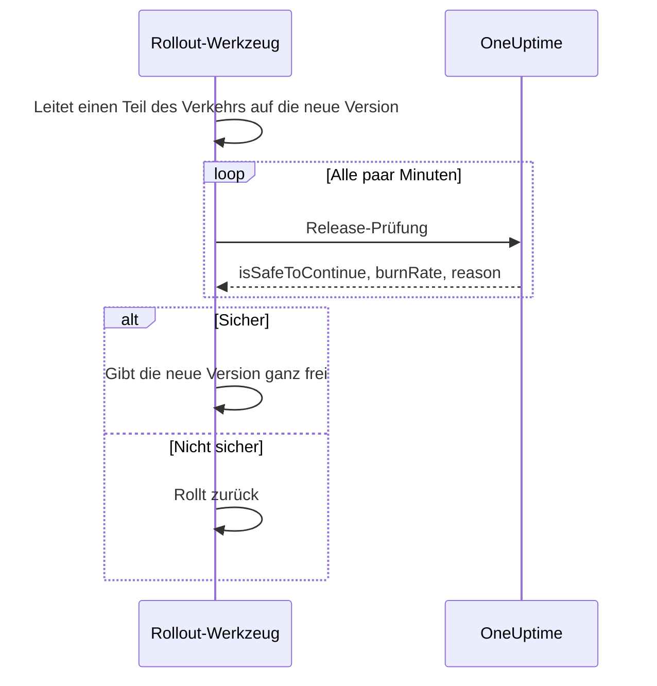

# Release-Prüfungen

Eine Release-Prüfung fragt ein SLO „Ist es sicher, dieses Release weiter auszurollen?“, während das Release ausgeliefert wird, und antwortet danach, wie schnell das SLO in den letzten Minuten sein Fehlerbudget verbrannt hat. Argo Rollouts, Flagger oder eine Deployment-Pipeline stellt diese Frage, während ein Canary Verkehr annimmt, und rollt das Release bei einem Nein zurück. OneUptime deployt selbst nichts: Ihr Rollout-Werkzeug führt den Rollout weiter durch, und OneUptime sagt ihm, wie es um das Release steht.

:::cards
- [Die Prüfung abfragen](#die-prüfung-abfragen): Eine Anfrage mit einem API-Schlüssel, und was sie antwortet.
- [Argo Rollouts](#argo-rollouts): Eine Analyse, die den Rollout abbricht.
- [Flagger](#flagger): Ein Webhook, der den Canary anhält.
- [GitHub Actions](#github-actions): Ein Schritt, der nach einem Deployment zurückrollt.
:::

## So funktioniert es

Das [Deployment-Gate](/docs/slo/error-budget-policy#deployment-gate) antwortet vor einem Release, aus dem Fehlerbudget des ganzen Compliance-Zeitfensters. Ein Release, das etwas kaputt macht, hat in seinen ersten zehn Minuten kaum etwas vom Budget eines Monats verbraucht, deshalb liest die Release-Prüfung das, was das Release verändert: die Burn-Rate der letzten Minuten.



Die Prüfung antwortet mit einem von drei Urteilen:

| Urteil | Wann | `isSafeToContinue` |
| --- | --- | --- |
| `Pass` | Das Zeitfenster hat das Fehlerbudget mit `maxBurnRate` oder langsamer verbrannt. | `true` |
| `Fail` | Es hat schneller verbrannt, oder die Fehlerbudget-Richtlinie des SLO friert Deployments ein. | `false` |
| `NotEnoughData` | Das Zeitfenster hatte weniger Anfragen als `minimumRequestCount`, oder die Monitore des SLO haben darin keinen Status erfasst. Zu wenig, um das Release für sicher zu erklären. | `false` |

Bei einer Burn-Rate von 1 hat das Zeitfenster das Ziel des SLO genau erreicht, daher lässt der Standardwert `1` von `maxBurnRate` ein Release durchfallen, das schlechter abschneidet als das Ziel.

Was die Prüfung liest, hängt davon ab, was das SLO misst:

- Ein [Anfrage-SLO](/docs/slo/request-slos) wird nach den Anfragen seiner Dienste im Zeitfenster beurteilt, gelesen aus ihren Spans, sobald sie eintreffen. Fügen Sie `serviceVersion` hinzu, um nur die Anfragen der neuen Version zu beurteilen: OneUptime gleicht den Wert mit dem Ressourcenattribut `service.version` der Spans ab, das ein OpenTelemetry-SDK aus `OTEL_RESOURCE_ATTRIBUTES=service.version=1.4.2` setzt. So wird der Canary nach seinen eigenen Anfragen beurteilt, nicht verwässert durch die der alten Version.
- Ein SLO der Monitor-Verfügbarkeit wird nach den Status-Zeitleisten seiner Monitore über das Zeitfenster beurteilt. `minimumRequestCount` gilt dafür nicht, und eine Prüfung mit `serviceVersion` wird abgelehnt: Monitore haben keine Versionen.

## Bevor Sie beginnen

Sie brauchen ein SLO, das misst, was das Release betrifft. Ein Anfrage-SLO des Dienstes, den Sie ausliefern, beurteilt einen Canary am besten, weil es die eigenen Anfragen genau dieses Dienstes liest.

## Eine Release-Prüfung einrichten

:::steps
### Dem Rollout einen Schlüssel geben

Erstellen Sie einen [API-Schlüssel](/docs/api-reference/api-reference) des Projekts, dessen Rolle SLOs lesen kann, und speichern Sie ihn als Geheimnis Ihres Rollout-Werkzeugs oder Ihrer Pipeline.

### Die ID des SLO kopieren

Öffnen Sie das SLO und kopieren Sie seine ID aus der Adresse: `/slos/<slo-id>`.

### Die Prüfung einmal von Hand abfragen

Führen Sie die Anfrage unter [Die Prüfung abfragen](#die-prüfung-abfragen) mit dem Schlüssel und der ID aus. Sie antwortet mit `isSafeToContinue` und einem `reason`.

### Sie in Ihren Rollout einbauen

Fragen Sie die Prüfung aus [Argo Rollouts](#argo-rollouts), [Flagger](#flagger) oder [GitHub Actions](#github-actions) ab, und rollen Sie zurück, wenn `isSafeToContinue` den Wert `false` hat.
:::

## Die Prüfung abfragen

Die Prüfung ist ein `GET` oder `POST` an die Adresse `release-check` des SLO. Senden Sie die Optionen im Query-String oder mit `POST` als JSON-Body:

```bash
curl -sS "https://oneuptime.com/api/service-level-objective/<slo-id>/release-check?windowInMinutes=10&serviceVersion=1.4.2" \
  -H "ApiKey: $ONEUPTIME_API_KEY"
```

Sie antwortet zuerst mit dem Urteil und dann mit dem, woraus es gelesen wurde:

```json
{
  "isSafeToContinue": false,
  "verdict": "Fail",
  "reason": "The last 10 minutes burned the error budget at 3.2x, faster than the 1x this check allows (SLI 99.68% against the 99.9% target).",
  "sloId": "<slo-id>",
  "sloName": "Checkout requests",
  "sliType": "Request Success",
  "targetPercentage": 99.9,
  "windowInMinutes": 10,
  "maxBurnRate": 1,
  "burnRate": 3.2,
  "sliPercentage": 99.68,
  "deploymentsAllowed": true,
  "errorBudgetPolicyTier": null,
  "sloStatus": "Healthy",
  "checkedAt": "2026-11-15T12:00:00.000Z",
  "goodRequestCount": 2492,
  "totalRequestCount": 2500,
  "minimumRequestCount": 1,
  "serviceVersion": "1.4.2"
}
```

Die Optionen:

| Option | Standard | Was sie bewirkt |
| --- | --- | --- |
| `windowInMinutes` | `10` | Wie weit die Prüfung zurückblickt, in ganzen Minuten von 1 bis 360. |
| `maxBurnRate` | `1` | Die schnellste Burn-Rate, die noch besteht. Mit `2` darf das Zeitfenster das Budget doppelt so schnell verbrennen, wie das Ziel erlaubt. |
| `minimumRequestCount` | `1` | Anfrage-SLOs: die Mindestzahl an Anfragen, die die Prüfung beurteilt. Mit `0` besteht ein Zeitfenster ohne Anfragen. |
| `serviceVersion` | Keiner | Anfrage-SLOs: nur die Anfragen beurteilen, deren Spans diese `service.version` tragen. |
| `includeDeploymentGate` | `true` | Durchfallen, solange die Fehlerbudget-Richtlinie des SLO Deployments einfriert. Mit `false` entscheidet allein die Burn-Rate. |
| `failWithStatusCode` | `false` | Ein Nein mit dem HTTP-Status 412 statt 200 beantworten, für Werkzeuge, die nur den Statuscode lesen. |

Die Felder der Antwort:

| Feld | Was es enthält |
| --- | --- |
| `isSafeToContinue` | `true`, um mit dem Rollout fortzufahren, `false`, um ihn zurückzurollen. |
| `verdict` | `Pass`, `Fail` oder `NotEnoughData`. |
| `reason` | Ein Satz für das Log des Rollouts, der sagt, was gemessen wurde und warum die Prüfung so geantwortet hat. |
| `burnRate` und `sliPercentage` | Wie schnell das Zeitfenster das Fehlerbudget verbrannt hat, und der SLI über das Zeitfenster. |
| `goodRequestCount` und `totalRequestCount` | Anfrage-SLOs: die Anfragen, die das Zeitfenster enthielt, und wie viele davon gut waren. |
| `deploymentsAllowed` und `errorBudgetPolicyTier` | Ob die Fehlerbudget-Richtlinie des SLO Deployments erlaubt, und die Stufe, in der es ist. |
| `checkedAt` | Wann die Prüfung gemessen wurde. |

Ein SLO, das sich nicht messen lässt – ein Anfrage-SLO ohne Dienste, ein Latenz-SLO ohne Schwelle, ein SLO der Monitor-Verfügbarkeit ohne Monitore –, wird mit HTTP 400 und dem, was zu beheben ist, beantwortet, sodass ein Rollout an einem klaren Fehler anhält statt an einer Vermutung. Auf einer selbst gehosteten Installation verwenden Sie statt oneuptime.com deren eigene Adresse.

## Argo Rollouts

Eine Analyse mit einer `web`-Metrik fragt die Prüfung bei jedem Schritt eines Canary ab, und Argo Rollouts bricht den Rollout ab und skaliert den Canary herunter, wenn sie fehlschlägt. Speichern Sie zuerst den API-Schlüssel als Secret:

```bash
kubectl create secret generic oneuptime --from-literal=api-key="$ONEUPTIME_API_KEY"
```

Fügen Sie dann die Vorlage hinzu, und führen Sie sie nach dem ersten Schritt des Canary aus:

:::tabs
@tab AnalysisTemplate
```yaml title="oneuptime-release-check.yaml"
apiVersion: argoproj.io/v1alpha1
kind: AnalysisTemplate
metadata:
  name: oneuptime-release-check
spec:
  args:
    - name: version
    - name: api-key
      valueFrom:
        secretKeyRef:
          name: oneuptime
          key: api-key
  metrics:
    - name: slo-burn-rate
      interval: 2m
      count: 5
      failureLimit: 0
      successCondition: result == true
      provider:
        web:
          url: "https://oneuptime.com/api/service-level-objective/<slo-id>/release-check?windowInMinutes=10&serviceVersion={{args.version}}"
          headers:
            - key: ApiKey
              value: "{{args.api-key}}"
          jsonPath: "{$.isSafeToContinue}"
```
@tab Rollout
```yaml title="rollout.yaml"
apiVersion: argoproj.io/v1alpha1
kind: Rollout
metadata:
  name: checkout
spec:
  strategy:
    canary:
      steps:
        - setWeight: 10
        - analysis:
            templates:
              - templateName: oneuptime-release-check
            args:
              - name: version
                value: "1.4.2"
        - setWeight: 50
        - pause: { duration: 10m }
```
:::

Die Analyse fragt fünfmal im Abstand von zwei Minuten, und das erste Nein bricht den Rollout ab. Übergeben Sie dieselbe Version, die die Pods des Canary in `OTEL_RESOURCE_ATTRIBUTES` setzen. Kann es sein, dass der Canary bei seinem ersten Gewicht keinen Verkehr bekommt, hängen Sie `&minimumRequestCount=0` an die Adresse an, sonst lässt ein ruhiger Canary die Analyse mit `NotEnoughData` scheitern.

## Flagger

Flagger ruft bei jedem Schritt seiner Analyse einen `rollout`-Webhook auf, und es hält den Canary an und rollt ihn zurück, wenn der Webhook wiederholt fehlschlägt. Die Webhooks von Flagger senden keine Header, fragen Sie die Prüfung daher über den Flagger-Lasttester ab, der für den Webhook einen Befehl ausführt:

```yaml title="canary.yaml"
apiVersion: flagger.app/v1beta1
kind: Canary
metadata:
  name: checkout
spec:
  analysis:
    interval: 1m
    threshold: 2
    maxWeight: 50
    stepWeight: 10
    webhooks:
      - name: oneuptime-release-check
        type: rollout
        url: http://flagger-loadtester.test/
        timeout: 30s
        metadata:
          type: bash
          cmd: "curl -sSf -H \"ApiKey: $ONEUPTIME_API_KEY\" 'https://oneuptime.com/api/service-level-objective/<slo-id>/release-check?windowInMinutes=5&failWithStatusCode=true'"
```

Mit `failWithStatusCode=true` ist ein Nein HTTP 412, sodass `curl -f` mit einem Fehler endet und der Webhook fehlschlägt. Geben Sie dem Lasttester den Schlüssel als `ONEUPTIME_API_KEY` in seiner Umgebung, aus einem Kubernetes-Secret. Sobald `threshold` Prüfungen fehlgeschlagen sind, rollt Flagger den Canary zurück.

## GitHub Actions

Eine Pipeline, die in einem Zug deployt, kann das Release trotzdem beobachten: deployen, die Prüfung ein paar Mal abfragen und zurückrollen, wenn sie Nein sagt.

```yaml title=".github/workflows/deploy.yml"
name: Deploy
on:
  push:
    branches: [main]

jobs:
  deploy:
    runs-on: ubuntu-latest
    steps:
      - uses: actions/checkout@v4
      - name: Deploy
        run: ./deploy.sh
      - name: Watch the release against the SLO
        env:
          ONEUPTIME_API_KEY: ${{ secrets.ONEUPTIME_API_KEY }}
          SLO_ID: <slo-id>
          VERSION: ${{ github.sha }}
        run: |
          for attempt in 1 2 3 4 5; do
            sleep 120
            CHECK=$(curl -sS "https://oneuptime.com/api/service-level-objective/$SLO_ID/release-check?windowInMinutes=10&serviceVersion=$VERSION" \
              -H "ApiKey: $ONEUPTIME_API_KEY")
            echo "$CHECK" | jq -r '.reason'
            if [ "$(echo "$CHECK" | jq -r '.isSafeToContinue')" != "true" ]; then
              exit 1
            fi
          done
      - name: Roll back
        if: failure()
        run: ./rollback.sh
```

Der Schritt schlägt bei einem Nein fehl, und ebenso bei jeder Antwort ohne `isSafeToContinue: true` – einer falschen ID, einem Schlüssel, der das SLO nicht lesen kann, gar keiner Antwort –, sodass die Pipeline nie auf eine Antwort hin weitermacht, die sie nicht bekommen hat. Setzen Sie `service.version` beim Start des Dienstes auf den Commit (`${{ github.sha }}`), damit die Prüfung nur die neue Version beurteilt.

## Nächste Schritte

:::cards
- [Anfrage- und Latenz-SLOs](/docs/slo/request-slos): Die Anfragen eines Dienstes messen, der SLI, der einen Canary am besten beurteilt.
- [Fehlerbudget-Richtlinie](/docs/slo/error-budget-policy): Deployments einfrieren, solange das Budget knapp ist.
- [Burn-Rate-Warnungen und -Vorfälle](/docs/slo/burn-rate-alerts): Ihr Team alarmieren, wenn das Budget zu schnell verbrennt.
:::
