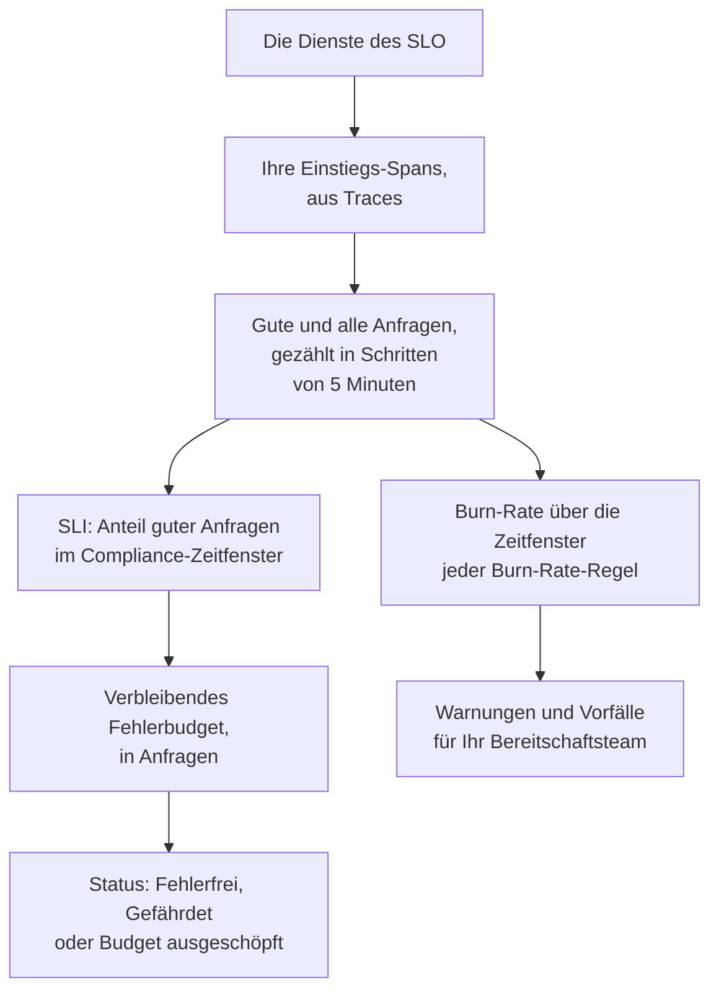

# Anfrage- und Latenz-SLOs

Ein Anfrage-SLO misst, was Ihre Nutzer von einem Dienst bekommen: den Anteil seiner Anfragen, die gelingen oder schnell genug beantwortet werden. OneUptime zählt sie aus den Traces, die Ihre Dienste ohnehin senden, es ist also kein Monitor einzurichten: Wählen Sie die Dienste und ein Ziel, und OneUptime misst sie alle 5 Minuten.

:::cards
- [Ein Anfrage-SLO erstellen](#ein-anfrage-slo-erstellen): Die Dienste, eine Schwelle für die Latenz und ein Ziel.
- [Wie Anfragen gezählt werden](#wie-anfragen-gezählt-werden): Welche Spans zählen, und wann.
- [Release-Prüfungen](/docs/slo/release-checks): Ein Release zurückrollen, das das Fehlerbudget verbrennt.
:::

## Anfrage-Erfolg und Anfrage-Latenz

| Was es misst | Eine Anfrage ist schlecht, wenn | Sein Fehlerbudget zählt |
| --- | --- | --- |
| **Anfrage-Erfolg** | Der Status ihres Spans `Error` ist. Ein Span ohne Status zählt als gut, so wie OpenTelemetry es meint. | Fehlgeschlagene Anfragen |
| **Anfrage-Latenz** | Sie länger gedauert hat als die **Latenzschwelle (ms)** des SLO, unabhängig von ihrem Status. | Langsame Anfragen |

Der SLI ist der Anteil guter Anfragen im Compliance-Zeitfenster, und das Fehlerbudget sind die schlechten Anfragen, die das Ziel erlaubt: bei 99,9 % eine von 1.000. Ein Latenz-SLO zählt eine Anfrage, die schnell fehlgeschlagen ist, als gut. Messen Sie einen wichtigen Dienst daher auf beide Arten: mit einem SLO dafür, dass er funktioniert, und einem dafür, dass er schnell ist.

## So funktioniert es

Eine Anfrage ist ein Einstiegs-Span eines der Dienste des SLO: der Span, an dem eine Anfrage oder eine Nachricht in den Dienst gelangt, so wie die Liste der [Traces](/docs/telemetry/traces-explorer#traces-und-spans) sie standardmäßig zeigt. Eine Anfrage, die durch zwei der Dienste des SLO läuft, zählt in jedem der beiden einmal.

Von da an funktioniert ein Anfrage-SLO wie jedes andere. Status, Burn-Rate-Regeln, Fehlerbudget-Richtlinie, Eigentümer und Benachrichtigungen sind dieselben, nur wird sein Fehlerbudget in Anfragen statt in Minuten angegeben.

## Bevor Sie beginnen

- Die Dienste senden Traces an OneUptime: siehe [OpenTelemetry](/docs/telemetry/open-telemetry). Jeder von ihnen steht im [Dienstkatalog](/docs/telemetry/services) unter seinem `service.name`.
- Eine Rolle, die SLOs erstellen darf: Projektinhaber, Projektadministrator oder eine eigene Rolle mit der Berechtigung Create Service Level Objective.

## Ein Anfrage-SLO erstellen

:::steps
### SLOs öffnen

Öffnen Sie **SLOs** über das Menü **Produkte** in der oberen Leiste, und klicken Sie auf **Service Level Objective erstellen**.

### Festlegen, was es misst

Wählen Sie unter **Messgröße** entweder **Anfrage-Erfolg** oder **Anfrage-Latenz** und dann die **Dienste**, deren Anfragen es zählt. Legen Sie für **Anfrage-Latenz** außerdem die **Latenzschwelle (ms)** fest, zum Beispiel `300`: Eine Anfrage, die innerhalb dieser Zeit beantwortet wird, gilt als schnell genug. Klicken Sie auf **Weiter**.

### Name und Ziel festlegen

Geben Sie einen **Name** ein, zum Beispiel „Checkout requests“, und ein **Ziel (%)**: den Anteil der Anfragen, die gut sein müssen. Klicken Sie auf **Service Level Objective erstellen**.

### Die ersten Zahlen abwarten

Die erste Auswertung, innerhalb von 5 Minuten, zählt die Anfragen der letzten 6 Stunden, sodass das SLO sofort Zahlen hat. Die Auswertungen danach zählen auch ältere Anfragen, bis das Compliance-Zeitfenster abgedeckt ist.
:::

Um später zu ändern, was ein SLO misst, seine Dienste oder seine Schwelle, öffnen Sie seine **Einstellungen** und klicken Sie auf **Messgröße bearbeiten**.

## Wie Anfragen gezählt werden

OneUptime zählt die guten und alle Anfragen jedes SLO in Schritten von 5 Minuten und speichert die Zählungen, sodass das SLO sein Zeitfenster aus seinen eigenen Zählungen liest, statt jedes Mal aus allen Spans:

- Ein Schritt wird 2 Minuten nach seinem Ende gezählt, damit verspätet eintreffende Spans darin enthalten sind, und die nächste Auswertung zählt die letzten beiden Schritte noch einmal, für Spans, die noch später eintreffen.
- Ein neues SLO beginnt mit den letzten 6 Stunden. Jede Auswertung danach zählt bis zu einen Tag älterer Anfragen, die neuesten zuerst, bis das Zeitfenster abgedeckt ist.
- Gezählt werden können nur Anfragen, die noch innerhalb Ihrer [Telemetrie-Aufbewahrung](/docs/telemetry/data-retention#wie-lange-telemetrie-aufbewahrt-wird) liegen. Gezählte Schritte werden 400 Tage aufbewahrt, länger als jedes Compliance-Zeitfenster, sodass sich ein Zeitfenster, das länger ist als die Aufbewahrung, mit dem Alter des SLO füllt.
- Eine Änderung daran, was das SLO misst, an seinen Diensten oder an seiner Latenzschwelle zählt seine Anfragen noch einmal von vorn. Ein längeres Compliance-Zeitfenster wird gefüllt, indem weiter zurück gezählt wird.

Solange die Zählungen nur einen Teil des Compliance-Zeitfensters abdecken, sagt die **Übersicht** das mit einem Chip **Fenster zu 23 % gefüllt**, und die Kachel **Verbleibendes Fehlerbudget** wiederholt ihn unter ihrer Zahl. Beide verschwinden, sobald die Zählungen das ganze Zeitfenster abdecken.

## Das Fehlerbudget in Anfragen

Das Budget sind die schlechten Anfragen, die das Ziel unter den im Zeitfenster gezählten Anfragen erlaubt, es wächst also mit dem Verkehr: Bei 99,9 % erlaubt ein Zeitfenster mit 2.000.000 Anfragen 2.000 fehlgeschlagene. In der **Übersicht**:

- **Verbleibendes Fehlerbudget** sagt, wie viele schlechte Anfragen von wie vielen noch übrig sind, oder um wie viele das SLO über dem Budget liegt.
- **Budget-Reichweite** sagt, wie lange das Budget bei der aktuellen Burn-Rate reicht, solange der Verkehr so bleibt, wie er war.
- Die Zusammenfassung zählt die Dienste des SLO, und ein Latenz-SLO nennt seine Schwelle unter seinem Ziel.

Auch Burn-Rate-Warnungen, Benachrichtigungen und der Feed nennen das Budget in Anfragen. Die Metrik `oneuptime.slo.error.budget.remaining.seconds` wird für ein Anfrage-SLO nicht gesendet; stellen Sie stattdessen `oneuptime.slo.error.budget.remaining.percent` als Diagramm dar.

Ein Anfrage-SLO bekommt dieselben Regeln **Fast burn**, **Slow burn** und **Slow leak** wie jedes neue SLO. In einer ruhigen Stunde mit einer Handvoll Anfragen kann schon ein einziger Fehler das Budget schnell verbrennen, deshalb kann eine Regel Zeitfenster mit zu wenigen Anfragen übergehen: Setzen Sie `minimumSampleCount` der Regel über die API, dann überspringt die Regel ein langes Zeitfenster, das weniger Anfragen enthält.

## Fehlerbehebung

:::details Das SLO zeigt Waiting for requests
Keiner seiner Dienste hat im Zeitfenster bisher eine Anfrage beantwortet. Prüfen Sie, ob die Dienste Traces an OneUptime senden und ob ihre Spans Einstiegs-Spans enthalten: Ein Dienst, dessen Spans alle intern sind, hat keine Anfragen, die sich zählen ließen.
:::

:::details Der SLI hat sich geändert, nachdem ich die Dienste geändert habe
Eine Änderung daran, was das SLO misst, an seinen Diensten oder an seiner Latenzschwelle zählt seine Anfragen neu, beginnend mit den letzten 6 Stunden, sodass SLI und Budget von dort an neu beginnen. Der Chip **Fenster zu 23 % gefüllt** zeigt, wie viel des Zeitfensters bisher gezählt ist.
:::

## Nächste Schritte

:::cards
- [Release-Prüfungen](/docs/slo/release-checks): Argo Rollouts, Flagger oder eine Pipeline ein Release zurückrollen lassen, das das Budget verbrennt.
- [Burn-Rate-Warnungen und -Vorfälle](/docs/slo/burn-rate-alerts): Ihr Team alarmieren, wenn das Budget zu schnell verbrennt.
- [Fehlerbudget-Richtlinie](/docs/slo/error-budget-policy): Vereinbaren, was das Team tut, während das Budget schrumpft.
:::
