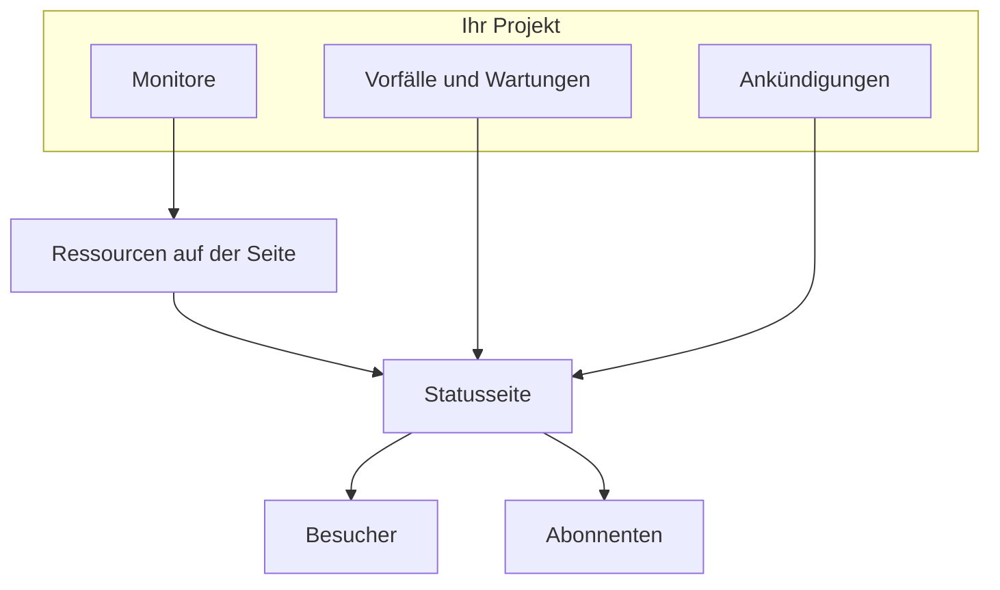

# Statusseiten – Übersicht

Eine Statusseite ist das öffentliche Gesicht von allem, was Sie überwachen: eine einzige URL, die Ihre Kunden aufrufen können, statt Ihnen zu schreiben und zu fragen, ob es nur bei ihnen klemmt. Sie zeigt den aktuellen Zustand der Dienste, die Sie sichtbar machen, die Vorfälle, an denen Sie gerade arbeiten, die Wartungen, die Sie geplant haben, und jede Ankündigung, die Sie oben anheften möchten.

Wenn um 2 Uhr nachts etwas kaputtgeht, ist die Statusseite das Erste, was Ihre Support-Warteschlange verlinkt. Und sie ist die Quelle, aus der Ihre Abonnenten benachrichtigt werden – es lohnt sich also, sie einzurichten, bevor Sie sie brauchen, und nicht mitten im Ausfall.

:::cards
- [Eine Statusseite anlegen](#eine-statusseite-anlegen): Zwei Felder zum Start, alles andere danach.
- [Festlegen, was sie zeigt](#auswählen-was-auf-der-seite-erscheint): Vorfälle, Episoden, Ankündigungen, Wartungen und Verfügbarkeit, in einer Karte.
- [Festlegen, wer sie sehen darf](#einschränken-wer-die-seite-sehen-darf): Alle mit dem Link, nur angemeldete Personen oder alle mit dem Passwort.
- [Eine Statusseite archivieren](#eine-statusseite-archivieren): Eine Seite offline nehmen, ohne sie zu löschen.
:::

## So funktioniert es

Statusseiten liegen unter **Statusseiten** im Menü **Produkte** der oberen Leiste, bei den wichtigsten Produkten. Alles auf dieser Seite gilt pro Statusseite: Ein Projekt darf beliebig viele davon betreiben – eine öffentliche für Kunden, eine private für ein internes Publikum, eine pro Region für einen bestimmten Markt.

Die Seite zeigt die Monitore, die Sie darauf setzen, als ihre Ressourcen. Vorfälle und geplante Wartungen erreichen sie über diese Monitore, Ankündigungen veröffentlichen Sie direkt darauf. Besucher lesen die Seite, und Abonnenten werden über jede Änderung auf den Kanälen informiert, die sie gewählt haben.

## Auf einen Blick

- **Mit zwei Feldern angelegt.** Eine neue Statusseite fragt nur nach **Name** und **Beschreibung**. Ressourcen, Branding und Domains richten Sie danach ein.
- **Ressourcen sind das, was Besucher sehen.** Jede Zeile der Seite ist eine **Statusseite Ressource** – ein Monitor (oder eine Monitorgruppe) mit eigenem Anzeigenamen, eigenem Tooltip und eigenen Verfügbarkeitsoptionen. Gruppen teilen eine lange Seite in Abschnitte und lassen sich verschachteln.
- **Eine Vorschau-URL ab dem ersten Tag.** Jede Statusseite bekommt einen Vorschaulink, damit Sie sie ansehen können, bevor es überhaupt eine eigene Domain gibt.
- **Die besucherseitigen Routen hängen an Einstellungen.** Vorfälle, Episoden, Ankündigungen und geplante Ereignisse erscheinen jeweils nur, solange ihr Schalter in **Was Ihre Statusseite zeigt** (unter **Erweiterte Einstellungen**) an ist, die Abonnentenseite nur, solange **Abonnentenseite anzeigen** an ist.
- **Wer sie sehen darf, ist eine Wahl.** Alle mit dem Link, nur angemeldete Personen (private Benutzer, SAML-SSO oder OIDC) oder alle mit dem Passwort – auf dem Bildschirm **Zugriff** der Seite, mit einer optionalen IP-Zulassungsliste unter **Weitere Einstellungen**.
- **Abonnenten werden automatisch informiert.** Abonnenten per E-Mail, SMS, Slack, Microsoft Teams und Webhook können einer Seite folgen, jeder Kanal hinter einem eigenen Schalter.

## Zentrale Begriffe

| Begriff | Was er bedeutet |
| --- | --- |
| **Statusseite** | Eine öffentliche (oder private) Seite mit eigenem Branding, eigenen Domains, Ressourcen und Abonnenten. Das Modell `StatusPage`. |
| **Ressource** | Eine Zeile, die Besucher sehen – ein Monitor oder eine Monitorgruppe, auf der Seite mit Anzeigename und Verfügbarkeitsoptionen dargestellt. |
| **Gruppe** | Ein benannter Abschnitt, der Ressourcen enthält. Gruppen lassen sich ineinander verschachteln, und jede Ebene fasst den Status von allem darunter zusammen. |
| **Ankündigung** | Eine Meldung, die Sie auf einer oder mehreren Statusseiten veröffentlichen, mit Startzeit und optionaler Endzeit. |
| **Abonnent** | Jemand (oder etwas), der der Seite per E-Mail, SMS, Slack, Microsoft Teams oder Webhook folgt. |
| **Benutzerdefinierte Domain** | Eine Domain von Ihnen – `status.example.com` –, die per CNAME-Eintrag auf die Seite zeigt. OneUptime stellt ihr SSL-Zertifikat kostenlos aus und erneuert es. |
| **Privater Benutzer** | Ein Konto, das sich an einer privaten Statusseite anmelden kann. Getrennt von den Benutzern Ihres OneUptime-Projekts. |

## Eine Statusseite anlegen

:::steps
### Das Formular öffnen

Öffnen Sie **Statusseiten → Alle Statusseiten** und klicken Sie auf **Statusseite erstellen**.

### Die Seite benennen

Füllen Sie im Dialog **Neu erstellen: Statusseite** das Feld **Name** aus (Pflichtfeld, mindestens zwei Zeichen) und optional **Beschreibung**, und klicken Sie dann auf **Statusseite erstellen**.

Das ist das ganze Formular. Die Liste, auf der Sie wieder landen, zeigt **Name**, **Beschreibung**, **Beschriftungen** und **Eigentümer** und lässt sich nach **Statusseiten-ID**, **Name** und **Beschreibung** filtern.

### Die neue Seite öffnen

Öffnen Sie die neue Seite, und Sie landen auf ihrem Bildschirm **Übersicht** mit zwei Karten: **Vorschau-URL der Statusseite** mit einem Link auf die Seite selbst und **Statusseiten-Details**, wo Sie Name, Beschreibung und Beschriftungen bearbeiten, die Sie gerade gesetzt haben. Sobald das Projekt benutzerdefinierte Felder für Statusseiten hat, folgt ihnen eine Karte **Benutzerdefinierte Felder**.
:::

Eine Seite, die über die API oder Terraform angelegt wird, unterliegt denselben Tarifen wie die unten beschriebenen Einstellungen. In OneUptime Cloud wird das Anlegen einer Seite mit einer eingeschalteten Einstellung, die Ihr Tarif nicht enthält – zum Beispiel privat, eine ausgeblendete Liste, eigenes HTML, CSS oder JavaScript, E-Mail-Berichte, SMS-, Slack-, Microsoft-Teams- oder Webhook-Abonnenten, eine IP-Zulassungsliste –, mit `402 Payment Required` abgelehnt, und die Meldung nennt den Tarif. Der Tarif jeder Einstellung steht unten bei ihr. Einstellungen, die auf ihrem Standard bleiben, wie dieses Formular sie lässt, funktionieren in jedem Tarif.

Als Nächstes, grob nach Nutzen sortiert:

- Fügen Sie Ressourcen hinzu, damit die Seite etwas zeigt – siehe [Statusseiten – Ressourcen & Gruppen](/docs/status-pages/resources-and-groups).
- Legen Sie Seitentitel, Favicon, Logo und Titelbild fest und hängen Sie dann eine eigene Domain an – siehe [Statusseiten – Branding & Domains](/docs/status-pages/branding-and-domains).
- Entscheiden Sie, über welche Kanäle man abonnieren kann – siehe [Abonnenten & Ankündigungen](/docs/status-pages/subscribers).
- Stimmen Sie unter **Erweiterte Einstellungen** ab, was auf der Seite erscheint.

## Wo alles liegt

Sobald eine Statusseite geöffnet ist, ist ihr eigenes Seitenmenü links in neun Abschnitte gegliedert. Nutzen Sie es als Karte für den Rest dieses Dokumentationsbereichs.

| Abschnitt | Was er enthält |
| --- | --- |
| **Grundlegend** | **Übersicht**, **Ankündigungen**, **Eigentümer**. |
| **Ressourcen** | Ein einziger Bildschirm **Ressourcen** – links die Gruppen, rechts die Monitore der gewählten Gruppe – und **Monitor-Regeln**. |
| **Abonnenten** | **E-Mail-Abonnenten**, **SMS-Abonnenten**, **Slack-Abonnenten**, **MS Teams-Abonnenten**, **Webhook-Abonnenten**, **Abonnenten-Einstellungen**. |
| **Benachrichtigungsprotokolle** | **Benachrichtigungsprotokolle** – was an Abonnenten gesendet wurde. |
| **Branding** | **Branding** (Logo, Titel, Favicon, Links, Fußzeile, Farben und Sprachen, auf einer Seite), **Benutzerdefinierte Domains**, **HTML, CSS und JavaScript**. |
| **Sicherheit** | **Zugriff** (wer die Seite sehen darf), **Private Benutzer**, **SSO**, **OIDC**, **SCIM**. |
| **KI** | **MCP**. |
| **Entwickler** | **Terraform**, **API**, **KI-Assistenten** – die Seite als Code. |
| **Erweitert** | **Eingebetteter Status**, **Berichte**, **Benutzerdefinierte Felder**, **Erweiterte Einstellungen**, **Audit-Protokolle**, **Statusseite löschen**. |

Nur **Grundlegend** und **Ressourcen**, also das, was die Seite zeigt, sind anfangs geöffnet. Jeder andere Abschnitt ist anfangs eingeklappt, wie die selten genutzten Abschnitte jedes Menüs in OneUptime: Klicken Sie auf den Titel eines Abschnitts, um seine Seiten einzublenden. Ein Abschnitt öffnet sich von selbst, sobald Sie auf einer seiner Seiten sind, etwa auf **Erweiterte Einstellungen** oder **E-Mail-Abonnenten**.

Zwei Eigenheiten der Benennung, die Sie kennen sollten, bevor Sie suchen:

- Der Eintrag **Ressourcen** heißt nur dann **Ressourcen**, wenn im Projekt Monitorgruppen aktiviert sind. Sonst heißt er **Monitore**. Es ist in beiden Fällen derselbe Bildschirm.
- Es gibt keine eigene Gruppenseite. Gruppen und Ressourcen wurden zusammengelegt, und die alte Route `/groups` leitet jetzt auf den Ressourcen-Bildschirm um.

Außerhalb einer einzelnen Seite listet der Abschnitt **Statusseiten** selbst **Alle Statusseiten**, und ein Abschnitt **Mehr** enthält **Ankündigungen**. Ein eingeklappter Abschnitt **Einstellungen** enthält **Ankündigungs-Vorlagen**, **Abonnenten-Vorlagen**, **Benutzerdefinierte Felder**, **Eigentümerregeln** und **Beschriftungsregeln**, die projektweit gelten und von allen Statusseiten geteilt werden. Ein eingeklappter Abschnitt **Erweitert** enthält **Archiviert**: die Statusseiten, die Sie offline genommen haben (siehe [Eine Statusseite archivieren](#eine-statusseite-archivieren)).

**Beschriftungsregeln** und **Eigentümerregeln** versehen neue Statusseiten mit Beschriftungen und Eigentümern. Eine Regel hat zwei Schritte – **Übereinstimmung**, die Bedingungen, die eine Statusseite erfüllen muss, dann **Beschriftungen** (oder **Eigentümer**), was die Regel hinzufügt –, und ihr **Name** wird aus Ihrer Auswahl ausgefüllt. Eine neue Regel muss mindestens eine Beschriftung oder einen Eigentümer hinzufügen; beim Bearbeiten besteht sie nie darauf, und die Liste kennzeichnet eine ältere Regel, die nichts hinzufügt, mit **Fügt nichts hinzu**. Siehe [Beschriftungs- und Eigentümerregeln](/docs/configuration/label-and-owner-rules).

## Was Besucher sehen

Die öffentliche Seite ist eine eigene App mit wenigen Routen:

- `/` – die **Übersicht**.
- `/incidents` und `/incidents/:id` – die Vorfallliste und ein einzelner Vorfall.
- `/announcements` und `/announcements/:id`.
- `/scheduled-events` und `/scheduled-events/:id`.
- `/subscribe/email`, `/subscribe/sms`, `/subscribe/slack`, `/subscribe/microsoft-teams`, `/subscribe/webhooks`.
- `/confirm-subscription/:id`, `/update-subscription/:id` und `/unsubscribe/:token` – die Links in den Nachrichten, die Abonnenten bekommen.
- `/rss` – der Feed.
- `/login`, `/sso` und `/master-password` – nur auf einer privaten Seite relevant.

Die obere Navigationsleiste zeigt immer **Übersicht**; der Rest erscheint nur, wenn er aktiviert ist. **Vorfälle**, **Ankündigungen** und **Geplante Ereignisse** brauchen jeweils ihren Schalter; **Abonnieren** braucht sowohl **Abonnentenseite anzeigen** als auch mindestens einen aktivierten Abonnentenkanal. Eine private Seite bekommt zusätzlich einen Eintrag **Abmelden**.

Ein einzelner Vorfall, eine Episode, eine Ankündigung oder ein geplantes Ereignis öffnet sich nur, wenn die Seite sie auflisten würde, unabhängig von ihrem Verlaufsfenster: Ein privater Vorfall oder eine private Episode, einer, der auf Statusseiten ausgeblendet ist, ein auf Statusseiten ausgeblendetes geplantes Ereignis oder eine erst später geplante Ankündigung wird auch über ihren Link nicht gefunden.

### Die Übersichtsseite

Die Übersicht ist die Seite, die die meisten Besucher überhaupt zu sehen bekommen. Von oben nach unten zeigt sie:

1. **Alle laufenden Ankündigungen** – Ankündigungen, deren Startzeit vorbei und deren Endzeit noch nicht erreicht ist.
2. **Ein Gesamtstatus-Banner** – eine einzelne Zeile, die zusammenfasst, ob alle oder nur einige Ressourcen betroffen sind.
3. **Ein Gesamtprozentsatz der Verfügbarkeit**, wenn Sie ihn eingeschaltet haben: am Ende des Gesamtstatus-Banners, solange jede Ressource betriebsbereit ist. Standardmäßig aus.
4. **Die Ressourcengruppen**, jede mit ihren Ressourcen, deren aktuellem Status und ihren Verfügbarkeitsbalken.
5. **Aktive Vorfälle**, mit den aktiven Episoden.
6. **Geplante Wartungsereignisse**.

Eine brandneue Seite ohne Inhalt zeigt einen leeren Zustand mit dem Hinweis, Ressourcen im Dashboard hinzuzufügen – Ihr Stichwort, zum Bildschirm **Ressourcen** zu gehen.

Die Übersicht, die ein Besucher sieht, ist höchstens 15 Sekunden alt, und alles, was Sie von der Seite nehmen, verschwindet innerhalb einer Sekunde: ein Vorfall, eine Episode oder ein geplantes Ereignis, das Sie auf Statusseiten ausblenden, privat machen, auf andere Seiten beschränken oder löschen, eine Ankündigung, die Sie beenden, auf später verschieben oder löschen, eine öffentliche Notiz, die Sie löschen, und eine Ressource, eine Gruppe oder ein Monitor, den Sie von der Seite entfernen oder löschen. Andere Änderungen, etwa ein neuer Titel, erscheinen innerhalb dieser 15 Sekunden.

Was einen Vorfall überhaupt auf diese Seite bringt und was ihn wieder herunternimmt, steht unter [Vorfallstatus & Schweregrade](/docs/incidents/states-and-severities).

## Auswählen, was auf der Seite erscheint

Was Besucher sehen, legen Sie in einer Karte fest: **Was Ihre Statusseite zeigt**, unter **Statusseiten → Ihre Seite → Erweitert → Erweiterte Einstellungen**. Sie hat eine Zeile für jede Liste, die die Seite zeigen kann, dann **Verfügbarkeitsverlauf** (mit dem Gesamtprozentsatz der Verfügbarkeit und den Status, die als Ausfallzeit zählen) und die Zeile „Powered by OneUptime“. Es gibt keine Schaltfläche zum Bearbeiten: Ein Schalter speichert in dem Moment, in dem Sie ihn umlegen, eine Anzahl von Tagen, wenn Sie ihr Feld verlassen oder Enter drücken, und eine Auswahl aus einer Liste in dem Moment, in dem Sie sie treffen.

- **Vorfälle anzeigen** (`showIncidentsOnStatusPage`) – standardmäßig an. Darunter legt **Die letzten … Tage anzeigen** (`showIncidentHistoryInDays`, Standard 14) fest, wie weit die Vorfallliste zurückreicht, und **Vorfallbeschriftungen anzeigen** (`showIncidentLabelsOnStatusPage`) ist standardmäßig aus.
- **Nur auf diese Seite beschränkte Vorfälle anzeigen** (`onlyShowScopedIncidents`) – ebenfalls in der Vorfallzeile, standardmäßig aus. Schalten Sie es ein, und die Seite zeigt nur noch die Vorfälle, die mit **Auf diese Statusseiten beschränken** auf sie beschränkt sind, und benachrichtigt ihre Abonnenten nur darüber. Vorfälle, die auf keine Seite beschränkt sind, einschließlich derer, die ein Monitor, Slack, Microsoft Teams, die API oder KI von sich aus eröffnet, erreichen sie nie, bis jemand die Seite zu ihnen hinzufügt. Es entscheidet auch, welche Vorfälle ihre Episoden auf die Seite bringen, und bleibt deshalb, wenn **Vorfälle anzeigen** aus ist. Für Seiten, die Monitore teilen, aber unterschiedliche Zielgruppen bedienen, siehe [Eine Statusseite pro Zielgruppe](/docs/status-pages/one-status-page-per-audience).
- **Episoden anzeigen** (`showEpisodesOnStatusPage`) – standardmäßig an, mit **Die letzten … Tage anzeigen** (`showEpisodeHistoryInDays`, Standard 14) und **Episodenbeschriftungen anzeigen** (`showEpisodeLabelsOnStatusPage`, standardmäßig aus). Episoden sind ein eigenes Modell mit eigenen Endpunkten, keine Ansicht von Vorfällen.
- **Ankündigungen anzeigen** (`showAnnouncementsOnStatusPage`) – standardmäßig an, mit **Die letzten … Tage anzeigen** (`showAnnouncementHistoryInDays`, Standard 14).
- **Geplante Wartungsereignisse anzeigen** (`showScheduledMaintenanceEventsOnStatusPage`) – standardmäßig an, mit **Die letzten … Tage anzeigen** (`showScheduledEventHistoryInDays`, Standard 14) und **Ereignisbeschriftungen anzeigen** (`showScheduledEventLabelsOnStatusPage`, standardmäßig aus).
- **Verfügbarkeitsverlauf** – alles zur Verfügbarkeit der Seite, in einer Zeile:
  - **Die letzten … Tage anzeigen** (`showUptimeHistoryInDays`) ist die Länge des Verfügbarkeitsbalkens neben jeder Ressource. Standard 90, und der Wert muss zwischen 1 und 90 liegen. Jede Option **Verfügbarkeit % anzeigen** und **Statusverlaufsdiagramm anzeigen** an einer Ressource oder Gruppe liest diese Zahl, und der Gesamtprozentsatz der Verfügbarkeit ebenso.
  - **Gesamtprozentsatz der Verfügbarkeit anzeigen** (`showOverallUptimePercentOnStatusPage`) – standardmäßig aus. Schalten Sie es ein, und das Gesamtstatus-Banner endet mit einem Verfügbarkeitsprozentsatz für die ganze Seite, dem Durchschnitt ihrer Ressourcen und Gruppen, solange alles betriebsbereit ist. Solange es an ist, wählt **Genauigkeit** (`overallUptimePercentPrecision`), wie viele Nachkommastellen er zeigt: `99%`, `99.9%`, `99.99%` (der Standard) oder `99.999%`. Jede Ressource und jede Gruppe hat ihre eigene Genauigkeit.
  - **Zählt als Ausfallzeit** (`downtimeMonitorStatuses`) – die Monitorstatus, deren Zeit gegen jeden Verfügbarkeitsprozentsatz der Seite zählt: den jeder Ressource, jeder Gruppe und den Gesamtwert. Jeder Status ist ein Chip in seiner eigenen Farbe. Fügen Sie einen aus der Liste hinzu oder entfernen Sie einen mit seinem **×**, und die Änderung wird sofort gespeichert. Eine neue Statusseite beginnt mit jedem Status des Projekts, der nicht betriebsbereit ist. Mindestens ein Status bleibt: Der letzte lässt sich nicht entfernen, weil ohne Status jede Verfügbarkeit auf der Seite 100% anzeigen würde.
- **Branding "Powered By OneUptime" anzeigen** – standardmäßig an, sodass die Fußzeile für Besucher „Powered by OneUptime“ lautet. Schalten Sie es aus, um die Zeile auszublenden. Die Spalte speichert es umgekehrt, als `hidePoweredByOneUptimeBranding`.

**Eine ausgeschaltete Liste** verschwindet von der Seite, zusammen mit ihrem Eintrag in der Navigationsleiste, falls sie einen hat; ihr öffentlicher Endpunkt lehnt ab, und die Abonnenten der Seite werden über diese Art von Ereignis nicht benachrichtigt. Ihre Zeile zeigt dann nur noch ihren Schalter: Wie weit eine ausgeblendete Liste zurückreicht und ob sie Beschriftungen zeigt, ändert nichts.

**Tarife.** In OneUptime Cloud zeigt eine Einstellung, die Ihr Tarif nicht ändern kann, daneben den Tarif, den sie braucht. Die vier Listenschalter, die drei Beschriftungsschalter und der Verlauf der Episoden brauchen **Growth**; das Anzeigen des Gesamtprozentsatzes der Verfügbarkeit und das Ausblenden der Zeile „Powered by OneUptime“ brauchen **Scale**. Die anderen Verlaufsfenster, **Verfügbarkeitsverlauf**, **Genauigkeit**, **Zählt als Ausfallzeit** und **Nur auf diese Seite beschränkte Vorfälle anzeigen** lassen sich in jedem Tarif ändern, und jede speichert für sich: Eine Seite, deren Gesamtprozentsatz der Verfügbarkeit schon an ist, kann ihre Genauigkeit in jedem Tarif ändern. Eine Einstellung so zurückzusetzen, wie eine neue Seite sie hat – eine Liste wieder anzeigen, Beschriftungen oder den Gesamtprozentsatz der Verfügbarkeit ausblenden, die Zeile „Powered by OneUptime“ anzeigen, den Verlauf der Episoden wieder auf 14 Tage –, funktioniert in jedem Tarif, sodass nichts, was eine Testphase geändert hat, mangels Tarif so bleibt: Der Schalter sagt, dass er noch zurück kann, und welchen Tarif es braucht, um ihn wieder zu ändern.

Ob die Seite einen Eintrag **Abonnieren** zeigt (**Abonnentenseite anzeigen**, `showSubscriberPageOnStatusPage`, standardmäßig an) und über welche Kanäle Besucher abonnieren können, legen Sie nicht auf diesem Bildschirm fest: Beides steht in der Karte **Kanäle** unter **Abonnenten → Abonnenten-Einstellungen** (siehe [Abonnementkanäle](/docs/status-pages/subscribers#abonnementkanäle)).

Unter der Karte stehen **Statusseite als JSON exportieren**, das die eigenen Einstellungen der Statusseite als Datei herunterlädt, die Sie wieder importieren können, und **Statusseite archivieren** (siehe [Eine Statusseite archivieren](#eine-statusseite-archivieren)). Der Gesamtprozentsatz der Verfügbarkeit und die Ausfallzeit-Status waren hier früher zwei eigene Karten, jede hinter einer Schaltfläche **Bearbeiten**; jetzt sind sie Zeilen der Karte.

**Wo die Farben sind.** Die Farben der Verfügbarkeitsbalken stehen nicht hier – die **Standard-Balkenfarbe** und die Balkenfarbregeln liegen unter **Weitere Einstellungen** auf **Statusseiten → Ihre Seite → Branding → Branding**. Eine Theme- oder Markenfarbeinstellung gibt es nirgends; alles, was über diese Steuerelemente hinausgeht, erledigen Sie mit **Benutzerdefiniertes CSS**.

## Vorschau, bevor Sie live gehen

Der Bildschirm **Übersicht** jeder Statusseite trägt eine Karte **Vorschau-URL der Statusseite** mit einem Link direkt auf die Seite. Nutzen Sie sie, solange Sie noch Ressourcen hinzufügen und bevor es eine eigene Domain gibt.

Hinter den Kulissen hat jede öffentliche Route einen Vorschau-Zwilling unter `/status-page/{statusPageId}/...` – eine Vorschau der Übersicht, eine Vorschau der Vorfallliste, eine Vorschau der Abonnieren-Seite und so weiter. Eine URL oder ein Screenshot aus der Dashboard-Vorschau stimmt deshalb nicht mit dem überein, was ein Kunde sieht, sobald eine eigene Domain angehängt ist – prüfen Sie also jeden Link, den Sie in ein Runbook oder eine E-Mail einfügen.

## Einschränken, wer die Seite sehen darf

Nicht jede Statusseite ist für die Öffentlichkeit. Wer eine Seite sehen darf, ist eine Wahl, die erste Karte auf **Statusseiten → Ihre Seite → Sicherheit → Zugriff**, **Wer diese Statusseite sehen kann**:

- **Alle mit dem Link** – die Seite ist öffentlich. Jede neue Statusseite beginnt hier.
- **Nur angemeldete Personen** – Besucher landen auf `/login` und melden sich als privater Benutzer oder bei Ihrem SSO- oder OIDC-Anbieter an (siehe unten). Unter der Wahl listet die Karte die für die Seite eingerichtete Anmeldung auf – wie viele private Benutzer sie hat und ob SSO und OIDC an sind, jeweils mit einem Link auf ihren Bildschirm – und sagt, solange sie die Wahl ist, wenn sich noch niemand anmelden kann.
- **Alle mit dem Passwort** – Besucher landen auf `/master-password` und entsperren die Seite mit einem Passwort, das Sie ihnen geben. Niemand braucht ein Konto. Wenn Sie sie wählen, fragt derselbe Dialog nach dem Passwort, falls die Seite keines hat; hat sie eines, können Sie es behalten oder ein neues eingeben. Danach ersetzt **Passwort ändern** unter der Wahl es. Das Passwort wird als Hash gespeichert und lässt sich nicht wieder anzeigen, und wer das alte eingegeben hat, kann die Seite noch bis zu 7 Tage lang ansehen.

Eine Wahl zu treffen fragt nach einer Bestätigung, sagt, was sich für Besucher ändert, und speichert sofort. Es gibt keine Schaltfläche zum Bearbeiten.

**Bilder.** Ein Bild in dem, was die Seite zeigt – einer öffentlichen Notiz, einer Ankündigung, einer Beschreibung –, wird über seine eigene lange, nicht erratbare Adresse geöffnet, die ohne Anmeldung funktioniert, damit auch die E-Mails Ihrer Abonnenten es zeigen können. Die Seite selbst verlangt weiterhin die Anmeldung oder das Passwort.

**Was gespeichert wird.** Die Wahl besteht aus drei Spalten, die API und Terraform wie bisher lesen und schreiben: `isPublicStatusPage`, `enableMasterPassword` und `masterPassword`. Nach dem Passwort werden Besucher nur auf einer Seite gefragt, die nicht öffentlich ist, bei der `enableMasterPassword` an und ein Passwort gesetzt ist; eine private Seite mit eingeschaltetem Schalter, aber ohne Passwort, ist eine Anmeldeseite. Wenn Sie **Alle mit dem Link** wählen, wird auch `enableMasterPassword` ausgeschaltet, denn eine öffentliche Seite fragt nie danach. Der Bildschirm **Zugriff** schreibt nur die Spalten, die eine Wahl ändert.

**Tarife.** In OneUptime Cloud braucht das Privatmachen einer Seite den Tarif **Growth**: In einem niedrigeren Tarif zeigen die beiden privaten Wahlmöglichkeiten den Tarif, den sie brauchen, und lassen sich nicht wählen. Sie wieder öffentlich zu machen – **Alle mit dem Link** – funktioniert in jedem Tarif, sodass eine Seite, die nach dem Ende einer Testphase oder nach einem Wechsel in einen niedrigeren Tarif privat geblieben ist, immer wieder geöffnet werden kann; der Dialog sagt, dass sie wieder privat zu machen **Growth** braucht. Der Wechsel zwischen **Nur angemeldete Personen** und **Alle mit dem Passwort** funktioniert in jedem Tarif, und **Passwort ändern** ebenso.

### Private Benutzer

Fügen Sie die Personen, die sich anmelden dürfen, auf **Statusseiten → Ihre Seite → Sicherheit → Private Benutzer** hinzu. Es gibt eine Aktion **In großen Mengen hinzufügen** – fügen Sie eine Liste von E-Mail-Adressen ein, und jede bekommt eine Einladungs-E-Mail. Private Benutzer haben ihren eigenen Ablauf für „Passwort vergessen“ und „Passwort zurücksetzen“, getrennt von den Konten Ihres OneUptime-Projekts.

**Private Benutzer und das Passwort lassen sich nicht kombinieren.** Solange **Alle mit dem Passwort** die Wahl ist, können sich private Benutzer nicht anmelden – sie geben ebenfalls das Passwort ein –, und der Bildschirm **Private Benutzer** sagt das, mit einem Link zurück zu **Zugriff**.

### SSO und OIDC

Für eine private Seite, die an Ihren Identitätsanbieter gebunden ist, konfiguriert **Statusseiten → Ihre Seite → Sicherheit → SSO** SAML: Sie geben die Anmelde-URL, den Aussteller und das x509-Zertifikat ein, und die Signatur- und Digest-Methoden sind unter **Weitere Felder** vorausgefüllt. **Statusseiten → Ihre Seite → Sicherheit → OIDC** konfiguriert OpenID Connect: Sie geben Aussteller, Client-ID und Secret ein, und Discovery-URL, Scopes und Claim-Namen sind unter **Weitere Felder** vorausgefüllt. **SCIM** stellt private Benutzer automatisch aus dem IdP bereit. In OneUptime Cloud brauchen alle drei den Tarif Scale oder höher. Auf einer selbst gehosteten Installation gehören SSO und OIDC zu jeder Edition, und SCIM braucht die [Enterprise Edition](/docs/self-hosted/enterprise).

Wenn Sie den SSO- oder OIDC-Anbieter einer Statusseite ausschalten oder löschen, werden die privaten Benutzer abgemeldet, die er angemeldet hat: Ihre Sitzungen enden bei ihrer nächsten Anfrage, und das Wiedereinschalten des Anbieters bringt sie nicht zurück – sie melden sich erneut damit an. Ein neues Zertifikat oder Client-Secret, andere URLs oder ein neuer Name lassen alle angemeldet. Auf einer Seite, die SSO verlangt, kann sich nach dem Ausschalten ihres letzten Anbieters niemand mehr anmelden, bis Sie wieder einen einschalten oder **SSO für die Anmeldung erzwingen** ausschalten; um zu einem anderen Anbieter zu wechseln, richten Sie den neuen ein und testen ihn, bevor Sie den alten ausschalten.

Unter den Anbietern enthält die Karte **SSO-Einstellungen** den Schalter **SSO für die Anmeldung erzwingen** (`requireSsoForLogin`, standardmäßig aus), der in dem Moment speichert, in dem Sie ihn umlegen. Das Einschalten fragt zuerst nach, denn ab dann können sich private Benutzer nicht mehr mit E-Mail und Passwort anmelden: Nur Personen, die Ihr SSO- oder OIDC-Anbieter hineinlässt, können die Seite sehen. Testen Sie SSO mit dem Link auf diesem Bildschirm, bevor Sie ihn einschalten. Er zählt nur, solange **Nur angemeldete Personen** die Wahl ist, und der Bildschirm **Zugriff** führt ihn unter dieser Wahl als **SSO vorgeschrieben** auf. Solange er an ist, wird auch ein privater Benutzer, der mit E-Mail und Passwort angemeldet ist, bei seiner nächsten Anfrage abgemeldet: Es zählen nur Sitzungen, die ein SSO- oder OIDC-Anbieter angemeldet hat. In OneUptime Cloud braucht das Einschalten den Tarif **Scale**, und das Ausschalten funktioniert in jedem Tarif. Eine Seite, die nach dem Ende einer Scale-Testphase oder nach einem Wechsel in einen niedrigeren Tarif weiterhin SSO verlangt, verlangt es, bis jemand es ausschaltet: Ihre Seiten **SSO** und **OIDC** zeigen dafür den Schalter unter dem Upsell des Tarifs.

### IP-Zulassungsliste

Unter **Weitere Einstellungen** auf **Zugriff** beschränkt der Abschnitt **IP-Zulassungsliste** (die Spalte `ipWhitelist`) eine Seite auf bekannte Netzwerke. Er gilt, wem auch immer die Seite offensteht: Ein Besucher von einer anderen Adresse wird abgewiesen, selbst mit dem Passwort oder einem privaten Benutzerkonto. Geben Sie einen Eintrag pro Zeile ein – eine IPv4- oder IPv6-Adresse oder einen IPv4-Bereich wie `10.0.0.0/8`; eine Zeile, die keines davon ist, wird beim Speichern abgelehnt. Lassen Sie ihn leer, um jede Adresse zuzulassen. Solange die Liste gilt, zeigt der eingeklappte Kopf **Weitere Einstellungen** **IP-Zulassungsliste** mit der Anzahl ihrer Einträge. In OneUptime Cloud braucht das Ändern den Tarif **Scale**; das Leeren funktioniert in jedem Tarif.

## Das einbettbare Badge und der RSS-Feed

Zwei Wege, den Status anderswo als auf der Seite selbst zu zeigen.

**Eingebettetes Status-Badge.** Schalten Sie auf **Statusseiten → Ihre Seite → Erweitert → Eingebetteter Status** **Eingebettetes Status-Badge aktivieren** ein (`enableEmbeddedOverallStatus`, standardmäßig aus) und klicken Sie dann auf der Karte **Sicherheitstoken** auf **Token neu generieren**, um dem Badge sein Token zu geben (`embeddedOverallStatusToken`). Das Badge wird unter `/api/status-page/badge/<status-page-id>?token=<token>` ausgeliefert, und der Bildschirm zeigt es unter **Badge-Vorschau** mit Snippets zum Kopieren, damit Sie den aktuellen Gesamtstatus in Ihre Dokumentation, die Fußzeile Ihrer App oder eine Marketingseite einbauen können.

**RSS-Feed.** Jede Statusseite liefert `/rss` aus – einen Feed mit dem Titel „{Seitentitel} Updates“, mit dem **Seitentitel** der Seite aus **Branding** oder ihrem Namen, wenn sie keinen hat, und mit Einträgen, die mit `Incident: `, `Announcement: ` und `Scheduled Maintenance: ` beginnen. Praktisch für alle, die Ihre Updates lieber in einen Reader oder einen Chatbot leiten, als per E-Mail zu abonnieren.

Wenn Sie die Daten lieber selbst abrufen, stehen hinter der Statusseite öffentliche Lese-Endpunkte für die Übersicht, Vorfälle, geplante Wartungsereignisse, Ankündigungen und Episoden – siehe [Öffentliche API](/docs/status-pages/public-api).

## Eine Statusseite archivieren

Archivieren Sie eine Statusseite, um sie offline zu nehmen, ohne sie zu löschen. Eine archivierte Statusseite:

- **Ist offline.** Ihre URL, ihre eigenen Domains, ihr eingebettetes Badge, ihre öffentliche API und ihr MCP-Server antworten alle so, als gäbe es die Seite nicht („Status Page not found“), sodass ein Besucher eine archivierte Seite nicht von einer unterscheiden kann, die es nie gab. Auch der Vorschaulink im Dashboard funktioniert nicht mehr.
- **Sendet ihren Abonnenten nichts.** Keine Benachrichtigungen zu Vorfällen, Episoden, Wartungen oder Ankündigungen, keine Berichte und keine Abonnementbestätigungen. Niemand kann sie abonnieren.
- **Verlässt die Liste der Statusseiten.** Sie finden sie unter **Statusseiten → Erweitert → Archiviert**.
- **Behält alles.** Ihre Ressourcen, Gruppen, ihr Branding, ihre Domains, privaten Benutzer und Abonnenten bleiben erhalten, sodass das Wiederherstellen aus dem Archiv die Seite genau so wieder online bringt, wie sie war.

Um eine Statusseite zu archivieren, öffnen Sie sie und gehen zu **Erweitert → Erweiterte Einstellungen → Statusseite archivieren**. Um mehrere zu archivieren, wählen Sie sie in der Liste **Statusseiten** aus und wählen **Archivieren**. Um eine zurückzuholen, öffnen Sie **Statusseiten → Erweitert → Archiviert**, wählen sie aus und wählen **Aus Archiv entfernen**, oder öffnen Sie sie und klicken Sie auf **Aus Archiv entfernen** im Banner oben auf ihren Seiten.

## Nächste Schritte

:::cards
- [Statusseiten – Ressourcen & Gruppen](/docs/status-pages/resources-and-groups): Monitore auf die Seite bringen und in Abschnitte ordnen.
- [Statusseiten – Branding & Domains](/docs/status-pages/branding-and-domains): Ihr Logo und Ihre Farben, und die Seite auf Ihrer eigenen Domain.
- [Abonnenten & Ankündigungen](/docs/status-pages/subscribers): Die fünf Abonnentenkanäle und das Veröffentlichen von Ankündigungen.
- [Eine Statusseite pro Zielgruppe](/docs/status-pages/one-status-page-per-audience): Eine Seite pro Kunde, Standort oder Region, und welche davon von jedem Vorfall erfahren.
:::
