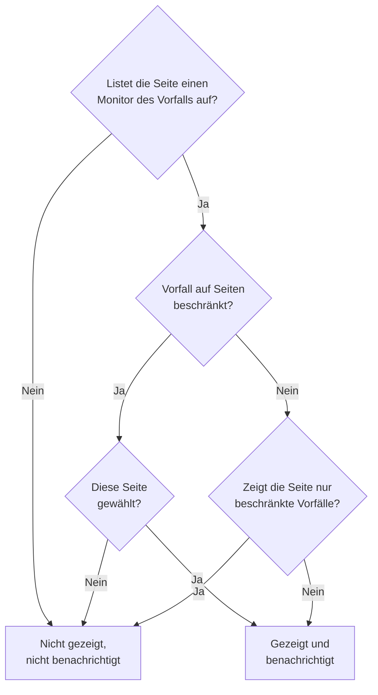

# Eine Statusseite pro Zielgruppe

Verschiedene Menschen brauchen verschiedene Nachrichten. Ein Kunde will nichts vom Ausfall eines anderen Kunden hören, und das Personal eines Standorts will keine E-Mail jedes Mal, wenn ein anderer Standort sein Netzwerk verliert. In OneUptime ist die Einheit der Zielgruppe die Statusseite: Jede hat ihre eigenen Abonnenten, ihr eigenes Branding und ihre eigene Privatsphäre. Geben Sie also jeder Zielgruppe eine eigene Seite und entscheiden Sie Vorfall für Vorfall, welche Seiten davon erfahren.

Gemeinsame Infrastruktur machte das früher schwer. Ein Vorfall erreicht eine Statusseite über seine Monitore, also informierte ein Monitor, den zehn Standortseiten teilten, alle zehn Standorte über einen Ausfall, der zwei betraf. Der einzige Ausweg war eine Seite oder ein Monitor für jede Kombination von Standorten. Diese Seite behandelt die Einstellungen, die das lösen:

- **Auf diese Statusseiten beschränken** an einem Vorfall, sodass er nur auf den Seiten erscheint und nur die Seiten benachrichtigt, die Sie wählen.
- **Nur auf diese Seite beschränkte Vorfälle anzeigen** an einer Statusseite, sodass ein Vorfall, den noch niemand eingegrenzt hat, keine dieser Seiten erreicht, bis jemand entscheidet. Das schließt die Vorfälle ein, die ein Monitor, Slack, Microsoft Teams, die API oder KI von sich aus eröffnet.
- Eine Aufzeichnung, welche Seiten informiert wurden, dass ein Vorfall erstellt wurde, sodass eine später hinzugefügte Seite einmal informiert wird und die anderen nicht noch einmal.
- Eine Zusammenfassung **Benachrichtigt**, die zeigt, wer von einem Vorfall erfahren wird, bevor Sie ihn melden oder eine öffentliche Notiz veröffentlichen, und **Vorschau**, die zeigt, was die Abonnenten jeder Seite bekommen werden.

:::cards
- [Einrichten](#eine-seite-pro-zielgruppe-einrichten): Eine Seite pro Zielgruppe und der Schalter, der nicht eingegrenzte Vorfälle von ihnen fernhält.
- [Einen Vorfall eingrenzen](#einen-vorfall-auf-statusseiten-beschränken): Die Seiten wählen, wenn Sie ihn melden, oder später.
- [Seiten hinzufügen oder entfernen](#statusseiten-hinzufügen-und-entfernen): Wer von einer hinzugefügten Seite erfährt und was das Entfernen einer Seite zurückholt.
- [Was jede Nachricht trägt](#was-jede-nachricht-trägt): Die Werte, die jede Seite bekommt, und was sie jeder Zielgruppe verraten.
:::

## Wann Sie es einsetzen

- **Ein Managed Service Provider** mit einer Statusseite pro Kunde, auf Monitoren, die sich die Kunden teilen.
- **Eine Organisation mit Standorten, Werken oder Regionen**, jede mit eigenem Personal, das informiert werden will.
- **Die interne IT** mit einer Seite pro Abteilung oder Gebäude.

Wenn Ihre Zielgruppe gern selbst auswählt, reicht vielleicht eine Seite: Lassen Sie Abonnenten die Ressourcen wählen, die ihnen wichtig sind (siehe [Abonnenten & Ankündigungen](/docs/status-pages/subscribers)). Nutzen Sie eine Seite pro Zielgruppe, wenn Sie die Wahl für sie treffen, Vorfall für Vorfall, oder wenn eine Zielgruppe die Vorfälle einer anderen überhaupt nicht sehen darf.

## Wie ein Vorfall eine Statusseite erreicht

Ein Vorfall erreicht eine Statusseite über seine Monitore. Eine Seite zeigt einen Vorfall und benachrichtigt ihre Abonnenten darüber, wenn eine der Ressourcen der Seite einer der Monitore des Vorfalls ist, direkt oder über eine Monitorgruppe auf der Seite. Zwei Einstellungen grenzen das ein:

- **Auf diese Statusseiten beschränken** am Vorfall (`statusPages`). Leer gelassen erreicht der Vorfall wie immer jede Seite, die seine Monitore auflistet. Mit gewählten Seiten erreicht er nur die gewählten Seiten **unter** denen, die seine Monitore auflisten.
- **Nur auf diese Seite beschränkte Vorfälle anzeigen** an der Statusseite (`onlyShowScopedIncidents`, standardmäßig aus). Ist es an, zeigt die Seite nie einen Vorfall, der nicht auf bestimmte Statusseiten beschränkt ist, und benachrichtigt nie jemanden darüber.



Für eine Seite, die einen der Monitore des Vorfalls auflistet:

| Der Vorfall ist | Seite mit ausgeschaltetem **Nur auf diese Seite beschränkte Vorfälle anzeigen** | Seite mit eingeschaltetem |
| --- | --- | --- |
| Auf keine Statusseite beschränkt | Gezeigt und benachrichtigt | Nicht gezeigt, nicht benachrichtigt |
| Auf Statusseiten beschränkt, und diese Seite ist gewählt | Gezeigt und benachrichtigt | Gezeigt und benachrichtigt |
| Auf Statusseiten beschränkt, aber nicht auf diese | Nicht gezeigt, nicht benachrichtigt | Nicht gezeigt, nicht benachrichtigt |

Eine Seite, die keinen der Monitore des Vorfalls auflistet, zeigt ihn nie, was Sie auch wählen, und ein Vorfall ohne Monitore benachrichtigt überhaupt keinen Statusseiten-Abonnenten. Die üblichen Regeln gelten zusätzlich: Der Vorfall muss **Auf Statusseite sichtbar** und nicht privat sein, die Seite muss **Vorfälle anzeigen** eingeschaltet haben, und ein Abonnent, der nur einige Ressourcen oder Ereignistypen gewählt hat, bekommt nur, was er gewählt hat.

Dieselben Regeln entscheiden alles, was davon abhängt, welche Seiten ein Vorfall erreicht:

- die Vorfalllisten, die Übersicht und die eigene Seite des Vorfalls auf der öffentlichen Statusseite sowie die [Öffentliche API](/docs/status-pages/public-api) der Statusseite;
- die E-Mail-, SMS-, Slack-, Microsoft-Teams- und Webhook-Nachrichten, die verschickt werden, wenn der Vorfall erstellt wird, seinen Zustand ändert, eine öffentliche Notiz oder ein Postmortem bekommt;
- die Vorfallzahlen in per E-Mail verschickten Statusseitenberichten, die nur die Vorfälle zählen, die die Seite zeigt.

Eine Vorfall-Episode erreicht eine Seite, wenn mindestens einer ihrer Vorfälle sie erreicht. Ihre Benachrichtigungen gehen an jede Seite, die ihre Vorfälle erreichen, und ihre Seite auf einer Statusseite, die keiner von ihnen erreicht, wird nicht gefunden. Ein privater Vorfall erreicht keine Seite, bringt also seine Episode nie auf eine, und eine private Episode erscheint auf überhaupt keiner Seite.

## Eine Seite pro Zielgruppe einrichten

:::steps
### Eine Statusseite für jede Zielgruppe erstellen

Erstellen Sie eine Seite pro Zielgruppe, zum Beispiel `Site 01` bis `Site 10`. Machen Sie sie privat, wenn die Zielgruppe intern ist (siehe [Einschränken, wer die Seite sehen darf](/docs/status-pages/index#einschränken-wer-die-seite-sehen-darf)). Abonnenten einer privaten Seite können sich trotzdem ohne Anmeldung abmelden, über den Link in jeder Nachricht (siehe [Ein Abonnement verwalten und kündigen](/docs/status-pages/subscribers#ein-abonnement-verwalten-und-kündigen)). Geben Sie ihnen Beschriftungen wie `Region East`, damit die Auswahl jede Seite mit einer Beschriftung mit einem Klick hinzufügen kann.

### Den gemeinsamen Monitor auf jede Seite setzen

Fügen Sie den gemeinsamen Monitor jeder Seite als Ressource hinzu (siehe [Statusseiten – Ressourcen & Gruppen](/docs/status-pages/resources-and-groups)). Eine Regel unter **Ressourcen → Monitor-Regeln** kann das anhand der Beschriftungen des Monitors für Sie erledigen.

### Nur auf diese Seite beschränkte Vorfälle anzeigen einschalten

Schalten Sie es auf jeder dieser Seiten ein. Es steht in der Karte **Was Ihre Statusseite zeigt** unter **Statusseiten → Ihre Seite → Erweitert → Erweiterte Einstellungen**, unter **Vorfälle anzeigen**, und speichert in dem Moment, in dem Sie es umlegen. Ab dann erreicht nichts mehr eine Standortseite, solange niemand sie wählt.

### Die Abonnenten jeder Zielgruppe hinzufügen

Nutzen Sie für Personal **In großen Mengen hinzufügen** auf **E-Mail-Abonnenten**, und ziehen Sie die eigene Adresse jeder Person einer Mailingliste wie `site03-all@` vor: Jeder auf der Liste kann sie für alle darauf abmelden. Meldet sich ein Abonnent ab, den Sie hinzugefügt haben, bekommen die Eigentümer der Seite und wer ihn hinzugefügt hat eine E-Mail (siehe [Gemeinsame Adressen und Mailinglisten](/docs/status-pages/subscribers#gemeinsame-adressen-und-mailinglisten)).

### Einsatzkräften das Lesen von Statusseiten erlauben

Die Auswahl listet nur die Statusseiten, die die Person lesen darf, und die Vorfallrollen dürfen keine Statusseiten lesen. Geben Sie Einsatzkräften neben ihrer Vorfallrolle die Rolle **Status Page Viewer**; sie lässt sich auf Seiten mit bestimmten Beschriftungen beschränken. Ohne sie ist die Auswahl leer.

### Festlegen, was jede Nachricht sagt

Definieren Sie unter **Vorfälle → Einstellungen → Benutzerdefinierte Felder** die benutzerdefinierten Vorfallfelder, die Ihr Team jedes Mal beantwortet, zum Beispiel `Impact` (eine Auswahlliste), `Expected Resolution` (ein Datum mit Uhrzeit) und `Acknowledgement` (ein Ja/Nein-Schalter). Ziehen Sie sie in die **Reihenfolge**, in der sie abgefragt und aufgelistet werden sollen, und schalten Sie **Beim Erstellen anzeigen** ein, damit das Meldeformular danach fragt, **Beim Erstellen erforderlich**, wo eine Antwort Pflicht ist, und **In Abonnentenbenachrichtigungen aufnehmen** für die, die jede Zielgruppe lesen darf. Die stehen dann in der Standard-E-Mail jeder Seite. Siehe [Benutzerdefinierte Felder](/docs/incidents/settings#benutzerdefinierte-felder).

### Die E-Mail jeder Seite gestalten (optional)

Geben Sie im Tarif **Scale** jeder Seite eine **Benutzerdefinierte SMTP-Konfiguration** und verknüpfen Sie eigene Vorlagen für die Vorfallereignisse; sie können jedes Feld mit `{{incident.customFields.<key>}}` platzieren. Während Sie eine Vorlage schreiben, zeigt **Live-Vorschau** darunter sie mit Beispielwerten gefüllt. Siehe [Was eine eigene Vorlage braucht](/docs/status-pages/subscribers#was-eine-eigene-vorlage-braucht) und [Was jede Nachricht trägt](#was-jede-nachricht-trägt), bevor Sie `{{affectedStatusPages}}` verwenden.

### Vorfallvorlagen mit gewählten Seiten speichern (optional)

Eine Vorlage `Region East outage` kann die Standortseiten im Osten tragen und Standardantworten für die benutzerdefinierten Felder.

### Die E-Mail jeder Seite vor dem ersten Ausfall prüfen

Starten Sie **Vorfall melden** mit dem gemeinsamen Monitor und zwei gewählten Standortseiten, und öffnen Sie in der Zusammenfassung vor dem Absenden **Vorschau** neben **Ja**: Sie zeigt die E-Mail, die die Abonnenten jeder Seite bekommen würden, und welche Vorlage sie verwendet und warum. **Test an mich senden** schickt eine in Ihr eigenes Postfach. Niemand sonst bekommt etwas, bis Sie den Vorfall melden, also verlassen Sie das Formular ohne Absenden, wenn Sie fertig sind. Siehe [Wer benachrichtigt wird](#wer-benachrichtigt-wird).
:::

## Einen Vorfall auf Statusseiten beschränken

### Beim Melden

Auf **Vorfälle → Alle Vorfälle → Vorfall melden** hat der Schritt **Betroffene Ressourcen** **Auf diese Statusseiten beschränken** unter **Weitere Felder**, nach den Monitoren und den anderen Ressourcen. Sein Platzhalter, **Jede Statusseite, die die Monitore auflistet**, ist das, was das Leerlassen bedeutet. Wählen Sie Seiten nach Namen, oder öffnen Sie den Reiter **Beschriftungen** der Auswahl und wählen Sie eine Beschriftung, um jede Seite hinzuzufügen, die sie trägt.

Das Formular warnt Sie:

- wenn eine gewählte Seite keinen der Monitore des Vorfalls auflistet oder überhaupt kein Monitor angehängt ist. Der Vorfall erscheint dann nicht auf dieser Seite und benachrichtigt ihre Abonnenten nicht;
- wenn Sie außerdem **Monitor-Status ändern in** setzen, direkt unter den Monitoren im selben Schritt. Siehe [Der Monitor-Status ist geteilt](#der-monitor-status-ist-geteilt);
- wenn Sie außerdem **Privater Vorfall** ankreuzen, unter **Weitere Felder** im Schritt **Vorfalldetails**. Private Vorfälle sind auf allen Statusseiten ausgeblendet, auch auf denen, die Sie gewählt haben.

Der Schritt **Details**, direkt nach **Betroffene Ressourcen**, fragt nach den benutzerdefinierten Vorfallfeldern, die mit **Beim Erstellen anzeigen** markiert sind (siehe [Einen Vorfall melden](/docs/incidents/declaring-incidents)). Seine Antworten gehen an jede Seite, die der Vorfall erreicht: Werte benutzerdefinierter Felder gehören zum Vorfall, nicht zu einer Statusseite.

**Aus Vorlage erstellen** füllt das Feld aus der Vorlage. Die Seiten einer Vorlage werden beim Erstellen in ihrem Schritt **Betroffene Ressourcen** gesetzt und danach auf ihrer Karte **Statusseiten-Umfang** (**Vorfälle → Einstellungen → Vorfall-Vorlagen**). Wie bei den anderen Vorlagenfeldern gewinnt eine Liste, die Sie selbst setzen. Die Seiten einer Vorlage werden auch für eine Einsatzkraft ausgefüllt, die keine Statusseiten lesen darf: Wer die Vorlage eingerichtet hat, hat sie für alle gewählt, die daraus melden.

### Wer benachrichtigt wird

Unter **Statusseiten-Abonnenten benachrichtigen**, direkt unter der Auswahl unter **Weitere Felder** im Schritt **Betroffene Ressourcen**, und noch einmal in der Zusammenfassung vor dem Absenden zeigt das Formular, wen der Vorfall erreichen wird:

> Benachrichtigt:
>
> - Site 03 (bis zu 41 per E-Mail)
> - Site 07 (bis zu 18 per E-Mail)

Darunter, unter **Nicht benachrichtigt:**, listet es die Seiten auf, die die Monitore auflisten, aber nicht informiert werden, und warum: keine der Seiten, auf die der Vorfall beschränkt ist, eine Seite, die nur auf sie beschränkte Vorfälle zeigt, oder eine Seite, die keine Vorfälle zeigt.

Wenn niemand informiert wird, zeigt die Zusammenfassung nichts: Der Vorfall hat keine Monitore, keine Statusseite listet sie auf, die Seiten haben noch keine Abonnenten, **Statusseiten-Abonnenten benachrichtigen** ist aus, oder der Vorfall ist privat. Sie warnt nur, wenn der Statusseiten-Umfang der Grund ist, und nennt die Seiten, die er auslässt: Der Vorfall ist nicht beschränkt, und die Seiten, die seine Monitore auflisten, zeigen nur auf sie beschränkte Vorfälle, er ist auf andere Seiten beschränkt, oder die Seiten, auf die er beschränkt ist, listen keinen seiner Monitore auf. In der Zusammenfassung lautet **Statusseiten-Abonnenten benachrichtigen** **Ja** oder **Nein** wie jedes andere Kästchen, mit **Vorschau** neben **Ja**; sie wird nicht angeboten, solange das Kästchen aus ist, der Vorfall privat ist oder kein Monitor angehängt ist.

Dieselbe Zusammenfassung erscheint unter **Statusseiten-Abonnenten benachrichtigen**, wenn Sie auf der Seite **Öffentliche Notizen** des Vorfalls eine Notiz schreiben, für den Vorfall, wie er gerade ist. Dort sagt sie auch, wenn der Vorfall auf Statusseiten ausgeblendet ist, denn dann wird nichts verschickt.

Die Zahlen sind „bis zu“. Sie zählen pro Kanal die bestätigten Abonnenten jeder Seite, die sich nicht abgemeldet haben, und ein Abonnent, der nur einige Ressourcen oder Ereignistypen gewählt hat, bekommt diese Nachricht womöglich nicht. Seiten, die Sie nicht lesen dürfen, werden nicht genannt. Sie werden als „weitere Statusseiten, auf die Sie keinen Zugriff haben“ gezählt.

**Vorschau**, neben **Ja** in der Zusammenfassung und neben dem Kontrollkästchen der Notiz, zeigt, was sie bekommen werden: Wählen Sie eine Seite, um ihre E-Mail so zu sehen, wie ihre Abonnenten sie bekommen, mit ihrem Betreff, und welche Vorlage sie verwendet und warum, zum Beispiel dass die eigene Vorlage einer Seite nicht verwendet wird, weil die Seite keine **Benutzerdefinierte SMTP-Konfiguration** hat. **Test an mich senden** schickt die E-Mail der Seite an Ihre eigene Konto-E-Mail und an niemanden sonst. Seiten, die Sie nicht lesen dürfen, werden gezählt, aber nicht in der Vorschau gezeigt. Siehe [Die E-Mail vor dem Versand in der Vorschau ansehen](/docs/status-pages/subscribers#die-e-mail-vor-dem-versand-in-der-vorschau-ansehen).

### Nach dem Melden

Öffnen Sie den Vorfall und gehen Sie zu **Erweitert → Einstellungen**. Die Karte **Statusseiten-Umfang** listet die Seiten, auf die der Vorfall beschränkt ist, und **Statusseiten-Umfang bearbeiten** ändert sie. Die **Übersicht** des Vorfalls zeigt dieselbe Liste als **Statusseiten-Umfang**, schreibgeschützt, mit einem Link **In den Einstellungen ändern**.

Auf **Vorfälle → Alle Vorfälle** findet der Filter **Statusseite** die Vorfälle, die auf die gewählten Seiten beschränkt sind, oder die, die auf keine Seite beschränkt sind.

### Über die API

`statusPages` ist eine Liste von Statusseiten-IDs, an `POST /api/incident` und bei Aktualisierungen eines Vorfalls sowie an Vorfallvorlagen. Jede Seite muss zum Projekt des Vorfalls gehören; eine Seite aus einem anderen Projekt wird abgelehnt. Jede Seite, die Sie hinzufügen, muss außerdem eine sein, die Sie lesen dürfen, wie in der Auswahl, sonst wird die Anfrage abgelehnt. Seiten, die der Vorfall oder die Vorlage schon hat, bleiben erhalten, ob Sie sie lesen dürfen oder nicht, und eine Seite einer Vorfallvorlage, die Sie lesen dürfen, kann beim Melden eines Vorfalls gewählt werden. Zwei weitere Spalten folgen daraus, und keine davon setzen Sie selbst:

- `isScopedToStatusPages` wird aus `statusPages` berechnet. Alles, was Sie dafür senden, wird ignoriert.
- `statusPagesNotifiedOnCreation` ist die Aufzeichnung der Seiten, die informiert wurden, dass der Vorfall erstellt wurde. Siehe [Statusseiten hinzufügen](#statusseiten-hinzufügen).

Um zu sehen, wen ein Vorfall erreichen würde, ohne etwas zu senden, rufen Sie den Zielgruppen-Endpunkt auf:

```bash
curl -X POST https://oneuptime.com/api/incident/subscriber-audience \
  -H "apikey: $ONEUPTIME_API_KEY" \
  -H "Content-Type: application/json" \
  -d '{
    "monitorIds": ["<monitor-id>"],
    "statusPageIds": ["<status-page-id>"]
  }'
```

Senden Sie für einen bestehenden Vorfall stattdessen `{"incidentId": "<incident-id>"}`. Die Antwort listet jede Seite auf, die benachrichtigt wird, mit einer Zahl pro Kanal (`email`, `sms`, `slack`, `microsoftTeams`, `webhook`), die ausgelassenen Seiten und warum, und `hiddenStatusPageCount` für die Seiten, die der Aufrufer nicht lesen darf. Sie gibt nie eine Adresse zurück.

## Vorfälle, die noch niemand eingegrenzt hat

Monitorkriterien, Slack, Microsoft Teams, die API und KI können alle von sich aus einen Vorfall eröffnen, und keiner von ihnen weiß, welche Standorte ein Fehler an einem gemeinsamen Monitor betrifft. Ein solcher Vorfall ist auf keine Seite beschränkt, also würde jede Seite, die den Monitor auflistet, ihn innerhalb von etwa einer Minute zeigen und ihre Abonnenten benachrichtigen. Ist eine E-Mail einmal an einen Abonnenten verschickt, lässt sie sich nicht zurückholen.

**Nur auf diese Seite beschränkte Vorfälle anzeigen** verhindert das. Eine Seite, auf der es eingeschaltet ist, ignoriert jeden nicht eingegrenzten Vorfall. Der Vorfall wird trotzdem eröffnet, Bereitschaftsrichtlinien alarmieren weiterhin die Einsatzkräfte, und seine Eigentümer werden weiterhin informiert, aber keine dieser Seiten erfährt davon. Eine Einsatzkraft ermittelt dann, wer betroffen ist, und fügt diese Seiten auf dem Reiter **Einstellungen** des Vorfalls hinzu, mit angekreuztem **Benachrichtigung über die Erstellung des Vorfalls an neu hinzugefügte Seiten senden**. Ihre Abonnenten werden innerhalb von etwa einer Minute informiert.

## Statusseiten hinzufügen und entfernen

### Statusseiten hinzufügen

Abonnenten einer Seite erfahren einmal, dass ein Vorfall erstellt wurde. Wenn Sie deshalb Seiten auf der Karte **Statusseiten-Umfang** hinzufügen, bietet das Bearbeitungsformular **Benachrichtigung über die Erstellung des Vorfalls an neu hinzugefügte Seiten senden** an, standardmäßig angekreuzt:

- Angekreuzt wird die Benachrichtigung „erstellt“ des Vorfalls erneut eingereiht, und sie geht nur an die Seiten, die noch nicht informiert wurden. Der Vorfall hält fest, welche Seiten informiert wurden, sodass die anderen es nicht zweimal hören.
- Nicht angekreuzt beginnen die hinzugefügten Seiten, den Vorfall zu zeigen, und erfahren ab jetzt alles, bekommen aber nicht gesagt, dass er erstellt wurde.

Das Kontrollkästchen erscheint nur, wenn das Ankreuzen etwas verschicken würde: Mindestens eine hinzugefügte Seite wurde noch nicht informiert, und der Vorfall wurde mit eingeschaltetem **Statusseiten-Abonnenten benachrichtigen** gemeldet, ist auf Statusseiten sichtbar und nicht privat. Einige Fälle werden für Sie erledigt:

- **Die Benachrichtigung ist noch eingereiht oder wird gerade verschickt.** Ein eingereihter Versand liest die Seiten, wenn er rausgeht, und ein laufender Versand liest sie beim Abschluss erneut und informiert dann die inzwischen hinzugefügten Seiten. Deshalb gibt es kein Kontrollkästchen: Die Seiten, die Sie hinzufügen, werden so oder so informiert. (Schlägt dieser Versand fehl, gehören die inzwischen hinzugefügten Seiten zu denen, an die sein **Wiederholen** sendet.)
- **Jede hinzugefügte Seite wurde schon informiert**, etwa eine Seite, die Sie entfernt und wieder hinzugefügt haben, oder ein Vorfall, der jeden Standort erreicht hat und jetzt auf zwei davon eingegrenzt wird. Niemand wird erneut informiert, also gibt es kein Kontrollkästchen.
- **Der Vorfall wurde nie angekündigt.** Wurde er ohne **Abonnenten benachrichtigen, dass dieser Vorfall erstellt wurde** veröffentlicht oder ohne Monitore gemeldet, wurde niemand informiert. Das Ankreuzen informiert nur die Seiten, die Sie hinzufügen, nicht die Seiten, auf die er schon beschränkt war.
- **Der Vorfall wurde gemeldet, bevor es diese Funktion gab.** Seine Benachrichtigung „erstellt“ ging an jede Seite, die seine Monitore auflistete, und es gibt keine Aufzeichnung dieser Seiten. Seiten hinzuzufügen verschickt sie nicht erneut, also wird das Kontrollkästchen nicht angeboten.
- **Der Vorfall ist ausgeblendet.** Solange er ausgeblendet ist, wird nichts verschickt. Wenn Sie **Auf Statusseite sichtbar** wieder einschalten, bietet die Karte **Vorfall-Einstellungen** **Abonnenten benachrichtigen, dass dieser Vorfall erstellt wurde** für die Seiten seines Umfangs an, die nie informiert wurden, etwa die, die hinzugefügt wurden, während er ausgeblendet war.

Eine später hinzugefügte Seite erfährt, was danach passiert: spätere öffentliche Notizen, Zustandsänderungen und das Postmortem. Die Notizen und Zustandsänderungen, die vor ihrem Hinzufügen verschickt wurden, bekommt sie nicht. Muss sie aufholen, veröffentlichen Sie eine öffentliche Notiz.

Dieselbe Aufzeichnung lässt **Wiederholen** bei einer fehlgeschlagenen Benachrichtigung „erstellt“ dort weitermachen, wo sie aufgehört hat: Seiten, die schon informiert wurden, werden übersprungen. Eine Seite zählt erst als informiert, wenn jeder ihrer Abonnenten die Nachricht bekommen hat; eine Seite, bei der eine Nachricht fehlschlug oder bei der der Versand mittendrin aufhörte, bekommt sie noch einmal vollständig. Die Aufzeichnung wird geschrieben, sobald jede Seite fertig ist, sodass das auch für einen unterbrochenen Versand gilt. Sie wird pro Seite geführt, nicht pro Abonnent: Die Abonnenten einer Seite, bei der der Versand mittendrin aufhörte und die die Nachricht schon bekommen hatten, bekommen sie ein zweites Mal.

Um stattdessen neu anzufangen, etwa nachdem Sie eine Vorlage oder eine SMTP-Einstellung korrigiert haben, kreuzen Sie in der Bestätigung von **Wiederholen** **Erneut an jede Statusseite senden, auch an die bereits erreichten Seiten** an: Die Schaltfläche wird zu **An alle Seiten erneut senden**, die Aufzeichnung wird geleert, und jede Seite, die der Vorfall jetzt erreicht, bekommt sie erneut. Nach einer Benachrichtigung, die vollständig rausgegangen ist, bietet der **Abonnenten-Benachrichtigungsstatus** auf der **Übersicht** des Vorfalls **Erneut senden** an, das dasselbe tut. Beide Bestätigungen listen die Seiten auf, die sie jetzt erreichen würden, oder sagen, dass sie niemanden erreichen würden; die einfache Bestätigung von **Wiederholen** führt die bereits erreichten Seiten als nicht erneut gesendet auf, da sie sie überspringt. Keines davon wird für eine übersprungene Benachrichtigung angeboten oder für eine, die noch eingereiht ist oder verschickt wird, noch jemandem, der den Vorfall nicht bearbeiten darf.

Über die API senden Sie `"miscDataProps": {"notifyAddedStatusPagesOfIncidentCreated": true}` mit der Aktualisierung, die `statusPages` ändert. `subscriberNotificationStatusOnIncidentCreated` selbst auf `Pending` zurückzusetzen, verschickt die Benachrichtigung „erstellt“ wie eh und je erneut an jede Seite, die der Vorfall erreicht: Die Aufzeichnung wird dabei geleert. Nach einem Fehler macht sie stattdessen dort weiter, wo der fehlgeschlagene Versand aufgehört hat. Um sie auch nach einem Fehler an jede Seite zu senden, fügen Sie dieser Aktualisierung `"miscDataProps": {"resendIncidentCreatedToAllStatusPages": true}` hinzu. Diese Anfrage wird für eine Benachrichtigung abgelehnt, die übersprungen wurde oder die eingereiht ist oder verschickt wird.

`shouldStatusPageSubscribersBeNotifiedOnIncidentCreated` zu schreiben gehört nicht dazu. Es wird beim Melden des Vorfalls gewählt, und keine Projektrolle kann es danach über die API ändern. Ein Workflow, der als System schreibt, und der Master-Admin einer Instanz können es, aber das speichert nur den neuen Wert. Es unverändert zurückzuschreiben, wie es ein Workflow tut, der den ganzen Vorfall kopiert, verschickt nichts erneut, und es später einzuschalten verschickt nicht die Benachrichtigung „erstellt“, ohne die der Vorfall gemeldet wurde. Ausgeschaltet, bevor diese Benachrichtigung rausgegangen ist, wird sie übersprungen.

### Statusseiten entfernen

Eine Seite zu entfernen holt nichts zurück. Die Seite zeigt den Vorfall nicht mehr, und ihre Abonnenten erfahren nichts weiter darüber, nicht einmal, dass er behoben wurde. Wenn Sie eine Seite entfernen, die schon über den Vorfall informiert wurde, warnt Sie das Bearbeitungsformular und schlägt eine abschließende öffentliche Notiz vor. Veröffentlichen Sie diese Notiz zuerst, solange die Seite noch in der Liste ist, und entfernen Sie dann die Seite.

Die ganze Liste zu leeren ist etwas anderes, als Seiten zu entfernen: Der Vorfall ist dann überhaupt nicht mehr beschränkt. Er erscheint wieder auf jeder Seite, die seine Monitore auflistet, und benachrichtigt sie, außer den Seiten, die nur auf sie beschränkte Vorfälle zeigen. Auch davor warnt Sie das Formular.

### Wenn eine gewählte Statusseite gelöscht wird

Eine Statusseite zu löschen entfernt sie aus jedem Vorfall, der auf sie beschränkt war. Ein Vorfall, dessen gewählte Seiten alle gelöscht wurden, bleibt beschränkt, auf nichts: Er ist auf jeder Statusseite ausgeblendet, statt auf jeder Seite zu erscheinen, die seine Monitore auflistet. Die Karte **Statusseiten-Umfang** sagt das. Wählen Sie andere Seiten oder leeren Sie die Liste, um ihn wieder zu zeigen.

Vorfallvorlagen funktionieren genauso. Eine Vorlage, deren Seiten alle gelöscht wurden, bleibt beschränkt: Ein Vorfall, den ein [Formular](/docs/forms/on-submit#die-vorfallsvorlage) oder der Schritt **Create One Incident** eines Workflows daraus meldet, ist auf jeder Statusseite ausgeblendet, die Karte **Statusseiten-Umfang** der Vorlage warnt Sie, und **Vorfall melden** beginnt ohne gewählte Seite und bittet Sie, die Seiten zu wählen, für die der Vorfall gedacht ist. Wählen Sie andere Seiten an der Vorlage, oder speichern Sie ihre Liste leer, um die daraus gemeldeten Vorfälle nicht mehr zu beschränken.

## Eine E-Mail pro Person

Bei einem Vorfall, der auf bestimmte Statusseiten beschränkt ist, bekommt eine E-Mail-Adresse oder Telefonnummer, die auf mehr als einer dieser Seiten abonniert ist, eine E-Mail oder SMS pro Versand, nicht eine pro Seite. Die Seiten werden in der Reihenfolge ihrer Namen durchlaufen, also bekommt diese Person die Vorlage, das Branding und den Abmeldelink der ersten Seite.

Webhook-, Slack- und Microsoft-Teams-Nachrichten werden nie zusammengelegt. Ihre Nutzlasten nennen die Statusseite, für die sie sind, und eine Integration, die pro Seite zuhört, muss jede Seite sehen.

Das gilt nur innerhalb eines Versands. Jemand, der auf `Site 03` und `Site 05` abonniert ist und die E-Mail „erstellt“ über `Site 03` bekommen hat, bekommt sie erneut, wenn `Site 05` später hinzugefügt wird. Ein Vorfall, der auf keine Seite beschränkt ist, verschickt wie eh und je eine Nachricht pro Abonnement.

## Was jede Nachricht trägt

Jede Seite, die der Vorfall erreicht, bekommt dieselben Werte: Sie gehören zum Vorfall, nicht zu einer Statusseite.

- **Benutzerdefinierte Felder in den Standardnachrichten.** Benutzerdefinierte Vorfallfelder mit eingeschaltetem **In Abonnentenbenachrichtigungen aufnehmen** werden in den Nachrichten zu Erstellung, Zustandsänderung, öffentlicher Notiz und Postmortem jeder Seite aufgelistet, in ihrer **Reihenfolge**: E-Mail, Slack, Microsoft Teams und Webhooks, aber nicht SMS. Das braucht weder den Tarif Scale noch eigenes SMTP. Siehe [Benutzerdefinierte Vorfallfelder in Benachrichtigungen](/docs/status-pages/subscribers#benutzerdefinierte-vorfallfelder-in-benachrichtigungen).
- **Aktualisierungen.** Ein benutzerdefiniertes Feld allein zu ändern informiert niemanden. Die nächste öffentliche Notiz oder Zustandsänderung trägt die aktuellen Werte, also ändern Sie, um den Standorten zu sagen, dass sich `Expected Resolution` verschoben hat, das Feld und veröffentlichen dann eine öffentliche Notiz.
- **Notizvorlagen.** Eine Notizvorlage zu wählen füllt Platzhalter wie `{{incident.title}}` und `{{incident.customFields.<key>}}` mit den aktuellen Werten des Vorfalls, und Sie können die Notiz vor dem Veröffentlichen weiterhin bearbeiten. Siehe [Notizvorlagen](/docs/incidents/settings#notiz-vorlagen).
- **Die Namen der anderen Zielgruppen.** `{{affectedStatusPages}}` in einer eigenen Abonnentenvorlage und `{{incident.affectedStatusPages}}` in einer Notizvorlage listen die Seiten auf, die der Vorfall erreicht, und alle, an die die Nachricht geht, lesen die Liste: Die Abonnenten von `Site 03` erfahren, dass auch `Site 07` betroffen ist. Zwischen Standorten einer Organisation ist das vielleicht gewollt. Zwischen Kunden verrät es einem Kunden etwas über einen anderen, also lassen Sie beide aus den Vorlagen und Notizen heraus, die diese Seiten bekommen.

## Wie sich das von geplanter Wartung unterscheidet

Geplante Wartungsereignisse haben auch eine Liste **Statusseiten**, aber sie funktioniert anders:

- **Geplante Wartung ersetzt.** Das Ereignis erscheint genau auf den Seiten in seiner Liste, ob sie seine Monitore auflisten oder nicht.
- **Ein Vorfall grenzt ein.** Seine Liste wählt nur unter den Seiten, die seine Monitore schon auflisten. Eine Seite zu wählen, die keinen davon auflistet, bewirkt nichts, und das Formular sagt das. Setzen Sie den Monitor zuerst auf diese Seite.

Das verhindert, dass eine versehentliche Auswahl einen Vorfall auf eine Seite über etwas ganz anderes bringt. Es heißt auch, dass ein Vorfall ohne Monitore keine Statusseite erreicht, egal wie viele Sie wählen.

## Der Monitor-Status ist geteilt

Ein Monitor hat einen Status, und jede Statusseite, die den Monitor auflistet, zeigt ihn. Einen Vorfall zu beschränken ändert daran nichts. Setzt der Vorfall **Monitor-Status ändern in**, oder fällt der Monitor von selbst aus, wird der Monitor auf jeder Seite rot, die ihn auflistet, auch auf Seiten, auf die der Vorfall nicht beschränkt ist, und auf Seiten, die nur auf sie beschränkte Vorfälle zeigen. Das Meldeformular warnt Sie, wenn Sie eine Statusänderung mit gewählten Seiten kombinieren.

**Braucht jeder Standort einen eigenen Status, geben Sie jedem Standort einen manuellen Monitor.** Erstellen Sie pro Standort einen manuellen Monitor ([Manuelle Überwachung](/docs/monitor/manual-monitor)), zum Beispiel `Site 03 network`, und listen Sie ihn nur auf der Seite dieses Standorts auf. Hängen Sie die manuellen Monitore der betroffenen Standorte an den Vorfall, mit **Monitor-Status ändern in**, wenn sich ihr Status ändern soll, und lassen Sie den gemeinsamen Monitor für die Seiten, die ihn sehen sollen. Der Vorfall erreicht dann genau die Standorte, deren Monitore er trägt, und eine Statusänderung erscheint nur auf ihren Seiten.

## Was festgehalten wird

- **Der Vorfall-Feed.** Der Eintrag „erstellt“ eines beschränkten Vorfalls listet die Seiten auf, auf die er beschränkt ist. Jede Änderung an der Liste fügt einen Eintrag hinzu, der die hinzugefügten und entfernten Seiten auflistet und ob die hinzugefügten Seiten die Benachrichtigung „erstellt“ bekommen.
- **Jede Abonnentenbenachrichtigung.** Der Eintrag **Abonnentenbenachrichtigung gesendet** im Vorfall-Feed hat ein Feld **Weitere Informationen**, das jede Seite auflistet, an die der Versand ging: wie viele Nachrichten auf jedem Kanal gesendet wurden und wie viele fehlschlugen, und den Betreff, mit dem ihre E-Mail rausging. Es listet auch die Seiten, die er übergangen hat, und warum (schon informiert oder zeigt keine Vorfälle), die Seiten, die der Umfang ausgelassen hat, und ob E-Mail und SMS einmal pro Adresse verschickt wurden. Hat der Versand Werte benutzerdefinierter Felder in eine Nachricht gesetzt, endet das Feld mit ihnen, unter **Custom fields sent**.
- **Der Status der Benachrichtigung.** Die Statusmeldung jeder Benachrichtigung sagt für jede Seite, wie viele Nachrichten auf jedem Kanal gesendet wurden und wie viele fehlschlugen, und nach einem Fehler, was **Wiederholen** tun wird. Ein Versand, der mittendrin unterbrochen wurde, weil sein Server neu startete oder nicht mehr antwortete, wird als fehlgeschlagen markiert, mit einer Meldung, die mit `Interrupted:` beginnt, statt in Bearbeitung zu bleiben. Siehe [Prüfen, was gesendet wurde](/docs/status-pages/subscribers#prüfen-was-gesendet-wurde).
- **Benachrichtigungsprotokolle** auf jeder Statusseite zeigt jede Nachricht, die diese Seite verschickt hat.

Zum Feed selbst siehe [Vorfallnotizen, Eigentümer & Feed](/docs/incidents/notes-owners-and-feed).

## Berechtigungen

- **Eine Statusseite zu wählen braucht Lesezugriff darauf.** Statusseiten werden unter den Statusseitenrollen gelesen, nicht unter den Vorfallrollen, und eine Statusseite lässt sich nach Beschriftung einschränken. Geben Sie Einsatzkräften **Status Page Viewer**, wenn Sie möchten, auf Beschriftungen beschränkt. Ohne sie ist die Auswahl leer, und die API lehnt eine Seite ab, die der Aufrufer nicht lesen darf, bei Vorfällen wie bei Vorfallvorlagen.
- **Seiten, die der Bearbeiter nicht sieht, bleiben erhalten.** Ein Bearbeiter, der nur einige Seiten eines Vorfalls lesen darf, sieht nur diese in der Auswahl, und das Speichern behält die Seiten, die er nicht sieht.
- **Die Seiten, auf die ein Vorfall beschränkt ist, gehören zum Vorfall.** Wie seine Monitore sieht jeder, der den Vorfall lesen darf, ihre Namen, auf der Karte **Statusseiten-Umfang**, in der Übersicht und im Vorfall-Feed, ob er diese Statusseiten lesen darf oder nicht.
- **Was ein Versand erreicht hat, gehört auch zum Vorfall.** Sobald eine Benachrichtigung rausgegangen ist, nennen ihre Statusmeldung und ihr Feed-Eintrag jede Statusseite, an die sie ging, mit dem, was jeweils gesendet wurde und was fehlschlug, und jeder, der den Vorfall lesen darf, sieht sie, ob er diese Statusseiten lesen darf oder nicht. Nur die Zusammenfassung und die Vorschau unten, die vorausschauen, bleiben bei den Seiten, die die Person lesen darf.
- **Die Zielgruppen-Zusammenfassung** steht den Rollen offen, die einen Vorfall melden oder bearbeiten oder eine öffentliche Notiz dazu veröffentlichen dürfen. Sie nennt nur die Seiten, die die Person lesen darf. Andere Seiten, die der Vorfall benachrichtigen wird, werden als „weitere Statusseiten, auf die Sie keinen Zugriff haben“ gezählt, und sie zeigt nie Adressen.
- **Vorschau** steht denselben Rollen offen und zeigt nur die Seiten in der Vorschau, die die Person lesen darf, höchstens sechzigmal alle zehn Minuten. Wie die Zusammenfassung zeigt sie nie eine Adresse. **Test an mich senden** schickt nur an die eigene Konto-E-Mail der Person, sobald diese bestätigt ist, höchstens zehnmal alle 15 Minuten.
- **Eine Benachrichtigung erneut zu senden** braucht für ihre Benachrichtigung „erstellt“ die Berechtigung, den Vorfall zu bearbeiten, und für eine Notiz sowohl die Berechtigung, öffentliche Notizen zu bearbeiten, als auch die Berechtigung, öffentliche Notizen zu veröffentlichen, die Abonnenten benachrichtigen – und dasselbe gilt dafür, Abonnenten über die Bearbeitung einer Notiz zu informieren. Keines davon wird angenommen, während diese Benachrichtigung verschickt wird.

## Einen selbst gehosteten Server aktualisieren

Die Worker, die Abonnentenbenachrichtigungen verschicken, halten einen Vorfall auf den Seiten, auf die er beschränkt ist. Während ein Upgrade auf eine Version mit dieser Funktion ausgerollt wird, verschickt ein Worker, der noch auf der vorherigen Version läuft, die Benachrichtigungen, die er aufgreift, wie eh und je: an jede Statusseite, die die Monitore des Vorfalls auflistet, auch an Seiten, die nur auf sie beschränkte Vorfälle zeigen. Lassen Sie also das Worker-Deployment vollständig ausrollen oder skalieren Sie die alten Worker auf null, bevor jemand einen Vorfall auf Statusseiten beschränkt oder **Nur auf diese Seite beschränkte Vorfälle anzeigen** einschaltet. Mit Helm führt `migrate.hook: true` außerdem die Datenbankmigrationen aus, bevor ein neuer Pod startet.

## Nächste Schritte

:::cards
- [Abonnenten & Ankündigungen](/docs/status-pages/subscribers): Die Abonnentenkanäle und was jedes Ereignis verschickt.
- [Einen Vorfall melden](/docs/incidents/declaring-incidents): Das Meldeformular, Schritt für Schritt.
- [Vorfallstatus & Schweregrade](/docs/incidents/states-and-severities): Was einen Vorfall sonst noch von einer Statusseite fernhält.
- [Manuelle Überwachung](/docs/monitor/manual-monitor): Monitore, deren Status Sie selbst setzen.
:::
