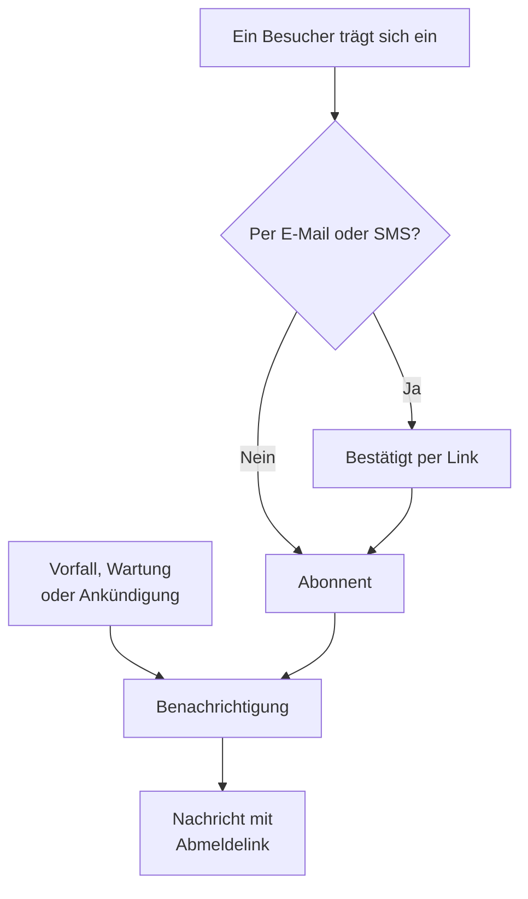

# Abonnenten & Ankündigungen

Eine Statusseite ist ein Ort, den Menschen aufsuchen. Abonnenten sind die Menschen, die sich das lieber sparen – sie hinterlassen einmal eine E-Mail-Adresse, eine Telefonnummer, einen Slack-Webhook oder einen HTTP-Endpunkt, und von da an kommen Ihre Updates zu ihnen.

Ankündigungen sind die andere Hälfte derselben Aufgabe. Ein Monitor kann Ihren Besuchern sagen, dass der Checkout 500er zurückgibt; kein Monitor kann ihnen sagen, dass Sie am Samstag Datenbanken migrieren, dass ein Drittanbieter gerade einen schlechten Tag hat oder dass der Vorfall, von dem sie gestern gelesen haben, vollständig abgeschlossen ist. Ankündigungen sind der Freitextkanal für alles, was Ihre Prüfungen nicht sehen können, und sie gehen an dieselbe Abonnentenliste.

Diese Seite behandelt beides: die fünf Abonnementkanäle und wie Besucher sich eintragen, was Abonnenten sich aussuchen können, die Abläufe für Double Opt-in und Abmeldung, den E-Mail-Bericht, den Abonnenten jeden Monat bekommen können, sowie das Schreiben, Planen und Vorlagen von Ankündigungen.

:::cards
- [Abonnementkanäle](#abonnementkanäle): Die Kanäle, über die sich Besucher eintragen, und die Seite, auf der sie es tun.
- [Worüber Abonnenten informiert werden](#worüber-abonnenten-benachrichtigt-werden): Ankündigungen, Wartungen, Vorfälle und Episoden, und Änderungen daran.
- [Prüfen, was gesendet wurde](#prüfen-was-gesendet-wurde): Der Status jeder Benachrichtigung, Wiederholen und erneutes Senden.
- [Ankündigungen](#ankündigungen): Eine Mitteilung auf einer oder mehreren Statusseiten veröffentlichen.
:::

## So funktioniert es



Jede Statusseite hat ihre eigenen Abonnenten. Ein Besucher trägt sich auf der Seite **Abonnieren** der Statusseite ein, wo eine E-Mail-Adresse oder eine Telefonnummer erst über einen Link bestätigt, bevor sie etwas erfährt, oder Ihr Team fügt ihn im Dashboard hinzu. Von da an benachrichtigt jeder Vorfall, jedes geplante Wartungsereignis und jede Ankündigung, die die Seite erreicht, ihre Abonnenten, jeden auf dem Kanal, über den er sich eingetragen hat, und jede Nachricht trägt den Link, der das Abonnement kündigt.

## Abonnementkanäle

Eine Statusseite unterstützt fünf Kanäle. Sie und die Seite, auf der sich Besucher anmelden, werden an einer Stelle geschaltet: in der Karte **Kanäle** unter **Statusseiten → Ihre Seite → Abonnenten → Abonnenten-Einstellungen**. Jeder Schalter speichert, sobald Sie ihn umlegen:

- **Abonnentenseite anzeigen** (`showSubscriberPageOnStatusPage`) – standardmäßig an. Zeigt den Eintrag **Abonnieren** in der Navigationsleiste der Statusseite, über den sich Besucher über die Kanäle darunter anmelden.
- **E-Mail** (`enableEmailSubscribers`) – standardmäßig an. Alles andere ist aus, bis Sie es einschalten.
- **SMS** (`enableSmsSubscribers`) – standardmäßig aus. In OneUptime Cloud wird jede SMS vom SMS- und Anrufguthaben des Projekts bezahlt, es sei denn, die Seite hat eine eigene **Twilio-Konfiguration** (siehe [unten](#e-mail-fußzeile-eigenes-smtp-und-twilio)). Zum Einschalten muss für das Projekt außerdem **SMS** an sein, in der Karte **Benachrichtigungskanäle** unter **Projekteinstellungen > Benachrichtigungen > Benachrichtigungseinstellungen**. Das kann ein Projekteigentümer oder jemand mit **Abrechnungs-Administrator** oder **Manage Billing** einschalten.
- **Slack** (`enableSlackSubscribers`) – standardmäßig aus.
- **Microsoft Teams** (`enableMicrosoftTeamsSubscribers`) – standardmäßig aus.
- **Webhook** (`enableWebhookSubscribers`) – standardmäßig aus.

Die Schalter bestimmen, wie sich Besucher selbst anmelden können; eine Anmeldung über einen ausgeschalteten Kanal lehnt die Statusseite ab. Benachrichtigungen stoppen sie nicht: Abonnenten, die Ihr Team im Dashboard, über die API oder per Workflow hinzufügt, erhalten Updates, egal welche Kanäle an sind.

In OneUptime Cloud steht neben einem Schalter, den Ihr Tarif nicht enthält, der Name des Tarifs: **Growth** für **SMS** und **Abonnentenseite anzeigen**, **Scale** für **Slack**, **Microsoft Teams** und **Webhook**. Einen Kanal auszuschalten funktioniert in jedem Tarif, sodass sich ein Kanal, den eine Testphase eingeschaltet hat, immer wieder ausschalten lässt; der Schalter sagt das darunter.

Jeder Kanal bekommt außerdem seine eigene Liste im Seitenmenü der Statusseite unter **Abonnenten**: **E-Mail-Abonnenten**, **SMS-Abonnenten**, **Slack-Abonnenten**, **Microsoft Teams-Abonnenten** und **Webhook-Abonnenten**. Dort sehen Sie, wer eingetragen ist, tragen jemanden mit **Abonnent hinzufügen** von Hand nach oder hinterlassen sich zu einem bestimmten Abonnenten eine **Interne Notiz** (`internalNote`), die nur Ihr Team sieht. Solange ein Kanal aus ist, steht das oben in seiner Liste, direkt neben dem Schalter des Kanals – so schalten Sie ihn ein, ohne die Liste zu verlassen.

**Ein Schalter allein genügt nicht.** Der Eintrag **Abonnieren** in der Navigationsleiste der Statusseite erscheint nur, wenn **Abonnentenseite anzeigen** an ist *und* mindestens ein Kanal an ist. Schalten Sie **E-Mail** ein, lassen aber **Abonnentenseite anzeigen** aus, kommen Besucher gar nicht erst zum Formular.

**Stattdessen ein Kalender.** Besucher, die Ihre geplante Wartung nur in ihrem eigenen Kalender haben möchten, müssen nichts abonnieren: **Kalender abonnieren** auf der Seite **Geplante Ereignisse** fügt sie zu Google Kalender, Apple Kalender oder Outlook hinzu, und der Kalender hält sich selbst aktuell. Er sendet nichts und hängt nicht von den Kanälen oben ab, und eine private Seite bietet ihn nicht an. Siehe [Wartungskalender](/docs/scheduled-maintenance/calendar#der-kalender-einer-statusseite).

## Alle Benachrichtigungen ausschalten

Die erste Karte in den **Abonnenten-Einstellungen**, **Benachrichtigungen**, enthält den Schalter **Benachrichtigungen an Abonnenten senden** (`sendSubscriberNotifications`), standardmäßig an, der speichert, sobald Sie ihn umlegen. Ist er aus, sendet die Statusseite ihren Abonnenten nichts: keine Benachrichtigung zu Vorfällen, Episoden, geplanter Wartung oder Ankündigungen, keine Notiz und kein Postmortem und keinen E-Mail-Bericht, was auch immer ihre Kanäle und Ereignistypen vorsehen. Ihre Abonnenten bleiben erhalten, und Besucher können weiterhin abonnieren, solange die Seite **Abonnieren** und ein Kanal an sind; ein neuer E-Mail-Abonnent bekommt weiterhin die E-Mail, die das Abonnement bestätigt. Nichts wird für später zurückgehalten: Schalten Sie ihn wieder ein, informiert die Seite ihre Abonnenten über das, was ab dann geschieht.

Solange er aus ist, steht das oben in jeder Abonnentenliste, mit einem Link zurück zu den **Abonnenten-Einstellungen**. Die Zusammenfassung, wer benachrichtigt wird – bei einem Vorfall oder einer öffentlichen Notiz –, nennt die Seite als eine, die ihren Abonnenten keine Benachrichtigungen sendet, und die Statusmeldung einer Benachrichtigung und ihr Feed-Eintrag sagen, warum die Seite übergangen wurde. Der Schalter funktioniert in jedem Tarif. Ein Testbericht an eine Adresse, die Sie eingeben, geht weiterhin raus.

## Wer abonnieren kann

Die Karte **Wer abonnieren kann**, ebenfalls in den **Abonnenten-Einstellungen**, beschränkt die Benachrichtigungen einer Seite auf die Menschen, für die sie gedacht ist:

- **Nur private Benutzer können abonnieren** (`limitSubscribersToPrivateUsers`), standardmäßig aus, speichert, sobald Sie den Schalter umlegen. Ist er an, können nur die [privaten Benutzer](/docs/status-pages/index#private-benutzer) der Seite abonnieren – ob von Hand hinzugefügt, per SSO angemeldet oder per SCIM bereitgestellt –, und zwar per E-Mail, mit der Adresse, mit der sie sich anmelden. Die Seite **Abonnieren** füllt diese Adresse aus, lässt sie nicht ändern und bietet keinen anderen Kanal an. Ihr Team kann nur die Adresse eines privaten Benutzers hinzufügen und keinen SMS-, Slack-, Microsoft-Teams- oder Webhook-Abonnenten. Ein Abonnent, dessen Adresse jetzt keinem privaten Benutzer der Seite gehört – einer, der hinzugefügt wurde, bevor Sie den Schalter eingeschaltet haben, oder ein Leser, der seitdem von Hand oder per SCIM entfernt wurde –, bekommt nichts und wird nicht gezählt. Eine öffentliche Seite hat keine Anmeldung, sodass dort, solange er an ist, nur Ihr Team Abonnenten hinzufügen kann.
- **Zulässige E-Mail-Domains** (`allowedSubscriberEmailDomains`) enthält die Domains, unter denen die Adresse eines E-Mail-Abonnenten liegen darf, eine pro Zeile, etwa `acme.com`. Eine Adresse unter einer Subdomain passt ebenfalls (`eu.acme.com` für `acme.com`), aber keine, die nur auf dieselben Buchstaben endet (`evilacme.com`). Anmeldungen und hinzugefügte Abonnenten unter jeder anderen Domain werden abgelehnt, und ein E-Mail-Abonnent, dessen Adresse schon unter einer anderen Domain liegt, bekommt nichts. Lassen Sie das Feld leer, um jede Domain zuzulassen. SMS-, Slack-, Microsoft-Teams- und Webhook-Abonnenten haben keine Domain und sind nicht betroffen. Tippen Sie die Liste ein und wählen Sie **Domains speichern**: Ein Eintrag, der keine Domain ist, wird genannt, bevor irgendetwas gespeichert wird, und die Liste wird in Kleinbuchstaben gespeichert, eine Domain pro Zeile, bis zu 100 Domains.

Keine der beiden Einstellungen löscht einen Abonnenten, und wenn Sie sie ausschalten, wird wieder an alle gesendet. In OneUptime Cloud braucht das Einschalten jeder der beiden den Tarif **Scale**; das Ausschalten funktioniert in jedem Tarif. Selbst gehostet gehört das Einschalten zur Enterprise Edition: In der Community Edition gelten bereits eingeschaltete Einschränkungen weiter und lassen sich nur ausschalten.

## Was ein Besucher auf der Seite Abonnieren sieht

Die Seite **Abonnieren** hat ein Untermenü mit einem Reiter je aktiviertem Kanal; ist nur ein Kanal an, gibt es kein Untermenü, nur das Formular dieses Kanals. Jeder Reiter fragt nur das Nötigste ab:

| Reiter | Adresse | Überschrift | Was er abfragt |
| --- | --- | --- | --- |
| **E-Mail** | `/subscribe/email` | **Per E-Mail abonnieren** | **Ihre E-Mail**, mit dem Platzhalter `subscriber@company.com`. |
| **SMS** | `/subscribe/sms` | **Per SMS abonnieren** | **Ihre Telefonnummer**, mit dem Platzhalter `+11234567890`. |
| **Slack** | `/subscribe/slack` | **Über Slack abonnieren** | **Slack-Arbeitsbereichsname** (dient der Validierung) und **Slack Eingehende Webhook-URL**, mit dem Platzhalter `https://hooks.slack.com/services/...`. |
| **MS Teams** | `/subscribe/microsoft-teams` | **Über Microsoft Teams abonnieren** | **Name des Microsoft Teams-Arbeitsbereichs** und **Microsoft Teams Eingehende Webhook-URL**, mit dem Platzhalter `https://outlook.office.com/webhook/...`. |
| **Webhooks** | `/subscribe/webhooks` | **Per Webhook abonnieren** | **Webhook-URL**, mit dem Platzhalter `https://example.com/webhook`. Bei jedem Ereignis auf der Statusseite geht eine JSON-`POST`-Anfrage dorthin. |

Der Absendeknopf heißt **Abonnieren**. Eine Anmeldung per Slack, Microsoft Teams oder Webhook zeigt *Sie wurden erfolgreich abonniert.* Eine Anmeldung per SMS zeigt *Wir haben eine SMS an diese Telefonnummer gesendet. Öffnen Sie den Link darin, um Ihr Abonnement zu bestätigen.* Eine Anmeldung per E-Mail sagt, dass ein Bestätigungslink verschickt wurde, und dass man den Spam-Ordner prüfen soll, wenn er nicht ankommt (siehe [Double Opt-in per E-Mail](#double-opt-in-per-e-mail)). Die Reiter **E-Mail**, **SMS**, **Slack** und **MS Teams** tragen außerdem die Aufteilung **Neues Abonnement** / **Bestehendes Abonnement verwalten**, sodass jemand, der bereits abonniert hat, zu seinen Einstellungen zurückfindet, ohne eine alte Nachricht suchen zu müssen.

## Grenzen für Anmeldungen und Links

Jede Anmeldung schickt ihrem Kontakt sofort eine Nachricht, eine Bestätigungs-E-Mail, eine SMS, eine Slack- oder Microsoft-Teams-Nachricht oder einen Webhook-Aufruf, und **Verwaltungslink senden** tut das auch. Damit niemand eine Statusseite nutzen kann, um Menschen Nachrichten zu schicken, die nicht darum gebeten haben, oder um die SMS-Kosten Ihres Projekts in die Höhe zu treiben, sind beide für das Netzwerk jedes Besuchers und für jeden Kontakt begrenzt. Die Grenzen liegen weit über dem, was Menschen tun: Ein ganzes Büro kann sich während eines Vorfalls gemeinsam anmelden.

| Was begrenzt ist | Grenze |
| --- | --- |
| Anmeldungen aus einem Netzwerk | 60 in 15 Minuten |
| Anmeldungen und Verwaltungslinks per SMS aus einem Netzwerk, zusammen | 10 in 15 Minuten |
| Verwaltungslinks, die aus einem Netzwerk angefordert werden | 30 in 15 Minuten |
| Anmeldungen einer E-Mail-Adresse, einer Telefonnummer, eines Slack- oder Microsoft-Teams-Kanals oder eines Webhooks, auf allen Statusseiten zusammen | 10 in einer Stunde |
| Verwaltungslinks für eine E-Mail-Adresse oder Telefonnummer auf allen Statusseiten zusammen, oder für einen Slack- oder Microsoft-Teams-Arbeitsbereichsnamen auf einer Statusseite | 5 in einer Stunde |

Ist eine Grenze überschritten, antwortet die API mit `429` und einem Header `Retry-After` in Sekunden, und dem Besucher wird gesagt, dass es zu viele Anmeldungen oder Links aus seinem Netzwerk oder für diesen Kontakt gab und er es später erneut versuchen soll. Nichts wird erstellt oder gesendet, und Ihr Projekt bemerkt nichts davon: Kein Abonnent wird hinzugefügt, und keine Nachricht wird gesendet oder bezahlt. Die Grenzen für Verwaltungslinks zählen jede Anfrage, ob ein Abonnement passt oder nicht, sodass sich damit nicht herausfinden lässt, wer abonniert hat. Eine E-Mail-Adresse wird gezählt, wie auch immer sie geschrieben ist, in Großbuchstaben, mit einem `+tag` oder, bei Gmail, mit Punkten, und eine Telefonnummer, wie auch immer sie eingegeben ist. Eine Anmeldung nennt einen Kontakt, eine E-Mail-Adresse, eine Telefonnummer, einen Slack- oder Microsoft-Teams-Kanal oder einen Webhook: Eine Liste von Adressen oder ein zweiter Kontakt wird abgelehnt.

Jede Grenze pro Netzwerk zählt außerdem die Adressen eines IPv6-/64 zusammen, mit dem Zehnfachen ihres Werts. Die Zeitfenster sind fest, nicht gleitend. Ist die Ratenbegrenzung nicht erreichbar, gehen Anmeldungen und Verwaltungslinks per E-Mail, Slack, Microsoft Teams und Webhook ungezählt weiter, und solche per SMS werden mit `503` abgelehnt, bis sie wieder da ist, weil jede SMS bezahlt wird. Ein Abonnement über seinen eigenen Link zu ändern oder zu kündigen, ist nie begrenzt.

**Ein Abonnement pro Kontakt.** Eine Statusseite nimmt jede E-Mail-Adresse, Telefonnummer und Webhook-Adresse einmal an, Slack- und Microsoft-Teams-Webhooks eingeschlossen. Eine E-Mail-Adresse ist in Großbuchstaben dieselbe, eine Telefonnummer, wie auch immer sie eingegeben ist (`+14155550100`, `14155550100` und `0014155550100` sind eine Nummer), und eine Webhook-Adresse, ob ihr Host in Großbuchstaben steht, mit seinem Standardport oder einem Fragment, oder mit prozentkodierten Buchstaben. Ein Besucher, der einen Kontakt erneut einträgt, erfährt, dass er bereits abonniert hat, oder, solange das Abonnement auf seine Bestätigung wartet, dass der Link zur Bestätigung gesendet wurde, und nichts wird gesendet. Fügt Ihr Team ihn erneut hinzu oder ändert einen Abonnenten auf ihn, wird das abgelehnt, ebenso das Wiedereinschalten eines gekündigten Abonnements, solange ein anderes Abonnement seinen Kontakt hat. Abonnenten von vorher bleiben erhalten: Wurde eine Nummer in zwei Schreibweisen abonniert, löschen Sie die, die Sie nicht brauchen.

**Auch was Ihr Team sendet, zählt.** Nichts begrenzt, wie schnell Ihr Team Abonnenten hinzufügt, im Dashboard, in großen Mengen, über die API oder per Workflow. Aber die Nachricht, die ein hinzugefügter Abonnent erhält, die E-Mail mit der Bitte um Bestätigung oder die Nachricht, dass er abonniert ist, zählt zu den 10 Anmeldungen dieses Kontakts in einer Stunde, und darüber hinaus wird das Hinzufügen mit `429` abgelehnt. Ein Abonnent, der ohne Nachricht hinzugefügt wird, wird nie gezählt: **Jetzt abonnieren** für eine E-Mail-Adresse, oder **Willkommensnachricht senden** ausgeschaltet für die anderen Kanäle. Ist die Ratenbegrenzung nicht erreichbar, gehen die Hinzufügungen Ihres Teams ungezählt weiter.

Ein privater Benutzer, der auf der Anmeldeseite der Statusseite einen Link zum Zurücksetzen des Passworts anfordert, ist genauso begrenzt: 5 Rücksetz-E-Mails an eine Adresse in einer Stunde, auf allen Statusseiten zusammen, und 30 aus einem Netzwerk in 15 Minuten. Eine Einladung, zu einer privaten Statusseite oder zu einem Projekt, wird ebenfalls pro Adresse gezählt: 10 an eine Adresse in einer Stunde, beide Arten zusammen.

Auf einer selbst gehosteten Installation ändern diese Umgebungsvariablen der OneUptime-App die Grenzen:

| Variable | Standard | Was sie festlegt |
| --- | --- | --- |
| `PUBLIC_MESSAGE_RATE_LIMIT_WINDOW_SECONDS` | `900` | Das Zeitfenster der Grenzen pro Netzwerk, in Sekunden. |
| `PUBLIC_MESSAGE_RATE_LIMIT_PER_CONTACT_WINDOW_SECONDS` | `3600` | Das Zeitfenster der Grenzen pro Kontakt, in Sekunden. |
| `PUBLIC_MESSAGE_RATE_LIMIT_STATUS_PAGE_SIGN_UPS_PER_IP` | `60` | Anmeldungen von einer Adresse pro Zeitfenster. |
| `PUBLIC_MESSAGE_RATE_LIMIT_TEXT_MESSAGES_PER_IP` | `10` | Anmeldungen und Verwaltungslinks per SMS von einer Adresse pro Zeitfenster, zusammen. |
| `PUBLIC_MESSAGE_RATE_LIMIT_STATUS_PAGE_MANAGE_LINKS_PER_IP` | `30` | Verwaltungslinks, die von einer Adresse pro Zeitfenster angefordert werden. |
| `PUBLIC_MESSAGE_RATE_LIMIT_STATUS_PAGE_SIGN_UPS_PER_CONTACT` | `10` | Anmeldungen eines Kontakts pro Zeitfenster. |
| `PUBLIC_MESSAGE_RATE_LIMIT_STATUS_PAGE_MANAGE_LINKS_PER_CONTACT` | `5` | Verwaltungslinks für einen Kontakt pro Zeitfenster. |
| `PUBLIC_MESSAGE_RATE_LIMIT_STATUS_PAGE_PASSWORD_RESETS_PER_IP` | `30` | Passwort-Zurücksetzungen privater Benutzer, die von einer Adresse pro Zeitfenster angefordert werden. |
| `PUBLIC_MESSAGE_RATE_LIMIT_STATUS_PAGE_PASSWORD_RESETS_PER_CONTACT` | `5` | Rücksetz-E-Mails privater Benutzer an eine Adresse pro Zeitfenster. |
| `PUBLIC_MESSAGE_RATE_LIMIT_INVITATIONS_PER_CONTACT` | `10` | Einladungen an eine Adresse pro Zeitfenster, zu privaten Statusseiten und Projekten zusammen. |

Weder `config.env` noch die Werte des Helm-Charts reichen sie weiter: Fügen Sie sie selbst der Umgebung des Containers `app` hinzu, im Helm-Chart mit `app.extraEnv` oder dem chartweiten `extraEnv`, oder bei Docker Compose in einer `docker-compose.override.yml`. `TRUSTED_PROXY_HOPS` entscheidet, welche Adresse die Grenzen pro Netzwerk zählen.

## Abonnenten Ressourcen und Ereignistypen wählen lassen

Standardmäßig bekommt ein Abonnent alles auf der Seite. Zwei Schalter in der Karte **Auswahl für Abonnenten** auf **Abonnenten-Einstellungen** ändern das, und jeder speichert in dem Moment, in dem Sie ihn umlegen:

- **Abonnenten erlauben, Ressourcen auszuwählen** (`allowSubscribersToChooseResources`) – standardmäßig aus. Schalten Sie es ein, und das Abonnierformular bekommt einen Schalter **Alle Ressourcen abonnieren**; wird er abgewählt, erscheint **Ressourcen zum Abonnieren auswählen**, damit der Besucher einzelne Ressourcen auswählen kann.
- **Abonnenten erlauben, Ereignistypen auszuwählen** (`allowSubscribersToChooseEventTypes`) – standardmäßig aus. Gleiches Prinzip: ein Schalter **Alle Ereignistypen abonnieren** und darunter **Ereignistypen zum Abonnieren auswählen**, wenn er abgewählt ist.

Mit einem der beiden eingeschaltet bleibt das Abonnierformular eine Seite. Unter dem Ziel der Updates (die E-Mail-Adresse, die Telefonnummer, der Arbeitsbereich oder der Webhook) kommt **Einstellungen**, eingeklappt zu einer Zeile, die sagt, was der Besucher bekommen wird. Jede Ressource und jede Art von Ereignis ist schon ausgewählt, also beginnt sie mit „Sie erhalten alle Updates dieser Statusseite.“, und ein Besucher, der alles will, drückt **Abonnieren**, ohne sie zu öffnen. Alle anderen öffnen **Einstellungen** und grenzen die Ressourcen oder Ereignistypen ein; wieder eingeklappt folgt die Zeile ihrer Auswahl („Sie erhalten nur Updates zu den ausgewählten Ressourcen.“). Sind beide aus, gibt es keine **Einstellungen**: Das Formular besteht aus dem Ziel der Updates und dann **Abonnieren**.

Die Seite **Abonnement aktualisieren** (siehe unten) zeigt dieselbe Auswahl offen, denn genau deshalb kommt ein Abonnent dorthin.

Die Ereignistypen sind `Incident`, `Announcement` und `Scheduled Event`.

**Eine Monitorgruppe steht für jeden Monitor darin.** Eine Ressource auf der Seite ist entweder ein Monitor oder eine Monitorgruppe, und ein Abonnent, der eine Monitorgruppe wählt, erfährt von Vorfällen, geplanten Wartungsereignissen (einschließlich ihrer Notizen) und Ankündigungen zu jedem Monitor in der Gruppe, genau so, als hätte er diesen Monitor gewählt – so zeigt sie auch die Statusseite. Wer nur andere Ressourcen gewählt hat, erfährt nichts, und wer einen Monitor und die Gruppe gewählt hat, die ihn enthält, bekommt eine Benachrichtigung, nicht zwei.

Die Auswahl landet im Abonnentendatensatz als **Hat alle Ressourcen abonniert** (`isSubscribedToAllResources`, Standard true), **Hat alle Ereignistypen abonniert** (`isSubscribedToAllEventTypes`, Standard true), **Abonnierte Ressourcen** und **Abonnierte Ereignistypen**.

**Ein Abonnent wählt unter den Ressourcen seiner eigenen Seite.** **Abonnierte Ressourcen** nennt Ressourcen der eigenen Statusseite des Abonnenten, wer auch immer es schreibt: ein Besucher auf der Seite, ein Teammitglied im Dashboard, ein API-Schlüssel oder ein Workflow. Ein Besucher wählt aus dem, was die Seite ihm zeigt, also ist eine Ressource, deren Monitor archiviert ist und die die Seite ausblendet, keine, die er wählen kann. Eine Ressource einer anderen Statusseite oder eine, die die Seite vor einem Besucher verbirgt, wird mit dem `400` abgelehnt, der das Feld und die ID nennt, wie eine ID, die zu nichts passt. Eine Änderung fragt nur nach den Ressourcen, die sie hinzufügt, sodass ein Abonnement eine Ressource behält, die es schon nennt, etwa eine, deren Monitor nach der Auswahl archiviert wurde. Ein Abonnent erfährt von einem Ereignis nur über Ressourcen seiner eigenen Seite.

Gut für: eine Seite, die mehrere Produkte abdeckt. Ein Kunde, der nur Ihre API nutzt, will nicht jedes Mal benachrichtigt werden, wenn die Marketing-Website wackelt – lassen Sie ihn die Liste selbst eingrenzen, statt zuzusehen, wie er sich ganz abmeldet.

**Zeitzonen der Abonnenten** liegt unter **Weitere Einstellungen** auf demselben Bildschirm (siehe [unten](#e-mail-fußzeile-eigenes-smtp-und-twilio)).

## Double Opt-in per E-Mail

E-Mail-Abonnenten bestätigen immer. Wird ein Abonnent mit einer E-Mail-Adresse angelegt und nicht bereits als bestätigt angelegt, wird **Ist Abonnement bestätigt** (`isSubscriptionConfirmed`) auf `false` gesetzt und ein zufälliges, 32 Zeichen langes **Token zur Abonnementbestätigung** erzeugt. OneUptime schickt dann einen Bestätigungslink der Form `{statusPageUrl}/confirm-subscription/{statusPageSubscriberId}?verification-token={token}`. Der Besucher landet auf einer Seite **Abonnement bestätigen** und sieht, sobald es durchgeht, *Abonnement erfolgreich bestätigt*.

Slack-, Microsoft-Teams- und Webhook-Abonnenten überspringen das, ebenso SMS-Abonnenten, die Ihr Team hinzufügt – sie werden mit `isSubscriptionConfirmed` bereits auf `true` angelegt. Fügt Ihr Team unter **E-Mail-Abonnenten** einen E-Mail-Abonnenten hinzu, entscheidet **Beim Hinzufügen**: **Jetzt abonnieren** (der Standard: bestätigt, und nichts wird gesendet), **Jetzt abonnieren und Bescheid geben** (bestätigt, und die E-Mail, dass er abonniert ist, geht hinaus) oder **Zuerst um Bestätigung bitten** (er bekommt den Bestätigungslink, wie bei einer Anmeldung). **In großen Mengen hinzufügen** fragt dasselbe.

**Auch Anmeldungen per SMS werden bestätigt.** Ein Besucher, der sich per SMS einträgt, bekommt eine einzige SMS: den Bestätigungslink. Nichts anderes wird an die Nummer gesendet, bevor der Link geöffnet wird, und sein Öffnen schickt per SMS die Nachricht, dass er abonniert ist, mit dem Link, der das Abonnement kündigt. Bis dahin wird der Abonnent als **Warten auf Bestätigung** angezeigt, und das SMS-Protokoll zeigt den Link mit seinem Code durch `[redacted]` ersetzt. SMS-Abonnenten von vorher sind bereits bestätigt.

**Ein Bestätigungslink gilt 24 Stunden.** Die E-Mail und die SMS sagen es. Später geöffnet, bestätigt er nichts: Die Seite **Abonnement bestätigen** zeigt *Dieser Link zum Bestätigen Ihres Abonnements ist abgelaufen oder ungültig. Ein Link gilt 24 Stunden, nachdem er gesendet wurde. Einen neuen erhalten Sie, wenn Sie erneut abonnieren.* und bietet **Erneut abonnieren** an, und die API antwortet mit `400`. Der Abonnent bleibt unbestätigt, bekommt nichts und wird in seiner Liste als **Link abgelaufen** statt **Warten auf Bestätigung** angezeigt.

**Erneut eintragen.** Solange der Link gilt, sendet ein erneutes Eintragen derselben E-Mail-Adresse oder Telefonnummer auf dieser Statusseite nichts mehr: Der Besucher erfährt, dass bereits ein Link gesendet wurde, und die API antwortet mit `429` und einem `Retry-After`-Header. Ein Kontakt bekommt also höchstens einen Bestätigungslink am Tag von einer Statusseite, wie oft er auch eingetragen wird. Ist der Link abgelaufen, hält das Abonnement seinen Kontakt nicht mehr: Eine neue Anmeldung oder das Hinzufügen des Kontakts durch Ihr Team ersetzt es, und eine Anmeldung bekommt einen neuen Link. Wer einen Kontakt zuerst einträgt, kann seinen Inhaber nicht vom Abonnieren abhalten: Der Link geht an den Inhaber, und einen Tag später kann er einen eigenen bekommen. Links, die vor dieser Änderung gesendet wurden, gelten ebenfalls 24 Stunden nach ihrer Anmeldung.

**Unbestätigt heißt stumm.** Die Abfrage, die Abonnenten für eine Benachrichtigung holt, filtert auf `isUnsubscribed: false` und `isSubscriptionConfirmed: true`. Eine E-Mail-Adresse, die den Link nie angeklickt hat, steht in Ihrer Liste **E-Mail-Abonnenten** und bekommt nichts. Wenn jemand schwört, abonniert zu haben, aber nichts hört, prüfen Sie zuerst diese Spalte.

Es gibt keinen Schalter, um die E-Mail-Bestätigung abzuschalten – sie gilt ausnahmslos für jeden, der sich über die Statusseite einträgt. Eine eigene Spalte pro Abonnent, **Abonnementbestätigung senden** (`sendYouHaveSubscribedMessage`, Standard true), steuert die E-Mail „Sie haben abonniert“, die verschickt wird, sobald ein Abonnent bestätigt ist. Im Dashboard setzt sie **Beim Hinzufügen** für einen E-Mail-Abonnenten und **Willkommensnachricht senden** unter **Weitere Felder** für die anderen Kanäle.

## Ein Abonnement verwalten und kündigen

Jede Nachricht, die ein Abonnent bekommt, trägt einen Abmeldelink der Form `{statusPageUrl}/unsubscribe/{statusPageSubscriberId}-{token}`: am Ende einer E-Mail, im Text einer SMS-, Slack- oder Microsoft-Teams-Nachricht und als `unsubscribeUrl` in einer Webhook-Nutzlast. Das Token ist ein zufälliges Geheimnis, das zu genau diesem einen Abonnement gehört, daher funktioniert der Link ohne Anmeldung. Das gilt auch für eine private Statusseite, auf der alles andere einen angemeldeten Besucher braucht.

Eine SMS trägt denselben Link, von einer öffentlichen Statusseite wie von einer privaten, und ebenso `{{unsubscribeUrl}}` in einer eigenen SMS-Vorlage. Ein Link nur mit der ID des Abonnenten wäre kürzer, aber jedes Projektmitglied, das den Abonnenten sehen kann, kann seine ID lesen, und ein solcher Link würde es das Abonnement ändern lassen.

Das SMS-Protokoll (der Reiter **SMS** unter **Benachrichtigungsprotokolle**, auf der Statusseite und in den Einstellungen des Projekts) speichert den Text jeder SMS, und mehr Projektmitglieder können es lesen, als Abonnenten verwalten dürfen. Deshalb zeigt das Protokoll einen Abmelde- oder Verwaltungslink, dessen Token durch `[redacted]` ersetzt ist, zum Beispiel `{statusPageUrl}/unsubscribe/{statusPageSubscriberId}-[redacted]`. Nur das eigene Telefon des Abonnenten bekommt den funktionierenden Link. Auch die API gibt das Token eines neuen Abonnenten nie zurück, nicht einmal in der Antwort auf die Anfrage, die ihn angelegt hat.

**Den Link zu öffnen ändert nichts.** Die Seite zeigt Name und Logo der Statusseite und das Abonnement, zu dem der Link gehört: eine E-Mail-Adresse vollständig, eine Telefonnummer bis auf die letzten vier Ziffern maskiert, den Namen eines Slack- oder Microsoft-Teams-Arbeitsbereichs oder den Host eines Webhooks. Sie fragt *Möchten Sie keine Benachrichtigungen mehr von dieser Statusseite erhalten?*, und erst ein Klick auf **Abbestellen** kündigt das Abonnement, sodass Mail-Scanner und Link-Vorschauen, die jeden Link einer Nachricht öffnen, niemanden abmelden können. Sonst wird nichts von der Seite gezeigt, und keines ihrer eigenen JavaScripts läuft. Zweimal zu bestätigen oder den Link eines bereits gekündigten Abonnements zu öffnen, sagt nur, dass es gekündigt ist. Auf einer öffentlichen Statusseite verlinkt die Abmeldeseite außerdem auf die Seite **Abonnement aktualisieren** des Abonnenten, um stattdessen auszuwählen, welche Benachrichtigungen er bekommt.

Die Seite **Abonnement aktualisieren**, `{statusPageUrl}/update-subscription/{statusPageSubscriberId}-{token}`, öffnet sich ebenfalls nur mit dem Token des Abonnements: Die ID des Abonnenten allein öffnet nichts. Sie trägt den Titel **Abonnement aktualisieren** und sagt dem Besucher, dass er dort seine Einstellungen ändern oder sich abmelden kann. Sie enthält:

- Die Auswahlfelder für Ressourcen und Ereignistypen, die die Seite erlaubt.
- Einen Schalter **Abbestellen**, beschrieben als Abmeldung von allen Ressourcen. Er schreibt **Ist abgemeldet** (`isUnsubscribed`, Standard false).
- Einen Absendeknopf **Abonnement aktualisieren**; nach dem Speichern erscheint *Ihre Änderungen wurden gespeichert.*

Auf einer privaten Statusseite braucht sie einen angemeldeten Besucher, wie der Rest der Seite. Wie die Abmeldeseite führt sie keines der eigenen JavaScripts der Seite aus, und sie zeigt statt eigenem Header- oder Footer-HTML den normalen Header und die normale Fußzeile. Wer den Link verloren hat, nutzt **Bestehendes Abonnement verwalten** auf der Seite **Abonnieren** und drückt **Verwaltungslink senden**. Der Link geht an das Abonnement selbst – an seine E-Mail-Adresse, seine Telefonnummer oder seinen Slack- oder Microsoft-Teams-Kanal –, nie an eine Adresse aus der Anfrage, und die Seite antwortet gleich, ob ein Abonnement passte oder nicht, sodass sich damit nicht herausfinden lässt, wer abonniert hat. Diese Nachricht verlinkt auf die Seite **Abonnement aktualisieren** und gibt einer eigenen Vorlage beide Links: `manageSubscriptionUrl` und `unsubscribeUrl`.

Die Endpunkte hinter all dem sind `POST .../subscribe/:statusPageId`, `POST .../manage-subscription/:statusPageId`, `POST .../get-subscription/:statusPageId/:subscriberId/:token`, `PUT .../update-subscription/:statusPageId/:subscriberId/:token` sowie `GET` und `POST .../unsubscribe/:statusPageId/:subscriberId/:token`. Das `GET` zur Abmeldung beschreibt nur den Link. Das `POST` kündigt das Abonnement, egal mit welchem Body, auch mit dem Body `List-Unsubscribe=One-Click` einer Ein-Klick-Abmeldung. Jeder Endpunkt, der ein Token nimmt, gibt dieselbe Antwort für ein fehlendes oder falsches Token, einen gelöschten Abonnenten und einen Abonnenten einer anderen Statusseite, sodass sich mit keinem herausfinden lässt, wer abonniert hat.

Die Abmeldung setzt ein Flag, statt eine Zeile zu löschen, sodass der Datensatz mit gesetztem **Ist abgemeldet** in der Kanalliste bleibt – nützlich, wenn Sie später erklären müssen, warum eine bestimmte Adresse keine Mails mehr bekommt. Sie hält außerdem **Abgemeldet am** (`unsubscribedAt`) fest, wer auch immer das Abonnement gekündigt hat: der Abonnent über den Link oder die Seite **Abonnement aktualisieren** oder ein Teammitglied im Dashboard oder über die API. Um mehrere auf einmal abzumelden, wählen Sie sie in einer Abonnentenliste aus und wählen **Abbestellen** unter **Massenaktionen**. Jede Abonnentenliste hat eine Spalte und einen Filter **Abgemeldet am**. Setzen Sie den **Status** eines Abonnenten wieder auf **Abonniert**, wird es geleert. Abonnements, die gekündigt wurden, bevor OneUptime das festhielt, haben kein Datum.

Ein Link nur mit der ID des Abonnenten öffnet nichts mehr. Ein Link **Abonnement aktualisieren** in einer älteren Nachricht, `{statusPageUrl}/update-subscription/{statusPageSubscriberId}`, öffnet eine Seite, die sagt, dass der Link abgelaufen ist, mit **Neuen Link anfordern**, das zur Seite **Abonnieren** führt. Sehr alte Nachrichten trugen `/api/status-page-subscriber/unsubscribe/{statusPageSubscriberId}`, der früher sofort beim Öffnen abmeldete. Er ändert nichts mehr: Er führt auf die Abmeldeseite, die sagt, dass der Link veraltet ist und man den aus einer aktuellen Nachricht nehmen soll.

### Gemeinsame Adressen und Mailinglisten

Wer ein Postfach lesen kann, kann es abmelden. Für eine Adresse, die jemand selbst eingetragen hat, ist genau das der Sinn. Für eine, die Ihr Team hinzugefügt hat, etwa die Mailingliste eines Standorts wie `site03-all@`, heißt es, dass ein einzelner Leser alle auf der Liste vor dem nächsten Ausfall von der Seite nehmen kann. Deshalb:

- **Fügen Sie Personen nach Möglichkeit mit ihren eigenen Adressen hinzu.** Das Formular **In großen Mengen hinzufügen** und das Formular für E-Mail-Abonnenten sagen das in der Beschreibung des E-Mail-Felds.
- **Das Team wird informiert.** Ein Abonnent, den Ihr Team hinzugefügt hat, ist einer, der im Dashboard, mit einem API-Schlüssel (die REST-API, Terraform, ein Skript) oder per Workflow hinzugefügt wurde; die API liest das als **Wurde von Team hinzugefügt** (`isAddedByTeam`). Meldet sich einer davon ab, über seinen Link oder die Seite **Abonnement aktualisieren**, bekommen die Eigentümer der Statusseite (ihre Eigentümer-Benutzer und die Mitglieder ihrer Eigentümer-Teams) je eine E-Mail, die den Abonnenten nennt, mit einem Link zur Abonnentenliste der Seite. Ebenso das Teammitglied, das ihn hinzugefügt hat, wenn es ein Teammitglied war. Eine Seite ohne Eigentümer schreibt nur diesem Teammitglied, sodass ein Abonnent, den ein API-Schlüssel oder ein Workflow zu einer Seite ohne Eigentümer hinzugefügt hat, nicht gemeldet wird. Personen, die sich selbst auf der Statusseite eingetragen haben, werden nie gemeldet. Abonnenten, die ein API-Schlüssel oder ein Workflow hinzugefügt hat, bevor OneUptime das festhielt, lassen sich nicht von Anmeldungen unterscheiden und werden ebenfalls nicht gemeldet.
- **Die Abonnentenlisten zeigen es.** Über jeder Liste nennt ein Hinweis die von Ihrem Team hinzugefügten Abonnenten, die sich in den letzten 30 Tagen abgemeldet haben.

Die Abmeldeseite warnt den Leser eines solchen Abonnements, bevor er bestätigt: Ist es eine gemeinsame Adresse, stoppt die Abmeldung die Benachrichtigungen für alle, die sie bekommen, und das Team wird informiert.

## Worüber Abonnenten benachrichtigt werden

Abonnenten erfahren von den drei Ereignistypen oben, aber jede Quelle hat ihren eigenen Schalter, sodass nichts aus Versehen verschickt wird.

### Benachrichtigungen zu Ankündigungen

Die Ankündigung selbst trägt **Sollen Abonnenten benachrichtigt werden?** (`shouldStatusPageSubscribersBeNotified`), im Erstellformular als Kontrollkästchen **Statusseiten-Abonnenten benachrichtigen** unter **Zeitplan & Benachrichtigungen** angeboten und standardmäßig an. Abonnenten werden einmal informiert, wenn die Ankündigung zu erscheinen beginnt, also wird das beim Erstellen der Ankündigung entschieden; eine Bearbeitung kann es nicht ändern. Ein Workflow, der es später schreibt, speichert es nur: Es unverändert zurückzuschreiben, sendet die Ankündigung nie erneut, es einzuschalten sendet sie nicht, und es auszuschalten, bevor die Benachrichtigung verschickt wurde, überspringt die Benachrichtigung. Nennt die Ankündigung unter **Betroffene Monitore** Monitore, ist die Benachrichtigung auf diese Monitore beschränkt: Auf einer Seite, auf der Abonnenten Ressourcen wählen, geht sie an die Abonnenten dieser Monitore, der Monitorgruppen, die sie enthalten, und aller Ressourcen. Lassen Sie es leer, werden alle Abonnenten benachrichtigt. Auf einer Statusseite, die keinen dieser Monitore auflistet, weder direkt noch über eine Gruppe, gilt die Ankündigung allen, die diese Seite lesen, also wird jeder Abonnent dort benachrichtigt, der Ankündigungen bekommt.

### Geplante Wartungsereignisse

Ein geplantes Wartungsereignis hat eigene Abonnentenspalten: **Sollen Abonnenten benachrichtigt werden, wenn das Ereignis erstellt wird?**, **Sollen Abonnenten benachrichtigt werden, wenn das Ereignis auf „Laufend“ geändert wird?**, **Sollen Abonnenten benachrichtigt werden, wenn das Ereignis auf „Beendet“ geändert wird?**, dazu **Abonnentenbenachrichtigungen vor dem Ereignis** und **Nächste Abonnentenbenachrichtigung vor dem Ereignis um?** für Vorwarnungen. **Statusseiten** am Ereignis entscheidet, auf welchen Seiten es erscheint, **Auf der Statusseite sichtbar?**, ob es überhaupt erscheint, und **Auf Statusseite veröffentlichen am**, falls gesetzt, ab wann: Bis dahin steht es auf keiner von ihnen, und ihre Abonnenten erfahren erst zu diesem Zeitpunkt, dass es geplant ist, statt beim Erstellen.

**Geplantes Wartungsereignis erstellen** führt durch zwei Schritte und dann eine Überprüfung, so wie **Vorfall melden**:

1. **Ereignis** – **Titel**, **Beschreibung**, **Beginnt am** und **Endet am**. Ein neues Ereignis beginnt zur nächsten vollen Stunde Ihrer Uhr und dauert eine Stunde; ändern Sie die Zeiten nur, wenn sie falsch sind. Wenn Sie **Beginnt am** verschieben, wandert **Endet am** mit, sodass das Zeitfenster seine Länge behält, und das Ereignis muss nach seinem Beginn enden. **Eigentümer** und **Beschriftungen** warten unter **Weitere Felder**.
2. **Betroffene Ressourcen** – zuerst **Monitore**, dann direkt darunter **Monitor-Status ändern in**, sobald ein Monitor gewählt ist: Die Monitore wechseln zu Beginn des Ereignisses in diesen Status und an seinem Ende zurück auf betriebsbereit. Dann **Andere betroffene Ressourcen**: die Hosts, Cluster, Container-Hosts, Datenbanken, IoT-Flotten, Netzwerkstandorte und Dienste, die die Wartung berührt. Dann **Ereignis auf diesen Status-Seiten anzeigen**, dann **Abonnentenbenachrichtigungen**, eingeklappt zu einer Zeile, die sagt, was passieren wird. Standardmäßig lautet sie „Wird auf seinen Statusseiten angezeigt, sobald es gespeichert ist. Abonnenten der Statusseiten des Ereignisses werden benachrichtigt, wenn es geplant wird, wenn es beginnt und wenn es endet.“ Öffnen Sie sie, um unter **Auf Statusseiten veröffentlichen** zu wählen, wann das Ereignis veröffentlicht wird, und um **Wenn das Ereignis geplant wird**, **Wenn das Ereignis beginnt**, **Wenn das Ereignis endet** und **Erinnerungen vor dem Ereignis** zu ändern; die Zeile folgt dem, was Sie wählen, und auch der Überprüfungsschritt zeigt sie.

Auf dem Reiter **Geplante Wartung** eines Hosts, eines Kubernetes-, Proxmox-, Ceph- oder Docker-Swarm-Clusters, eines Docker- oder Podman-Hosts, eines vCenters, eines Speicherarrays, einer IoT-Flotte, einer Datenbank, eines Dienstes oder eines Netzwerkstandorts öffnet **Geplantes Wartungsereignis erstellen** (und **Aus Vorlage erstellen**) dasselbe Formular mit dieser Ressource bereits unter **Andere betroffene Ressourcen** ausgewählt, und die Breadcrumbs führen zurück zu diesem Reiter. Der Reiter **Geplante Wartung** eines Inventarelements wählt den Host, den Dienst oder den Kubernetes-Cluster, auf den das Element zeigt, und die Breadcrumbs führen über den Reiter dieser Ressource zurück.

Nur der Titel muss eingetippt werden: Alles andere hat einen Standard, also führt **Weiter** durch die übrigen Schritte, ohne etwas abzufragen, und **Geplantes Wartungsereignis erstellen** steht auf der Überprüfung am Ende. Niemand wird benachrichtigt, bis Sie eine Statusseite wählen. Die drei Einstellungen **Wenn das Ereignis …** werden beim Erstellen des Ereignisses gewählt, und ein Workflow, der **Wenn das Ereignis geplant wird** später schreibt, speichert es nur: unverändert zurückgeschrieben oder eingeschaltet, sendet es nichts, und ausgeschaltet, bevor die Benachrichtigung „geplant“ verschickt wurde, wird diese Benachrichtigung übersprungen. Die Schaltfläche **Bearbeiten** auf der Karte **Wartungsdetails** des Ereignisses ändert seinen Titel, sein Zeitfenster und seine Beschriftungen (**Ereignis**) sowie seine Statusseiten, wann es veröffentlicht wird, und seine Erinnerungen (**Statusseiten**). Die Schaltfläche **Bearbeiten** auf seiner Karte **Betroffene Ressourcen** fragt so wie das Formular: **Monitore**, dann **Monitor-Status ändern in**, sobald es einen Monitor gibt, dann **Andere betroffene Ressourcen**, und die Karte zeigt den Status unter den Monitoren. Jeder, der das Ereignis bearbeiten darf, kann seinen Monitor-Status ändern, bis das Ereignis beginnt. Wenn es beginnt – zu seiner Startzeit oder wenn jemand es von Hand, aus Slack oder Microsoft Teams oder über die API in einen laufenden Zustand versetzt –, wechseln seine Monitore in den Status, den es in diesem Moment hat, und ebenso Monitore, die hinzukommen, während es läuft. Es von **Scheduled** direkt in einen eigenen Zustand zwischen **Ongoing** und **Ended** zu versetzen, etwa „Verifying“, startet es genauso: Seine Monitore wechseln in seinen Status, wie sie es in **Ongoing** täten, und kehren an seinem Ende auf betriebsbereit zurück. Ab dann lässt sich der Status nicht mehr ändern: **Bearbeiten** auf der Karte zeigt ihn schreibgeschützt mit „Das Ereignis hat begonnen, daher kann dies nicht mehr geändert werden.“, und die API lehnt eine Änderung mit „Change Monitor Status to can no longer be changed: this event has already started.“ ab. Den Status zurückzuschreiben, den das Ereignis schon hat, wird weiterhin angenommen. Vorlagen für geplante Wartung (**Einstellungen → Ereignis-Vorlagen**) nutzen dieselben Schritte, mit dem Namen der Vorlage davor und ihrem wiederkehrenden Zeitplan am Ende. Eine Vorlage fragt nach **Monitor-Status ändern in**, ob sie Monitore nennt oder nicht, denn ihr Status gilt auch für die Monitore, die gewählt werden, wenn aus ihr ein Ereignis geplant wird. Die Karte **Betroffene Ressourcen** einer bestehenden Vorlage fragt genauso und zeigt den Status, den die Vorlage wählt, oder **Monitore behalten ihren Status.**, wenn sie keinen wählt; jeder, der die Vorlage bearbeiten darf, kann ihn dort ändern.

**Welche Statusseiten?** Sobald das Ereignis Monitore nennt, werden die Statusseiten, die sie zeigen, unter **Ereignis auf diesen Status-Seiten anzeigen** vorgeschlagen: „Statusseiten, die die betroffenen Monitore zeigen:“, gefolgt vom Namen jeder Seite. Klicken Sie auf einen Namen, um diese Seite hinzuzufügen, oder auf **Alle hinzufügen**, um alle hinzuzufügen. Eine Seite zählt, wenn sie einen der Monitore auflistet, direkt oder über eine Monitorgruppe. Vorgeschlagen werden nur die Statusseiten, die Sie sehen können, und archivierte Seiten sowie Seiten, die keine geplanten Wartungsereignisse zeigen, bleiben außen vor. Nichts wird für Sie ausgewählt: Eine Statusseite, die Sie wählen, zeigt das Ereignis und informiert mit den Standardbenachrichtigungen ihre Abonnenten, also bleibt das Ihre Entscheidung. Der Schritt **Statusseiten** beim **Bearbeiten** des Ereignisses und die Formulare einer Vorlage für geplante Wartung schlagen genauso vor, aus den Monitoren des Ereignisses oder der Vorlage.

**Eigene Zustände.** Ein Ereignis läuft in **Ongoing** und in jedem eigenen Zustand zwischen **Ongoing** und **Ended** – etwa einem Schritt „Verifying“. Ein eigener Zustand vor **Ongoing** hat noch nicht begonnen, und einer nach **Ended** – „Reviewing“ – ist vorbei. Alles, was fragt, ob ein Ereignis läuft, fragt diese eine Regel. Ein solches Ereignis wird auf seinen Statusseiten als laufend geführt – auf der Übersicht, auf der eigenen Seite des Ereignisses und im RSS-Feed –, ebenso in den Listen **Laufend** unter **Geplante Wartung** und **Startseite**, ihren Menü-Badges und der Kachel **Laufende Wartung** auf **Startseite**, und die Microsoft-Teams-App führt es als laufende Wartung. Seine Monitore bleiben in Wartung, die Netzwerkstandorte und Telemetrie-Reihen, die es abdeckt, bleiben stummgeschaltet, und SLO-Burn-Rate-Alarme zu seinen Monitoren werden zurückgehalten. Zu seinem **Endet am** wird es beendet wie ein laufendes Ereignis, und seine Abonnenten werden informiert, wenn **Wenn das Ereignis endet** an ist. Es von **Ongoing** oder „Verifying“ direkt in einen eigenen Zustand nach **Ended** zu versetzen, beendet es wie **Ended**: Seine Monitore kehren auf betriebsbereit zurück, und der Kopf des Ereignisses zeigt, wie lange es gedauert hat. Es von **Ongoing** auf „Verifying“ oder von **Ended** auf „Reviewing“ weiterzuschieben, startet oder beendet nichts erneut. Die Stelle eines Zustands ist seine Stelle in der Liste auf der Seite **Ereignisstatus**, unter **Geplante Wartung → Einstellungen**.

**Warten auf den Beginn, vorbei und abgeschlossen.** Dieselbe Stelle sagt den Rest. Ein Ereignis wartet auf sein **Beginnt am** in **Scheduled** und in jedem eigenen Zustand zwischen **Scheduled** und **Ongoing** – etwa einem Schritt „Confirmed“. Zu seiner Startzeit beginnt es von dort aus, wie es von **Scheduled** aus beginnt: Es wechselt in **Ongoing**, seine Monitore wechseln in sein **Monitor-Status ändern in**, seine Eigentümer werden informiert und seine Abonnenten ebenfalls, wenn **Wenn das Ereignis beginnt** an ist. Bis dahin wird es unter den kommenden Ereignissen geführt – auf der Übersicht, der Seite der geplanten Ereignisse und im RSS-Feed seiner Statusseiten und wenn jemand die Microsoft-Teams-App nach geplanter Wartung fragt –, und die Erinnerungen vor dem Ereignis gehen weiterhin an seine Abonnenten. Sein Feed und die Zeitachse seiner Statusseite zeigen einen solchen Zustand mit der Uhr, die sie für **Scheduled** zeigen. Ein eigener Zustand vor **Scheduled** – ein „Draft“ oder ein Freigabeschritt – hat ebenfalls nicht begonnen, wartet aber auf einen Menschen: Nichts startet dort ein Ereignis zu seiner Zeit, und es wird nicht als bevorstehend geführt. Ein Ereignis ist vorbei in **Ended**, in **Completed** und in jedem eigenen Zustand nach **Ended**, und die **Übersicht** des Ereignisses behandelt es überall als vorbei – in seinem Kopf, seiner Karte **Messungen** und der Zeitachse, die sie zeigt. Abgeschlossen ist es in **Completed** und in jedem eigenen Zustand danach – „Archived“: Das stoppt die Erinnerungen seiner Eigentümer (**Erinnern, bis das Ereignis abgeschlossen ist**), dafür verweigern Slack und Microsoft Teams **Mark as Complete**, und so markieren sein Feed und die Zeitachse seiner Statusseite es als erledigt. In **Ended** oder in „Reviewing“ zwischen **Ended** und **Completed** ist es vorbei, aber noch nicht abgeschlossen.

**Netzwerkstandorte folgen jeder Zustandsänderung.** Die Netzwerkstandorte, die ein Ereignis abdeckt, rechnen seinen geplanten Ausfall nicht den Standorten darüber an, solange es läuft. Jede Zustandsänderung des Ereignisses berechnet ihren Status sofort neu, in beide Richtungen – auch wenn es zurückgeht, wie es geschieht, wenn der Eintrag des Zustands, in dem es ist, aus seiner **Zustands-Zeitachse** gelöscht wird: Von „Verifying“ zurück auf **Scheduled** gesetzt, hört es sofort auf, sie stummzuschalten, statt erst beim nächsten Durchlauf, der als Sicherheitsnetz weiterhin alle fünf Minuten läuft.

**Was der Feed bei einer Bearbeitung festhält.** Eine Bearbeitung fügt dem **Feed der geplanten Wartung** des Ereignisses einen Eintrag **Scheduled Maintenance was updated.** hinzu – auch in seinen Slack- und Microsoft-Teams-Kanälen veröffentlicht – mit einer Zeile für alles, was sie geändert hat: den Titel, **Beginnt am**, **Endet am**, **Auf Statusseite veröffentlichen am**, die Beschreibung, die Erinnerungen vor dem Ereignis, was das Ereignis betrifft, **Monitor-Status ändern in**, die Statusseiten, auf denen es erscheint, und seine Beschriftungen, jeweils mit dem neuen Wert. Ein unverändert gespeicherter Wert bekommt keine Zeile, sodass das Speichern der Karte **Wartungsdetails** ohne Änderung – sie sendet jedes Mal Titel, Zeitfenster, Beschriftungen, Statusseiten und Erinnerungen – oder ein API-Client, ein Workflow oder Terraform, der das Ereignis unverändert zurückschreibt, gar keinen Eintrag hinzufügt. Eine Zeit ist dieselbe, wenn sie denselben Moment meint, wie auch immer sie geschrieben ist – eine ohne Zeitzone ist UTC, wie sie gespeichert wird –, und die Erinnerungen, die Statusseiten, die betroffenen Ressourcen und die Beschriftungen sind dieselbe Menge in beliebiger Reihenfolge. Alle Erinnerungen, Statusseiten oder Beschriftungen zu entfernen, wird als „No reminders before the event.“, „Not shown on any status page.“ oder „All labels removed.“ festgehalten, und das Entfernen der letzten betroffenen Ressource neben den Monitoren – etwa des letzten Hosts, Clusters oder Dienstes – als „No other affected resources.“. Die Erinnerungsregel des Ereignisses wird nur dann neu zugeordnet, und das Warten auf seine nächste Erinnerung beginnt nur dann von vorn, wenn sich seine Beschriftungen ändern oder sein Schalter **Erinnerungen senden** umgelegt wird. Eine Erinnerungsregel (**Geplante Wartung → Regeln → Erinnerungsregeln**) mit **Während es läuft** zählt die erste Erinnerung ab dem Beginn des Ereignisses, sodass das Verschieben von **Beginnt am** diese Erinnerung mitverschiebt, solange der Beginn noch bevorsteht; die Erinnerungen einer Regel, die vor dem Beginn erinnert, bleiben, wo sie sind. Der Feed eines Monitors hält eine Bearbeitung seines Namens, seiner Beschreibung und seiner Beschriftungen genauso fest.

Wird ein Ereignis mit ausgeschaltetem **Wenn das Ereignis geplant wird** erstellt (unter **Abonnentenbenachrichtigungen** im Schritt **Betroffene Ressourcen** des Erstellformulars), beginnen neue öffentliche Notizen dazu mit ausgeschaltetem **Statusseiten-Abonnenten benachrichtigen**, mit einer Zeile unter dem Kontrollkästchen, die den Grund nennt. Das gilt auf der Seite **Öffentliche Notizen** des Ereignisses und unter **Öffentliche Notiz hinzufügen** im **Feed der geplanten Wartung**, das denselben Notiz-Editor öffnet. Notizen, die ohne ausdrückliche Wahl veröffentlicht werden, folgen derselben Einstellung **Wenn das Ereignis geplant wird**: Notizen aus Slack und Microsoft Teams, Workflows und API-Anfragen, die `shouldStatusPageSubscribersBeNotifiedOnNoteCreated` weglassen. Ein ausdrückliches `true` oder `false` bleibt immer erhalten. **Wenn das Ereignis geplant wird** schaltet nur die Ankündigung aus, die beim Erstellen des Ereignisses verschickt wird. Erinnerungen (**Abonnentenbenachrichtigungen vor dem Ereignis**, im Erstellformular mit **Erinnerungen vor dem Ereignis** gesetzt) und die Benachrichtigungen, die **Wenn das Ereignis beginnt** und **Wenn das Ereignis endet** festlegen, sind eigene Einstellungen und gehen weiterhin raus. Wenn Abonnenten auf diesem Weg schon vom Ereignis erfahren haben, etwa durch eine Erinnerung oder die Benachrichtigung „laufend“, kreuzen Sie das Kästchen an, um sie über die Notiz zu informieren.

Der Dialog **Geplante Wartung als `<state name>` markieren**, geöffnet über die Schaltflächen oben auf der Seite **Übersicht** des Ereignisses, hat ein einziges Kontrollkästchen **Statusseiten-Abonnenten benachrichtigen**, das sowohl die Zustandsänderung als auch die **Öffentliche Notiz** des Dialogs abdeckt (eingeklappt unter **Öffentliche Notiz hinzufügen**). Bei einem Ereignis, das mit eingeschaltetem **Wenn das Ereignis geplant wird** erstellt wurde, beginnt es wie bisher eingeschaltet. Bei einem Ereignis, das mit ausgeschaltetem erstellt wurde, beginnt es ausgeschaltet, mit derselben Zeile darunter, außer in zwei Fällen, in denen es eingeschaltet beginnt, passend zu dem, was die automatische Zustandsänderung ankündigen würde:

- Sie versetzen das Ereignis in seinen laufenden Zustand oder aus einem Zustand, in dem es noch nicht begonnen hat, in einen eigenen Zustand zwischen **Ongoing** und **Ended** (es beginnt), und **Wenn das Ereignis beginnt** ist an.
- Sie versetzen das Ereignis in einen beendeten oder abgeschlossenen Zustand oder aus einem Zustand, in dem es läuft, in einen eigenen Zustand nach **Ended** (es endet), und **Wenn das Ereignis endet** ist an.

**Eine Notiz, die mit einer Zustandsänderung verschickt wird, ist die eine Nachricht.** Schreiben Sie in diesem Dialog (oder in der Sammelaktion **Status ändern**) eine **Öffentliche Notiz** mit eingeschaltetem **Statusseiten-Abonnenten benachrichtigen**, und Abonnenten bekommen die Notiz auf jedem Kanal statt einer eigenen Nachricht zur Zustandsänderung: eine Nachricht, nicht zwei. Die Zustandsänderung zeigt **Gesendete Benachrichtigungen**, und ihre Statusmeldung sagt, dass die Notiz sie getragen hat. Die Notiz wird veröffentlicht, sobald die Zustandsänderung gespeichert ist: Sie folgt der Änderung im Feed des Ereignisses und in Slack und Microsoft Teams, und eine Zustandsänderung, die nicht gespeichert wird, veröffentlicht keine Notiz und informiert niemanden. Eine Notiz, die nur aus Leerzeichen besteht, wird nicht veröffentlicht, und Abonnenten bekommen die Nachricht zur Zustandsänderung. Mit ausgeschaltetem Kästchen informiert weder die Zustandsänderung noch ihre Notiz jemanden. Über die API geht die Notiz mit der Zustandsänderung in `"miscDataProps": {"publicNote": "..."}` an `POST /api/scheduled-maintenance-state-timeline`, und `shouldStatusPageSubscribersBeNotified` entscheidet für beide (weggelassen benachrichtigt die Zustandsänderung, ihre Notiz nicht). Vorfälle funktionieren genauso; siehe [Vorfallstatus & Schweregrade](/docs/incidents/states-and-severities#statusseiten-abonnenten-über-einen-statuswechsel-informieren).

**Die Notiz nennt den neuen Zustand.** Weil sie die eine Nachricht ist, sagt eine mit einer Zustandsänderung verschickte Notiz auf jedem Kanal, was das Ereignis jetzt ist, so wie es die Nachricht zur Zustandsänderung tat: Der Betreff der E-Mail lautet `[Ongoing Scheduled Maintenance] <title>`, und ihre Details zeigen eine Zeile **Status**, die SMS sagt `Maintenance <title> on <status page> is Ongoing.`, Slack- und Microsoft-Teams-Nachrichten tragen eine Zeile `**Status:** Ongoing`, und die Webhook-Nutzlast `ScheduledMaintenanceNoteCreated` trägt `scheduledMaintenanceState` in `data`. Eine für sich veröffentlichte Notiz liest sich wie immer. Die Notiz zu veröffentlichen braucht **Create Scheduled Maintenance Status Page Note** (die eingebauten Rollen für geplante Wartung und für das Projekt haben es): Wem es fehlt, dem wird **Öffentliche Notiz hinzufügen** nicht angeboten, und eine Zustandsänderung, die er mit einer Notiz sendet, wird abgelehnt, sodass das Ereignis seinen Zustand behält, statt sich zu ändern, ohne dass jemand informiert wird.

Das manuelle Formular auf der Seite **Zustands-Zeitachse** des Ereignisses und die Sammelaktion **Status ändern** in der Liste der geplanten Wartungen berücksichtigen diese Einstellungen nicht: Ihr Kontrollkästchen **Statusseiten-Abonnenten benachrichtigen** beginnt immer eingeschaltet.

Ereignisse, die aus einer Vorlage erstellt werden, übernehmen **Wenn das Ereignis geplant wird** aus der Vorlage, zusammen mit ihren anderen Abonnenteneinstellungen. **Aus Vorlage erstellen** füllt das Erstellformular mit den Werten der Vorlage, und wiederkehrende Ereignisse, die eine Vorlage unter **Einstellungen → Ereignis-Vorlagen** plant, übernehmen sie.

### Vorfälle

`Incident` ist der dritte Ereignistyp. Was einen Vorfall überhaupt auf eine Statusseite bringt – welche Ressourcen er berührt und welche Zustände ihn sichtbar halten –, steht unter [Vorfallstatus & Schweregrade](/docs/incidents/states-and-severities). Öffentliche Notizen zu einem Vorfall, der ohne Benachrichtigung der Abonnenten gemeldet wurde, beginnen mit ausgeschaltetem **Statusseiten-Abonnenten benachrichtigen**; siehe [Vorfallnotizen, Eigentümer & Feed](/docs/incidents/notes-owners-and-feed#eine-öffentliche-notiz-posten).

Die Nachrichten eines Vorfalls – erstellt, Zustand geändert, öffentliche Notiz und Postmortem – gehen an die Abonnenten jeder Statusseite, die einen seiner Monitore auflistet. Zwei Einstellungen grenzen das ein. **Auf diese Statusseiten beschränken** am Vorfall hält ihn auf den Seiten, die Sie unter diesen wählen, und **Nur auf diese Seite beschränkte Vorfälle anzeigen** an einer Statusseite hält jeden Vorfall fern, der nicht auf sie beschränkt ist. Bei einem Vorfall, der auf bestimmte Seiten beschränkt ist, bekommt eine E-Mail-Adresse oder Telefonnummer, die auf mehreren davon abonniert ist, eine E-Mail oder SMS pro Versand, nicht eine pro Seite; Webhook-, Slack- und Microsoft-Teams-Nachrichten werden nie zusammengelegt. Das Meldeformular und die Seite **Öffentliche Notizen** zeigen, wer benachrichtigt wird, bevor irgendetwas verschickt wird. Siehe [Eine Statusseite pro Zielgruppe](/docs/status-pages/one-status-page-per-audience).

#### Das Postmortem

Abonnenten erfahren einmal vom Postmortem eines Vorfalls, wenn es veröffentlicht wird: wenn die Statusseite es zum ersten Mal zeigt. Die Statusseite zeigt ein Postmortem, wenn **Auf Statusseite veröffentlichen** an ist und das Postmortem eine Notiz hat; seine Anhänge erscheinen mit der Notiz, nie ohne sie. Das Einschalten der Veröffentlichung über einer geschriebenen Notiz veröffentlicht es also, und ebenso das Schreiben der Notiz eines eingeschalteten Postmortems. **Abonnenten benachrichtigen** im selben Formular entscheidet, ob sie überhaupt informiert werden. Danach gilt:

- **Erneutes Speichern informiert niemanden.** Das Formular **Postmortem-Notiz bearbeiten** sendet bei jedem Speichern das ganze Postmortem, und ein API-Client, Terraform oder ein Workflow schreibt womöglich den ganzen Vorfall zurück; was schon veröffentlicht ist, ist keine Neuigkeit.
- **Ein veröffentlichtes Postmortem zu bearbeiten informiert auch niemanden.** Die Statusseite zeigt die neue Notiz sofort, und der Vorfall-Feed hält sie einmal fest, als **Postmortem Note updated**, aber die Abonnenten wurden schon informiert. Leerraum um die Notiz zählt nicht als Änderung.
- **Es von der Statusseite zu nehmen informiert niemanden, und es erneut zu veröffentlichen informiert sie erneut**: Sie haben es verschwinden sehen. Die Notiz eines veröffentlichten Postmortems zu leeren, nimmt es ebenfalls von der Statusseite.
- **Ein eingeschaltetes Postmortem ohne Notiz zeigt nichts**, also wird niemand informiert, bis seine Notiz geschrieben ist.
- **Ein Postmortem, das veröffentlicht wird, während sein Vorfall ausgeblendet ist, wird verschickt, wenn der Vorfall sichtbar gemacht wird.** Die Statusseite zeigt ein Postmortem nur bei einem Vorfall, den sie zeigt – **Auf Statusseite sichtbar** an und der Vorfall nicht privat –, also wird niemand informiert, solange der Vorfall ausgeblendet ist, und der Status der Benachrichtigung lautet **Noch nicht gesendet: Vorfall auf Statusseiten ausgeblendet**. **Auf Statusseite sichtbar** einzuschalten verschickt es, einmal (bei einem privaten Vorfall zusammen mit dem Ausschalten von **Privater Vorfall**), und der Schalter auf der Seite **Einstellungen** des Vorfalls sagt Ihnen das, bevor Sie speichern. Den Vorfall auszublenden und wieder anzuzeigen verschickt nichts weiter, und einen Vorfall anzuzeigen, dessen Postmortem schon verschickt oder nicht veröffentlicht ist, verschickt nichts. Ein Postmortem, das eine frühere Version auf diese Weise übersprungen hat, wird genauso verschickt, wenn sein Vorfall beim Upgrade noch ausgeblendet war; eines, dessen Vorfall seitdem sichtbar gemacht wurde, bleibt unverschickt, weil die Statusseite es seitdem gezeigt hat.
- **Abonnenten benachrichtigen wird gelesen, wenn die Benachrichtigung rausgeht.** Ein Postmortem, das mit ausgeschaltetem Schalter veröffentlicht wurde, wird nicht angekündigt, und ihn danach einzuschalten verschickt nicht die Benachrichtigung, ohne die es veröffentlicht wurde.

Der Status der Benachrichtigung steht auf der Seite **Postmortem** des Vorfalls; eine fehlgeschlagene bietet **Wiederholen** an (siehe [Wiederholen und erneut senden](#wiederholen-und-erneut-senden)). Über die API veröffentlicht `showPostmortemOnStatusPage` als `true` über einer geschriebenen `postmortemNote` es, selbst wenn die Anfrage den ganzen Vorfall zurückschreibt, einschließlich seines aktuellen Benachrichtigungsstatus, und einen ausgeblendeten Vorfall sichtbar zu machen – `isVisibleOnStatusPage` als `true` zu schreiben, bei einem privaten zusätzlich `isPrivate` als `false` – verschickt ein Postmortem, das darauf wartet. `subscriberNotificationStatusOnPostmortemPublished` als `Pending` zu schreiben, verschickt es erneut. Eine Benachrichtigung, die schon wartet oder verschickt wird, wird nicht ein zweites Mal eingereiht, und ein Postmortem, das veröffentlicht wird, während eine vorbereitet wird, wird trotzdem einmal angekündigt. Der automatische KI-Entwurf des Postmortems wird nie in ein eingeschaltetes Postmortem geschrieben, sodass ein ungeprüfter Entwurf nie Abonnenten erreicht.

#### Die E-Mail vor dem Versand in der Vorschau ansehen

**Vorschau** ist ein kleiner Link neben dem Wert, den er in der Vorschau zeigt: neben **Ja** unter **Statusseiten-Abonnenten benachrichtigen** im letzten Schritt von **Neuen Vorfall melden** und neben dem Kontrollkästchen **Statusseiten-Abonnenten benachrichtigen**, während Sie eine öffentliche Notiz schreiben. Er öffnet **Vorschau der Benachrichtigung**, die die E-Mail zeigt, die die Abonnenten jeder Statusseite bekommen werden, gebaut und gerendert mit demselben Code, derselben Vorlage und denselben Einstellungen, mit denen die Benachrichtigung verschickt wird – was Sie sehen, ist das, was sie bekommen:

- Wählen Sie eine Statusseite, um ihre E-Mail zu sehen, mit ihrem Betreff und ihren „bis zu“-Zahlen pro Kanal;
- eine Zeile sagt, welche Vorlage verwendet wird und warum, zum Beispiel dass die eigene Vorlage der Seite nicht verwendet wird, weil die Seite keine **Benutzerdefinierte SMTP-Konfiguration** hat;
- wenn nichts verschickt wird (keine Monitore, ein privater oder ausgeblendeter Vorfall, ausgeschaltetes **Statusseiten-Abonnenten benachrichtigen** oder keine Statusseite, die den Vorfall zeigt), sagt sie das, statt eine E-Mail zu zeigen.

Nur die Statusseiten, die Sie sehen können, werden in der Vorschau gezeigt; die anderen werden gezählt. Die E-Mail wird in einem abgeschotteten Rahmen gezeigt, der keine Skripte ausführt. Ihr Abmeldelink ist ein Beispiel, denn die E-Mail jedes Abonnenten trägt ihren eigenen.

**Test an mich senden** schickt die E-Mail der gezeigten Seite an Ihre eigene Konto-E-Mail, mit `[Test]` am Anfang des Betreffs, über die **Benutzerdefinierte SMTP-Konfiguration** der Seite, wenn sie eine hat. Sie geht nie an eine andere Adresse, braucht eine bestätigte Konto-E-Mail, und jede Person kann zehn Test-E-Mails alle 15 Minuten senden.

#### Benutzerdefinierte Vorfallfelder in Benachrichtigungen

Benutzerdefinierte Vorfallfelder mit eingeschaltetem **In Abonnentenbenachrichtigungen aufnehmen** (unter **Vorfälle → Einstellungen → Benutzerdefinierte Felder**) gehen mit den Nachrichten des Vorfalls raus – erstellt, Zustand geändert, öffentliche Notiz veröffentlicht oder aktualisiert, und Postmortem. Das funktioniert in jedem Tarif, der benutzerdefinierte Felder hat; es braucht weder eine eigene Vorlage noch eigenes SMTP.

- **E-Mail** listet sie im Detailkasten unter den eigenen Zeilen des Vorfalls auf, in der **Reihenfolge** der Felder. Ein Feld ohne Wert beim Vorfall wird weggelassen. Ein Ja/Nein-Feld lautet **Ja** oder **Nein**, ein Datum ist der gewählte Tag (für jeden Empfänger derselbe Tag, wo auch immer er ist, für ein Datum, das in einer beliebigen Zeitzone von UTC−10:59 bis UTC+13 gewählt wurde), ein Datum mit Uhrzeit wird in den Abonnenten-Zeitzonen der Statusseite gezeigt, langer Text behält seine Zeilen, und Rich Text wird formatiert gezeigt, mit denselben Linkregeln wie Notizen. Seine eingebetteten Bilder werden für die Empfänger sichtbar gemacht, wenn die erste Nachricht verschickt wird, die es trägt.
- **Slack** und **Microsoft Teams** listen sie genauso auf, eines pro Zeile.
- **Webhook**-Nutzlasten tragen sie in `data.customFields`, geschlüsselt nach der **Vorlagenvariable** jedes Felds: `{ "name": ..., "type": ..., "value": ... }`, mit dem Wert wie gespeichert (`null`, wenn der Vorfall keinen hat). Die Schlüssel ändern sich nicht, wenn ein Feld umbenannt wird.
- **SMS** lässt sie weg. Eine SMS wird pro Segment abgerechnet, und die Standardnachricht ist schon nah an einem; eine eigene SMS-Vorlage kann jedes Feld mit `{{incident.customFields.<key>}}` platzieren.
- Benachrichtigungen zu einer **Vorfall-Episode** tragen keine benutzerdefinierten Felder: Eine Episode gruppiert Vorfälle, die jeweils eigene Werte haben. Die eigenen Benachrichtigungen jedes enthaltenen Vorfalls tragen seine Felder.

Der Eintrag **Abonnentenbenachrichtigung gesendet** im Vorfall-Feed listet unter **Custom fields sent** die Werte auf, die jeder Versand in eine Nachricht gesetzt hat. Abonnenten stehen meist außerhalb Ihres Teams, also schalten Sie die Einstellung nur für Felder ein, die man ihnen bedenkenlos zeigen kann.

Der Abschnitt **Benachrichtigungsprotokolle** im Seitenmenü der Statusseite (`{id}/notification-logs`) ist der Ort, an dem Sie nachsehen, was die Seite tatsächlich verschickt hat.

### Vorfall-Episoden

Eine Vorfall-Episode hält in `shouldStatusPageSubscribersBeNotifiedOnEpisodeCreated` fest, ob Abonnenten über ihre Erstellung informiert wurden. Episoden, die mit der Schaltfläche **Episode erstellen** oder durch **Gruppierungsregeln** erstellt werden, haben es eingeschaltet; eine API-Anfrage kann eine mit `false` erstellen.

Bei einer Episode, die mit `false` erstellt wurde, beginnen neue öffentliche Notizen mit ausgeschaltetem **Statusseiten-Abonnenten benachrichtigen**, mit einer Zeile darunter, die den Grund nennt, auf der Seite **Öffentliche Notizen** der Episode und unter **Öffentliche Notiz hinzufügen** im **Episoden-Feed**, das denselben Notiz-Editor öffnet. Sie können es trotzdem ankreuzen. Notizen, die ohne ausdrückliche Wahl veröffentlicht werden, folgen derselben Einstellung: Slack-Notizen, Workflows und API-Anfragen, die `shouldStatusPageSubscribersBeNotifiedOnNoteCreated` weglassen. Ein ausdrückliches `true` oder `false` bleibt immer erhalten. Nur diese Einstellung zählt. Eine private Episode erhält überhaupt keine öffentlichen Notizen: siehe [Private Vorfälle erhalten nur private Notizen](/docs/incidents/notes-owners-and-feed#private-vorfälle-erhalten-nur-private-notizen).

Das betrifft nur öffentliche Notizen. Die Zustandsänderungen der Episode (**Bestätigen**, **Beheben** und automatisches Beheben) benachrichtigen Abonnenten weiterhin, denn weder der Dialog zur Zustandsänderung der Episode noch das Formular auf ihrer Seite **Zustands-Zeitachse** hat ein Kontrollkästchen **Statusseiten-Abonnenten benachrichtigen**.

Eine Episode, die in einem späteren Zustand erstellt wird – mit **Anfangsstatus** im Formular **Episode erstellen** oder einem über die API gesendeten Zustand –, wird einmal angekündigt, durch ihre Benachrichtigung zur Erstellung: Ihr erster Zustand wird nie für sich als Zustandsänderung verschickt, welcher Zustand es auch ist, und eine Episode, die mit `shouldStatusPageSubscribersBeNotifiedOnEpisodeCreated` auf `false` erstellt wurde, kündigt ihn gar nicht an. Die erste Zeile ihrer Zustands-Zeitachse hält diese Benachrichtigung als übersprungen fest, mit dem Grund.

### Abonnenten über eine Bearbeitung informieren

Abonnenten erfahren von einer Ankündigung oder einer öffentlichen Notiz einmal, wenn sie veröffentlicht wird. Sie danach zu bearbeiten ändert, was die Statusseite zeigt, informiert aber niemanden, außer Sie verlangen es bei dieser Bearbeitung.

Das Bearbeitungsformular einer Ankündigung und einer öffentlichen Notiz zu einem Vorfall, einem geplanten Wartungsereignis oder einer Vorfall-Episode hat ein Kontrollkästchen **Abonnenten über diese Aktualisierung benachrichtigen**. Es beginnt jedes Mal leer, sodass eine Tippfehlerkorrektur still bleibt; kreuzen Sie es an, wenn die Änderung zählt – ein neues Wartungsfenster, eine überarbeitete Auswirkung, ein korrigiertes Kundenupdate. In den Erstellformularen gibt es es nicht, die haben ihre eigene Wahl **Statusseiten-Abonnenten benachrichtigen**. Bei einer Ankündigung steht es im Schritt **Ankündigung**, direkt unter der Beschreibung.

Speichern Sie mit angekreuztem Kästchen, bekommen Abonnenten den bearbeiteten Inhalt als Aktualisierung gekennzeichnet, nicht als neuen Beitrag:

- **E-Mail** nutzt eine eigene Vorlage – zum Beispiel den Betreff `[Announcement Updated] <title>` und die Überschrift `Announcement Updated: <title>` oder **Updated Note** im Detailkasten einer Notiz-E-Mail.
- **SMS**, **Slack** und **Microsoft Teams** sagen, dass die Ankündigung oder Notiz aktualisiert wurde.
- **Webhook**-Abonnenten bekommen `AnnouncementUpdated`, `IncidentNoteUpdated`, `ScheduledMaintenanceNoteUpdated` oder `EpisodeNoteUpdated` als `eventType`, mit dem aktuellen Inhalt in `data`.

Die Aktualisierung geht an dieselben Personen, die das Original heute erreichen würde: dieselben Kanalschalter, dieselben Ressourcen- und Ereignistyp-Einstellungen und dieselben Sichtbarkeitsprüfungen (ein ausgeblendeter Vorfall oder eine Seite mit ausgeschaltetem **Ankündigungen anzeigen** sendet weiterhin nichts).

Zwei Fälle senden absichtlich nichts und halten fest, warum:

- **Die ursprüngliche Benachrichtigung ist noch nicht rausgegangen.** Wartet eine Ankündigung oder Notiz noch auf ihre Ankündigung, liest diese Benachrichtigung das Element beim Versand und trägt Ihre Bearbeitung schon, sodass eine eigene Nachricht „aktualisiert“ nur verwirren würde. Wird das Original in diesem Moment verschickt, wartet die Aktualisierung stattdessen und geht raus, sobald das Original fertig ist: Dieser Versand hat das Element vor Ihrer Bearbeitung gelesen, also haben Abonnenten womöglich den Text von davor bekommen.
- **Die Ankündigung ist für später geplant.** Bis **Anzeige der Ankündigung beginnen ab** vorbei ist, steht sie auf keiner Statusseite, und wer benachrichtigt wird, wenn sie online geht, sieht die bearbeitete Fassung.

Das bearbeitete Element zeigt einen **Status der Aktualisierungsbenachrichtigung** neben dem ursprünglichen, mit denselben Zuständen (**Wird bald gesendet**, **Gesendete Benachrichtigungen**, **Fehlgeschlagen** und so weiter). **Wiederholen** bei einer fehlgeschlagenen Aktualisierungsbenachrichtigung sendet die Aktualisierung erneut, nie die ursprüngliche Nachricht „veröffentlicht“. Jede Statusseite kann diese Nachrichten mit den Vorlagen-Ereignistypen **Subscriber Announcement Updated**, **Subscriber Incident Note Updated**, **Subscriber Scheduled Maintenance Note Updated** und **Subscriber Episode Note Updated** anpassen; ohne eigene Vorlage wird der eingebaute Aktualisierungstext verwendet.

Über die API senden Sie die Wahl neben den Feldern, die Sie ändern, in `miscDataProps`:

```json
{
  "data": {
    "description": "The maintenance now starts on Sunday at 02:00 UTC."
  },
  "miscDataProps": {
    "notifySubscribersOfUpdate": true
  }
}
```

als Body von `PUT /api/status-page-announcement/<announcement-id>` (oder `incident-public-note`, `scheduled-maintenance-public-note`, `incident-episode-public-note`). Lassen Sie `miscDataProps` weg, bleibt die Bearbeitung wie bisher still.

## Prüfen, was gesendet wurde

Jede Abonnentenbenachrichtigung hat einen eigenen Status neben dem, worum es geht. Bei einem Vorfall ist das seine Benachrichtigung „erstellt“ auf der **Übersicht** des Vorfalls, jede Zeile seiner **Zustands-Zeitachse**, jede öffentliche Notiz und sein **Postmortem**. Geplante Wartungsereignisse und Ankündigungen zeigen ihre genauso, und Vorfall-Episoden an ihren öffentlichen Notizen. Klicken Sie auf den Status, um seine Meldung zu lesen, die sagt, was passiert ist. Öffentliche Notizen zeigen den Status als Badge mit eigenem Wortlaut:

| Status | An einer öffentlichen Notiz | Was es bedeutet |
| --- | --- | --- |
| **Wird bald gesendet** | **Abonnenten werden in Kürze benachrichtigt** | Eingereiht. Der Job, der sie verschickt, läuft jede Minute. |
| **Benachrichtigungen werden gesendet** | **Abonnenten werden benachrichtigt** | Der Job arbeitet die Abonnenten ab. |
| **Gesendete Benachrichtigungen** | **Abonnenten benachrichtigt** | Sie ist rausgegangen. Was das heißt, steht unten. |
| **Fehlgeschlagen** | **Benachrichtigung fehlgeschlagen** | Nicht jeder Abonnent hat sie bekommen, oder der Versand hat aufgehört. Die Meldung sagt, was verschickt wurde und was **Wiederholen** tut. |
| **Benachrichtigungen übersprungen.** | **Abonnenten nicht benachrichtigt** | Es sollte nichts verschickt werden, zum Beispiel weil der Vorfall auf Statusseiten ausgeblendet ist. Die Meldung sagt, warum. |

### Wie ein Versand gezählt wird

Die Benachrichtigungen von Vorfällen und Vorfall-Episoden – erstellt, Zustand geändert, öffentliche Notiz veröffentlicht oder aktualisiert, und Postmortem – werden Nachricht für Nachricht gezählt:

- **Eine Nachricht zählt als gesendet**, sobald der Mailserver oder SMS-Anbieter sie angenommen hat oder sobald der Slack-, Microsoft-Teams- oder Webhook-Endpunkt geantwortet hat. „Gesendet“ ist so weit, wie OneUptime sehen kann: Ein Mailserver kann eine E-Mail später noch zurückweisen.
- **Eine Nachricht zählt als fehlgeschlagen**, wenn sie abgelehnt wird, wenn ihr Versand einen Fehler wirft oder wenn sie innerhalb von 4 Minuten keine Antwort bekommt. Ein Fehler macht die Benachrichtigung **Fehlgeschlagen**; die anderen Abonnenten bekommen sie trotzdem.
- **Jeder Abonnent wird erreicht.** Die Abonnenten einer Statusseite werden zu je 10.000 gelesen, bis zum letzten, mit 20 Nachrichten gleichzeitig unterwegs. Eine Benachrichtigung beginnt 20 Minuten nach ihrem Start keine neuen Nachrichten mehr: Die Statusseiten und Abonnenten, die sie bis dahin nicht erreicht hat, werden als nicht gesendet aufgeführt, und sie wird als **Fehlgeschlagen** markiert.
- **Die Zahlen werden pro Statusseite festgehalten.** Die Statusmeldung führt für jede Statusseite auf, wie viele Nachrichten auf jedem Kanal gesendet wurden und fehlschlugen, zum Beispiel `Site 03: 41 email sent. Site 07: 16 email, 2 SMS sent; 2 email failed.` Der Eintrag **Abonnentenbenachrichtigung gesendet** im Feed des Vorfalls führt dieselben Zahlen mit dem Betreff auf, mit dem die E-Mail jeder Seite rausging. **Benachrichtigungsprotokolle** auf jeder Statusseite zeigt jede Nachricht.

Benachrichtigungen zu geplanter Wartung und zu Ankündigungen werden noch nicht so gezählt. Ihre Nachrichten werden an die Sender übergeben, ohne auf eine Antwort zu warten, also heißt **Gesendete Benachrichtigungen**, dass sie übergeben wurden, und ein Versand erreicht höchstens 10.000 Abonnenten jeder Statusseite.

### Unterbrochene Versände

Ein Versand, dessen Server mittendrin neu startet oder nicht mehr antwortet, kann nicht fertig werden, und nichts anderes würde ihn abschließen. Deshalb wird eine Benachrichtigung, die nach 40 Minuten noch **Benachrichtigungen werden gesendet** ist, länger als jeder Versand dauern darf, als **Fehlgeschlagen** markiert, mit einer Meldung, die mit `Interrupted:` beginnt und sagt, was **Wiederholen** tun wird. Das gilt für jede Benachrichtigung oben, geplante Wartung und Ankündigungen eingeschlossen. Die Prüfung läuft alle 5 Minuten.

### Wiederholen und erneut senden

**Wiederholen** wird bei einer Benachrichtigung angeboten, die **Fehlgeschlagen** ist. Es stellt die Benachrichtigung zurück in die Warteschlange, und der nächste Lauf des Versandjobs verschickt sie innerhalb einer Minute erneut. Bei einem Vorfall wird auch angeboten, nach dem Versand einer Benachrichtigung erneut zu senden: **Benachrichtigung erneut senden** bei einer öffentlichen Notiz und **Erneut senden** bei der Benachrichtigung „erstellt“ des Vorfalls, auf seiner **Übersicht**. Beide fragen zuerst nach und listen die Statusseiten auf, die sie jetzt erreichen würden, mit einer „bis zu“-Zahl pro Kanal. Keines davon wird bei einer übersprungenen Benachrichtigung angeboten oder solange eine noch eingereiht ist oder verschickt wird. Siehe [Vorfallnotizen, Eigentümer & Feed](/docs/incidents/notes-owners-and-feed#wann-eine-öffentliche-notiz-die-abonnenten-tatsächlich-erreicht).

Eine erneut verschickte Benachrichtigung wird so verschickt, wie die Dinge stehen, wenn sie rausgeht: an die Statusseiten, die sie dann erreicht, und an deren Abonnenten zu diesem Zeitpunkt. Bei einem Vorfall heißt das, dass die seitdem zu seinem Umfang hinzugefügten oder daraus entfernten Seiten zählen, und ebenso die Personen, die seitdem abonniert oder sich abgemeldet haben.

**Der Fortschritt wird pro Statusseite festgehalten, nicht pro Abonnent.**

- **Die Benachrichtigung „erstellt“ des Vorfalls** hält jede Statusseite fest, sobald jeder ihrer Abonnenten sie bekommen hat, und **Wiederholen** überspringt diese Seiten. Eine Seite, bei der eine Nachricht fehlschlug oder bei der der Versand mittendrin aufhörte, bekommt sie noch einmal vollständig, sodass die Abonnenten dieser Seite, die sie schon bekommen haben, sie ein zweites Mal bekommen. Um sie erneut an jede Seite zu senden, nutzen Sie **An alle Seiten erneut senden** (siehe [Statusseiten hinzufügen](/docs/status-pages/one-status-page-per-audience#statusseiten-hinzufügen)).
- **Jede andere Benachrichtigung** – eine Zustandsänderung, eine öffentliche Notiz, ein Postmortem und die von Episoden, geplanten Wartungsereignissen und Ankündigungen – führt keine solche Aufzeichnung. **Wiederholen** sendet sie erneut an jede Statusseite, auch an die Abonnenten, die sie schon bekommen haben.

Bei einem Vorfall, der auf bestimmte Statusseiten beschränkt ist, gilt eine E-Mail oder SMS pro Person innerhalb jedes Versands, sodass eine Wiederholung, die ein eigener Versand ist, jemanden erreichen kann, der die erste bekommen hat. Siehe [Eine E-Mail pro Person](/docs/status-pages/one-status-page-per-audience#eine-e-mail-pro-person).

## E-Mail-Berichte

Eine Statusseite kann ihren Abonnenten nach Zeitplan einen Bericht mailen: für jede Ressource auf der Seite ihre Verfügbarkeit, ihre Ausfallzeit und ihre Vorfälle über einen Zeitraum. Das legen Sie in der Karte **E-Mail-Berichte** unter **Statusseiten → Ihre Seite → Erweitert → Berichte** fest.

- **E-Mail-Berichte senden** schaltet Berichte ein und aus und speichert, sobald Sie ihn umlegen. Auszufüllen gibt es dabei so oder so nichts.
- **Beim ersten Einschalten der Berichte** bekommt die Seite einen Zeitplan: einen Bericht am 1. jedes Monats um 09:00, beginnend am nächsten Monatsersten, jeder über den ganzen Kalendermonat davor, sodass der Bericht vom 1. November den Oktober abdeckt. 09:00 gilt in der Berichtszeitzone, die UTC ist, solange Sie sie nicht ändern.
- **Solange Berichte an sind**, sagt die Karte, wann der nächste Bericht rausgeht und welche Tage er abdeckt, wie oft Berichte rausgehen, was jeder abdeckt und die Zeitzone. **Zeitplan bearbeiten** ändert das auf einer Seite: **Wie oft** und **Erster Bericht am**, dem jeder spätere Bericht im gewählten Rhythmus folgt, zur selben Tageszeit. Unter **Weitere Felder** stehen die **Berichtszeitzone** und der **Berichtszeitraum**: der vorherige ganze Kalenderzeitraum (ein wöchentlicher Bericht deckt Montag bis Sonntag ab) oder eine gleitende Anzahl von Tagen, die endet, wenn der Bericht verschickt wird. Der nächste Bericht und seine Tage werden beim Bearbeiten berechnet, bevor Sie speichern. Sagt die Karte **Noch nicht geplant**, während Berichte an sind, speichern Sie den Zeitplan mit **Zeitplan bearbeiten**: Das berechnet, wann der nächste Bericht rausgeht.
- **Berichte auszuschalten** behält den Zeitplan. Wieder eingeschaltet gehen Berichte ab seinem nächsten Datum wieder danach raus, sodass eine Seite, die einen Monat aus war, den verpassten Bericht nicht nachschickt.
- **Testbericht senden** unter der Karte mailt einen Bericht an eine Adresse, die Sie angeben, damit Sie sehen, was Abonnenten bekommen, ob Berichte an sind oder nicht. Es braucht, was das Einschalten der Berichte braucht: die Berechtigung, die Seite zu bearbeiten, und in OneUptime Cloud den Tarif **Growth**.

Berichte gehen an die E-Mail-Abonnenten der Seite; SMS-, Slack-, Microsoft-Teams- und Webhook-Abonnenten bekommen sie nicht. Eine mit der Seite verknüpfte Vorlage **Subscriber Report** ersetzt die eingebaute E-Mail, wenn die Seite eine **Benutzerdefinierte SMTP-Konfiguration** hat (siehe [Benachrichtigungsvorlagen anpassen](#benachrichtigungsvorlagen-anpassen)). In OneUptime Cloud braucht das Einschalten der Berichte den Tarif **Growth** oder höher, und in einem niedrigeren Tarif steht der Name des Tarifs neben dem Schalter. Sie auszuschalten funktioniert in jedem Tarif, sodass eine Seite, die eine Testphase Berichte senden ließ, immer aufhören kann: Der Schalter sagt das darunter, und die Berichte wieder einzuschalten braucht **Growth**.

**Über die API oder Terraform** gibt das Einschalten von `isReportEnabled` ohne `reportStartDateTime` oder `reportRecurringInterval` der Seite denselben Standardzeitplan, statt Berichte eingeschaltet ohne Zeitplan zu lassen. Ein Zeitplan, den Sie mitschicken, bleibt erhalten, ebenso einer, den die Seite schon hat. Senden Sie `reportRecurringInterval` ohne `reportStartDateTime`, und der erste Bericht geht um 09:00 zu Beginn des nächsten Zeitraums dieses Intervalls raus: am nächsten Tag bei einem täglichen Zeitplan, am nächsten Montag bei einem wöchentlichen, am 1. des nächsten Monats bei einem monatlichen und am 1. Januar bei einem jährlichen; ein stündlicher Zeitplan beginnt zur nächsten vollen Stunde. Der Server berechnet `sendNextReportBy`, den Zeitpunkt, zu dem der nächste Bericht rausgeht, und lehnt ein `reportStartDateTime` oder `reportRecurringInterval` ab, das er nicht lesen kann.

## Benachrichtigungsvorlagen anpassen

Der Reiter **Benachrichtigungsvorlagen** der **Abonnenten-Einstellungen** listet die Vorlagen, die diese Statusseite nutzt, mit den Spalten **Vorlagenname**, **Ereignistyp** und **Benachrichtigungsmethode** – so können Sie den Wortlaut je Ereignistyp und je Kanal variieren, statt eine Einheitsnachricht für alles hinzunehmen.

Projektweite Vorlagen liegen eine Ebene höher, unter **Statusseiten → Einstellungen → Abonnenten-Vorlagen**, neben **Ankündigungs-Vorlagen**.

### Was eine eigene Vorlage braucht

In OneUptime Cloud sind Vorlagen für Abonnentenbenachrichtigungen eine Funktion des Tarifs **Scale**; selbst gehostete Installationen haben keine Tariflimits. Eine Vorlage wird erst verwendet, wenn sie auf dem Reiter **Benachrichtigungsvorlagen** einer Seite mit dieser Statusseite verknüpft ist, und zwei Kanäle brauchen außerdem, dass die Seite über Ihren eigenen Anbieter sendet:

| Kanal | Eine verknüpfte Vorlage wird verwendet, wenn die Seite hat |
| --- | --- |
| **E-Mail** | eine **Benutzerdefinierte SMTP-Konfiguration** (siehe [unten](#e-mail-fußzeile-eigenes-smtp-und-twilio)) |
| **SMS** | eine **Twilio-Konfiguration** |
| **Slack** und **Microsoft Teams** | nichts weiter |

Ohne sie sendet die Seite ihre Standard-E-Mail oder -SMS. Lässt sich eine verknüpfte E-Mail- oder SMS-Vorlage aus diesem Grund nicht verwenden, sagt der Reiter **Benachrichtigungsvorlagen** das mit **Benutzerdefinierte Vorlagen erfordern Konfiguration**. Eigene SMTP- und Twilio-Konfigurationen brauchen den Tarif **Growth** oder höher. Webhook-Abonnenten bekommen immer die Standard-JSON-Nutzlast.

Nichts davon ist nötig, um benutzerdefinierte Vorfallfelder in Nachrichten zu bringen. Felder, die mit **In Abonnentenbenachrichtigungen aufnehmen** markiert sind, stehen in jedem Tarif mit benutzerdefinierten Feldern in den Standardnachrichten per E-Mail, Slack, Microsoft Teams und Webhook (siehe [Benutzerdefinierte Vorfallfelder in Benachrichtigungen](#benutzerdefinierte-vorfallfelder-in-benachrichtigungen)). Eine eigene Vorlage dient dazu, sie selbst zu platzieren, irgendwo in Ihrem eigenen Layout.

### Vorfallvariablen

Vorlagen für die fünf Vorfall-Ereignistypen – **Subscriber Incident Created**, **Subscriber Incident State Changed**, **Subscriber Incident Note Created**, **Subscriber Incident Note Updated** und **Subscriber Incident Postmortem Published** – können zusätzlich zu ihren eigenen Variablen diese verwenden:

| Variable | Gefüllt mit |
| --- | --- |
| `{{incidentLabels}}` | Den Beschriftungen des Vorfalls, durch Kommas getrennt. |
| `{{affectedStatusPages}}` | Den Namen aller Statusseiten, auf denen der Vorfall erscheint, durch Kommas getrennt. |
| `{{incident.customFields.<key>}}` | Dem Wert eines benutzerdefinierten Vorfallfelds, nach der **Vorlagenvariable** des Felds, ob das Feld mit **In Abonnentenbenachrichtigungen aufnehmen** markiert ist oder nicht. |

Der Schlüssel ist die **Vorlagenvariable** des Felds, die sich nicht ändert, wenn das Feld umbenannt wird; das Vorlagenformular listet die benutzerdefinierten Vorfallfelder des Projekts, jedes mit seiner Variable, unter dem Vorlagentext auf (siehe [Variablen einfügen](#variablen-einfügen)). Vorlagen, die mit dem älteren `{{customFields.<key>}}` gespeichert sind, werden genauso gefüllt. Ein Feld ohne Wert beim Vorfall bleibt leer. Im Text einer E-Mail wird ein einfaches Feld wie jeder andere Wert maskiert, während ein Rich-Text-, Langtext- oder Datum-mit-Uhrzeit-Feld als HTML eingesetzt wird: formatiertes Markdown, seine Zeilen oder eine Zeile pro Abonnenten-Zeitzone. Die eingebetteten Bilder eines Rich-Text-Felds werden für die Empfänger sichtbar gemacht.

**Zwei davon sind interne Daten.** `{{affectedStatusPages}}` nennt jede Zielgruppe, die der Vorfall erreicht: Mit [einer Statusseite pro Zielgruppe](/docs/status-pages/one-status-page-per-audience) erfahren die Abonnenten eines Standorts, welche anderen Standorte betroffen sind, und ein Kunde erfährt die Namen anderer. Ein benutzerdefiniertes Feld kann Notizen für Ihr Team enthalten. Platzieren Sie sie nur in Vorlagen, deren Abonnenten sie sehen dürfen.

**Beschriftungen und benutzerdefinierte Felder zu platzieren braucht Zugriff auf Vorfälle.** `{{incidentLabels}}` und `{{incident.customFields.<key>}}` lesen die Vorfalldatensätze Ihres Teams, die die Statusseite nicht zeigt. Eine Vorlage, die sie platziert, kann deshalb nur speichern, wer jeden Vorfall und seine benutzerdefinierten Felder lesen darf – **Projektinhaber**, **Projektadministrator**, **Projektmitglied** oder **Betrachter** oder **Vorfall-Administrator**, **Vorfall-Mitglied** oder **Vorfall-Betrachter**, ohne Beschränkung auf bestimmte Beschriftungen oder auf eigene Vorfälle. **Statusseiten-Administrator** und **Statusseiten-Mitglied** allein können Vorlagen schreiben, aber diese Platzhalter nicht hinzufügen; den Rest einer Vorlage, die sie schon enthält, können sie weiterhin bearbeiten. `{{affectedStatusPages}}` braucht nicht mehr als die Vorlage selbst.

### Der Zustand in Notizvorlagen

Vorlagen für **Subscriber Incident Note Created** und **Subscriber Scheduled Maintenance Note Created** können den Zustand des Ereignisses mit `{{incidentState}}` und `{{scheduledMaintenanceState}}` nennen. Bei einer mit einer Zustandsänderung veröffentlichten Notiz ist das der Zustand, in den die Änderung gewechselt hat, auch wenn das Ereignis bis zum Versand der Nachricht weitergezogen ist; bei jeder anderen Notiz ist es der Zustand des Ereignisses beim Versand der Nachricht. Die **Note Updated**-Vorlagen bekommen den Zustand des Ereignisses beim Versand der Aktualisierung. Eine eigene E-Mail-Vorlage ohne eigenen Betreff greift bei einer mit einer Zustandsänderung veröffentlichten Notiz auf den Betreff der Zustandsänderung zurück: `[Incident Resolved] <title>` oder `[Scheduled Maintenance Ongoing] <title>`.

### Variablen einfügen

Sie müssen den Namen einer Variable nie tippen. Unter dem Vorlagentext – und unter dem Betreff einer E-Mail-Vorlage – listet **Vorlagenvariablen** jede Variable auf, die das Ereignis der Vorlage nutzen kann, mit dem, womit sie gefüllt wird: die der Statusseite, die eigenen des Ereignisses und bei einem Vorfallereignis die benutzerdefinierten Vorfallfelder des Projekts nach Namen. Sie bleibt eingeklappt, bis Sie sie öffnen, und ein Klick auf eine Variable setzt sie an die Stelle des Cursors. Der HTML-Editor einer E-Mail-Vorlage hat außerdem **Variable einfügen** in seiner Werkzeugleiste, und in jedem dieser Felder öffnet die Eingabe von `{{` die Liste unter dem Cursor: Tippen Sie weiter, um sie einzugrenzen, wählen Sie mit den Pfeiltasten und drücken Sie Enter oder Tab. Bei einer Berichtsvorlage endet die Liste mit dem, was ihre Schleifen erreichen, etwa `{{this.resourceName}}` innerhalb von `{{#each report.resources}}`. Die eigene Seite einer Vorlage behält die vollständige **Vorlagenvariablen-Referenz**.

### Werte in Vorlagen

Der Text einer **E-Mail**-Vorlage wird als HTML verschickt, daher werden die Werte, die OneUptime einsetzt, maskiert: Ein Titel, ein Name, ein Schweregrad oder Zustand und eine URL lesen sich als die Zeichen, die sie enthalten, und Markup darin (etwa ein Vorfall mit dem Titel `<a href="...">`) erscheint als Text, statt zu einem Link zu werden. Beschreibungen, Notizen, das Postmortem und `{{resourcesAffected}}` sind schon HTML und werden unverändert eingesetzt. Das eigene HTML der Vorlage wird so verschickt, wie Sie es geschrieben haben. Ein Betreff und eine SMS zeigen Text so, wie er geschrieben ist, also bekommen sie jeden einfachen Wert unverändert und Beschreibungen, Notizen, das Postmortem und Rich-Text-Felder als reinen Text: Ihre Markdown-Formatierung fällt weg, und ebenso HTML-Tags und -Kommentare wie `<b>`, `</p>` oder `<!-- draft -->`. Ein `<`, das keines beginnt, wie in `p99 < 200 ms`, bleibt. Um spitze Klammern zu behalten, setzen Sie den Text in einen Inline-Codeabschnitt, etwa `Map<String, Integer>` zwischen einfachen Backticks: Ein eingezäunter Codeblock fällt weg, ebenso alles in einem Kommentar. Eine Slack- oder Microsoft-Teams-Nachricht ist Markdown, daher wird in jeder Abonnentennachricht – der eines Vorfalls, einer Vorfall-Episode, eines geplanten Wartungsereignisses oder einer Ankündigung sowie den Willkommens- und Testnachrichten – jeder einfache Wert (ein Titel, der Name der Statusseite, ein Schweregrad oder Zustand, die betroffenen Ressourcen, der Text eines benutzerdefinierten Felds) für Markdown maskiert, in den Standardnachrichten wie in Ihren eigenen Vorlagen: Er liest sich als die Zeichen, die er enthält, auf einer Zeile, und Klammern, `<` oder eine Erwähnung wie `<!channel>` darin erscheinen als Text, statt zu einem Link, einem Bild oder einem Ping zu werden. Beschreibungen und Notizen sind schon Markdown und werden unverändert eingesetzt.

Links und Bilder in Markdown, das eine E-Mail erreicht (Beschreibungen, Notizen, Ankündigungen), bleiben nur für `http`-, `https`- und `mailto`-Adressen erhalten (`http` und `https` bei Bildern); jeder andere Link erscheint als sein Text.

### Live-Vorschau

Während Sie eine Vorlage schreiben, füllt **Live-Vorschau** unter dem Vorlagentext sie mit Beispielwerten, so wie jede Benachrichtigung mit echten gefüllt wird. Eine E-Mail-Vorlage erscheint so, wie die E-Mail aussähe, in einem abgeschotteten Rahmen, mit HTML-Werten als HTML und jedem anderen Wert maskiert; die anderen Kanäle zeigen den Text, den sie senden würden. Platzhalter, die das Ereignis der Vorlage nicht anbietet, werden unter der Vorschau aufgeführt: Sie werden so verschickt, wie sie geschrieben sind. Berichtsvorlagen haben keine Vorschau, denn sie werden beim Versand des Berichts mit seinen eigenen Daten gefüllt.

## E-Mail-Fußzeile, eigenes SMTP und Twilio

Vier weitere Abschnitte unter **Weitere Einstellungen** unten in den **Abonnenten-Einstellungen** steuern, wie Abonnentennachrichten Ihr Projekt verlassen:

- **Zeitzonen der Abonnenten** – die Zeitzonen, in denen Zeiten in Benachrichtigungen angezeigt werden, gewählt mit **Zeitzonen bearbeiten**. Ist keine gewählt, werden Zeiten in UTC und in der Zeit von London, New York, Los Angeles, Kolkata und Sydney angezeigt.
- **E-Mail-Fußzeile** – die Zeile am Ende jeder E-Mail an die Abonnenten der Seite. **Fußzeile bearbeiten** fragt nach der **Fußzeile**: **Die Standard-Fußzeile**, eine Zeile, die sagt, dass sie die E-Mail bekommen, weil sie abonniert haben, oder **Ihr eigener Text**, der **Fußzeilentext**, den Sie schreiben (`enableCustomSubscriberEmailNotificationFooterText` und `subscriberEmailNotificationFooterText`). Bleibt Ihr eigener Text leer, geht die Standard-Fußzeile hinaus.
- **Benutzerdefiniertes SMTP** – **Benutzerdefinierte SMTP-Konfiguration** verschickt Abonnenten-E-Mails über Ihren eigenen Mailserver statt über den Standard.
- **Twilio-Konfiguration** – **Twilio-Konfiguration** ist das Twilio-Konto für SMS-Abonnenten.

Eigenes SMTP lohnt sich früh, wenn Sie E-Mail-Abonnenten haben: Mail von Ihrer eigenen Domain wird weit seltener gefiltert und weit eher von dem Kunden vertraut, der sie um 2 Uhr nachts liest.

Die Standard-SMS werden in den Zeichen geschrieben, die eine SMS am günstigsten überträgt: Typografische Anführungszeichen, Gedankenstriche und Ähnliches gehen als ihre schlichten Entsprechungen hinaus, und ein Emoji wird weggelassen, sodass ein einzelnes Zeichen in einem Titel eine SMS nie zwei oder drei Teile kosten lässt. Links gehen genau so hinaus, wie sie geschrieben sind. Eine eigene SMS-Vorlage geht so hinaus, wie Sie sie geschrieben haben, mit den Werten, die sie einsetzt.

## Ankündigungen

Eine Ankündigung ist ein Datensatz auf Projektebene (das Modell `StatusPageAnnouncement`), den Sie auf eine oder mehrere Statusseiten verteilen, optional auf bestimmte Monitore beschränkt, mit einem Zeitfenster, in dem sie angezeigt wird.

Sie erstellen eine unter **Statusseiten → Mehr → Ankündigungen** oder unter **Ankündigungen** im Seitenmenü einer einzelnen Statusseite. Von einer Statusseite aus erstellt, ist diese Seite schon ausgewählt, also fragt sie nur nach Titel und Beschreibung: **Weiter** führt durch den Rest, und **Ankündigung erstellen** auf der Überprüfung bringt Sie zurück zur Liste **Ankündigungen** der Seite (oder zur Liste des Projekts, wenn Sie diese Seite unterwegs abgewählt haben). Das Erstellformular hat zwei Schritte und dann eine Überprüfung:

1. **Ankündigung** – **Titel** (Pflichtfeld, mindestens zwei Zeichen) und **Beschreibung** (Markdown, Pflichtfeld: Es ist der Text, den die Leute auf der Statusseite lesen). **Anhänge**, für Dateien, die mit der Ankündigung auf der Statusseite verfügbar sein sollen, warten unter **Weitere Felder**.
2. **Statusseiten** – **Ankündigung auf diesen Status-Seiten anzeigen**, eine Pflicht-Mehrfachauswahl (eine Ankündigung kann mehrere Seiten auf einmal ansprechen), und **Betroffene Monitore**: Wählen Sie keinen, werden alle Abonnenten benachrichtigt. Sobald Monitore gewählt sind, werden die Statusseiten, die sie zeigen, unter der Statusseitenauswahl vorgeschlagen („Statusseiten, die die betroffenen Monitore zeigen:“, dann der Name jeder Seite). Klicken Sie auf einen Namen, um diese Seite hinzuzufügen, oder auf **Alle hinzufügen**; nichts wird für Sie ausgewählt. Darunter ist **Zeitplan & Benachrichtigungen** zu einer Zeile eingeklappt, die sagt, was passieren wird: „Wird sofort angezeigt und bleibt sichtbar, bis Sie sie beenden. Abonnenten werden benachrichtigt, sobald sie angezeigt wird.“ Öffnen Sie es, um **Anzeige der Ankündigung beginnen ab** (Standard: jetzt), **Anzeige der Ankündigung beenden um** (leer: Die Ankündigung bleibt stehen, bis Sie ein Ende setzen) oder **Statusseiten-Abonnenten benachrichtigen** (standardmäßig an) zu ändern. Die Zeile folgt Ihren Antworten. Das Ende muss nach dem Beginn kommen und bei einer neuen Ankündigung noch bevorstehen: Eine, die schon geendet hat, würde nie erscheinen.

Der Überprüfungsschritt zeigt dieselbe Zeile. **Aus Vorlage erstellen** füllt das Formular aus einer Vorlage; von einer Statusseite aus erstellt, bleiben die eigenen Statusseiten der Vorlage neben dieser Seite erhalten.

Die eigene Seite der Ankündigung bearbeitet sie in denselben zwei Schritten. **Abonnenten über diese Aktualisierung benachrichtigen** steht unter der Beschreibung (siehe [Abonnenten über eine Bearbeitung informieren](#abonnenten-über-eine-bearbeitung-informieren)), und **Zeitplan** enthält Beginn und Ende. Ein Ende zu setzen, das schon vorbei ist, ist der Weg, eine Ankündigung herunterzunehmen.

Besucher lesen Ankündigungen unter `/announcements`, aufgeteilt in **Aktive Ankündigungen** und **Vergangene Ankündigungen**, jede mit **Angekündigt am** versehen. Gerade laufende Ankündigungen sind außerdem oben auf der Übersichtsseite angeheftet. Gibt es nichts zu zeigen, lautet die Seite *Keine Ankündigungen* mit dem Hinweis, dass bisher keine veröffentlicht wurden.

Anhänge werden über `GET {statusPageCrudPath}/status-page-announcement/attachment/:statusPageId/:announcementId/:fileId` ausgeliefert, hinter derselben Leseprüfung wie die Statusseite selbst – ein Anhang auf einer privaten Seite bleibt also privat.

## Wie die Zeitsteuerung von Ankündigungen funktioniert

**Anzeigen ab** (`showAnnouncementAt`) und **Endet am** (`endAnnouncementAt`) steuern alles, aber die Übersichtsseite und die Ankündigungsliste stellen unterschiedliche Fragen, und der Unterschied bringt Leute ins Stolpern.

- **Die Übersichtsseite** zeigt eine Ankündigung, wenn `showAnnouncementAt` in der Vergangenheit liegt und `endAnnouncementAt` entweder in der Zukunft liegt oder leer ist.
- **Die Liste `/announcements`** zeigt Ankündigungen, deren `showAnnouncementAt` im Verlaufsfenster der Ankündigungen liegt (`showAnnouncementHistoryInDays`, Standard 14), und teilt sie dann im Client in aktiv und vergangen auf.

Zwei Folgen, mit denen Sie planen sollten:

- **Eine Ankündigung ohne Enddatum läuft nie ab.** Lassen Sie **Anzeige der Ankündigung beenden um** leer, bleibt sie unbegrenzt oben auf der Übersichtsseite angeheftet. Setzen Sie bei allem, was zeitgebunden ist, ein Enddatum.
- **Eine alte, aber noch aktive Ankündigung kann aus der Liste verschwinden.** Hat sie vor mehr als `showAnnouncementHistoryInDays` begonnen, fällt sie aus `/announcements` heraus, bleibt aber auf der Übersicht. Erhöhen Sie das Verlaufsfenster, wenn Sie langlaufende Hinweise haben.

**Bilder folgen der Ankündigung.** Ein Bild in der Beschreibung einer Ankündigung öffnet sich für alle ab **Anzeige der Ankündigung beginnen ab**, nicht vorher. Solange eine Ankündigung für später geplant ist, öffnen sich ihre Bilder nur für die Mitglieder Ihres Projekts, so wie die Ankündigung selbst nur im Dashboard erscheint. Sobald sie angezeigt wird, öffnen sich ihre Bilder für alle, auf der Statusseite und in den E-Mails, die Abonnenten bekommen. Das bleibt so, nachdem sie endet, denn ihre Statusseiten führen sie weiter unter **Vergangene Ankündigungen**, und ihr Link funktioniert weiter. Verschieben Sie eine Ankündigung auf später, sind ihre Bilder bis dahin wieder privat.

Ob Ankündigungen überhaupt erscheinen, legen Sie in der Karte **Was Ihre Statusseite zeigt** in den **Erweiterte Einstellungen** fest: **Ankündigungen anzeigen** (`showAnnouncementsOnStatusPage`, Standard true) und darunter **Die letzten … Tage anzeigen** (`showAnnouncementHistoryInDays`, Standard 14). Mit ausgeschaltetem **Ankündigungen anzeigen** lehnt der Endpunkt für Ankündigungen die Anfrage rundweg ab.

## Ankündigungsvorlagen

Wenn Sie dieselbe Art von Hinweis immer wieder veröffentlichen – eine monatliche Wartungsvorwarnung, eine wiederkehrende Störung eines Drittanbieters –, legen Sie sie vorab an. **Statusseiten → Einstellungen → Ankündigungs-Vorlagen** speichert das Modell `StatusPageAnnouncementTemplate`. Sein Formular führt durch **Vorlageninformationen** (**Vorlagenname**, **Vorlagenbeschreibung**) und dann die eigenen Schritte der Ankündigung: **Ankündigung** (**Titel**, **Beschreibung**) und **Statusseiten** (**Ankündigung auf diesen Status-Seiten anzeigen**, **Betroffene Monitore** und **Statusseiten-Abonnenten benachrichtigen**, standardmäßig an), sodass die Verteilung und die Entscheidung über die Benachrichtigung einmal getroffen werden statt jedes Mal. Eine Vorlage enthält keinen Zeitplan: Eine Ankündigung daraus wird angezeigt, sobald sie erstellt ist, außer Sie ändern das unter **Zeitplan & Benachrichtigungen**.

## Webhook-Abonnenten und SSRF-Schutz

Webhook-Abonnenten bekommen bei jedem Ereignis auf der Statusseite eine JSON-`POST`-Anfrage, was sie zum einfachsten Weg macht, Updates der Statusseite in ein eigenes System zu leiten – einen Chatbot, ein internes Dashboard, eine Ticket-Warteschlange. Vorfall-Nutzlasten enthalten `data.customFields`, die benutzerdefinierten Felder des Vorfalls, die mit **In Abonnentenbenachrichtigungen aufnehmen** markiert sind (siehe [Benutzerdefinierte Vorfallfelder in Benachrichtigungen](#benutzerdefinierte-vorfallfelder-in-benachrichtigungen)).

Weil das Abonnieren ein öffentlicher Vorgang auf einer öffentlichen Seite ist, schützt OneUptime das Ziel:

- Eine allgemeine **Webhook-URL** wird geprüft, bevor sie angenommen wird, und private, Loopback-, Link-Local- und Cloud-Metadaten-Adressen werden abgelehnt. Sie können ein Abonnement nicht auf etwas im eigenen Netzwerk des OneUptime-Deployments richten.
- Eine **Slack Eingehende Webhook-URL** muss mit `https://hooks.slack.com/services/` beginnen.
- Eine **Microsoft Teams Eingehende Webhook-URL** muss eine `https`-Adresse auf `office.com`, `office365.com`, `logic.azure.com` oder `environment.api.powerplatform.com` oder einer Subdomain davon sein.

Wird ein Webhook-Abonnement bei der Anmeldung abgelehnt, ist eine interne oder fehlerhafte URL das Erste, was Sie prüfen sollten.

## Nächste Schritte

:::cards
- [Statusseiten – Übersicht](/docs/status-pages/index): Was eine Statusseite ist und wie sie aufgebaut ist.
- [Statusseiten – Ressourcen & Gruppen](/docs/status-pages/resources-and-groups): Die Monitore und Gruppen, zwischen denen Abonnenten wählen.
- [Eine Statusseite pro Zielgruppe](/docs/status-pages/one-status-page-per-audience): Einen Vorfall auf die Seiten beschränken, deren Abonnenten davon erfahren sollen.
- [Statusseiten – Branding & Domains](/docs/status-pages/branding-and-domains): Das Aussehen der Seite, auf die Ihre Nachrichten verlinken.
:::
