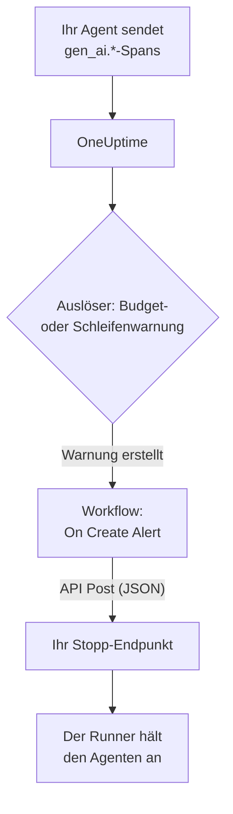

# Schutzschalter für KI-Agenten

Ein KI-Agent fällt selten aus, indem er abstürzt. Er fällt aus, indem er weitermacht: Er wiederholt ein defektes Tool, plant denselben Schritt noch einmal oder startet weitere Sub-Agenten, während jede Runde weitere Tokens kostet. Diese Seite baut dafür einen Schutzschalter aus Teilen, die OneUptime schon hat: eine Warnung, die den außer Kontrolle geratenen Agenten bemerkt, und einen Workflow, der einen Endpunkt in Ihrer Hand aufruft, um ihn zu stoppen.

:::cards
- [Einen Auslöser wählen](#einen-auslöser-wählen): Warnen bei Ausgaben oder bei einem Tool, das immer wieder aufgerufen wird.
- [Den Stopp-Endpunkt bauen](#den-stopp-endpunkt-bauen): Der kleine Dienst, der Ihren Agenten anhält.
- [Den Workflow bauen](#den-workflow-bauen): Von einer neuen Warnung zum Aufruf Ihres Endpunkts.
- [Den Schutzschalter testen](#den-schutzschalter-testen): Erst von Hand auslösen, dann echt.
:::

## So funktioniert es



Der Schutzschalter beobachtet das OpenTelemetry, das Ihr Agent ohnehin sendet, direkt oder [über ein Gateway](/docs/telemetry/ai-gateways), und handelt neben dem Anfragepfad, nicht in ihm. Keinem Modellaufruf wird etwas hinzugefügt, und ein Wechsel von Anbieter, SDK oder Gateway macht ihn nicht kaputt.

Der Preis ist die Geschwindigkeit: Er stoppt einen außer Kontrolle geratenen Agenten in Minuten, nicht in Millisekunden. Behalten Sie Schrittlimits und Timeouts im Agenten selbst, und lassen Sie den Schutzschalter auffangen, was daran vorbeikommt.

| Auslöser | Erkennt | Zeit bis zur Warnung |
| --- | --- | --- |
| Eine Budgetwarnung, von einem Metrics-Monitor | Ausgaben, die weiter steigen, egal warum | Bis zu 15 Minuten, plus eine Minute für den Monitor |
| Eine Schleifenwarnung, von einem Traces-Monitor | Dasselbe Tool, immer wieder aufgerufen | 1 bis 5 Minuten |

## Bevor Sie beginnen

- Ihr Agent sendet GenAI-Spans an OneUptime. Siehe [KI- / LLM-Observability](/docs/telemetry/ai-llm-observability).
- Ein HTTPS-Endpunkt, der Ihren Agent-Runner anhalten oder stoppen kann und von OneUptime aus erreichbar ist. Sie bauen ihn in [Den Stopp-Endpunkt bauen](#den-stopp-endpunkt-bauen).
- Die Berechtigung, im Projekt Monitore und Workflows zu erstellen.

## Einen Auslöser wählen

Beide Auslöser enden gleich: Ein Monitor erstellt eine Warnung, und die neue Warnung startet den Workflow. Sie können beide einrichten: Dem Workflow ist egal, welcher ausgelöst hat.

### Eine Budgetwarnung

Ausgaben sind das sicherste Zeichen eines außer Kontrolle geratenen Agenten. Ein Budget summiert alle 15 Minuten die KI-Ausgaben des Tages und veröffentlicht sie als zwei Metriken, `oneuptime.llm.budget.spend.usd` und `oneuptime.llm.budget.percent.used`, jede mit der ID des Budgets in `oneuptime.llm.budget.id`.

:::steps
1. Öffnen Sie **Produkte → KI / LLM → Budgets** und klicken Sie auf **LLM-Kostenbudget erstellen**. Legen Sie ein **Tagesbudget (USD)** fest und wählen Sie unter **Dienst (optional)** den Dienst des Agenten, damit das Budget nur diesen Agenten beobachtet.
2. Wählen Sie im Zeilenmenü des neuen Budgets **ID anzeigen** und kopieren Sie die ID.
3. Erstellen Sie einen [Metrics-Monitor](/docs/monitor/metrics-monitor) auf `oneuptime.llm.budget.percent.used`, gefiltert nach dem Attribut `oneuptime.llm.budget.id` mit der kopierten ID, und setzen Sie seinen **Zeitbereich** auf **Letzte 30 Minuten**.
4. Fügen Sie ein Kriterium **Greater Than Or Equal To** `100` hinzu, das eine Warnung erstellt, und geben Sie ihm einen **Warnungstitel**, der den Agenten nennt, etwa `LLM budget exceeded: support-bot`. Der Workflow und Ihr Endpunkt lesen beide diesen Titel.
:::

Filtern Sie nach der ID, nicht nach dem Namen: Wer ein Budget umbenennt, benennt seine Zeitreihe um, und ein nach dem alten Namen gefilterter Monitor träfe stillschweigend nichts mehr. Lassen Sie den Zeitbereich bei 30 Minuten: Ein Budget veröffentlicht alle 15 Minuten einen Punkt, also findet ein kürzerer Bereich zwischen zwei Punkten nichts, und die Warnung öffnet und schließt sich immer wieder.

Ein zweites Kriterium bei `80` mit einem niedrigeren Schweregrad warnt zuerst einen Menschen, über die Bereitschaftsrichtlinie der Warnung, bevor der Schutzschalter bei `100` auslöst.

### Eine Schleifenwarnung

Ein festgefahrener Agent hinterlässt eine Spur, die Sie erkennen: denselben Tool-Span, immer und immer wieder. Ein gesunder Lauf ruft ein Tool nicht dutzendfach in wenigen Minuten auf, also erkennt eine Zählung die Schleife lange vor dem Budget.

:::steps
1. Öffnen Sie **Monitore**, klicken Sie auf **Monitor erstellen** und wählen Sie **Traces** unter **Weitere Monitortypen**.
2. Setzen Sie unter **Weitere Felder** den Filter **Nach Telemetrie-Dienst filtern** auf den Dienst des Agenten und **Nach Attributen filtern** auf `gen_ai.tool.name` gleich dem Tool, bei dem Sie eine Schleife erwarten, etwa `search_web`. Wenn Ihre Instrumentierung den Span jedes Tools benennt, tragen Sie diesen Namen stattdessen in **Span-Name** ein.
3. Setzen Sie **Überwachungs-Traces für (time)** auf **Letzte 5 Minuten**.
4. Fügen Sie ein Kriterium **Span Count** **Greater Than** einer Zahl hinzu, die kein gesunder Lauf in fünf Minuten erreicht, etwa `50`, das eine Warnung mit einem Titel wie `Agent loop: support-bot` erstellt.
:::

Ein zweiter Traces-Monitor mit **Nach Span-Status filtern** auf **Fehler** und einer niedrigeren Zahl erkennt Wiederholungsstürme: ein Tool, das immer wieder fehlschlägt, und einen Agenten, der es immer wieder versucht.

## Den Stopp-Endpunkt bauen

Der Workflow sendet einen `POST` mit einem JSON-Body an einen Endpunkt, den Sie betreiben. Was „stoppen“ heißt, entscheiden Sie. Von der kleinsten Wirkung bis zur größten:

| Aktion | Wirkung |
| --- | --- |
| Neue Arbeit stoppen | Der Runner startet keine neuen Läufe für diesen Agenten |
| Seine Läufe abbrechen | Laufende Läufe dieses Agenten werden abgebrochen |
| Den Pool anhalten | Jeder Worker läuft leer, bis jemand den Schutzschalter zurücksetzt |

Ein minimaler Endpunkt in Express, der pro Agent einen Schutzschalter auslöst:

```typescript title="circuit-breaker.ts"
import express from "express";

const app = express();
app.use(express.json());

const tripped = new Set<string>(); // agents whose breaker is open

app.post("/circuit-breaker", (req, res) => {
  if (req.headers["authorization"] !== `Bearer ${process.env.KILL_TOKEN}`) {
    return res.status(401).end();
  }

  const alertTitle: string = req.body.alertTitle ?? "";

  // "LLM budget exceeded: support-bot" -> "support-bot"
  const agent: string = alertTitle.split(": ").pop() ?? "unknown";

  tripped.add(agent); // your run loop checks this set
  abortActiveRuns(agent); // cancel that agent's runs in flight

  // Answer fast; do the slow cleanup in the background.
  return res.status(200).json({ tripped: agent });
});
```

Bauen Sie ihn nach diesen Regeln:

- Machen Sie das Auslösen idempotent. Eine Vorwarnung und eine Überschreitung, oder eine Budget- und eine Schleifenwarnung zusammen, können ihn mehr als einmal auslösen, und ein zweites Auslösen darf nichts ändern.
- Antworten Sie innerhalb von ein, zwei Sekunden und räumen Sie im Hintergrund auf. Der Workflow wertet jede 2xx-Antwort als Erfolg.
- Verlangen Sie ein Geheimnis. Wer den Endpunkt aufrufen kann, kann Ihre Agenten stoppen, also prüfen Sie ein Bearer-Token, das der Workflow aus einer geheimen globalen Variable sendet.
- Setzen Sie ihn von Hand zurück. Ein ausgelöster Schutzschalter bleibt ausgelöst, bis sich jemand den Lauf angesehen hat: Öffnen Sie die Unterhaltung des Agenten unter **Produkte → KI / LLM → Unterhaltungen**, um nachzulesen oder abzuspielen, was er getan hat.

Die Anfrage geht von OneUptime aus. Bei OneUptime Cloud muss Ihr Endpunkt aus dem Internet erreichbar sein. Eine selbst betriebene Installation lehnt private Netzwerkadressen ab, außer ein Administrator erlaubt sie: Siehe [Ausgehender Netzwerkzugriff](/docs/workflows/configuration#ausgehender-netzwerkzugriff).

## Den Workflow bauen

Speichern Sie zuerst das Token des Endpunkts dort, wo der Workflow es nutzen kann, ohne es zu zeigen: Öffnen Sie **Arbeitsabläufe → Globale Variablen**, klicken Sie auf **Arbeitsablaufvariable erstellen**, nennen Sie sie `AGENT_KILL_TOKEN`, tragen Sie das Token unter **Inhalt** ein und schalten Sie **Geheimnis** ein. Ein geheimer Wert wird aus Ausführungsprotokollen und Schrittverläufen entfernt.

:::steps
### Den Workflow erstellen

Öffnen Sie **Produkte → Arbeitsabläufe** und klicken Sie auf **Arbeitsablauf erstellen**. Klicken Sie auf **Ohne Vorlage beginnen**, nennen Sie ihn `AI agent circuit breaker` und klicken Sie auf **Arbeitsablauf erstellen**. Er öffnet sich im **Editor**, ausgeschaltet.

### Den Trigger hinzufügen

Klicken Sie auf den gestrichelten Baustein **Wählen Sie, was diesen Arbeitsablauf startet** und wählen Sie **On Create Alert** im Bereich **Add Trigger**. Klicken Sie auf den Trigger, haken Sie unter **Select Fields** den Titel und die Beschreibung an und klicken Sie auf **Speichern**. Die ID auf dem Baustein, `alert-on-create-1`, ist der Name, unter dem spätere Bausteine auf ihn verweisen.

### Den Titel prüfen

Klicken Sie auf **Komponente hinzufügen**, wählen Sie **If / Else** und verbinden Sie den Punkt **Success** des Triggers damit. Setzen Sie **Value to check** auf den Titel der Warnung (klicken Sie auf **{ }** und wählen Sie ihn), **Comparison** auf **enthält** und **Compare with** auf den Anfang, den Ihre Auslösertitel gemeinsam haben, etwa `LLM budget exceeded`.

### Ihren Endpunkt aufrufen

Fügen Sie **API Post (JSON)** hinzu und verbinden Sie den Punkt **Yes** des **If / Else** damit. Setzen Sie seine **URL** auf Ihren Endpunkt, etwa `https://agents.example.com/circuit-breaker`, und füllen Sie die Header und den Body unten aus.

### Einen Fehlschlag melden

Fügen Sie **Send Message to Slack** oder **Send Email** hinzu und verbinden Sie den Punkt **Error** des API-Bausteins damit. Ein Schutzschalter, der nicht auslöst, ist genau die Warnung, die ein Mensch sehen muss.

### Ihn einschalten

Schalten Sie **Aktiviert** oben im **Editor** ein.
:::

Die **Request Headers** des API-Bausteins:

```json title="Request Headers"
{
  "Authorization": "Bearer {{global.variables.AGENT_KILL_TOKEN}}",
  "Content-Type": "application/json"
}
```

Sein **Request Body**:

```json title="Request Body"
{
  "source": "oneuptime-circuit-breaker",
  "alertId": "{{local.components.alert-on-create-1.returnValues.model._id}}",
  "alertTitle": "{{local.components.alert-on-create-1.returnValues.model.title}}",
  "alertDescription": "{{local.components.alert-on-create-1.returnValues.model.description}}"
}
```

Um auf mehrere Auslöser zu reagieren, beginnen Sie alle ihre Titel gleich, oder hängen Sie weitere **If / Else**-Bausteine an den Punkt **No**. Siehe [Einen Workflow erstellen](/docs/workflows/authoring) für die Arbeitsfläche und [Variablen](/docs/workflows/variables) für die `{{…}}`-Verweise.

## Den Schutzschalter testen

:::steps
1. Lösen Sie ihn von Hand aus. Öffnen Sie **Warnungen**, klicken Sie auf **Warnung erstellen** und erstellen Sie eine mit dem Titel `LLM budget exceeded: test`. Die Ausführung erscheint unter **Arbeitsabläufe → Protokolle → Ausführungen**, und Ihr Endpunkt erhält den Aufruf.
2. Lösen Sie ihn echt aus. Erstellen Sie ein Budget mit einem winzigen Limit, etwa `0.01` USD, auf dem Dienst eines Testagenten, richten Sie einen Budget-Monitor darauf und lassen Sie den Agenten laufen: Der Prozentsatz überschreitet 100, die Warnung öffnet sich, der Workflow läuft und der Schutzschalter löst aus. Für die Schleifenwarnung geben Sie einem Testagenten ein Tool, das immer fehlschlägt.
3. Lösen Sie ihn zweimal aus. Erstellen Sie dieselbe Warnung noch einmal: Ihr Endpunkt muss das zweite Auslösen hinnehmen, ohne etwas zu ändern.
:::

## Wie sich der Schutzschalter mit der Zeit verhält

- Der Workflow läuft, wenn eine Warnung erstellt wird, also löst ein Auslöser den Schutzschalter einmal pro Warnung aus, nicht einmal pro Auswertung.
- Ein Budget zählt den UTC-Tag, also beginnt sein Prozentsatz um Mitternacht UTC wieder bei 0. Eine Budgetwarnung kann sich dann schließen, und der nächste schlechte Tag öffnet eine neue Warnung, die den Schutzschalter erneut auslöst.
- Ein Monitor hält seine Warnung offen, solange seine Kriterien erfüllt sind. Mit **Warnung automatisch beheben** schließt sich die Warnung, wenn sie nicht mehr erfüllt sind, und die nächste Überschreitung öffnet eine neue Warnung.
- Das Zurücksetzen ist auf beiden Seiten die Entscheidung eines Menschen: Beheben Sie die Warnung in OneUptime, und setzen Sie den Schutzschalter in Ihrem Runner zurück.
- Jede neue Warnung im Projekt startet den Workflow. Das **If / Else** hält andere Warnungen vom Schutzschalter fern: Lassen Sie es nicht weg.

## Fehlerbehebung

:::details Der Workflow läuft nicht
Prüfen Sie, ob **Aktiviert** oben im **Editor** eingeschaltet ist: Workflows werden ausgeschaltet erstellt. Prüfen Sie dann, ob die Warnung erstellt wurde, nachdem Sie den Workflow eingeschaltet haben: Der Trigger startet eine Ausführung nur für eine neue Warnung.
:::

:::details Der Workflow läuft, nimmt aber immer den Zweig No
Der Titel ist leer oder passt nicht. Ein Feld, das unter **Select Fields** des Triggers nicht angehakt ist, kommt leer an, also haken Sie den Titel an. Vergleichen Sie dann den Titel der Warnung mit **Compare with**: **enthält** muss genau diesen Text darin finden.
:::

:::details Ihr Endpunkt antwortet mit 401
Der Header `Authorization` passt nicht zum Token, das Ihr Endpunkt erwartet. Prüfen Sie den Namen in `{{global.variables.AGENT_KILL_TOKEN}}` und den in der globalen Variable gespeicherten Wert. Der Wert einer geheimen Variable lässt sich nicht zurücklesen, also tippen Sie ihn im Zweifel mit **Inhalt aktualisieren** neu ein.
:::

:::details Die Budgetwarnung öffnet und schließt sich immer wieder
Der **Zeitbereich** des Monitors ist kürzer als die 15 Minuten zwischen zwei Punkten des Budgets. Setzen Sie ihn auf **Letzte 30 Minuten**.
:::

:::details Die Anfrage erreicht Ihren Endpunkt nie
Öffnen Sie die Ausführung unter **Arbeitsabläufe → Protokolle → Ausführungen** und darin den Schritt **API Post (JSON)**: Er sagt, warum die Anfrage fehlgeschlagen ist. Bei OneUptime Cloud muss der Endpunkt aus dem Internet erreichbar sein; eine selbst betriebene Installation lehnt private Netzwerkadressen ab, außer ein Administrator erlaubt sie.
:::

## Nächste Schritte

:::cards
- [KI- / LLM-Observability](/docs/telemetry/ai-llm-observability): Budgets, Kosten und die Spans, die der Schutzschalter beobachtet.
- [Traces-Monitor](/docs/monitor/traces-monitor): Span-Filter und Kriterien im Detail.
- [Workflows](/docs/workflows/index): Trigger, Komponenten, Variablen und Ausführungen.
- [KI-Gateways](/docs/telemetry/ai-gateways): Die Modellaufrufe aller Agenten über einen einzigen Export.
:::
