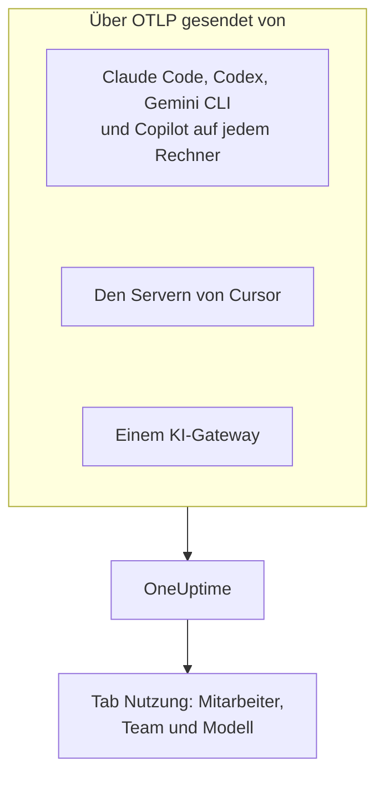

# KI-Coding-Assistenten

Ihre Entwickler nutzen Claude Code, Cursor, Codex, Gemini CLI und Copilot, und die Rechnungen wachsen. Diese Seite beantwortet die Fragen, die eine Führungskraft hat: **wer welches Tool nutzt, mit welchen Modellen, und was jede Person und jedes Team ausgibt**.

Die meisten Coding-Assistenten exportieren OpenTelemetry selbst, auf den Entwicklerrechnern ist also nichts zu installieren: Richten Sie den Export auf OneUptime, und Tokens, Kosten und Tool-Nutzung landen neben den eigenen KI-Aufrufen Ihrer Apps. Alles hier kommt über OpenTelemetry an; OneUptime fragt keine Admin- oder Abrechnungs-API eines Anbieters ab.

:::cards
- [Unterstützungsmatrix](#unterstützungsmatrix): Was jedes Tool sendet und ob es eine Person nennt.
- [Zuordnung zu Mitarbeitern und Teams](#zuordnung-zu-mitarbeitern-und-teams): Die Schlüssel, die den Ausgaben einen Namen und ein Team geben.
- [Der Tab Nutzung](#der-tab-nutzung): Was die Ausgabentabellen für einen Coding-Assistenten zeigen können und was nicht.
- [Wo Sie anfangen](#wo-sie-anfangen): Eine Einführungsreihenfolge, die am ersten Tag Ergebnisse zeigt.
:::

## So funktioniert es

Jedes Tool sendet seine Telemetrie mit Ihrem Ingestion-Schlüssel an den OTLP-Endpunkt von OneUptime: von jedem Entwicklerrechner, von den Servern des Anbieters (Cursor) oder von einem Gateway, über das Ihr Modellverkehr läuft.



## Bevor Sie beginnen

1. Erstellen Sie einen Telemetrie-Ingestion-Schlüssel unter **Projekteinstellungen → Telemetrie & APM → Ingestion-Schlüssel**.
2. Ihr OTLP-Endpunkt ist `https://oneuptime.com/otlp`, oder `https://YOUR-ONEUPTIME-HOST/otlp`, wenn Sie OneUptime selbst betreiben.
3. Jeder Export sendet den Schlüssel im Header `x-oneuptime-token`.

Ein Ingestion-Schlüssel für die ganze Flotte genügt. Er landet auf jedem Entwicklerrechner, behandeln Sie ihn also als gemeinsames Geheimnis, das nur Daten senden kann, und rotieren Sie ihn wie jedes andere.

## Unterstützungsmatrix

Drei Dinge entscheiden, was Sie von einem Tool bekommen: ob es überhaupt OpenTelemetry sendet, wie seine Telemetrie OneUptime erreicht und ob etwas darin eine Person nennt.

| Tool | Was es sendet | Wie es OneUptime erreicht | Wen es nennt | Anleitung |
| --- | --- | --- | --- | --- |
| Claude Code | Metriken und Logs; Traces in der Beta | Von jedem Rechner; Umgebungsvariablen oder eine verwaltete Einstellungsdatei | `user.email`, wenn mit einem Claude-Konto angemeldet | [Claude Code](/docs/telemetry/claude-code) |
| Cursor | Metriken und Logs | Von den Servern von Cursor, einmal im Dashboard von Cursor eingerichtet; nur im Enterprise-Tarif | `cursor.user.id`, eine Ganzzahl | [Cursor](/docs/telemetry/cursor) |
| OpenAI Codex | Traces, Metriken und Logs, jeweils in `~/.codex/config.toml` eingeschaltet | Von jedem Rechner, eine vollständige URL pro Signal | Niemanden in Spans oder Metriken: Sie setzen `user.id` und `user.email` in `[otel.span_attributes]` | [OpenAI Codex](/docs/telemetry/openai-codex) |
| Gemini CLI | Traces, Metriken und Logs | Von jedem Rechner, meist über einen lokalen Collector | `user.email`, wenn angemeldet | [Gemini CLI & GitHub Copilot](/docs/telemetry/gemini-cli-and-copilot) |
| GitHub Copilot | Traces, Metriken und Logs, nur aus seinen Agenten-Oberflächen | Vom Editor oder vom Agenten-Host | Niemanden: Sie setzen `enduser.id` und `user.email` auf jedem Rechner | [Gemini CLI & GitHub Copilot](/docs/telemetry/gemini-cli-and-copilot) |
| Cline | Metriken und Logs | Zentral konfiguriert, im Organisations-Dashboard von Cline | Eine anonymisierte `user_id` | — |
| LiteLLM und Portkey | Traces jedes Aufrufs durch das Gateway | Vom Gateway-Prozess | Bei LiteLLM die Person, der der virtuelle Schlüssel gehört | [KI-Gateways](/docs/telemetry/ai-gateways) |
| Ihre eigenen Apps | Was Ihre GenAI-Instrumentierung sendet | Von Ihrer App | Wen Sie als `user.id` setzen | [KI- / LLM-Observability](/docs/telemetry/ai-llm-observability) |
| Windsurf, JetBrains AI, Amazon Bedrock, Azure OpenAI | Kein eigenes OpenTelemetry | Nur über ein vorgeschaltetes Gateway | Wen das Gateway nennt | [KI-Gateways](/docs/telemetry/ai-gateways) |

Ein Strich bedeutet, dass OneUptime für das Tool noch keine Anleitung hat. Seine Telemetrie wird trotzdem wie jedes andere OpenTelemetry aufgenommen.

:::details Was GitHub Copilot genau exportiert
Copilot exportiert OpenTelemetry nur aus seinen Agenten-Oberflächen: Chat und Agentenmodus in VS Code, dem Agenten-Host hinter Copilot CLI, dem Copilot SDK und Agenten-Workflows in JetBrains-IDEs über das Copilot-Plugin. GitHub dokumentiert keinen Export für Inline-Vervollständigungen, Copilot auf github.com oder das Code-Review von Copilot. Copilot sendet keinerlei Benutzerattribut, setzen Sie also `enduser.id` und `user.email` pro Rechner über `resourceAttributes` oder `OTEL_RESOURCE_ATTRIBUTES`.
:::

:::details Amazon Bedrock, Azure OpenAI, Windsurf und JetBrains AI
- **Amazon Bedrock**: Die APIs `InvokeModel` und `Converse` senden kein OpenTelemetry. Bedrock AgentCore ist anders: AWS dokumentiert dafür Metriken, Spans und Logs, standardmäßig an CloudWatch gesendet. `DISABLE_ADOT_OBSERVABILITY=true` schaltet die Standard-ADOT-Konfiguration der Runtime ab, sodass Sie das ADOT SDK stattdessen auf OneUptime richten können.
- **Azure OpenAI**: Der Dienst sendet nichts, und seine Azure-Monitor-Metriken haben keine Benutzerdimension. Instrumentieren Sie den Client oder schalten Sie API Management oder ein anderes Gateway davor.
- **Windsurf**: dokumentiert keinen Telemetrie-Export. Daten pro Benutzer liegen in der Enterprise-API von Windsurf, die OneUptime nicht abfragt.
- **JetBrains AI Assistant und Junie**: exportieren keine Nutzung. Das OpenTelemetry-Plugin von JetBrains empfängt die Telemetrie Ihrer eigenen App in der IDE; es sendet nichts nach außen.
:::

## Zuordnung zu Mitarbeitern und Teams

OneUptime kopiert die Person, die einen Aufruf gemacht hat, und ihr Team beim Eintreffen der Telemetrie in Spalten, sodass der Tab **Nutzung** Personen und Teams ohne Attributfilter reihen kann.

### Als Mitarbeiter gelesene Attribute

Auf einem Span gewinnt der erste vorhandene Schlüssel, in dieser Reihenfolge:

| Spalte | Schlüssel, bevorzugte zuerst |
| --- | --- |
| Mitarbeiter-ID | `user.id`, `enduser.id`, `litellm.metadata.user_api_key_user_id`, `metadata.user_api_key_user_id`, `traceloop.association.properties.user_id`, `langfuse.user.id`, `user.account_uuid`, `user.account_id`, `cursor.user.id` |
| Mitarbeiter-E-Mail | `user.email`, `litellm.metadata.user_api_key_user_email`, `metadata.user_api_key_user_email`, `traceloop.association.properties.user_email`, `enduser.email` |
| Team / Kostenstelle | `team.id`, `team`, `cost_center`, `department`, `litellm.metadata.user_api_key_team_id`, `litellm.team.id`, `metadata.user_api_key_team_id`, `cursor.team.id` |

Auf einem Metrik-Datenpunkt ist die Liste kürzer und beginnt mit der E-Mail, weil die Coding-Assistenten, die Metriken senden, `user.email` selbst senden:

| Spalte | Schlüssel, bevorzugte zuerst |
| --- | --- |
| Mitarbeiter | `user.email`, `user.id`, `user.account_uuid`, `user.account_id`, `cursor.user.id` |
| Team / Kostenstelle | `team.id`, `team`, `cost_center`, `department`, `cursor.team.id` |
| Modell | `gen_ai.request.model`, `model`, `cursor.model.name` |

So werden diese Schlüssel gelesen:

- **Jeder Schlüssel wird auch mit dem Präfix `resource.` gelesen.** Der OTLP-Ingest speichert Ressourcenattribute unter diesem Präfix, `OTEL_RESOURCE_ATTRIBUTES=team.id=platform` kommt also als `resource.team.id` an. Die Schlüssel ohne Präfix werden zuerst probiert, sodass ein Wert am Span einen Wert für den ganzen Prozess schlägt.
- **Der Tab Nutzung zeigt die E-Mail einer Person, wenn der Aufruf eine hat, und sonst die ID.** Zeilen mit derselben E-Mail werden zusammengezählt, sodass ein Entwickler auf zwei Rechnern eine Zeile ist.
- **Identität wird nur aus KI-Aufrufen gelesen.** `user.id`, `user.email` und `team.id` sind generische Schlüssel, die auch Browser- und Backend-Spans tragen; nur Spans, die bereits als KI-Aufrufe erkannt sind, bekommen die Spalten.
- **Log-Einträge werden nicht auf Identität gelesen.** Das betrifft Codex, das `user.email` nur in seine Logs schreibt.
- LiteLLM schreibt diese Schlüssel auf zwei Arten: Sein Standard-Callback `otel` nutzt das Präfix `metadata.`, sein optionaler OpenTelemetry-v2-Modus (`LITELLM_OTEL_V2=true`) den Namensraum `litellm.`. OneUptime liest beide, ein unveränderter Proxy funktioniert also ohne weitere Einrichtung.

### Teams und Kostenstellen

Keine Instrumentierung sendet `team.id`, `team`, `cost_center` oder `department`: Ihre Organisation setzt sie, meist über `OTEL_RESOURCE_ATTRIBUTES` am Prozess des Tools.

```bash
export OTEL_RESOURCE_ATTRIBUTES="team.id=platform,team=Platform_Engineering,cost_center=eng-123,department=engineering"
```

Setzen Sie es dort, wo Sie Entwicklerrechner ohnehin einrichten: in einem MDM-Profil, einer verwalteten Einstellungsdatei oder einem Shell-Profil aus Ihren Dotfiles. Werte dürfen keine Leerzeichen enthalten: Verwenden Sie Unterstriche oder Prozentkodierung wie `%20`. Codex hat keine Ressourcenattribute, setzen Sie dieselben Schlüssel dort stattdessen in `[otel.span_attributes]`.

Um Ausgaben nach Anwendung zu trennen, nutzen Sie den Dienstnamen (`OTEL_SERVICE_NAME` oder die eigene Einstellung des Tools). Die Aufschlüsselung **Anwendung / Dienst** deckt nur Tools ab, die GenAI-Spans senden.

### Was bewusst nicht als Mitarbeiter gilt

Ein Aufruf kann zwei verschiedene Personen tragen: den Mitarbeiter, der ihn gemacht hat, und den Kunden, für den er gemacht wurde. Diese Schlüssel tragen den Kunden, und OneUptime liest sie nie in eine Identitätsspalte:

- `gen_ai.user` und `llm.user`: so geben Instrumentierungen den Anfrageparameter `user` von OpenAI wieder, den OpenAI als Kennung Ihrer Endbenutzer beschreibt.
- `litellm.metadata.user_api_key_end_user_id`, `metadata.user_api_key_end_user_id` und `litellm.end_user.id`: der Endbenutzer bei LiteLLM, im Gegensatz zur Person, der der Schlüssel gehört, also dem Mitarbeiter.

Eine Kunden-ID als Mitarbeiter zu lesen, machte aus einem Support-Bot, der 40.000 Kunden bedient, 40.000 Phantom-Mitarbeiter, während der Entwickler, dem die Ausgaben gehören, scheinbar nichts ausgäbe. Die Schlüssel bleiben in den Attributen des Spans, und der Tab **LLM** im Trace-Viewer zeigt sie als Endbenutzer.

### Datenschutz

Die Spalte mit der E-Mail des Mitarbeiters enthält personenbezogene Daten. Die **Scrub-Regeln** der Traces decken sie genauso ab wie das Attribut, aus dem sie gelesen wurde, eine Regel, die E-Mails maskiert, maskiert also auch die Spalte. Sie finden sie unter **Traces → Einstellungen**.

## Metriken der Coding-Assistenten, die OneUptime liest

Die Coding-Assistenten benennen ihre Metriken mit eigenem Präfix statt `gen_ai.*`, daher kennt OneUptime jede einzelne beim Namen:

| Metrik | Tool | Einheit |
| --- | --- | --- |
| `claude_code.token.usage` | Claude Code | Tokens |
| `claude_code.cost.usage` | Claude Code | USD |
| `cursor.token.usage` | Cursor | Tokens |
| `cursor.cost.usage` | Cursor | USD, laut Cursor selbst eine Schätzung |
| `codex.turn.token_usage` | OpenAI Codex | Tokens |
| `codex.turn.cost_microusd` | OpenAI Codex | Millionstel USD: OneUptime rechnet sie um, tun Sie es nicht |

OneUptime liest außerdem Tokens aus `gen_ai.client.token.usage`, `gen_ai.client.token.count`, `llm.token.usage` und `llm.usage.tokens`, und Kosten aus `gen_ai.client.cost`, `gen_ai.client.cost.usd`, `gen_ai.usage.cost`, `litellm_spend_metric` und `litellm.cost.total`.

Zwei Dinge, bevor Sie die Zahlen lesen:

- **`gemini_cli.token.usage` bleibt absichtlich außen vor.** Gemini CLI sendet seine Tokens zweimal, als eigene Metrik und als `gen_ai.client.token.usage`, und beide zu lesen würde sie verdoppeln. Seine Tokens werden einmal gezählt, über `gen_ai.client.token.usage`. Gemini CLI sendet keine Kostenmetrik: Schalten Sie seine Traces ein, damit jeder Aufruf bepreist wird.
- **Nur Eingabe- und Ausgabe-Tokens werden gezählt.** Der Token-Typ wird aus `gen_ai.token.type`, `llm.token.type`, `type`, `cursor.token.type` oder `token_type` gelesen, und nur `input` und `output` (oder die älteren `prompt` und `completion`) zählen. Cache-Lese- und -Schreibvorgänge, `total` von Codex (das die anderen wiederholt) und `reasoning_output` (Teil von `output`) bleiben außen vor, eine aus Metriken stammende Summe ist also kleiner als die Summe von allem, was ein Tool sendet.

## Der Tab Nutzung

Öffnen Sie **Produkte → KI / LLM** und gehen Sie zu **Nutzung**. Er reiht **Mitarbeiter**, **Team**, **Modell**, **Anbieter** und **Anwendung / Dienst** nach Ausgaben, über die letzten 7 Tage, wenn Sie keinen anderen Zeitraum wählen. Aufrufe, die niemanden nennen, werden unter **Nicht zugeordnet** gezählt: Eine große Zeile **Nicht zugeordnet** zeigt Ihnen, welches Tool noch eine Identität braucht.

### Metriken der Coding-Assistenten sind ein Ersatz, keine Ergänzung

GenAI-Spans gehen vor: Die Metriken werden nur für eine Zahl gelesen, zu der die Spans nichts gemeldet haben, und beide werden nie addiert ([warum](/docs/telemetry/ai-llm-observability#spans-zuerst-metriken-springen-ein)). Für Coding-Assistenten hat das eine harte Folge: **Wenn dasselbe Projekt GenAI-Spans mit Kosten empfängt, erscheinen die Ausgaben der Coding-Assistenten nicht.** Geben Sie den Coding-Assistenten ein eigenes Projekt, mit eigenem Ingestion-Schlüssel.

Wenn der Ersatz greift, zeigt jede Aufschlüsselung für ein Tool, das nur Metriken sendet, Folgendes:

| Aufschlüsselung | Aus Metriken |
| --- | --- |
| **Mitarbeiter** | Ja, aus jedem Identitätsschlüssel oben, ohne Präfix und mit `resource.`-Präfix |
| **Team** | Ja, aus den Team-Schlüsseln |
| **Modell** | Ja: Claude Code und Codex senden ein `model` ohne Präfix, Cursor `cursor.model.name` |
| **Anbieter** | Nein: Die Metriken der Coding-Assistenten nennen keinen Anbieter |
| **Anwendung / Dienst** | Nein: Ihre Metriken gehören zu keinem OneUptime-Dienst |

Eine aus Metriken gelesene Zeile trägt nur Kosten: Ihre Zellen für Aufrufe und Tokens zeigen `—`, weil ein Ausgabenzähler keine Details pro Aufruf hat und eine 0 dort behaupten würde, die Person hätte keine Aufrufe gemacht. Die Tabelle ist mit **aus GenAI-Metriken** markiert.

## Kein OpenTelemetry? Schalten Sie ein Gateway davor

Für Windsurf, JetBrains AI, die Modell-APIs von Bedrock, Azure OpenAI und alles andere ohne eigenen Export schalten Sie ein KI-Gateway davor. Jeder Aufruf geht dann durch einen Prozess, der OpenTelemetry sendet, und Sie konfigurieren den Export einmal.

**Nutzen Sie LiteLLM mit einem virtuellen Schlüssel pro Mitarbeiter.** LiteLLM schreibt ID und E-Mail der Person, der der Schlüssel gehört, auf jeden Span, was OneUptime als Mitarbeiter liest, und das Team des Schlüssels als Team. Es bepreist außerdem jeden Aufruf selbst, mit den eigenen Tarifen, die Sie am Proxy festlegen, und seine gemeldeten Kosten gehen der Schätzung von OneUptime vor. Nutzen Sie dafür nicht seine Endbenutzer-ID: Das ist der Kunde. Die Einrichtung steht unter [KI-Gateways](/docs/telemetry/ai-gateways).

Zwei Grenzen, bevor Sie mit einem Gateway planen:

- **Ein Gateway sieht nur Verkehr, der durch es läuft.** Die eigene Base-URL-Überschreibung von Cursor ist eine Einstellung pro Benutzer, die nur Chat-Modelle abdeckt (die Tab-Vervollständigung nutzt weiter die Modelle von Cursor), bevorzugen Sie also den nativen Export von Cursor.
- **Ein Gateway sieht den Modellaufruf, nicht den Agenten.** Es zeichnet Prompts und Antworten auf, aber nicht die Tool-Aufrufe, Dateiänderungen und Annahme- oder Ablehnungsentscheidungen, die die eigene Telemetrie eines Tools meldet.

## Prompt-Inhalte: die Standards unterscheiden sich je Tool

Prompts und Antworten sind die riskantesten Daten in dieser Pipeline: Sie enthalten regelmäßig Quellcode, Kundendaten und eingefügte Zugangsdaten. Prüfen Sie den Standard jedes Tools:

| Tool | Prompt-Inhalte standardmäßig |
| --- | --- |
| Claude Code | Aus: Jede Art von Inhalt hat ihre eigene Opt-in-Variable |
| Cursor | Aus: Nur die optionale Familie `conversation_content` sendet Nachrichtentext |
| OpenAI Codex | Aus: `log_user_prompt` ist standardmäßig `false` |
| Gemini CLI | **An**: `logPrompts` ist standardmäßig `true`, setzen Sie es also auf `false`, wenn Sie die Telemetrie einschalten |
| GitHub Copilot | Aus: `captureContent`, das verwaltete Einstellungen mit `lockCaptureContent` festschreiben können |
| LiteLLM | An mit dem Standard-Callback `otel` (abschalten mit `turn_off_message_logging`); aus im OpenTelemetry-v2-Modus |

Codex sendet seine Metriken außerdem standardmäßig an OpenAI: siehe [OpenAI Codex](/docs/telemetry/openai-codex). Wo Sie Inhalte bewusst erfassen, gelten die **Scrub-Regeln** und **Drop-Filter** der Traces dafür wie für jede andere Telemetrie.

## Was OneUptime noch nicht tut

- **Keine Connectoren für Admin- oder Abrechnungs-APIs der Anbieter.** OneUptime fragt weder die Admin-API von Anthropic noch die Admin-API von Cursor, die Nutzungs- und Kosten-Endpunkte von OpenAI, die Copilot-Abrechnung von GitHub oder die APIs von Windsurf oder JetBrains ab. Für rechnungsgenaue Zahlen holen Sie sie beim Anbieter.
- **Kosten sind eine Schätzung, außer ein Tool meldet sie.** Gemeldete Kosten werden unverändert verwendet; sonst bepreist OneUptime Tokens zu Listenpreisen. `cursor.cost.usage` von Cursor ist selbst eine Schätzung.
- **Identität aus Log-Einträgen wird nicht gelesen.** Die `user.email` von Codex, die es nur in Logs sendet, wird nicht mit den Ausgaben verknüpft.
- **`cursor.user.email` von Cursor wird noch nicht gelesen**, Cursor-Benutzer erscheinen also als ihre Ganzzahl `cursor.user.id`.
- **Codex-Spans nennen kein Modell**, daher kann OneUptime sie nicht bepreisen: Codex zeigt Tokens pro Person und seine Kosten nur in den Summen.
- **Tools ändern sich schnell.** Wenn diese Seite sagt, ein Tool habe keinen Export, prüfen Sie seine aktuelle Dokumentation, bevor Sie um ein Gateway herum bauen.

## Wo Sie anfangen

Führen Sie es in dieser Reihenfolge ein; jeder Schritt nützt für sich. Nutzen Sie ein Projekt, das noch keine GenAI-Spans aus Ihren eigenen Apps empfängt, sonst hält [die Ersatzregel](#metriken-der-coding-assistenten-sind-ein-ersatz-keine-ergänzung) die Ausgaben der Coding-Assistenten von der Seite fern.

1. **Gemini CLI**, falls es jemand nutzt. Es sendet `user.email` ohne Einrichtung und zeigt so die Zuordnung von Anfang bis Ende. Schalten Sie auch seine Traces ein: Es sendet keine Kostenmetrik.
2. **Claude Code**: eine verwaltete Einstellungsdatei für die Flotte, `user.email` ohne Zutun, eine echte Kostenmetrik sowie Annahmequote, Commits, Pull Requests und Codezeilen pro Entwickler.
3. **Cursor**, im Enterprise-Tarif: ein Bildschirm im Dashboard von Cursor, kein Entwicklerrechner berührt, auch wenn Personen als Ganzzahlen ankommen.
4. **Copilot und Codex**, die beide auf jedem Rechner eine Identität brauchen. Setzen Sie sie bei der Einrichtung der Rechner: Aufrufe, die ohne eine ankamen, lassen sich später nicht zuordnen.
5. **Ein LiteLLM-Gateway** für alles andere, mit einem virtuellen Schlüssel pro Mitarbeiter.

## Nächste Schritte

:::cards
- [Claude Code](/docs/telemetry/claude-code): Den Export von Claude Code für einen Rechner oder die ganze Flotte einschalten.
- [Cursor](/docs/telemetry/cursor): Die Team-Telemetrie von Cursor aus dem Dashboard von Cursor senden.
- [OpenAI Codex](/docs/telemetry/openai-codex): Die drei Exporter von Codex konfigurieren und seinen Spans eine Identität geben.
- [KI- / LLM-Observability](/docs/telemetry/ai-llm-observability): Unterhaltungen, Warnungen, Kosten und Budgets für jeden KI-Aufruf.
:::
