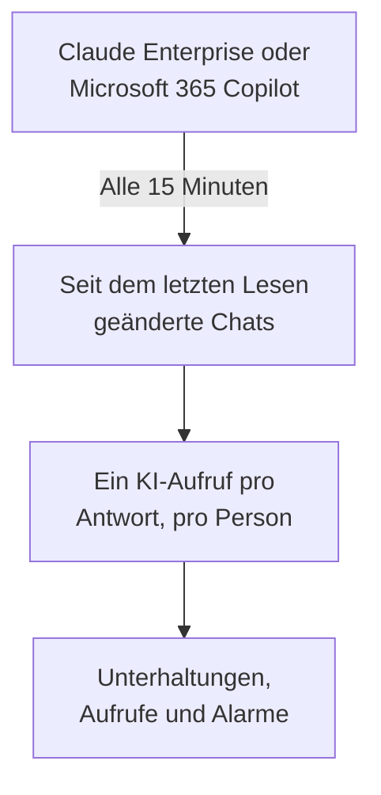

# KI-Tools im Unternehmen

Sehen Sie, was Ihre Leute die KI-Tools fragen, die Ihr Unternehmen bezahlt, als Unterhaltungen pro Person. Verbinden Sie Claude Enterprise oder Microsoft 365 Copilot mit Zugangsdaten, die nur lesen können, und OneUptime holt jeden neuen Chat alle 15 Minuten in **Unterhaltungen**. Nur Projektinhaber und Admins können sie lesen, es sei denn, Sie entscheiden anders.

:::cards
- [Zuerst Ihre Leute informieren](#zuerst-ihre-leute-informieren): Ihre Chats sind ihre eigenen Worte.
- [Ein Tool verbinden](#ein-tool-verbinden): Zugangsdaten einfügen, wählen, wer lesen darf, testen und verbinden.
- [Datenschutz](#datenschutz): Wer die Unterhaltungen lesen darf und ob die Worte behalten werden.
- [Andere KI-Tools](#andere-ki-tools): ChatGPT Enterprise, Gemini, Open WebUI, LibreChat und Coding-Assistenten.
:::

## Zuerst Ihre Leute informieren

> [!IMPORTANT]
> Das sind die eigenen Worte Ihrer Leute. Sagen Sie ihnen, bevor Sie ein Tool verbinden, dass ihre Chats damit gespeichert werden und wer sie lesen kann, und klären Sie mit Ihrer Rechts- oder Personalabteilung, was Ihre Richtlinien und das örtliche Recht verlangen.

## So funktioniert es

Alle 15 Minuten fragt OneUptime das Tool nach den Chats, die sich seit dem letzten Lesen geändert haben. Jede Antwort wird zu einem KI-Aufruf der Person, die gefragt hat, mit den Fragen seit der vorigen Antwort, und jeder Chat wird zu einer Unterhaltung.

Die Chats kommen so an wie die KI-Aufrufe Ihrer Apps, also gelten Scrub-Regeln, Drop-Filter, Aufbewahrung und die KI-Alarme für sie. Die Tools werden pro Lizenz bezahlt, daher tragen diese Aufrufe weder Tokens noch Kosten. Eine Frage, die eine Stunde lang keine Antwort hat, kommt für sich allein an, sodass auch ein Chat erscheint, den die KI nie beantwortet hat.

## Bevor Sie beginnen

- Die Rolle Project Owner oder Project Admin. Nur sie können ein Tool verbinden, ändern oder entfernen.
- Eine Administratorin oder ein Administrator des Tools, um die Zugangsdaten zu erstellen: Der Abschnitt jedes Tools unten nennt, wer.
- Ihre Leute informiert, und die Antwort Ihrer Rechts- oder Personalabteilung.

## Ein Tool verbinden

:::steps
### Verbinden öffnen

Öffnen Sie **Produkte → KI / LLM → Verbinden**. Klicken Sie unter **Die KI-Tools deines Unternehmens** auf die Kachel des Tools.

### Die Zugangsdaten einfügen

Füllen Sie unter **Anmeldedaten** aus, was das Tool verlangt. Geheimnisse werden verschlüsselt gespeichert und nie wieder angezeigt.

### Wählen, wer lesen darf

Setzen Sie unter **Datenschutz** **Wer Unterhaltungen lesen kann** und **Geschriebenes behalten**, wie [Datenschutz](#datenschutz) erklärt.

### Testen

Klicken Sie unter **Testen** auf **Verbindung testen**. OneUptime zählt die Chats der letzten 7 Tage: Nichts, was jemand geschrieben hat, wird gelesen, angezeigt oder gespeichert.

### Verbinden

Klicken Sie auf **Verbinden**. Das erste Lesen beginnt innerhalb einer Minute und holt die letzten 7 Tage.
:::

## Claude Enterprise

OneUptime liest jeden claude.ai-Chat Ihrer Organisation über die Compliance API: wer gefragt hat, was Claude gefragt wurde, was es geantwortet hat und welches Modell es genutzt hat. Ein Chat, der eine neue Nachricht bekommt, wird erneut gelesen, und die schon geholten Antworten werden erkannt und übersprungen.

:::steps
### Die Compliance API einschalten

Der Primary Owner Ihrer Organisation öffnet in claude.ai Organization settings, API und schaltet die Compliance API ein.

### Einen Compliance-Zugriffsschlüssel erstellen

Erstellen Sie dort einen Schlüssel mit dem Scope `read:compliance_user_data`. Er beginnt mit `sk-ant-api01-`.

### Claude Enterprise verbinden

Fügen Sie den Schlüssel als **Compliance-Zugriffsschlüssel** ein.
:::

## Microsoft 365 Copilot

OneUptime liest den Copilot-Interaktionsverlauf jeder Person aus Microsoft Graph: was sie Copilot in Teams, Outlook, Word, Excel, PowerPoint, Loop oder Copilot Chat gefragt hat, was er geantwortet hat und in welcher App. Ein Prompt und seine Antworten werden zu einem KI-Aufruf, eine Copilot-Sitzung zu einer Unterhaltung. Ein großer Tenant wird in Teilen gelesen und dort fortgesetzt, wo das letzte Lesen aufgehört hat.

:::steps
### Eine App registrieren

Registrieren Sie in Microsoft Entra ID eine App und erstellen Sie ein Client-Secret für sie.

### Die Berechtigungen erteilen

Geben Sie der App die Anwendungsberechtigungen `AiEnterpriseInteraction.Read.All` und `User.Read.All` von Microsoft Graph und erteilen Sie die Administratorzustimmung (admin consent).

### Copilot verbinden

Füllen Sie **Verzeichnis-ID (Tenant)**, **Anwendungs-ID (Client)** und **Client-Secret** aus. Um nur einige Personen zu lesen, tragen Sie die Objekt-ID einer Gruppe in **Nur Personen in dieser Gruppe** unter **Weitere Felder** ein und geben Sie der App auch `GroupMember.Read.All`. Für Azure Government ändern Sie dort **Cloud**.
:::

## Datenschutz

| Einstellung | Was sie bewirkt |
| --- | --- |
| **Wer Unterhaltungen lesen kann** | **Projektinhaber und Admins**, die Voreinstellung: Niemand sonst im Projekt sieht diese Unterhaltungen oder die KI-Aufrufe, aus denen sie bestehen, irgendwo in OneUptime. **Alle, die KI-Aufrufe lesen dürfen**: alle, die die Traces des Projekts lesen dürfen. |
| **Geschriebenes behalten** | An, die Voreinstellung: Fragen und Antworten werden behalten. Aus: OneUptime behält, wer gefragt hat, wann, mit welchem Modell und in welcher App, aber nicht die Worte. |

Eine Änderung daran, wer lesen darf, gilt innerhalb einer Minute. **Geschriebenes behalten** auszuschalten gilt für die danach gelesenen Chats; was vorher behalten wurde, bleibt bis zum Ende seiner Aufbewahrung.

Um die Worte zu behalten, aber Teile davon zu maskieren, etwa E-Mail-Adressen oder Kartennummern, nutzen Sie **Scrub-Regeln** unter **Traces → Einstellungen**: Sie greifen, bevor irgendetwas gespeichert wird. Die Unterhaltungen werden so lange behalten, wie der Dienst der Verbindung seine Traces behält: siehe [Datenaufbewahrung](/docs/telemetry/data-retention). Das Entfernen einer Verbindung beendet ihr Lesen; was sie gelesen hat, bleibt, lesbar für dieselben Personen, bis seine Aufbewahrung endet.

## Andere KI-Tools

Diese Tools haben keine API, mit der OneUptime die Chats der Leute lesen kann, oder brauchen einen anderen Weg.

### ChatGPT Enterprise

OpenAI öffnet seine Compliance API für einen Workspace nur auf Anfrage und veröffentlicht nicht, was ihre Einträge enthalten, daher kann OneUptime Chats aus ChatGPT Enterprise noch nicht lesen. Ihre OpenAI-Organisation als [Anbieterkonto](/docs/telemetry/ai-provider-accounts#openai) zu verbinden, zeigt ihre API-Nutzung und -Kosten, die ChatGPT nicht enthalten.

### Gemini für Google Workspace

Google bietet keine API, um die Gemini-Chats der Leute zu lesen. Google Vault bewahrt sie für eDiscovery auf.

### Coding-Assistenten

Claude Code, Codex, Gemini CLI, GitHub Copilot und Cursor senden ihr eigenes OpenTelemetry: siehe [KI-Coding-Assistenten](/docs/telemetry/ai-coding-assistants).

### Open WebUI und LibreChat

Selbst gehostete Chat-Apps rufen die Modelle über eine API auf, die Sie festlegen. Schalten Sie einen LiteLLM-Proxy vor die Modelle und senden Sie seine Traces an OneUptime, wie [KI-Gateways](/docs/telemetry/ai-gateways#litellm-proxy) zeigt: Prompts und Antworten jedes Chats kommen als KI-Aufrufe an. Ein virtueller Schlüssel pro Person nennt, wer gefragt hat; ein Schlüssel, den alle teilen, nennt niemanden. Der eigene OpenTelemetry-Export von Open WebUI erfasst seine Webanfragen und Datenbankaufrufe, nicht die Chats.

## Fehlerbehebung

:::details Der Test findet keine Chats
In den letzten 7 Tagen hat niemand das Tool genutzt, oder die Zugangsdaten gehören zu einer anderen Organisation oder einem anderen Tenant. Prüfen Sie bei Copilot, dass die Gruppe unter **Nur Personen in dieser Gruppe** die gemeinte ist.
:::

:::details Die Zugangsdaten funktionieren, dürfen aber nicht lesen, was die Verbindung braucht
Erteilen Sie bei Copilot die Administratorzustimmung für die Graph-Berechtigungen der App, und auch `GroupMember.Read.All`, wenn Sie eine Gruppe nennen. Erstellen Sie bei Claude Enterprise den Schlüssel mit dem Scope `read:compliance_user_data`.
:::

:::details Jemand sieht die Unterhaltungen nicht
**Wer Unterhaltungen lesen kann** steht auf **Projektinhaber und Admins**. Ein Inhaber oder Admin kann es mit **Bearbeiten** in der Zeile der Verbindung ändern.
:::

:::details Die Unterhaltungen zeigen, wer gefragt hat, aber keine Worte
**Geschriebenes behalten** war aus, als sie gelesen wurden. Das Einschalten gilt für die danach gelesenen Chats.
:::

## Nächste Schritte

:::cards
- [KI- / LLM-Observability](/docs/telemetry/ai-llm-observability): Unterhaltungen lesen und abspielen und erfahren, wenn Antworten schiefgehen.
- [KI-Anbieterkonten](/docs/telemetry/ai-provider-accounts): Nutzung und Kosten Ihrer Konten bei OpenAI, Anthropic, Azure, Bedrock und Vertex AI.
- [KI-Coding-Assistenten](/docs/telemetry/ai-coding-assistants): Ausgaben pro Entwickler für die Coding-Tools.
- [Datenaufbewahrung](/docs/telemetry/data-retention): Wie lange die Unterhaltungen behalten werden.
:::
