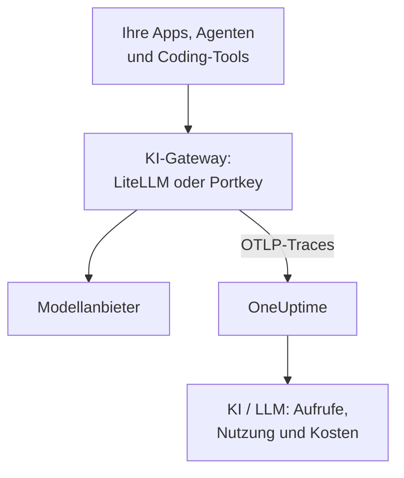

# KI-Gateways (LiteLLM, Portkey)

Ein KI-Gateway sitzt zwischen Ihren Apps und den Modellanbietern, also läuft jeder Modellaufruf durch es hindurch. Senden Sie das OpenTelemetry des Gateways einmal an OneUptime, und jeder Aufruf dahinter kommt in [KI / LLM](/docs/telemetry/ai-llm-observability) an, mit Modell, Tokens, Kosten und, sofern Sie es nicht abschalten, dem Prompt und der Antwort, ohne jede App zu instrumentieren.

:::cards
- [LiteLLM Proxy](#litellm-proxy): Eingebauter Export, mit drei Variablen eingestellt.
- [Wer was ausgegeben hat](#ein-virtueller-schlüssel-pro-mitarbeiter): Ein virtueller LiteLLM-Schlüssel pro Mitarbeiter nennt jede Person.
- [Portkey](#portkey): Eingebauter Export auf selbst betriebenen Gateways; sonst die App instrumentieren.
- [Prüfen, ob Aufrufe ankommen](#prüfen-ob-aufrufe-ankommen): Was Sie sehen sollten, und was zu tun ist, wenn nicht.
:::

## So funktioniert es



| | LiteLLM Proxy | Portkey, selbst betrieben oder Enterprise | Portkey, Open Source oder gehostet |
| --- | --- | --- | --- |
| Export an OneUptime | Eingebaut | Eingebaut, experimentell | Keiner: stattdessen die App instrumentieren |
| Einzustellender Endpunkt | `https://oneuptime.com/otlp/v1/traces` | `https://oneuptime.com/otlp` | Der eigene Exporter der App |
| Nennt jede Person | Ja, mit einem virtuellen Schlüssel pro Mitarbeiter | Nein | Nur, was die App sendet |
| Prompts und Antworten | Gesendet, sofern Sie sie nicht abschalten | Immer gesendet | Hängt von der Instrumentierung ab |

## Bevor Sie beginnen

- Ein Ingestion-Schlüssel: Öffnen Sie **Projekteinstellungen → Telemetrie & APM → Ingestion-Schlüssel** und klicken Sie auf **Aufnahmeschlüssel erstellen**.
- Ihre OTLP-Basis-URL: `https://oneuptime.com/otlp`, oder `https://YOUR-ONEUPTIME-HOST/otlp`, wenn Sie OneUptime selbst betreiben. OneUptime nimmt OTLP über HTTP an, in Protobuf und in JSON.
- Der Schlüssel reist im Header `x-oneuptime-token` jeder Exportanfrage mit.

## LiteLLM Proxy

Der OpenTelemetry-Callback von LiteLLM gehört zum Open-Source-Proxy, und das offizielle Docker-Image (`ghcr.io/berriai/litellm`) bringt die Pakete mit, die er braucht.

:::steps
### Den otel-Callback einschalten

Fügen Sie `otel` zu den Callbacks in der `config.yaml` des Proxys hinzu:

```yaml title="config.yaml"
model_list:
  - model_name: gpt-4o
    litellm_params:
      model: openai/gpt-4o
      api_key: os.environ/OPENAI_API_KEY

litellm_settings:
  callbacks: ["otel"]
```

### Den Exporter auf OneUptime richten

Setzen Sie drei Variablen am Proxy:

```bash
export OTEL_EXPORTER="otlp_http"
export OTEL_ENDPOINT="https://oneuptime.com/otlp/v1/traces"
export OTEL_HEADERS="x-oneuptime-token=YOUR_INGESTION_TOKEN"
```

### Den Proxy starten

:::tabs
@tab Docker
```bash
docker run \
  -v $(pwd)/config.yaml:/app/config.yaml \
  -e OPENAI_API_KEY="sk-..." \
  -e OTEL_EXPORTER="otlp_http" \
  -e OTEL_ENDPOINT="https://oneuptime.com/otlp/v1/traces" \
  -e OTEL_HEADERS="x-oneuptime-token=YOUR_INGESTION_TOKEN" \
  -e OTEL_SERVICE_NAME="litellm-gateway" \
  -p 4000:4000 \
  ghcr.io/berriai/litellm:main-stable \
  --config /app/config.yaml
```
@tab pip
```bash
pip install 'litellm[proxy]' opentelemetry-api opentelemetry-sdk opentelemetry-exporter-otlp
litellm --config config.yaml
```
:::

`litellm[proxy]` allein enthält die OpenTelemetry-Pakete nicht, also installieren Sie sie mit.

### Eine Anfrage hindurchschicken

Rufen Sie den Proxy einmal auf und prüfen Sie dann KI / LLM wie unter [Prüfen, ob Aufrufe ankommen](#prüfen-ob-aufrufe-ankommen) beschrieben.
:::

| Variable | Wert | Hinweise |
| --- | --- | --- |
| `OTEL_EXPORTER` | `otlp_http` | Wird auch als `OTEL_EXPORTER_OTLP_PROTOCOL` gelesen |
| `OTEL_ENDPOINT` | `https://oneuptime.com/otlp/v1/traces` | Der volle Pfad `/v1/traces` funktioniert mit jeder LiteLLM-Version; wird auch als `OTEL_EXPORTER_OTLP_ENDPOINT` gelesen |
| `OTEL_HEADERS` | `x-oneuptime-token=YOUR_INGESTION_TOKEN` | Kommagetrennte `key=value`-Paare; wird auch als `OTEL_EXPORTER_OTLP_HEADERS` gelesen |
| `OTEL_SERVICE_NAME` | Der Name Ihres Gateways | Der Dienst, unter dem seine Aufrufe erscheinen; ohne Angabe `litellm` |

### Was LiteLLM sendet

Jeder Aufruf trägt `gen_ai.system`, `gen_ai.request.model`, `gen_ai.response.model`, `gen_ai.usage.input_tokens` und `gen_ai.usage.output_tokens`, seine Parameter sowie den Prompt und die Antwort: alles, was OneUptime braucht, um [den Aufruf zu lesen](/docs/telemetry/ai-llm-observability).

Seit LiteLLM 1.81 stehen diese Attribute am Span `Received Proxy Server Request` der Anfrage, und es gibt keinen eigenen Span `litellm_request` mehr. Macht eine Anfrage mehrere Modellaufrufe, überschreibt dort jeder Aufruf die Attribute des vorherigen; setzen Sie daher `USE_OTEL_LITELLM_REQUEST_SPAN=true`, um für jeden Aufruf einen Span `litellm_request` zu bekommen.

LiteLLM bepreist jeden Aufruf selbst, einschließlich eigener Tarife, die Sie am Proxy festgelegt haben, und meldet den Preis als `gen_ai.cost.total_cost`. OneUptime zieht gemeldete Kosten der eigenen Schätzung vor und [schätzt aus den Tokens](/docs/telemetry/ai-llm-observability) nur, wenn LiteLLM den Aufruf nicht bepreisen konnte, etwa bei einem eigenen Modell ohne festgelegten Preis.

### Ein virtueller Schlüssel pro Mitarbeiter

Geben Sie jeder Person ihren eigenen virtuellen LiteLLM-Schlüssel, und jeder ihrer Aufrufe kommt mit ihrer Identität an. LiteLLM schreibt ID, E-Mail und Team des Schlüsselinhabers an den Span, und OneUptime liest sie als Mitarbeiter und Team, sodass der Tab **Nutzung** die Ausgaben pro Person ordnet, ohne Einrichtung auf deren Rechnern.

Virtuelle Schlüssel brauchen am Proxy eine Datenbank und einen Master-Schlüssel (`DATABASE_URL` und `LITELLM_MASTER_KEY`). Legen Sie einen Benutzer mit seiner E-Mail an, dann einen Schlüssel für diesen Benutzer:

```bash
curl -X POST "http://localhost:4000/user/new" \
  -H "Authorization: Bearer YOUR_MASTER_KEY" \
  -H "Content-Type: application/json" \
  -d '{"user_email": "alice@example.com"}'

curl -X POST "http://localhost:4000/key/generate" \
  -H "Authorization: Bearer YOUR_MASTER_KEY" \
  -H "Content-Type: application/json" \
  -d '{"user_id": "USER_ID_FROM_THE_FIRST_CALL", "team_id": "platform"}'
```

| Span-Attribut von LiteLLM | OneUptime liest es als |
| --- | --- |
| `metadata.user_api_key_user_id` | Die ID des Mitarbeiters |
| `metadata.user_api_key_user_email` | Die E-Mail des Mitarbeiters |
| `metadata.user_api_key_team_id` | Das Team |
| `metadata.user_api_key_end_user_id` | Nie den Mitarbeiter: Es ist das Feld `user`, das Ihre App für ihren eigenen Kunden sendet |

Im OpenTelemetry-v2-Modus von LiteLLM kommen dieselben Werte mit dem Präfix `litellm.` an (`litellm.metadata.user_api_key_user_email` und so weiter), die OneUptime ebenfalls liest.

### Prompts heraushalten

Der Callback `otel` sendet standardmäßig vollständige Prompts und Antworten. Um sie herauszuhalten, nutzen Sie eine dieser Möglichkeiten:

:::tabs
@tab Jeder Callback
```yaml title="config.yaml"
litellm_settings:
  callbacks: ["otel"]
  turn_off_message_logging: true
```
@tab Nur der OTel-Callback
```yaml title="config.yaml"
litellm_settings:
  callbacks: ["otel"]

callback_settings:
  otel:
    message_logging: False
```
@tab Umgebungsvariable
```bash
export OTEL_INSTRUMENTATION_GENAI_CAPTURE_MESSAGE_CONTENT="NO_CONTENT"
```
:::

`callback_settings` ist ein Schlüssel der obersten Ebene, kein Schlüssel unter `litellm_settings`. Um Prompts zu behalten, aber Teile davon zu maskieren, nutzen Sie stattdessen Bereinigungsregeln unter **Traces → Einstellungen**.

:::details Der OpenTelemetry-v2-Modus von LiteLLM
Neuere LiteLLM-Versionen haben einen optionalen OpenTelemetry-v2-Modus (`LITELLM_OTEL_V2=true`, keine Änderung an `config.yaml`). Er sendet einen Trace pro Anfrage, mit der HTTP-Verarbeitung, der Authentifizierung, den Guardrails und dem Modellaufruf als GenAI-Spans mit Namen wie `chat gpt-4o`. Im v2-Modus sind Prompts standardmäßig aus; schalten Sie sie mit `OTEL_INSTRUMENTATION_GENAI_CAPTURE_MESSAGE_CONTENT` ein. Seine Kosten kommen als `litellm.cost.total` an, das OneUptime ebenfalls liest. Nutzen Sie den einen Modus oder den anderen, nicht beide.
:::

## Portkey

Was Portkey senden kann, hängt davon ab, wie Sie es betreiben:

| Bereitstellung | Export an OneUptime |
| --- | --- |
| Selbst betriebenes oder Enterprise-Gateway | Eingebaut (experimentell): Setzen Sie die Variablen unten |
| Open-Source-Gateway (`portkey-ai/gateway`) | Keiner: Instrumentieren Sie die App, die es aufruft |
| Gehostetes Gateway (portkey.ai) | Keiner am Gateway: Instrumentieren Sie die App, die es aufruft |

Portkey hat auch einen eigenen OpenTelemetry-Endpunkt (`api.portkey.ai/v1/otel`). Er nimmt Traces in Portkey auf, die umgekehrte Richtung dieser Seite.

### Selbst betriebene und Enterprise-Gateways

Setzen Sie diese Variablen am Container des Gateways:

```yaml title="docker-compose.yml"
services:
  portkey-gateway:
    environment:
      EXPERIMENTAL_GEN_AI_OTEL_TRACES_ENABLED: "true"
      EXPERIMENTAL_GEN_AI_OTEL_EXPORTER_OTLP_ENDPOINT: "https://oneuptime.com/otlp"
      EXPERIMENTAL_GEN_AI_OTEL_EXPORTER_OTLP_HEADERS: "x-oneuptime-token=YOUR_INGESTION_TOKEN"
```

- Geben Sie die Basis-URL von OTLP an: Portkey hängt `/v1/traces` selbst an.
- Header sind kommagetrennte `key=value`-Paare. `EXPERIMENTAL_GEN_AI_OTEL_RESOURCE_ATTRIBUTES` fügt auf dieselbe Weise Ressourcenattribute hinzu, etwa `deployment.environment=production`.
- Portkey sendet OTLP über HTTP nur mit JSON, was OneUptime ohne Collector dazwischen annimmt.
- Jeder Aufruf ist ein Span namens `{operation} {model}`, etwa `chat gpt-4o`, unter dem Dienst `portkey`, mit `gen_ai.provider.name`, dem angefragten und dem ausgelieferten Modell, den Token-Zahlen, `gen_ai.conversation.id` und den Nachrichten in `gen_ai.input.messages` und `gen_ai.output.messages`.
- Vollständige Prompts und Antworten sind immer enthalten. Maskieren Sie, was nötig ist, mit Bereinigungsregeln unter **Traces → Einstellungen**.
- Jeder Aufruf wird nach der Antwort einzeln gesendet, ohne Bündelung und ohne Wiederholung: Ein fehlgeschlagener Export ist verloren. Behandeln Sie ihn als Observability, nicht als Audit-Log.
- Ist Ihre `x-portkey-trace-id` eine gültige Trace-ID (32 Hex-Zeichen), verwendet Portkey sie weiter, sodass die Spans des Gateways sich dem eigenen Trace Ihrer App anschließen.

Portkey kennzeichnet diesen Export als experimentell. Wenn die Variablen nichts bewirken, prüfen Sie die aktuelle Dokumentation von Portkey gegen die Version Ihres Gateways.

### Open-Source- und gehostete Gateways

Das Open-Source-Gateway hat keinen Exporter, und am gehosteten Gateway können Sie seine Variablen nicht setzen. Instrumentieren Sie stattdessen die App, die Portkey aufruft. Portkey spricht die OpenAI-API, also erfassen die GenAI-Instrumentierungen aus [KI- / LLM-Observability](/docs/telemetry/ai-llm-observability) (OpenLLMetry, OpenInference, OpenLIT) Ihre SDK-Aufrufe, auch wenn die Basis-URL auf Portkey zeigt:

```python
from traceloop.sdk import Traceloop
from openai import OpenAI

Traceloop.init(
    app_name="my-ai-agent",
    api_endpoint="https://oneuptime.com/otlp",
    headers={"x-oneuptime-token": "YOUR_INGESTION_TOKEN"},
)

client = OpenAI(
    base_url="https://api.portkey.ai/v1",   # or your gateway's URL
    default_headers={"x-portkey-api-key": "PORTKEY_API_KEY"},
)
# Calls through Portkey are now traced to OneUptime.
```

Diese Spans beschreiben den Aufruf so, wie Ihre App ihn gemacht hat: das Modell, nach dem sie gefragt hat, die Zeit, die sie gewartet hat, die Tokens, die sie zurückbekam. Was das Gateway unterwegs entschieden hat, etwa einen Fallback, eine Wiederholung oder einen Cache-Treffer, bleibt in Portkey. Um das in OneUptime zu sehen, nutzen Sie den Export des selbst betriebenen Gateways.

## Prüfen, ob Aufrufe ankommen

:::steps
1. Senden Sie eine Anfrage durch das Gateway und warten Sie ein paar Sekunden.
2. Öffnen Sie **Produkte → KI / LLM → Aufrufe**. Der Aufruf steht dort mit Anbieter, Modell und Tokens.
3. Klicken Sie auf den Aufruf, um seinen Trace zu öffnen, und öffnen Sie den Tab **LLM** des Spans: das Modell, die Tokens, die Parameter und, sofern Sie sie nicht abgeschaltet haben, der Prompt und die Antwort.
4. Öffnen Sie **Nutzung**: Der Aufruf zählt in den Summen mit, mit den Kosten, die das Gateway gemeldet oder OneUptime geschätzt hat.
:::

## Fehlerbehebung

:::details Von LiteLLM kommt nichts an
Setzen Sie kurz `OTEL_EXPORTER="console"`. Erscheinen Spans in der Ausgabe des Proxys, dann traced LiteLLM, und das Problem ist der Endpunkt oder der Schlüssel. `DEBUG_OTEL="true"` gibt aus, was der Exporter tut.
:::

:::details Der Schlüssel wird abgelehnt
OneUptime antwortet `401` bei einem fehlenden, unbekannten oder abgelaufenen Schlüssel und `422` bei einem deaktivierten Schlüssel oder einem Browser-Schlüssel. Erstellen Sie einen Server-Schlüssel unter **Projekteinstellungen → Telemetrie & APM → Ingestion-Schlüssel** und senden Sie ihn in `x-oneuptime-token`.
:::

:::details Der Endpunkt ist falsch
LiteLLM nimmt den vollen Pfad, `https://oneuptime.com/otlp/v1/traces`. Portkey nimmt die Basis-URL, `https://oneuptime.com/otlp`, und hängt `/v1/traces` selbst an.
:::

:::details Spans kommen an, aber nicht in KI / LLM
Filtern Sie **Traces** nach dem Dienst des Gateways (`litellm`, `portkey` oder Ihr `OTEL_SERVICE_NAME`), um seine rohen Spans zu sehen. Ein Span zählt nur als Modellaufruf, wenn er `gen_ai.*`-Attribute trägt: Prüfen Sie, dass der Callback `otel` ist und der Aufruf an ein Modell ging.
:::

:::details Ausgaben erscheinen als Nicht zugeordnet
Die Aufrufe nennen keine Person. Geben Sie jedem Mitarbeiter seinen eigenen virtuellen Schlüssel, wie unter [Ein virtueller Schlüssel pro Mitarbeiter](#ein-virtueller-schlüssel-pro-mitarbeiter). Das Feld `user`, das Ihre App sendet, nennt ihren Kunden, nicht den Mitarbeiter, und wird nie als Mitarbeiter gelesen.
:::

:::details Von mehreren Aufrufen erscheint nur der letzte
Seit LiteLLM 1.81 teilen sich die Modellaufrufe einer Anfrage einen Span. Setzen Sie `USE_OTEL_LITELLM_REQUEST_SPAN=true`, um für jeden Aufruf einen Span zu bekommen.
:::

## Nächste Schritte

:::cards
- [KI- / LLM-Observability](/docs/telemetry/ai-llm-observability): Unterhaltungen, Warnungen, Nutzung und tägliche Kostenbudgets für diese Aufrufe.
- [KI-Coding-Assistenten](/docs/telemetry/ai-coding-assistants): Ein Gateway vor Tools setzen, die keine eigene Telemetrie senden.
- [Schutzschalter für KI-Agenten](/docs/telemetry/ai-agent-circuit-breaker): Einen außer Kontrolle geratenen Agenten stoppen, wenn seine Warnung auslöst.
- [Traces-Monitor](/docs/monitor/traces-monitor): Bei Span-Mustern warnen, etwa einem Tool, das in einer Schleife aufgerufen wird.
:::
