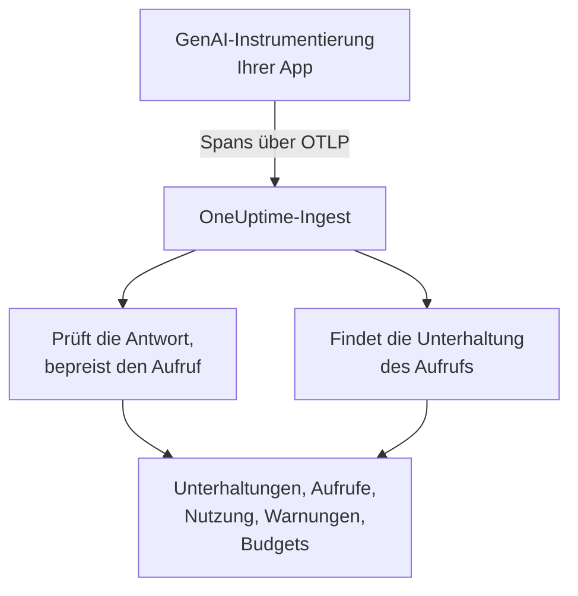
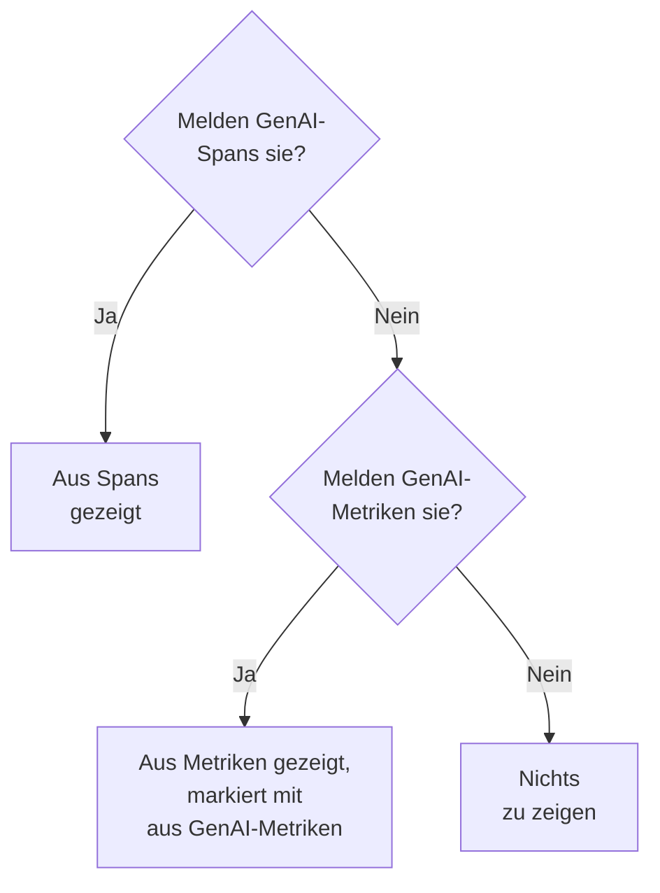

# KI- / LLM-Observability

Lesen Sie jede Unterhaltung, die Ihre KI geführt hat, spielen Sie sie so ab, wie sie geschehen ist, und erfahren Sie, wenn sie schlecht antwortet. OneUptime baut all das aus Standard-OpenTelemetry: Wenn Ihre App Spans mit den **GenAI-Semantikkonventionen** (`gen_ai.*`) sendet, bekommen Sie Unterhaltungen, Warnungen, Nutzung und Kosten, ohne proprietäres SDK.

:::cards
- [Einrichten](#in-fünf-schritten-einrichten): Fünf Schritte, vom ersten Span bis zu markierten Antworten.
- [Eine Unterhaltung abspielen](#eine-unterhaltung-lesen-und-abspielen): Einen Chat so lesen, wie die Person ihn gesehen hat, im Tempo, in dem er geschah.
- [Gewarnt werden](#erfahren-wenn-die-ki-schlecht-antwortet): Fertige Warnungen für Antworten, die fehlschlagen, verweigert, abgeschnitten, markiert oder langsam sind.
- [Die Ausgaben im Blick](#sehen-wer-was-ausgibt): Kosten nach Person, Team, Modell und App, mit Tagesbudgets.
:::

## So funktioniert es

Die GenAI-Instrumentierung Ihrer App exportiert jeden Aufruf des Modells als OpenTelemetry-Span. Sobald der Span ankommt, liest OneUptime seine `gen_ai.*`-Attribute, prüft die Antwort auf Probleme, bepreist den Aufruf und ordnet ihn seiner Unterhaltung zu.



Öffnen Sie **Produkte → KI / LLM** unter **Observability**. Das Produkt hat sieben Tabs:

| Tab | Was er zeigt |
| --- | --- |
| **Unterhaltungen** | Jede Unterhaltung, die Ihre KI geführt hat, die mit Handlungsbedarf zuerst. Über der Liste: Unterhaltungen, KI-Antworten, wie viele Aufmerksamkeit brauchen, Kosten und die typische Antwortzeit. |
| **Aufrufe** | Jeder Modell-, Embedding-, Agenten- und Tool-Aufruf. Filtern Sie nach Dienst, Anbieter, Modell, Operation, Person, Team oder Unterhaltung; ein Klick öffnet den Aufruf im Trace-Viewer. |
| **Nutzung** | Aufrufe, Tokens und Kosten eines Zeitraums, gereiht nach Mitarbeiter, Team, Modell, Anbieter oder App. |
| **Warnungen** | Fertige Warnungen für den Fall, dass die KI schlecht antwortet, und Ihre KI- / LLM-Monitore. |
| **Budgets** | Tägliche Kostenlimits, als Metriken veröffentlicht, auf die Sie Warnungen setzen können. |
| **Preise** | Ihre eigenen Preise für Modelle, die die integrierte Preisliste nicht kennt. |
| **Einrichtung** | Die fünf Schritte unten, mit dem Endpunkt Ihres Projekts. |

Im Trace-Viewer hat der Span jedes KI-Aufrufs außerdem einen Tab **LLM**: Anbieter, Modell, Tokens, Kosten, Anfrageparameter sowie den Prompt und die Antwort.

## Bevor Sie beginnen

- Ein OneUptime-Projekt, in dem Sie einen Telemetrie-Ingestion-Schlüssel erstellen können.
- Eine App, die ein Modell aufruft, und eine GenAI-Instrumentierung für ihre Sprache: **OpenLLMetry** (Traceloop), **OpenInference** (Arize), das **Vercel AI SDK** oder die OpenTelemetry-Instrumentierungen für OpenAI, Anthropic und Gemini.

> [!TIP]
> Modellverkehr, der über ein Gateway wie LiteLLM oder Portkey läuft, können Sie aus dem Gateway exportieren statt aus jeder App: siehe [KI-Gateways](/docs/telemetry/ai-gateways). Für die Coding-Assistenten Ihrer Entwickler siehe [KI-Coding-Assistenten](/docs/telemetry/ai-coding-assistants).

## In fünf Schritten einrichten

Der erste Schritt genügt, um Aufrufe zu sehen. Jeder weitere Schritt zeigt mehr.

:::steps
### Ihre KI-Aufrufe senden

Erstellen Sie einen Ingestion-Schlüssel unter **Projekteinstellungen → Telemetrie & APM → Ingestion-Schlüssel** (der [OpenTelemetry-Schnellstart](/docs/telemetry/open-telemetry#einen-ingestion-schlüssel-erstellen) zeigt den Weg). Richten Sie dann Ihre Instrumentierung auf OneUptime:

:::tabs
@tab Python
```bash
pip install traceloop-sdk opentelemetry-exporter-otlp
```

```python
from traceloop.sdk import Traceloop

Traceloop.init(
    app_name="my-ai-agent",
    api_endpoint="https://oneuptime.com/otlp",
    headers={"x-oneuptime-token": "YOUR_INGESTION_TOKEN"},
)
# Your OpenAI, Anthropic and LangChain calls are now traced.
```
@tab Node.js
```bash
npm install @traceloop/node-server-sdk
```

```typescript
import * as traceloop from "@traceloop/node-server-sdk";

traceloop.initialize({
  appName: "my-ai-agent",
  baseUrl: "https://oneuptime.com/otlp",
  headers: { "x-oneuptime-token": "YOUR_INGESTION_TOKEN" },
});
```
@tab OpenTelemetry SDK
```bash
export OTEL_EXPORTER_OTLP_ENDPOINT="https://oneuptime.com/otlp"
export OTEL_EXPORTER_OTLP_HEADERS="x-oneuptime-token=YOUR_INGESTION_TOKEN"
export OTEL_EXPORTER_OTLP_PROTOCOL="http/protobuf"
export OTEL_SERVICE_NAME="my-ai-agent"
```
:::

Betreiben Sie OneUptime selbst? Verwenden Sie `https://YOUR-ONEUPTIME-HOST/otlp` statt `https://oneuptime.com/otlp`. Rufen Sie Ihr Modell einmal auf, und der Aufruf erscheint unter **Aufrufe**.

### Festhalten, was gesagt wurde

Eine Unterhaltung zeigt, was Menschen gefragt und was die KI geantwortet hat, nur wenn Ihre Instrumentierung es aufzeichnet. OpenLLMetry zeichnet Prompts und Antworten auf, solange Sie nicht `TRACELOOP_TRACE_CONTENT=false` setzen. Die OpenTelemetry-Instrumentierungen zeichnen sie nur auf, wenn Sie darum bitten:

```bash
export OTEL_INSTRUMENTATION_GENAI_CAPTURE_MESSAGE_CONTENT=true
```

Neuere OpenTelemetry-Instrumentierungen erwarten `span_only`, `event_only` oder `span_and_event` statt `true`. Ohne aufgezeichneten Inhalt zeigt eine Unterhaltung trotzdem ihre Zeiten, Kosten und Probleme. Prompts können sensible Daten enthalten: [Datenschutz und Schwärzung](#datenschutz-und-schwärzung) zeigt, wie Sie sie vor dem Speichern maskieren.

### Aufrufe zu Unterhaltungen gruppieren

Eine Chat-App ruft das Modell einmal pro Runde auf. Setzen Sie `gen_ai.conversation.id` (oder `session.id`) bei jedem KI-Aufruf auf die ID Ihres Chats, dann erscheint jeder Chat als eine Unterhaltung, egal wie viele Aufrufe und Traces er brauchte. Mit OpenLLMetry setzen Sie sie einmal pro Anfrage:

```python
from traceloop.sdk import Traceloop

Traceloop.set_association_properties({
    "session_id": chat.id,
    "user_email": user.email,
})
```

Mit dem Vercel AI SDK übergeben Sie die ID des Chats als `experimental_telemetry: { metadata: { sessionId } }`. Aufrufe ohne Unterhaltungs-ID erscheinen trotzdem, je eine Anfrage (ein Trace).

### Sagen, wer gefragt hat

Setzen Sie bei jedem KI-Aufruf `user.id` oder `user.email` (die Association-Property oben setzt die E-Mail). Dann zeigt jede Unterhaltung, mit wem sie geführt wurde, Sie können die Liste nach Person durchsuchen, und der Tab **Nutzung** reiht die Ausgaben nach Mitarbeiter. [Zuordnung zu Mitarbeitern und Teams](/docs/telemetry/ai-coding-assistants#zuordnung-zu-mitarbeitern-und-teams) listet jeden Identitätsschlüssel, den OneUptime liest.

### Schlechte Antworten markieren

OneUptime prüft jede Antwort beim Eintreffen und markiert, was mit ihr schiefgelaufen ist:

| Problem | Was es bedeutet | Erkannt an |
| --- | --- | --- |
| Fehlgeschlagen | Der Aufruf endete mit einem Fehler, es kam keine Antwort an | Span-Status Error, `error.type` oder einem Abschlussgrund `error` |
| Verweigert | Die KI hat abgelehnt, oder ein Sicherheitsfilter hat die Antwort blockiert | Einem Abschlussgrund für Verweigerung oder Sicherheit (`content_filter`, `refusal`, `SAFETY` und ähnliche), einer Verweigerung in der Antwort oder einer Antwort, die mit einer englischen Standardablehnung beginnt |
| Abgeschnitten | Die Antwort endete am Token-Limit | Einem Abschlussgrund `length`, `max_tokens` oder `MAX_TOKENS` |
| Leer | Kein Text und kein Tool-Aufruf | Aufgezeichnetem Inhalt, der nichts enthält, oder 0 Ausgabe-Tokens |
| Markiert | Eine Bewertung, die Ihre App gesendet hat, nennt die Antwort schlecht | Einem `gen_ai.evaluation.result`-Ereignis |

Die ersten vier brauchen nichts von Ihnen. Um eine Antwort zu markieren, die Ihr Guardrail, Ihre Evaluation oder ein Daumen-runter-Knopf ablehnt, fügen Sie dem Span der Antwort, solange er offen ist, ein `gen_ai.evaluation.result`-Ereignis hinzu, mit `gen_ai.evaluation.score.label` auf `fail`:

```python
from opentelemetry import trace

trace.get_current_span().add_event(
    "gen_ai.evaluation.result",
    {
        "gen_ai.evaluation.name": "relevance",
        "gen_ai.evaluation.score.label": "fail",
        "gen_ai.evaluation.explanation": "The answer is about another product.",
    },
)
```

Labels wie `incorrect`, `wrong`, `unhelpful`, `toxic`, `unsafe` und `hallucination` zählen ebenfalls als durchgefallen. OneUptime schickt Ihre Unterhaltungen nie an eine andere KI zur Bewertung: Jede Prüfung liest nur, was der Aufruf selbst mitbringt.
:::

## Eine Unterhaltung lesen und abspielen

Eine Unterhaltung öffnet sich vollständig, so wie eine Chat-App ihren Verlauf zeigt: was die Person gesagt hat, rechts; die Antworten der KI links, mit Modell, Zeit, Tokens und Kosten; Tool-Aufrufe dazwischen; und was schiefging, dort markiert, wo es geschah. **Details** unter einer Antwort zeigt, warum sie endete, ihre Bewertungen und einen Link zum Aufruf in Traces.

Die Leiste unten spielt die Unterhaltung so ab, wie die Person sie erlebt hat:

| Steuerung | Was sie tut |
| --- | --- |
| **Erneut abspielen** | Spielt die Unterhaltung ab der ersten Nachricht ab, im Tempo, in dem sie geschah. „KI antwortet…“ zählt hoch, während eine Antwort unterwegs ist. Klicken Sie auf die Uhrzeit einer Nachricht, um ab dort abzuspielen. |
| **Wartezeiten überspringen** | Standardmäßig an: kürzt jede Stille, die länger als 3 Sekunden ist. |
| `1x` | Ändert die Geschwindigkeit: 1x, 2x, 4x oder 8x. |
| **K**, **J** oder **←**, **L** oder **→** | Abspielen oder anhalten, eine Nachricht zurück, eine Nachricht vor. |

Die Adresse der Seite merkt sich die Nachricht, an der eine Wiedergabe stehen blieb (`?step=`), sodass ein geteilter Link an diesem Moment öffnet.

## Erfahren, wenn die KI schlecht antwortet

Der Tab **Warnungen** listet die Warnungen, die die meisten KI-Apps brauchen. Wenn Sie eine wählen, öffnet sich **Monitor erstellen** ausgefüllt, und Sie können vor dem Speichern alles ändern:

| Warnung | Wann sie Sie benachrichtigt | Schweregrad |
| --- | --- | --- |
| Antworten gehen schief | Mehr als 5 % der Antworten in 15 Minuten schlagen fehl, werden verweigert, abgeschnitten, sind leer oder markiert | Warning |
| KI-Aufrufe schlagen fehl | Mehr als 10 % der Aufrufe des Modells in 5 Minuten enden mit einem Fehler | Critical |
| Die KI verweigert Antworten | Mehr als 5 % der Antworten in 30 Minuten sind Verweigerungen | Warning |
| Antworten werden abgeschnitten | 3 oder mehr Antworten in 30 Minuten enden am Token-Limit | Warning |
| Antworten werden markiert | Eine Bewertung nennt eine Antwort schlecht | Warning |
| Antworten sind langsam | Mehr als 10 % der Antworten in 15 Minuten dauern länger als 30 Sekunden | Warning |
| Die KI antwortet nicht mehr | Die KI gibt 30 Minuten lang keine Antworten | Critical |

Die Warnungen auf einen Anteil der Antworten warten außerdem auf mindestens 3 schlechte Antworten, sodass eine schlechte von zwei Antworten niemanden alarmiert. Eine Critical-Warnung nimmt den schwersten Warnungsschweregrad Ihres Projekts, eine Warning-Warnung den nächsten: in einem neuen Projekt High und Low.

Jede Warnung ist ein Monitor vom Typ **KI / LLM**. Seine Einstellungen legen fest, was als schlechte Antwort zählt (**Eine Antwort als schlecht zählen, wenn sie**, **Oder länger dauert als (Sekunden)**), wie weit jede Prüfung zurückschaut (**Zeitfenster**, standardmäßig 15 Minuten), welche **Apps** er beobachtet und, unter **Weitere Felder**, welches **Modell**. Eine **Vorschau** zeigt, was der Monitor gerade zählen würde. Seine Kriterien vergleichen drei Zahlen: **Schlechte KI-Antworten (in %)**, **Schlechte KI-Antworten** und **KI-Antworten**.

Eine fertige Warnung löst eine Warnung aus, die sich selbst auflöst, und zeigt den Monitor als **Degraded**, solange die Antworten schlecht sind. Ihr Vorfall ist ausgefüllt, aber ausgeschaltet: Schalten Sie ihn ein, um stattdessen jemanden zu alarmieren.

## Sehen, wer was ausgibt

Der Tab **Nutzung** zeigt die Aufrufe, Tokens und Kosten eines Zeitraums (die letzten 7 Tage, wenn Sie keinen anderen wählen) und eine Tabelle der Top 25 nach einer von fünf Aufschlüsselungen: **Mitarbeiter**, **Team**, **Modell**, **Anbieter** und **Anwendung / Dienst**. Aufrufe, die niemanden nennen, werden unter **Nicht zugeordnet** gezählt, nie verworfen.

Personen und Teams kommen aus Identitätsattributen des Aufrufs: siehe [Zuordnung zu Mitarbeitern und Teams](/docs/telemetry/ai-coding-assistants#zuordnung-zu-mitarbeitern-und-teams).

### Spans zuerst, Metriken springen ein

GenAI-Spans tragen Modell, Tokens und Kosten eines Aufrufs, wo es sie gibt, beantworten sie also alles. Manche Tools veröffentlichen Token- und Kostenmetriken und keine GenAI-Spans, etwa die meisten Coding-Assistenten. OneUptime liest diese Metriken nur für eine Zahl, zu der die Spans nichts gemeldet haben, und addiert beide nie: Viele Instrumentierungen senden beides für denselben Aufruf, und die Summe würde jeden Dollar doppelt zählen.



| Wo | Was auf Metriken zurückfällt | Wann |
| --- | --- | --- |
| Eingabe- und Ausgabe-Tokens | Beide Summen | Die Token-Summen der Spans sind beide 0 |
| Kosten (USD) | Die Kosten, mit den Mikro-USD-Kosten von Codex in USD umgerechnet | Die Kostensumme der Spans ist 0 |
| LLM-Aufrufe | Nichts: nur Spans | — |
| Tabellen **Mitarbeiter**, **Team**, **Modell** | Nur Kosten; die Zellen für Aufrufe und Tokens zeigen `—` | Die Tabelle fand keine Span-Zeilen |
| Tabellen **Anbieter**, **Anwendung / Dienst** | Nichts: nur Spans | — |
| Unterhaltungen | Nichts: Unterhaltungen entstehen aus Spans | — |

Eine aus Metriken genommene Zahl ist mit **aus GenAI-Metriken** markiert, weil sie keine passenden Zeilen in **Aufrufe** hat. Sobald Ihre GenAI-Spans also eine Zahl melden, erscheint der Anteil eines reinen Metrik-Tools daran nicht. Um die Ausgaben eines solchen Tools für sich zu sehen, senden Sie es in ein eigenes Projekt, in dem keine GenAI-Spans ankommen.

## Was ein Aufruf kostet

Kosten, die Ihre Instrumentierung meldet (`gen_ai.usage.cost`), werden unverändert verwendet, auch wenn sie 0 sind. Meldet sie keine, schätzt OneUptime sie beim Eintreffen des Spans, aus seinen Token-Zahlen und einer integrierten Preisliste für gängige Modelle von OpenAI, Anthropic, Google Gemini, Mistral, DeepSeek, xAI, Cohere, Amazon Nova und Meta Llama. Bepreist wird zuerst das ausgelieferte Modell, dann das angefragte.

Modelle werden über das längste Namenspräfix zugeordnet, sodass datierte und vom Anbieter erweiterte IDs wie `gpt-4o-2024-08-06` und `us.anthropic.claude-sonnet-4-5-20250929-v1:0` den Preis ihrer Familie finden. Ein Modell, das die Liste nicht kennt, auch ein neues Release, wird nie geraten: Seine Kosten bleiben 0, bis Sie es bepreisen. Schätzungen nutzen Listenpreise, ohne Cache- oder Batch-Rabatte.

Um ein Modell selbst zu bepreisen (ein ausgehandelter Tarif, ein Fine-Tune oder ein selbst betriebenes Modell), fügen Sie es im Tab **Preise** unter **Benutzerdefinierte LLM-Preise** hinzu: ein **Modellpräfix**, ein **Eingabepreis (USD pro 1 Mio. Tokens)** und ein **Ausgabepreis (USD pro 1 Mio. Tokens)**. Das längste passende Präfix gewinnt über Ihre Preise und die integrierte Liste hinweg; bei Gleichstand gewinnt Ihr Preis. Ein Preis gilt für Aufrufe, die etwa eine Minute nach dem Speichern ankommen; bereits gespeicherte Aufrufe behalten ihre Kosten.

## Tägliche Kostenbudgets

Ein Budget verfolgt die Ausgaben eines Tages in USD, über den UTC-Tag. Alle 15 Minuten addiert OneUptime die KI-Ausgaben des Tages (aus Spans oder, wenn kein Span welche gemeldet hat, aus GenAI-Kostenmetriken), zeigt sie am Budget und veröffentlicht zwei Metriken:

| Metrik | Was sie ist |
| --- | --- |
| `oneuptime.llm.budget.spend.usd` | Die bisherigen Ausgaben des Tages, in USD |
| `oneuptime.llm.budget.percent.used` | Die Ausgaben in Prozent des Tageslimits |

Beide tragen `oneuptime.llm.budget.id` und `oneuptime.llm.budget.name` sowie den Geltungsbereich des Budgets, wenn es einen hat.

:::steps
### Das Budget erstellen

Klicken Sie im Tab **Budgets** auf **LLM-Kostenbudget erstellen**. Geben Sie ihm einen Namen und ein **Tagesbudget (USD)**, und lassen Sie den Geltungsbereich für das ganze Projekt leer oder wählen Sie einen **Dienst (optional)**, einen **LLM-Anbieter (optional)** oder ein **LLM-Modell (optional)**. Mehrere Budgets können verschiedene Bereiche beobachten.

### Darauf warnen

Erstellen Sie eine [Metriken-Überwachung](/docs/monitor/metrics-monitor) auf `oneuptime.llm.budget.percent.used`, gefiltert nach `oneuptime.llm.budget.id` (der Name ändert sich, wenn Sie das Budget umbenennen). Fügen Sie ein Kriterium `>= 80` hinzu, das eine Warnung auslöst, und eines `>= 100`, das eine kritische Warnung auslöst.

### Das Fenster vergrößern

Setzen Sie das rollierende Fenster des Monitors auf 30 Minuten. Ein Budget veröffentlicht alle 15 Minuten einen Punkt, sodass das Standardfenster von 1 Minute zwischen zwei Punkten nichts fände.
:::

Eine Budgetwarnung kann auch einen Workflow starten, der einen außer Kontrolle geratenen Agenten stoppt: siehe [Schutzschalter für KI-Agenten](/docs/telemetry/ai-agent-circuit-breaker).

## Dashboards und Metrikwarnungen

GenAI-Metriken wie `gen_ai.client.token.usage` und `gen_ai.client.operation.duration` kommen als gewöhnliche OpenTelemetry-Metriken an. Stellen Sie sie in einem [Dashboard](/docs/dashboards/index) dar oder warnen Sie darauf mit einer [Metriken-Überwachung](/docs/monitor/metrics-monitor), zum Beispiel wenn das p95 von `gen_ai.client.operation.duration` eine Schwelle überschreitet, gruppiert nach Modell.

## Datenschutz und Schwärzung

KI-Aufrufe werden als Trace-Spans gespeichert, daher gelten die **Scrub-Regeln** und **Drop-Filter** der Traces für sie: Maskieren Sie ein Attribut oder verwerfen Sie einen Span, bevor er gespeichert wird. Beides finden Sie unter **Traces → Einstellungen**. Die Spalte mit der E-Mail des Mitarbeiters wird mit dem Attribut bereinigt, aus dem sie gelesen wurde, sodass eine Regel, die E-Mails maskiert, sie ebenfalls erfasst.

Unterhaltungen werden mit derselben Berechtigung gelesen wie Traces: Wer die Traces des Projekts lesen darf, darf seine Unterhaltungen lesen, und niemand sonst.

## Attribute, die OneUptime liest

OneUptime liest die OpenTelemetry-GenAI-Konventionen und die Schreibweisen von OpenLLMetry, OpenInference, dem Vercel AI SDK und LiteLLM, sodass die gängigen Bibliotheken so funktionieren, wie sie sind. Für jeden Wert gewinnt der erste Schlüssel, den ein Span trägt:

| Wert | Schlüssel, in der Reihenfolge, in der sie probiert werden |
| --- | --- |
| Anbieter | `gen_ai.system`, `gen_ai.provider.name`, `llm.system`, `llm.provider` |
| Operation | `gen_ai.operation.name`, `llm.request.type`, `openinference.span.kind` |
| Angefragtes Modell | `gen_ai.request.model`, `llm.model_name`, `llm.request.model` |
| Ausgeliefertes Modell | `gen_ai.response.model`, `llm.response.model` |
| Eingabe-Tokens | `gen_ai.usage.input_tokens`, `gen_ai.usage.prompt_tokens`, `llm.token_count.prompt`, `llm.usage.prompt_tokens` |
| Ausgabe-Tokens | `gen_ai.usage.output_tokens`, `gen_ai.usage.completion_tokens`, `llm.token_count.completion`, `llm.usage.completion_tokens` |
| Gesamt-Tokens | `gen_ai.usage.total_tokens`, `llm.token_count.total`, `llm.usage.total_tokens` |
| Kosten (USD) | `gen_ai.usage.cost`, `gen_ai.usage.cost_usd`, `gen_ai.usage.total_cost`, `llm.usage.total_cost`, `gen_ai.cost.total_cost`, `litellm.cost.total` |
| Unterhaltung | `gen_ai.conversation.id`, `session.id`, `langfuse.session.id`, `traceloop.association.properties.session_id`, `ai.telemetry.metadata.sessionId` |
| Agent | `gen_ai.agent.name`, `agent.name` |
| Tool | `gen_ai.tool.name`, `tool.name`, `ai.toolCall.name` |
| Abschlussgrund | `gen_ai.response.finish_reasons`, `gen_ai.response.finish_reason`, `llm.response.finish_reason`, `ai.response.finishReason` |
| Fehler | `error.type` |

Ein Span zählt als KI-Aufruf, wenn er einen dieser Werte trägt oder irgendein Attribut, das mit `gen_ai.`, `llm.` oder `traceloop.` beginnt. Gesamt-Tokens sind Eingabe plus Ausgabe, wenn keine Summe gemeldet wird. Die Schlüssel `gen_ai.usage.total_tokens` und `gen_ai.usage.cost` gehören nicht zu den Konventionen, die keinen von beiden definieren; OneUptime liest sie, weil gängige Instrumentierungen sie senden.

Die Identitätsschlüssel (wer den Aufruf gemacht hat und sein Team) stehen unter [Zuordnung zu Mitarbeitern und Teams](/docs/telemetry/ai-coding-assistants#zuordnung-zu-mitarbeitern-und-teams).

### Woher Prompts und Antworten gelesen werden

Die Unterhaltungsansicht liest die Nachrichten eines Aufrufs aus, in dieser Reihenfolge:

- dem Ereignis `gen_ai.client.inference.operation.details`;
- den Attributen `gen_ai.input.messages`, `gen_ai.output.messages` und `gen_ai.system_instructions`;
- den älteren Ereignissen pro Rolle: `gen_ai.system.message`, `gen_ai.user.message`, `gen_ai.assistant.message`, `gen_ai.tool.message` und `gen_ai.choice`;
- den indizierten Attributen: `gen_ai.prompt.N.content` und `gen_ai.completion.N.content` von OpenLLMetry, `llm.input_messages.N.message.content` und `llm.output_messages.N.message.content` von OpenInference;
- den Nachrichten-Arrays in `gen_ai.prompt`, `gen_ai.completion`, `ai.prompt.messages`, `ai.response.text`, `input.value` und `output.value`.

## Fehlerbehebung

:::details Aufrufe kommen an, aber keine Unterhaltung zeigt Text
Ihre Instrumentierung zeichnet keinen Inhalt auf. Schalten Sie es ein, wie [Festhalten, was gesagt wurde](#festhalten-was-gesagt-wurde) zeigt; Aufrufe von davor bleiben ohne Text.
:::

:::details Jeder Aufruf eines Chats erscheint als eigene Unterhaltung
Die Aufrufe tragen keine Unterhaltungs-ID. Setzen Sie `gen_ai.conversation.id` oder `session.id` bei jedem Aufruf des Chats, wie [Aufrufe zu Unterhaltungen gruppieren](#aufrufe-zu-unterhaltungen-gruppieren) zeigt.
:::

:::details Aufrufe zeigen Tokens, kosten aber $0
Das Modell steht nicht in der integrierten Preisliste, oder der Span nennt kein Modell. Fügen Sie die Preise des Modells im Tab **Preise** hinzu; Aufrufe, die danach ankommen, werden bepreist.
:::

:::details Der Tab Nutzung sagt aus GenAI-Metriken und zeigt `—` bei Aufrufen und Tokens
Die Zahlen stammen von einem Tool, das Metriken und keine GenAI-Spans sendet, etwa einem Coding-Assistenten. Eine Metrik trägt Kosten, aber keine Details pro Aufruf, daher bleiben diese Zellen leer. Siehe [Spans zuerst, Metriken springen ein](#spans-zuerst-metriken-springen-ein).
:::

:::details Ein Budget-Monitor springt zwischen zwei Zuständen hin und her
Das rollierende Fenster des Monitors ist kürzer als 15 Minuten, daher findet er manchmal keinen Punkt. Setzen Sie es auf 30 Minuten.
:::

## Nächste Schritte

:::cards
- [KI-Coding-Assistenten](/docs/telemetry/ai-coding-assistants): Ausgaben pro Entwickler für Claude Code, Cursor, Codex, Gemini CLI und Copilot.
- [KI-Gateways](/docs/telemetry/ai-gateways): Die Modellaufrufe jeder App über ein LiteLLM- oder Portkey-Gateway tracen.
- [Schutzschalter für KI-Agenten](/docs/telemetry/ai-agent-circuit-breaker): Einen außer Kontrolle geratenen Agenten stoppen, wenn eine Budgetwarnung auslöst.
- [OpenTelemetry](/docs/telemetry/open-telemetry): Endpunkte, Ingestion-Schlüssel und Limits für jedes Signal.
:::
