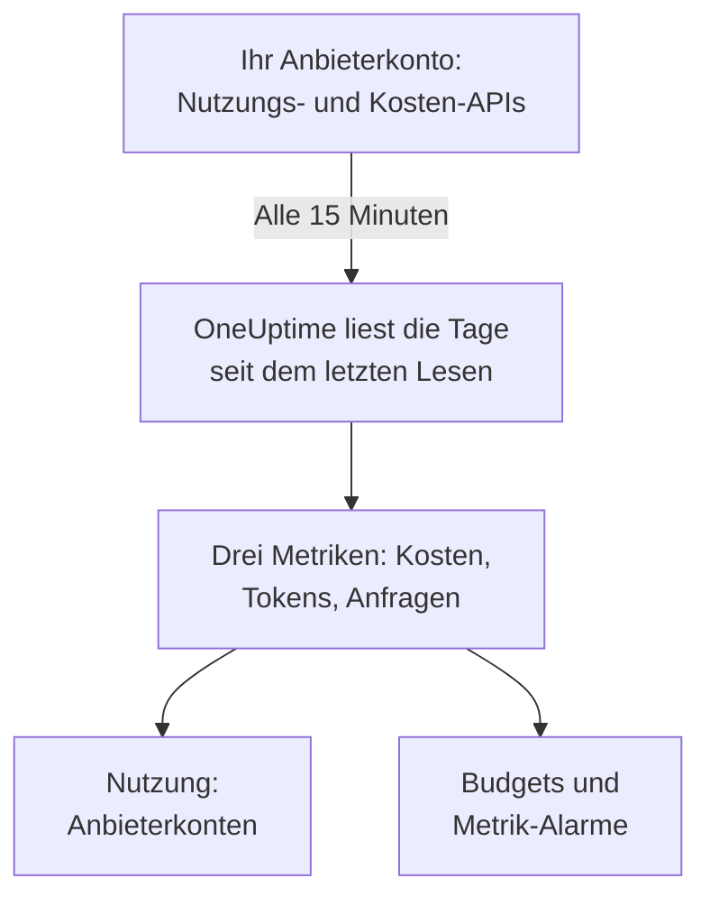

# KI-Anbieterkonten

Sehen Sie, was Ihre KI-Anbieterkonten verbraucht haben und was es gekostet hat, ohne Änderung an Ihren Apps. Verbinden Sie ein Konto bei OpenAI, Anthropic, Azure OpenAI und Microsoft Foundry, Amazon Bedrock oder Google Vertex AI mit Zugangsdaten, die nur lesen können, und OneUptime liest seine Nutzung alle 15 Minuten in **Nutzung**, **Budgets** und Metriken ein, auf die Sie alarmieren können.

:::cards
- [Ein Konto verbinden](#ein-konto-verbinden): Anbieter wählen, Zugangsdaten einfügen, testen und verbinden.
- [Was jeder Anbieter liefert](#was-jeder-anbieter-liefert): Kosten, Tokens und Anfragen, und wie jeder Anbieter sie gruppiert.
- [Die Nutzung ansehen](#die-nutzung-ansehen): Nach Modell, Person, Projekt oder Ressource, API-Schlüssel und Verbindung.
- [Budgets und Alarme](#budgets-und-alarme): Ein Tagesbudget auf die Rechnung und Alarme auf die Metriken.
:::

## So funktioniert es

Alle 15 Minuten fragt OneUptime jedes verbundene Konto nach seiner Nutzung pro UTC-Tag und speichert sie als drei Metriken des eigenen Dienstes der Verbindung. Jedes Lesen holt die Tage seit dem letzten Lesen und die letzten 3 Tage erneut, den heutigen eingeschlossen, weil Anbieter den heutigen Tag laufend ergänzen und die gerade vergangenen Tage korrigieren.

Die Nutzung eines Kontos ist das, was ihm in Rechnung gestellt wurde, Tag für Tag. Sie enthält keine Unterhaltungen, Prompts oder Antworten: Dafür senden Sie die KI-Aufrufe Ihrer Apps, wie [KI- / LLM-Observability](/docs/telemetry/ai-llm-observability) zeigt. Beides bleibt getrennt, sodass nichts doppelt gezählt wird.

## Bevor Sie beginnen

- Die Rolle Project Owner oder Project Admin. Nur sie können ein Konto verbinden, ändern oder entfernen; alle, die die Telemetrie des Projekts lesen, sehen die Verbindungen und die Nutzung.
- Zugangsdaten für das Konto, von jemandem, der es verwaltet. Der Abschnitt jedes Anbieters unten nennt, welche und wo sie erstellt werden.
- Nichts zu installieren: OneUptime ruft die API des Anbieters von seinen eigenen Servern auf.

## Ein Konto verbinden

:::steps
### Verbinden öffnen

Öffnen Sie **Produkte → KI / LLM → Verbinden**. Klicken Sie unter **Deine KI-Anbieterkonten** auf die Kachel des Anbieters.

### Lesen, woher die Zugangsdaten kommen

**Einrichten** sagt, was Sie brauchen, was ankommt und wo diese Seite es erklärt.

### Die Zugangsdaten einfügen

Füllen Sie unter **Anmeldedaten** aus, was der Anbieter verlangt. Geheimnisse werden verschlüsselt gespeichert und nie wieder angezeigt, weder im Dashboard noch über die API. **Name** und die Einstellungen, die die meisten unverändert lassen, liegen unter **Weitere Felder**.

### Testen

Klicken Sie unter **Testen** auf **Verbindung testen**. OneUptime liest die Nutzung der letzten 7 Tage und zeigt, was es gefunden hat: Kosten, Tokens, Anfragen, Modelle, Personen, Schlüssel und Projekte. Nichts wird gespeichert, bis Sie verbinden.

### Verbinden

Klicken Sie auf **Verbinden**. Das erste Lesen beginnt innerhalb einer Minute und holt die letzten 30 Tage.
:::

Verbundene Konten stehen unter den Kacheln, mit **Status** und **Zuletzt gelesen**. **Jetzt lesen** liest sofort, **Testen** prüft die gespeicherten Einstellungen erneut, **Ausschalten** beendet das Lesen und behält, was gelesen wurde, und **Bearbeiten** ändert die Einstellungen: Ein leer gelassenes Geheimnis behält das gespeicherte. **Fehler anzeigen** zeigt, warum ein Lesen fehlschlug, ohne jedes Geheimnis.

## Was jeder Anbieter liefert

| Anbieter | Kosten | Gruppiert nach | Zugangsdaten |
| --- | --- | --- | --- |
| OpenAI | Was OpenAI meldet | Projekt, API-Schlüssel, Person und Modell | Ein Admin-Schlüssel |
| Anthropic | Was Anthropic meldet | Workspace, API-Schlüssel, Person und Modell | Ein Admin-Schlüssel |
| Azure OpenAI und Microsoft Foundry | Aus Tokens geschätzt | Ressource und Modell | Eine App mit Monitoring Reader |
| Amazon Bedrock | Aus Tokens geschätzt | Region und Modell | Ein Zugriffsschlüssel, der CloudWatch liest |
| Google Vertex AI | Aus Tokens geschätzt | Region und Modell | Ein Dienstkonto mit Monitoring Viewer |

Jeder Anbieter außer Anthropic zählt auch Anfragen: Der Nutzungsbericht von Anthropic hat keine. Geschätzte Kosten nutzen die Preisliste aus [Was ein Aufruf kostet](/docs/telemetry/ai-llm-observability#was-ein-aufruf-kostet) und Ihre eigenen Preise aus **Preise** und sind als Schätzung markiert. Ein Modell, das die Preisliste nicht kennt, hat keine Kosten, bis Sie es dort bepreisen.

Keine dieser Zugangsdaten kann ein Modell aufrufen: Jede liest Nutzung, Kosten oder Metriken und sonst nichts.

## OpenAI

OneUptime liest Ihre OpenAI-Organisation mit einem Admin-Schlüssel: die Nutzung von Completions und Embeddings nach Tag, Modell, Projekt, API-Schlüssel und Person sowie die Kosten jedes Tages nach Projekt und Posten. Ein Kostenposten wird auf die Schlüssel und Personen aufgeteilt, die sein Modell genutzt haben, sodass auch die Zeile einer Person Kosten hat. Projekt- und Schlüsselnamen und die E-Mail-Adressen der Personen ersetzen die IDs von OpenAI.

:::steps
### Einen OpenAI-Admin-Schlüssel erstellen

Öffnen Sie im Dashboard von OpenAI Settings, Organization, Admin keys und erstellen Sie einen Schlüssel. Das können nur Organisationsinhaber. Er beginnt mit `sk-admin-`.

### OpenAI verbinden

Fügen Sie den Schlüssel als **Admin-Schlüssel** ein.
:::

## Anthropic

OneUptime liest Ihre Claude-API-Organisation mit einem Admin-Schlüssel: den Nutzungsbericht der Nachrichten nach Tag, Modell, Workspace, API-Schlüssel und Person sowie den Kostenbericht nach Workspace und Posten, auf dieselbe Weise aufgeteilt. Claude Code, mit den Schlüsseln oder Console-Anmeldungen der Organisation genutzt, steht ebenfalls in diesen Berichten, unter der Person oder dem Schlüssel, die es genutzt haben.

:::steps
### Einen Anthropic-Admin-Schlüssel erstellen

Öffnen Sie in der Claude Console Settings, Admin keys und erstellen Sie einen Schlüssel. Das können nur Organisationsadmins. Er beginnt mit `sk-ant-admin01-`.

### Anthropic verbinden

Fügen Sie den Schlüssel als **Admin-Schlüssel** ein.
:::

## Azure OpenAI und Microsoft Foundry

OneUptime liest jede Azure-OpenAI- und Foundry-Ressource eines Abonnements aus Azure Monitor: Tokens und Anfragen nach Tag, Ressource und Modell. Azure Monitor zählt Tokens, kein Geld, und nennt weder Person noch Schlüssel, also sind die Kosten die Schätzung von OneUptime, und Person und Schlüssel bleiben leer.

:::steps
### Eine App registrieren

Registrieren Sie in Microsoft Entra ID eine App und erstellen Sie ein Client-Secret für sie.

### Ihr das Lesen der Metriken erlauben

Geben Sie der App auf dem Abonnement die Rolle Monitoring Reader.

### Azure verbinden

Füllen Sie **Verzeichnis-ID (Tenant)**, **Anwendungs-ID (Client)**, **Abonnement-ID** und **Client-Secret** aus. Für Azure Government ändern Sie **Cloud** unter **Weitere Felder**.
:::

## Amazon Bedrock

OneUptime liest die CloudWatch-Metriken `AWS/Bedrock` jeder Region, die Sie nennen: Eingabe-, Ausgabe- und Cache-Tokens sowie Aufrufe, nach Tag und Modell. CloudWatch zählt Tokens, kein Geld, und nennt weder Person noch Schlüssel: Die Kosten sind die Schätzung von OneUptime, und jede Region wird als Projekt geführt.

:::steps
### Einen Zugriffsschlüssel erstellen

Erstellen Sie einen IAM-Benutzer oder eine Rolle, deren Richtlinie `cloudwatch:GetMetricData` und `cloudwatch:ListMetrics` erlaubt, und einen Zugriffsschlüssel dafür.

### Bedrock verbinden

Füllen Sie **Zugriffsschlüssel-ID**, **Geheimer Zugriffsschlüssel** und **Regionen** aus, durch Kommas getrennt: `us-east-1`, wenn Sie es nicht ändern.
:::

## Google Vertex AI

OneUptime liest die Cloud-Monitoring-Metriken, die Vertex AI für seine Modelle veröffentlicht, Gemini und Partnermodelle wie Claude: Eingabe- und Ausgabe-Tokens sowie Aufrufe, nach Tag, Region und Modell. Cloud Monitoring zählt Tokens, kein Geld, und nennt weder Person noch Schlüssel: Die Kosten sind die Schätzung von OneUptime.

:::steps
### Ein Dienstkonto erstellen

Erstellen Sie im Projekt ein Dienstkonto mit der Rolle Monitoring Viewer und einen JSON-Schlüssel dafür.

### Vertex AI verbinden

Füllen Sie **Projekt-ID** aus und fügen Sie die ganze Schlüsseldatei als **Dienstkontoschlüssel (JSON)** ein.
:::

## Die Nutzung ansehen

Öffnen Sie **Nutzung** und wählen Sie **Anbieterkonten**. Dort stehen die Kosten, Tokens und Anfragen, die Ihre Konten für den Zeitraum gemeldet haben, gereiht nach **Modell**, **Person**, **Anbieter**, **Projekt oder Ressource**, **API-Schlüssel** oder **Verbindung**. Der Zeitraum beginnt um Mitternacht UTC seines ersten Tages, weil Anbieter ganze Tage melden.

**Anbieterkonten** und **Deine KI-Aufrufe** werden nie addiert. Ein Aufruf, den Ihre App mit einem Schlüssel eines verbundenen Kontos macht, steckt in beiden, also würde er beim Addieren doppelt gezählt.

## Budgets und Alarme

Ein Budget zählt das eine oder das andere. Erstellen Sie unter **Budgets** ein Budget und setzen Sie **Ausgaben zählen aus** auf **Anbieterkonten**: Es zählt, was den verbundenen Konten für den UTC-Tag berechnet wurde, eingegrenzt durch **LLM-Anbieter (optional)** und **LLM-Modell (optional)**, wenn Sie sie setzen. Anbieter melden die Nutzung eines Tages Minuten bis Stunden später, also budgetieren Sie für Alarme innerhalb von Minuten stattdessen **Deine KI-Aufrufe**.

Die Nutzung jedes Kontos wird als drei Metriken gespeichert, die Sie auf einem [Dashboard](/docs/dashboards/index) darstellen oder mit einem [Metriken-Überwachung](/docs/monitor/metrics-monitor) überwachen können:

| Metrik | Was sie ist |
| --- | --- |
| `oneuptime.llm.provider.cost` | Die Kosten eines Tages, in USD |
| `oneuptime.llm.provider.tokens` | Die Tokens eines Tages, nach `gen_ai.token.type`: `input` (Cache-Tokens eingeschlossen), `output`, `cache_read` und `cache_write` |
| `oneuptime.llm.provider.requests` | Die Anfragen eines Tages |

Jeder Punkt trägt den Zeitstempel des Beginns seines UTC-Tages. Er trägt `oneuptime.llm.connection.id` und `oneuptime.llm.connection.name` sowie, was der Anbieter nennt: `gen_ai.provider.name`, `gen_ai.request.model`, `user.email`, `oneuptime.llm.provider.project` und `oneuptime.llm.provider.api_key`. Geschätzte Kosten tragen `oneuptime.llm.cost.estimated`.

## Wann gelesen wird

| Lesen | Wann |
| --- | --- |
| Das erste | Innerhalb einer Minute nach dem Verbinden, 30 Tage zurück |
| Die nächsten | Alle 15 Minuten |
| Nachdem ein Schlüssel oder eine Berechtigung abgelehnt wurde | 60 Minuten später |
| Nach jedem anderen Fehler | 15 Minuten später |
| Ausgeschaltet | Keins, bis sie wieder eingeschaltet ist |

Ein Tarif ohne Telemetrie-Funktionen liest nichts. Das Entfernen einer Verbindung beendet ihr Lesen und behält, was sie gelesen hat, bis die Aufbewahrung des Dienstes es entfernt.

## Warum OneUptime kein eigenes Gateway hat

OneUptime liest Ihre Konten; es steht nie zwischen Ihren Apps und den Anbietern. Ein Proxy würde Ihre Anbieterschlüssel halten und jedem Modellaufruf Ihrer Apps einen Zwischenschritt hinzufügen. Wenn Ihr Modellverkehr schon über LiteLLM, Portkey oder OpenRouter läuft, senden Sie die Traces des Gateways an OneUptime, wie [KI-Gateways](/docs/telemetry/ai-gateways) zeigt, und verbinden Sie das Konto für seine Rechnung.

## Fehlerbehebung

:::details Der Test sagt, der Schlüssel oder das Geheimnis wurde nicht akzeptiert
Prüfen Sie, dass Sie alles kopiert haben, dass er nicht widerrufen wurde und dass es die Art ist, die dieser Anbieter verlangt: ein Admin-Schlüssel von OpenAI oder Anthropic, kein Projekt- oder API-Schlüssel.
:::

:::details Die Zugangsdaten funktionieren, dürfen aber nicht lesen, was die Verbindung braucht
Geben Sie ihnen die Rolle, die diese Seite für den Anbieter nennt: Monitoring Reader auf dem Azure-Abonnement, die beiden CloudWatch-Aktionen in AWS, Monitoring Viewer auf dem Google-Cloud-Projekt.
:::

:::details Der Test besteht, aber für heute erscheint nichts
Anbieter melden die Nutzung eines Tages Minuten bis Stunden danach und korrigieren sie noch einen oder zwei Tage lang. Die nächsten Lesevorgänge holen sie.
:::

:::details Die Kosten weichen von der Rechnung ab
Gemeldete Kosten sind die Zahl des Anbieters vor Steuern, Gutschriften und Rabatten. Geschätzte Kosten sind Tokens zum Listenpreis oder zu Ihren eigenen Preisen aus **Preise**.
:::

## Nächste Schritte

:::cards
- [KI- / LLM-Observability](/docs/telemetry/ai-llm-observability): Unterhaltungen, Alarme und Kosten der eigenen KI-Aufrufe Ihrer Apps.
- [KI-Tools im Unternehmen](/docs/telemetry/ai-company-tools): Was Ihre Leute Claude Enterprise und Microsoft 365 Copilot fragen.
- [KI-Gateways](/docs/telemetry/ai-gateways): Jeden Modellaufruf über LiteLLM, Portkey oder OpenRouter tracen.
- [Metriken-Überwachung](/docs/monitor/metrics-monitor): Auf die Anbietermetriken alarmieren.
:::
