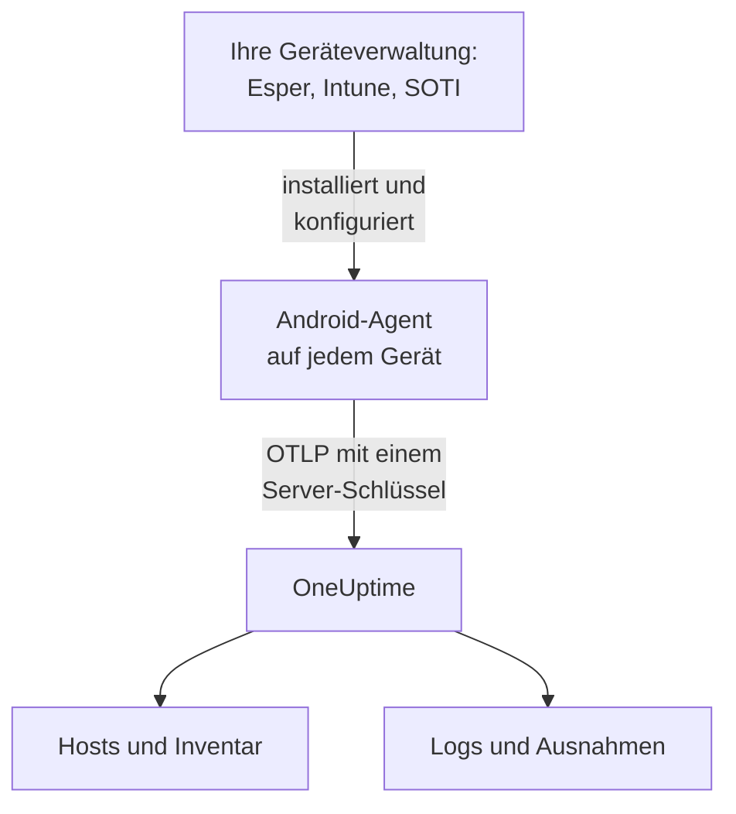

# Android-Agent

Der OneUptime-Android-Agent meldet ein Android-Gerät, das Ihrer Organisation gehört, etwa einen Bestellkiosk, ein POS-Terminal, ein Handheld oder einen Digital-Signage-Player, an OneUptime: Arbeitsspeicher, Speicherplatz, Netzwerk, Akku und Temperatur, seine Neustarts, die darauf installierten Apps sowie die Abstürze und Logs dieser Apps. Ihre Geräteverwaltung installiert und konfiguriert ihn auf der ganzen Flotte auf einmal. Jedes Gerät wird zu einem Host unter **Hosts** und zu einem Element im **Inventar**, neben Ihren Servern und Windows-Rechnern.

:::cards
- [Wann Sie ihn einsetzen](#agent-oder-app-instrumentierung): Der Agent sieht das Gerät, die App-Instrumentierung sieht Ihre App.
- [Mit Esper bereitstellen](#mit-esper-bereitstellen): Das APK hochladen, die Einstellungen verteilen, den Agenten einmal starten.
- [Einstellungen](#einstellungen): Jeder Schlüssel seiner verwalteten Konfiguration.
- [Logs anderer Apps lesen](#logs-anderer-apps-lesen): READ_LOGS einmal erteilen, mit adb oder über Ihre Geräteverwaltung.
- [Protokollsitzungen](#protokollsitzungen): Die Logs aller Apps für eine Weile, von der Person am Gerät erlaubt.
:::

## So funktioniert es

Der Agent ist eine kleine App, die als Vordergrunddienst läuft. Jede Minute liest er den Zustand des Geräts und sendet ihn mit einem **Server**-Ingestion-Schlüssel über OTLP an Ihre OneUptime-Instanz, zusammen mit den Neustarts, den installierten Apps und den Logs des Geräts. Er startet von selbst, wenn das Gerät hochfährt, behält das Erfasste auf dem Gerät, solange das Netzwerk ausgefallen ist, und sendet es, sobald das Netzwerk wieder da ist. Er hält ein schlafendes Gerät nie wach und komprimiert, was er sendet.



## Agent oder App-Instrumentierung

| | [OpenTelemetry Android](/docs/rum/android-setup) in Ihrer App | Der Android-Agent |
| --- | --- | --- |
| Was erfasst wird | Ihre App: ihre Abstürze, ANRs, Bildschirme, Sitzungen, Anfragen und Abläufe | Das Gerät: Arbeitsspeicher, Speicherplatz, Netzwerk, Akku, Neustarts, installierte Apps sowie die Abstürze und ANRs jeder App |
| Wo es erscheint | **Real User Monitoring**, **Traces** und **Ausnahmen** | **Hosts**, **Inventar**, **Protokolle** und **Ausnahmen** |
| Wie Sie es installieren | Im Code Ihrer App | Als App, über Ihre Geräteverwaltung |

Setzen Sie auf Geräten, die Ihnen gehören, beides ein, und geben Sie dem Gerät in beiden denselben Namen: in der Einstellung `device_name` des Agenten und im `host.name`, den Ihre App setzt. Das Gerät ist dann ein einziges Element im **Inventar**, das die Telemetrie der App und die des Geräts zusammenführt.

## Bevor Sie beginnen

- Geräte mit Android 7.0 oder neuer, eingebunden in eine Geräteverwaltung, die die verwalteten Konfigurationen von Android unterstützt: Esper, Microsoft Intune, Workspace ONE, SOTI und andere Geräteverwaltungen für Android Enterprise. Für ein einzelnes Gerät genügt adb.
- Ein **Server**-Ingestion-Schlüssel, erstellt unter **Projekteinstellungen → Telemetrie & APM → Ingestion-Schlüssel** mit **Ingestion-Schlüssel erstellen**.
- Der Agent: `oneuptime-android-agent.apk`, angehängt an jedes [OneUptime-Release](https://github.com/OneUptime/oneuptime/releases/latest).
- Ausgehendes HTTPS von den Geräten zu Ihrer OneUptime-URL. Der Agent lehnt jede URL ab, die nicht mit `https://` beginnt, denn jede Anfrage trägt den Ingestion-Schlüssel.

## Mit Esper bereitstellen

:::steps
### Das APK hochladen

Laden Sie `oneuptime-android-agent.apk` in der Esper-Konsole in die **App Library** hoch, und fügen Sie es dem Blueprint der Geräte hinzu, die Sie überwachen möchten.

### Die Einstellungen verteilen

Öffnen Sie im Blueprint die **Managed Configuration** des Agenten und fügen Sie seine Einstellungen ein. Esper füllt die Platzhalter auf jedem Gerät aus, mit Esper Agent 8.00.0764 oder neuer:

```json title="Managed configuration"
{
  "oneuptime_url": "https://oneuptime.com",
  "oneuptime_token": "YOUR_TELEMETRY_INGESTION_TOKEN",
  "device_name": "${esper.deviceName}",
  "device_serial": "${esper.serialNumber}",
  "device_type": "kiosk",
  "labels": "region=emea"
}
```

Wenn Sie OneUptime selbst hosten, tragen Sie Ihre eigene URL in `oneuptime_url` ein. Führen Sie dann ein Converge der Geräte aus, damit sie die neuen Einstellungen lesen.

### Den Agenten einmal starten

Android startet eine neu installierte App beim Hochfahren erst, nachdem sie einmal geöffnet wurde. Schalten Sie im Blueprint, im Multi-App-Modus, **Launch on Start** für den Agenten ein, oder öffnen Sie den Agenten auf jedem Gerät einmal. Von da an startet er von selbst, wann immer das Gerät hochfährt, und nach jedem Update.

### Die Geräte in OneUptime finden

Innerhalb einer Minute erscheint jedes Gerät unter **Hosts**, benannt nach seinem `device_name`, und im **Inventar**. Der Bildschirm des Agenten auf dem Gerät zeigt, ob er Daten meldet, und wenn nicht, was ihn daran hindert.
:::

Andere Geräteverwaltungen funktionieren genauso: Fügen Sie das APK als Branchen-App (LOB) oder interne App hinzu, setzen Sie dieselben Schlüssel in ihrer App-Konfiguration und öffnen Sie die App auf jedem Gerät einmal.

## Einstellungen

Der Agent liest diese Schlüssel aus seiner verwalteten Konfiguration. Ein Gerät ohne verwaltete Konfiguration lässt sich stattdessen auf dem Bildschirm des Agenten einrichten, mit der URL, dem Ingestion-Schlüssel und dem Namen des Geräts. Ein dort eingegebener Ingestion-Schlüssel wird mit dem Android Keystore verschlüsselt gespeichert.

| Schlüssel | Was er festlegt | Standardwert |
| --- | --- | --- |
| `oneuptime_url` | Ihre OneUptime-URL | `https://oneuptime.com` |
| `oneuptime_token` | Ein **Server**-Ingestion-Schlüssel | Keiner: Ohne Schlüssel sendet der Agent nichts |
| `device_name` | Der Name des Geräts unter **Hosts** und im **Inventar**, der dort seine Identität bildet | Sein Modell und der Anfang seiner Android-ID |
| `device_serial` | Seine Seriennummer, die Android ab Android 10 nicht mehr an Apps herausgibt | Keiner |
| `device_type` | Was es ist, etwa ein Kiosk, ein POS-Terminal oder ein Handheld | `Android device` |
| `device_location` | Wo es steht, etwa die Nummer einer Filiale | Keiner |
| `labels` | Beschriftungen für den Host, als durch Kommas getrennte Paare `name=value` | Keiner |
| `collection_interval_seconds` | Wie oft er meldet, von 30 bis 600 Sekunden | `60` |
| `logcat_enabled` | Ob er sendet, was er aus Logcat liest | `true` |
| `logcat_min_level` | Die niedrigste Stufe der Logcat-Zeilen, die er unter Android 12 und älter sendet: `verbose`, `debug`, `info`, `warn`, `error` oder `fatal` | `warn` |
| `installed_apps_enabled` | Ob er die installierten Apps sendet | `true` |

Ein Platzhalter, den Ihre Geräteverwaltung nicht ausgefüllt hat, etwa ein unverändert gesendetes `${esper.deviceName}`, wird ignoriert, und der Bildschirm des Agenten weist darauf hin. Lassen Sie `device_name` unverändert, sobald ein Gerät meldet: Ein neuer Name ist ein neuer Host.

Der Bildschirm des Agenten, seine Benachrichtigungen sowie die Titel und Beschreibungen, die Ihre Geräteverwaltung für diese Schlüssel anzeigt, erscheinen in der Sprache des Geräts, in jeder Sprache, die das Dashboard von OneUptime spricht.

## Logs anderer Apps lesen

Android lässt eine App die Logs anderer Apps nur mit der Berechtigung READ_LOGS lesen, und nur adb kann sie erteilen: weder die App selbst noch eine Geräterichtlinie. Erteilen Sie sie einmal auf jedem Gerät, dann bleibt sie über Neustarts und Updates hinweg erteilt:

```bash
adb shell pm grant com.oneuptime.androidagent android.permission.READ_LOGS
```

Führen Sie diesen Befehl bei Esper über **Secure Remote ADB** aus: Schalten Sie den ADB-Zugriff für das Gerät ein, verbinden Sie sich mit `espercli secureadb connect -d DEVICE_ID` und führen Sie dann den Befehl aus. Android startet den Agenten neu, sobald die Berechtigung erteilt ist, und der Agent beginnt sofort zu lesen.

Was der Agent dann liest, hängt von der Android-Version ab:

- Android 13 und neuer: die Abstürze und ANRs jeder App. Android zeigt die Logzeilen anderer Apps nur einer App, die gerade auf dem Bildschirm zu sehen ist, und erst, nachdem die Person am Gerät es erlaubt hat. Ein Agent, der im Hintergrund läuft, kann sie daher nicht lesen. Mit einer [Protokollsitzung](#protokollsitzungen) fordern Sie sie für eine Weile an.
- Android 12 und älter: die Abstürze und ANRs jeder App sowie die Logzeilen jeder App ab der Stufe `logcat_min_level`.

Ohne READ_LOGS meldet der Agent alles andere, und sein Bildschirm und die Logs des Geräts erklären, wie Sie die Berechtigung erteilen.

### Absturz-Stack-Traces und Neustartgründe

Android bewahrt den vollständigen Bericht jedes App-Absturzes, jedes nativen Absturzes und jedes ANR sowie den Grund jedes Neustarts in seiner DropBox auf. Der Agent liest sie für jede App, wenn er READ_LOGS und den Zugriff auf Nutzungsdaten hat, und unter Android 15 und neuer READ_DROPBOX_DATA. Erteilen Sie sie einmal mit adb, wie READ_LOGS:

```bash
adb shell pm grant com.oneuptime.androidagent android.permission.READ_DROPBOX_DATA
adb shell appops set com.oneuptime.androidagent GET_USAGE_STATS allow
```

Der erste Befehl gilt für Android 15 und neuer; den Zugriff auf Nutzungsdaten können Sie auch auf dem Gerät unter **Einstellungen → Zugriff auf Nutzungsdaten** einschalten. Eine Geräterichtlinie kann diese Berechtigungen nicht erteilen, und der Bildschirm des Agenten listet die Befehle auf, die noch auszuführen sind. Damit hat jeder Absturz unter **Ausnahmen** seinen vollständigen Stack-Trace, ein nativer Absturz sein Signal und die Bibliothek, in der er abgestürzt ist, ein ANR den Stack seines Hauptthreads und ein Neustart unter **Protokolle** den Grund, den Android dafür angibt. Kartennummern, E-Mail-Adressen, Tokens und Passwörter in dem, was der Agent liest, werden vor dem Senden durch `[card number]`, `[email]`, `[token]` und `[redacted]` ersetzt.

### CPU-Auslastung

Ab Android 8 hält Android die CPU-Auslastung eines Geräts vor Apps verborgen. Nur eine App, die Geräteinhaber ist, kann sie lesen, und nur auf Geräten, deren Hardware sie meldet. Der Agent liest sie, wenn er der Geräteinhaber ist. Das legen Sie mit adb fest, auf einem Gerät ohne Konten und ohne anderen Geräteinhaber:

```bash
adb shell dpm set-device-owner com.oneuptime.androidagent/.admin.AgentDeviceAdminReceiver
```

Ein Gerät, dessen Inhaber bereits Ihre Geräteverwaltung ist, kann keinen zweiten Inhaber haben, daher ist seine CPU-Auslastung nicht verfügbar, und der Bildschirm des Agenten weist darauf hin. Seine CPU-Auslastung fehlt dann in der Liste der Hosts, und die Vorlage **High CPU Utilization** wird für das Gerät nicht angeboten.

## Protokollsitzungen

Eine Protokollsitzung sendet für eine Weile die Logs aller Apps eines Geräts, zur Fehlerbehebung. Unter Android 13 und neuer ist sie der einzige Weg, die Logzeilen anderer Apps zu lesen, denn Android zeigt sie nur einer App, die gerade auf dem Bildschirm zu sehen ist, und erst, nachdem die Person am Gerät es erlaubt hat.

:::steps
### Eine Sitzung anfordern

Öffnen Sie das Gerät unter **Hosts**, dann **Protokolle**, und klicken Sie unter **Protokollsitzungen** auf **Protokollsitzung anfordern**. Wählen Sie, wie lange das Gerät seine Logs sendet, von 15 Minuten bis 4 Stunden, und die niedrigste Stufe, die es sendet: **Info**, **Debug** oder **Ausführlich**.

### Am Gerät zulassen

Innerhalb einer Minute zeigt das Gerät eine Benachrichtigung, dass jemand seine Logs angefordert hat, mit dessen Namen. Die Person am Gerät öffnet den Agenten und tippt auf **Zulassen**. Unter Android 13 und neuer fragt Android dann, ob der Zugriff auf alle Geräteprotokolle erlaubt werden soll, und die Person erlaubt auch das.

### Die Zeilen lesen

Die Sitzung zeigt **Wird erfasst** an, und die Zeilen aller Apps kommen in den Logs des Geräts an. Klicken Sie auf **Zeilen anzeigen**, um nur die Zeilen der Sitzung zu sehen. Die Sitzung endet, wenn ihre Zeit abgelaufen ist oder wenn jemand sie auf dem Gerät stoppt oder in OneUptime abbricht.
:::

Eine Sitzung braucht READ_LOGS und `logcat_enabled`; ohne sie zeigt sie **Nicht verfügbar** an. Auf einem Gerät läuft jeweils nur eine Sitzung. Eine Anfrage, die niemand innerhalb einer Stunde zulässt, läuft ab, und eine Sitzung, während der das Gerät neu startet, endet damit, denn die Berechtigung von Android endet mit dem Prozess des Agenten. Um eine Sitzung anzufordern, brauchen Sie die Berechtigung, den Host zu bearbeiten, und die **Audit-Protokolle** des Hosts halten fest, wer sie angefordert hat und wann.

## Was der Agent meldet

| Was | Wo es in OneUptime erscheint |
| --- | --- |
| Arbeitsspeicher, Speicherplatz, Netzwerk und Laufzeit | Die Seite des Geräts unter **Hosts**: dieselben Metriken, die der Collector eines Servers sendet, sodass die Host-Warnungsvorlagen funktionieren |
| Akkuladung und Temperatur sowie ob das Gerät extern mit Strom versorgt wird | Die Metriken `hw.battery.charge`, `hw.temperature` und `android.battery.plugged` |
| Thermischer Zustand | Die Metriken `android.thermal.status` und `android.thermal.headroom` |
| CPU-Auslastung | Die Metrik `system.cpu.utilization`: unter Android 7, und unter Android 8 und neuer, wenn der Agent der [Geräteinhaber](#cpu-auslastung) ist |
| Neustarts | **Protokolle**, mit `@event.name:device.boot`: wie lange das Gerät lief, ob es sauber heruntergefahren wurde, wie lange es aus war, warum es neu gestartet ist, und Neustartschleifen |
| Installierte Apps | **Protokolle**, mit `@event.name:android.package.inventory` einmal am Tag sowie bei jeder Installation, jedem Update und jeder Entfernung |
| Abstürze und ANRs jeder App | **Ausnahmen**, als nicht behandelt, benannt nach der App, mit ihren Stacks, wenn der Agent die [DropBox](#absturz-stack-traces-und-neustartgründe) liest |
| Hersteller, Modell, Seriennummer, Betriebssystemversion, Sicherheitspatch-Ebene und Firmware | Das Element des Geräts im **Inventar** |

Unter **Hosts** lautet das Betriebssystem des Geräts Android, mit dem Android-Logo.

Die Starts des Geräts in der letzten Stunde sind die Metrik `android.boot.recent_count`, und ein Gerät, das immer wieder neu startet, schreibt bei jedem Hochfahren ein Log mit dem Schweregrad Warnung. Unter **Hosts** werden einem Android-Gerät eigene Warnungsvorlagen angeboten: Device Unplugged, Low Battery, Device Overheating, Restart Loop und Storage Nearly Full, dazu Host Stopped Reporting, Host Restarted und High Memory Utilization sowie High CPU Utilization, sobald es seine CPU-Auslastung meldet. Die ersten Debug-Befehle jeder Warnung sind adb-Befehle. Siehe [Host-Überwachung](/docs/monitor/host-monitor#android-geräte).

## Fehlerbehebung

:::details Ein Gerät erscheint nicht unter Hosts
Öffnen Sie den Agenten auf dem Gerät: Sein Bildschirm zeigt, was fehlt, etwa ein Ingestion-Schlüssel, eine URL, die er nicht verwenden kann, oder ein fehlgeschlagener Upload und dessen Ursache. Auf einem Gerät, auf dem der Agent nach der Installation nie geöffnet wurde, ist er nicht gestartet: Öffnen Sie ihn einmal, oder schalten Sie **Launch on Start** ein.
:::

:::details Der Agent zeigt an, dass OneUptime den Ingestion-Schlüssel abgelehnt hat
Verwenden Sie einen **Server**-Schlüssel, der eingeschaltet und nicht abgelaufen ist. Ein **Browser**-Schlüssel wird von einem Gerät aus abgelehnt.
:::

:::details Keine Logs von anderen Apps
Erteilen Sie READ_LOGS, wie [Logs anderer Apps lesen](#logs-anderer-apps-lesen) beschreibt. Unter Android 13 und neuer werden von anderen Apps nur Abstürze und ANRs gelesen, solange keine [Protokollsitzung](#protokollsitzungen) läuft.
:::

:::details Eine Protokollsitzung bleibt bei Wartet auf Genehmigung
Am Gerät hat sie noch niemand zugelassen. Jemand muss den Agenten auf dem Gerät öffnen und auf **Zulassen** tippen und unter Android 13 und neuer auch den Android-Dialog zulassen, während der Agent auf dem Bildschirm zu sehen ist. Eine Sitzung, die im Android-Dialog abgelehnt wurde, zeigt **Abgelehnt** an: Fordern Sie eine neue an.
:::

:::details Zwei Geräte erscheinen als ein einziger Host
Sie haben denselben `device_name`. Verwenden Sie einen Platzhalter, der sich von Gerät zu Gerät unterscheidet, etwa `${esper.deviceName}` oder `${esper.serialNumber}`.
:::

## Nächste Schritte

:::cards
- [Einrichtung für Android](/docs/rum/android-setup): Ihre eigene App mit OpenTelemetry Android instrumentieren.
- [Hosts](/docs/telemetry/hosts): Die Seiten, Messwerte und Warnungen eines Hosts.
- [Host-Überwachung](/docs/monitor/host-monitor): Eine Warnung erhalten, wenn ein Gerät nicht mehr meldet oder sein Speicherplatz knapp wird.
- [Ausnahmen](/docs/telemetry/exceptions): Die Abstürze und ANRs sichten, die Ihre Geräte melden.
:::
