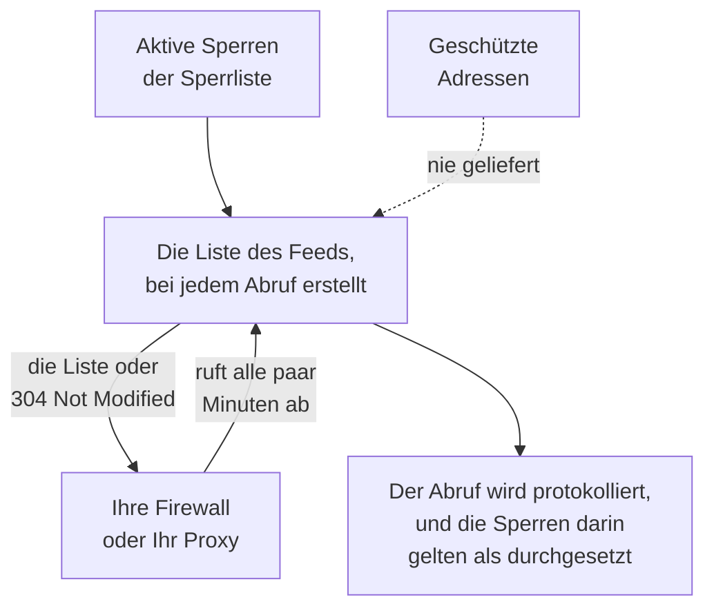

# Sperrlisten-Feeds für Firewalls und Proxys

Ein Sperrlisten-Feed ist eine geheime URL, von der Ihre Firewall oder Ihr Proxy alle paar Minuten die [Sperrliste](/docs/telemetry/security-cases#sperrliste) Ihres Projekts liest. Palo Alto Networks, FortiGate, Check Point, Cisco Secure Firewall, OPNsense und pfSense lesen ihn als externe Liste, und Befehle, die Sie aus OneUptime kopieren, wenden ihn mit nftables, ipset, nginx, HAProxy oder der Windows-Firewall an. Ihre Firewall verbindet sich mit OneUptime: OneUptime braucht nie eine Route in Ihr Netzwerk oder ein Passwort für Ihre Firewall.

:::cards
- [Einen Feed erstellen](#einen-feed-erstellen): Die Firewall wählen, das Geheimnis kopieren und ihren Schritten folgen.
- [Ihre Firewall einrichten](#ihre-firewall-einrichten): Die Schritte für jede Firewall und jeden Proxy und wie oft sie abrufen.
- [Wann eine Sperre durchgesetzt ist](#wann-eine-sperre-durchgesetzt-ist): Erst wenn eine Firewall eine Liste abgerufen hat, die sie enthält.
- [Das Geheimnis rotieren oder widerrufen](#das-geheimnis-rotieren-oder-widerrufen): Ein neues Geheimnis mit einem Tag Überschneidung oder sofort gar keins.
:::

## So funktioniert es



Jeder Abruf erstellt die Liste aus den Sperren, die in diesem Moment aktiv sind. Eine Sperre, die abläuft oder aufgehoben wird, fehlt im nächsten Abruf, und eine geschützte Adresse ist nie darin, auch keine, die erst nach ihrer Sperrung geschützt wurde. Eine Sperre gilt erst dann als beim Feed durchgesetzt, wenn eine Firewall eine Liste abgerufen hat, die sie enthält.

## Bevor Sie beginnen

- Eine Firewall oder ein Proxy, der eine Liste von Adressen von einer `https`-URL liest, oder ein Linux- oder Windows-Host, auf dem Sie Befehle als root oder als Administrator ausführen können.
- Ein Weg von der Firewall hinaus zu OneUptime über HTTPS: `https://oneuptime.com` oder die Adresse Ihres eigenen OneUptime-Servers.
- Eine Rolle, die Feeds erstellen darf: Projektinhaber, Projektadministrator oder Sicherheits-Administrator. Sicherheits-Mitglied und Sicherheits-Betrachter können Feeds und ihre Abrufe lesen. Siehe [Rollen](/docs/permissions/reference#rollen).

## Einen Feed erstellen

:::steps
### Sperrlisten-Feeds öffnen

Öffnen Sie **Produkte → Sicherheitsereignisse → Playbooks → Sperrlisten-Feeds**.

### Den Feed erstellen

Klicken Sie auf **Sperrlisten-Feed erstellen** und wählen Sie die **Firewall**, die ihn liest. **Name** ist, wie die Sperrliste den Feed dort nennt, wo eine Sperre durchgesetzt wird; bleibt das Feld leer, wird er nach der Firewall benannt, etwa „FortiGate feed“. Unter **Weitere Felder** wählt **Liefert** IPv4 und IPv6, nur IPv4 oder nur IPv6, und **Zulässige Quelladressen** schränkt ein, wer den Feed lesen darf.

### Das Geheimnis kopieren

Die Seite des Feeds öffnet sich mit seinem Geheimnis, das nur einmal angezeigt wird: OneUptime speichert nur seinen Hash. Kopieren Sie es und klicken Sie dann auf **Fertig**. Bis Sie die Seite verlassen, setzen die Schritte darauf das Geheimnis für Sie ein.

### Den Schritten Ihrer Firewall folgen

**Ihre Firewall einrichten** zeigt die einzufügende URL, wie Ihre Firewall das Geheimnis sendet, und die Schritte in ihrer eigenen Konsole, ausgefüllt. Wählen Sie dort eine andere Firewall, um stattdessen deren Schritte zu sehen. Nach dem ersten Abruf Ihrer Firewall zeigt der Status des Feeds **Wird eingelesen**, und **Abrufe** listet den Abruf auf.
:::

## Was ein Feed liefert

| Datei | Für | Was sie enthält |
| --- | --- | --- |
| `blocklist.txt` | Palo Alto Networks, pfSense, ipset, HAProxy, die Windows-Firewall und jede andere Firewall | Eine Adresse oder einen Bereich pro Zeile. |
| `blocklist.txt?comments=1` | FortiGate, Check Point, Cisco Secure Firewall und OPNsense, die Zeilen überspringen, die mit `#` beginnen | Jede Adresse und jeden Bereich, jeweils nach einer Zeile, die sagt, warum gesperrt wird. |
| `nftables.nft` | nftables | Eine Datei für `nft -f`, die die Sets `blocklist_v4` und `blocklist_v6` der Tabelle `inet oneuptime` leert und neu füllt. |
| `nginx.conf` | nginx | Eine `deny`-Zeile für jede Adresse und jeden Bereich. |
| Der Name einer Datei gefolgt von `.md5`, etwa `blocklist.txt.md5` | Cisco Secure Firewall | Den MD5-Wert der Datei, damit die Firewall die Liste nur herunterlädt, wenn sie sich geändert hat. |

Die URL eines Feeds lautet `https://oneuptime.com/api/blocklist-feed/<feed ID>/<file>`, und die Seite des Feeds zeigt sie für Ihre Firewall ausgefüllt. Mit `?comments=1` sieht die Liste so aus:

```text
# OneUptime case CASE-42 until 2026-11-21 10:42 UTC
203.0.113.7
# OneUptime blocklist until lifted
198.51.100.0/24
```

Ein Feed liefert die aktiven Sperren, deren Aktion **Sperren** ist. Eine Challenge liefert er nie, denn die kann eine Firewall nicht ausführen, und ein Feed, der nur IPv4 oder nur IPv6 liefert, lässt die anderen Adressen weg. Die nftables-Datei lässt eine Adresse weg, die ein Bereich der Liste bereits enthält, da nftables überlappende Einträge in einem Set ablehnt.

Wenn nichts gesperrt ist, enthält `blocklist.txt` eine Adresse, `192.0.2.1` (`2001:db8::1` bei einem Feed, der nur IPv6 liefert). Diese Adresse ist für Dokumentation reserviert, und kein Verkehr im Internet kommt von ihr: Palo Alto Networks und Cisco behalten die zuletzt gelesene Liste, wenn eine Liste leer zurückkommt, sodass eine leere Liste weiter sperren würde, was Sie aufgehoben haben.

Jede Antwort trägt ein `ETag`. Eine Firewall, die es in `If-None-Match` zurücksendet, erhält `304 Not Modified`, solange die Liste unverändert ist, und die Befehle, die OneUptime Ihnen gibt, tun das.

## Wie eine Firewall das Geheimnis sendet

| Wie | Was die Firewall sendet | Verwendet von |
| --- | --- | --- |
| Basic-Authentifizierung | Einen beliebigen Benutzernamen, etwa `oneuptime`, mit dem Geheimnis als Passwort | Palo Alto Networks (nur über HTTPS), FortiGate und Check Point |
| Bearer-Token | `Authorization: Bearer <secret>` | Den Befehlen für nftables, ipset, nginx, HAProxy und die Windows-Firewall |
| Geheimnis in der URL | `https://oneuptime.com/api/blocklist-feed/<feed ID>/<secret>/blocklist.txt` | Cisco Secure Firewall, OPNsense und pfSense, die keinen anderen Weg dokumentieren, es zu senden |

Eine Anfrage ohne Geheimnis oder mit einem falschen erhält `401 Unauthorized`. Eine URL mit einem falschen Geheimnis darin erhält `404 Not Found`, wie eine Adresse, die es nicht gibt. Der eigene Webserver von OneUptime schreibt keine Feed-URLs in sein Zugriffsprotokoll, sodass ein Geheimnis in einer URL dort nicht landet.

## Einschränken, wer einen Feed lesen darf

**Zulässige Quelladressen** unter **Weitere Felder** nimmt bis zu 50 Adressen und Bereiche an, einen Eintrag pro Zeile, etwa `203.0.113.7` oder `198.51.100.0/24`. Eine Anfrage von jeder anderen Adresse erhält `403 Forbidden`, auch mit dem richtigen Geheimnis. Lassen Sie das Feld leer, damit jede Adresse, die das Geheimnis hat, den Feed lesen darf.

Jede Adresse kann einen Feed 60-mal pro Minute abrufen und Feeds insgesamt 600-mal pro Minute. Darüber hinaus erhält sie `429 Too Many Requests` mit einem `Retry-After`-Header.

## Wann eine Sperre durchgesetzt ist

Eine Sperre gilt als bei einem Feed durchgesetzt, sobald eine Firewall nach dem Erstellen der Sperre eine Liste abgerufen hat, die sie enthält, und zwar für zehn Minuten nach jedem solchen Abruf. Eine Antwort `304 Not Modified` zählt als Abruf derselben Liste. Auf der **Sperrliste** wird der Chip des Feeds unter **Durchgesetzt bei** dann grün, und sein Tooltip sagt, wie lange nach der Sperre die Firewall sie abgerufen hat, etwa „Eine Firewall hat diese Sperre 3 Min. nach ihrer Erstellung von FortiGate feed abgerufen. Zuletzt abgerufen vor 2 Minuten.“

Nach zehn Minuten ohne Abruf sagt der Chip, dass die Firewall den Feed seitdem nicht abgerufen hat: Die Firewall sperrt die Adresse vielleicht weiterhin, aber OneUptime kann es nicht feststellen. Lassen Sie Ihre Firewall den Feed daher alle fünf Minuten oder häufiger abrufen. Eine Firewall, die seltener abruft, etwa OPNsense, sperrt zwischen ihren Abrufen weiter, und OneUptime nennt die Sperre dort nur für die zehn Minuten nach jedem Abruf durchgesetzt.

Eine Sperre, die abläuft oder aufgehoben wird, fehlt im nächsten Abruf, und ihr Chip wartet darauf, dass eine Firewall die Liste ohne sie abruft. Wenn OneUptime nicht lesen kann, welche Adressen geschützt sind, antwortet der Feed mit `503 Service Unavailable` und `Retry-After: 60` statt mit einer Liste, die eine davon enthalten könnte, und die Firewall behält die Liste, die sie hat.

## Wenn eine Firewall nicht mehr liest

OneUptime lernt, wie oft jeder Feed abgerufen wird. Wurde ein Feed das Dreifache seines üblichen Intervalls lang nicht abgerufen, mindestens aber zehn Minuten, zeigt sein Status **Wird nicht mehr eingelesen**, die **Sperrliste** nennt ihn über ihrer Liste, und die Projektinhaber erhalten eine E-Mail: „Your firewall stopped reading the blocklist feed _Feedname_“. Bis eine Firewall einen Feed zweimal abgerufen hat, erwartet OneUptime alle fünf Minuten einen Abruf, von OPNsense jede Stunde und von pfSense jeden Tag.

Der nächste Abruf hebt das auf, und ein späterer Stopp sendet eine weitere E-Mail. Ein Feed, dessen Geheimnis widerrufen wurde, gilt nie als gestoppt.

## Das Geheimnis rotieren oder widerrufen

**Geheimnis rotieren** auf der Seite des Feeds erstellt ein neues Geheimnis und zeigt es einmal an. Das ersetzte Geheimnis funktioniert noch 24 Stunden lang, sodass Sie jeder Firewall das neue geben können; **Abrufe** markiert einen Abruf, der noch das alte gesendet hat, als **Vorheriges Geheimnis**. Wird innerhalb dieser 24 Stunden erneut rotiert, endet das älteste Geheimnis sofort.

**Geheimnis widerrufen** beendet das Geheimnis und das davor sofort: Verwenden Sie es, wenn ein Geheimnis nach außen gelangt ist. Der Feed antwortet dann niemandem, und seine Firewalls behalten die Liste, die sie haben, ohne sie zu aktualisieren, bis **Geheimnis rotieren** ein neues Geheimnis erstellt. Das Löschen eines Feeds beendet ihn, sein Geheimnis und seine Abrufe.

## Ihre Firewall einrichten

Die Seite des Feeds zeigt diese Schritte für die Firewall, die Sie wählen, mit der URL, dem Benutzernamen und, direkt nach der Erstellung des Geheimnisses, dem Geheimnis ausgefüllt.

| Firewall | Datei | Geheimnis | Abruf alle | Fasst höchstens |
| --- | --- | --- | --- | --- |
| Palo Alto Networks | `blocklist.txt` | Basic-Authentifizierung | 5 Minuten, das kürzeste angebotene Intervall | 30 benutzerdefinierte Listen und insgesamt 50.000 Adressen (150.000 bei den Serien PA-3200, PA-5200 und PA-7000) |
| FortiGate | `blocklist.txt?comments=1` | Basic-Authentifizierung | 5 Minuten (1 bis 43.200; standardmäßig 5) | 300.000 Adressen über alle seine Threat-Feeds hinweg |
| Check Point | `blocklist.txt?comments=1`, IPv4 | Basic-Authentifizierung | 5 Minuten (standardmäßig stündlich) | 50.000 Adressen pro Feed |
| Cisco Secure Firewall | `blocklist.txt?comments=1` und sein MD5 | In der URL | 5 Minuten (standardmäßig 2 Stunden) | |
| OPNsense | `blocklist.txt?comments=1` | In der URL | 1 Stunde, das kürzeste angebotene Intervall | |
| pfSense | `blocklist.txt` | In der URL | 1 Tag, das kürzeste angebotene Intervall | |
| nftables, ipset, nginx, HAProxy, Windows-Firewall | Eigene | Bearer-Token | 1 Minute | |

### Palo Alto Networks

1. Gehen Sie in der Weboberfläche zu **Objects → External Dynamic Lists** und klicken Sie auf **Add**.
2. Setzen Sie **Type** auf **IP List** und **Source** auf die URL des Feeds, `https://oneuptime.com/api/blocklist-feed/<feed ID>/blocklist.txt`.
3. Schalten Sie **Client Authentication** ein, mit **Username** `oneuptime` und dem Geheimnis des Feeds als **Password**.
4. Setzen Sie **Check for updates** auf **Every Five Minutes**, klicken Sie auf **OK** und führen Sie einen Commit aus.
5. Fügen Sie unter **Policies → Security** eine Regel mit der Liste als **Source Address** und der Aktion **Deny** hinzu und führen Sie einen Commit aus.

Palo Alto Networks sendet Benutzername und Passwort nur über HTTPS. Es liest einen Kommentar nur nach einer Adresse, nie in einer eigenen Zeile, daher ist sein Feed die einfache Liste. Siehe [Configure the Firewall to Access an External Dynamic List](https://docs.paloaltonetworks.com/pan-os/11-1/pan-os-admin/policy/use-an-external-dynamic-list-in-policy/configure-the-firewall-to-access-an-external-dynamic-list).

### FortiGate

1. Gehen Sie zu **Security Fabric → External Connectors**, klicken Sie auf **Create New** und wählen Sie **IP Address** unter **Threat Feeds**.
2. Setzen Sie **URL of external resource** auf die URL des Feeds, `https://oneuptime.com/api/blocklist-feed/<feed ID>/blocklist.txt?comments=1`.
3. Schalten Sie **HTTP basic authentication** ein, mit **Username** `oneuptime` und dem Geheimnis des Feeds als **Password**.
4. Setzen Sie **Refresh Rate** auf 5 Minuten und klicken Sie auf **OK**.
5. Verwenden Sie unter **Policy & Objects → Firewall Policy** den Feed als **Source** einer Richtlinie und setzen Sie **Action** auf **DENY**.

Siehe [Configuring a threat feed](https://docs.fortinet.com/document/fortigate/7.6.0/administration-guide/379433/configuring-a-threat-feed).

### Check Point

1. Öffnen Sie in SmartConsole den **Object Explorer** und wählen Sie **New → More → Network Object → Network Feed**.
2. Setzen Sie **Feed URL** auf die URL des Feeds, `https://oneuptime.com/api/blocklist-feed/<feed ID>/blocklist.txt?comments=1`, **Format** auf **Flat list** und **Data type** auf **IP Address**.
3. Geben Sie unter **Advanced Settings** als **Username** `oneuptime` und das Geheimnis des Feeds als Passwort für **Authentication** ein.
4. Setzen Sie **Check feed interval** auf 5 Minuten, klicken Sie auf **Test Feed** und dann auf **OK**.
5. Verwenden Sie den Feed als **Source** einer Access-Control-Regel mit der Aktion **Drop** und installieren Sie die Richtlinie.

Check Point dokumentiert für einen Netzwerk-Feed IPv4-Adressen, daher liefert ein dafür erstellter Feed nur IPv4. Siehe [Network Feed](https://sc1.checkpoint.com/documents/R82/WebAdminGuides/EN/CP_R82_SecurityManagement_AdminGuide/Content/Topics-SECMG/Network_Feed.htm).

### Cisco Secure Firewall

1. Wählen Sie im Management Center **Objects → Security Intelligence** und klicken Sie auf **Add Network Lists and Feeds**.
2. Setzen Sie **Type** auf **Feed**, **Feed URL** auf die URL des Feeds, `https://oneuptime.com/api/blocklist-feed/<feed ID>/<secret>/blocklist.txt?comments=1`, und **MD5 URL** auf dieselbe URL mit `.md5` nach `blocklist.txt`.
3. Setzen Sie **Update Frequency** auf 5 Minuten und speichern Sie.
4. Öffnen Sie in Ihrer Zugriffskontrollrichtlinie **Security Intelligence → Networks**, fügen Sie den Feed zur **Block List** hinzu, speichern Sie dann und stellen Sie die Richtlinie bereit.

Cisco braucht eine MD5-URL für eine Aktualisierungsfrequenz von 30 Minuten oder weniger, und seine verwalteten Geräte übernehmen alle 30 Minuten Aktualisierungen vom Management Center, daher erreicht eine Sperre sie bis zu 30 Minuten nach dem Abruf des Feeds. Siehe [Creating Security Intelligence feeds](https://docs.manage.security.cisco.com/cdfmc/t_creating_security_intelligence_feeds.html).

### OPNsense

1. Gehen Sie zu **Firewall → Aliases** und fügen Sie einen Alias vom Typ **URL Table (IPs)** hinzu.
2. Setzen Sie **Content** auf die URL des Feeds, `https://oneuptime.com/api/blocklist-feed/<feed ID>/<secret>/blocklist.txt?comments=1`, und **Refresh Frequency** auf 0 Tage und 1 Stunde.
3. Speichern Sie, klicken Sie auf **Apply** und fügen Sie dann unter **Firewall → Rules** eine Regel hinzu, die Datenverkehr blockiert, dessen **Source** der Alias ist.

OPNsense ruft eine URL-Tabelle höchstens stündlich ab, daher bestätigt OneUptime seine Sperren nur für die zehn Minuten nach jedem Abruf. Dazwischen sperrt OPNsense sie trotzdem. Siehe [Aliases](https://docs.opnsense.org/manual/aliases.html).

### pfSense

1. Gehen Sie zu **Firewall → Aliases**, klicken Sie auf **Add** und wählen Sie **URL Table (IPs)**.
2. Geben Sie die URL des Feeds ein, `https://oneuptime.com/api/blocklist-feed/<feed ID>/<secret>/blocklist.txt`, und legen Sie als Aktualisierungsintervall 1 Tag fest.
3. Klicken Sie auf **Save** und **Apply Changes** und fügen Sie dann unter **Firewall → Rules** eine Regel mit dem Alias als **Source** und der Aktion **Block** hinzu.

> [!WARNING]
> pfSense ruft eine URL-Tabelle höchstens einmal am Tag ab: zu langsam, um einen Angriff abzuwehren, während er läuft. Verwenden Sie es für lange Sperren, neben einer Firewall, die alle paar Minuten abruft.

Siehe [Alias Types](https://docs.netgate.com/pfsense/en/latest/firewall/aliases-types.html).

### nftables

Führen Sie die Befehle, die die Seite des Feeds zeigt, einmal als root aus. Sie erstellen die Tabelle `inet oneuptime` mit zwei Sets, `blocklist_v4` und `blocklist_v6`, Regeln in ihren Ketten `input` und `forward`, die Verkehr von den Adressen darin verwerfen, und das Skript `/usr/local/sbin/oneuptime-blocklist`, das das Geheimnis in `/etc/oneuptime-blocklist` aufbewahrt, nur für root lesbar.

```bash
# Run once, as root.
install -d -m 700 /etc/oneuptime-blocklist /var/lib/oneuptime-blocklist
printf 'Authorization: Bearer %s\n' 'YOUR_FEED_SECRET' > /etc/oneuptime-blocklist/auth
chmod 600 /etc/oneuptime-blocklist/auth
cat > /usr/local/sbin/oneuptime-blocklist <<'SCRIPT'
#!/bin/sh
# Loads the OneUptime blocklist into nftables when it changed.
set -eu
URL='https://oneuptime.com/api/blocklist-feed/<feed ID>/nftables.nft'
STATE=/var/lib/oneuptime-blocklist
if ! nft list table inet oneuptime >/dev/null 2>&1; then
  rm -f "$STATE/etag"
  nft -f - <<'NFT'
table inet oneuptime {
  set blocklist_v4 { type ipv4_addr; flags interval; auto-merge; }
  set blocklist_v6 { type ipv6_addr; flags interval; auto-merge; }
  chain input {
    type filter hook input priority filter; policy accept;
    ip saddr @blocklist_v4 drop
    ip6 saddr @blocklist_v6 drop
  }
  chain forward {
    type filter hook forward priority filter; policy accept;
    ip saddr @blocklist_v4 drop
    ip6 saddr @blocklist_v6 drop
  }
}
NFT
fi
TMP=$(mktemp)
trap 'rm -f "$TMP" "$TMP.h"' EXIT
ETAG=$(cat "$STATE/etag" 2>/dev/null || true)
CODE=$(curl --silent --show-error --max-time 60 --header @/etc/oneuptime-blocklist/auth \
  ${ETAG:+--header "If-None-Match: $ETAG"} \
  --dump-header "$TMP.h" --output "$TMP" --write-out '%{http_code}' "$URL")
[ "$CODE" = 304 ] && exit 0
[ "$CODE" = 200 ] || { echo "oneuptime-blocklist: the feed answered $CODE" >&2; exit 1; }
nft -f "$TMP"
sed -n 's/^[Ee][Tt][Aa][Gg]:[[:space:]]*//p' "$TMP.h" | tr -d '\r' > "$STATE/etag"
SCRIPT
chmod 700 /usr/local/sbin/oneuptime-blocklist
echo '* * * * * root flock -n /run/oneuptime-blocklist.lock /usr/local/sbin/oneuptime-blocklist' > /etc/cron.d/oneuptime-blocklist
/usr/local/sbin/oneuptime-blocklist
```

Das Skript läuft jede Minute über `/etc/cron.d/oneuptime-blocklist`. Es lädt `nftables.nft` nur, wenn sich die Liste geändert hat, in einer einzigen Transaktion, sodass die Sets nie halb gefüllt sind. Siehe [Sets](https://wiki.nftables.org/wiki-nftables/index.php/Sets).

### ipset und iptables

Führen Sie die Befehle, die die Seite des Feeds zeigt, einmal als root aus. Sie erstellen zwei Sets, `oneuptime_v4` und `oneuptime_v6`, und Regeln in der Kette `PREROUTING` der Tabelle `raw`, für iptables und ip6tables, die Verkehr von den Adressen darin verwerfen.

Das Skript läuft jede Minute per cron. Wenn sich die Liste geändert hat, füllt es zwei neue Sets und tauscht sie gegen die alten aus, sodass die Regeln nie ein halb gefülltes Set sehen. Siehe [ipset](https://ipset.netfilter.org/ipset.man.html).

### nginx

Fügen Sie die include-Zeile in den `server`-Block jeder zu schützenden Website ein und führen Sie dann die Befehle, die die Seite des Feeds zeigt, einmal als root aus:

```nginx
server {
    include /etc/nginx/oneuptime-blocklist.conf;
}
```

```bash
# Run once, as root.
install -d -m 700 /etc/oneuptime-blocklist /var/lib/oneuptime-blocklist
printf 'Authorization: Bearer %s\n' 'YOUR_FEED_SECRET' > /etc/oneuptime-blocklist/auth
chmod 600 /etc/oneuptime-blocklist/auth
touch /etc/nginx/oneuptime-blocklist.conf
cat > /usr/local/sbin/oneuptime-blocklist <<'SCRIPT'
#!/bin/sh
# Writes the OneUptime blocklist for nginx when it changed, and reloads nginx.
set -eu
URL='https://oneuptime.com/api/blocklist-feed/<feed ID>/nginx.conf'
STATE=/var/lib/oneuptime-blocklist
TMP=$(mktemp)
trap 'rm -f "$TMP" "$TMP.h"' EXIT
ETAG=$(cat "$STATE/etag" 2>/dev/null || true)
CODE=$(curl --silent --show-error --max-time 60 --header @/etc/oneuptime-blocklist/auth \
  ${ETAG:+--header "If-None-Match: $ETAG"} \
  --dump-header "$TMP.h" --output "$TMP" --write-out '%{http_code}' "$URL")
[ "$CODE" = 304 ] && exit 0
[ "$CODE" = 200 ] || { echo "oneuptime-blocklist: the feed answered $CODE" >&2; exit 1; }
cp /etc/nginx/oneuptime-blocklist.conf "$STATE/last.conf"
cp "$TMP" /etc/nginx/oneuptime-blocklist.conf
if nginx -t -q; then nginx -s reload; else cp "$STATE/last.conf" /etc/nginx/oneuptime-blocklist.conf; exit 1; fi
sed -n 's/^[Ee][Tt][Aa][Gg]:[[:space:]]*//p' "$TMP.h" | tr -d '\r' > "$STATE/etag"
SCRIPT
chmod 700 /usr/local/sbin/oneuptime-blocklist
echo '* * * * * root flock -n /run/oneuptime-blocklist.lock /usr/local/sbin/oneuptime-blocklist' > /etc/cron.d/oneuptime-blocklist
/usr/local/sbin/oneuptime-blocklist

# Then add this line to the server block of the site to protect, and reload nginx:
#   include /etc/nginx/oneuptime-blocklist.conf;
```

Das Skript läuft jede Minute per cron. Wenn sich die Liste geändert hat, schreibt es `/etc/nginx/oneuptime-blocklist.conf`, prüft die Konfiguration mit `nginx -t` und lädt nginx neu, und es stellt die vorherige Datei wieder her, wenn die Prüfung fehlschlägt.

Hinter einem Load Balancer oder einem CDN sieht nginx die Adresse des Balancers, nicht die des Besuchers, es sei denn, das realip-Modul ist eingerichtet: Setzen Sie `set_real_ip_from` auf die Adressen des Balancers und `real_ip_header` auf den Header, den er sendet, oder sperren Sie stattdessen am Balancer. Siehe [ngx_http_access_module](https://nginx.org/en/docs/http/ngx_http_access_module.html).

### HAProxy

Erstellen Sie als root die Listendatei und fügen Sie zwei Zeilen zu `haproxy.cfg` hinzu, dann laden Sie HAProxy einmal neu: Seine Runtime API aktualisiert nur eine Liste, die HAProxy bereits liest.

```text
global
    stats socket /run/haproxy/admin.sock mode 660 level admin

frontend www
    http-request deny if { src -n -f /etc/haproxy/oneuptime-blocklist.lst }
```

Führen Sie dann die übrigen Befehle aus, die die Seite des Feeds zeigt. Das Skript läuft jede Minute per cron und schreibt, wenn sich die Liste geändert hat, `/etc/haproxy/oneuptime-blocklist.lst` und aktualisiert HAProxy über seine Runtime API, ohne Neuladen. Siehe [The Runtime API](https://docs.haproxy.org/3.4/management.html#9.3).

### Windows-Firewall

Führen Sie die Befehle, die die Seite des Feeds zeigt, einmal in PowerShell als Administrator aus. Sie speichern ein Skript und das Geheimnis in `C:\ProgramData\OneUptime\Blocklist`, das nur SYSTEM und Administratoren lesen können, und registrieren die geplante Aufgabe „OneUptime Blocklist“, die das Skript jede Minute als SYSTEM ausführt.

Das Skript pflegt eingehende Regeln, die jede Adresse auf der Liste sperren, 1.000 pro Regel: „OneUptime blocklist 0“, „OneUptime blocklist 1“ und so weiter. Siehe [Set-NetFirewallRule](https://learn.microsoft.com/en-us/powershell/module/netsecurity/set-netfirewallrule).

### Andere Firewalls

1. Richten Sie Ihre Firewall oder Ihren Proxy auf die URL des Feeds aus, `https://oneuptime.com/api/blocklist-feed/<feed ID>/blocklist.txt`: eine Adresse oder ein Bereich pro Zeile.
2. Senden Sie das Geheimnis des Feeds als Passwort der Basic-Authentifizierung mit beliebigem Benutzernamen oder als Bearer-Token.
3. Lassen Sie die Liste alle 5 Minuten oder häufiger abrufen: Eine Sperre gilt dort nach jedem Abruf zehn Minuten lang als durchgesetzt.

### Kubernetes

Sperren Sie am Edge oder an der Cloud-WAF vor dem Cluster, verbunden als Ziel der Sperrliste unter **Sicherheitsverbindungen** oder **Cloud-Verbindungen**, oder auf einem Proxy, den Sie mit den Befehlen für nginx oder HAProxy davor betreiben. Der Community-Controller Ingress NGINX wurde eingestellt und sein Repository im März 2026 archiviert, daher dokumentiert OneUptime seine Annotationen nicht. Siehe [Ingress NGINX Retirement](https://kubernetes.io/blog/2025/11/11/ingress-nginx-retirement/).

## Grenzen

| Was | Grenze |
| --- | --- |
| Einträge in einem Feed | 20.000 |
| Zulässige Quelladressen | 50 Adressen und Bereiche |
| Abrufe eines Feeds von einer Adresse | 60 pro Minute |
| Abrufe aller Feeds von einer Adresse | 600 pro Minute |
| Ein ersetztes Geheimnis funktioniert weiter | 24 Stunden |
| Eine Sperre gilt nach einem Abruf als durchgesetzt | 10 Minuten |
| Aufbewahrte Abrufe | 30 Tage |

## Fehlerbehebung

:::details Die Firewall erhält 401 Unauthorized
Das Geheimnis, das sie sendet, ist nicht das des Feeds. Prüfen Sie, ob das Passwort oder das Bearer-Token das ganze Geheimnis ist, ohne etwas davor oder danach. Ein Geheimnis, das vor mehr als 24 Stunden ersetzt wurde, funktioniert nicht mehr: **Geheimnis rotieren** erstellt ein neues.
:::

:::details Die Firewall erhält 404 Not Found
Die URL nennt einen Feed, den es nicht gibt, oder eine Datei, die ein Feed nicht liefert, oder sie enthält ein falsches Geheimnis. Kopieren Sie die URL erneut von der Seite des Feeds.
:::

:::details Die Firewall erhält 403 Forbidden
**Zulässige Quelladressen** des Feeds enthält nicht die Adresse, von der die Firewall abruft. **Abrufe** zeigt die Adresse, von der jeder Abruf kam.
:::

:::details Der Chip einer Sperre wartet darauf, dass eine Firewall den Feed abruft
Seit dem Erstellen der Sperre hat keine Firewall den Feed abgerufen. Prüfen Sie **Abrufe** auf der Seite des Feeds: Eine Firewall, die alle fünf Minuten abruft, hat die Sperre spätestens nach fünf Minuten.
:::

## Nächste Schritte

:::cards
- [Sicherheitsfälle und Playbooks](/docs/telemetry/security-cases): Eine Adresse aus einem Fall sperren, von Hand oder per Playbook.
- [Threat Intelligence](/docs/telemetry/threat-intelligence): Bekannte bösartige Adressen in OneUptime bringen.
- [Sicherheitsereignisse](/docs/telemetry/security-events): Die Adressen finden, die es wert sind, gesperrt zu werden.
:::
