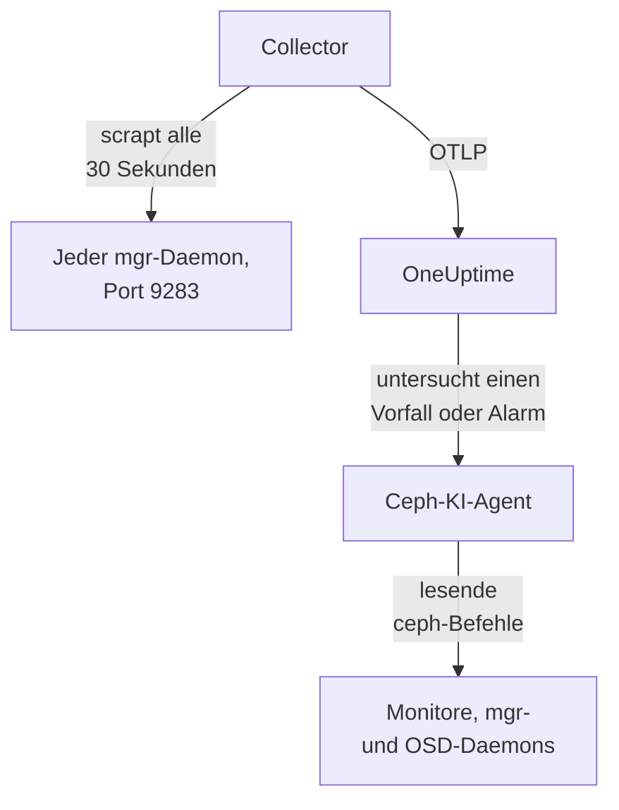

# Ceph-Agent

Der OneUptime-Ceph-Agent überwacht einen Ceph-Cluster: seinen Zustand, das Monitor-Quorum, die OSDs, Pools und Placement Groups. Er scrapt das Ceph-mgr-Modul `prometheus` auf jedem mgr-Daemon, versieht jede Metrik mit dem Namen Ihres Clusters und sendet sie an OneUptime, wo der Cluster mit seinen OSDs, Pools und Daemons erscheint. [Ceph-Monitore](/docs/monitor/ceph-monitor) alarmieren anhand dessen, was ankommt.

:::cards
- [Agent installieren](#agent-installieren): Das mgr-Modul aktivieren, dann das Installationsskript oder Docker Compose.
- [Was der Agent erfasst](#was-der-agent-erfasst): Die Serien hinter den Ceph-Seiten, Metriken und Alarmvorlagen.
- [KI-Agent](#ki-agent): OneUptime AI den Cluster lesen lassen, während sie untersucht.
- [Fehlerbehebung](#fehlerbehebung): Ein Diagnoseskript und die üblichen Probleme.
:::

## So funktioniert es

Der Agent besteht aus zwei Containern, die Sie mit Docker Compose auf einem Rechner ausführen. Ein OpenTelemetry Collector scrapt das mgr-Modul `prometheus` auf jedem mgr-Daemon alle 30 Sekunden. Nur der aktive mgr antwortet mit Metriken; fällt er auf einen Standby um, fließen die Metriken daher ohne Änderung weiter. Der Ceph-KI-Agent daneben lässt OneUptime AI lesende `ceph`-Befehle ausführen, während sie einen Vorfall oder Alarm untersucht.



Der Cluster registriert sich mit seinen ersten Daten unter dem Namen, den der Agent als `ceph.cluster.name` an jede Metrik hängt.

## Bevor Sie beginnen

- Docker Engine 20.10 oder neuer mit dem Plugin Docker Compose v2, auf einem Rechner, der Ihre Ceph-mgr-Daemons auf Port 9283 erreicht.
- Eine Shell auf einem Ceph-Admin-Knoten, auf dem die `ceph`-CLI mit Admin-Rechten funktioniert.
- Ein Ingestion-Schlüssel. Legen Sie ihn unter **Projekteinstellungen → Telemetrie & APM → Ingestion-Schlüssel** an und kopieren Sie seinen Wert.
- Ausgehendes HTTPS von diesem Rechner zu Ihrer OneUptime-URL.

## Agent installieren

:::steps
### Das mgr-Modul prometheus aktivieren

Auf einem Ceph-Admin-Knoten:

```bash
ceph mgr module enable prometheus
```

Jeder mgr-Daemon liefert dann Prometheus-Metriken auf Port `9283` unter `/metrics`. Nur der aktive mgr gibt Metriken zurück: Standby-mgrs antworten mit einer leeren Antwort oder mit einem HTTP-Fehler, wenn `mgr/prometheus/standby_behaviour` auf `error` gesetzt ist. Deshalb scrapt der Agent jeden mgr. Listen Sie sie auf:

```bash
ceph mgr stat                    # active mgr
ceph orch ps --daemon-type mgr   # all mgrs (cephadm clusters)
```

### Den Agent installieren und starten

:::tabs
@tab install.sh
Laden Sie das Installationsskript herunter und führen Sie es auf dem Rechner aus, auf dem der Agent laufen soll:

```bash
curl -sSL https://raw.githubusercontent.com/OneUptime/oneuptime/master/agents/CephAgent/install.sh -o install.sh
bash install.sh
```

Das Skript fragt nach Ihrer OneUptime-URL, dem Ingestion-Schlüssel, einem Namen für den Cluster und den mgr-Endpunkten sowie danach, ob der [KI-Agent](#ki-agent) Korrekturen anwenden darf. Wo `ceph` mit Admin-Rechten funktioniert, bietet es außerdem an, den eigenen Ceph-Client des KI-Agents anzulegen. Es installiert nach `/opt/oneuptime-ceph-agent`, schreibt eine `.env`-Datei mit `0600` und startet den Agent mit Docker Compose. Ein erneuter Lauf des Skripts verwendet alles in dieser `.env` wieder, statt erneut zu fragen; so [aktualisieren Sie den Agent](#agent-aktualisieren).
@tab Docker Compose
Laden Sie `docker-compose.yml` und `otel-collector-config.yaml` aus dem [Verzeichnis CephAgent](https://github.com/OneUptime/oneuptime/tree/master/agents/CephAgent) in einen neuen Ordner herunter:

```bash
mkdir oneuptime-ceph-agent && cd oneuptime-ceph-agent
curl -fsSLO https://raw.githubusercontent.com/OneUptime/oneuptime/master/agents/CephAgent/docker-compose.yml
curl -fsSLO https://raw.githubusercontent.com/OneUptime/oneuptime/master/agents/CephAgent/otel-collector-config.yaml
```

Legen Sie daneben eine Datei `.env` an:

```bash title=".env"
ONEUPTIME_URL=YOUR_ONEUPTIME_URL
ONEUPTIME_TELEMETRY_INGESTION_KEY=YOUR_TELEMETRY_INGESTION_TOKEN
CEPH_CLUSTER_NAME=my-ceph-cluster
CEPH_MGR_ENDPOINTS=[ceph-mon-1:9283,ceph-mon-2:9283,ceph-mon-3:9283]
```

Listen Sie jeden mgr-Daemon auf, den aktiven und die Standbys, durch Kommas getrennt und in eckigen Klammern: Durch die Klammern liest der Collector den Wert als Liste von Scrape-Zielen. Starten Sie den Agent:

```bash
docker compose up -d
```

Der Container des KI-Agents startet ebenfalls und wartet auf einen eigenen Ceph-Client: siehe [KI-Agent](#ki-agent).
:::

### Prüfen, ob der Agent läuft

```bash
docker compose ps
docker logs -f oneuptime-ceph-agent
```

`docker compose ps` listet den Collector (`oneuptime-ceph-agent`) und den KI-Agent (`oneuptime-ceph-ai-agent`) auf. Sobald der Collector gestartet ist, sollten seine Logs diese Zeile zeigen:

```text
Everything is ready. Begin running and processing data.
```

### Den Cluster in OneUptime finden

Öffnen Sie **Produkte → Infrastruktur → Ceph → Alle Cluster**. Der Cluster erscheint nach etwa einer Minute unter seinem `CEPH_CLUSTER_NAME`, mit seinen OSDs, Pools und Daemons.
:::

## Umgebungsvariablen

Das Installationsskript schreibt diese nach `/opt/oneuptime-ceph-agent/.env`; eine Docker-Compose-Installation liest sie aus der `.env` neben `docker-compose.yml`. Nachdem Sie einen Wert geändert haben, führen Sie in diesem Ordner `docker compose up -d` aus.

| Variable | Erforderlich | Beschreibung |
| --- | --- | --- |
| `ONEUPTIME_URL` | Ja | Ihre OneUptime-URL, etwa `https://oneuptime.com` oder Ihre selbst gehostete Instanz. Verwenden Sie `http://` und ihren Port, wenn die Instanz nur HTTP spricht. |
| `ONEUPTIME_TELEMETRY_INGESTION_KEY` | Ja | Der Ingestion-Schlüssel aus **Projekteinstellungen → Telemetrie & APM → Ingestion-Schlüssel**. |
| `CEPH_CLUSTER_NAME` | Ja | Der Name des Clusters in OneUptime, an jede Metrik als Ressourcenattribut `ceph.cluster.name` gehängt. Halten Sie ihn stabil: Eine spätere Änderung registriert einen zweiten Cluster. Standard ist `ceph`. |
| `CEPH_MGR_ENDPOINTS` | Ja | Jeder mgr-Daemon als kommagetrennte `host:port`-Liste in eckigen Klammern, etwa `[ceph-mon-1:9283,ceph-mon-2:9283,ceph-mon-3:9283]`. Das Installationsskript setzt die Klammern für Sie. |

Die eigenen Einstellungen des KI-Agents stehen unter [KI-Agent](#ki-agent).

## Wie der Agent scrapt

- **Jeder mgr, alle 30 Sekunden.** Das mgr-Modul `prometheus` hält jeden Scrape für `mgr/prometheus/scrape_interval` (standardmäßig 15 Sekunden) im Cache. Scrapen Sie nie häufiger: Sie würden nur erneut den Cache lesen.
- **`honor_labels: true`.** Die Labels, die Ceph exportiert (`ceph_daemon`, `pool_id`, Instanz-Labels pro Daemon), bleiben, wie sie sind. Ohne diese Einstellung würde das Label `instance` für jedes Scrape-Ziel umgeschrieben und sich bei jedem Wechsel des aktiven mgr ändern, was jede Serie unterbricht.

## Was der Agent erfasst

Der Agent sendet alles, was das mgr-Modul `prometheus` exportiert. Die Ceph-Seiten, der Metrikkatalog und die Alarmvorlagen von OneUptime bauen auf diesen Serien auf:

| Kategorie | Metriken |
| --- | --- |
| Cluster-Zustand | `ceph_health_status` (0 = OK, 1 = WARN, 2 = ERR), `ceph_health_detail` (eine Serie pro aktiver Integritätsprüfung, mit den Labels `name` und `severity`, ab Quincy; Grundlage der Alarmvorlagen für Integritätsprüfungen und der **Aktive Integritätsprüfungen** in der Übersicht), `ceph_healthcheck_slow_ops`, `ceph_daemon_health_metrics` (pro Daemon, nach `type` geschlüsselt), `ceph_mon_quorum_status`, `ceph_mon_metadata`, `ceph_cluster_total_bytes`, `ceph_cluster_total_used_bytes` |
| OSD | `ceph_osd_up`, `ceph_osd_in`, `ceph_osd_apply_latency_ms`, `ceph_osd_commit_latency_ms`, `ceph_osd_stat_bytes`, `ceph_osd_stat_bytes_used`, `ceph_osd_numpg`, `ceph_osd_metadata`, pro OSD über das Label `ceph_daemon` (etwa `osd.3`) |
| Pool | `ceph_pool_stored`, `ceph_pool_max_avail`, `ceph_pool_objects`, `ceph_pool_rd`, `ceph_pool_wr`, `ceph_pool_rd_bytes`, `ceph_pool_wr_bytes`, `ceph_pool_metadata`. Die Datenserien tragen nur ein Label `pool_id`; der Name des Pools steht auf `ceph_pool_metadata`. |
| Placement Groups | `ceph_pg_total`, `ceph_pg_active`, `ceph_pg_clean`, `ceph_pg_degraded`, `ceph_pg_undersized` (alle pro Pool, nach `pool_id`), `ceph_num_objects_degraded`, `ceph_num_objects_misplaced` |
| Daemons | `ceph_mgr_metadata`, `ceph_mds_metadata` und `ceph_rgw_metadata`, neben den Monitor- und OSD-Metadaten oben. Jede benennt einen Daemon und trägt seine Version im Label `ceph_version`: Die Seite **Daemons** listet sie auf. |

### Weitere Scrape-Ziele

Das mgr-Modul deckt den Zustand und die Kapazität des Clusters ab. Für einen genaueren Blick fügen Sie weitere Jobs unter `scrape_configs` in `otel-collector-config.yaml` hinzu:

- **`ceph-exporter` (Reef 18.2 und neuer).** cephadm führt auf jedem Host des Clusters einen Daemon `ceph-exporter` aus, der Leistungszähler pro Daemon auf Port `9926` liefert. Fügen Sie ein Ziel pro Host hinzu.
- **`node_exporter`.** Der übliche Begleiter für die CPU-, Speicher-, Festplatten- und Netzwerkmetriken jedes Ceph-Hosts, standardmäßig auf Port `9100`.

Beide erhalten das Ressourcenattribut `ceph.cluster.name` vom mitgelieferten Processor `resource` und landen so beim selben Cluster in OneUptime.

## Optional — Das Ceph-Cluster-Log senden

Der Agent kann `/var/log/ceph/ceph.log` verfolgen und an OneUptime senden, was die Seite **Cluster-Protokoll** des Clusters füllt. Standardmäßig ist das aus, weil der Agent dafür auf einem Host laufen muss, der das Cluster-Log hat: standardmäßig ein Monitor-Host.

:::steps
### Den Receiver einschalten

Kommentieren Sie in `otel-collector-config.yaml` den Receiver `filelog` und die Pipeline `logs` ein.

### Das Log-Verzeichnis einhängen

Kommentieren Sie in `docker-compose.yml` das Volume ein, das das Verzeichnis in den Collector einhängt:

```yaml
- /var/log/ceph:/var/log/ceph:ro
```

### Den Agent neu starten

```bash
docker compose up -d
```
:::

Zeilen werden gesendet, sobald sie geschrieben werden. OneUptime liest beim Anzeigen das Format von `ceph.log` (Zeit, Daemon, Level `INF`/`WRN`/`ERR`, Nachricht), und der Processor `resource` hängt `ceph.cluster.name` an, sodass das Log bei diesem Cluster landet.

## Den Cluster mit Projekt-Labels versehen

Ein Ressourcenattribut, das mit `oneuptime.label.` beginnt, wird zu einem Projekt-Label am Cluster: `oneuptime.label.<dimension>=<value>` ist das Label `<dimension>:<value>`. Fügen Sie die Attribute dem Processor `resource` in `otel-collector-config.yaml` hinzu, neben `ceph.cluster.name`:

```yaml
processors:
  resource:
    attributes:
      # ...existing attributes...
      - key: oneuptime.label.team
        value: storage
        action: upsert
      - key: oneuptime.label.env
        value: production
        action: upsert
```

Der Collector liest seine Konfiguration nur beim Start: Führen Sie `docker compose restart oneuptime-ceph-agent` aus. Der Cluster zeigt dann die Labels `team:storage` und `env:production`. Labels werden ohne Rücksicht auf Groß- und Kleinschreibung verglichen, daher wird ein vorhandenes Label `Production` wiederverwendet statt dupliziert, und der Agent entfernt nie ein Label, das jemand in OneUptime hinzugefügt hat.

## Als systemd-Dienst ausführen

Um den Agent mit dem Rechner zu starten und bei einem Fehler neu zu starten, installieren Sie seine systemd-Unit. Sie geht davon aus, dass der Agent in `/opt/oneuptime-ceph-agent` liegt, wo das Installationsskript ihn ablegt:

```bash
sudo curl -fsSL https://raw.githubusercontent.com/OneUptime/oneuptime/master/agents/CephAgent/systemd/oneuptime-ceph-agent.service -o /etc/systemd/system/oneuptime-ceph-agent.service
sudo systemctl daemon-reload
sudo systemctl enable --now oneuptime-ceph-agent
```

## Agent aktualisieren

Der Agent meldet die Collector-Version, die seine Dateien festlegen, als seine **Agent-Version**. Ist sie älter als die Version, die dieses OneUptime-Release festlegt, erscheint daneben in der **Übersicht** des Clusters ein Warnzeichen. Wählen Sie es aus, um diese Befehle zu sehen. Ein Agent, der installiert wurde, bevor seine Dateien eine Version meldeten, zeigt keine an, bis er auf diese Weise aktualisiert wurde.

Das Collector-Image ist in `docker-compose.yml` festgelegt, und seine Konfiguration ist eine Datei daneben; ein Pull allein bringt den Agent daher nicht voran. Führen Sie `install.sh` erneut aus: Es verwendet jeden Wert Ihrer vorhandenen `.env` wieder (es wird nichts erneut abgefragt), erneuert `docker-compose.yml` und `otel-collector-config.yaml` (eine von Ihnen bearbeitete Datei wird als `<file>.bak.<timestamp>` aufbewahrt), zieht die Images und erstellt den Agent neu, damit der Collector seine neue Konfiguration liest. Der Ordner `ceph/` des KI-Agents bleibt, wie er ist.

```bash
curl -sSL https://raw.githubusercontent.com/OneUptime/oneuptime/master/agents/CephAgent/install.sh -o install.sh
bash install.sh
```

Haben Sie stattdessen mit Docker Compose installiert? Laden Sie im Ordner des Agents beide Dateien erneut herunter (und nehmen Sie Ihre Änderungen daran erneut vor), ziehen Sie dann die Images und erstellen Sie den Agent neu:

```bash
curl -fsSLO https://raw.githubusercontent.com/OneUptime/oneuptime/master/agents/CephAgent/docker-compose.yml
curl -fsSLO https://raw.githubusercontent.com/OneUptime/oneuptime/master/agents/CephAgent/otel-collector-config.yaml
docker compose pull
docker compose up -d --force-recreate
```

## Agent deinstallieren

```bash
cd /opt/oneuptime-ceph-agent
docker compose down
```

Haben Sie den Ceph-Client des KI-Agents angelegt, entfernen Sie ihn auf einem Admin-Knoten mit `ceph auth del client.oneuptime-ai`.

## KI-Agent

Die `docker-compose.yml` des Agents führt außerdem den **Ceph-KI-Agent** aus, `oneuptime-ceph-ai-agent` (Image `oneuptime/resource-ai-agent:release`). Während OneUptime AI einen Vorfall oder Alarm auf diesem Cluster untersucht, führt sie darüber lesende `ceph`-Befehle aus — `ceph health detail`, `ceph osd tree`, `ceph pg dump_stuck`, `ceph crash ls` — und wendet, nur wenn Sie es erlauben, Korrekturen an, etwa ein OSD wieder auf in zu setzen oder `noout` zu löschen. Er registriert sich wie der Collector als der Cluster namens `CEPH_CLUSTER_NAME` und erscheint in OneUptime auf der Seite **KI → KI-Agent** des Clusters.

- **KI-Untersuchungen sind standardmäßig aktiviert.** Sobald der Agent verbunden ist, untersucht OneUptime AI Vorfälle und Alarme auf diesem Cluster mit ihm, und die **Übersicht** des Clusters zeigt den Status des Agents an. Zum Beenden setzen Sie `ONEUPTIME_AI_INVESTIGATION=false` dort, wo der Agent läuft (**Ändern** unter **Was die KI tun darf** auf der Seite des KI-Agents zeigt, wie), oder lassen den Agent weg.
- **Sein eigener Ceph-Client ist die harte Grenze.** Er verbindet sich als `client.oneuptime-ai`, mit der minimalen `ceph.conf` des Clusters und dem Keyring dieses Clients in einem Ordner `ceph/` neben `docker-compose.yml` (schreibgeschützt unter `/etc/ceph` eingehängt). Mit Lese-Caps kann nichts, was er ausführt, den Cluster ändern. Bei einer Neuinstallation bietet `install.sh` an, den Client anzulegen; ein erneuter Lauf tut das nie. Legen Sie nie den Admin-Keyring in diesen Ordner.
- Er ist **schreibgeschützt**, sofern Sie nicht `ONEUPTIME_AI_ALLOW_WRITES=true` setzen und dem Client die Caps für die Korrekturen geben (das README des Agents listet sie auf); `ONEUPTIME_AI_WRITE_TARGETS` (zum Beispiel `osd.*,cluster`) begrenzt, was eine Korrektur antasten darf. `ONEUPTIME_AI_FIXES` in derselben `.env` legt fest, wie Korrekturen ablaufen — `ask-for-approval` (ein Mensch genehmigt jede), `automatic` oder `bypass-approval` —, und die Seite des KI-Agents zeigt es schreibgeschützt an ([Was die KI tun darf, vom Agent festgelegt](/docs/ai/infrastructure-ai-agents#what-ai-may-do-set-by-the-agent)).
- Er verbindet sich ausgehend mit den Monitoren (TCP 3300 und 6789) sowie den mgr- und OSD-Daemons (TCP 6800–7300), läuft als UID 1000 ohne Capabilities und führt nie `auth`, `config-key`, `tell` oder etwas aus, das Daten löscht. Löschen Sie den Dienst `oneuptime-ceph-ai-agent` aus `docker-compose.yml`, wenn Sie OneUptime AI nicht verwenden.

Um den Client von Hand anzulegen, führen Sie dies auf einem Ceph-Admin-Knoten im Ordner des Agents aus (kopieren Sie die beiden Dateien in den Ordner `ceph/` auf dem Rechner des Agents, falls das ein anderer ist):

```bash
mkdir -p ceph
ceph config generate-minimal-conf > ceph/ceph.conf
ceph auth get-or-create client.oneuptime-ai mon 'allow r' mgr 'allow r' osd 'allow r' -o ceph/ceph.client.oneuptime-ai.keyring
sudo chown 1000:1000 ceph/ceph.client.oneuptime-ai.keyring
sudo chmod 600 ceph/ceph.client.oneuptime-ai.keyring
docker compose up -d
```

Was er ausführen darf, wie Korrekturen funktionieren und wie Sie Fehler beheben: [Infrastructure AI Agents](/docs/ai/infrastructure-ai-agents#ceph-clusters).

## Fehlerbehebung

:::details Zuerst das Diagnoseskript ausführen
Der Agent bringt ein Skript mit, [`troubleshoot.sh`](https://github.com/OneUptime/oneuptime/blob/master/agents/CephAgent/troubleshoot.sh), das die ganze Kette prüft: die Container-Laufzeit, jeden konfigurierten mgr-Endpunkt, den an jede Metrik gehängten Clusternamen, die Form des Tokens, die eigenen Metriken des Collectors und ob OneUptime den Ingestion-Schlüssel akzeptiert. Es warnt, wenn kein Endpunkt `ceph_health_status` liefert oder wenn nur einer konfiguriert ist, da nur der aktive mgr Metriken liefert. Die Schlüsselprüfung zählt am meisten. OneUptime lehnt einen falschen Schlüssel mit `401` ab (`422` für einen deaktivierten Schlüssel oder einen Browser-Schlüssel), und der Collector behandelt beides als dauerhaft: Er verwirft den Batch und protokolliert einen Fehler `Exporting failed`, der leicht zu übersehen ist, während der Container gesund bleibt. Das Skript fragt `GET <url>/otlp/v1/validate` aus dem Netzwerk des Agents ab, um direkt `200` (gültig) oder `401` (ungültig) zu erhalten, und weicht auf älteren Servern auf `POST /fluentd/v1/logs` aus.

```bash
curl -sSL https://raw.githubusercontent.com/OneUptime/oneuptime/master/agents/CephAgent/troubleshoot.sh -o troubleshoot.sh
bash troubleshoot.sh    # add -d <dir> if you installed outside /opt/oneuptime-ceph-agent
```

Es endet mit einem Urteil, das die wahrscheinlichste Ursache nennt.
:::

:::details Es erscheint kein Cluster in OneUptime
1. Lesen Sie die Logs des Collectors: `docker logs oneuptime-ceph-agent`. Ein `401` beim Export bedeutet einen falschen Ingestion-Schlüssel; eine abgelehnte Verbindung bedeutet eine falsche `ONEUPTIME_URL`.
2. Prüfen Sie, ob ein mgr Metriken liefert: `curl http://ACTIVE_MGR_HOST:9283/metrics | head` sollte `ceph_*`-Zeilen ausgeben. Falls nicht, aktivieren Sie das Modul mit `ceph mgr module enable prometheus`.
3. Prüfen Sie, ob `CEPH_MGR_ENDPOINTS` in eckigen Klammern steht. Ohne sie liest der Collector die ganze kommagetrennte Liste als ein einziges Ziel, das es nicht gibt.
:::

:::details Der Cluster wird als getrennt angezeigt
Ein Cluster wird als getrennt angezeigt, wenn OneUptime 15 Minuten lang nichts von ihm empfangen hat; OneUptime prüft alle 5 Minuten, und Zeit, in der es selbst keine Daten empfing, zählt nicht. Prüfen Sie, ob der Collector läuft (`docker compose ps`), ob seine Logs keine Exportfehler zeigen und ob der Rechner Ihre OneUptime-URL noch erreicht. Mit seinen nächsten Daten wird der Cluster wieder als verbunden angezeigt.
:::

:::details Metriken stoppen nach einem mgr-Failover
Wahrscheinlich scrapen Sie nur den mgr, der früher aktiv war. Listen Sie jeden mgr-Daemon in `CEPH_MGR_ENDPOINTS` auf: Das Scrapen der Standbys kostet fast nichts, und sie antworten mit leeren Antworten.
:::

:::details Scrape-Fehler für Standby-mgrs in den Logs des Collectors
Erwartet, wenn `mgr/prometheus/standby_behaviour` auf Ihrem Cluster auf `error` gesetzt ist: Standbys antworten dann mit HTTP 500. Der Scrape des aktiven mgr gelingt weiterhin, die Fehler sind also nur Rauschen; setzen Sie das Verhalten auf `default` zurück, um sie verstummen zu lassen.
:::

:::details Metriken landen beim falschen Cluster
OneUptime registriert einen Ceph-Cluster über sein `ceph.cluster.name`, das der Agent aus `CEPH_CLUSTER_NAME` nimmt. Eine Änderung nach den ersten Daten legt einen zweiten Cluster an, statt den ersten umzubenennen.
:::

## Nächste Schritte

:::cards
- [Ceph-Überwachung](/docs/monitor/ceph-monitor): Alarmieren bei Zustand, OSDs, Placement Groups, Kapazität, Abstürzen und langsamen Operationen.
- [Proxmox-Agent](/docs/telemetry/proxmox): Betreiben Sie Ceph unter Proxmox VE? Überwachen Sie auch den Cluster.
- [Infrastructure AI Agents](/docs/ai/infrastructure-ai-agents): Was der Ceph-KI-Agent ausführen darf und wie Korrekturen funktionieren.
- [Host-OpenTelemetry-Collector](/docs/telemetry/host-otel-collector): Die Sicht des Betriebssystems auf jeden Ceph-Host.
:::
