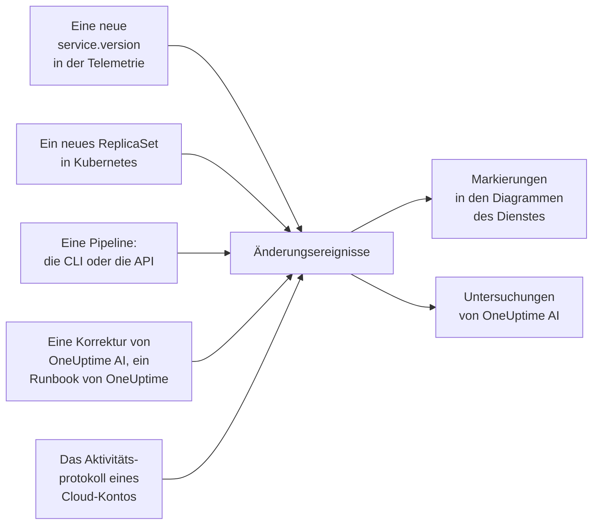

# Deploys und Änderungen

OneUptime hält fest, was sich in Ihrem Projekt geändert hat: Deploys, Kubernetes-Rollouts, Konfigurationsänderungen, die Änderungen in Ihren verbundenen Cloud-Konten und die Korrekturen, die es selbst ausgeführt hat. Jede Änderung wird als Markierung in die Diagramme ihres Dienstes oder ihrer Cloud-Ressource eingezeichnet, und OneUptime AI liest die Änderungen, wenn es einen Vorfall untersucht. So ist „es fing direkt nach dem Deploy um 10:02 an“ das Erste, was Sie erfahren, nicht das Letzte.

:::cards
- [Was OneUptime von selbst aufzeichnet](#was-oneuptime-von-selbst-aufzeichnet): Deploys und Rollouts aus der Telemetrie, die Änderungen Ihrer Cloud-Konten und die eigenen Korrekturen.
- [Einen Deploy aus einer Pipeline aufzeichnen](#einen-deploy-aus-einer-pipeline-aufzeichnen): Die CLI, GitHub Actions und die API.
- [Wie OneUptime AI Änderungen nutzt](#wie-oneuptime-ai-änderungen-nutzt): Die verdächtigen Änderungen in jeder Untersuchung.
- [Referenz](#referenz): Felder, Attribute und Grenzen.
:::

## So funktioniert es



## Was OneUptime von selbst aufzeichnet

Dafür müssen Sie nichts senden. OneUptime zeichnet diese Änderungen anhand der Telemetrie auf, die es ohnehin empfängt, und anhand dessen, was es selbst tut.

| Änderung | Aufgezeichnet, wenn | Quelle |
| --- | --- | --- |
| Ein Deploy | Ein Dienst beginnt, eine `service.version` zu melden, die er in seiner Umgebung noch nie gemeldet hat | `service-version` |
| Ein Rollout | Die Pods eines Kubernetes-Deployments beginnen, ein ReplicaSet auszuführen, das sie noch nie ausgeführt haben: ein neues Image, eine geänderte Umgebungsvariable oder Konfigurationsreferenz oder ein Neustart | `kubernetes` |
| Eine Korrektur von OneUptime AI | Ein KI-Agent meldet das Ergebnis eines Befehls, der etwas ändert, etwa `kubectl rollout restart` | `oneuptime-ai` |
| Ein Runbook | Ein Runbook, das OneUptime ausgeführt hat, wird abgeschlossen, schlägt fehl oder wird nach seinem Start abgebrochen | `runbook` |
| Eine Cloud-Änderung | Das Aktivitätsprotokoll eines verbundenen Cloud-Kontos zeichnet eine Änderung auf: AWS CloudTrail, das Azure-Aktivitätsprotokoll oder das Audit-Log Admin Activity von Google Cloud | `cloud` |
| Ein Ereignis des Anbieters | Der Cloud-Anbieter veröffentlicht ein Integritätsereignis zum Konto: AWS Health, Azure Service Health oder Resource Health oder Google Cloud Service Health | `cloud-health` |

- **Die erste Version, die ein Dienst meldet, ist seine Ausgangsbasis, kein Deploy.** Ein Dienst, der seit Monaten läuft, wird nicht in dem Moment deployt, in dem OneUptime seine Telemetrie zu empfangen beginnt.
- **Ein Rollback auf eine Version, die in den letzten 30 Tagen gesehen wurde, wird nicht aufgezeichnet,** weil diese Version nicht neu ist. Ein Rollback, den OneUptime AI ausführt, wird als Korrektur aufgezeichnet.
- **Nach mehr als 6 neuen Versionen oder ReplicaSets in einer Stunde wird bis zum Ende der Stunde nichts mehr aufgezeichnet.** Eine „Version“, die sich mit jedem Pod ändert, etwa ein Build-Zeitstempel, würde sonst für jeden Pod einen Deploy aufzeichnen.

Ein Deploy wird nur für einen Dienst aufgezeichnet, der `service.version` meldet. Setzen Sie das Attribut zusammen mit der Umgebung und dem Commit in den Ressourcenattributen Ihres OpenTelemetry-SDKs oder -Collectors:

```bash
OTEL_RESOURCE_ATTRIBUTES="service.version=2.3.1,deployment.environment.name=production,vcs.ref.head.revision=$GIT_SHA"
```

Für einen Rollout braucht es den [Kubernetes-Agenten](/docs/telemetry/kubernetes-agent), der die Telemetrie jedes Pods mit seinem Deployment und ReplicaSet versieht.

Eine Cloud-Änderung oder ein Ereignis des Anbieters braucht ein [verbundenes Cloud-Konto](/docs/telemetry/cloud-accounts). Jeder solche Eintrag ist mit der Cloud-Ressource verknüpft, die er nennt, sofern OneUptime diese Ressource auflistet, und wird in deren Diagramme eingezeichnet. Sein Typ ergibt sich aus der Operation: `deployment`, `scaling` oder `rollback`, wenn der Name der Operation das sagt, sonst `config-change`, und `provider-event` für ein Integritätsereignis. Diagramme, die auf keine Ressource gefiltert sind, lassen das Aktivitätsprotokoll eines Cloud-Kontos weg, damit ein geschäftiges Konto Ihre Deploys nicht verdrängt; die Integritätsereignisse des Anbieters bleiben darin.

## Einen Deploy aus einer Pipeline aufzeichnen

Eine Pipeline kann einen Deploy oder jede andere Änderung in dem Moment aufzeichnen, in dem sie geschieht: eine Konfigurationsänderung, eine Migration, ein Feature-Flag. Sie schreibt mit einem Telemetrie-Ingestion-Schlüssel Ihres Projekts, derselben Art, mit der Ihre Anwendungen Telemetrie senden. Erstellen Sie einen unter **Projekteinstellungen → Telemetrie & APM → Ingestion-Schlüssel**.

Ein Schlüssel mit festgelegtem Dienstnamen zeichnet jede Änderung unter diesem Dienst auf.

:::tabs
@tab CLI
```bash
oneuptime deploy \
  --service checkout \
  --service-version 2.3.1 \
  --commit "$GIT_SHA" \
  --environment production \
  --url https://oneuptime.com \
  --ingestion-key "$ONEUPTIME_TELEMETRY_INGESTION_KEY"
```
@tab GitHub Actions
```yaml title=".github/workflows/deploy.yml"
- name: Record the deploy in OneUptime
  env:
    ONEUPTIME_URL: https://oneuptime.com
    ONEUPTIME_TELEMETRY_INGESTION_KEY: ${{ secrets.ONEUPTIME_TELEMETRY_INGESTION_KEY }}
  run: |
    npx -y @oneuptime/cli deploy \
      --service checkout \
      --service-version "${{ github.ref_name }}" \
      --commit "${{ github.sha }}" \
      --repository "${{ github.server_url }}/${{ github.repository }}" \
      --environment production
```
@tab API
```bash
curl -X POST https://oneuptime.com/telemetry/change-events/v1/ingest \
  -H "Content-Type: application/json" \
  -H "x-oneuptime-token: $ONEUPTIME_TELEMETRY_INGESTION_KEY" \
  -d '{"events": [{"serviceName": "checkout", "version": "2.3.1", "commit": "1a2b3c4", "environment": "production"}]}'
```
:::

Verwenden Sie bei einer selbst gehosteten OneUptime-Instanz Ihre eigene Adresse statt `https://oneuptime.com`. Die API antwortet mit der Zahl der Ereignisse, die sie gespeichert hat, und der Zahl derer, die sie übersprungen hat:

```json
{ "ingested": 1, "skipped": 0 }
```

Jede Option der CLI finden Sie unter [`oneuptime deploy`](/docs/cli/command-reference#oneuptime-deploy).

## Wie OneUptime AI Änderungen nutzt

Jede [KI-Untersuchung](/docs/ai/ai-sre) eines Vorfalls oder einer Warnung geht von den Änderungen aus, die in den 2 Stunden davor aufgezeichnet wurden, und von denen in den 10 Minuten danach – für eine Pipeline, die ihren Deploy erst nach Abschluss des Rollouts aufzeichnet. Die Änderungen an den Diensten, Clustern, Hosts und Cloud-Ressourcen, mit denen der Vorfall verknüpft ist, stehen an erster Stelle.

Für bis zu 4 davon, die einen Dienst nennen, liest OneUptime die Telemetrie des Dienstes in den 30 Minuten vor und nach der Änderung und stuft die Änderung als **verdächtig** ein, wenn sich der Dienst direkt danach messbar verschlechtert hat:

| Signal | Verdächtig, wenn |
| --- | --- |
| Fehlgeschlagene Spans | Die Fehlerrate hat sich mindestens verdoppelt und ist um mindestens einen Prozentpunkt gestiegen, bei mindestens 10 fehlgeschlagenen Spans |
| Latenz | Die p99-Latenz ist um mindestens die Hälfte gestiegen, und um mindestens 100 ms |
| Ausnahmen | Mindestens dreimal so viele pro Minute, und mindestens 10 davon |
| Neue Ausnahmen | Ein Ausnahmetyp, der zwischen 10 Minuten vor und 30 Minuten nach der Änderung erstmals in der Version auftrat, die die Änderung ausgeliefert hat, kam mindestens 3-mal vor |

OneUptime entscheidet anhand dieser Zahlen, welche Änderung verdächtig ist, nicht anhand dessen, was im Titel einer Änderung steht. Die Untersuchung prüft eine verdächtige Änderung zuerst, sagt, ob sie den Vorfall verursacht hat, und ob ihr Rollback die schnellste sichere Korrektur ist.

Ist die verdächtige Änderung ein Kubernetes-Rollout auf einem Cluster, dessen [KI-Korrekturen](/docs/ai/ai-sre#so-funktionieren-korrekturen) eingeschaltet sind, nimmt OneUptime AI den Rollout zuerst zurück, mit einem `kubectl rollout undo`, das OneUptime aus der aufgezeichneten Änderung baut. Ein Deploy, der Code ausliefert, wird über seine Commits zurückgenommen: Die Untersuchung nennt den Commit oder Pull Request, der den Fehler verursacht hat, sodass ein [Korrektur-Pull-Request](/docs/ai/ai-sre#automatische-code-korrekturen) genau diesen rückgängig machen kann.

OneUptime prüft außerdem jeden Deploy von sich aus, unabhängig davon, ob jemand alarmiert wird. Sobald die 30 Minuten nach einem Deploy vergangen sind, vergleicht es sie anhand derselben Schwellen mit den 30 Minuten davor, und hat sich der Dienst verschlechtert, nennt ein [KI-Einblick](/docs/ai/ai-sre#einblicke-proaktive-erkennung) den Deploy an diesem Dienst.

Ein Korrektur-Pull-Request, den OneUptime AI geöffnet hat, wird genauso geprüft: Sobald ein aufgezeichneter Deploy seinen Commit enthält, beobachtet OneUptime dort, wofür die Korrektur gedacht war - die Ausnahme, die Operation, die sie schneller gemacht hat, den Monitor hinter dem Vorfall oder der Warnung, die Telemetrie, die sie hinzufügt - und sagt, ob die Korrektur gewirkt hat (siehe [Automatische Code-Korrekturen](/docs/ai/ai-sre#automatische-code-korrekturen)). Die bereitgestellte Korrektur wird nur dann in der Version des Deploys gelesen, wenn die eigene Telemetrie des Dienstes diese Version meldet, und sonst ab 10 Minuten nach dem Deploy, wenn alte Instanzen abgebaut sind.

In einer Untersuchung und in [KI fragen](/docs/ai/ask-ai) listet `recent_changes` die Änderungen in einem beliebigen Zeitfenster auf, und `get_change_details` zeigt, was ein Deploy ausgeliefert hat: die Commits seit dem vorherigen Deploy des Dienstes, ihre Autoren, die Pull Requests und die Dateien, die sie geändert haben. Dafür braucht die Änderung ihren Commit, und ein Repository muss über die [GitHub App](/docs/ai/github-app) verbunden sein.

## Referenz

### Felder

| Feld | Was es ist |
| --- | --- |
| `title` | Was sich geändert hat, etwa `Deploy 2.3.1`. Ein Deploy, der `version` sendet, kann es weglassen |
| `eventType` | Die Art der Änderung: `deployment` (der Standard), `config-change`, `scaling`, `rollback`, `feature-flag` oder eine eigene |
| `serviceName` | Der Dienst, zu dem sie gehört. Ohne ihn gilt die Änderung für das ganze Projekt |
| `time` | Wann sie geschah, als ISO 8601 oder als Epoch-Sekunden oder -Millisekunden. Standard ist der Zeitpunkt, zu dem sie eintraf |
| `description` | Details der Änderung |
| `version` | Die deployte Version |
| `previousVersion` | Die Version, die sie ersetzt hat |
| `commit` | Der deployte Commit (auch `commitSha` oder `sha`) |
| `repository` | Das Repository des Commits (auch `repositoryUrl`) |
| `branch` | Der deployte Branch |
| `pullRequest` | Der deployte Pull Request |
| `environment` | Die Umgebung, in die deployt wurde |
| `attributes` | Bis zu 50 weitere Attribute, als Text, Zahlen oder boolesche Werte |

Die Felder der obersten Ebene werden als Attribute unter ihren OpenTelemetry-Namen gespeichert: `version` als `service.version`, `commit` als `vcs.ref.head.revision`, `repository` als `vcs.repository.url.full`, `branch` als `vcs.ref.head.name`, `pullRequest` als `vcs.change.id` und `environment` als `deployment.environment.name`. Ein Attribut, das unter einem dieser Namen gesendet wird, hat Vorrang vor seinem Feld.

Attribute, deren Namen mit `oneuptime.` beginnen, gehören OneUptime selbst und werden aus dem entfernt, was eine Pipeline sendet. Jede Änderung, die eine Pipeline aufzeichnet, weist sich in `oneuptime.change.source` als solche aus: Der Wert ist `api`.

Eine aus einem Cloud-Konto gelesene Änderung nennt das Konto und die Ressource unter den Namen von OpenTelemetry, `cloud.provider`, `cloud.account.id`, `cloud.region` und `cloud.resource_id`, und hält die Operation in `oneuptime.cloud.operation` fest, wer sie ausgeführt hat in `oneuptime.cloud.actor`, ob sie fehlgeschlagen ist in `oneuptime.change.status` und ihr Cloud-Konto in `oneuptime.cloud_account.id`.

### Grenzen

| Grenze | Wert |
| --- | --- |
| Ereignisse pro Anfrage | 100 |
| Titel | 500 Zeichen |
| Beschreibung | 5.000 Zeichen |
| Attribute | 50 |
| Zeit | Eine Zeit, die mehr als 366 Tage zurückliegt oder mehr als 60 Minuten in der Zukunft liegt, wird durch die Zeit ersetzt, zu der das Ereignis eintraf |

## Nächste Schritte

:::cards
- [AI SRE](/docs/ai/ai-sre): Was eine Untersuchung liest und wie sie behebt, was sie findet.
- [Befehlsreferenz](/docs/cli/command-reference): Jeder Befehl der CLI.
- [OpenTelemetry](/docs/telemetry/open-telemetry): Die Telemetrie Ihrer Dienste senden, mit ihren Versionen.
- [Ein Cloud-Konto verbinden](/docs/telemetry/cloud-accounts): Die Änderungen und Integritätsereignisse Ihrer AWS-, Azure- und Google-Cloud-Konten.
:::
