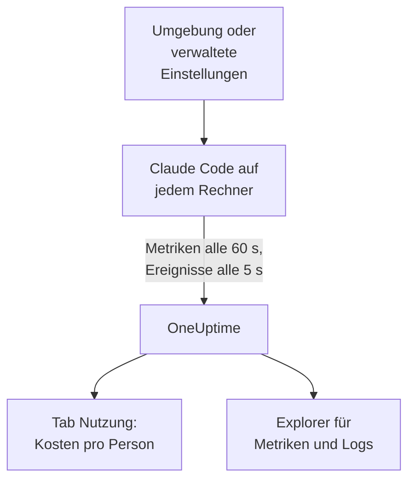

# Claude Code

Claude Code exportiert OpenTelemetry-Metriken und -Ereignisse selbst, direkt an OneUptime: kein Collector und kein Gateway dazwischen. Schalten Sie es mit ein paar Umgebungsvariablen ein, oder für eine ganze Flotte mit einer verwalteten Einstellungsdatei, und sehen Sie Kosten, Tokens, Sitzungen, Commits und angenommene Änderungen pro Entwickler.

:::cards
- [Einen Rechner einrichten](#einen-rechner-einrichten): Sechs Umgebungsvariablen und ein Neustart.
- [Auf die Flotte ausrollen](#auf-die-flotte-ausrollen): Eine verwaltete Einstellungsdatei auf jedem Rechner.
- [Ausgaben Personen zuordnen](#nutzung-personen-und-teams-zuordnen): Wer angemeldet ist und wann Sie die Identität selbst setzen müssen.
- [Fehlerbehebung](#fehlerbehebung): Was Sie prüfen, wenn nichts ankommt.
:::

## So funktioniert es



Claude Code sendet:

- **Kosten und Tokens**: `claude_code.cost.usage` (USD) und `claude_code.token.usage`, nach Modell, nach Hauptagent oder Subagent und nach dem Agenten, Skill, Plugin oder MCP-Server, der den Aufruf gemacht hat.
- **Aktivität**: Sitzungen, Commits, Pull Requests, hinzugefügte und entfernte Codezeilen sowie aktive Zeit.
- **Änderungsentscheidungen**: `claude_code.code_edit_tool.decision` zählt angenommene und abgelehnte Änderungen, die Annahmequote ist also `accept / (accept + reject)`, nach Sprache und nach Tool.
- **Ereignisse**: Prompts, Tool-Ergebnisse, API-Anfragen und -Fehler, Wechsel des Berechtigungsmodus und MCP-Server-Verbindungen, als OTLP-Log-Einträge.

Jeder Metrik-Datenpunkt und jedes Ereignis trägt `user.email`, wenn der Entwickler mit einem Claude-Konto angemeldet ist, und OneUptime liest sie als Mitarbeiter auf den Metriken, wo Kosten und Tokens stehen.

## Bevor Sie beginnen

1. Erstellen Sie einen Telemetrie-Ingestion-Schlüssel unter **Projekteinstellungen → Telemetrie & APM → Ingestion-Schlüssel**.
2. Ihr OTLP-Endpunkt ist `https://oneuptime.com/otlp`, oder `https://YOUR-ONEUPTIME-HOST/otlp`, wenn Sie OneUptime selbst betreiben.
3. Nutzen Sie einen Schlüssel für die ganze Flotte. Er landet auf jedem Entwicklerrechner, behandeln Sie ihn also als gemeinsames Geheimnis, das nur Daten senden kann, und rotieren Sie ihn wie jedes andere.

## Einen Rechner einrichten

:::steps
### Die Variablen exportieren

Fügen Sie diese Ihrem Shell-Profil hinzu (`.zshrc` oder `.bashrc`), oder exportieren Sie sie in dem Terminal, aus dem Sie Claude Code starten:

```bash
export CLAUDE_CODE_ENABLE_TELEMETRY=1
export OTEL_METRICS_EXPORTER=otlp
export OTEL_LOGS_EXPORTER=otlp
export OTEL_EXPORTER_OTLP_PROTOCOL=http/protobuf
export OTEL_EXPORTER_OTLP_ENDPOINT="https://oneuptime.com/otlp"
export OTEL_EXPORTER_OTLP_HEADERS="x-oneuptime-token=YOUR_INGESTION_TOKEN"
```

| Variable | Was sie tut |
| --- | --- |
| `CLAUDE_CODE_ENABLE_TELEMETRY` | Der Hauptschalter: Ohne ihn wird nichts exportiert. |
| `OTEL_METRICS_EXPORTER`, `OTEL_LOGS_EXPORTER` | `otlp` sendet an OneUptime. `otlp,console` gibt zusätzlich aus, was gesendet wird, praktisch beim Einrichten. |
| `OTEL_EXPORTER_OTLP_PROTOCOL` | `http/protobuf`; `http/json` und `grpc` funktionieren auch. |
| `OTEL_EXPORTER_OTLP_ENDPOINT` | Die Basis-URL. Claude Code hängt `/v1/metrics` und `/v1/logs` selbst an. |
| `OTEL_EXPORTER_OTLP_HEADERS` | Durch Kommas getrennte Paare `key=value`; hier Ihr Ingestion-Schlüssel. |

### Claude Code neu starten

Die Variablen werden beim Start von Claude Code gelesen. Metriken werden alle 60 Sekunden gesendet und Ereignisse alle 5 Sekunden, nutzen Sie Claude Code also eine Minute, bevor Sie nachsehen.

### Prüfen, ob Daten ankommen

Öffnen Sie **Metriken** und suchen Sie nach `claude_code.token.usage`, öffnen Sie dann **Produkte → KI / LLM** und gehen Sie zu **Nutzung**: Ihre Kosten erscheinen unter Ihrer E-Mail, markiert mit **aus GenAI-Metriken**.
:::

Um Metriken und Ereignisse an verschiedene Orte zu senden, setzen Sie stattdessen `OTEL_EXPORTER_OTLP_METRICS_ENDPOINT` und `OTEL_EXPORTER_OTLP_LOGS_ENDPOINT`, mit dem vollständigen Pfad (`https://oneuptime.com/otlp/v1/metrics`, `https://oneuptime.com/otlp/v1/logs`).

## Auf die Flotte ausrollen

Für eine Organisation liefern Sie dieselben Variablen in einer verwalteten Einstellungsdatei aus. Sie hat die Form von `settings.json`, mit den Variablen in einem Block `env`:

```json title="managed-settings.json"
{
  "env": {
    "CLAUDE_CODE_ENABLE_TELEMETRY": "1",
    "OTEL_METRICS_EXPORTER": "otlp",
    "OTEL_LOGS_EXPORTER": "otlp",
    "OTEL_EXPORTER_OTLP_PROTOCOL": "http/protobuf",
    "OTEL_EXPORTER_OTLP_ENDPOINT": "https://oneuptime.com/otlp",
    "OTEL_EXPORTER_OTLP_HEADERS": "x-oneuptime-token=YOUR_INGESTION_TOKEN",
    "OTEL_RESOURCE_ATTRIBUTES": "team.id=platform,cost_center=eng-123"
  }
}
```

:::steps
### Die Datei dort ablegen, wo Claude Code sie liest

| Plattform | Pfad |
| --- | --- |
| macOS | `/Library/Application Support/ClaudeCode/managed-settings.json` |
| Linux und WSL | `/etc/claude-code/managed-settings.json` |
| Windows | `C:\Program Files\ClaudeCode\managed-settings.json` |

Claude Code liest den alten Windows-Pfad `C:\ProgramData\ClaudeCode\managed-settings.json` nicht mehr. Wenn Sie bereits eine verwaltete Einstellungsdatei ausliefern, fügen Sie stattdessen eine Drop-in-Datei hinzu, etwa `managed-settings.d/10-telemetry.json` daneben: Claude Code führt zuerst `managed-settings.json` zusammen, dann jede `*.json`-Datei in `managed-settings.d/` in alphabetischer Reihenfolge.

### Einen Rechner prüfen

Führen Sie `/status` in Claude Code aus. Die Zeile `Setting sources` sollte `Enterprise managed settings (file)` lauten, oder `(drop-ins)` bzw. `(file + drop-ins)` bei einer Drop-in-Datei. Eine andere Quelle in Klammern bedeutet, dass eine höherrangige Quelle gewonnen hat und Ihre nicht verwendet wurde.

### Die Flotte ankommen sehen

Im Tab **Nutzung** erscheint jeder Entwickler als Zeile, sobald er Claude Code mit den neuen Einstellungen genutzt hat.
:::

Dasselbe JSON kann auch aus serververwalteten Einstellungen in der Admin-Konsole von claude.ai kommen (beim Start und jede Stunde abgerufen), aus einem macOS-Konfigurationsprofil in der Domain `com.anthropic.claudecode` oder aus einem Wert `Settings` unter `HKLM\SOFTWARE\Policies\ClaudeCode` unter Windows.

:::details Welche verwaltete Quelle gewinnt und wie sich die Telemetrievariablen kombinieren
Standardmäßig nutzt Claude Code die höchstrangige Quelle, die irgendeinen Richtlinienschlüssel setzt, und ignoriert die anderen: serververwaltete Einstellungen, dann eine MDM- oder Betriebssystem-Richtlinie, dann die verwalteten Einstellungsdateien, dann den Registrierungswert `HKCU` pro Benutzer. Der Block `env` ist die Ausnahme: Seit Version 2.1.223 wird er Variable für Variable über die Admin-Quellen zusammengeführt.

Die Telemetrievariablen nicht: Die Variablen `OTEL_EXPORTER_OTLP_*`, die Inhaltsschalter `OTEL_LOG_*`, `OTEL_LOGS_EXPORTER` und die Beta-Tracing-Variablen kommen gemeinsam aus der höchstrangigen Quelle, die eine von ihnen setzt, sodass ein Endpunkt aus einer Quelle nie mit Zugangsdaten aus einer anderen zusammenkommt. Setzt eine höherrangige Quelle eine davon, trägt eine Telemetrie-Drop-in-Datei nichts bei.

Serververwaltete Einstellungen brauchen einen Schritt mehr: Ein nicht leeres `OTEL_EXPORTER_OTLP_ENDPOINT` wird erst angewendet, nachdem jeder Entwickler in einer interaktiven Sitzung einen Sicherheitsdialog bestätigt hat, und Änderungen an den Exporter-Einstellungen gelten ab dem nächsten Start. Dateien und MDM-Richtlinien haben keinen Dialog.
:::

:::details Den Ingestion-Schlüssel rotieren, ohne jeden Rechner zu bearbeiten
Setzen Sie statt eines festen Headers `"otelHeadersHelper": "/path/to/generate-otel-headers.sh"` in den Einstellungen. Das Skript gibt ein flaches JSON-Objekt mit Headern aus, etwa `{"x-oneuptime-token":"..."}`. Claude Code führt es beim Start aus und dann alle `CLAUDE_CODE_OTEL_HEADERS_HELPER_DEBOUNCE_MS` Millisekunden (standardmäßig `1740000`, 29 Minuten). Fehler erscheinen in `/status`.
:::

## Nutzung Personen und Teams zuordnen

**Der Mitarbeiter ist `user.email`.** Claude Code sendet sie, wenn der Entwickler mit einem Claude-Konto angemeldet ist, und es gibt keine Variable, um sie abzuschalten. OneUptime liest sie aus jedem Kosten- und Token-Datenpunkt, ohne Einrichtung.

**Andere Anmeldungen senden keine E-Mail.** Mit einem API-Schlüssel oder mit Claude auf Amazon Bedrock, Google Cloud oder Microsoft Foundry gibt es kein Claude-Konto in der Sitzung, und Claude Code sendet nur `user.id` und `session.id`. Setzen Sie die Identität selbst, pro Rechner, in den verwalteten Einstellungen oder einem Start-Wrapper:

```bash
export OTEL_RESOURCE_ATTRIBUTES="user.email=jdoe@example.com,team.id=platform"
```

**`user.id` ist keine Person.** Es ist eine zufällige ID, die Claude Code beim ersten Start in `~/.claude.json` schreibt: eine pro Installation, und eine neue, wenn die Datei gelöscht wird. Ohne E-Mail erscheint jede Installation als eigene Zeile. Eine Ausnahme: Eine Sitzung, die bei einem Claude Apps Gateway angemeldet ist, sendet die angemeldete Identität (`user.id` ist das Subjekt des Identitätsanbieters, `user.email` die E-Mail) und ignoriert `user.*`-Schlüssel, die Sie selbst setzen.

**Teams und Kostenstellen** kommen aus `OTEL_RESOURCE_ATTRIBUTES`: OneUptime liest `team.id`, `team`, `cost_center` und `department`. Werte dürfen keine Leerzeichen enthalten, und Anführungszeichen maskieren sie nicht: Schreiben Sie `team=Platform_Engineering` oder kodieren Sie in Prozent, wie in `team=Platform%20Engineering`. Claude Code kopiert diese Schlüssel auf jeden Datenpunkt (`OTEL_METRICS_INCLUDE_RESOURCE_ATTRIBUTES`, standardmäßig an), und OneUptime liest sie so oder so. Ein Schlüssel, den Sie setzen, überschreibt nie einen, den Claude Code selbst setzt.

## Was OneUptime zeigt

Unter **Produkte → KI / LLM → Nutzung** speist `claude_code.cost.usage` die Tabellen **Mitarbeiter**, **Team** und **Modell**, und `claude_code.token.usage` die Token-Summen. Zwei Regeln entscheiden, was Sie sehen:

- **Die Metriken springen für Spans ein; sie werden nie zu ihnen addiert.** Wenn dasselbe Projekt GenAI-Spans mit Kosten aus Ihren eigenen Apps bekommt, erscheinen die Ausgaben von Claude Code nicht. Senden Sie Claude Code in ein eigenes Projekt. Siehe [Spans zuerst, Metriken springen ein](/docs/telemetry/ai-llm-observability#spans-zuerst-metriken-springen-ein).
- **Eine Zeile aus Metriken trägt nur Kosten.** Ihre Zellen für Aufrufe und Tokens zeigen `—`, und die Tabellen **Anbieter** und **Anwendung / Dienst** bleiben leer: Die Metriken nennen keinen Anbieter und gehören zu keinem OneUptime-Dienst.

Alles andere, etwa Annahmequote, Codezeilen, Commits und Pull Requests pro Entwickler oder Ausgaben nach `query_source`, stellen Sie in einem [Dashboard](/docs/dashboards/index) aus den Metriken unten dar und warnen darauf mit einer [Metriken-Überwachung](/docs/monitor/metrics-monitor).

## Metriken

Jede Metrik ist ein Zähler und trägt die Standardattribute zusätzlich zu ihren eigenen.

| Metrik | Einheit | Ihre eigenen Attribute |
| --- | --- | --- |
| `claude_code.session.count` | keine | `start_type`: `fresh`, `resume`, `continue`, `agents_view` |
| `claude_code.lines_of_code.count` | keine | `type`: `added`, `removed`; `model` |
| `claude_code.commit.count` | keine | keine |
| `claude_code.pull_request.count` | keine | keine |
| `claude_code.cost.usage` | USD | `model`; `query_source`: `main`, `subagent`, `auxiliary`; `speed`: `fast`, `normal`; `effort`; `agent.name`, `skill.name`, `plugin.name`, `marketplace.name`, `mcp_server.name`, `mcp_tool.name` |
| `claude_code.token.usage` | Tokens | `type`: `input`, `output`, `cacheRead`, `cacheCreation`; und dieselben Attribute wie `claude_code.cost.usage` |
| `claude_code.code_edit_tool.decision` | keine | `tool_name`: `Edit`, `Write`, `NotebookEdit`; `decision`: `accept`, `reject`; `source`; `language` |
| `claude_code.active_time.total` | s | `type`: `user` (an der Tastatur), `cli` (Tools und Modellantworten) |

Die Standardattribute sind `session.id`, `app.version`, `app.entrypoint`, `organization.id`, `user.account_uuid`, `user.account_id`, `user.id`, `user.email` und `terminal.type`, dazu Ihre `OTEL_RESOURCE_ATTRIBUTES`. Einige davon lassen sich abschalten: siehe [Das Metrikvolumen klein halten](#das-metrikvolumen-klein-halten).

- Die Cache-Token-Typen sind in camelCase: `cacheRead` und `cacheCreation`. Die Token-Summen von OneUptime zählen nur `input` und `output`.
- Auf den Kosten- und Token-Metriken lauten die Namen Ihrer eigenen Agenten und MCP-Server sowie von Plugins und Skills Dritter `custom` oder `third-party`, außer `OTEL_LOG_TOOL_DETAILS=1` ist gesetzt (Claude Code 2.1.273 oder neuer).

## Ereignisse

Ereignisse kommen als OTLP-Log-Einträge an, jeweils mit `event.name`, `event.timestamp` und `event.sequence`. Die, die Sie am häufigsten nutzen:

| Ereignis | Was es aufzeichnet |
| --- | --- |
| `claude_code.user_prompt` | Einen Prompt: seine Länge und seinen Befehl; den Text nur, wenn Sie ihn einschalten |
| `claude_code.api_request` | Eine Modellanfrage: `model`, `cost_usd`, `cost_usd_micros`, `duration_ms`, `input_tokens`, `output_tokens`, Cache-Tokens |
| `claude_code.api_error` | Eine Anfrage, die nach ihren Wiederholungen fehlschlug: `model`, `error`, `status_code`, `attempt` |
| `claude_code.tool_result` | Einen Tool-Lauf: `tool_name`, `success`, `duration_ms` und die Entscheidung, die ihn erlaubt hat |
| `claude_code.tool_decision` | Ob ein Tool erlaubt wurde, und wodurch |
| `claude_code.mcp_server_connection` | Einen MCP-Server, der sich verbindet oder scheitert |

Claude Code sendet viele weitere, etwa Ablehnungen, Wechsel des Berechtigungsmodus sowie Plugin-, Hook- und Skill-Ereignisse: Die [Monitoring-Referenz](https://code.claude.com/docs/en/monitoring-usage) von Anthropic listet sie alle. In `cost_usd_micros` sind die Kosten eine ganze Zahl von Millionstel USD, die sich ohne Rundungsdrift addieren lässt.

## Das Metrikvolumen klein halten

Claude Code setzt standardmäßig `session.id` auf jeden Datenpunkt, und jede Sitzung ist eine neue Reihe. Über eine Flotte hinweg treibt dieses eine Attribut das Metrikvolumen, und die Kostenauswertung braucht es nicht:

```bash
export OTEL_METRICS_INCLUDE_SESSION_ID=false
```

| Variable | Standard | Fügt hinzu |
| --- | --- | --- |
| `OTEL_METRICS_INCLUDE_SESSION_ID` | `true` | `session.id`, ein neuer Wert pro Sitzung |
| `OTEL_METRICS_INCLUDE_VERSION` | `false` | `app.version` |
| `OTEL_METRICS_INCLUDE_ACCOUNT_UUID` | `true` | `user.account_uuid` und `user.account_id` |
| `OTEL_METRICS_INCLUDE_ENTRYPOINT` | `false` | `app.entrypoint` |
| `OTEL_METRICS_INCLUDE_RESOURCE_ATTRIBUTES` | `true` | Ihre Schlüssel aus `OTEL_RESOURCE_ATTRIBUTES` |
| `OTEL_METRICS_INCLUDE_REPOSITORY` | `false` | Die `vcs.*`-Attribute des Repositorys |

`user.email`, `user.id`, `organization.id` und `terminal.type` haben keinen Schalter. Ereignisse sind das lebhaftere Signal: Jeder aktive Entwickler sendet alle 5 Sekunden (`OTEL_LOGS_EXPORT_INTERVAL`, in Millisekunden). Erhöhen Sie den Wert, um weniger und größere Pakete zu senden, oder setzen Sie `OTEL_LOGS_EXPORTER=none`, wenn Sie nur Kosten und Nutzung brauchen, die alle in den Metriken stehen.

## Prompt- und Tool-Inhalte sind standardmäßig aus

Claude Code exportiert keine Prompts, Antworten, Tool-Argumente oder Tool-Ausgaben, außer Sie schalten jedes davon ein:

| Variable | Standard | Was `1` einschaltet |
| --- | --- | --- |
| `OTEL_LOG_USER_PROMPTS` | aus | Prompt-Text |
| `OTEL_LOG_ASSISTANT_RESPONSES` | aus | Antworttext; ungesetzt folgt er `OTEL_LOG_USER_PROMPTS` |
| `OTEL_LOG_TOOL_DETAILS` | aus | Tool-Parameter, Bash-Befehle und die echten Namen von Agenten, Plugins, Skills und MCP-Servern |
| `OTEL_LOG_TOOL_CONTENT` | aus | Ein- und Ausgabe von Tools, nur auf Trace-Spans |
| `OTEL_LOG_RAW_API_BODIES` | aus | Vollständige Bodies von API-Anfragen und -Antworten (`file:<dir>` schreibt sie stattdessen auf die Festplatte) |

Wir empfehlen, sie ausgeschaltet zu lassen: Die Metriken und die geschwärzten Ereignisse beantworten bereits, wer was mit welchem Modell und mit welcher Annahmequote ausgegeben hat. Die Erfassung von Inhalten verschiebt Prompts, Quellcode und Tool-Ausgaben in einen Telemetriespeicher mit anderen Zugriffsregeln als Ihre Repositorys. Wenn Sie sie für eine Untersuchung einschalten, begrenzt `CLAUDE_CODE_OTEL_CONTENT_MAX_LENGTH` (standardmäßig `61440`), wie viel pro Eintrag übertragen wird, und die **Scrub-Regeln** und **Drop-Filter** der Traces unter **Traces → Einstellungen** maskieren oder verwerfen sie, bevor sie gespeichert werden.

## Metriken kommen als Deltas an

Claude Code sendet standardmäßig Delta-Metriken: Jeder Datenpunkt ist der Zuwachs seit dem letzten Export, keine laufende Summe. Wenn Sie sie darstellen oder darauf warnen, addieren Sie die Datenpunkte über das Fenster, und wenden Sie keine Raten- oder Zähler-Reset-Funktion an wie bei einem kumulativen Zähler: Die Zahlen werden falsch, ohne kaputt auszusehen.

```bash
export OTEL_EXPORTER_OTLP_METRICS_TEMPORALITY_PREFERENCE=cumulative
```

Legen Sie `cumulative` nur fest, wenn jeder Exporter in Ihrer Organisation es nutzt, und mischen Sie die beiden nicht innerhalb einer Flotte.

## Traces (Beta)

Claude Code hat außerdem einen Beta-Exporter für Traces, der jede Interaktion als Span-Baum zeichnet: `claude_code.interaction`, mit `claude_code.llm_request` und `claude_code.tool` darunter.

```bash
export CLAUDE_CODE_ENHANCED_TELEMETRY_BETA=1
export OTEL_TRACES_EXPORTER=otlp
```

> [!WARNING]
> Halten Sie die Traces-Beta aus dem Projekt heraus, das Sie für Ausgaben nutzen. Ihre Modell-Spans tragen `gen_ai.system` und `gen_ai.request.model`, daher listet OneUptime sie unter **Aufrufe**, aber ihre Tokens stehen in `input_tokens` und `output_tokens`, nicht in den Schlüsseln `gen_ai.usage.*`, sodass sie ohne Tokens und ohne Kosten ankommen. Sobald es sie gibt, sind sie die Zeilen, die die Tabellen **Mitarbeiter**, **Team** und **Modell** zeigen, mit $0, anstelle der Ausgaben aus den Metriken.

In Agent-SDK- und nicht interaktiven `-p`-Sitzungen übernimmt Claude Code ein eingehendes `TRACEPARENT`, sodass seine Spans sich dem Trace des Aufrufers anschließen; interaktive Sitzungen ignorieren es. Den Header `traceparent` sendet es nur an das Modell, wenn `ANTHROPIC_BASE_URL` nicht gesetzt ist oder die Anthropic-API ist; hinter Ihrem eigenen Proxy setzen Sie `CLAUDE_CODE_PROPAGATE_TRACEPARENT=1`.

## Fehlerbehebung

:::details Es kommt gar nichts an
Prüfen Sie zuerst `CLAUDE_CODE_ENABLE_TELEMETRY=1`: Ohne sie bewirkt keine andere Variable etwas. Fügen Sie dann `console` zu den Exportern hinzu (`OTEL_METRICS_EXPORTER=otlp,console`) und beobachten Sie das Terminal: Erscheinen Datenpunkte, ist Claude Code in Ordnung, und das Problem ist der Endpunkt, der Schlüssel oder das Netzwerk.
:::

:::details Die verwaltete Einstellungsdatei scheint ignoriert zu werden
Führen Sie `/status` aus und lesen Sie die Zeile `Setting sources`. Steht dort keine verwaltete Quelle, liegt die Datei am falschen Pfad, ist kein gültiges JSON oder kann vom Konto des Entwicklers nicht gelesen werden. Steht dort eine andere Quelle, hat sie gewonnen, und Ihre wurde nicht verwendet. Serververwaltete Einstellungen warten außerdem darauf, dass der Entwickler den Bestätigungsdialog in einer interaktiven Sitzung annimmt.
:::

:::details Ausgaben erscheinen als Nicht zugeordnet oder als eine Zeile pro Installation
Diese Entwickler sind nicht mit einem Claude-Konto angemeldet: Sie nutzen einen API-Schlüssel, Amazon Bedrock, Google Cloud oder Microsoft Foundry. Setzen Sie für sie `user.email` in `OTEL_RESOURCE_ATTRIBUTES`, wie [Nutzung Personen und Teams zuordnen](#nutzung-personen-und-teams-zuordnen) zeigt.
:::

:::details Das Team oder die Kostenstelle fehlt
Prüfen Sie, ob `OTEL_RESOURCE_ATTRIBUTES` auf dem Rechner gesetzt ist, keine Leerzeichen enthält und keinen Schlüssel wiederverwendet, den Claude Code selbst setzt: Der Wert von Claude Code gewinnt.
:::

:::details Die Zahlen wirken zu klein oder zu groß
Claude Code sendet Deltas: Addieren Sie die Datenpunkte über das Fenster, wie [Metriken kommen als Deltas an](#metriken-kommen-als-deltas-an) erklärt. Und warten Sie eine volle Minute: Metriken werden alle 60 Sekunden gesendet.
:::

:::details Der Schlüssel wird abgelehnt
OneUptime weist ein falsches `x-oneuptime-token` ab. Kopieren Sie den Schlüssel erneut aus **Projekteinstellungen → Telemetrie & APM → Ingestion-Schlüssel** und prüfen Sie, dass der Header `x-oneuptime-token=YOUR_INGESTION_TOKEN` lautet, ohne Leerzeichen um das `=`.
:::

## Nächste Schritte

:::cards
- [KI-Coding-Assistenten](/docs/telemetry/ai-coding-assistants): Wie Ausgaben über alle Coding-Assistenten hinweg zugeordnet werden.
- [KI- / LLM-Observability](/docs/telemetry/ai-llm-observability): Unterhaltungen, Warnungen, Kosten und Budgets für Ihre eigenen KI-Aufrufe.
- [Metriken-Überwachung](/docs/monitor/metrics-monitor): Auf Ausgaben oder Tokens pro Entwickler warnen.
:::
