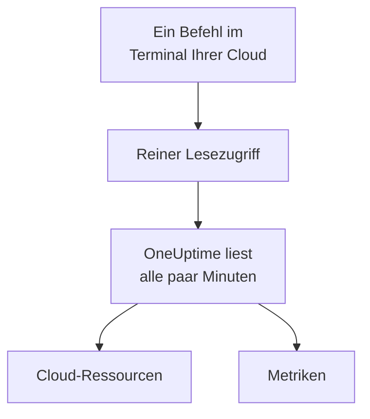

# Ein Cloud-Konto verbinden

Verbinden Sie ein AWS-Konto, ein Azure-Abonnement oder ein Google-Cloud-Projekt im Dashboard, und OneUptime listet seine Ressourcen auf und liest ihre wichtigsten Metriken nach Zeitplan. Sie führen einen Befehl im Browser-Terminal Ihrer Cloud aus und fügen ein, was er ausgibt: Es gibt keinen Collector zu betreiben und nichts zu installieren.

:::cards
- [Amazon Web Services](#amazon-web-services): Eine IAM-Rolle, mit der sich OneUptime anmeldet, oder ein Zugriffsschlüssel.
- [Microsoft Azure](#microsoft-azure): Eine App mit der Rolle Monitoring Reader.
- [Google Cloud](#google-cloud): Ein Dienstkonto mit der Rolle Monitoring Viewer.
- [Was OneUptime liest](#was-oneuptime-liest): Welche Ressourcen und Metriken, wie oft, und was es kostet.
:::

## So funktioniert es



- **Der Zugriff kann nur lesen.** Der Befehl erstellt einen Zugriff, der Metriken liest und sonst nichts: drei Leseaktionen bei AWS, die Rolle **Monitoring Reader** bei Azure und die Rolle **Monitoring Viewer** bei Google Cloud. Löschen Sie ihn, um OneUptime den Zugriff zu entziehen.
- **OneUptime liest nach Zeitplan.** Alle 5 Minuten bei Azure und Google Cloud und alle 10 Minuten bei AWS, sofern Sie beim Verbinden kein anderes Intervall wählen.
- **Jede Ressource erhält eine eigene Seite.** Ressourcen erscheinen unter **Cloud → Alle Ressourcen** mit ihren wichtigsten Metriken, Eigentümern und Beschriftungen, wie die Ressourcen, die ein Collector meldet.

## Bevor Sie beginnen

- **Ein Projektinhaber oder -administrator.** Nur sie können Cloud-Konten verbinden, testen und bearbeiten.
- **Das Terminal Ihrer Cloud** (AWS CloudShell, Azure Cloud Shell oder Google Cloud Shell), angemeldet als jemand, der eine IAM-Rolle oder einen IAM-Benutzer, eine App-Registrierung oder ein Dienstkonto erstellen darf.

## Amazon Web Services

:::steps
### Das AWS-Formular öffnen

Gehen Sie zu **Cloud → Verbinden** und wählen Sie **Amazon Web Services**.

### Den Befehl in AWS CloudShell ausführen

Wählen Sie, wie sich OneUptime anmeldet. Eine **IAM-Rolle** ist der empfohlene Weg: Nichts Geheimes wird gespeichert, und Sie können die Rolle jederzeit löschen. Das Formular zeigt den Befehl, geschrieben für Ihr Projekt: Er erstellt eine Rolle, die dem AWS-Konto von OneUptime mit der externen ID Ihres Projekts vertraut, und gibt den ARN der Rolle aus. Verwenden Sie einen **Zugriffsschlüssel**, wenn eine Rolle nicht möglich ist. Dieser Befehl erstellt einen Benutzer mit denselben Berechtigungen und gibt seinen Schlüssel aus:

```bash
aws iam create-user --user-name OneUptimeReadOnly > /dev/null 2>&1 || true
aws iam put-user-policy --user-name OneUptimeReadOnly --policy-name OneUptimeReadOnly --policy-document '{"Version":"2012-10-17","Statement":[{"Effect":"Allow","Action":["cloudwatch:GetMetricData","cloudwatch:ListMetrics","tag:GetResources"],"Resource":"*"}]}'
aws iam create-access-key --user-name OneUptimeReadOnly
```

### Einfügen, was der AWS-Befehl ausgegeben hat

Fügen Sie alles, was der Befehl ausgegeben hat, in **Was der Befehl ausgegeben hat** ein. OneUptime entnimmt daraus den ARN der Rolle oder die Zugriffsschlüssel-ID und ihr Geheimnis.

### AWS testen und verbinden

OneUptime testet die Verbindung, sobald dieser Schritt geöffnet wird: Es meldet sich an, zählt die gefundenen Ressourcen und sagt, was ihr Lesen kostet. Wählen Sie **Verbinden**, um zu speichern.
:::

Die Rolle und der Benutzer können drei Dinge tun, und sonst nichts:

| Aktion | Wofür OneUptime sie nutzt |
| --- | --- |
| `cloudwatch:ListMetrics` | Die Ressourcen finden, die Metriken melden, in jeder Region |
| `cloudwatch:GetMetricData` | Ihre wichtigsten Metriken lesen |
| `tag:GetResources` | Jede Ressource nach ihrem `Name`-Tag benennen |

> [!NOTE]
> Bei einem selbst gehosteten OneUptime braucht der Weg über eine **IAM-Rolle** eine eigene AWS-Identität von OneUptime: Setzen Sie `CLOUD_CONNECT_AWS_ACCESS_KEY_ID` und `CLOUD_CONNECT_AWS_SECRET_ACCESS_KEY` auf den Schlüssel eines IAM-Benutzers, der `sts:AssumeRole` aufrufen darf. Ohne sie bietet das Formular einen **Zugriffsschlüssel** an.

## Microsoft Azure

:::steps
### Das Azure-Formular öffnen

Gehen Sie zu **Cloud → Verbinden** und wählen Sie **Microsoft Azure**.

### Den Befehl in Azure Cloud Shell ausführen

Der Befehl erstellt eine App mit der Rolle **Monitoring Reader** für Ihr aktuelles Abonnement und gibt ihre Details aus:

```bash
az ad sp create-for-rbac --name OneUptimeReadOnly --role "Monitoring Reader" --scopes "/subscriptions/$(az account show --query id --output tsv)"
```

### Einfügen, was der Azure-Befehl ausgegeben hat

Fügen Sie alles, was der Befehl ausgegeben hat, in **Was der Befehl ausgegeben hat** ein. OneUptime entnimmt daraus `tenant`, `appId` und `password`.

### Azure testen und verbinden

OneUptime testet die Verbindung, sobald dieser Schritt geöffnet wird. Wählen Sie **Verbinden**, um zu speichern.
:::

Um weitere Abonnements mit derselben App zu lesen, geben Sie ihr die Rolle für jedes davon:

```bash
az role assignment create --assignee <APP_ID> --role "Monitoring Reader" --scope /subscriptions/<SUBSCRIPTION_ID>
```

OneUptime liest jedes Abonnement, das die App lesen kann, sofern Sie unter **Abonnements** keine auflisten.

## Google Cloud

:::steps
### Das Google-Cloud-Formular öffnen

Gehen Sie zu **Cloud → Verbinden** und wählen Sie **Google Cloud**.

### Den Befehl in Google Cloud Shell ausführen

Führen Sie ihn in dem Projekt aus, das überwacht werden soll. Er schaltet die Cloud Monitoring API ein, erstellt ein Dienstkonto mit der Rolle **Monitoring Viewer** und gibt seinen Schlüssel aus:

```bash
PROJECT_ID=$(gcloud config get-value project)
gcloud services enable monitoring.googleapis.com
gcloud iam service-accounts create oneuptime-read-only --display-name "OneUptime (read only)"
gcloud projects add-iam-policy-binding "$PROJECT_ID" --member "serviceAccount:oneuptime-read-only@$PROJECT_ID.iam.gserviceaccount.com" --role roles/monitoring.viewer --condition=None > /dev/null
gcloud iam service-accounts keys create oneuptime-key.json --iam-account "oneuptime-read-only@$PROJECT_ID.iam.gserviceaccount.com"
cat oneuptime-key.json && rm oneuptime-key.json
```

### Den Schlüssel einfügen

Fügen Sie alles ein, was der Befehl ausgegeben hat. OneUptime liest das eigene Projekt des Schlüssels und speichert den Schlüssel verschlüsselt.

### Google Cloud testen und verbinden

OneUptime testet die Verbindung, sobald dieser Schritt geöffnet wird. Wählen Sie **Verbinden**, um zu speichern.
:::

Um weitere Projekte mit demselben Dienstkonto zu lesen, geben Sie ihm die Rolle in jedem davon und führen Sie sie unter **Projekte** auf:

```bash
gcloud projects add-iam-policy-binding <PROJECT_ID> --member "serviceAccount:oneuptime-read-only@<KEY_PROJECT_ID>.iam.gserviceaccount.com" --role roles/monitoring.viewer
```

## Was OneUptime liest

| | AWS | Azure | Google Cloud |
| --- | --- | --- | --- |
| Ressourcen | Die, die Metriken an CloudWatch melden, in jeder Region, die Sie nutzen | Jede Ressource in den Abonnements | Die, die Metriken an Cloud Monitoring melden |
| Metriken | Die wichtigsten Metriken jedes Dienstes, etwa CPU, Netzwerk und Statusprüfungen einer Instanz | Bis zu 8 wichtige Metriken pro Ressource | Die wichtigsten Metriken jedes Ressourcentyps |
| Gelesen alle | 10 Minuten | 5 Minuten | 5 Minuten |
| Eine gelöschte Ressource | Archiviert nach 7 Tagen ohne Metriken | Archiviert beim nächsten Lesevorgang | Archiviert nach 7 Tagen ohne Metriken |

Jeder Lesevorgang setzt dort an, wo der letzte aufgehört hat, sodass jeder Datenpunkt einmal geschrieben wird. Der erste Lesevorgang einer neuen Verbindung startet innerhalb einer Minute und reicht eine Stunde zurück; nach einer Pause reicht ein Lesevorgang höchstens 6 Stunden zurück.

Die Aufrufe von OneUptime werden Ihrem Cloud-Konto zu den Preisen Ihrer Cloud berechnet. Der Test schätzt die Kosten dessen, was er findet, und seltener zu lesen kostet weniger: Ändern Sie **Leseintervall für Metriken** unter **Weitere Felder**.

| Cloud | Preis |
| --- | --- |
| AWS | CloudWatch `GetMetricData`: $0.01 pro 1.000 Metriken, und jede wichtige Metrik einer Ressource ist eine Metrik pro Lesevorgang |
| Azure | Die ersten 1.000.000 Metrik-Lesevorgänge pro Monat und Abonnement sind kostenlos, danach $0.01 pro 1.000 |
| Google Cloud | Die ersten 1.000.000 gelesenen Zeitreihen pro Monat sind kostenlos, danach $0.50 pro Million |

## Fehlerbehebung

:::details Der Test sagt, der Schlüssel oder das Geheimnis wurde nicht akzeptiert
Kopieren Sie alles, was der Befehl ausgegeben hat, und fügen Sie es erneut ein. Ein gerade erstellter Schlüssel kann eine Minute brauchen, bis er funktioniert.
:::

:::details Der Test meldet sich an, kann aber nicht lesen
Führen Sie den Befehl erneut aus: Er vergibt die Rolle, die OneUptime braucht. Führen Sie bei AWS den Befehl aus, den das Formular für dieses Projekt zeigt: Eine Rolle, die für ein anderes Projekt erstellt wurde, vertraut der externen ID jenes Projekts, nicht der dieses Projekts.
:::

:::details Google Cloud lässt den Befehl keinen Schlüssel erstellen
Eine Organisationsrichtlinie, `iam.disableServiceAccountKeyCreation`, kann Dienstkontoschlüssel verbieten. Bitten Sie den Administrator Ihrer Organisation um eine Ausnahme für das Projekt, oder [senden Sie die Metriken mit Ihrem eigenen Collector](/docs/telemetry/cloud-resources).
:::

:::details Es erscheinen keine Ressourcen
Bei AWS und Google Cloud erscheint eine Ressource, sobald sie Metriken meldet. Wenn eine Verbindung nicht funktioniert, sagt **Fehler anzeigen** unter **Cloud → Verbinden**, warum ihr letzter Lesevorgang fehlgeschlagen ist.
:::

## Nächste Schritte

:::cards
- [Cloud-Ressourcen](/docs/telemetry/cloud-resources): Betreiben Sie stattdessen Ihren eigenen OpenTelemetry Collector, oder streamen Sie CloudWatch-Metriken.
- [Metrics-Monitor](/docs/monitor/metrics-monitor): Bei den Metriken einer Ressource alarmieren.
:::
