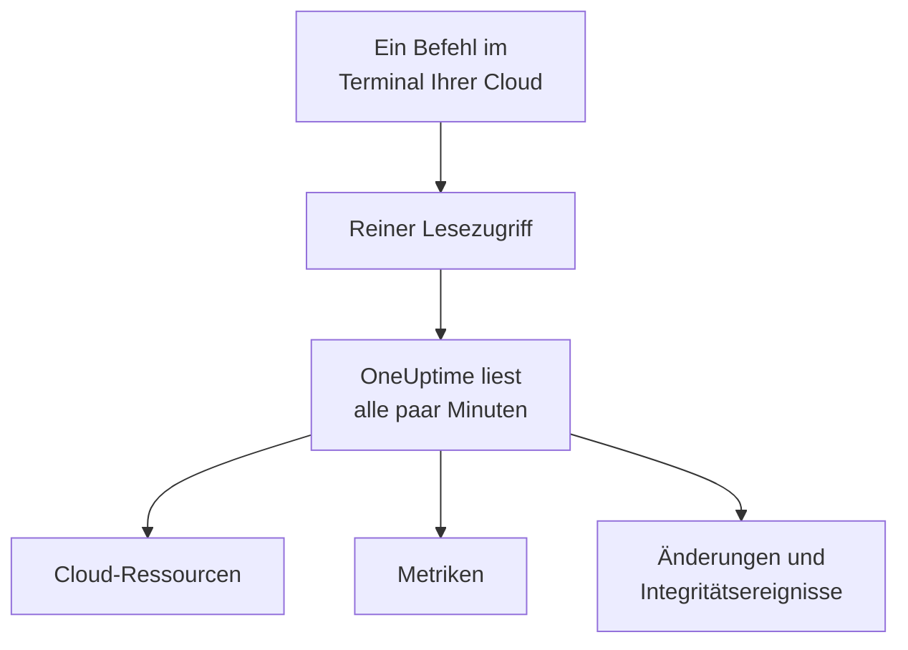

# Ein Cloud-Konto verbinden

Verbinden Sie ein AWS-Konto, ein Azure-Abonnement oder ein Google-Cloud-Projekt im Dashboard, und OneUptime listet jede Ressource darin auf, liest ihre wichtigsten Metriken und sagt, wie es jeder geht, erfasst, was sich an ihnen geändert hat und was Ihr Cloud-Anbieter über ihren Zustand meldet, und liest, was das Konto kostet und wie es weniger kosten könnte. Sie führen einen Befehl im Browser-Terminal Ihrer Cloud aus und fügen ein, was er ausgibt: Es gibt keinen Collector zu betreiben und nichts zu installieren.

:::cards
- [Amazon Web Services](#amazon-web-services): Eine IAM-Rolle, mit der sich OneUptime anmeldet, oder ein Zugriffsschlüssel.
- [Microsoft Azure](#microsoft-azure): Eine App mit den Rollen Monitoring Reader und Cost Management Reader.
- [Google Cloud](#google-cloud): Ein Dienstkonto mit sechs Rollen, die nur lesen.
- [Was OneUptime liest](#was-oneuptime-liest): Ressourcen, Metriken, Änderungen, Integritätsereignisse und Kosten, wie oft, und was das Lesen kostet.
- [Cloud-Kosten und Einsparungen](/docs/telemetry/cloud-costs): Was jedes Konto kostet, wie Sie weniger ausgeben, und Budgets, die warnen.
- [CloudWatch-Metriken und -Protokolle streamen](/docs/telemetry/cloud-streaming): Jede Metrik innerhalb von Minuten, und CloudWatch Logs, über Amazon Data Firehose.
- [Azure-Monitor-Metriken und -Protokolle streamen](/docs/telemetry/cloud-streaming-azure): Schlüsselmetriken innerhalb von Minuten, und Ressourcenprotokolle, gelesen aus Event Hubs in Ihrem Abonnement.
- [Google-Cloud-Protokolle streamen](/docs/telemetry/cloud-streaming-google-cloud): Jedes Protokoll, sobald es geschrieben wird, gepusht über Pub/Sub.
- [Datensicherheit](#datensicherheit): Was die Verbindung Datensicherheit lesen lässt und was jede Stufe dem Befehl hinzufügt.
- [KI Probleme beheben lassen](#ki-probleme-beheben-lassen): Ein weiterer Befehl, und OneUptime AI kann beheben, was es findet.
:::

## So funktioniert es



- **Der Zugriff kann nur lesen.** Der Befehl erstellt einen Zugriff, der Ihre Ressourcen und ihre Einrichtung, ihre Metriken, ihre Änderungen, die Integritätsereignisse Ihres Anbieters und die Kosten des Kontos liest, und sonst nichts: die unten aufgeführten Aktionen bei AWS, die Rollen **Monitoring Reader** und **Cost Management Reader** bei Azure und sechs Leserollen bei Google Cloud. OneUptime liest damit niemals Daten oder Geheimnisse, außer Logzeilen, wenn Sie der KI erlauben, die Logs eines Kontos zu lesen, und Inhaltsstichproben, wenn Sie sie für [Datensicherheit](#datensicherheit) einschalten. Löschen Sie ihn, um OneUptime den Zugriff zu entziehen.
- **OneUptime liest nach Zeitplan.** Alle 5 Minuten bei Azure und Google Cloud und alle 10 Minuten bei AWS, sofern Sie beim Verbinden kein anderes Intervall wählen. Jeder Lesevorgang erfasst auch, was sich seit dem letzten geändert hat, und alle 30 Minuten listet ein Lesevorgang jede Ressource erneut auf.
- **Jede Ressource erhält eine eigene Seite.** Ressourcen erscheinen unter **Cloud → Alle Ressourcen** mit ihrem Zustand, ihren wichtigsten Metriken, Eigentümern und Beschriftungen. Die Seite einer aufgelisteten Ressource zeigt auch ihre **Verbundene Ressourcen** (worin sie läuft, was ihr Datenverkehr sendet), ihre Endpunkte, Tags und Einstellungen sowie ihre **Vorfälle**, **Warnungen** und **Änderungen**.
- **Jedes Konto erhält eine eigene Seite.** Konten erscheinen unter **Cloud → Konten** mit ihren Ressourcen nach Typ und Region, ihren **Kosten**, ihren **Änderungen** und einer **Topologie**, die zeigt, wie ihre Ressourcen zusammenhängen.
- **Cloud öffnet mit seiner Übersicht.** **Cloud → Übersicht** listet die Ressourcen auf, die Aufmerksamkeit brauchen, und warum, was die Konten in diesem Monat kosten und was Ihre Clouds als Einsparung vorschlagen. [Cloud-Kosten und Einsparungen](/docs/telemetry/cloud-costs) erklärt, wie Kosten, Einsparungen und Budgets gelesen werden. Wenn in Ihren Konten Apps auf verwalteten App-Plattformen laufen, zählt die Karte **App-Plattformen** deren Umgebungen und Apps, und jede Zahl öffnet diese Liste in App-Plattformen, bereits auf diese Konten gefiltert.
- **OneUptime AI liest, was sich geändert hat.** Eine Untersuchung eines Vorfalls oder einer Warnung, die mit einer Cloud-Ressource verknüpft ist, liest zuerst die Änderungen dieser Ressource und liest beim Start das Aktivitätsprotokoll des Kontos erneut.

## Bevor Sie beginnen

- **Ein Projektinhaber oder -administrator.** Nur sie können Cloud-Konten verbinden, testen und bearbeiten.
- **Das Terminal Ihrer Cloud** (AWS CloudShell, Azure Cloud Shell oder Google Cloud Shell), angemeldet als jemand, der eine IAM-Rolle oder einen IAM-Benutzer, eine App-Registrierung oder ein Dienstkonto erstellen darf.

## Amazon Web Services

:::steps
### Das AWS-Formular öffnen

Gehen Sie zu **Cloud → Verbinden** und wählen Sie **Amazon Web Services**.

### Den Befehl in AWS CloudShell ausführen

Wählen Sie, wie sich OneUptime anmeldet. Eine **IAM-Rolle** ist der empfohlene Weg: Nichts Geheimes wird gespeichert, und Sie können die Rolle jederzeit löschen. Das Formular zeigt den Befehl, geschrieben für Ihr Projekt: Er erstellt eine Rolle, die dem AWS-Konto von OneUptime mit der externen ID Ihres Projekts vertraut, und gibt den ARN der Rolle aus.

Wählen Sie unter **Was gelesen wird** dieses Konto oder jedes Konto Ihrer AWS Organization. Führen Sie den Befehl der Organisation in ihrem Verwaltungskonto aus: Er fügt ein StackSet hinzu, das dieselbe Rolle in jedes Konto legt, jetzt und wenn Konten hinzukommen, und erlaubt der Rolle des Verwaltungskontos, die Konten aufzulisten. Eine Verbindung liest bis zu 50 Konten.

Verwenden Sie einen **Zugriffsschlüssel**, wenn eine Rolle nicht möglich ist: Er liest nur sein eigenes Konto. Dieser Befehl erstellt einen Benutzer mit denselben Berechtigungen und gibt seinen Schlüssel aus:

```bash
aws iam create-user --user-name OneUptimeReadOnly > /dev/null 2>&1 || true
aws iam put-user-policy --user-name OneUptimeReadOnly --policy-name OneUptimeReadOnly --policy-document '{"Version":"2012-10-17","Statement":[{"Effect":"Allow","Action":["cloudwatch:GetMetricData","cloudwatch:ListMetrics","tag:GetResources","iam:ListAccountAliases","cloudformation:ListResources","ec2:DescribeInstances","ec2:DescribeVolumes","ec2:DescribeVpcs","ec2:DescribeNatGateways","autoscaling:DescribeAutoScalingGroups","elasticloadbalancing:DescribeLoadBalancers","elasticloadbalancing:DescribeLoadBalancerAttributes","elasticloadbalancing:DescribeTargetGroups","elasticloadbalancing:DescribeTargetGroupAttributes","elasticloadbalancing:DescribeTargetHealth","elasticloadbalancing:DescribeTags","ecs:ListClusters","ecs:DescribeClusters","ecs:ListServices","ecs:DescribeServices","lambda:ListFunctions","rds:DescribeDBInstances","rds:DescribeDBClusters","elasticache:DescribeReplicationGroups","sqs:ListQueues","sqs:GetQueueAttributes","sns:ListTopics","sns:GetTopicAttributes","sns:ListSubscriptionsByTopic","dynamodb:ListTables","dynamodb:DescribeTable","kinesis:ListStreams","kinesis:DescribeStreamSummary","states:ListStateMachines","states:DescribeStateMachine","cloudfront:ListDistributions","elasticfilesystem:DescribeFileSystems","es:ListDomainNames","es:DescribeDomains","apprunner:ListServices","apprunner:DescribeService","elasticbeanstalk:DescribeEnvironments","cloudtrail:LookupEvents","health:DescribeEvents","health:DescribeEventDetails","ce:GetCostAndUsage","ce:GetCostAndUsageWithResources","ce:GetSavingsPlansCoverage","ce:GetSavingsPlansUtilization","ce:GetReservationCoverage","ce:GetReservationUtilization","cost-optimization-hub:ListRecommendations","rds:DescribeEvents","autoscaling:DescribeScalingActivities","ec2:DescribeInstanceStatus","ecs:DescribeTaskDefinition","lambda:GetFunctionConfiguration","lambda:GetFunctionConcurrency","lambda:GetAlias","servicequotas:ListServiceQuotas","logs:DescribeLogGroups","logs:FilterLogEvents"],"Resource":"*"},{"Effect":"Allow","Action":["apigateway:GET"],"Resource":["arn:aws:apigateway:*::/restapis*","arn:aws:apigateway:*::/apis*"]}]}'
aws iam create-access-key --user-name OneUptimeReadOnly
```

### Einfügen, was der AWS-Befehl ausgegeben hat

Fügen Sie alles, was der Befehl ausgegeben hat, in **Was der Befehl ausgegeben hat** ein. OneUptime entnimmt daraus den ARN der Rolle oder die Zugriffsschlüssel-ID und ihr Geheimnis.

### AWS testen und verbinden

OneUptime testet die Verbindung, sobald dieser Schritt geöffnet wird: Es meldet sich an, zählt die gefundenen Ressourcen und sagt, was ihr Lesen kostet. Wählen Sie **Verbinden**, um zu speichern.
:::

Die Rolle und der Benutzer können Folgendes tun, und sonst nichts:

| Wofür OneUptime sie nutzt | Aktionen |
| --- | --- |
| Die Ressourcen finden, die Metriken melden, und ihre Metriken lesen | `cloudwatch:GetMetricData`, `cloudwatch:ListMetrics` |
| Jede Ressource benennen und ihre Tags lesen | `tag:GetResources`, `iam:ListAccountAliases` |
| Jede Ressource und ihre Konfiguration über Cloud Control auflisten | `cloudformation:ListResources`, `ec2:DescribeInstances`, `ec2:DescribeVolumes`, `ec2:DescribeVpcs`, `ec2:DescribeNatGateways`, `autoscaling:DescribeAutoScalingGroups`, `elasticloadbalancing:DescribeLoadBalancers`, `elasticloadbalancing:DescribeLoadBalancerAttributes`, `elasticloadbalancing:DescribeTargetGroups`, `elasticloadbalancing:DescribeTargetGroupAttributes`, `elasticloadbalancing:DescribeTargetHealth`, `elasticloadbalancing:DescribeTags`, `ecs:ListClusters`, `ecs:DescribeClusters`, `ecs:ListServices`, `ecs:DescribeServices`, `lambda:ListFunctions`, `rds:DescribeDBInstances`, `rds:DescribeDBClusters`, `elasticache:DescribeReplicationGroups`, `sqs:ListQueues`, `sqs:GetQueueAttributes`, `sns:ListTopics`, `sns:GetTopicAttributes`, `sns:ListSubscriptionsByTopic`, `dynamodb:ListTables`, `dynamodb:DescribeTable`, `kinesis:ListStreams`, `kinesis:DescribeStreamSummary`, `states:ListStateMachines`, `states:DescribeStateMachine`, `cloudfront:ListDistributions`, `elasticfilesystem:DescribeFileSystems`, `es:ListDomainNames`, `es:DescribeDomains`, `apprunner:ListServices`, `apprunner:DescribeService`, `elasticbeanstalk:DescribeEnvironments`, `apigateway:GET` |
| Lesen, was sich geändert hat: die Verwaltungsereignisse des Kontos | `cloudtrail:LookupEvents` |
| Die eigenen Integritätsereignisse von AWS für das Konto lesen | `health:DescribeEvents`, `health:DescribeEventDetails` |
| Lesen, was das Konto kostet, aus Cost Explorer | `ce:GetCostAndUsage`, `ce:GetCostAndUsageWithResources`, `ce:GetSavingsPlansCoverage`, `ce:GetSavingsPlansUtilization`, `ce:GetReservationCoverage`, `ce:GetReservationUtilization` |
| Die Wege lesen, weniger auszugeben, aus Cost Optimization Hub | `cost-optimization-hub:ListRecommendations` |
| Den aktuellen Status und die jüngsten Ereignisse einer Ressource während einer Untersuchung lesen | `rds:DescribeEvents`, `autoscaling:DescribeScalingActivities`, `ec2:DescribeInstanceStatus`, `ecs:DescribeTaskDefinition`, `lambda:GetFunctionConfiguration`, `lambda:GetFunctionConcurrency`, `lambda:GetAlias` |
| Die Kontingente des Kontos während einer Untersuchung lesen | `servicequotas:ListServiceQuotas` |
| Logzeilen lesen, nur wenn Sie der KI erlauben, die Logs eines Kontos zu lesen | `logs:DescribeLogGroups`, `logs:FilterLogEvents` |
| Die Konten der Organisation auflisten, vom Verwaltungskonto aus | `organizations:ListAccounts` |

`apigateway:GET` ist nur für die Definitionen der APIs selbst erlaubt, niemals für ihre Schlüssel, und nur die Rolle des Verwaltungskontos darf die Konten der Organisation auflisten. AWS Health antwortet nur Konten mit einem Business-, Enterprise-On-Ramp- oder Enterprise-Supportplan: Ohne einen fragt OneUptime einen Tag später erneut.

> [!NOTE]
> Bei einem selbst gehosteten OneUptime braucht der Weg über eine **IAM-Rolle** eine eigene AWS-Identität von OneUptime: Setzen Sie `CLOUD_CONNECT_AWS_ACCESS_KEY_ID` und `CLOUD_CONNECT_AWS_SECRET_ACCESS_KEY` auf den Schlüssel eines IAM-Benutzers, der `sts:AssumeRole` aufrufen darf. Ohne sie bietet das Formular einen **Zugriffsschlüssel** an.

## Microsoft Azure

:::steps
### Das Azure-Formular öffnen

Gehen Sie zu **Cloud → Verbinden** und wählen Sie **Microsoft Azure**.

### Den Befehl in Azure Cloud Shell ausführen

Der Befehl erstellt eine App mit den Rollen **Monitoring Reader** und **Cost Management Reader** für Ihr aktuelles Abonnement und gibt ihre Details mit dem Datum aus, an dem ihr Geheimnis abläuft:

```bash
SCOPE="/subscriptions/$(az account show --query id --output tsv)"
OUT=$(az ad sp create-for-rbac --name OneUptimeReadOnly --role "Monitoring Reader" --scopes "$SCOPE")
APP=$(echo "$OUT" | jq -r .appId)
az role assignment create --assignee "$APP" --role "Cost Management Reader" --scope "$SCOPE" > /dev/null
END=$(az ad app credential list --id "$APP" --query "max([].endDateTime)" --output tsv)
echo "$OUT" | jq --arg end "$END" '. + {endDateTime: $end}'
```

Wählen Sie unter **Was gelesen wird** stattdessen jedes Abonnement des Mandanten, und die Rolle wird der Stammverwaltungsgruppe des Mandanten zugewiesen:

```bash
SCOPE="/providers/Microsoft.Management/managementGroups/$(az account show --query tenantId --output tsv)"
OUT=$(az ad sp create-for-rbac --name OneUptimeReadOnly --role "Monitoring Reader" --scopes "$SCOPE")
APP=$(echo "$OUT" | jq -r .appId)
az role assignment create --assignee "$APP" --role "Cost Management Reader" --scope "$SCOPE" > /dev/null
END=$(az ad app credential list --id "$APP" --query "max([].endDateTime)" --output tsv)
echo "$OUT" | jq --arg end "$END" '. + {endDateTime: $end}'
```

### Einfügen, was der Azure-Befehl ausgegeben hat

Fügen Sie alles, was der Befehl ausgegeben hat, in **Was der Befehl ausgegeben hat** ein. OneUptime entnimmt daraus `tenant`, `appId`, `password` und das Ablaufdatum.

### Azure testen und verbinden

OneUptime testet die Verbindung, sobald dieser Schritt geöffnet wird. Wählen Sie **Verbinden**, um zu speichern.
:::

Um weitere Abonnements mit derselben App zu lesen, geben Sie ihr beide Rollen für jedes davon:

```bash
az role assignment create --assignee <APP_ID> --role "Monitoring Reader" --scope /subscriptions/<SUBSCRIPTION_ID>
az role assignment create --assignee <APP_ID> --role "Cost Management Reader" --scope /subscriptions/<SUBSCRIPTION_ID>
```

OneUptime liest jedes Abonnement, das die App lesen kann, bis zu 50, sofern Sie unter **Abonnements** keine auflisten. Das Geheimnis der App funktioniert nach seinem Ablaufdatum nicht mehr: Ab 30 Tagen vorher warnt jeder Lesevorgang davor. Führen Sie den Befehl erneut aus und fügen Sie ein, was er ausgibt, um ein neues zu vergeben.

## Google Cloud

:::steps
### Das Google-Cloud-Formular öffnen

Gehen Sie zu **Cloud → Verbinden** und wählen Sie **Google Cloud**.

### Den Befehl in Google Cloud Shell ausführen

Führen Sie ihn in dem Projekt aus, das überwacht werden soll. Er schaltet die APIs ein, die OneUptime liest, erstellt ein Dienstkonto mit den Rollen **Monitoring Viewer**, **Cloud Asset Viewer**, **Logs Viewer**, **Service Health Viewer**, **BigQuery Job User** und **Compute Recommender Viewer** und gibt seinen Schlüssel aus:

```bash
PROJECT_ID=$(gcloud config get-value project)
gcloud services enable monitoring.googleapis.com cloudasset.googleapis.com logging.googleapis.com cloudresourcemanager.googleapis.com servicehealth.googleapis.com bigquery.googleapis.com recommender.googleapis.com
gcloud iam service-accounts create oneuptime-read-only --display-name "OneUptime (read only)" > /dev/null 2>&1 || true
gcloud projects add-iam-policy-binding "$PROJECT_ID" --member "serviceAccount:oneuptime-read-only@$PROJECT_ID.iam.gserviceaccount.com" --role roles/monitoring.viewer --condition=None > /dev/null
gcloud projects add-iam-policy-binding "$PROJECT_ID" --member "serviceAccount:oneuptime-read-only@$PROJECT_ID.iam.gserviceaccount.com" --role roles/cloudasset.viewer --condition=None > /dev/null
gcloud projects add-iam-policy-binding "$PROJECT_ID" --member "serviceAccount:oneuptime-read-only@$PROJECT_ID.iam.gserviceaccount.com" --role roles/logging.viewer --condition=None > /dev/null
gcloud projects add-iam-policy-binding "$PROJECT_ID" --member "serviceAccount:oneuptime-read-only@$PROJECT_ID.iam.gserviceaccount.com" --role roles/servicehealth.viewer --condition=None > /dev/null
gcloud projects add-iam-policy-binding "$PROJECT_ID" --member "serviceAccount:oneuptime-read-only@$PROJECT_ID.iam.gserviceaccount.com" --role roles/bigquery.jobUser --condition=None > /dev/null
gcloud projects add-iam-policy-binding "$PROJECT_ID" --member "serviceAccount:oneuptime-read-only@$PROJECT_ID.iam.gserviceaccount.com" --role roles/recommender.computeViewer --condition=None > /dev/null
gcloud iam service-accounts keys create oneuptime-key.json --iam-account "oneuptime-read-only@$PROJECT_ID.iam.gserviceaccount.com"
cat oneuptime-key.json && rm oneuptime-key.json
```

Wählen Sie unter **Was gelesen wird** stattdessen jedes Projekt der Organisation, und die Rollen werden der Organisation des Projekts zugewiesen:

```bash
PROJECT_ID=$(gcloud config get-value project)
ORG_ID=$(gcloud projects get-ancestors "$PROJECT_ID" --format="value(id)" | tail -1)
gcloud services enable monitoring.googleapis.com cloudasset.googleapis.com logging.googleapis.com cloudresourcemanager.googleapis.com servicehealth.googleapis.com bigquery.googleapis.com recommender.googleapis.com
gcloud iam service-accounts create oneuptime-read-only --display-name "OneUptime (read only)" > /dev/null 2>&1 || true
gcloud organizations add-iam-policy-binding "$ORG_ID" --member "serviceAccount:oneuptime-read-only@$PROJECT_ID.iam.gserviceaccount.com" --role roles/monitoring.viewer --condition=None > /dev/null
gcloud organizations add-iam-policy-binding "$ORG_ID" --member "serviceAccount:oneuptime-read-only@$PROJECT_ID.iam.gserviceaccount.com" --role roles/cloudasset.viewer --condition=None > /dev/null
gcloud organizations add-iam-policy-binding "$ORG_ID" --member "serviceAccount:oneuptime-read-only@$PROJECT_ID.iam.gserviceaccount.com" --role roles/logging.viewer --condition=None > /dev/null
gcloud organizations add-iam-policy-binding "$ORG_ID" --member "serviceAccount:oneuptime-read-only@$PROJECT_ID.iam.gserviceaccount.com" --role roles/servicehealth.viewer --condition=None > /dev/null
gcloud organizations add-iam-policy-binding "$ORG_ID" --member "serviceAccount:oneuptime-read-only@$PROJECT_ID.iam.gserviceaccount.com" --role roles/bigquery.jobUser --condition=None > /dev/null
gcloud organizations add-iam-policy-binding "$ORG_ID" --member "serviceAccount:oneuptime-read-only@$PROJECT_ID.iam.gserviceaccount.com" --role roles/recommender.computeViewer --condition=None > /dev/null
gcloud iam service-accounts keys create oneuptime-key.json --iam-account "oneuptime-read-only@$PROJECT_ID.iam.gserviceaccount.com"
cat oneuptime-key.json && rm oneuptime-key.json
```

### Den Schlüssel einfügen

Fügen Sie alles ein, was der Befehl ausgegeben hat. OneUptime liest das eigene Projekt des Schlüssels und speichert den Schlüssel verschlüsselt.

### Google Cloud testen und verbinden

OneUptime testet die Verbindung, sobald dieser Schritt geöffnet wird. Wählen Sie **Verbinden**, um zu speichern.
:::

Um weitere Projekte mit demselben Dienstkonto zu lesen, geben Sie ihm diese Rollen in jedem davon und führen Sie sie unter **Projekte** auf:

```bash
for ROLE in roles/monitoring.viewer roles/cloudasset.viewer roles/logging.viewer roles/servicehealth.viewer roles/recommender.computeViewer; do gcloud projects add-iam-policy-binding <PROJECT_ID> --member "serviceAccount:oneuptime-read-only@<KEY_PROJECT_ID>.iam.gserviceaccount.com" --role "$ROLE"; done
```

Die Verbindung einer Organisation liest bis zu 50 ihrer Projekte, sofern Sie unter **Projekte** keine auflisten.

Google Cloud hat keine API für die Kosten eines Projekts: OneUptime liest sie aus dem Export Ihres Rechnungskontos nach BigQuery, sobald Sie dessen Tabelle unter **Tabelle des Abrechnungsexports** angeben. [Cloud-Kosten und Einsparungen](/docs/telemetry/cloud-costs#google-cloud) zeigt, wie.

## Datensicherheit

Dieselbe Verbindung kann [Datensicherheit](/docs/data-security/index) die Datenspeicher des Kontos lesen lassen: seine Buckets, Datenbanken und Warehouses. Unter **Weitere Felder** steht **Datensicherheit** auf **Aus**, bis Sie etwas anderes wählen, und der Befehl, den das Formular zeigt, ändert sich mit dieser Wahl:

| Datensicherheit | Was Datensicherheit lesen darf | Was der Befehl hinzufügt |
| --- | --- | --- |
| **Aus** | Keinen der Datenspeicher des Kontos | Nichts |
| **Nur Konfiguration** | Wer jeden Datenspeicher erreichen kann und wie er verschlüsselt, gesichert und protokolliert wird. Nie Daten. | Bei AWS eine zweite Inline-Richtlinie, `OneUptimeDataSecurity`, mit Leseaktionen. Bei Azure und Google Cloud nichts: **Monitoring Reader** und **Cloud Asset Viewer** lesen das bereits. |
| **Konfiguration und Inhaltsstichproben** | Das, und Stichproben von Objekten und Zeilen, um sensible Daten darin zu finden | Bei AWS dieselbe Richtlinie mit `s3:ListBucket`, `s3:GetObject` und `kms:Decrypt`, nur über S3. Bei Azure **Storage Blob Data Reader**. Bei Google Cloud `roles/storage.objectViewer` und `roles/bigquery.dataViewer`. |

Bei AWS fügt der Befehl der Rolle die Richtlinie mit einer weiteren Zeile hinzu. Auf der Inhaltsstufe lautet sie:

```bash
aws iam put-role-policy --role-name "$ROLE" --policy-name OneUptimeDataSecurity --policy-document '{"Version":"2012-10-17","Statement":[{"Effect":"Allow","Action":["s3:ListAllMyBuckets","s3:GetBucketLocation","s3:GetBucketPolicyStatus","s3:GetBucketPublicAccessBlock","s3:GetAccountPublicAccessBlock","s3:GetBucketAcl","s3:GetBucketPolicy","s3:GetEncryptionConfiguration","s3:GetBucketVersioning","s3:GetBucketLogging","s3:GetBucketOwnershipControls","s3:GetReplicationConfiguration","s3:GetBucketTagging","rds:DescribeDBInstances","rds:DescribeDBClusters","rds:DescribeDBSnapshots","rds:DescribeDBSnapshotAttributes","rds:DescribeDBClusterSnapshots","rds:DescribeDBClusterSnapshotAttributes","dynamodb:ListTables","dynamodb:DescribeTable","dynamodb:DescribeContinuousBackups","redshift:DescribeClusters","redshift:DescribeLoggingStatus","es:ListDomainNames","es:DescribeDomains","elasticache:DescribeReplicationGroups","elasticfilesystem:DescribeFileSystems","kms:ListAliases","iam:GetAccountAuthorizationDetails","iam:GenerateCredentialReport","iam:GetCredentialReport"],"Resource":"*"},{"Effect":"Allow","Action":["s3:ListBucket"],"Resource":"arn:aws:s3:::*"},{"Effect":"Allow","Action":["s3:GetObject"],"Resource":"arn:aws:s3:::*/*"},{"Effect":"Allow","Action":["kms:Decrypt"],"Resource":"*","Condition":{"StringLike":{"kms:ViaService":"s3.*.amazonaws.com"}}}]}'
```

IAM begrenzt die eigenen Inline-Richtlinien eines Benutzers auf insgesamt 2.048 Zeichen, deshalb kommt die Richtlinie bei einem **Zugriffsschlüssel** auf eine Gruppe, `OneUptimeDataSecurity`, der der Benutzer beitritt:

```bash
aws iam create-user --user-name OneUptimeReadOnly > /dev/null 2>&1 || true
aws iam put-user-policy --user-name OneUptimeReadOnly --policy-name OneUptimeReadOnly --policy-document '{"Version":"2012-10-17","Statement":[{"Effect":"Allow","Action":["cloudwatch:GetMetricData","cloudwatch:ListMetrics","tag:GetResources","iam:ListAccountAliases","cloudformation:ListResources","ec2:DescribeInstances","ec2:DescribeVolumes","ec2:DescribeVpcs","ec2:DescribeNatGateways","autoscaling:DescribeAutoScalingGroups","elasticloadbalancing:DescribeLoadBalancers","elasticloadbalancing:DescribeLoadBalancerAttributes","elasticloadbalancing:DescribeTargetGroups","elasticloadbalancing:DescribeTargetGroupAttributes","elasticloadbalancing:DescribeTargetHealth","elasticloadbalancing:DescribeTags","ecs:ListClusters","ecs:DescribeClusters","ecs:ListServices","ecs:DescribeServices","lambda:ListFunctions","rds:DescribeDBInstances","rds:DescribeDBClusters","elasticache:DescribeReplicationGroups","sqs:ListQueues","sqs:GetQueueAttributes","sns:ListTopics","sns:GetTopicAttributes","sns:ListSubscriptionsByTopic","dynamodb:ListTables","dynamodb:DescribeTable","kinesis:ListStreams","kinesis:DescribeStreamSummary","states:ListStateMachines","states:DescribeStateMachine","cloudfront:ListDistributions","elasticfilesystem:DescribeFileSystems","es:ListDomainNames","es:DescribeDomains","apprunner:ListServices","apprunner:DescribeService","elasticbeanstalk:DescribeEnvironments","cloudtrail:LookupEvents","health:DescribeEvents","health:DescribeEventDetails","ce:GetCostAndUsage","ce:GetCostAndUsageWithResources","ce:GetSavingsPlansCoverage","ce:GetSavingsPlansUtilization","ce:GetReservationCoverage","ce:GetReservationUtilization","cost-optimization-hub:ListRecommendations","rds:DescribeEvents","autoscaling:DescribeScalingActivities","ec2:DescribeInstanceStatus","ecs:DescribeTaskDefinition","lambda:GetFunctionConfiguration","lambda:GetFunctionConcurrency","lambda:GetAlias","servicequotas:ListServiceQuotas","logs:DescribeLogGroups","logs:FilterLogEvents"],"Resource":"*"},{"Effect":"Allow","Action":["apigateway:GET"],"Resource":["arn:aws:apigateway:*::/restapis*","arn:aws:apigateway:*::/apis*"]}]}'
aws iam create-group --group-name OneUptimeDataSecurity > /dev/null 2>&1 || true
aws iam put-group-policy --group-name OneUptimeDataSecurity --policy-name OneUptimeDataSecurity --policy-document '{"Version":"2012-10-17","Statement":[{"Effect":"Allow","Action":["s3:ListAllMyBuckets","s3:GetBucketLocation","s3:GetBucketPolicyStatus","s3:GetBucketPublicAccessBlock","s3:GetAccountPublicAccessBlock","s3:GetBucketAcl","s3:GetBucketPolicy","s3:GetEncryptionConfiguration","s3:GetBucketVersioning","s3:GetBucketLogging","s3:GetBucketOwnershipControls","s3:GetReplicationConfiguration","s3:GetBucketTagging","rds:DescribeDBInstances","rds:DescribeDBClusters","rds:DescribeDBSnapshots","rds:DescribeDBSnapshotAttributes","rds:DescribeDBClusterSnapshots","rds:DescribeDBClusterSnapshotAttributes","dynamodb:ListTables","dynamodb:DescribeTable","dynamodb:DescribeContinuousBackups","redshift:DescribeClusters","redshift:DescribeLoggingStatus","es:ListDomainNames","es:DescribeDomains","elasticache:DescribeReplicationGroups","elasticfilesystem:DescribeFileSystems","kms:ListAliases","iam:GetAccountAuthorizationDetails","iam:GenerateCredentialReport","iam:GetCredentialReport"],"Resource":"*"},{"Effect":"Allow","Action":["s3:ListBucket"],"Resource":"arn:aws:s3:::*"},{"Effect":"Allow","Action":["s3:GetObject"],"Resource":"arn:aws:s3:::*/*"},{"Effect":"Allow","Action":["kms:Decrypt"],"Resource":"*","Condition":{"StringLike":{"kms:ViaService":"s3.*.amazonaws.com"}}}]}'
aws iam add-user-to-group --user-name OneUptimeReadOnly --group-name OneUptimeDataSecurity
aws iam create-access-key --user-name OneUptimeReadOnly
```

Bei Azure fügt die Inhaltsstufe **Storage Blob Data Reader** im selben Bereich wie **Monitoring Reader** hinzu:

```bash
SCOPE="/subscriptions/$(az account show --query id --output tsv)"
OUT=$(az ad sp create-for-rbac --name OneUptimeReadOnly --role "Monitoring Reader" --scopes "$SCOPE")
APP=$(echo "$OUT" | jq -r .appId)
az role assignment create --assignee "$APP" --role "Cost Management Reader" --scope "$SCOPE" > /dev/null
az role assignment create --assignee "$APP" --role "Storage Blob Data Reader" --scope "$SCOPE" > /dev/null
END=$(az ad app credential list --id "$APP" --query "max([].endDateTime)" --output tsv)
echo "$OUT" | jq --arg end "$END" '. + {endDateTime: $end}'
```

Bei Google Cloud fügt sie die zwei Rollen hinzu:

```bash
PROJECT_ID=$(gcloud config get-value project)
gcloud services enable monitoring.googleapis.com cloudasset.googleapis.com logging.googleapis.com cloudresourcemanager.googleapis.com servicehealth.googleapis.com bigquery.googleapis.com recommender.googleapis.com
gcloud iam service-accounts create oneuptime-read-only --display-name "OneUptime (read only)" > /dev/null 2>&1 || true
gcloud projects add-iam-policy-binding "$PROJECT_ID" --member "serviceAccount:oneuptime-read-only@$PROJECT_ID.iam.gserviceaccount.com" --role roles/monitoring.viewer --condition=None > /dev/null
gcloud projects add-iam-policy-binding "$PROJECT_ID" --member "serviceAccount:oneuptime-read-only@$PROJECT_ID.iam.gserviceaccount.com" --role roles/cloudasset.viewer --condition=None > /dev/null
gcloud projects add-iam-policy-binding "$PROJECT_ID" --member "serviceAccount:oneuptime-read-only@$PROJECT_ID.iam.gserviceaccount.com" --role roles/logging.viewer --condition=None > /dev/null
gcloud projects add-iam-policy-binding "$PROJECT_ID" --member "serviceAccount:oneuptime-read-only@$PROJECT_ID.iam.gserviceaccount.com" --role roles/servicehealth.viewer --condition=None > /dev/null
gcloud projects add-iam-policy-binding "$PROJECT_ID" --member "serviceAccount:oneuptime-read-only@$PROJECT_ID.iam.gserviceaccount.com" --role roles/bigquery.jobUser --condition=None > /dev/null
gcloud projects add-iam-policy-binding "$PROJECT_ID" --member "serviceAccount:oneuptime-read-only@$PROJECT_ID.iam.gserviceaccount.com" --role roles/recommender.computeViewer --condition=None > /dev/null
gcloud projects add-iam-policy-binding "$PROJECT_ID" --member "serviceAccount:oneuptime-read-only@$PROJECT_ID.iam.gserviceaccount.com" --role roles/storage.objectViewer --condition=None > /dev/null
gcloud projects add-iam-policy-binding "$PROJECT_ID" --member "serviceAccount:oneuptime-read-only@$PROJECT_ID.iam.gserviceaccount.com" --role roles/bigquery.dataViewer --condition=None > /dev/null
gcloud iam service-accounts keys create oneuptime-key.json --iam-account "oneuptime-read-only@$PROJECT_ID.iam.gserviceaccount.com"
cat oneuptime-key.json && rm oneuptime-key.json
```

Der Befehl einer niedrigeren Stufe ersetzt die AWS-Richtlinie durch die der niedrigeren Stufe. **Aus** fügt nichts hinzu und lässt daher stehen, was ein früherer Befehl gewährt hat, bis Sie es löschen: die Richtlinie `OneUptimeDataSecurity` bei AWS, mit `aws iam delete-role-policy --role-name <your role> --policy-name OneUptimeDataSecurity`, und die Rollen der Inhaltsstufe bei Azure und Google Cloud. Datensicherheit hört so oder so sofort auf zu lesen: Sie liest nur, was die Stufe der Verbindung sagt. [Datensicherheit einrichten](/docs/data-security/setup) listet jede Aktion der Richtlinie auf und was Datensicherheit von dem behält, was sie liest.

## Was OneUptime liest

| | AWS | Azure | Google Cloud |
| --- | --- | --- | --- |
| Ressourcen | Jede Ressource der Typen, die OneUptime kennt, in jeder Region, die Sie nutzen, aus Cloud Control | Jede Ressource in den Abonnements, aus Resource Graph | Jede Ressource in den Projekten, aus Cloud Asset Inventory |
| Metriken | Die wichtigsten Metriken jedes Dienstes, etwa CPU, Netzwerk und Statusprüfungen einer Instanz | Bis zu 8 wichtige Metriken pro Ressource | Die wichtigsten Metriken jedes Ressourcentyps |
| Änderungen | Verwaltungsereignisse von CloudTrail | Die administrativen Ereignisse des Aktivitätsprotokolls | Das Audit-Log Admin Activity |
| Integritätsereignisse | AWS Health | Service Health und Resource Health | Service Health |
| Kosten | Die jedes Tages, nach Dienst und Region, und mit Kosten pro Ressource nach Ressource, aus Cost Explorer | Die jedes Tages, nach Ressource und Dienst, aus Cost Management | Die jedes Tages, nach Dienst, Region und Ressource, aus Ihrem Abrechnungsexport nach BigQuery |
| Wege, weniger auszugeben | Cost Optimization Hub | Azure Advisor | Der Recommender |
| Zusagen | Savings Plans und Reserved Instances: was sie decken und wie viel davon genutzt wird, aus Cost Explorer | Sparpläne und Reservierungen, aus Cost Management | Rabatte für zugesicherte Nutzung, aus Ihrem Abrechnungsexport nach BigQuery |
| Gelesen alle | 10 Minuten | 5 Minuten | 5 Minuten |
| Eine gelöschte Ressource | Archiviert, sobald eine vollständige Auflistung sie nicht mehr enthält | Archiviert, sobald eine vollständige Auflistung sie nicht mehr enthält | Archiviert, sobald eine vollständige Auflistung sie nicht mehr enthält |

Jeder Lesevorgang setzt dort an, wo der letzte aufgehört hat, sodass jeder Datenpunkt und jede Änderung einmal geschrieben wird. Ist **Cloud-Audit-Protokolle** in den Sicherheitsereignissen eingeschaltet, behalten dieselben Lesevorgänge die Audit-Logs der Konten auch als [Sicherheitsereignisse](/docs/telemetry/security-events#die-audit-logs-ihrer-cloud-konten-lesen). Der erste Lesevorgang einer neuen Verbindung startet innerhalb einer Minute und reicht für Metriken eine Stunde und für Änderungen 2 Stunden zurück; nach einer Pause reicht ein Lesevorgang höchstens 6 Stunden zurück. Eine Ressource, die nur Metriken meldet und in keiner Auflistung steht, wird nach 7 Tagen ohne Metriken archiviert. Kosten werden zweimal am Tag gelesen, die Wege, weniger auszugeben, und die Zusagen einmal am Tag.

Die Aufrufe von OneUptime werden Ihrem Cloud-Konto zu den Preisen Ihrer Cloud berechnet. Ressourcen aufzulisten, Änderungen und Integritätsereignisse zu lesen, die Wege, weniger auszugeben, zu lesen und die Kosten von Azure zu lesen, kostet nichts; Metriken zu lesen schon, und ebenso die Kosten von AWS und Google Cloud. Der Test schätzt die Kosten dessen, was er findet, und seltener zu lesen kostet weniger: Ändern Sie **Leseintervall für Metriken** unter **Weitere Felder**.

| Cloud | Preis |
| --- | --- |
| AWS | CloudWatch `GetMetricData`: $0.01 pro 1.000 Metriken, und jede wichtige Metrik einer Ressource ist eine Metrik pro Lesevorgang |
| AWS-Kosten | Cost Explorer: $0.01 pro Anfrage. Ein Lesevorgang der Kosten stellt einige, die Zusagen vier am Tag und Kosten pro Ressource einige weitere am Tag |
| Azure | Die ersten 1.000.000 Metrik-Lesevorgänge pro Monat und Abonnement sind kostenlos, danach $0.01 pro 1.000 |
| Google Cloud | Die ersten 1.000.000 gelesenen Zeitreihen pro Monat sind kostenlos, danach $0.50 pro Million |
| Google-Cloud-Kosten | BigQuery berechnet die Abfrage Ihres Abrechnungsexports: die ersten 1 TiB pro Monat sind kostenlos, danach $6.25 pro TiB |

Die wichtigsten Metriken eines Service-Bus- oder Event-Hubs-Namespace werden für jede seiner Warteschlangen, Topics und Event Hubs gelesen, aufgeteilt nach der Dimension `EntityName`, im selben einen Aufruf pro Namespace und Lesevorgang: Bei einem Lesevorgang alle 5 Minuten kostet ein Namespace mit 50 Warteschlangen 12 Aufrufe pro Stunde, so viel wie einer mit einer einzigen. Ein Lesevorgang liest bis zu 1.000 davon pro Namespace und meldet, wenn es mehr gibt. Die Metriken jeder einzelnen erscheinen auf ihrer Seite unter [Warteschlangen](/docs/telemetry/queues#azure-service-bus), so zugeordnet wie vom `azure_monitor`-Receiver des Collectors, und wo dieser Receiver eine Metrik einer Warteschlange ebenfalls liest, bleiben seine Werte erhalten und die der Verbindung werden ausgelassen, sodass nichts doppelt gezählt wird.

## Was Sie in OneUptime sehen

- **Die Seite eines Kontos.** Unter **Cloud → Konten** zählt die Übersicht eines Kontos seine Ressourcen nach Typ und Region und sagt, wann eine Verbindung es zuletzt gelesen hat. Seine **Ressourcen** listet sie auf, seine **Änderungen** listet auf, was sich darin geändert hat, das Neueste zuerst, und seine **Topologie** zeichnet seine Regionen, die Netzwerke darin und was in jedem läuft, mit den offenen Vorfällen und Warnungen an den Ressourcen, mit denen sie verknüpft sind. Auf **Änderungen** steht bei einer Änderung, die OneUptime AI vorgenommen hat, **OneUptime AI**, mit dem Vorfall oder der Warnung, die sie behoben hat, wer sie genehmigt hat oder dass sie selbstständig lief, und einem Link zu ihrem Eintrag auf der Seite **KI-Protokolle** des Kontos. Sein **Feed** hält fest, wie das Konto zu OneUptime kam, wann sich sein Cloud-KI-Agent verbunden hat oder zurückgesetzt wurde, und wer geändert hat, was OneUptime AI darin tun darf.
- **Die Änderungen einer Ressource.** Eine Änderung wird als Änderungsereignis gespeichert, verknüpft mit der Ressource, die sie geändert hat, und mit ihrem Konto, und als Markierung in den Metrikdiagrammen der Ressource gezeichnet, zusammen mit ihren Vorfällen und Warnungen. Diagramme, die auf keine Ressource gefiltert sind, lassen das Aktivitätsprotokoll eines Cloud-Kontos weg, damit ein geschäftiges Konto Ihre Deploys nicht verdrängt; die Integritätsereignisse des Anbieters bleiben darauf.
- **Vorfälle und Warnungen.** Verknüpfen Sie eine Cloud-Ressource unter den verknüpften Ressourcen einer Überwachung, eines Vorfalls oder einer Warnung, und ihre Vorfälle und Warnungen werden auf der Seite der Ressource aufgeführt. Eine Website-, API-, SSL-, Ping- oder Port-Überwachung, deren Host zu einem Endpunkt einer Ressource führt, direkt oder über ihr DNS, führt die Ressource unter **Vorgeschlagene Cloud-Ressourcen** auf ihrer Karte **Verknüpfte Ressourcen** auf: Wählen Sie **Ressource verknüpfen**, um sie zu verknüpfen.
- **Der Zustand einer Ressource.** Jeder Lesevorgang behält den neuesten Wert der wichtigsten Metriken einer Ressource und beurteilt sie: Eine Ressource zeigt **Fehlerfrei**, **Beeinträchtigt** oder **Fehlerhaft**, mit dem Grund, etwa fehlschlagende Statusprüfungen oder fast vollen Speicher, und **Meldet nicht**, sobald ihre Metriken ausbleiben. **Cloud → Übersicht** und die Übersicht eines Kontos listen auf, was Aufmerksamkeit braucht, das Dringendste zuerst.
- **Empfohlene Monitore.** Die **Empfehlungen** eines Kontos listen die Monitore, die OneUptime für seine Ressourcen empfiehlt, nach Ressourcentyp, mit den Ressourcen, für die jeder gedacht ist, und wie viele ihn schon haben: Fügen Sie einen zu einer Ressource hinzu oder zu allen Ressourcen ihres Typs auf einmal, und das Seitenmenü zählt die, die noch einzurichten sind. Der Tab **Empfehlungen** einer Ressource bietet ihre eigenen an. Jeder Monitor liest die wichtigsten Metriken, die die Verbindung liest, alle 5 Minuten, über die letzten 30 Minuten bei AWS und die letzten 15 bei Azure und Google Cloud, und ist mit seiner Ressource verknüpft. Eine Anzahl, etwa Fehler oder gedrosselte Anfragen, wird über dieses Fenster summiert, sodass ein Konto, das [seine Metriken streamt](/docs/telemetry/cloud-streaming), und eines, das gelesen wird, gleich alarmieren, das gestreamte früher. Die Tage bis zum Ablauf eines Zertifikats, die ACM zweimal täglich veröffentlicht, werden einmal pro Stunde gelesen: Sein Monitor liest die letzten 2 Tage und alarmiert, sobald das Zertifikat nur noch 30 Tage oder weniger gültig ist oder ACM sie nicht mehr veröffentlicht, weil es abgelaufen ist. Die Verbindungen einer RDS-Instanz werden an 90 % des Verbindungslimits ihrer Klasse und Engine gemessen. Solange ein [Wartungsereignis](/docs/scheduled-maintenance/creating-events) eine Ressource enthält, eröffnen ihre Monitore keinen Vorfall und keine Warnung.
- **Was die Konten kosten.** **Cloud → Ausgaben → Kosten** zeichnet die Ausgaben jedes Tages und wohin sie gehen, **Cloud → Ausgaben → Einsparungen** listet die Wege auf, weniger auszugeben, und **Cloud → Ausgaben → Budgets** warnt, bevor ein Monat mehr kostet, als er sollte: [Cloud-Kosten und Einsparungen](/docs/telemetry/cloud-costs).

## KI Probleme beheben lassen

OneUptime AI liest beim Untersuchen jedes verbundene Konto, mit dem oben beschriebenen Lesezugriff. Damit es Probleme auch beheben kann, etwa einen Dienst neu starten, hochskalieren oder zurückrollen, öffnen Sie das Konto unter **Cloud → Konten** und wählen Sie **KI Probleme beheben lassen** in der Karte **KI-Agent** seiner **Übersicht**.

Der Dialog stellt eine einzige Frage, **Wie weit darf die KI gehen?**: **Mich zuerst fragen**, die Voreinstellung, bei der OneUptime AI jede Korrektur vorschlägt und eine Person sie mit einem Klick genehmigt, oder **Sichere Korrekturen selbstständig anwenden**, bei der sichere Änderungen selbstständig laufen und riskantere weiterhin auf eine Genehmigung warten. Alles andere hat unter **Weitere Felder** eine sichere Voreinstellung. Dann zeigt er einen einzigen Befehl, geschrieben für dieses Konto: Führen Sie ihn in AWS CloudShell, Azure Cloud Shell oder Google Cloud Shell aus, angemeldet als jemand, der Rollen im Konto erstellen darf. Der Befehl erstellt eine Rolle, die nur die eingeschalteten Änderungen vornehmen darf, und startet damit den Cloud-KI-Agenten in Ihrem Konto. Der Agent verbindet sich innerhalb weniger Minuten von selbst, und der Dialog meldet es: Es gibt nichts zurückzukopieren.

Der Befehl enthält einen Schlüssel, der nur für den Agenten dieses Kontos erstellt wurde und einen Tag lang gilt, bis sich der Agent damit verbindet: Öffnen Sie den Dialog erneut, um einen neuen zu erhalten. Nur wer den Agenten zurücksetzen und das Konto bearbeiten darf, erhält einen.

Bei einem AWS-Konto, das eine Verbindung gefunden hat, die eine AWS Organization liest, fragt der Dialog zusätzlich **Welche Konten?**: **Jedes Konto der Organisation** richtet mit einem Befehl in der AWS CloudShell des Verwaltungskontos in jedem ihrer Konten einen Agenten ein, jeden mit seinem eigenen Schlüssel und derselben Rolle mit minimalen Rechten, und listet auf, welche Agenten sich verbunden haben.

Der Agent läuft den ganzen Monat in Ihrem Konto und wird von Ihrer Cloud zu deren Listenpreisen abgerechnet. In Google Cloud läuft er auf einer eigenen kleinen VM, in einem Netzwerk, das nichts hereinlässt; für ein Projekt, dessen Organisation keiner VM eine externe IP-Adresse erlaubt, wählen Sie unter **Weitere Felder** bei **Wo der Agent läuft** die Option **Cloud Run**:

| Cloud | Was läuft | Etwa |
| --- | --- | --- |
| AWS | Ein ECS-Fargate-Task mit 0.25 vCPU und 0.5 GB sowie seine öffentliche IPv4-Adresse, zu den Preisen von `us-east-1` | $13 pro Monat |
| Azure | Ein Container-Apps-Replikat mit 0.25 vCPU und 0.5 GiB, nach dem monatlichen kostenlosen Kontingent des Abonnements von 180.000 vCPU-Sekunden und 360.000 GiB-Sekunden | $14 pro Monat |
| Google Cloud | Eine `e2-micro`-VM in Compute Engine mit ihrem 10-GB-Standard-Bootlaufwerk und ihrer externen IPv4-Adresse, zu den Preisen von `us-central1`. Das kostenlose Kontingent von Google Cloud deckt eine `e2-micro`-VM pro Monat in `us-central1`, `us-west1` und `us-east1` ab | $10 pro Monat |
| Google Cloud, auf Cloud Run | Eine Cloud-Run-Instanz mit 1 vCPU und 0.5 GiB mit dauerhaft zugewiesener CPU, die eine ganze vCPU belegt, nach dem monatlichen kostenlosen Kontingent von 240.000 vCPU-Sekunden und 450.000 GiB-Sekunden | $45 pro Monat |

Was der Agent ändern darf, wie jede Änderung eingestuft und rückgängig gemacht wird und wie Sie seine Logs lesen: [KI-Agenten für die Infrastruktur](/docs/ai/infrastructure-ai-agents#in-einem-cloud-konto).

## Fehlerbehebung

:::details Der Test sagt, der Schlüssel oder das Geheimnis wurde nicht akzeptiert
Kopieren Sie alles, was der Befehl ausgegeben hat, und fügen Sie es erneut ein. Ein gerade erstellter Schlüssel kann eine Minute brauchen, bis er funktioniert. Ein abgelaufenes Azure-Geheimnis wird ebenfalls abgelehnt: Führen Sie den Befehl erneut aus.
:::

:::details Der Test meldet sich an, kann aber nicht lesen
Führen Sie den Befehl erneut aus: Er vergibt die Rollen, die OneUptime braucht. Führen Sie bei AWS den Befehl aus, den das Formular für dieses Projekt zeigt: Eine Rolle, die für ein anderes Projekt erstellt wurde, vertraut der externen ID jenes Projekts, nicht der dieses Projekts.
:::

:::details Google Cloud lässt den Befehl keinen Schlüssel erstellen
Eine Organisationsrichtlinie, `iam.disableServiceAccountKeyCreation`, kann Dienstkontoschlüssel verbieten. Bitten Sie den Administrator Ihrer Organisation um eine Ausnahme für das Projekt, oder [senden Sie die Metriken mit Ihrem eigenen Collector](/docs/telemetry/cloud-resources).
:::

:::details Es erscheinen keine Ressourcen
Der erste Lesevorgang listet jede Ressource des Kontos auf, ob sie Metriken meldet oder nicht. Wenn eine Verbindung nicht funktioniert, sagt **Fehler anzeigen** unter **Cloud → Verbinden**, warum ihr letzter Lesevorgang fehlgeschlagen ist.
:::

:::details Einige Konten der Organisation fehlen
Eine Verbindung liest bis zu 50 Konten, Abonnements oder Projekte, und jeder Lesevorgang sagt es, wenn es mehr gibt. Verbinden Sie die anderen mit einer eigenen Verbindung.
:::

:::details Ein Lesevorgang hat Warnungen
Ein Lesevorgang, der funktioniert, kann trotzdem etwas auslassen, etwa eine Metrik, die die Cloud für einige Ressourcen nicht geliefert hat, oder die Warteschlangen eines Namespace über die ersten 1.000 hinaus. Unter **Cloud → Verbinden** nennt der Status der Verbindung dann, wie viele Warnungen ihr letzter Lesevorgang hatte: Wählen Sie sie aus, um jede einzelne zu lesen.
:::

## Nächste Schritte

:::cards
- [Cloud-Ressourcen](/docs/telemetry/cloud-resources): Betreiben Sie stattdessen Ihren eigenen OpenTelemetry Collector, oder streamen Sie CloudWatch-Metriken.
- [Deploys und Änderungen](/docs/telemetry/change-events): Jede Änderung, die OneUptime erfasst, und wie OneUptime AI sie liest.
- [Metrics-Monitor](/docs/monitor/metrics-monitor): Bei den Metriken einer Ressource alarmieren.
:::
