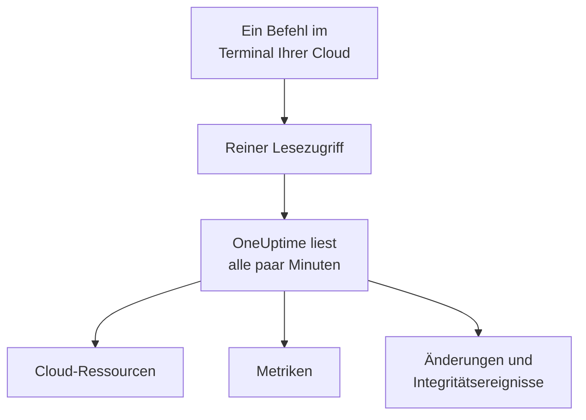

# Ein Cloud-Konto verbinden

Verbinden Sie ein AWS-Konto, ein Azure-Abonnement oder ein Google-Cloud-Projekt im Dashboard, und OneUptime listet jede Ressource darin auf, liest ihre wichtigsten Metriken und erfasst, was sich an ihnen geändert hat und was Ihr Cloud-Anbieter über ihren Zustand meldet. Sie führen einen Befehl im Browser-Terminal Ihrer Cloud aus und fügen ein, was er ausgibt: Es gibt keinen Collector zu betreiben und nichts zu installieren.

:::cards
- [Amazon Web Services](#amazon-web-services): Eine IAM-Rolle, mit der sich OneUptime anmeldet, oder ein Zugriffsschlüssel.
- [Microsoft Azure](#microsoft-azure): Eine App mit der Rolle Monitoring Reader.
- [Google Cloud](#google-cloud): Ein Dienstkonto mit vier Rollen, die nur lesen.
- [Was OneUptime liest](#was-oneuptime-liest): Ressourcen, Metriken, Änderungen und Integritätsereignisse, wie oft, und was es kostet.
:::

## So funktioniert es



- **Der Zugriff kann nur lesen.** Der Befehl erstellt einen Zugriff, der Ihre Ressourcen und ihre Einrichtung, ihre Metriken, ihre Änderungen und die Integritätsereignisse Ihres Anbieters liest, und sonst nichts: die unten aufgeführten Aktionen bei AWS, die Rolle **Monitoring Reader** bei Azure und vier Leserollen bei Google Cloud. Er liest niemals Daten oder Geheimnisse. Löschen Sie ihn, um OneUptime den Zugriff zu entziehen.
- **OneUptime liest nach Zeitplan.** Alle 5 Minuten bei Azure und Google Cloud und alle 10 Minuten bei AWS, sofern Sie beim Verbinden kein anderes Intervall wählen. Jeder Lesevorgang erfasst auch, was sich seit dem letzten geändert hat, und alle 30 Minuten listet ein Lesevorgang jede Ressource erneut auf.
- **Jede Ressource erhält eine eigene Seite.** Ressourcen erscheinen unter **Cloud → Alle Ressourcen** mit ihren wichtigsten Metriken, Eigentümern und Beschriftungen. Die Seite einer aufgelisteten Ressource zeigt auch ihre **Verbundene Ressourcen** (worin sie läuft, was ihr Datenverkehr sendet), ihre Endpunkte, Tags und Einstellungen sowie ihre **Vorfälle**, **Warnungen** und **Änderungen**.
- **Jedes Konto erhält eine eigene Seite.** Konten erscheinen unter **Cloud → Konten** mit ihren Ressourcen nach Typ und Region, ihren **Änderungen** und einer **Topologie**, die zeigt, wie ihre Ressourcen zusammenhängen.
- **OneUptime AI liest, was sich geändert hat.** Eine Untersuchung eines Vorfalls oder einer Warnung, die mit einer Cloud-Ressource verknüpft ist, liest zuerst die Änderungen dieser Ressource und liest beim Start das Aktivitätsprotokoll des Kontos erneut.

## Bevor Sie beginnen

- **Ein Projektinhaber oder -administrator.** Nur sie können Cloud-Konten verbinden, testen und bearbeiten.
- **Das Terminal Ihrer Cloud** (AWS CloudShell, Azure Cloud Shell oder Google Cloud Shell), angemeldet als jemand, der eine IAM-Rolle oder einen IAM-Benutzer, eine App-Registrierung oder ein Dienstkonto erstellen darf.

## Amazon Web Services

:::steps
### Das AWS-Formular öffnen

Gehen Sie zu **Cloud → Verbinden** und wählen Sie **Amazon Web Services**.

### Den Befehl in AWS CloudShell ausführen

Wählen Sie, wie sich OneUptime anmeldet. Eine **IAM-Rolle** ist der empfohlene Weg: Nichts Geheimes wird gespeichert, und Sie können die Rolle jederzeit löschen. Das Formular zeigt den Befehl, geschrieben für Ihr Projekt: Er erstellt eine Rolle, die dem AWS-Konto von OneUptime mit der externen ID Ihres Projekts vertraut, und gibt den ARN der Rolle aus.

Wählen Sie unter **Was gelesen wird** dieses Konto oder jedes Konto Ihrer AWS Organization. Führen Sie den Befehl der Organisation in ihrem Verwaltungskonto aus: Er fügt ein StackSet hinzu, das dieselbe Rolle in jedes Konto legt, jetzt und wenn Konten hinzukommen, und erlaubt der Rolle des Verwaltungskontos, die Konten aufzulisten. Eine Verbindung liest bis zu 50 Konten.

Verwenden Sie einen **Zugriffsschlüssel**, wenn eine Rolle nicht möglich ist: Er liest nur sein eigenes Konto. Dieser Befehl erstellt einen Benutzer mit denselben Berechtigungen und gibt seinen Schlüssel aus:

```bash
aws iam create-user --user-name OneUptimeReadOnly > /dev/null 2>&1 || true
aws iam put-user-policy --user-name OneUptimeReadOnly --policy-name OneUptimeReadOnly --policy-document '{"Version":"2012-10-17","Statement":[{"Effect":"Allow","Action":["cloudwatch:GetMetricData","cloudwatch:ListMetrics","tag:GetResources","iam:ListAccountAliases","cloudformation:ListResources","ec2:DescribeInstances","ec2:DescribeVolumes","ec2:DescribeVpcs","ec2:DescribeNatGateways","autoscaling:DescribeAutoScalingGroups","elasticloadbalancing:DescribeLoadBalancers","elasticloadbalancing:DescribeLoadBalancerAttributes","elasticloadbalancing:DescribeTargetGroups","elasticloadbalancing:DescribeTargetGroupAttributes","elasticloadbalancing:DescribeTargetHealth","elasticloadbalancing:DescribeTags","ecs:ListClusters","ecs:DescribeClusters","ecs:ListServices","ecs:DescribeServices","lambda:ListFunctions","rds:DescribeDBInstances","rds:DescribeDBClusters","elasticache:DescribeReplicationGroups","sqs:ListQueues","sqs:GetQueueAttributes","sns:ListTopics","sns:GetTopicAttributes","sns:ListSubscriptionsByTopic","dynamodb:ListTables","dynamodb:DescribeTable","kinesis:ListStreams","kinesis:DescribeStreamSummary","states:ListStateMachines","states:DescribeStateMachine","cloudfront:ListDistributions","elasticfilesystem:DescribeFileSystems","es:ListDomainNames","es:DescribeDomains","apprunner:ListServices","apprunner:DescribeService","cloudtrail:LookupEvents","health:DescribeEvents","health:DescribeEventDetails"],"Resource":"*"},{"Effect":"Allow","Action":["apigateway:GET"],"Resource":["arn:aws:apigateway:*::/restapis","arn:aws:apigateway:*::/restapis/*","arn:aws:apigateway:*::/apis","arn:aws:apigateway:*::/apis/*"]}]}'
aws iam create-access-key --user-name OneUptimeReadOnly
```

### Einfügen, was der AWS-Befehl ausgegeben hat

Fügen Sie alles, was der Befehl ausgegeben hat, in **Was der Befehl ausgegeben hat** ein. OneUptime entnimmt daraus den ARN der Rolle oder die Zugriffsschlüssel-ID und ihr Geheimnis.

### AWS testen und verbinden

OneUptime testet die Verbindung, sobald dieser Schritt geöffnet wird: Es meldet sich an, zählt die gefundenen Ressourcen und sagt, was ihr Lesen kostet. Wählen Sie **Verbinden**, um zu speichern.
:::

Die Rolle und der Benutzer können Folgendes tun, und sonst nichts:

| Wofür OneUptime sie nutzt | Aktionen |
| --- | --- |
| Die Ressourcen finden, die Metriken melden, und ihre Metriken lesen | `cloudwatch:GetMetricData`, `cloudwatch:ListMetrics` |
| Jede Ressource benennen und ihre Tags lesen | `tag:GetResources`, `iam:ListAccountAliases` |
| Jede Ressource und ihre Konfiguration über Cloud Control auflisten | `cloudformation:ListResources`, `ec2:DescribeInstances`, `ec2:DescribeVolumes`, `ec2:DescribeVpcs`, `ec2:DescribeNatGateways`, `autoscaling:DescribeAutoScalingGroups`, `elasticloadbalancing:DescribeLoadBalancers`, `elasticloadbalancing:DescribeLoadBalancerAttributes`, `elasticloadbalancing:DescribeTargetGroups`, `elasticloadbalancing:DescribeTargetGroupAttributes`, `elasticloadbalancing:DescribeTargetHealth`, `elasticloadbalancing:DescribeTags`, `ecs:ListClusters`, `ecs:DescribeClusters`, `ecs:ListServices`, `ecs:DescribeServices`, `lambda:ListFunctions`, `rds:DescribeDBInstances`, `rds:DescribeDBClusters`, `elasticache:DescribeReplicationGroups`, `sqs:ListQueues`, `sqs:GetQueueAttributes`, `sns:ListTopics`, `sns:GetTopicAttributes`, `sns:ListSubscriptionsByTopic`, `dynamodb:ListTables`, `dynamodb:DescribeTable`, `kinesis:ListStreams`, `kinesis:DescribeStreamSummary`, `states:ListStateMachines`, `states:DescribeStateMachine`, `cloudfront:ListDistributions`, `elasticfilesystem:DescribeFileSystems`, `es:ListDomainNames`, `es:DescribeDomains`, `apprunner:ListServices`, `apprunner:DescribeService`, `apigateway:GET` |
| Lesen, was sich geändert hat: die Verwaltungsereignisse des Kontos | `cloudtrail:LookupEvents` |
| Die eigenen Integritätsereignisse von AWS für das Konto lesen | `health:DescribeEvents`, `health:DescribeEventDetails` |
| Die Konten der Organisation auflisten, vom Verwaltungskonto aus | `organizations:ListAccounts` |

`apigateway:GET` ist nur für die Definitionen der APIs selbst erlaubt, niemals für ihre Schlüssel, und nur die Rolle des Verwaltungskontos darf die Konten der Organisation auflisten. AWS Health antwortet nur Konten mit einem Business-, Enterprise-On-Ramp- oder Enterprise-Supportplan: Ohne einen fragt OneUptime einen Tag später erneut.

> [!NOTE]
> Bei einem selbst gehosteten OneUptime braucht der Weg über eine **IAM-Rolle** eine eigene AWS-Identität von OneUptime: Setzen Sie `CLOUD_CONNECT_AWS_ACCESS_KEY_ID` und `CLOUD_CONNECT_AWS_SECRET_ACCESS_KEY` auf den Schlüssel eines IAM-Benutzers, der `sts:AssumeRole` aufrufen darf. Ohne sie bietet das Formular einen **Zugriffsschlüssel** an.

## Microsoft Azure

:::steps
### Das Azure-Formular öffnen

Gehen Sie zu **Cloud → Verbinden** und wählen Sie **Microsoft Azure**.

### Den Befehl in Azure Cloud Shell ausführen

Der Befehl erstellt eine App mit der Rolle **Monitoring Reader** für Ihr aktuelles Abonnement und gibt ihre Details mit dem Datum aus, an dem ihr Geheimnis abläuft:

```bash
SCOPE="/subscriptions/$(az account show --query id --output tsv)"
OUT=$(az ad sp create-for-rbac --name OneUptimeReadOnly --role "Monitoring Reader" --scopes "$SCOPE")
APP=$(echo "$OUT" | jq -r .appId)
END=$(az ad app credential list --id "$APP" --query "max([].endDateTime)" --output tsv)
echo "$OUT" | jq --arg end "$END" '. + {endDateTime: $end}'
```

Wählen Sie unter **Was gelesen wird** stattdessen jedes Abonnement des Mandanten, und die Rolle wird der Stammverwaltungsgruppe des Mandanten zugewiesen:

```bash
SCOPE="/providers/Microsoft.Management/managementGroups/$(az account show --query tenantId --output tsv)"
OUT=$(az ad sp create-for-rbac --name OneUptimeReadOnly --role "Monitoring Reader" --scopes "$SCOPE")
APP=$(echo "$OUT" | jq -r .appId)
END=$(az ad app credential list --id "$APP" --query "max([].endDateTime)" --output tsv)
echo "$OUT" | jq --arg end "$END" '. + {endDateTime: $end}'
```

### Einfügen, was der Azure-Befehl ausgegeben hat

Fügen Sie alles, was der Befehl ausgegeben hat, in **Was der Befehl ausgegeben hat** ein. OneUptime entnimmt daraus `tenant`, `appId`, `password` und das Ablaufdatum.

### Azure testen und verbinden

OneUptime testet die Verbindung, sobald dieser Schritt geöffnet wird. Wählen Sie **Verbinden**, um zu speichern.
:::

Um weitere Abonnements mit derselben App zu lesen, geben Sie ihr die Rolle für jedes davon:

```bash
az role assignment create --assignee <APP_ID> --role "Monitoring Reader" --scope /subscriptions/<SUBSCRIPTION_ID>
```

OneUptime liest jedes Abonnement, das die App lesen kann, bis zu 50, sofern Sie unter **Abonnements** keine auflisten. Das Geheimnis der App funktioniert nach seinem Ablaufdatum nicht mehr: Ab 30 Tagen vorher warnt jeder Lesevorgang davor. Führen Sie den Befehl erneut aus und fügen Sie ein, was er ausgibt, um ein neues zu vergeben.

## Google Cloud

:::steps
### Das Google-Cloud-Formular öffnen

Gehen Sie zu **Cloud → Verbinden** und wählen Sie **Google Cloud**.

### Den Befehl in Google Cloud Shell ausführen

Führen Sie ihn in dem Projekt aus, das überwacht werden soll. Er schaltet die APIs ein, die OneUptime liest, erstellt ein Dienstkonto mit den Rollen **Monitoring Viewer**, **Cloud Asset Viewer**, **Logs Viewer** und **Service Health Viewer** und gibt seinen Schlüssel aus:

```bash
PROJECT_ID=$(gcloud config get-value project)
gcloud services enable monitoring.googleapis.com cloudasset.googleapis.com logging.googleapis.com cloudresourcemanager.googleapis.com servicehealth.googleapis.com
gcloud iam service-accounts create oneuptime-read-only --display-name "OneUptime (read only)" > /dev/null 2>&1 || true
gcloud projects add-iam-policy-binding "$PROJECT_ID" --member "serviceAccount:oneuptime-read-only@$PROJECT_ID.iam.gserviceaccount.com" --role roles/monitoring.viewer --condition=None > /dev/null
gcloud projects add-iam-policy-binding "$PROJECT_ID" --member "serviceAccount:oneuptime-read-only@$PROJECT_ID.iam.gserviceaccount.com" --role roles/cloudasset.viewer --condition=None > /dev/null
gcloud projects add-iam-policy-binding "$PROJECT_ID" --member "serviceAccount:oneuptime-read-only@$PROJECT_ID.iam.gserviceaccount.com" --role roles/logging.viewer --condition=None > /dev/null
gcloud projects add-iam-policy-binding "$PROJECT_ID" --member "serviceAccount:oneuptime-read-only@$PROJECT_ID.iam.gserviceaccount.com" --role roles/servicehealth.viewer --condition=None > /dev/null
gcloud iam service-accounts keys create oneuptime-key.json --iam-account "oneuptime-read-only@$PROJECT_ID.iam.gserviceaccount.com"
cat oneuptime-key.json && rm oneuptime-key.json
```

Wählen Sie unter **Was gelesen wird** stattdessen jedes Projekt der Organisation, und die Rollen werden der Organisation des Projekts zugewiesen:

```bash
PROJECT_ID=$(gcloud config get-value project)
ORG_ID=$(gcloud projects get-ancestors "$PROJECT_ID" --format="value(id)" | tail -1)
gcloud services enable monitoring.googleapis.com cloudasset.googleapis.com logging.googleapis.com cloudresourcemanager.googleapis.com servicehealth.googleapis.com
gcloud iam service-accounts create oneuptime-read-only --display-name "OneUptime (read only)" > /dev/null 2>&1 || true
gcloud organizations add-iam-policy-binding "$ORG_ID" --member "serviceAccount:oneuptime-read-only@$PROJECT_ID.iam.gserviceaccount.com" --role roles/monitoring.viewer --condition=None > /dev/null
gcloud organizations add-iam-policy-binding "$ORG_ID" --member "serviceAccount:oneuptime-read-only@$PROJECT_ID.iam.gserviceaccount.com" --role roles/cloudasset.viewer --condition=None > /dev/null
gcloud organizations add-iam-policy-binding "$ORG_ID" --member "serviceAccount:oneuptime-read-only@$PROJECT_ID.iam.gserviceaccount.com" --role roles/logging.viewer --condition=None > /dev/null
gcloud organizations add-iam-policy-binding "$ORG_ID" --member "serviceAccount:oneuptime-read-only@$PROJECT_ID.iam.gserviceaccount.com" --role roles/servicehealth.viewer --condition=None > /dev/null
gcloud iam service-accounts keys create oneuptime-key.json --iam-account "oneuptime-read-only@$PROJECT_ID.iam.gserviceaccount.com"
cat oneuptime-key.json && rm oneuptime-key.json
```

### Den Schlüssel einfügen

Fügen Sie alles ein, was der Befehl ausgegeben hat. OneUptime liest das eigene Projekt des Schlüssels und speichert den Schlüssel verschlüsselt.

### Google Cloud testen und verbinden

OneUptime testet die Verbindung, sobald dieser Schritt geöffnet wird. Wählen Sie **Verbinden**, um zu speichern.
:::

Um weitere Projekte mit demselben Dienstkonto zu lesen, geben Sie ihm die vier Rollen in jedem davon und führen Sie sie unter **Projekte** auf:

```bash
for ROLE in roles/monitoring.viewer roles/cloudasset.viewer roles/logging.viewer roles/servicehealth.viewer; do gcloud projects add-iam-policy-binding <PROJECT_ID> --member "serviceAccount:oneuptime-read-only@<KEY_PROJECT_ID>.iam.gserviceaccount.com" --role "$ROLE"; done
```

Die Verbindung einer Organisation liest bis zu 50 ihrer Projekte, sofern Sie unter **Projekte** keine auflisten.

## Was OneUptime liest

| | AWS | Azure | Google Cloud |
| --- | --- | --- | --- |
| Ressourcen | Jede Ressource der Typen, die OneUptime kennt, in jeder Region, die Sie nutzen, aus Cloud Control | Jede Ressource in den Abonnements, aus Resource Graph | Jede Ressource in den Projekten, aus Cloud Asset Inventory |
| Metriken | Die wichtigsten Metriken jedes Dienstes, etwa CPU, Netzwerk und Statusprüfungen einer Instanz | Bis zu 8 wichtige Metriken pro Ressource | Die wichtigsten Metriken jedes Ressourcentyps |
| Änderungen | Verwaltungsereignisse von CloudTrail | Die administrativen Ereignisse des Aktivitätsprotokolls | Das Audit-Log Admin Activity |
| Integritätsereignisse | AWS Health | Service Health und Resource Health | Service Health |
| Gelesen alle | 10 Minuten | 5 Minuten | 5 Minuten |
| Eine gelöschte Ressource | Archiviert, sobald eine vollständige Auflistung sie nicht mehr enthält | Archiviert, sobald eine vollständige Auflistung sie nicht mehr enthält | Archiviert, sobald eine vollständige Auflistung sie nicht mehr enthält |

Jeder Lesevorgang setzt dort an, wo der letzte aufgehört hat, sodass jeder Datenpunkt und jede Änderung einmal geschrieben wird. Der erste Lesevorgang einer neuen Verbindung startet innerhalb einer Minute und reicht für Metriken eine Stunde und für Änderungen 2 Stunden zurück; nach einer Pause reicht ein Lesevorgang höchstens 6 Stunden zurück. Eine Ressource, die nur Metriken meldet und in keiner Auflistung steht, wird nach 7 Tagen ohne Metriken archiviert.

Die Aufrufe von OneUptime werden Ihrem Cloud-Konto zu den Preisen Ihrer Cloud berechnet. Ressourcen aufzulisten und Änderungen und Integritätsereignisse zu lesen, kostet in allen drei Clouds nichts; Metriken zu lesen schon. Der Test schätzt die Kosten dessen, was er findet, und seltener zu lesen kostet weniger: Ändern Sie **Leseintervall für Metriken** unter **Weitere Felder**.

| Cloud | Preis |
| --- | --- |
| AWS | CloudWatch `GetMetricData`: $0.01 pro 1.000 Metriken, und jede wichtige Metrik einer Ressource ist eine Metrik pro Lesevorgang |
| Azure | Die ersten 1.000.000 Metrik-Lesevorgänge pro Monat und Abonnement sind kostenlos, danach $0.01 pro 1.000 |
| Google Cloud | Die ersten 1.000.000 gelesenen Zeitreihen pro Monat sind kostenlos, danach $0.50 pro Million |

## Was Sie in OneUptime sehen

- **Die Seite eines Kontos.** Unter **Cloud → Konten** zählt die Übersicht eines Kontos seine Ressourcen nach Typ und Region und sagt, wann eine Verbindung es zuletzt gelesen hat. Seine **Ressourcen** listet sie auf, seine **Änderungen** listet auf, was sich darin geändert hat, das Neueste zuerst, und seine **Topologie** zeichnet seine Regionen, die Netzwerke darin und was in jedem läuft, mit den offenen Vorfällen und Warnungen an den Ressourcen, mit denen sie verknüpft sind.
- **Die Änderungen einer Ressource.** Eine Änderung wird als Änderungsereignis gespeichert, verknüpft mit der Ressource, die sie geändert hat, und mit ihrem Konto, und als Markierung in den Metrikdiagrammen der Ressource gezeichnet, zusammen mit ihren Vorfällen und Warnungen. Diagramme, die auf keine Ressource gefiltert sind, lassen das Aktivitätsprotokoll eines Cloud-Kontos weg, damit ein geschäftiges Konto Ihre Deploys nicht verdrängt; die Integritätsereignisse des Anbieters bleiben darauf.
- **Vorfälle und Warnungen.** Verknüpfen Sie eine Cloud-Ressource unter den verknüpften Ressourcen einer Überwachung, eines Vorfalls oder einer Warnung, und ihre Vorfälle und Warnungen werden auf der Seite der Ressource aufgeführt. Eine Website-, API-, SSL-, Ping- oder Port-Überwachung, deren Host zu einem Endpunkt einer Ressource führt, direkt oder über ihr DNS, führt die Ressource unter **Vorgeschlagene Cloud-Ressourcen** auf ihrer Karte **Verknüpfte Ressourcen** auf: Wählen Sie **Ressource verknüpfen**, um sie zu verknüpfen.

## Fehlerbehebung

:::details Der Test sagt, der Schlüssel oder das Geheimnis wurde nicht akzeptiert
Kopieren Sie alles, was der Befehl ausgegeben hat, und fügen Sie es erneut ein. Ein gerade erstellter Schlüssel kann eine Minute brauchen, bis er funktioniert. Ein abgelaufenes Azure-Geheimnis wird ebenfalls abgelehnt: Führen Sie den Befehl erneut aus.
:::

:::details Der Test meldet sich an, kann aber nicht lesen
Führen Sie den Befehl erneut aus: Er vergibt die Rollen, die OneUptime braucht. Führen Sie bei AWS den Befehl aus, den das Formular für dieses Projekt zeigt: Eine Rolle, die für ein anderes Projekt erstellt wurde, vertraut der externen ID jenes Projekts, nicht der dieses Projekts.
:::

:::details Google Cloud lässt den Befehl keinen Schlüssel erstellen
Eine Organisationsrichtlinie, `iam.disableServiceAccountKeyCreation`, kann Dienstkontoschlüssel verbieten. Bitten Sie den Administrator Ihrer Organisation um eine Ausnahme für das Projekt, oder [senden Sie die Metriken mit Ihrem eigenen Collector](/docs/telemetry/cloud-resources).
:::

:::details Es erscheinen keine Ressourcen
Der erste Lesevorgang listet jede Ressource des Kontos auf, ob sie Metriken meldet oder nicht. Wenn eine Verbindung nicht funktioniert, sagt **Fehler anzeigen** unter **Cloud → Verbinden**, warum ihr letzter Lesevorgang fehlgeschlagen ist.
:::

:::details Einige Konten der Organisation fehlen
Eine Verbindung liest bis zu 50 Konten, Abonnements oder Projekte, und jeder Lesevorgang sagt es, wenn es mehr gibt. Verbinden Sie die anderen mit einer eigenen Verbindung.
:::

## Nächste Schritte

:::cards
- [Cloud-Ressourcen](/docs/telemetry/cloud-resources): Betreiben Sie stattdessen Ihren eigenen OpenTelemetry Collector, oder streamen Sie CloudWatch-Metriken.
- [Deploys und Änderungen](/docs/telemetry/change-events): Jede Änderung, die OneUptime erfasst, und wie OneUptime AI sie liest.
- [Metrics-Monitor](/docs/monitor/metrics-monitor): Bei den Metriken einer Ressource alarmieren.
:::
