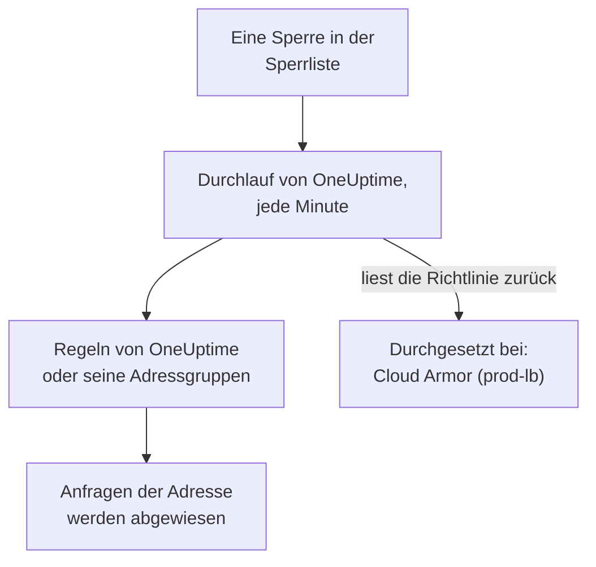

# Adressen in Cloud Armor blockieren

Die Sperrliste Ihres Projekts kann in den Sicherheitsrichtlinien von Google Cloud Armor durchgesetzt werden, die Ihre Load Balancer schützen. Schalten Sie die Funktion für eine bestehende Google-Cloud-Verbindung ein, wählen Sie die Sicherheitsrichtlinien, und jede Adresse, die die Sperrliste sperrt, wird dort blockiert, ob eine Person, ein Playbook oder OneUptime AI sie gesperrt hat.

:::cards
- [Einschalten](#einschalten): Eine Einstellung an der Google-Cloud-Verbindung, und die Rolle, die sie braucht.
- [Was OneUptime anlegt](#was-oneuptime-anlegt): Eigene Regeln in jeder Richtlinie, oder Adressgruppen mit Cloud Armor Enterprise.
- [Welche Adresse abgeglichen wird](#welche-adresse-abgeglichen-wird): Die Adresse, die sich verbunden hat, oder die Benutzer-IP hinter einem Proxy.
:::

## So funktioniert es

OneUptime pflegt eigene Regeln in jeder gewählten Sicherheitsrichtlinie und legt die Adressen, die die Sperrliste sperrt, darin ab. Jede Minute ändert es, was sich geändert hat, eine Regel nach der anderen, und liest die Richtlinie danach zurück. Auf der Seite **Sperrliste** nennt **Durchgesetzt bei** für eine Sperre Cloud Armor (prod-lb) erst, wenn die Richtlinie die Sperre enthält; bis dahin ist sie nicht durchgesetzt.

## Bevor Sie beginnen

- Ein mit OneUptime verbundenes Google-Cloud-Projekt (siehe [Ein Cloud-Konto verbinden](/docs/telemetry/cloud-accounts#google-cloud)).
- Eine Rolle, die ändern darf, wo die Sperrliste durchgesetzt wird: **Projektinhaber**, **Projektadministrator** oder **Sicherheits-Administrator**.
- Jemand, der im Google-Cloud-Projekt Rollen anlegen und gewähren darf, um einen Befehl in Cloud Shell auszuführen.

## Einschalten

:::steps
### Die Verbindung öffnen
Öffnen Sie **Cloud → Verbinden** und bearbeiten Sie die Google-Cloud-Verbindung.

### Die Einstellung einschalten
Setzen Sie unter **Weitere Felder** die Einstellung **Adressen in Cloud Armor blockieren** auf **An** und speichern Sie. Der Einrichtungsbefehl, den das Formular zeigt, gewährt jetzt die unten genannte Rolle dort, wo er auch die anderen gewährt. Eine bestehende Verbindung muss ihn nicht erneut ausführen: Der Dialog **WAF hinzufügen** zeigt die Zeilen, die die Rolle im Projekt der Richtlinie gewähren.

### Die Sicherheitsrichtlinien hinzufügen
Öffnen Sie **Sicherheitsereignisse → Playbooks → Sperrliste**. Klicken Sie unter **Cloud-WAFs** auf **WAF hinzufügen** und wählen Sie eine Sicherheitsrichtlinie. OneUptime fragt Google Cloud, ob die Verbindung sie schreiben darf, ohne etwas zu schreiben.

### Die Rolle gewähren, falls sie fehlt
Fehlt eine Berechtigung, zeigt der Dialog die Zeilen, die sie im Projekt der Richtlinie gewähren. Führen Sie sie in Cloud Shell aus, klicken Sie auf **Erneut prüfen** und fügen Sie dann die Richtlinie hinzu. Ihr **Status** zeigt **Wird durchgesetzt**, sobald OneUptime sie eingerichtet hat.
:::

Die Sicherheitsrichtlinien stammen aus dem Inventar der Verbindung: Eine Richtlinie, die OneUptime noch nicht gelesen hat, wird nach dem nächsten Lesevorgang aufgeführt. Solange eine Richtlinie die Sperrliste durchsetzt, lässt sich die Einstellung ihrer Verbindung nicht ausschalten, und die Verbindung lässt sich nicht löschen: Entfernen Sie zuerst die Richtlinie, damit OneUptime seine Regeln herausnimmt.

## Was OneUptime anlegt

OneUptime legt fest, wie eine Richtlinie die Sperrliste aufnimmt, wenn Sie sie hinzufügen.

| Was | Name | Wo |
| --- | --- | --- |
| Regeln, die mit 403 abweisen, jede mit bis zu 10 Adressen oder Bereichen | Ihre Beschreibung beginnt mit `OneUptime blocklist <project> #1`, `#2`, ... | In jeder gewählten Richtlinie, höchstens 20 davon. |
| Zwei Adressgruppen, IPv4 und IPv6 | `oneuptime-<project>-block-ipv4`, `oneuptime-<project>-block-ipv6` | Global, im Projekt der Richtlinie. Nur mit Cloud Armor Enterprise. |
| Eine Regel, die mit 403 abweist, was eine der beiden Gruppen enthält | Ihre Beschreibung beginnt mit `OneUptime blocklist <project>, address groups` | In jeder gewählten globalen Backend-Richtlinie, mit Cloud Armor Enterprise. |

`<project>` sind die ersten acht Zeichen der externen ID Ihres Projekts, sodass zwei OneUptime-Projekte, die dieselbe Richtlinie wählen, nie gegenseitig ihre Regeln schreiben. Cloud Armor benennt eine Regel nur über ihre Priorität, deshalb erkennt OneUptime seine eigenen Regeln an ihrer Beschreibung.

- **Regeln.** Cloud Armor fasst 10 Adressen oder Bereiche in einer Regel, daher fasst eine Richtlinie in den 20 Regeln von OneUptime bis zu 200 Sperren; eine Sperre, die nicht mehr hineinpasst, meldet das in ihrer Zeile.
- **Adressgruppen.** Eine globale Backend-Richtlinie eines Projekts mit Cloud Armor Enterprise nimmt die Sperrliste stattdessen in zwei Adressgruppen auf: 10.000 IPv4- und 2.000 IPv6-Bereiche. Alle solchen Richtlinien des Projekts teilen sie sich, und eine Regel in jeder Richtlinie weist ab, was sie enthalten. Die Gruppen belegen 16.000 Einheiten des Adressgruppen-Kontingents des Projekts.

OneUptime fügt jede seiner Regeln einzeln hinzu, ändert und entfernt sie, mit den Regelmethoden von Cloud Armor: Es schreibt die Richtlinie nie als Ganzes und schreibt nie eine Ihrer Regeln. Eine einzelne Adresse wird als `/32` oder `/128` geschrieben.

## Der Platz der Regeln in der Richtlinie

OneUptime legt seine Regeln auf freie Prioritäten vor Ihrer ersten Regel, die eine Anfrage durchlässt, die niedrigste zuerst, sodass keine Ihrer Regeln eine gesperrte Adresse durchlässt: eine Regel, die zulässt, drosselt, ratenbasiert sperrt oder fair aufteilt. Eine Ihrer Regeln, die abweist, darf davor stehen. OneUptime nummeriert eine Ihrer Regeln nie um, ändert oder entfernt sie nie: Wenn vor Ihrer ersten solchen Regel keine Priorität frei ist, zeigt die Richtlinie **Keine freie Priorität**, und OneUptime fügt seine Regel hinzu, sobald Sie eine freigeben.

## Welche Adresse abgeglichen wird

| Sicherheitsrichtlinie | Client-Adresse | Wann Sie sie wählen |
| --- | --- | --- |
| Backend | **Adresse, die sich mit dem Load Balancer verbunden hat (origin.ip)** | Die Standardeinstellung. |
| Backend | Benutzer-IP aus den Anfrage-Headern der Richtlinie (origin.user_ip) | Für einen Load Balancer hinter einem weiteren Proxy oder CDN. |
| Edge | Adresse, die sich mit dem Load Balancer verbunden hat (origin.ip) | Die einzige Wahl: Eine Edge-Richtlinie liest keine andere Adresse. |

`origin.user_ip` ist die Adresse in den Anfrage-Headern für die Benutzer-IP der Richtlinie (`userIpRequestHeaders`), die ein Proxy oder CDN vor dem Load Balancer schreibt. Ist keiner festgelegt oder steht keine gültige Adresse darin, ist es `origin.ip`. Wählen Sie diese Option nur, wenn ein solcher Proxy sie schreibt, denn ein Client, der den Load Balancer direkt erreicht, kann sie selbst schreiben. Die Auswahl steht im Dialog **WAF hinzufügen** unter **Weitere Felder**, und Sie können sie später mit **Client-Adresse** in der Zeile der Richtlinie ändern.

Eine Netzwerk-Edge-Sicherheitsrichtlinie für Passthrough-Network-Load-Balancer lässt sich nicht wählen, und der Dialog **WAF hinzufügen** nennt den Grund: Ihre Regeln treffen auf Pakete zu, nicht auf Anfragen.

Die Regeln von OneUptime in Cloud Armor weisen nur ab. Eine Sperre, die für eine Adresse eine Challenge verlangt, wird in Cloud Armor nicht angewendet und meldet das. Die Challenge einer Richtlinie für automatische Reaktionen wird dort als Sperre für dieselbe Dauer durchgesetzt.

## Wenn eine Regel von Hand geändert wird

Wenn jemand eine der Regeln von OneUptime in den Vorschaumodus versetzt, ändert oder löscht oder eine seiner Adressgruppen löscht, lässt OneUptime alles so, wie diese Person es hinterlassen hat. Die Richtlinie zeigt **Von Hand geändert**, und die Sperren, die darin enthalten waren, werden mit Begründung nicht durchgesetzt, bis jemand in der Zeile der Richtlinie auf **Wiederherstellen** klickt. „Wiederherstellen“ schreibt die Regel erneut so, wie OneUptime sie schreibt, auf ihrer eigenen Priorität, solange diese frei ist, und legt eine gelöschte Adressgruppe neu an.

OneUptime prüft nicht, ob eine Richtlinie an einen Backend-Dienst angehängt ist. Eine Richtlinie, die an keinen angehängt ist, blockiert nichts.

## Eine Richtlinie in Terraform verwalten

Eine `google_compute_security_policy` mit `rule`-Blöcken besitzt jede Regel der Richtlinie, daher entfernt der nächste Plan die Regeln von OneUptime. Verwalten Sie Ihre Regeln als `google_compute_security_policy_rule`-Ressourcen, die andere Regeln unberührt lassen, oder fügen Sie dem `lifecycle`-Block der Richtlinie `ignore_changes = [rule]` hinzu.

## Berechtigungen

Der Einrichtungsbefehl legt eine benutzerdefinierte Rolle, `oneuptimeCloudArmorBlocklist`, dort an, wo er die anderen Rollen der Verbindung gewährt, und gewährt sie dem Dienstkonto der Verbindung. Die Zeilen, die der Dialog **WAF hinzufügen** zeigt, legen dieselbe Rolle im Projekt der Richtlinie an. Eine Richtlinie im Regelmodus braucht nur ihre eigenen Berechtigungen.

| Berechtigung | Warum |
| --- | --- |
| `compute.securityPolicies.get`, `compute.securityPolicies.update` | Eine globale Richtlinie lesen und die Regeln von OneUptime darin ändern. |
| `compute.regionSecurityPolicies.get`, `compute.regionSecurityPolicies.update` | Eine regionale Richtlinie lesen und die Regeln von OneUptime darin ändern. |
| `compute.globalOperations.get`, `compute.regionOperations.get` | Warten, bis eine Änderung abgeschlossen ist. |
| `compute.projects.get` | Lesen, ob das Projekt Cloud Armor Enterprise hat. |
| `networksecurity.addressGroups.get`, `networksecurity.addressGroups.list`, `networksecurity.addressGroups.create`, `networksecurity.addressGroups.update`, `networksecurity.addressGroups.delete`, `networksecurity.addressGroups.use` | Die Adressgruppen von OneUptime pflegen und von seiner Regel aus auf sie verweisen. Nur mit Cloud Armor Enterprise. |
| `networksecurity.operations.get` | Warten, bis die Änderung einer Adressgruppe abgeschlossen ist. |

Die Rolle kann keine Richtlinie löschen, und OneUptime schreibt nie etwas anderes. Der Einrichtungsbefehl aktiviert außerdem die APIs Compute Engine und Network Security.

## Entfernen

:::steps
### Die Sicherheitsrichtlinie entfernen
Klicken Sie unter **Sicherheitsereignisse → Playbooks → Sperrliste** in der Zeile der Richtlinie auf **Entfernen**. OneUptime nimmt seine Regeln aus der Richtlinie heraus und löscht seine Adressgruppen, sobald keine andere Richtlinie des Projekts sie mehr nutzt.

### Die Einstellung ausschalten
Bearbeiten Sie die Verbindung, setzen Sie **Adressen in Cloud Armor blockieren** auf **Aus** und speichern Sie. Die Einstellung lässt sich ausschalten, sobald keine Richtlinie der Verbindung mehr die Sperrliste durchsetzt.
:::

Wenn OneUptime die Richtlinie nicht mehr schreiben darf, aktivieren Sie im Dialog **WAF entfernen** die Option **Nur aus OneUptime entfernen**. OneUptime entfernt die Richtlinie aus der Sperrliste und nennt die Regeln und Adressgruppen, die es belassen hat: Diese blockieren weiter, was sie enthalten, bis Sie sie in Google Cloud löschen.

## Fehlerbehebung

:::details Wird nicht durchgesetzt
Der Status der Richtlinie sagt, was Google Cloud geantwortet hat und was zu tun ist. Eine Ablehnung nennt die fehlende Berechtigung: Führen Sie die Zeilen aus, die **WAF hinzufügen** für die Richtlinie zeigt, und klicken Sie dann auf **Erneut prüfen**. Eine Ablehnung wegen eines Kontingents nennt dieses: Fordern Sie bei Google Cloud ein höheres Kontingent an, oder löschen Sie Regeln, die Sie nicht mehr verwenden.
:::

:::details Keine freie Priorität
Jede Priorität vor Ihrer ersten Regel, die eine Anfrage durchlässt, ist belegt. Geben Sie dieser Regel eine höhere Nummer und klicken Sie dann auf **Erneut prüfen**.
:::

:::details Eine Richtlinie fehlt in der Liste
OneUptime führt die Sicherheitsrichtlinien von Verbindungen mit eingeschalteter Einstellung auf, sobald es sie gelesen hat. Eine seitdem hinzugefügte Richtlinie erscheint nach dem nächsten Lesevorgang der Verbindung.
:::

## Nächste Schritte

:::cards
- [Sicherheitsfälle und Playbooks](/docs/telemetry/security-cases): Sperren Sie eine Adresse aus einem Fall heraus, und sehen Sie, wie ihr Schritt geprüft wird.
- [Ein Cloud-Konto verbinden](/docs/telemetry/cloud-accounts): Die Verbindung, zu der diese Einstellung gehört.
:::
