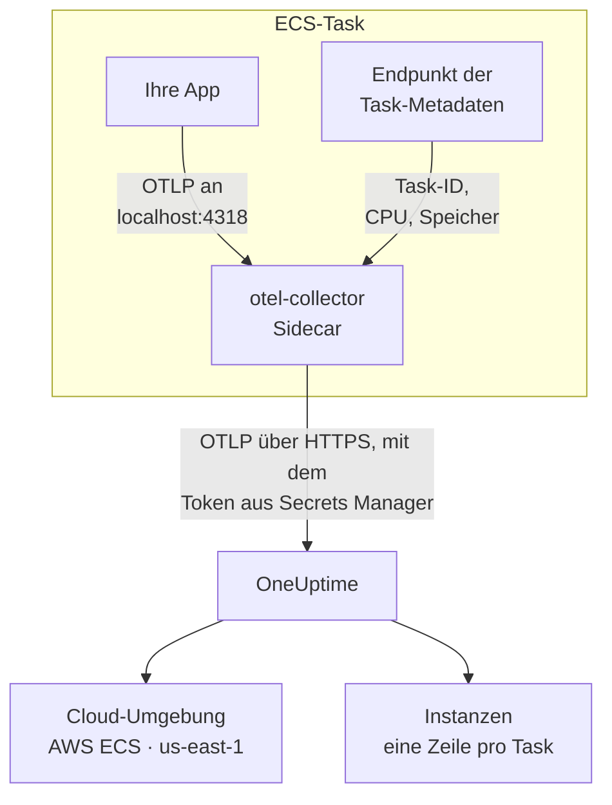

# AWS ECS / Fargate

Senden Sie die Traces, Logs und Metriken Ihrer Amazon-ECS-Tasks an OneUptime, auf den Starttypen Fargate und EC2 gleichermaßen. Jeder Task, der `cloud.platform=aws_ecs` meldet, gehört zu einer **Cloud-Umgebung** pro AWS-Konto und Region, etwa _AWS ECS · us-east-1 · 123456789012_, ob darin ein Dienst läuft oder fünfzig.

:::cards
- [So funktioniert es](#so-funktioniert-es): Was der ECS-Detektor und der Sidecar-Collector tun.
- [Einrichten](#einrichten): Das Token speichern, die Einstellungen zur Task-Definition hinzufügen, bereitstellen und prüfen.
- [Die vollständige Task-Definition](#die-vollständige-task-definition): Eine vollständige Fargate-Task-Definition zum Registrieren.
- [Fehlerbehebung](#fehlerbehebung): Tasks, die in PENDING hängen, abgelehnte Exporte, leere Instanzen oder Kacheln.
:::

## So funktioniert es



- **Der ECS-Detektor benennt die Umgebung.** Der OpenTelemetry-Ressourcendetektor für ECS, im SDK oder in einem Collector, liest den Endpunkt für Task-Metadaten, den ECS jedem Container bereitstellt, und versieht alles, was der Task sendet, mit Konto, Region und Task. Nichts ist fest eingetragen.
- **Der Task benennt jede Instanz.** Der Tab **Instanzen** der Umgebung listet die laufenden Tasks nach Task-ID auf, mit ihrer CPU und ihrem Arbeitsspeicher.
- **Ein Sidecar-Collector liefert CPU und Arbeitsspeicher.** Sein `awsecscontainermetrics`-Receiver liest CPU und Arbeitsspeicher jedes Tasks vom selben Endpunkt, und er hält das Token, sodass die Anwendung es nie sieht.

Der ECS-Detektor setzt diese Ressourcenattribute:

| Attribut | Vom ECS-Detektor gesetzt | Wofür |
| ------------------------------------------------------------------ | ----------------------- | --------------------------------------------------------------------------------------------------------- |
| `cloud.platform` | `aws_ecs` | Legt die Telemetrie unter **Cloud-Umgebungen** ab. Der Wert muss genau stimmen |
| `cloud.account.id` | `123456789012` | Teil des Umgebungsschlüssels |
| `cloud.region` | `us-east-1` | Teil des Umgebungsschlüssels |
| `aws.ecs.task.arn` | der Task-ARN | Benennt einen laufenden Task unter **Instanzen**, nach der Task-ID an seinem Ende |
| `aws.ecs.task.id` | die Task-ID | Dasselbe; neuere Detektorversionen setzen beide |
| `aws.ecs.cluster.arn`, `aws.ecs.task.family`, `aws.ecs.launchtype` | der Cluster und der Task | Auf jedem Span, Log und jeder Metrik gespeichert, damit Sie danach suchen können; nicht Teil der Umgebung |

Der Umgebungsschlüssel ist `aws_ecs|123456789012|us-east-1`. Die Task-ID benennt eine Instanz auch dann, wenn das SDK zusätzlich `service.instance.id` setzt: Die Container-Metriken des Sidecars tragen nur die Task-ID, und ein Schlüssel darauf hält die Spans eines Tasks und seine CPU und seinen Arbeitsspeicher in einer Zeile. Die vollständige Regel steht unter [Cloud-Umgebungen](/docs/telemetry/cloud-environments).

## Bevor Sie beginnen

- **Ein Ingestion-Schlüssel.** Erstellen Sie einen **Server**-Schlüssel unter **Projekteinstellungen → Telemetrie & APM → Ingestion-Schlüssel** und kopieren Sie sein Token.
- **Ein ECS-Cluster und eine Task-Definition, die Sie überarbeiten können**, und die AWS CLI, für dieses Konto eingerichtet.
- **Ihre Anwendung, mit einem OpenTelemetry SDK instrumentiert**, das OTLP exportiert, in jeder Sprache.

## Wählen, wie die Telemetrie den Task verlässt

| | Sidecar collector | SDK direct |
| ----------------------- | ---------------------------------------------- | ----------------------------------------------- |
| Zusätzlicher Container | `otel-collector` in jedem Task | Keiner |
| CPU und Arbeitsspeicher pro Task | Ja, vom `awsecscontainermetrics`-Receiver | Nein |
| Hält das Token | Der Collector | Die Anwendung |
| Das Secret enthält | Das reine Token | Den ganzen Header `x-oneuptime-token=...` |

Die meisten Teams nutzen den Sidecar-Collector: Er setzt die `cloud.*`-Attribute selbst auf Telemetrie aus Bibliotheken, die nichts von ECS wissen. SDK direct ist die einfachste Wahl für einen einzelnen Dienst. Jeder Schritt unten hat einen Tab für beide; wählen Sie einen, und jeder Schritt folgt ihm.

## Einrichten

:::steps
### Das Token in Secrets Manager speichern

> [!IMPORTANT]
> Das Token ist ein Geheimnis. Bewahren Sie es in AWS Secrets Manager auf und verweisen Sie in der Task-Definition mit `secrets` und `valueFrom` darauf. Ein Token in einem einfachen `environment`-Eintrag sieht jeder, der die Task-Definition lesen kann, und es erscheint in jeder Ausgabe von `describe-task-definition` und in jedem CloudFormation-Diff.

:::tabs
@tab Sidecar collector
```bash
aws secretsmanager create-secret \
  --name oneuptime/ingestion-token \
  --region us-east-1 \
  --secret-string "YOUR_TELEMETRY_INGESTION_TOKEN"
```

Die Konfiguration des Collectors fügt den Namen des Headers hinzu, daher enthält dieses Secret nur das Token.
@tab SDK direct
```bash
aws secretsmanager create-secret \
  --name oneuptime/ingestion-token \
  --region us-east-1 \
  --secret-string "x-oneuptime-token=YOUR_TELEMETRY_INGESTION_TOKEN"
```

ECS setzt den Wert eines Secrets unverändert in die Variable ein, und `OTEL_EXPORTER_OTLP_HEADERS` braucht das ganze `name=value`-Paar, daher enthält dieses Secret den vollständigen Header.
:::

Notieren Sie den ARN, den der Befehl ausgibt. Er endet mit einem zufälligen Suffix, etwa `oneuptime/ingestion-token-AbCdEf`, und Sie fügen ihn in die Task-Definition ein.

### Den Task das Secret lesen lassen

Die Task-Ausführungsrolle (die Rolle, mit der ECS den Task startet, nicht die Rolle, unter der Ihr Code läuft) muss das Secret lesen können. Hängen Sie diese Richtlinie an `ecsTaskExecutionRole` an:

```json title="secret-access-policy.json"
{
  "Version": "2012-10-17",
  "Statement": [
    {
      "Effect": "Allow",
      "Action": ["secretsmanager:GetSecretValue"],
      "Resource": "arn:aws:secretsmanager:us-east-1:123456789012:secret:oneuptime/ingestion-token-*"
    }
  ]
}
```

Wenn ein kundenverwalteter KMS-Schlüssel das Secret verschlüsselt, braucht die Rolle außerdem `kms:Decrypt` auf diesem Schlüssel. Fehlt eines davon, startet der Task nicht: Er bricht mit `ResourceInitializationError: unable to pull secrets` ab.

### Die Einstellungen zur Task-Definition hinzufügen

:::tabs
@tab Sidecar collector
1. **AWS Console → Amazon Elastic Container Service → Task definitions** → die Familie auswählen → **Create new revision**.
2. Klappen Sie unter **Container - 1** (Ihre Anwendung) **Environment variables** auf und fügen Sie die Anwendungsvariablen unten hinzu.
3. **+ Add container**: Name `otel-collector`, Image `otel/opentelemetry-collector-contrib:latest` (legen Sie eine Version fest, sobald es funktioniert), **Essential container: No**. Geben Sie unter **Docker configuration → Command** `--config=env:OTEL_COLLECTOR_CONFIG` ein.
4. Fügen Sie am Collector-Container die Umgebungsvariable `ONEUPTIME_TOKEN` mit **Value type: ValueFrom** und dem ARN des Secrets hinzu, und `OTEL_COLLECTOR_CONFIG` mit **Value type: Value** und der Collector-Konfiguration unten.
5. Fügen Sie unter **Startup dependency ordering** am Anwendungs-Container `otel-collector` mit der Bedingung **Start** hinzu, damit die Anwendung nie startet, bevor etwas auf Port 4318 lauscht.
6. Prüfen Sie unter **Task execution role**, dass es die Rolle ist, an die Sie die Richtlinie angehängt haben.

Anwendungsvariablen. Im Netzwerkmodus `awsvpc` (auf Fargate immer) teilen sich die Container eines Tasks ein Netzwerk, daher ist `localhost` der Sidecar:

```bash
OTEL_SERVICE_NAME=checkout-api
OTEL_EXPORTER_OTLP_ENDPOINT=http://localhost:4318
OTEL_EXPORTER_OTLP_PROTOCOL=http/protobuf
```

Collector-Konfiguration. Der Collector liest sie vollständig aus der Variablen `OTEL_COLLECTOR_CONFIG`, sodass keine Datei in ein Image gebaut werden muss, und er löst `${env:ONEUPTIME_TOKEN}` aus dem Secret auf, das ECS in seine Umgebung setzt:

```yaml title="OTEL_COLLECTOR_CONFIG"
receivers:
  otlp:
    protocols:
      http:
        endpoint: 0.0.0.0:4318
      grpc:
        endpoint: 0.0.0.0:4317
  # Per-task and per-container CPU / memory from the ECS task metadata
  # endpoint. This is what fills the CPU and memory tiles in OneUptime.
  awsecscontainermetrics:
    collection_interval: 20s
processors:
  # Stamps cloud.provider, cloud.platform=aws_ecs, cloud.account.id,
  # cloud.region and aws.ecs.task.arn on every span, log and metric.
  resourcedetection:
    detectors: [env, ecs]
    timeout: 5s
  batch: {}
exporters:
  otlphttp/oneuptime:
    endpoint: https://oneuptime.com/otlp
    headers:
      x-oneuptime-token: ${env:ONEUPTIME_TOKEN}
service:
  pipelines:
    traces:
      receivers: [otlp]
      processors: [resourcedetection, batch]
      exporters: [otlphttp/oneuptime]
    metrics:
      receivers: [otlp, awsecscontainermetrics]
      processors: [resourcedetection, batch]
      exporters: [otlphttp/oneuptime]
    logs:
      receivers: [otlp]
      processors: [resourcedetection, batch]
      exporters: [otlphttp/oneuptime]
```

Weder der `ecs`-Detektor noch der `awsecscontainermetrics`-Receiver braucht eine IAM-Berechtigung: Beide lesen den Metadaten-Endpunkt, den ECS jedem Container in `ECS_CONTAINER_METADATA_URI_V4` bereitstellt.
@tab SDK direct
1. **AWS Console → Amazon Elastic Container Service → Task definitions** → die Familie auswählen → **Create new revision**.
2. Klappen Sie unter **Container - 1** (Ihre Anwendung) **Environment variables** auf und fügen Sie die Variablen unten hinzu. Fügen Sie `OTEL_EXPORTER_OTLP_HEADERS` mit **Value type: ValueFrom** und dem ARN des Secrets als Wert hinzu.
3. Fügen Sie den Schalter hinzu, der den ECS-Ressourcendetektor Ihrer Sprache einschaltet, aus der Tabelle unten.
4. Prüfen Sie unter **Task execution role**, dass es die Rolle ist, an die Sie die Richtlinie angehängt haben.

```bash
OTEL_SERVICE_NAME=checkout-api
OTEL_EXPORTER_OTLP_ENDPOINT=https://oneuptime.com/otlp
OTEL_EXPORTER_OTLP_PROTOCOL=http/protobuf
# Injected from Secrets Manager (secrets / valueFrom), not typed here.
OTEL_EXPORTER_OTLP_HEADERS=x-oneuptime-token=YOUR_TELEMETRY_INGESTION_TOKEN
```

| Sprache | Den ECS-Detektor einschalten |
| -------- | --------------------------------------------------------------------------------------------------------------- |
| Node.js | `OTEL_NODE_RESOURCE_DETECTORS=env,host,os,aws` (auto-instrumentations-node) |
| Python | `pip install opentelemetry-sdk-extension-aws`, dann `OTEL_EXPERIMENTAL_RESOURCE_DETECTORS=aws_ecs` |
| Java | `-Dotel.resource.providers.aws.enabled=true` (der Agent liefert den Provider ausgeschaltet aus) |
| Go | `import "go.opentelemetry.io/contrib/detectors/aws/ecs"` und `ecs.NewResourceDetector()` an `resource.New` übergeben |
| .NET | Das Paket `OpenTelemetry.Resources.AWS`: `.ConfigureResource(r => r.AddAWSECSDetector())` |

In einer Task-Definitionsdatei lautet das Secret `"secrets": [{ "name": "OTEL_EXPORTER_OTLP_HEADERS", "valueFrom": "<secret ARN>" }]`.
:::

Wenn Sie OneUptime selbst hosten, verwenden Sie `https://YOUR-ONEUPTIME-HOST/otlp` als Endpunkt.

### Die neue Revision bereitstellen

Klicken Sie auf **Create**, dann auf **Clusters → your cluster → Services → select the service → Update → Task definition revision: latest → Deploy**. Oder über die CLI:

```bash
aws ecs update-service \
  --cluster production \
  --service checkout-api \
  --task-definition checkout-api
```

### Die Verbindung prüfen

Prüfen Sie zuerst das Token: Es ist die günstigste Prüfung, und ohne es funktioniert nichts danach.

```bash
curl -i https://oneuptime.com/otlp/v1/validate \
  -H "x-oneuptime-token: YOUR_TELEMETRY_INGESTION_TOKEN"
```

`200` mit `"valid": true` bedeutet, dass das Token angenommen wird. `401` bedeutet, dass es unbekannt, widerrufen, deaktiviert oder abgelaufen ist. Führen Sie denselben Befehl mit ECS Exec im Task aus, um zu zeigen, dass der Task selbst OneUptime erreicht:

```bash
aws ecs execute-command --cluster production --task <task id> \
  --container app --interactive --command "sh"
```

Der CloudWatch-Logstream des Collectors (`otel/otel-collector/...`) sollte `Everything is ready` melden, ohne Zeilen mit `401` oder `connection refused`. Innerhalb einer Minute nach dem ersten Span, Log oder der ersten Metrik erscheint die Umgebung unter **Cloud → Alle Umgebungen** als _AWS ECS · us-east-1 · 123456789012_.
:::

## Die vollständige Task-Definition

Die Sidecar-Einrichtung als Datei, die Sie mit `aws ecs register-task-definition --cli-input-json file://task-definition.json` registrieren. Ersetzen Sie Konto-ID, Region, Image und den ARN des Secrets:

```json title="task-definition.json"
{
  "family": "checkout-api",
  "requiresCompatibilities": ["FARGATE"],
  "networkMode": "awsvpc",
  "cpu": "512",
  "memory": "1024",
  "executionRoleArn": "arn:aws:iam::123456789012:role/ecsTaskExecutionRole",
  "taskRoleArn": "arn:aws:iam::123456789012:role/checkout-api-task-role",
  "containerDefinitions": [
    {
      "name": "app",
      "image": "123456789012.dkr.ecr.us-east-1.amazonaws.com/checkout-api:1.4.2",
      "essential": true,
      "portMappings": [{ "containerPort": 8080, "protocol": "tcp" }],
      "environment": [
        { "name": "OTEL_SERVICE_NAME", "value": "checkout-api" },
        {
          "name": "OTEL_EXPORTER_OTLP_ENDPOINT",
          "value": "http://localhost:4318"
        },
        { "name": "OTEL_EXPORTER_OTLP_PROTOCOL", "value": "http/protobuf" }
      ],
      "dependsOn": [
        { "containerName": "otel-collector", "condition": "START" }
      ],
      "logConfiguration": {
        "logDriver": "awslogs",
        "options": {
          "awslogs-group": "/ecs/checkout-api",
          "awslogs-region": "us-east-1",
          "awslogs-stream-prefix": "app"
        }
      }
    },
    {
      "name": "otel-collector",
      "image": "otel/opentelemetry-collector-contrib:latest",
      "essential": false,
      "command": ["--config=env:OTEL_COLLECTOR_CONFIG"],
      "secrets": [
        {
          "name": "ONEUPTIME_TOKEN",
          "valueFrom": "arn:aws:secretsmanager:us-east-1:123456789012:secret:oneuptime/ingestion-token-AbCdEf"
        }
      ],
      "environment": [
        {
          "name": "OTEL_COLLECTOR_CONFIG",
          "value": "receivers:\n  otlp:\n    protocols:\n      http:\n        endpoint: 0.0.0.0:4318\n      grpc:\n        endpoint: 0.0.0.0:4317\n  awsecscontainermetrics:\n    collection_interval: 20s\nprocessors:\n  resourcedetection:\n    detectors: [env, ecs]\n    timeout: 5s\n  batch: {}\nexporters:\n  otlphttp/oneuptime:\n    endpoint: https://oneuptime.com/otlp\n    headers:\n      x-oneuptime-token: ${env:ONEUPTIME_TOKEN}\nservice:\n  pipelines:\n    traces:\n      receivers: [otlp]\n      processors: [resourcedetection, batch]\n      exporters: [otlphttp/oneuptime]\n    metrics:\n      receivers: [otlp, awsecscontainermetrics]\n      processors: [resourcedetection, batch]\n      exporters: [otlphttp/oneuptime]\n    logs:\n      receivers: [otlp]\n      processors: [resourcedetection, batch]\n      exporters: [otlphttp/oneuptime]\n"
        }
      ],
      "logConfiguration": {
        "logDriver": "awslogs",
        "options": {
          "awslogs-group": "/ecs/checkout-api",
          "awslogs-region": "us-east-1",
          "awslogs-stream-prefix": "otel"
        }
      }
    }
  ]
}
```

Der Wert von `OTEL_COLLECTOR_CONFIG` ist die Collector-Konfiguration als ein einziger JSON-String. Statt sie von Hand zu escapen, legen Sie das YAML in `collector.yaml` ab und überlassen Sie das `jq`:

```bash
jq --rawfile cfg collector.yaml \
  '.containerDefinitions[1].environment[0].value = $cfg' \
  task-definition.json > task-definition.rendered.json
aws ecs register-task-definition --cli-input-json file://task-definition.rendered.json
```

## Netzwerk

Der Task muss zwei Dinge außerhalb Ihrer VPC erreichen: Secrets Manager, um zu starten, und OneUptime, um zu exportieren.

- **Fargate-Tasks in privaten Subnetzen** brauchen eine Route ins Internet: ein NAT-Gateway in der Routentabelle des Subnetzes oder ein öffentliches Subnetz mit `assignPublicIp=ENABLED`. Ein Task ohne beides hängt beim Secret in `PENDING`, bevor der Collector irgendetwas sendet.
- **Ausgehende Regeln der Sicherheitsgruppe** müssen TCP 443 zum OneUptime-Host erlauben: `oneuptime.com` oder Ihr eigener Host auf dem Port, auf dem er lauscht. Die Standard-Sicherheitsgruppe erlaubt allen ausgehenden Verkehr; eine abgeschottete oft nicht. Telemetrie braucht keine eingehende Regel.
- **VPC-Schnittstellenendpunkte** für `com.amazonaws.us-east-1.secretsmanager` (und `ecr.api`, `ecr.dkr` und S3 für das Ziehen von Images) halten die AWS-Aufrufe vom NAT-Pfad fern. OneUptime selbst braucht weiterhin die Route ins Internet.

```bash
aws ecs update-service \
  --cluster production \
  --service checkout-api \
  --task-definition checkout-api \
  --network-configuration "awsvpcConfiguration={subnets=[subnet-0abc1234],securityGroups=[sg-0def5678],assignPublicIp=ENABLED}"
```

## Was Sie erhalten

- **Übersicht**: Anfragen, Fehlerrate und p95-Latenz aus Ihren Traces, die Kacheln **CPU** und **Arbeitsspeicher** und **Top-Instanzen nach CPU**. Die Kacheln füllen sich aus `ecs.task.cpu.utilized` und `ecs.task.memory.utilized` des `awsecscontainermetrics`-Receivers oder aus jeder Metrik `container.cpu.utilization` und `container.memory.usage`, die die Identität des Tasks trägt. SDK direct liefert keines davon.
- **Instanzen**: eine Zeile pro laufendem Task, benannt nach seiner Task-ID (dem Ende von `aws.ecs.task.arn`), mit seiner letzten CPU, seinem Arbeitsspeicher und dem Zeitpunkt, an dem er zuletzt gesehen wurde. Ein Task, der nicht mehr meldet, wird als **Veraltet** markiert.
- **Protokolle**, **Traces** und **Metriken**: alles, was `cloud.platform=aws_ecs` für dieses Konto und diese Region getragen hat.
- **Dienste**: dieselben Tasks, aufgeschlüsselt nach `service.name`.

## Fehlerbehebung

Die ECS-Fehler, in der Reihenfolge, in der sie auftreten:

:::details Ein Task hängt in PENDING mit "unable to pull secrets"
Der vollständige Fehler lautet `ResourceInitializationError: unable to pull secrets`. Entweder fehlt der Task-Ausführungsrolle `secretsmanager:GetSecretValue` auf dem Secret (oder `kms:Decrypt` auf seinem Schlüssel), oder der Task hat keine Route zu Secrets Manager: kein NAT-Gateway und kein VPC-Endpunkt. Siehe [Netzwerk](#netzwerk).
:::

:::details Der Collector meldet 401
Das Secret enthält den falschen Wert. Für den Sidecar-Collector muss es das reine Token sein; für SDK direct der ganze Header `x-oneuptime-token=...`. Prüfen Sie das Token selbst mit dem Befehl unter [Die Verbindung prüfen](#die-verbindung-prüfen).
:::

:::details Die Umgebung erscheint, aber Instanzen ist leer
Die Telemetrie trägt keine Task-Identität. Stellen Sie sicher, dass der `ecs`-Detektor läuft: Die Ressource muss `aws.ecs.task.arn`, `aws.ecs.task.id` oder `service.instance.id` tragen.
:::

:::details Instanzen füllen sich, aber die Kacheln CPU und Arbeitsspeicher bleiben leer
Der `awsecscontainermetrics`-Receiver fehlt in der `metrics`-Pipeline, oder diese Pipeline überspringt den `resourcedetection`-Prozessor, sodass die Container-Metriken ohne `cloud.platform` ankommen. SDK direct füllt diese Kacheln nie.
:::

Eine Umgebung, die nie erscheint, unter **Hosts** oder **Serverless-Funktionen** landet, **Getrennt** zeigt oder sich in zwei aufteilt, behandelt [Cloud-Fehlerbehebung](/docs/telemetry/cloud-troubleshooting).

## Nächste Schritte

:::cards
- [Cloud-Umgebungen](/docs/telemetry/cloud-environments): Wie Umgebungen und Instanzen erkannt werden.
- [Cloud-Fehlerbehebung](/docs/telemetry/cloud-troubleshooting): Die Fehler, die alle Plattformen gemeinsam haben.
- [Cloud-Ressourcen (IaaS & PaaS)](/docs/telemetry/cloud-resources): Ihre Load Balancer, RDS-Datenbanken und Buckets, aus CloudWatch.
- [OpenTelemetry](/docs/telemetry/open-telemetry): Ihre Anwendung instrumentieren, dazu die Endpunkte und Grenzen.
:::
