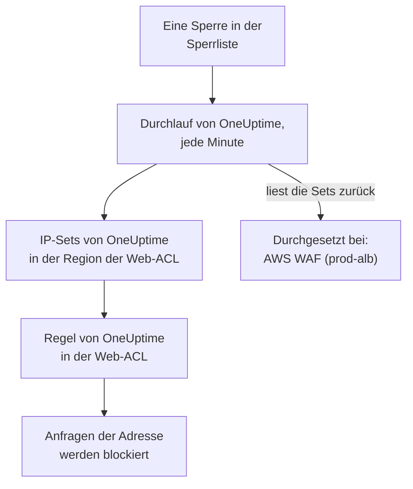

# Adressen in AWS WAF blockieren

Die Sperrliste Ihres Projekts kann in den Web-ACLs von AWS WAF durchgesetzt werden, die vor Ihren CloudFront-Distributionen, Load Balancern und API-Gateway-APIs stehen. Schalten Sie die Funktion für eine bestehende AWS-Cloud-Verbindung ein, wählen Sie die Web-ACLs, und jede Adresse, die die Sperrliste sperrt, wird dort blockiert, ob eine Person, ein Playbook oder OneUptime AI sie gesperrt hat.

:::cards
- [Einschalten](#einschalten): Eine Einstellung an der AWS-Verbindung, und ihr Einrichtungsbefehl noch einmal.
- [Was OneUptime anlegt](#was-oneuptime-anlegt): Vier IP-Sets pro Region und zwei Regeln pro Web-ACL.
- [Die Web-ACL im Code verwalten](#die-web-acl-im-code-verwalten): Fügen Sie die Regeln selbst in Terraform oder CloudFormation hinzu.
:::

## So funktioniert es

OneUptime pflegt eigene IP-Sets in jeder Region, in der eine gewählte Web-ACL liegt, und in jeder Web-ACL eine Regel, die die Adressen darin blockiert. Jede Minute schreibt es jedes Set einmal mit dem, was die Sperrliste enthält, und liest die Sets danach zurück. Auf der Seite **Sperrliste** nennt **Durchgesetzt bei** für eine Sperre AWS WAF (prod-alb) erst, wenn AWS WAF die Sperre enthält und die Regel der Web-ACL ihr Set blockiert; bis dahin ist sie nicht durchgesetzt.

## Bevor Sie beginnen

- Ein mit OneUptime verbundenes AWS-Konto (siehe [Ein Cloud-Konto verbinden](/docs/telemetry/cloud-accounts#amazon-web-services)).
- Eine Rolle, die ändern darf, wo die Sperrliste durchgesetzt wird: **Projektinhaber**, **Projektadministrator** oder **Sicherheits-Administrator**.
- Jemand, der den Einrichtungsbefehl der Verbindung im AWS-Konto erneut ausführen kann.

## Einschalten

:::steps
### Die Verbindung öffnen
Öffnen Sie **Cloud → Verbinden** und bearbeiten Sie die AWS-Verbindung.

### Wählen, wer die Regel hinzufügt
Setzen Sie unter **Weitere Felder** die Einstellung **Adressen in AWS WAF blockieren** auf **An, und OneUptime fügt seine Regel hinzu**, oder auf **An, und ich füge die Regel im Code hinzu**, wenn Ihre Web-ACLs in Terraform oder CloudFormation verwaltet werden.

### Den Einrichtungsbefehl erneut ausführen
Der Befehl, den das Formular jetzt zeigt, gewährt die IP-Sets und, wenn OneUptime die Regel hinzufügt, auch die Regel. Führen Sie ihn in AWS CloudShell aus und speichern Sie dann die Verbindung.

### Die Web-ACLs hinzufügen
Öffnen Sie **Sicherheitsereignisse → Playbooks → Sperrliste**. Klicken Sie unter **Cloud-WAFs** auf **WAF hinzufügen**, wählen Sie eine Web-ACL und unter **Weitere Felder**, wo sie die Adresse des Clients liest, und fügen Sie sie hinzu. OneUptime richtet sie sofort ein, und ihr **Status** zeigt **Wird durchgesetzt**, sobald ihre Regel die Sets blockiert.
:::

Die Web-ACLs stammen aus dem Inventar der Verbindung: Eine Web-ACL, die OneUptime noch nicht gelesen hat, wird nach dem nächsten Lesevorgang aufgeführt. Solange eine Web-ACL die Sperrliste durchsetzt, lässt sich die Einstellung ihrer Verbindung weder ausschalten noch von der Regel, die OneUptime hinzufügt, auf die Regel im Code umstellen, und die Verbindung lässt sich nicht löschen: Entfernen Sie zuerst die Web-ACL, damit OneUptime seine Regel herausnimmt.

## Was OneUptime anlegt

| Was | Name | Wo |
| --- | --- | --- |
| Vier IP-Sets: Sperren und Challenge, IPv4 und IPv6 | `oneuptime-<project>-block-ipv4`, `oneuptime-<project>-block-ipv6`, `oneuptime-<project>-challenge-ipv4`, `oneuptime-<project>-challenge-ipv6` | In jeder Region, in der eine gewählte Web-ACL liegt. Die Web-ACLs von CloudFront sind global, und ihre Sets liegen in `us-east-1`. |
| Zwei Regeln: eine blockiert, eine stellt eine Challenge | `OneUptime-Blocklist-<project>`, `OneUptime-Challenge-<project>` | In jeder gewählten Web-ACL, wenn OneUptime seine Regel hinzufügt. |

`<project>` sind die ersten acht Zeichen der externen ID Ihres Projekts, sodass zwei OneUptime-Projekte in einem Konto nie gegenseitig ihre Sets schreiben. Web-ACLs einer Region teilen sich die Sets. Eine einzelne Adresse wird als `/32` oder `/128` geschrieben. AWS WAF fasst 10.000 Adressen in einem Set und 100 IP-Sets in einer Region, sofern AWS das für Sie nicht erhöht hat; eine Sperre, die nicht mehr hineinpasst, meldet das in ihrer Zeile.

## Der Platz der Regel in der Web-ACL

OneUptime legt seine beiden Regeln auf freie Prioritäten unterhalb der Priorität Ihrer ersten Regel, sodass sie vor den Regeln laufen, die Sie geschrieben haben. Enthält die Web-ACL keine Regel, erhalten sie die Prioritäten 0 und 1. OneUptime nummeriert eine Ihrer Regeln nie um, ändert oder entfernt sie nie: Wenn unterhalb Ihrer ersten Regel keine zwei Prioritäten frei sind, zeigt die Web-ACL **Keine freie Priorität**, und OneUptime fügt seine Regeln hinzu, sobald Sie zwei freigeben.

Jede Regel greift, wenn eines ihrer Sets, IPv4 oder IPv6, die Adresse des Clients enthält. AWS WAF aktualisiert eine Web-ACL nur als Ganzes, deshalb liest OneUptime sie, fügt seine Regeln hinzu und schreibt sie mit dem Lock-Token der Web-ACL zurück, und es liest sie erneut, wenn jemand anderes sie zwischendurch geschrieben hat.

## Weitergeleitete Adressen

Eine Web-ACL hinter einem weiteren Proxy oder CDN sieht die Adresse des Proxys, nicht die des Clients. Wählen Sie unter **Client-Adresse**, wo sie die Adresse des Clients liest:

| Client-Adresse | Was die Regel liest |
| --- | --- |
| **Quelladresse der Anfrage** | Die Adresse, von der die Anfrage kam. Die Standardeinstellung. |
| Letzte Adresse im `X-Forwarded-For`-Header | Die Adresse, die der letzte Proxy angehängt hat. Eine Adresse davor ist nur eine, die die Anfrage behauptet hat. |
| `CF-Connecting-IP`-Header | Die eine Adresse, die Cloudflare schreibt. |
| `True-Client-IP`-Header | Die eine Adresse, die Akamai oder Cloudflare Enterprise schreibt. |

Eine Anfrage ohne den Header trifft nicht zu: AWS WAF lässt sie durch, statt die Adresse eines Proxys zu blockieren.

## Die Web-ACL im Code verwalten

Mit **An, und ich füge die Regel im Code hinzu** legt OneUptime nur die IP-Sets an und schreibt nie in Ihre Web-ACL. Klicken Sie in der Zeile der Web-ACL auf **Regel anzeigen**: Dort stehen beide Regeln als Terraform (`rule`-Blöcke von `aws_wafv2_web_acl`) und als CloudFormation, mit dem ARN jedes Sets und dem Header, den die Web-ACL liest. Fügen Sie sie in Ihrem Code vor Ihren anderen Regeln hinzu und wenden Sie ihn an.

Bis die Regeln dort sind, zeigt die Web-ACL **Wartet auf Ihre Regel**, und ihre Sperren werden nicht durchgesetzt. OneUptime liest die Web-ACL bei jedem Durchlauf, und ihre Sperren werden ab dem ersten Durchlauf durchgesetzt, der für jedes Set eine Regel findet, die es blockiert, egal wie Sie die Regel benannt haben.

## Berechtigungen

Der Einrichtungsbefehl fügt der Rolle eine Inline-Richtlinie, `OneUptimeWafBlocklist`, hinzu. Bei einem Zugriffsschlüssel kommt sie wegen der Grenze, die IAM den eigenen Richtlinien eines Benutzers setzt, auf eine Gruppe, `OneUptimeWafBlocklist-<project>`, der der Benutzer beitritt.

| Aktion | Ressource | Warum |
| --- | --- | --- |
| `wafv2:ListIPSets` | Beliebig | Die IP-Sets von OneUptime in einer Region finden. |
| `wafv2:GetIPSet`, `wafv2:CreateIPSet`, `wafv2:UpdateIPSet`, `wafv2:DeleteIPSet` | Nur die IP-Sets von OneUptime (`oneuptime-<project>-*`) | Die Sets pflegen und sie löschen, wenn Sie die letzte Web-ACL einer Region entfernen. |
| `wafv2:GetSampledRequests` | Web-ACLs | Die Anfragen lesen, die eine Regel abgewiesen hat: der Beleg, an dem der Sperrschritt eines Falls geprüft wird. |
| `wafv2:UpdateWebACL` | Web-ACLs sowie die IP-Sets, Regex-Sets und Regelgruppen, auf die sie verweisen | Die Regeln von OneUptime hinzufügen. Nur mit **An, und OneUptime fügt seine Regel hinzu**. |

Das Lesen einer Web-ACL, `wafv2:GetWebACL`, ist bereits in der Leserichtlinie der Verbindung enthalten.

## Entfernen

:::steps
### Die Web-ACL entfernen
Klicken Sie unter **Sicherheitsereignisse → Playbooks → Sperrliste** in der Zeile der Web-ACL auf **Entfernen**. OneUptime nimmt seine Regeln aus der Web-ACL heraus und leert und löscht seine IP-Sets, sobald keine andere Web-ACL der Region sie mehr nutzt.

### Die Einstellung ausschalten
Bearbeiten Sie die Verbindung, setzen Sie **Adressen in AWS WAF blockieren** auf **Aus** und speichern Sie. Die Einstellung lässt sich ausschalten, sobald keine Web-ACL der Verbindung mehr die Sperrliste durchsetzt.
:::

Wenn OneUptime die Web-ACL nicht mehr schreiben darf, aktivieren Sie im Dialog **WAF entfernen** die Option **Nur aus OneUptime entfernen**. OneUptime entfernt die Web-ACL aus der Sperrliste und nennt die Regeln und IP-Sets, die es in AWS WAF belassen hat: Diese blockieren weiter, was sie enthalten, bis Sie sie dort löschen. Verweist eine Ihrer Regeln noch auf ein Set, bleibt auch dieses bestehen: OneUptime leert es und nennt es.

## Fehlerbehebung

:::details Wird nicht durchgesetzt
Der Status der Web-ACL sagt, was AWS geantwortet hat und was zu tun ist. Eine Ablehnung nennt die Aktion und die Einstellung, die sie gewährt: Schalten Sie die Einstellung ein oder wählen Sie **An, und OneUptime fügt seine Regel hinzu**, führen Sie dann den Einrichtungsbefehl der Verbindung erneut aus und klicken Sie auf **Erneut prüfen**.
:::

:::details Keine freie Priorität
Ihre erste Regel hat die Priorität 0 oder 1, deshalb sind unterhalb von ihr keine zwei Prioritäten frei. Erhöhen Sie die Prioritätsnummern Ihrer Regeln um zwei und klicken Sie dann auf **Erneut prüfen**.
:::

:::details Eine Web-ACL fehlt in der Liste
OneUptime führt die Web-ACLs von Verbindungen mit eingeschalteter Einstellung auf, sobald es sie gelesen hat. Web-ACLs, die nur über ihre Metriken bekannt sind, brauchen den Einrichtungsbefehl der Verbindung erneut, damit OneUptime sie lesen kann.
:::

## Nächste Schritte

:::cards
- [Sicherheitsfälle und Playbooks](/docs/telemetry/security-cases): Sperren Sie eine Adresse aus einem Fall heraus, und sehen Sie, wie ihr Schritt geprüft wird.
- [Ein Cloud-Konto verbinden](/docs/telemetry/cloud-accounts): Die Verbindung, zu der diese Einstellung gehört.
:::
