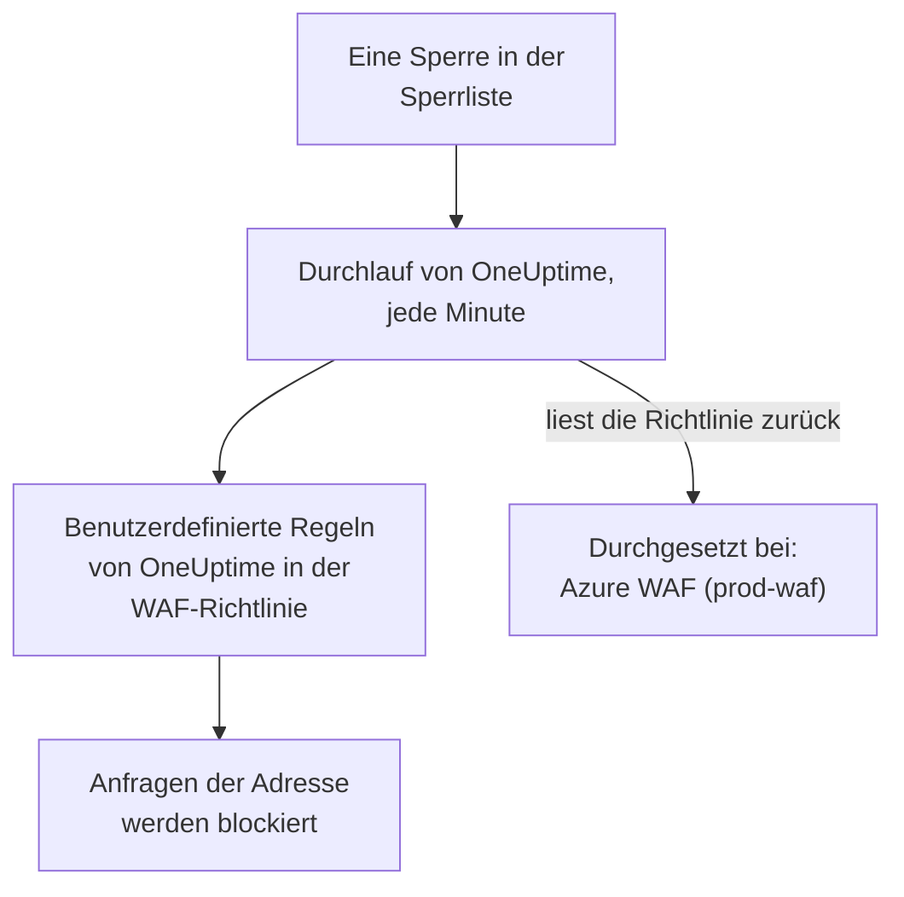

# Adressen in Azure WAF blockieren

Die Sperrliste Ihres Projekts kann in den WAF-Richtlinien von Azure WAF durchgesetzt werden, die Ihre Application Gateways und Front Doors schützen. Schalten Sie die Funktion für eine bestehende Azure-Cloud-Verbindung ein, wählen Sie die WAF-Richtlinien, und jede Adresse, die die Sperrliste sperrt, wird dort blockiert, ob eine Person, ein Playbook oder OneUptime AI sie gesperrt hat.

:::cards
- [Einschalten](#einschalten): Eine Einstellung an der Azure-Verbindung, und die Rolle, die sie braucht.
- [Was OneUptime anlegt](#was-oneuptime-anlegt): Eigene benutzerdefinierte Regeln in jeder Richtlinie, die Sie wählen.
- [Welche Adresse abgeglichen wird](#welche-adresse-abgeglichen-wird): Die Adresse, die sich verbunden hat, oder der ursprüngliche Client hinter einem Proxy.
:::

## So funktioniert es

OneUptime pflegt eigene benutzerdefinierte Regeln in jeder gewählten WAF-Richtlinie und legt die Adressen, die die Sperrliste sperrt, darin ab. Jede Minute schreibt es die Richtlinie einmal mit dem, was die Sperrliste enthält, und liest sie danach zurück. Auf der Seite **Sperrliste** nennt **Durchgesetzt bei** für eine Sperre Azure WAF (prod-waf) erst, wenn die Richtlinie die Sperre enthält und Azure sie angewendet hat; bis dahin ist sie nicht durchgesetzt.

## Bevor Sie beginnen

- Ein mit OneUptime verbundenes Azure-Abonnement (siehe [Ein Cloud-Konto verbinden](/docs/telemetry/cloud-accounts#microsoft-azure)).
- Eine Rolle, die ändern darf, wo die Sperrliste durchgesetzt wird: **Projektinhaber**, **Projektadministrator** oder **Sicherheits-Administrator**.
- Jemand, der im Azure-Abonnement Rollen zuweisen darf, um einen Befehl in Azure Cloud Shell auszuführen.

## Einschalten

:::steps
### Die Verbindung öffnen
Öffnen Sie **Cloud → Verbinden** und bearbeiten Sie die Azure-Verbindung.

### Die Einstellung einschalten
Setzen Sie unter **Weitere Felder** die Einstellung **Adressen in Azure WAF blockieren** auf **An** und speichern Sie. Der Einrichtungsbefehl, den das Formular zeigt, gewährt jetzt die unten genannte Rolle für das ganze Abonnement. Eine bestehende Verbindung muss ihn nicht erneut ausführen: Der Dialog **WAF hinzufügen** zeigt die Zeilen, die die Rolle nur für eine einzelne Richtlinie gewähren.

### Die WAF-Richtlinien hinzufügen
Öffnen Sie **Sicherheitsereignisse → Playbooks → Sperrliste**. Klicken Sie unter **Cloud-WAFs** auf **WAF hinzufügen** und wählen Sie eine WAF-Richtlinie. OneUptime fragt Azure, ob die Verbindung sie schreiben darf, ohne etwas zu schreiben.

### Die Rolle gewähren, falls sie fehlt
Fehlt eine Berechtigung, zeigt der Dialog die Zeilen, die sie nur für diese Richtlinie gewähren. Führen Sie sie in Azure Cloud Shell aus, klicken Sie auf **Erneut prüfen** und fügen Sie dann die Richtlinie hinzu. Ihr **Status** zeigt **Wird durchgesetzt**, sobald OneUptime sie gelesen hat.
:::

Die WAF-Richtlinien stammen aus dem Inventar der Verbindung: Eine Richtlinie, die OneUptime noch nicht gelesen hat, wird nach dem nächsten Lesevorgang aufgeführt. Solange eine Richtlinie die Sperrliste durchsetzt, lässt sich die Einstellung ihrer Verbindung nicht ausschalten, und die Verbindung lässt sich nicht löschen: Entfernen Sie zuerst die Richtlinie, damit OneUptime seine Regeln herausnimmt.

## Was OneUptime anlegt

| Was | Name | Wo |
| --- | --- | --- |
| Benutzerdefinierte Regeln, jede mit einer IP-Übereinstimmungsbedingung und der Aktion Block | `OneUptime<project>Block1`, `OneUptime<project>Block2`, ... | In jeder gewählten WAF-Richtlinie, höchstens 10 davon. |

`<project>` sind die ersten acht Zeichen der externen ID Ihres Projekts, sodass zwei OneUptime-Projekte, die dieselbe Richtlinie wählen, nie gegenseitig ihre Regeln schreiben. Eine Regel fasst auf Application Gateway 540 Adressen oder Bereiche, mit CRS 3.2 oder einem Default Rule Set 600, und auf Front Door 600. Mit zehn Regeln fasst eine Richtlinie 5.400 oder 6.000 Sperren; eine Sperre, die nicht mehr hineinpasst, meldet das in ihrer Zeile.

OneUptime ändert in einer Richtlinie nur seine eigenen Regeln. Azure schreibt eine WAF-Richtlinie nur als Ganzes, deshalb liest OneUptime die Richtlinie mit ihrem ETag, ändert seine eigenen Regeln und schreibt sie mit dem ETag in `If-Match` zurück: Jede andere Regel, jede Einstellung und jeder verwaltete Regelsatz wird so geschrieben, wie er gelesen wurde. Hat jemand anderes die Richtlinie zwischendurch geschrieben, lehnt Azure den Schreibvorgang ab, und OneUptime liest sie erneut und nimmt seine Änderung an dem vor, was die andere Person geschrieben hat.

## Der Platz der Regeln in der Richtlinie

OneUptime legt seine Regeln auf freie Prioritäten vor Ihrer ersten Regel, die Datenverkehr zulässt, die niedrigste zuerst, sodass keine Ihrer Regeln eine gesperrte Adresse durchlässt. Eine Ihrer Regeln, die blockiert oder protokolliert, darf davor stehen. OneUptime nummeriert eine Ihrer Regeln nie um, ändert oder entfernt sie nie: Wenn vor Ihrer ersten Allow-Regel keine Priorität frei ist, zeigt die Richtlinie **Keine freie Priorität**, und OneUptime fügt seine Regel hinzu, sobald Sie eine freigeben.

## Welche Adresse abgeglichen wird

| WAF-Richtlinie | Client-Adresse | Wann Sie sie wählen |
| --- | --- | --- |
| Front Door | **Adresse, die sich mit Front Door verbunden hat (SocketAddr)** | Die Standardeinstellung. |
| Front Door | Ursprünglicher Client, aus X-Forwarded-For (RemoteAddr) | Für Front Door hinter einem weiteren Proxy oder CDN. |
| Application Gateway | Adresse, die sich mit dem Gateway verbunden hat (RemoteAddr) | Die einzige Wahl: Seine IP-Übereinstimmung liest keine andere Adresse. |

Front Door entnimmt `RemoteAddr` dem `X-Forwarded-For`-Header, den ein Client, der sich direkt mit Front Door verbindet, selbst schreibt. Wählen Sie diese Option nur, wenn ein weiterer Proxy oder ein CDN vor Front Door diesen Header schreibt. Die Auswahl steht im Dialog **WAF hinzufügen** unter **Weitere Felder**, und Sie können sie später mit **Client-Adresse** in der Zeile der Richtlinie ändern.

Die IP-Übereinstimmung von Application Gateway liest nur IPv4-Adressen, daher wird eine IPv6-Sperre dort nicht angewendet, und ihre Zeile nennt den Grund.

Die Regeln von OneUptime in Azure WAF blockieren nur. Eine Sperre, die für eine Adresse eine Challenge verlangt, wird in Azure WAF nicht angewendet und meldet das. Die Challenge einer Richtlinie für automatische Reaktionen wird dort als Sperre für dieselbe Dauer durchgesetzt.

## Wie lange eine Änderung dauert

Application Gateway wendet eine Änderung an, sobald Azure sie schreibt. Front Door nimmt die Änderung an und verteilt sie in den nächsten Minuten auf seine Edge-Standorte: Die Richtlinie zeigt **Wird angewendet**, und **Durchgesetzt bei** wartet für eine neue Sperre auf die Richtlinie, bis Azure sie als bereitgestellt meldet. Ab dann ist die Sperre durchgesetzt.

## Wenn eine Regel von Hand geändert wird

Wenn jemand eine der Regeln von OneUptime in Azure ausschaltet, ändert oder löscht, lässt OneUptime sie so, wie diese Person sie hinterlassen hat. Die Richtlinie zeigt **Von Hand geändert**, und die Sperren, die diese Regel enthielt, werden mit Begründung nicht durchgesetzt, bis jemand in der Zeile der Richtlinie auf **Wiederherstellen** klickt. „Wiederherstellen“ schreibt die Regel erneut so, wie OneUptime sie schreibt, auf ihrer eigenen Priorität, solange diese frei ist.

Eine Richtlinie, die nichts blockiert, meldet das ebenfalls, und ihre Sperren werden nicht durchgesetzt:

- Eine Richtlinie, die ausgeschaltet ist.
- Eine Richtlinie im Modus **Detection**, die nur protokolliert, worauf die Regeln von OneUptime zutreffen.
- Eine Richtlinie, die keinem Application Gateway, keinem Listener, keiner Pfadregel und keiner Domäne von Front Door zugeordnet ist.

## Eine Richtlinie in Terraform verwalten

Auch Terraform schreibt eine WAF-Richtlinie als Ganzes, daher entfernt sein nächster Plan die Regeln von OneUptime. Damit OneUptime sie behalten kann, fügen Sie dem `lifecycle`-Block einer `azurerm_web_application_firewall_policy` die Zeile `ignore_changes = [custom_rules]` hinzu, oder dem einer `azurerm_cdn_frontdoor_firewall_policy` die Zeile `ignore_changes = [custom_rule]`, und halten Sie Ihre eigenen benutzerdefinierten Regeln aus dem Code dieser Richtlinie heraus.

## Berechtigungen

Der Einrichtungsbefehl legt eine benutzerdefinierte Rolle, `OneUptime WAF Blocklist`, an und weist sie der App der Verbindung für das Abonnement zu. Die Zeilen, die der Dialog **WAF hinzufügen** zeigt, weisen dieselbe Rolle nur für eine einzelne Richtlinie zu.

| Aktion | Warum |
| --- | --- |
| `Microsoft.Network/ApplicationGatewayWebApplicationFirewallPolicies/read`, `Microsoft.Network/ApplicationGatewayWebApplicationFirewallPolicies/write` | Eine WAF-Richtlinie von Application Gateway lesen und die Regeln von OneUptime darin schreiben. |
| `Microsoft.Network/FrontDoorWebApplicationFirewallPolicies/read`, `Microsoft.Network/FrontDoorWebApplicationFirewallPolicies/write` | Eine WAF-Richtlinie von Front Door lesen und die Regeln von OneUptime darin schreiben. |

Die Rolle kann keine Richtlinie löschen, und OneUptime schreibt nie etwas anderes.

## Entfernen

:::steps
### Die WAF-Richtlinie entfernen
Klicken Sie unter **Sicherheitsereignisse → Playbooks → Sperrliste** in der Zeile der Richtlinie auf **Entfernen**. OneUptime nimmt seine Regeln aus der Richtlinie heraus und ändert sonst nichts daran.

### Die Einstellung ausschalten
Bearbeiten Sie die Verbindung, setzen Sie **Adressen in Azure WAF blockieren** auf **Aus** und speichern Sie. Die Einstellung lässt sich ausschalten, sobald keine Richtlinie der Verbindung mehr die Sperrliste durchsetzt.
:::

Wenn OneUptime die Richtlinie nicht mehr schreiben darf, aktivieren Sie im Dialog **WAF entfernen** die Option **Nur aus OneUptime entfernen**. OneUptime entfernt die Richtlinie aus der Sperrliste und nennt die Regeln, die es darin belassen hat: Diese blockieren weiter, was sie enthalten, bis Sie sie in Azure löschen.

## Fehlerbehebung

:::details Wird nicht durchgesetzt
Der Status der Richtlinie sagt, was Azure geantwortet hat und was zu tun ist. Eine Ablehnung nennt die fehlende Berechtigung: Führen Sie die Zeilen aus, die **WAF hinzufügen** für die Richtlinie zeigt, und klicken Sie dann auf **Erneut prüfen**.
:::

:::details Keine freie Priorität
Ihre erste Regel, die Datenverkehr zulässt, hat die Priorität 1, oder jede Priorität davor ist belegt. Erhöhen Sie ihre Prioritätsnummer und klicken Sie dann auf **Erneut prüfen**.
:::

:::details Eine Richtlinie fehlt in der Liste
OneUptime führt die WAF-Richtlinien von Verbindungen mit eingeschalteter Einstellung auf, sobald es sie gelesen hat. Eine seitdem hinzugefügte Richtlinie erscheint nach dem nächsten Lesevorgang der Verbindung.
:::

## Nächste Schritte

:::cards
- [Sicherheitsfälle und Playbooks](/docs/telemetry/security-cases): Sperren Sie eine Adresse aus einem Fall heraus, und sehen Sie, wie ihr Schritt geprüft wird.
- [Ein Cloud-Konto verbinden](/docs/telemetry/cloud-accounts): Die Verbindung, zu der diese Einstellung gehört.
:::
