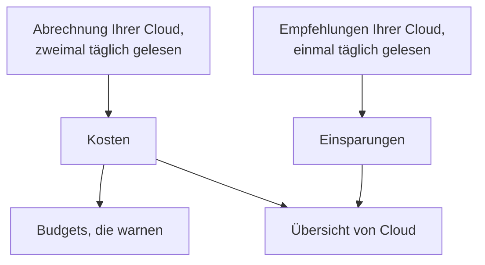

# Cloud-Kosten und Einsparungen

Ein verbundenes Cloud-Konto sagt auch, was es kostet und wie es weniger kosten könnte. OneUptime liest die Kosten jedes Tages aus der eigenen Abrechnung Ihrer Cloud und die Empfehlungen des eigenen Empfehlungsdienstes Ihrer Cloud, zeigt sie unter **Cloud → Ausgaben → Kosten** und **Cloud → Ausgaben → Einsparungen**, listet Ihre Savings Plans, Reservierungen und Rabatte für zugesicherte Nutzung unter **Cloud → Ausgaben → Zusagen** auf und warnt, bevor ein Monat mehr kostet als sein Budget unter **Cloud → Ausgaben → Budgets**.

:::cards
- [Amazon Web Services](#amazon-web-services): Cost Explorer und Cost Optimization Hub, jeweils einmal eingeschaltet.
- [Microsoft Azure](#microsoft-azure): Cost Management und Azure Advisor, mit einer weiteren Rolle.
- [Google Cloud](#google-cloud): Ihr Abrechnungsexport nach BigQuery und der Recommender.
- [Abgerechnet, amortisiert und netto](#abgerechnet-amortisiert-und-netto): Jede Kostenposition auf drei Arten, damit Zusagen und Gutschriften dort landen, wo das Geld hinging.
- [Zusagen und Verlängerungen](#zusagen-und-verlängerungen): Jede Zusage, Warnungen, bevor eine endet oder während sie zu wenig genutzt wird, und was zu verlängern oder zu kaufen ist.
- [Budgets](#budgets): Eine Warnung, sobald die Ausgaben eines Monats einen Anteil seines Budgets überschreiten.
:::

## So funktioniert es



- **Die Kosten kommen aus der eigenen Abrechnung Ihrer Cloud.** AWS Cost Explorer, Azure Cost Management und der Abrechnungsexport von Google Cloud nach BigQuery, in der Währung, in der das Konto abgerechnet wird, jeweils abgerechnet, amortisiert und netto gespeichert: siehe [Abgerechnet, amortisiert und netto](#abgerechnet-amortisiert-und-netto). Jeder Wert gilt für einen Tag, in UTC-Tagen, wie Ihre Cloud sie abrechnet.
- **Eine Cloud meldet die letzten ein, zwei Tage verspätet.** Jeder Lesevorgang liest die letzte Woche erneut, in den ersten Tagen eines Monats den ganzen letzten Monat, sodass sich die Kosten eines Tages festigen, während Ihre Cloud ihn abschließt. Der erste Lesevorgang einer Verbindung reicht bis zum Anfang des vorletzten Monats zurück.
- **Die Hochrechnung des Monats folgt dem Tempo der letzten Woche.** Sie ist, was der Monat bisher gekostet hat, und jeder noch kommende Tag mit dem Durchschnitt der letzten sieben vollen Tage.
- **Die Einsparungen kommen aus dem eigenen Empfehlungsdienst Ihrer Cloud.** AWS Cost Optimization Hub, Azure Advisor und der Recommender von Google Cloud: eine kleinere Größe, eine Ressource im Leerlauf, eine lohnende Zusage, jeweils mit dem, was sie im Monat einsparen würde. Eine Empfehlung, die Sie in der Konsole Ihrer Cloud umsetzen oder verwerfen, verschwindet beim nächsten Lesevorgang.

## Bevor Sie beginnen

- **Ein verbundenes Konto.** [Ein Cloud-Konto verbinden](/docs/telemetry/cloud-accounts) mit dem heutigen Einrichtungsbefehl: Er erlaubt der Verbindung, Kosten und Empfehlungen zu lesen. Eine früher erstellte Verbindung liest keins von beiden, bis Sie ihren Befehl erneut ausführen.

## Amazon Web Services

Die Verbindung liest Kosten mit `ce:GetCostAndUsage`, ihre Zusagen mit `ce:GetSavingsPlansCoverage`, `ce:GetSavingsPlansUtilization`, `ce:GetSavingsPlansUtilizationDetails`, `ce:GetReservationCoverage` und `ce:GetReservationUtilization`, die gekauften Savings Plans mit `savingsplans:DescribeSavingsPlans` und Empfehlungen mit `cost-optimization-hub:ListRecommendations` und `cost-optimization-hub:GetRecommendation`. Der Einrichtungsbefehl vergibt die Lesezugriffe von Cost Explorer als drei Familien, `ce:GetCostAndUsage*`, `ce:GetSavingsPlans*` und `ce:GetReservation*`, alles Lesezugriffe, damit der Benutzer eines Zugriffsschlüssels weiter in die 2.048 Zeichen passt, die IAM seiner Richtlinie erlaubt. Cost Explorer und Cost Optimization Hub müssen im Konto zuerst eingeschaltet werden:

:::steps
### Cost Explorer einschalten

Öffnen Sie Cost Explorer einmal in der AWS-Konsole Billing and Cost Management: AWS bereitet die Kosten des Kontos innerhalb eines Tages vor. Verbinden Sie das Verwaltungskonto der Organisation, um die Kosten jedes Mitgliedskontos zu lesen.

### Cost Optimization Hub aktivieren

Öffnen Sie Cost Optimization Hub in derselben Konsole und aktivieren Sie ihn, für die Organisation von ihrem Verwaltungskonto aus oder nur für das Konto. Seine Empfehlungen kommen innerhalb eines Tages.
:::

Cost Explorer berechnet $0.01 pro Anfrage: Ein Lesevorgang der Kosten stellt zwei oder einige mehr, eine für abgerechnet und amortisiert und eine für netto, und die Zusagen werden mit vier am Tag für ihre Abdeckung und Nutzung gelesen und mit sechs bis zwölf weiteren am Tag für die jeweils eigene. Die Savings Plans API und Cost Optimization Hub sind kostenlos.

### Kosten pro Ressource

Cost Explorer sagt auch, was jede Ressource kostet, für die letzten 14 Tage, sobald Daten auf Ressourcenebene eingeschaltet sind. Öffnen Sie in der AWS-Konsole Billing and Cost Management die Cost Management-Einstellungen und schalten Sie Daten auf Ressourcenebene in täglicher Granularität ein, für die Organisation von ihrem Verwaltungskonto aus. AWS bereitet sie innerhalb von 48 Stunden vor.

Bearbeiten Sie dann die Verbindung unter **Cloud → Verbinden** und schalten Sie unter **Weitere Felder** **Kosten pro Ressource** ein. Die Verbindung liest sie einmal am Tag mit `ce:GetCostAndUsageWithResources`: beim ersten Mal die 14 Tage, danach die letzten drei erneut, mit jeweils einigen Anfragen. Was sie liest, bleibt bei den Kosten des Kontos, nachdem Cost Explorer es vergessen hat. Eine früher erstellte Verbindung braucht ihren Einrichtungsbefehl erneut, der die Aktion hinzufügt.

## Microsoft Azure

Die App liest Kosten mit der Rolle **Cost Management Reader**, für denselben Bereich wie **Monitoring Reader**: Der Einrichtungsbefehl vergibt beide. Die Empfehlungen von Azure Advisor werden mit **Monitoring Reader** gelesen, es gibt also nichts einzuschalten. Um einer früher erstellten App die Rolle zu geben, führen Sie aus:

```bash
az role assignment create --assignee <APP_ID> --role "Cost Management Reader" --scope /subscriptions/<SUBSCRIPTION_ID>
```

Cost Management antwortet für jedes Abonnement, mit der Ressource, für die jede Kostenposition anfällt, und das Lesen kostet nichts. Wenn es für ein Abonnement nicht antworten kann, sagt die Seite **Kosten** des Kontos, warum.

Cost Management begrenzt, wie schnell die Kosten eines Mandanten gelesen werden, für alle, die sie lesen, gleich: Jede Abfrage kostet eine Abfrageverarbeitungseinheit (QPU) für jeden Monat an Daten, den sie liest, und ein Mandant hat 12 QPU alle 10 Sekunden, 60 pro Minute und 600 pro Stunde. OneUptime liest die Abonnements eines Mandanten nacheinander innerhalb von zwei Dritteln jedes Kontingents, wartet so lange, wie Cost Management es verlangt, wenn es eine Abfrage abweist, und macht beim nächsten Lesevorgang dort weiter, wo es aufgehört hat. Ein noch nicht gelesenes Abonnement zeigt **In der Warteschlange** und wann es gelesen wird; eines mit Werten behält sie in der Zwischenzeit. Seine amortisierten Kosten werden bei jedem Lesevorgang gelesen und seine tatsächlichen Kosten einmal am Tag, daher fragt der erste Lesevorgang eines Abonnements Cost Management zweimal und braucht doppelt so viele Abfrageeinheiten: Die ersten Werte eines großen Mandanten brauchen einige Lesevorgänge mehr.

Die Reservierungen und Sparpläne des Mandanten werden mit **Reservations Reader** und **Savings plan Reader** gelesen, die Azure auf der eigenen Ebene des Mandanten vergibt, wo nur ein globaler Administrator mit erhöhtem Zugriff sie gewähren darf. Der Einrichtungsbefehl versucht es und sagt es, wenn er es nicht darf. Um sie später als globaler Administrator mit erhöhtem Zugriff zu gewähren:

```bash
az role assignment create --assignee <APP_ID> --role "Reservations Reader" --scope /providers/Microsoft.Capacity
az role assignment create --assignee <APP_ID> --role "Savings plan Reader" --scope /providers/Microsoft.BillingBenefits
```

Ohne sie werden Kosten und Empfehlungen wie bisher gelesen, und **Cloud → Ausgaben → Zusagen** nennt die zu gewährende Rolle.

## Google Cloud

Google Cloud hat keine API für die Kosten eines Projekts: OneUptime liest sie aus dem Export Ihres Rechnungskontos nach BigQuery.

:::steps
### Ihre Abrechnung nach BigQuery exportieren

Öffnen Sie in der Google-Cloud-Konsole Billing, dann Billing export, und schalten Sie den Export der detaillierten Nutzungskosten in ein BigQuery-Dataset ein. Google schreibt ihn mit einigen Stunden Verzug, ab dem Tag, an dem Sie ihn einschalten.

### Das Dienstkonto ihn lesen lassen

Geben Sie dem Dienstkonto der Verbindung **BigQuery Data Viewer** für das Dataset des Exports. Der Einrichtungsbefehl hat ihm bereits **BigQuery Job User** gegeben, um die Abfrage in seinem eigenen Projekt auszuführen.

### Die Tabelle des Exports angeben

Bearbeiten Sie die Verbindung unter **Cloud → Verbinden** und setzen Sie unter **Weitere Felder** die **Tabelle des Abrechnungsexports** auf den vollständigen Namen der Tabelle: `<PROJECT_ID>.<DATASET>.gcp_billing_export_resource_v1_<BILLING_ACCOUNT_ID>`.
:::

Der detaillierte Export nennt die Ressource, für die jede Kostenposition anfällt; der Standardexport nennt nur Dienst und Region. BigQuery berechnet die Abfrage: die ersten 1 TiB pro Monat sind kostenlos, danach $6.25 pro TiB, und ein Monat eines Exports umfasst einige Megabyte bis einige Gigabyte. Die Empfehlungen des Recommenders zu Maschinentypen und ungenutzten Ressourcen werden mit **Compute Recommender Viewer** gelesen, den der Einrichtungsbefehl vergibt, und kosten nichts. Die Zusagen von Compute Engine werden aus Cloud Asset Inventory mit **Cloud Asset Viewer** aufgelistet, den der Einrichtungsbefehl bereits vergibt: Mehr ist nicht zu gewähren.

## Abgerechnet, amortisiert und netto

Jede Kostenposition wird auf drei Arten gespeichert, und **Cloud → Ausgaben → Kosten**, die **Kosten** eines Kontos, die Übersicht von Cloud und Budgets zeigen die, die Sie wählen:

- **Abgerechnet** ist jede Belastung am Tag, an dem Ihre Cloud sie abgerechnet hat, vor Gutschriften und Erstattungen. Ein im Voraus bezahlter Savings Plan oder eine im Voraus bezahlte Reservierung ist eine große Belastung am Tag des Kaufs, und die Nutzung, die sie abdeckt, wirkt für den Rest der Laufzeit kostenlos.
- **Amortisiert** verteilt die Gebühren jeder Zusage auf die Tage und Ressourcen, die sie abdeckt, damit das Geld dort landet, wo es ausgegeben wurde. Weiterhin vor Gutschriften und Erstattungen. Das zeigen die Seiten, sofern Sie nichts anderes wählen.
- **Netto** ist amortisiert, abzüglich Gutschriften, Erstattungen und Rabatten: der Rechnungsbetrag.

| | Abgerechnet | Amortisiert | Netto |
|---|---|---|---|
| AWS | Die unverschmolzenen Kosten (Unblended) von Cost Explorer | Die amortisierten Kosten von Cost Explorer | Die netto amortisierten Kosten von Cost Explorer, mit Gutschriften und Erstattungen |
| Azure | Die tatsächlichen Kosten von Cost Management | Die amortisierten Kosten von Cost Management | Die amortisierten Kosten: Azure zieht Gutschriften beim Abrechnungskonto ab, das die Verbindung eines Abonnements nicht liest |
| Google Cloud | Die Kosten des Exports | Die Kosten abzüglich der Gutschriften der Rabatte für zugesicherte Nutzung und der Abonnements | Die Kosten abzüglich aller Gutschriften |

Der Umschalter über den Werten ändert die Basis auf der Seite, und OneUptime merkt sich Ihre Wahl für dieses Projekt in Ihrem Browser. Die eigene Basis des Projekts, mit der die Seiten öffnen und die Budgets beobachten, steht unter **Cloud → Einstellungen → Kosteneinstellungen**. Ein Budget kann eine eigene Basis beobachten: Bearbeiten Sie es und legen Sie **Kostenbasis** fest.

Kosten, die gelesen wurden, bevor die drei gespeichert wurden, zeigen auf jeder Basis ihren abgerechneten Wert. Jede Verbindung liest ihre Kosten einmal erneut, so weit zurück wie ein erster Lesevorgang, damit sich jede Basis füllt.

## Wege, weniger auszugeben

**Cloud → Ausgaben → Einsparungen** listet jede Empfehlung auf, die größte Einsparung zuerst: was zu tun ist, bei welcher Ressource, was sich ändern würde und was sie im Monat einspart. Die Leiste darüber zählt sie zusammen, insgesamt und nach Art: eine kleinere Größe, eine Ressource im Leerlauf, eine Zusage. Eine Empfehlung verlinkt auf die Seite ihrer Ressource, wenn OneUptime die Ressource führt.

### Größenanpassung nach den eigenen Messwerten von OneUptime

Eine Ressource, für die kein Empfehlungsdienst spricht, weil er nicht eingeschaltet ist, ihren Typ nicht abdeckt oder sie für zu neu hält, bemisst OneUptime nach den CPU- und Speichermesswerten, die ihre Verbindung in den letzten 14 Tagen erfasst hat. OneUptime bemisst EC2-Instanzen, RDS-Datenbanken und ElastiCache-Cluster auf AWS, virtuelle Maschinen, flexible PostgreSQL- und MySQL-Server und App-Service-Pläne auf Azure sowie Compute-Engine-VMs und Cloud-SQL-Instanzen auf Google Cloud:

- **Überdimensioniert**, wenn die halb so große Größe oder ein Viertel davon noch Luft hätte: Auf der kleineren Größe läge das 95. Perzentil ihrer CPU bei höchstens 60 %, ihr höchster CPU-Messwert bei höchstens 100 % und die Spitze ihres Speichers bei höchstens 70 %, wenn ihr Speicher gelesen wird.
- **Unterdimensioniert**, wenn das 95. Perzentil ihrer CPU bei 85 % oder mehr liegt oder die Spitze ihres Speichers bei 90 % oder mehr: dann die doppelt so große Größe.

Eine Ressource wird bemessen, sobald sie 6 Tage an Messwerten hat. Ihre Seite zeigt ihre **Größenanpassung** neben dem, was sie kostet, und eine überdimensionierte steht unter **Cloud → Ausgaben → Einsparungen**, mit OneUptime als Quelle. Was eine Änderung einspart, ist ihr Anteil an dem, was die Ressource in den letzten 30 Tagen gekostet hat; bekannt ist es also, sobald Ihre Cloud die Ressource namentlich abrechnet: Der detaillierte Export von Azure und Google Cloud tut das, AWS ebenfalls, sobald Kosten pro Ressource eingeschaltet ist. Eine EC2-Instanz meldet ihren Speicher nur mit dem CloudWatch-Agent und eine Compute-Engine-VM nur mit dem Ops Agent: Ohne ihn wird sie allein nach ihrer CPU bemessen. Burstable-Größen wie t3, die B-Serie und e2-micro werden nie bemessen.

### Zusagen

**Cloud → Ausgaben → Einsparungen** und die Seite **Kosten** eines Kontos zeigen, wie viel der Ausgaben der letzten 30 Tage die Zusagen jedes Kontos bezahlt haben und wie viel davon genutzt wurde, eine Zeile für jede Art:

- AWS: Savings Plans und Reserved Instances, aus Cost Explorer. Das Verwaltungskonto einer Organisation liest sie für jedes Konto der Organisation.
- Azure: Sparpläne und Reservierungen, aus Cost Management, in amortisierten Kosten.
- Google Cloud: Rabatte für zugesicherte Nutzung, aus Ihrem Abrechnungsexport. Der Export sagt nicht, wie viel einer Zusage ungenutzt blieb, daher wird nicht angezeigt, wie viel genutzt wird.

Ein Konto ohne Zusage zeigt, was zu On-Demand-Preisen lief, das eine Zusage günstiger bezahlen würde. Die Werte jeder Art sind die ihrer Cloud, und Arten werden nie zusammengezählt: Eine Reservierung und ein Savings Plan können beide die Ausgaben derselben Maschine als ihre zu deckenden zählen. Jede einzelne Zusage ist unter **Cloud → Ausgaben → Zusagen** aufgelistet: siehe [Zusagen und Verlängerungen](#zusagen-und-verlängerungen).

## Zusagen und Verlängerungen

**Cloud → Ausgaben → Zusagen** listet jeden Savings Plan, jede Reservierung und jeden Rabatt für zugesicherte Nutzung auf, den Ihre Verbindungen lesen können, damit keiner unbemerkt endet:

- **Aktive Zusagen** darüber zählt die aktiven und die, die innerhalb von 90 Tagen enden, **Auslastung**, wie viel davon in den letzten 30 Tagen genutzt wurde und was ungenutzt blieb, und **Abdeckung**, wie viel der Ausgaben sie abdecken.
- **Enden bald** listet die auf, die innerhalb von 90 Tagen enden und sich nicht selbst verlängern, jede mit ihrem Verlängerungsplan: was zu kaufen ist, um ihren Rabatt zu behalten (ihre stündliche Zusage oder ihre Instanzen, im genutzten Anteil), was das im Monat kostet und spart, wann es sich amortisiert und wie viel der Ausgaben jetzt und nach ihrem Ende abgedeckt ist. **In der Konsole verlängern** öffnet die Seite, auf der Ihre Cloud sie verlängert.
- **Alle Zusagen** ist die ganze Liste: was jede ist und abdeckt, ihr Konto, wann sie endet, ihre Laufzeit und Zahlungsoption, wie viel davon in den letzten 30 Tagen genutzt wurde und welche Nutzung sie bezahlt und was das gespart hat.
- **Kaufpläne** sind, was der Empfehlungsdienst Ihrer Cloud zu kaufen vorschlägt, jeweils mit dem, was es im Monat kosten und sparen würde, wann es sich amortisieren würde und wie sich die Abdeckung ändern würde. **In der Konsole kaufen** öffnet die Seite, auf der man es kauft.
- Darunter die Zusagen jedes Kontos nach Art, wie seine **Kosten** sie zeigen, und wann die Zusagen warnen, mit **Warnungen ändern**.

OneUptime plant nur: Es kauft, verlängert oder gibt nie eine Zusage zurück. Sie kaufen in der Konsole Ihrer Cloud.

| | Woher die Zusagen kommen | Was über jede bekannt ist |
|---|---|---|
| AWS | Die Savings Plans und Reserved Instances von Cost Explorer, jeweils mit eigener Nutzung, und die Savings Plans API für die gekauften Pläne, auch die zum Start eingereihten | Ihr Ende, ihre Laufzeit, Zahlungsoption, stündliche Zusage oder Instanzen, Gebühren und Nutzung in den letzten 30 und 7 Tagen |
| Azure | Die Reservierungen und Sparpläne des Mandanten | Ihr Ende, ihre Laufzeit, ihr Abrechnungsplan, ob sie sich selbst verlängert, und die Nutzung in den letzten 30 und 7 Tagen |
| Google Cloud | Die Zusagen von Compute Engine, aus Cloud Asset Inventory | Ihr Ende, ihr Plan, ihre Ressourcen und ob sie sich selbst verlängert. Google Cloud sagt nicht, wie viel einer Zusage genutzt wird |

Das Verwaltungskonto einer Organisation listet bei AWS die Zusagen jedes Kontos auf. Ausgabenbasierte Rabatte für zugesicherte Nutzung, die Google Cloud im Rechnungskonto statt in einem Projekt führt, werden noch nicht aufgelistet.

### Zusagenwarnungen

Zusagen lösen Warnungen aus, über Bereitschaftsrichtlinien alarmiert wie jede Warnung. Unter **Cloud → Einstellungen → Kosteneinstellungen** legt **Zusagenwarnungen** fest, wann:

- **Vor dem Ende einer Zusage warnen**: zunächst 90, 30 und 7 Tage vor ihrem Ende. Eine Warnung am nächstgelegenen dieser Tage, den die Zusage erreicht hat, wobei jede nähere die vorherige ablöst. Eine Zusage, die sich selbst verlängert oder deren Verlängerung zum Start bei ihrem Ende eingereiht ist, löst keine aus.
- **Warnen bei Auslastung unter**: zunächst 80 %, der letzten 7 Tage einer Zusage, sobald sie eine Woche gelaufen ist. Die Warnung wird aufgelöst, wenn ihre Nutzung zurück ist.
- **Warnen bei Abdeckung unter**: zunächst 60 %, der Ausgaben, die die Zusagen einer Art eines Kontos abdecken könnten, nachdem sie mehr abgedeckt haben. Sie wird aufgelöst, wenn die Abdeckung zurück ist. Leer löst die Abdeckung keine Warnung aus.

**Bei Zusagen warnen** schaltet sie alle aus, und **Warnungsschweregrad**, **Bereitschaftsrichtlinien** und **Eigentümer** legen fest, wie schwer sie sind, wer alarmiert wird und wem sie gehören. Jede Warnung sagt, was die Zusage abdeckt und was sie bezahlt hat, und verweist auf ihren Verlängerungsplan. Eine Warnung wird von selbst aufgelöst, wenn ihre Zusage endet, sich verlängert oder nicht mehr aufgelistet wird.

## Budgets

:::steps
### Ein Budget erstellen

Erstellen Sie unter **Cloud → Ausgaben → Budgets** ein Budget: seinen **Monatlicher Betrag**, das **Konto**, für das es gilt, oder keins für alle Konten, und die **Kostenbasis**, die es zählt, oder keine für die des Projekts.

### Wählen, wann es warnt

**Warnen bei** nimmt die Anteile des Budgets in Prozent, bei denen gewarnt wird: anfangs 80 und 100. **Warnen, wenn eine Überschreitung absehbar ist** warnt außerdem einmal im Monat, wenn das Tempo der letzten Woche den Monat über das Budget brächte. **Bei ungewöhnlichen Tagen warnen** warnt außerdem am Tag nach einem Tag, der weit mehr gekostet hat als üblich: siehe [Ungewöhnliche Tage](#ungewöhnliche-tage). **Warnungsschweregrad** und **Bereitschaftsrichtlinien** legen fest, wie schwer die Warnungen sind und wer alarmiert wird.
:::

Ein Budget wird nach jedem Lesevorgang der Kosten und jede Stunde geprüft. Sobald die Ausgaben des Monats einen Schwellenwert überschreiten, wird dafür eine Warnung ausgelöst, die höchste, wenn ein Lesevorgang mehrere auf einmal überschreitet, und ein neuer Monat löst die Warnungen des letzten auf. Ein Budget zählt nur die Konten, die in seiner Währung abgerechnet werden, auf seiner Basis: Ein amortisiertes Budget wird nicht von einer im Voraus gekauften Zusage ausgelöst, die ein abgerechnetes am Tag des Kaufs zählt.

KI-Agenten können Budgets über den [MCP-Server](/docs/ai/mcp-server) anlegen und ändern, Skripte mit dem Befehl `oneuptime cloud-budget` der CLI: siehe [Ressourcenoperationen](/docs/cli/resource-operations).

### Ungewöhnliche Tage

Nach jedem Lesevorgang wird jeder der letzten 14 vollen Tage eines Kontos an den 14 Tagen davor gemessen. Ein Tag ist ungewöhnlich, wenn ein Dienst das Doppelte seines üblichen Tages oder mehr gekostet hat oder das ganze Konto das Anderthalbfache seines üblichen Tages oder mehr. In beiden Fällen muss es mindestens 10 mehr als üblich sein, in der Währung des Kontos, und mindestens 5 % des üblichen Tages des Kontos, damit ein paar Cent nie als Ausreißer gelten. Der übliche Wert eines Tages ist der Median der 14 Tage davor, sodass ein einzelner Ausreißer ihn kaum bewegt, und ein Konto wird erst beurteilt, wenn es eine Woche an Kosten hat.

**Cloud → Ausgaben → Kosten** markiert die ungewöhnlichen Tage in den täglichen Ausgaben, über ihren Balken, und listet sie darunter auf. Über alle Konten öffnet jede Markierung die Seite **Kosten** ihres Kontos. Ein Budget, das das Konto einbezieht, löst für jedes Konto und jeden Tag eine Warnung aus, am Tag danach, und nennt jeden Dienst, der zu hoch lag. Ein Ausreißer, der tagelang anhält, wird am Tag seines Beginns gemeldet, und ein Tag, der älter als eine Woche ist, wird nicht gemeldet. Ein Budget, das vor diesen Warnungen erstellt wurde, löst sie erst aus, wenn Sie es bearbeiten und sie einschalten.

## Wohin das Geld fließt

**Cloud → Ausgaben → Kosten** schlüsselt die Ausgaben eines Zeitraums nach Dienst, Region, Konto oder Ressource auf, und auf drei weitere Arten:

- Nach Umgebung der App-Plattformen: der Plattformdienst jeder Umgebung in ihrem Konto und ihrer Region, etwa Amazon ECS oder Cloud Run, und die Ressourcen einer Elastic Beanstalk-Umgebung nach dem Tag, das AWS ihnen gibt.
- Nach App: was eine Plattform einer App namentlich berechnet, etwa ein Cloud Run-Dienst oder eine Container App. Amazon ECS berechnet seine Tasks und App Service seine Pläne, daher bleiben die Kosten ihrer Apps die ihrer Umgebung.
- Nach Tag: jeder Wert des Tags, das Sie wählen. Eine Kostenposition behält die Tags, die sie beim Lesen hatte: die Labels eines Google Cloud-Abrechnungsexports, sonst die Tags der Ressource, der sie berechnet wird, was bei AWS Kosten pro Ressource braucht.

Unter der Liste sagt die Karte, worauf sich der Rest belief: was in keiner Umgebung liegt, was einer Umgebung als Ganzes berechnet wird oder was das Tag nicht trägt. Kosten, die gelesen wurden, bevor Tags behalten wurden, werden einmal erneut gelesen, so weit zurück wie ein erster Lesevorgang, damit ihre Tags nachkommen.

## Was Sie in OneUptime sehen

- **Die Übersicht von Cloud.** **Cloud → Übersicht** zeigt die Ausgaben des Monats im Vergleich zu denen des letzten Monats am selben Tag, die teuersten Dienste und die größten Wege, weniger auszugeben, neben dem, was Aufmerksamkeit braucht.
- **Die Ausgaben jedes Tages.** **Cloud → Ausgaben → Kosten** zeichnet jeden der letzten 30 Tage und markiert die Tage, die weit mehr gekostet haben als üblich, listet diese Tage auf und schlüsselt einen Zeitraum nach Dienst, Region, Konto, Ressource, Umgebung der App-Plattformen, App oder Tag auf, abgerechnet, amortisiert oder netto. Die Konten, deren Kosten nicht gelesen werden, sind darunter aufgeführt, jeweils mit dem Grund.
- **Jede Zusage.** **Cloud → Ausgaben → Zusagen** listet jede mit ihrem Ende und wie viel davon genutzt wird auf, die bald endenden mit dem, was zu verlängern ist, und was zu kaufen ist.
- **Die Kosten eines Kontos.** Die Seite **Kosten** eines Kontos zeigt dasselbe nur für das Konto, mit seinen Zusagen und seinen Wegen, weniger auszugeben.
- **Die Kosten einer Ressource.** Die Seite einer Ressource zeigt, was sie in diesem Monat und in den letzten 30 Tagen gekostet hat, wenn ihre Cloud sie namentlich abrechnet, mit ihren Wegen, weniger auszugeben, und ihrer Größenanpassung.

## Fehlerbehebung

:::details Ein Konto zeigt Benötigt Berechtigung
Die Verbindung darf die Kosten des Kontos noch nicht lesen. Führen Sie ihren Einrichtungsbefehl unter **Cloud → Verbinden** erneut aus: Er fügt hinzu, was das Lesen der Kosten braucht. Geben Sie bei Google Cloud dem Dienstkonto außerdem **BigQuery Data Viewer** für das Dataset des Exports.
:::

:::details Ein Konto zeigt Nicht eingerichtet
Seine Cloud hat noch keine Kosten zu liefern. Schalten Sie bei AWS Cost Explorer ein; geben Sie bei Google Cloud die Tabelle des Exports unter **Tabelle des Abrechnungsexports** an. Die ersten Werte kommen mit dem nächsten Lesevorgang, innerhalb von 12 Stunden.
:::

:::details Ein Konto zeigt In der Warteschlange
Seine Kosten warten, bis sie an der Reihe sind: Azure Cost Management begrenzt, wie schnell die Kosten eines Mandanten gelesen werden. Das Konto zeigt, wann sie gelesen werden, beim ersten Lesevorgang der Verbindung ab dann, und es ist nichts zu tun. Ein Konto, das schon Werte hat, behält sie in der Zwischenzeit.
:::

:::details Kosten pro Ressource zeigt Nicht eingerichtet
Daten auf Ressourcenebene sind für das Konto nicht eingeschaltet. Schalten Sie sie in täglicher Granularität in den Cost Management-Einstellungen der AWS-Konsole Billing and Cost Management ein, für die Mitglieder einer Organisation von ihrem Verwaltungskonto aus. AWS bereitet sie innerhalb von 48 Stunden vor, und der Lesevorgang des nächsten Tages übernimmt sie.
:::

:::details Die Zusagen zeigen Benötigt Berechtigung
Die Verbindung darf die Savings Plans und Reservierungen des Kontos noch nicht lesen. Führen Sie ihren Einrichtungsbefehl unter **Cloud → Verbinden** erneut aus: Er fügt die Aktionen hinzu, mit denen sie gelesen werden. Bei Azure gewährt ein globaler Administrator mit erhöhtem Zugriff **Reservations Reader** und **Savings plan Reader**: siehe [Microsoft Azure](#microsoft-azure).
:::

:::details Amortisiert und netto zeigen dasselbe wie abgerechnet
Kosten, die gelesen wurden, bevor die drei gespeichert wurden, zeigen auf jeder Basis ihren abgerechneten Wert bis zum nächsten Lesevorgang der Kosten der Verbindung, der sie so weit zurück erneut liest wie ihr erster. Bei Azure ist netto immer der amortisierte Wert.
:::

:::details Eine Zusage endet und keine Warnung kam
Eine Zusage, die sich selbst verlängert oder deren Verlängerung zum Start bei ihrem Ende eingereiht ist, löst keine aus, und auch keine in einem Projekt, dessen Zusagenwarnungen unter **Cloud → Einstellungen → Kosteneinstellungen** ausgeschaltet sind. Eine Warnung braucht außerdem einen Warnungsschweregrad im Projekt.
:::

:::details Die Werte lassen ein Konto aus
Die Werte stehen in der Währung, in der die meisten Ihrer Konten abgerechnet werden. Ein Konto, das in einer anderen abgerechnet wird, ist darunter mit seiner Währung aufgeführt, und ein Budget zählt nur die Konten, die in seiner eigenen abgerechnet werden.
:::

:::details Dieser Monat ist niedriger als in der Konsole Ihrer Cloud
Ihre Cloud meldet die letzten ein, zwei Tage verspätet, und abgerechnete und amortisierte Werte gelten vor Gutschriften und Erstattungen. Die nächsten Lesevorgänge holen auf. Vergleichen Sie mit der Basis, die die Konsole Ihrer Cloud zeigt: AWS öffnet mit den unverschmolzenen Kosten, also abgerechnet.
:::

## Nächste Schritte

:::cards
- [Cloud-Kostenzuordnung](/docs/telemetry/cloud-cost-allocation): Die Ausgaben nach Teams, Produkten und Kostenstellen aufteilen.
- [Ein Cloud-Konto verbinden](/docs/telemetry/cloud-accounts): Ein weiteres Konto verbinden oder seinen Befehl erneut ausführen.
- [Cloud-Ressourcen](/docs/telemetry/cloud-resources): Die Metriken jeder Ressource, aus einem eigenen Collector.
- [Kubernetes-Kosten-Observability](/docs/telemetry/kubernetes-cost): Was jeder Kubernetes-Workload kostet.
:::
