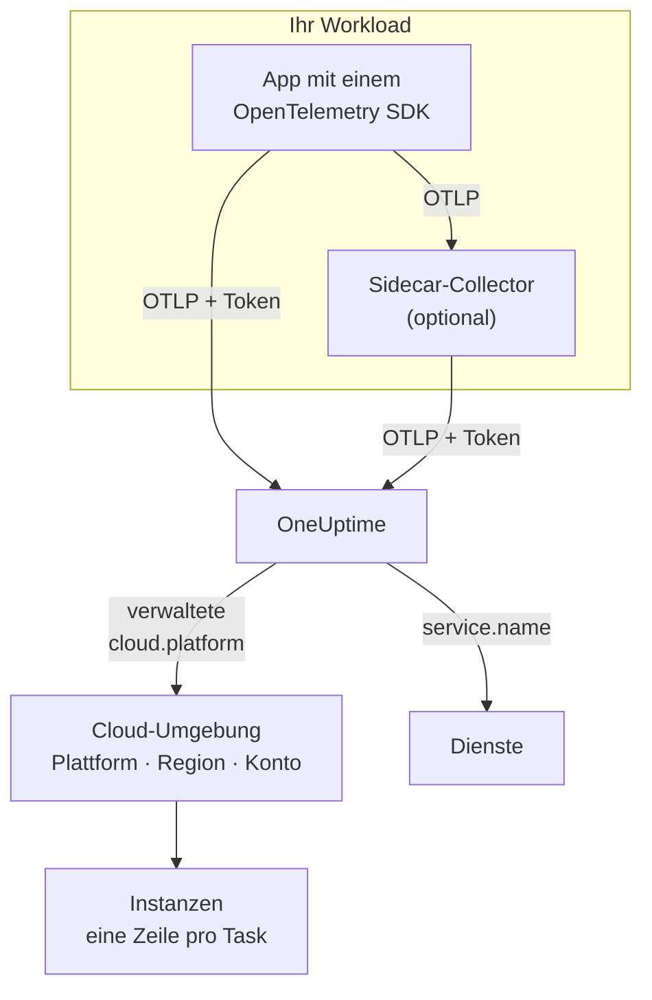

# Cloud-Umgebungen

Eine **Cloud-Umgebung** ist der Ort, an dem Ihre Container auf einer verwalteten Cloud-Plattform laufen: Konto und Region eines ECS-Clusters, Projekt und Region von Cloud Run, Abonnement und Region von Container Apps. OneUptime legt sie an, sobald Ihre Telemetrie zum ersten Mal mit den passenden Ressourcenattributen eintrifft, und fasst jeden Workload zusammen, der dort läuft. Sie müssen nichts von Hand registrieren.

:::cards
- [AWS ECS / Fargate](/docs/telemetry/cloud-aws-ecs): Tasks auf Fargate oder EC2, mit CPU und Arbeitsspeicher pro Task.
- [Google Cloud Run](/docs/telemetry/cloud-gcp-cloud-run): Dienste und Jobs, auch als Serverless-Funktionen aufgeführt.
- [Azure Container Apps](/docs/telemetry/cloud-azure-container-apps): Replikate, Region und Abonnement von Hand gesetzt.
- [Weitere Cloud-Plattformen](/docs/telemetry/cloud-other-platforms): Elastic Beanstalk, App Runner, App Engine, App Service und Container Instances.
:::

## So funktioniert es



- **Ein Ressourcendetektor sagt, wo der Workload läuft.** Ein OpenTelemetry-Ressourcendetektor im SDK oder in einem Collector liest die Metadaten der Plattform und setzt `cloud.platform`, `cloud.account.id` und `cloud.region` auf alles, was der Workload sendet. Wo es keinen Detektor gibt, setzen Sie sie selbst.
- **Die Umgebung fasst zusammen.** Jeder Workload mit derselben Plattform, demselben Konto und derselben Region landet in einer Umgebung. Die Dienste behalten ihre eigenen Zeilen unter **Dienste**.
- **Jeder laufende Task ist eine Instanz.** Der Tab **Instanzen** der Umgebung listet ihre laufenden Tasks, Instanzen oder Replikate auf, mit CPU und Arbeitsspeicher in Echtzeit, wo die Plattform sie liefern kann.

## Bevor Sie beginnen

- **Ein Ingestion-Schlüssel.** Erstellen Sie einen **Server**-Schlüssel unter **Projekteinstellungen → Telemetrie & APM → Ingestion-Schlüssel** und kopieren Sie sein Token: siehe [Einen Ingestion-Schlüssel erstellen](/docs/telemetry/open-telemetry#einen-ingestion-schlüssel-erstellen). Es ist ein Geheimnis: Jede Plattformseite zeigt, wo Sie es im Geheimnisspeicher dieser Cloud ablegen.
- **OpenTelemetry in Ihrer Anwendung.** Ein OpenTelemetry SDK, das OTLP exportiert, oder ein OpenTelemetry Collector, der neben der Anwendung läuft.

## Unterstützte Plattformen

| Plattform | `cloud.platform` | `cloud.*` gesetzt durch | Instanzidentität | Anleitung |
| ------------------------- | --------------------------- | ---------------------- | --------------------------------- | ------------------------------------------------------------------ |
| AWS ECS / Fargate | `aws_ecs` | Ressourcendetektor | `aws.ecs.task.arn` | [AWS ECS / Fargate](/docs/telemetry/cloud-aws-ecs) |
| AWS Elastic Beanstalk | `aws_elastic_beanstalk` | Ressourcendetektor | `host.id` | [Weitere Cloud-Plattformen](/docs/telemetry/cloud-other-platforms) |
| AWS App Runner | `aws_app_runner` | von Hand | `host.name` | [Weitere Cloud-Plattformen](/docs/telemetry/cloud-other-platforms) |
| Google Cloud Run | `gcp_cloud_run` | Ressourcendetektor | `faas.instance` | [Google Cloud Run](/docs/telemetry/cloud-gcp-cloud-run) |
| Google App Engine | `gcp_app_engine` | Ressourcendetektor | `faas.instance` | [Weitere Cloud-Plattformen](/docs/telemetry/cloud-other-platforms) |
| Azure Container Apps | `azure_container_apps` | Ressourcendetektor | `azure.container_app.instance.id` | [Azure Container Apps](/docs/telemetry/cloud-azure-container-apps) |
| Azure Container Instances | `azure_container_instances` | von Hand | `host.name` | [Weitere Cloud-Plattformen](/docs/telemetry/cloud-other-platforms) |
| Azure App Service | `azure_app_service` | Ressourcendetektor | `host.id` | [Weitere Cloud-Plattformen](/docs/telemetry/cloud-other-platforms) |

- **Ressourcendetektor:** Ein OpenTelemetry-Ressourcendetektor im SDK oder im `resourcedetection`-Prozessor des Collectors setzt die `cloud.*`-Attribute für Sie.
- **Von Hand:** Es gibt keinen Detektor, also schreiben Sie die Attribute in `OTEL_RESOURCE_ATTRIBUTES`. Die Seite der Plattform zeigt die genaue Zeile.
- **Die Azure-Detektoren wissen weniger.** Die Detektoren für Container Apps kennen weder die Region noch das Abonnement, und die Detektoren für App Service kennen das Abonnement nicht: Setzen Sie selbst, was fehlt.
- **Azure-Schreibweisen mit Punkt funktionieren.** Die Azure-Detektoren für Node.js und .NET schreiben `azure.container_apps` und `azure.app_service`. OneUptime schreibt sie beim Empfang in die obigen Werte mit Unterstrich um.

## Wie OneUptime eine Umgebung erkennt

Für jede Kombination aus drei Ressourcenattributen gibt es eine Umgebung:

| Attribut | Erforderlich | Was es ist |
| ------------------ | -------- | ------------------------------------------------------------------------------------------- |
| `cloud.platform` | Ja | Einer der Werte unter [Unterstützte Plattformen](#unterstützte-plattformen) |
| `cloud.account.id` | Nein | Die AWS-Konto-ID, die Google-Cloud-Projekt-ID oder die Azure-Abonnement-ID |
| `cloud.region` | Nein | Die Region, etwa `us-east-1`, `us-central1` oder `eastus` |

OneUptime verbindet die drei mit `|` zum **Umgebungsschlüssel** und benennt die Umgebung nach denselben Werten, etwa _AWS ECS · us-east-1 · 123456789012_:

```text title="Environment keys"
aws_ecs|123456789012|us-east-1
gcp_cloud_run|my-project|us-central1
azure_container_apps|00000000-0000-0000-0000-000000000000|eastus
```

> [!IMPORTANT]
> Ein fehlender Teil bleibt als leeres Segment im Schlüssel: `aws_ecs||us-east-1`. Ein Workload, der `cloud.account.id` weglässt, landet also in einer anderen Umgebung als einer, der es setzt. Das ist der häufigste Grund, warum Sie zwei Umgebungen sehen, wo Sie eine erwartet haben.

### Instanzidentität

Innerhalb einer Umgebung erhält jeder laufende Task, jede Instanz oder jedes Replikat eine Zeile unter **Instanzen**. Ihr Name stammt aus dem ersten dieser Ressourcenattribute, das die Telemetrie trägt:

1. `aws.ecs.task.id`
2. `aws.ecs.task.arn` (gekürzt auf die Task-ID)
3. `faas.instance`
4. `azure.container_app.instance.id`
5. `service.instance.id`
6. `container.id`
7. `host.id`
8. `host.name`

Die eigene Identität der Plattform steht absichtlich an erster Stelle. Ein Sidecar-Collector und das SDK der Anwendung sehen sie beide, und sie übersteht Neustarts. Ein SDK erfindet meist für jeden Prozess eine neue `service.instance.id` (das Node.js SDK tut das standardmäßig), sodass ein Schlüssel darauf einen ECS-Task in zwei Zeilen aufteilen würde. `service.instance.id` wird verwendet, wenn die Plattform keine eigene Identität setzt. Die Spalte **Instanzidentität** unter [Unterstützte Plattformen](#unterstützte-plattformen) nennt das Attribut, das eine typische Einrichtung auf jeder Plattform verwendet.

### Umgebungen, die Sie von Hand anlegen

Das ist selten nötig: Die Erfassung legt Umgebungen für Sie an. Um eine vor ihrer Telemetrie anzulegen, öffnen Sie **Cloud → Alle Umgebungen** und klicken Sie auf **Cloud-Ressource erstellen**. Wählen Sie die **Cloud-Plattform** und geben Sie dann **Cloud-Konto-ID** und **Cloud-Region** genau so ein, wie Ihre Telemetrie sie meldet. OneUptime bildet aus diesen drei den Schlüssel `platform|account|region`, und die Erfassung ordnet eine Umgebung allein über ihren Schlüssel zu. Die Umgebung wird so benannt, wie die Erfassung es tun würde; für einen anderen Namen öffnen Sie **Weitere Felder** und tragen ihn unter **Anzeigename** ein.

## Was keine Cloud-Umgebung ist

| Sie arbeiten mit | Wo es erscheint | Warum |
| ------------------------------------------------------------------------------------------------- | ------------------------ | ---------------------------------------------------------------------------------------------------- |
| EC2, Compute Engine, Azure VM (`aws_ec2`, `gcp_compute_engine`, `azure_vm`) | **Hosts** | Eine virtuelle Maschine ist ein Host. Siehe [Host-OpenTelemetry-Collector](/docs/telemetry/host-otel-collector) |
| EKS, GKE, AKS, selbst verwaltetes Kubernetes | **Kubernetes** | Zugeordnet über die `k8s.*`-Attribute. Siehe [Kubernetes-Agent](/docs/telemetry/kubernetes-agent) |
| Lambda, Cloud Functions, Azure Functions (`aws_lambda`, `gcp_cloud_functions`, `azure_functions`) | **Serverless-Funktionen** | Zugeordnet über `faas.name` oder `service.name` auf einer FaaS-`cloud.platform`. Siehe [Serverless-Funktionen](/docs/telemetry/serverless-functions) |
| Load Balancer, Buckets, verwaltete Datenbanken und andere IaaS- oder PaaS-Ressourcen | **Cloud-Ressourcen** | Erkannt aus den Metriken, die Azure Monitor, CloudWatch und Cloud Monitoring veröffentlichen. Siehe [Cloud-Ressourcen](/docs/telemetry/cloud-resources) |

> [!NOTE]
> Cloud Run und App Engine erscheinen absichtlich an zwei Stellen. Ihr Detektor setzt sowohl eine verwaltete `cloud.platform` als auch `faas.name`, sodass jeder Dienst auch eine eigene **Serverless-Funktion** ist, während die **Cloud-Umgebung** jeden Dienst in diesem Projekt und dieser Region zusammenfasst. Dieselbe Telemetrie wird unter beiden abgelegt.

## Einen Workload verbinden

Jede Plattformseite enthält diese Schritte mit den eigenen Befehlen und Konsolenseiten dieser Cloud. In Kürze:

:::steps
### Die Cloud-Attribute auf Ihre Telemetrie bringen

:::tabs
@tab Sidecar collector
Ein zweiter Container im Task, in der Instanz oder im Replikat. Die Anwendung exportiert an `localhost:4318`, und der `resourcedetection`-Prozessor des Collectors setzt `cloud.*` auf alles, was durchläuft. Der Collector hält das Token, und auf ECS liefert er außerdem CPU und Arbeitsspeicher pro Task:

```yaml title="collector.yaml"
processors:
  resourcedetection:
    detectors: [env, ecs] # [env, gcp] on Cloud Run and App Engine; [env, azurecontainerapps] on Container Apps
    timeout: 5s
```
@tab SDK direct
Das SDK der Anwendung exportiert direkt an OneUptime. Schalten Sie im SDK den Ressourcendetektor der Plattform ein, etwa `OTEL_NODE_RESOURCE_DETECTORS=env,host,os,aws` in Node.js: Jede Plattformseite nennt den Schalter für jede Sprache. Es gibt keinen zusätzlichen Container und keine Container-CPU und keinen Container-Arbeitsspeicher.
:::

### OTLP an OneUptime exportieren

:::tabs
@tab Sidecar collector
```yaml title="collector.yaml"
exporters:
  otlphttp/oneuptime:
    endpoint: https://oneuptime.com/otlp
    headers:
      x-oneuptime-token: ${env:ONEUPTIME_TOKEN}

service:
  pipelines:
    traces:
      receivers: [otlp]
      processors: [resourcedetection, batch]
      exporters: [otlphttp/oneuptime]
    metrics:
      receivers: [otlp]
      processors: [resourcedetection, batch]
      exporters: [otlphttp/oneuptime]
    logs:
      receivers: [otlp]
      processors: [resourcedetection, batch]
      exporters: [otlphttp/oneuptime]
```

Der Collector löst `${env:ONEUPTIME_TOKEN}` aus einer Umgebungsvariablen auf, die die Plattform aus ihrem Geheimnisspeicher füllt: Secrets Manager, Secret Manager oder Container-Apps-Secrets.
@tab SDK direct
```bash
OTEL_EXPORTER_OTLP_ENDPOINT="https://oneuptime.com/otlp"
OTEL_EXPORTER_OTLP_HEADERS="x-oneuptime-token=YOUR_TELEMETRY_INGESTION_TOKEN"
```
:::

Wenn Sie OneUptime selbst hosten, verwenden Sie `https://YOUR-ONEUPTIME-HOST/otlp`.

### Die Verbindung prüfen

```bash
curl -i https://oneuptime.com/otlp/v1/validate \
  -H "x-oneuptime-token: YOUR_TELEMETRY_INGESTION_TOKEN"
```

`200` mit `"valid": true` bedeutet, dass das Token angenommen wird. `401` bedeutet, dass es unbekannt, widerrufen, deaktiviert oder abgelaufen ist, und die `message` der Antwort sagt, was davon. Innerhalb einer Minute nach dem ersten Span, Log oder der ersten Metrik erscheint die Umgebung unter **Cloud → Alle Umgebungen**.
:::

> [!TIP]
> Dieselben Schritte stehen auch im Dashboard, mit Ihrem Token bereits eingesetzt: unter **Cloud → Alle Umgebungen**, bis Ihre erste Umgebung eintrifft, und im Tab **Dokumentation** jeder Umgebung.

## Was Sie erhalten

Die **Übersicht** einer Umgebung zeigt:

- **Anfragen**, **Fehlerrate** und **p95-Latenz** aus Ihren Traces, mit Diagrammen zu Anfragen, Fehlern und Arbeitsspeicher über den gewählten Zeitraum.
- **CPU** und **Arbeitsspeicher** über die aktiven Instanzen und eine Liste **Top-Instanzen nach CPU**. Sie stammen aus Metriken `container.cpu.utilization` und `container.memory.usage`, die die Instanzidentität tragen; auf ECS aus `ecs.task.cpu.utilized` und `ecs.task.memory.utilized` des `awsecscontainermetrics`-Receivers.
- **Instanzen**: wie viele in den letzten 15 Minuten gemeldet haben. Der Tab **Instanzen** hat für jede eine Zeile.
- Die Tabs **Protokolle**, **Traces** und **Metriken**, auf die Umgebung gefiltert.

Eine Umgebung, deren Telemetrie 15 Minuten lang ausbleibt, zeigt **Getrennt**, und der nächste Span, Log oder die nächste Metrik setzt sie wieder auf **Verbunden**. Zeit, in der OneUptime selbst ausgefallen war oder aufgeholt hat, zählt nicht zu den 15 Minuten.

### Beschriftungen und Eigentümer

- **Aus Ihrer Telemetrie:** Ein Ressourcenattribut wie `oneuptime.label.team=payments` fügt der Umgebung die Beschriftung `team:payments` hinzu.
- **Aus Regeln:** **Cloud → Einstellungen → Beschriftungsregeln** und **Eigentümerregeln** fügen passenden Umgebungen Beschriftungen und Eigentümer hinzu. Siehe [Beschriftungs- und Eigentümerregeln](/docs/configuration/label-and-owner-rules).

## Fehlerbehebung

[Cloud-Fehlerbehebung](/docs/telemetry/cloud-troubleshooting) geht jeden Fehler in der Reihenfolge durch, in der er auftritt: eine Umgebung, die nie erscheint, unter **Hosts** oder nur unter **Serverless-Funktionen** landet, keine Instanzen oder keine CPU- und Speicherwerte hat, **Getrennt** zeigt, sich in zwei aufteilt oder von Hand angelegt wurde und nie zugeordnet wird.

## Nächste Schritte

:::cards
- [AWS ECS / Fargate](/docs/telemetry/cloud-aws-ecs): Die häufigste Einrichtung, mit einer vollständigen Task-Definition.
- [Cloud-Fehlerbehebung](/docs/telemetry/cloud-troubleshooting): Was Sie prüfen, wenn eine Umgebung fehlt oder falsch ist.
- [Cloud-Ressourcen (IaaS & PaaS)](/docs/telemetry/cloud-resources): Load Balancer, Buckets und verwaltete Datenbanken aus der eigenen Überwachung Ihrer Cloud.
- [Serverless-Funktionen](/docs/telemetry/serverless-functions): Lambda, Cloud Functions und Azure Functions.
:::
