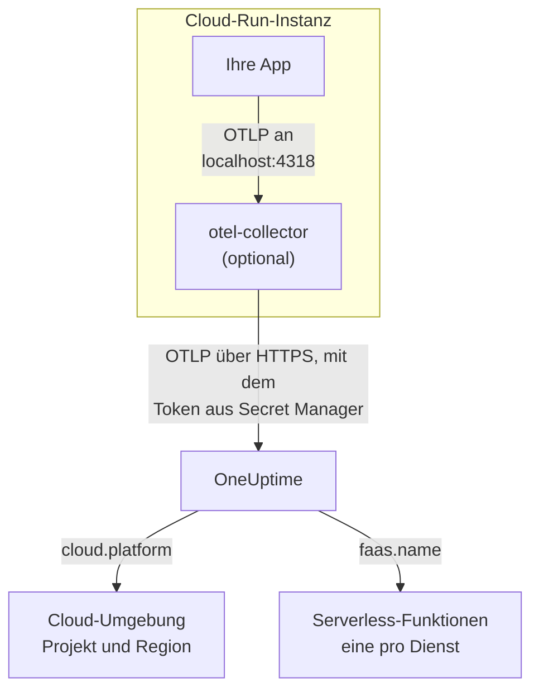

# Google Cloud Run

Senden Sie die Traces, Logs und Metriken Ihrer Cloud-Run-Dienste und -Jobs an OneUptime. Alles, was `cloud.platform=gcp_cloud_run` meldet, gehört zu einer **Cloud-Umgebung** pro Google-Cloud-Projekt und Region, etwa _GCP Cloud Run · us-central1 · my-project_, und jeder Dienst erscheint außerdem unter **Serverless-Funktionen**.

:::cards
- [So funktioniert es](#so-funktioniert-es): Was der GCP-Detektor setzt und warum ein Dienst an zwei Stellen erscheint.
- [Einrichten](#einrichten): Das Token speichern, den Dienst konfigurieren, bereitstellen und prüfen.
- [Das Dienst-YAML mit einem Sidecar](#das-dienst-yaml-mit-einem-sidecar): Ein vollständiger Cloud-Run-Dienst mit einem Collector.
- [Fehlerbehebung](#fehlerbehebung): Secret-Fehler, die Startreihenfolge des Sidecars und fehlende Umgebungen.
:::

## So funktioniert es



Der OpenTelemetry-Ressourcendetektor für GCP liest den Metadatenserver und die Umgebungsvariablen `K_SERVICE` und `K_REVISION` und setzt:

| Attribut | Wert auf Cloud Run | Wofür |
| ------------------ | ------------------------------ | ----------------------------------------------------------------------------------------- |
| `cloud.platform` | `gcp_cloud_run` | Legt die Telemetrie unter **Cloud-Umgebungen** ab |
| `cloud.account.id` | die Projekt-ID | Teil des Umgebungsschlüssels |
| `cloud.region` | `us-central1` | Teil des Umgebungsschlüssels |
| `faas.name` | der Dienstname (`K_SERVICE`) | Führt den Dienst außerdem unter **Serverless-Funktionen** auf |
| `faas.version` | die Revision (`K_REVISION`) | Wird in der Serverless-Funktionsübersicht des Dienstes angezeigt; die Umgebung nutzt es nicht |
| `faas.instance` | die Instanz-ID | Benennt eine laufende Instanz: je eine Zeile unter **Instanzen** |

> [!NOTE]
> Cloud Run erscheint absichtlich an zwei Stellen. Weil der Detektor `faas.name` setzt, ist jeder Dienst auch eine **Serverless-Funktion**, mit eigenen Aufrufen, eigener Fehlerrate und Dauer. Die **Cloud-Umgebung** fasst jeden Dienst in diesem Projekt und dieser Region zusammen. Nichts wird doppelt gespeichert: Dieselbe Telemetrie wird unter beiden abgelegt.

Der Umgebungsschlüssel ist `gcp_cloud_run|my-project|us-central1`.

## Bevor Sie beginnen

- **Ein Ingestion-Schlüssel.** Erstellen Sie einen **Server**-Schlüssel unter **Projekteinstellungen → Telemetrie & APM → Ingestion-Schlüssel** und kopieren Sie sein Token.
- **`gcloud`**, beim Projekt angemeldet, mit eingeschalteter Secret-Manager-API: `gcloud services enable secretmanager.googleapis.com`.
- **Ihre Anwendung, mit einem OpenTelemetry SDK instrumentiert**, das OTLP exportiert.

## Wählen, wie die Telemetrie den Dienst verlässt

| | SDK direct | Sidecar collector |
| --------------- | ---------------------------------------------------- | ---------------------------------------------------------------------- |
| Zusätzlicher Container | Keiner | `otel-collector` im Dienst |
| Am besten für | Einen Dienst und Cloud-Run-Jobs | Mehrere Dienste in einem Projekt oder ein SDK, das keinen Detektor ausführen kann |
| Hält das Token | Die Anwendung | Der Collector |
| Das Secret | `oneuptime-otlp-headers`, der ganze Header | `oneuptime-ingestion-token`, das reine Token |

Ein Job läuft bis zum Ende durch, es gibt also nichts, wofür ein Sidecar am Leben bleiben müsste: Verwenden Sie SDK direct. Jeder Schritt unten hat einen Tab für beide; wählen Sie einen, und jeder Schritt folgt ihm.

## Einrichten

:::steps
### Das Token in Secret Manager speichern

> [!IMPORTANT]
> Das Token ist ein Geheimnis. Legen Sie es in Secret Manager ab und verweisen Sie im Dienst als Secret-gestützte Umgebungsvariable darauf. Eine einfache Umgebungsvariable sieht jeder Betrachter des Projekts, in der Konsole und in `gcloud run services describe`.

:::tabs
@tab SDK direct
```bash
printf '%s' "x-oneuptime-token=YOUR_TELEMETRY_INGESTION_TOKEN" | gcloud secrets create oneuptime-otlp-headers \
  --data-file=- \
  --replication-policy=automatic

gcloud secrets add-iam-policy-binding oneuptime-otlp-headers \
  --member="serviceAccount:checkout-api@my-project.iam.gserviceaccount.com" \
  --role="roles/secretmanager.secretAccessor"
```

Cloud Run setzt den Wert eines Secrets unverändert in die Variable ein, und `OTEL_EXPORTER_OTLP_HEADERS` braucht das ganze `name=value`-Paar, daher enthält dieses Secret den vollständigen Header.
@tab Sidecar collector
```bash
printf '%s' "YOUR_TELEMETRY_INGESTION_TOKEN" | gcloud secrets create oneuptime-ingestion-token \
  --data-file=- \
  --replication-policy=automatic

gcloud secrets add-iam-policy-binding oneuptime-ingestion-token \
  --member="serviceAccount:checkout-api@my-project.iam.gserviceaccount.com" \
  --role="roles/secretmanager.secretAccessor"
```

Die Konfiguration des Collectors fügt den Namen des Headers hinzu, daher enthält dieses Secret nur das Token.
:::

Tragen Sie in `--member` das Laufzeit-Dienstkonto des Dienstes ein, nicht Ihren eigenen Benutzer. Ohne `roles/secretmanager.secretAccessor` lässt sich die Revision nicht bereitstellen und meldet `Permission denied on secret`. Läuft der Dienst noch unter dem Standard-Compute-Dienstkonto, erteilen Sie die Rolle diesem Konto, und erwägen Sie, dem Dienst ein eigenes Konto zu geben: Das Standardkonto teilen sich alle Dienste des Projekts.

### Den Dienst konfigurieren

:::tabs
@tab SDK direct
1. **Google Cloud console → Cloud Run → click the service → Edit & deploy new revision**.
2. Öffnen Sie auf dem Tab **Containers** Ihren Container und gehen Sie zu **Variables & Secrets**. Fügen Sie die Variablen unten hinzu.
3. Klicken Sie auf **Reference a secret**, wählen Sie `oneuptime-otlp-headers`, Version `latest`, und stellen Sie es als Umgebungsvariable `OTEL_EXPORTER_OTLP_HEADERS` bereit.
4. Prüfen Sie auf dem Tab **Security**, dass das **Service account** dasjenige ist, dem Sie `roles/secretmanager.secretAccessor` erteilt haben.

```bash
OTEL_SERVICE_NAME=checkout-api
OTEL_EXPORTER_OTLP_ENDPOINT=https://oneuptime.com/otlp
OTEL_EXPORTER_OTLP_PROTOCOL=http/protobuf
# Secret-backed (Variables & Secrets → Reference a secret), not typed here.
OTEL_EXPORTER_OTLP_HEADERS=x-oneuptime-token=YOUR_TELEMETRY_INGESTION_TOKEN
```

Schalten Sie dann den GCP-Ressourcendetektor Ihrer Sprache ein:

| Sprache | Den GCP-Detektor einschalten |
| -------- | ------------------------------------------------------------------------------------------------------------------- |
| Node.js | `OTEL_NODE_RESOURCE_DETECTORS=env,host,os,gcp` (auto-instrumentations-node) |
| Python | `pip install opentelemetry-resourcedetector-gcp`, dann `OTEL_EXPERIMENTAL_RESOURCE_DETECTORS=gcp_resource_detector` |
| Java | `-Dotel.resource.providers.gcp.enabled=true` |
| Go | `import "go.opentelemetry.io/contrib/detectors/gcp"` und `gcp.NewDetector()` an `resource.New` übergeben |
| .NET | Das Paket `OpenTelemetry.Resources.Gcp`: `.ConfigureResource(r => r.AddGcpDetector())` |

Oder setzen Sie alles über die CLI:

```bash
gcloud run services update checkout-api --region us-central1 \
  --set-env-vars "^@^OTEL_SERVICE_NAME=checkout-api@OTEL_EXPORTER_OTLP_ENDPOINT=https://oneuptime.com/otlp@OTEL_EXPORTER_OTLP_PROTOCOL=http/protobuf@OTEL_NODE_RESOURCE_DETECTORS=env,host,os,gcp" \
  --set-secrets "OTEL_EXPORTER_OTLP_HEADERS=oneuptime-otlp-headers:latest"
```

Das Präfix `^@^` lässt `gcloud` die Liste dieses Flags an `@` statt an `,` trennen. Ohne es trennt `gcloud` `OTEL_NODE_RESOURCE_DETECTORS=env,host,os,gcp` an jedem Komma und scheitert mit `Bad syntax for dict arg [host]`.
@tab Sidecar collector
1. **Google Cloud console → Cloud Run → click the service → Edit & deploy new revision**.
2. Öffnen Sie auf dem Tab **Containers** Ihren Container und gehen Sie zu **Variables & Secrets**. Fügen Sie die Anwendungsvariablen unten hinzu.
3. Klicken Sie auf **+ Add container**. Setzen Sie die URL des Container-Images auf `otel/opentelemetry-collector-contrib:latest` und fügen Sie unter **Container command and arguments** das Argument `--config=env:OTEL_COLLECTOR_CONFIG` hinzu.
4. Auf dem Tab **Variables & Secrets** des neuen Containers: **Reference a secret** mit `oneuptime-ingestion-token` als Umgebungsvariable `ONEUPTIME_TOKEN`. Fügen Sie die Variable `OTEL_COLLECTOR_CONFIG` mit der Collector-Konfiguration aus [Das Dienst-YAML mit einem Sidecar](#das-dienst-yaml-mit-einem-sidecar) hinzu.
5. Fügen Sie auf dem Tab **Settings** des Collectors eine **Startup probe** hinzu (HTTP, Pfad `/`, Port `13133`), und lassen Sie unter **Container start-up order** Ihren Container von `otel-collector` abhängen.
6. Prüfen Sie auf dem Tab **Security**, dass das **Service account** dasjenige ist, dem Sie `roles/secretmanager.secretAccessor` erteilt haben.

Container in einer Cloud-Run-Instanz teilen sich `localhost`, daher exportiert die Anwendung dort an den Sidecar:

```bash
OTEL_SERVICE_NAME=checkout-api
OTEL_EXPORTER_OTLP_ENDPOINT=http://localhost:4318
OTEL_EXPORTER_OTLP_PROTOCOL=http/protobuf
```

Über die CLI ist der Sidecar das Dienst-YAML unten, bereitgestellt mit `gcloud run services replace service.yaml --region us-central1`.
:::

Wenn Sie OneUptime selbst hosten, verwenden Sie `https://YOUR-ONEUPTIME-HOST/otlp` als Endpunkt.

### Die neue Revision bereitstellen

Klicken Sie in der Konsole auf **Deploy**. Cloud Run startet eine neue Revision mit den Einstellungen und leitet Verkehr an sie weiter, sobald sie bereit ist. Die `gcloud`-Befehle stellen von sich aus eine neue Revision bereit.

### Die Verbindung prüfen

```bash
curl -i https://oneuptime.com/otlp/v1/validate \
  -H "x-oneuptime-token: YOUR_TELEMETRY_INGESTION_TOKEN"
```

`200` mit `"valid": true` bedeutet, dass das Token angenommen wird. `401` bedeutet, dass es unbekannt, widerrufen, deaktiviert oder abgelaufen ist. Senden Sie dann eine Anfrage an den Dienst und suchen Sie in den Logs des Collectors in Cloud Logging (gefiltert auf den Container `otel-collector`) nach `401`, `connection refused` oder `context deadline exceeded`. Innerhalb einer Minute erscheint die Umgebung unter **Cloud → Alle Umgebungen** als _GCP Cloud Run · us-central1 · my-project_ und der Dienst unter **Serverless-Funktionen**.
:::

## Das Dienst-YAML mit einem Sidecar

Der Collector liest seine gesamte Konfiguration aus `OTEL_COLLECTOR_CONFIG` (`--config=env:OTEL_COLLECTOR_CONFIG`) und das Token aus dem Secret über `${env:ONEUPTIME_TOKEN}`. Die Annotation `run.googleapis.com/container-dependencies` lässt Cloud Run zuerst den Collector starten und auf dessen Startup-Probe warten, bevor die Anwendung startet:

```yaml title="service.yaml"
apiVersion: serving.knative.dev/v1
kind: Service
metadata:
  name: checkout-api
spec:
  template:
    metadata:
      annotations:
        # "app" depends on "otel-collector": the collector starts first and
        # must pass its startup probe before the app container is started.
        run.googleapis.com/container-dependencies: '{"app":["otel-collector"]}'
    spec:
      serviceAccountName: checkout-api@my-project.iam.gserviceaccount.com
      containers:
        - name: app
          image: us-central1-docker.pkg.dev/my-project/apps/checkout-api:1.4.2
          ports:
            - containerPort: 8080
          env:
            - name: OTEL_SERVICE_NAME
              value: checkout-api
            - name: OTEL_EXPORTER_OTLP_ENDPOINT
              value: http://localhost:4318
            - name: OTEL_EXPORTER_OTLP_PROTOCOL
              value: http/protobuf
        - name: otel-collector
          image: otel/opentelemetry-collector-contrib:latest
          args:
            - --config=env:OTEL_COLLECTOR_CONFIG
          env:
            - name: ONEUPTIME_TOKEN
              valueFrom:
                secretKeyRef:
                  name: oneuptime-ingestion-token
                  key: latest
            - name: OTEL_COLLECTOR_CONFIG
              value: |
                receivers:
                  otlp:
                    protocols:
                      http:
                        endpoint: 0.0.0.0:4318
                      grpc:
                        endpoint: 0.0.0.0:4317
                processors:
                  # Stamps cloud.provider, cloud.platform=gcp_cloud_run,
                  # cloud.account.id, cloud.region and faas.* on everything.
                  resourcedetection:
                    detectors: [env, gcp]
                    timeout: 5s
                  batch: {}
                exporters:
                  otlphttp/oneuptime:
                    endpoint: https://oneuptime.com/otlp
                    headers:
                      x-oneuptime-token: ${env:ONEUPTIME_TOKEN}
                extensions:
                  health_check:
                    endpoint: 0.0.0.0:13133
                service:
                  extensions: [health_check]
                  pipelines:
                    traces:
                      receivers: [otlp]
                      processors: [resourcedetection, batch]
                      exporters: [otlphttp/oneuptime]
                    metrics:
                      receivers: [otlp]
                      processors: [resourcedetection, batch]
                      exporters: [otlphttp/oneuptime]
                    logs:
                      receivers: [otlp]
                      processors: [resourcedetection, batch]
                      exporters: [otlphttp/oneuptime]
          startupProbe:
            httpGet:
              path: /
              port: 13133
            periodSeconds: 2
            failureThreshold: 15
          resources:
            limits:
              cpu: 500m
              memory: 256Mi
```

Stellen Sie es bereit:

```bash
gcloud run services replace service.yaml --region us-central1
```

Nur der Container, der Anfragen empfängt (`app`), deklariert `ports`; ein Sidecar darf das nicht.

## Netzwerk

- **Standardmäßig** erreicht ein Cloud-Run-Dienst das Internet direkt, und der Export an `oneuptime.com` braucht nichts weiter.
- **Mit VPC egress: All traffic** (`--vpc-egress all-traffic`, über Direct VPC egress oder einen Serverless-VPC-Access-Connector) verlässt der ausgehende Verkehr den Dienst über Ihre VPC, die dann Cloud NAT (oder eine Route zu einem Proxy) braucht, um den OneUptime-Host zu erreichen. Mit dem Standard `private-ranges-only` nutzen nur private Adressen die VPC, und OneUptime wird direkt erreicht.
- **Ausgehende Firewall-Regeln** in der VPC müssen TCP 443 zum OneUptime-Host erlauben.
- **Ein selbst gehostetes OneUptime in der VPC** ist der umgekehrte Fall: Leiten Sie den Verkehr durch die VPC (`private-ranges-only` oder `all-traffic`), damit `https://YOUR-ONEUPTIME-HOST/otlp` dort aufgelöst wird.

## Was Sie erhalten

- **Übersicht**: Anfragen, Fehlerrate und p95-Latenz aus Ihren Traces.
- **Instanzen**: eine Zeile pro Cloud-Run-Instanz, benannt nach `faas.instance`. Cloud Run zeigt einem Sidecar die Ressourcennutzung eines Containers nicht, daher bleiben die Kacheln **CPU** und **Arbeitsspeicher** leer, es sei denn, Sie senden selbst Metriken `container.cpu.utilization` und `container.memory.usage` mit derselben `faas.instance`. Lesen Sie hier die Anfrage-Kacheln, und überlassen Sie CPU und Arbeitsspeicher der Instanzen Cloud Monitoring.
- **Protokolle**, **Traces** und **Metriken**, auf die Umgebung gefiltert.
- Derselbe Dienst unter **Serverless-Funktionen** (nach `faas.name`) und unter **Dienste** (nach `service.name`).

## Fehlerbehebung

:::details Die Revision scheitert mit "Permission denied on secret"
Dem Laufzeit-Dienstkonto fehlt `roles/secretmanager.secretAccessor` auf dem Secret, oder die Bindung liegt auf einem anderen Secret als dem, auf das der Dienst verweist. Führen Sie den Befehl `gcloud secrets add-iam-policy-binding` erneut aus, mit dem Laufzeit-Dienstkonto als `--member`.
:::

:::details Cloud Run lehnt container-dependencies ab
Die Annotation nennt einen Container, den es nicht gibt, oder der Collector hat keine Startup-Probe, sodass Cloud Run nicht erkennen kann, wann er bereit ist.
:::

:::details Der Dienst steht unter Serverless-Funktionen, aber es gibt keine Umgebung
Die Telemetrie hat keine `cloud.platform`: Der GCP-Detektor ist im SDK nicht eingeschaltet, oder `gcp` fehlt in der Liste `detectors` des Collectors.
:::

:::details Die Umgebung ist da, aber Instanzen ist leer
Die Telemetrie hat weder `faas.instance` noch `service.instance.id`. Die Ursache ist dieselbe: Der Detektor läuft nicht.
:::

Eine Umgebung, die nie erscheint, **Getrennt** zeigt oder sich in zwei aufteilt, behandelt [Cloud-Fehlerbehebung](/docs/telemetry/cloud-troubleshooting).

## Nächste Schritte

:::cards
- [Cloud-Umgebungen](/docs/telemetry/cloud-environments): Wie Umgebungen und Instanzen erkannt werden.
- [Serverless-Funktionen](/docs/telemetry/serverless-functions): Die Ansicht pro Dienst für jeden Cloud-Run-Dienst.
- [Cloud-Fehlerbehebung](/docs/telemetry/cloud-troubleshooting): Die Fehler, die alle Plattformen gemeinsam haben.
- [Cloud-Ressourcen (IaaS & PaaS)](/docs/telemetry/cloud-resources): Ihre Cloud SQL, Load Balancer und Buckets, aus Cloud Monitoring.
:::
