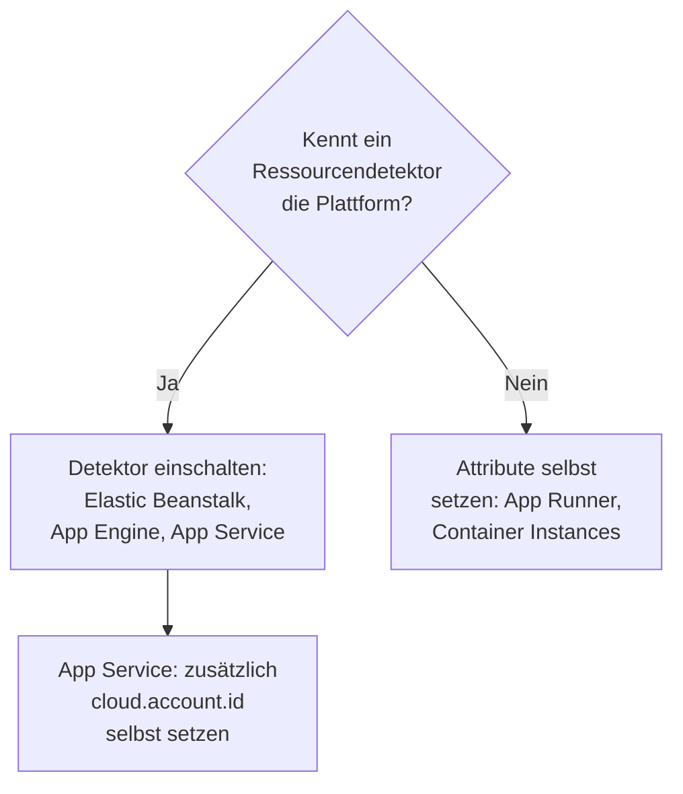

# Weitere Cloud-Plattformen

Richten Sie die verwalteten Plattformen ein, die keine eigene Seite haben: AWS Elastic Beanstalk, AWS App Runner, Google App Engine, Azure App Service und Azure Container Instances. Die Regel ist auf jeder Plattform dieselbe: Telemetrie, die eine verwaltete `cloud.platform` mit `cloud.account.id` und `cloud.region` trägt, gehört zu einer **Cloud-Umgebung** pro Plattform, Konto und Region, und eine Instanzidentität gibt jeder laufenden Instanz eine Zeile unter **Instanzen**.

:::cards
- [AWS Elastic Beanstalk](#aws-elastic-beanstalk): Ein Collector auf jeder Instanz, mit den Detektoren für Beanstalk und EC2.
- [AWS App Runner](#aws-app-runner): Die Attribute von Hand gesetzt, das Token aus Secrets Manager.
- [Google App Engine](#google-app-engine): Der GCP-Detektor, mit den Einstellungen in `app.yaml`.
- [Azure App Service](#azure-app-service): Die Azure-Detektoren, ein Key-Vault-Verweis und das Abonnement von Hand.
- [Azure Container Instances](#azure-container-instances): Die Attribute von Hand gesetzt, das Token als sichere Variable.
:::

## Was jede Plattform braucht

Was sich zwischen diesen Plattformen unterscheidet, ist, wer die `cloud.*`-Attribute setzt und wo die Einstellungen in der Konsole der Cloud hingehören:



| Plattform | `cloud.platform` | `cloud.*` gesetzt durch | Instanzidentität |
| ------------------------- | --------------------------- | ------------------------------------------------------------------------------------------ | ----------------------------------------------------------- |
| AWS Elastic Beanstalk | `aws_elastic_beanstalk` | Die Detektoren `elastic_beanstalk` und `ec2` des Collectors; Node.js `aws` | `host.id` (die `service.instance.id` des Deployments verwerfen) |
| AWS App Runner | `aws_app_runner` | Sie (kein Detektor) | `host.name` |
| Google App Engine | `gcp_app_engine` | Der `gcp`-Detektor (der des Collectors und jedes SDK) | `faas.instance` |
| Azure App Service | `azure_app_service` | `azureappservice` des Collectors, die `azure`-Detektoren für Node.js und .NET; `cloud.account.id` durch Sie | `service.instance.id`, dann `host.id` |
| Azure Container Instances | `azure_container_instances` | Sie (kein Detektor) | `host.name` |

Jeder Abschnitt unten braucht einen **Server**-Ingestion-Schlüssel aus **Projekteinstellungen → Telemetrie & APM → Ingestion-Schlüssel** und eine mit einem OpenTelemetry SDK instrumentierte Anwendung. Wenn Sie OneUptime selbst hosten, ersetzen Sie `https://oneuptime.com/otlp` durch `https://YOUR-ONEUPTIME-HOST/otlp`.

> [!IMPORTANT]
> Das Token ist auf jeder dieser Plattformen ein Geheimnis. Jeder Abschnitt nennt den Geheimnisspeicher der Plattform. Ein Token, das in eine einfache Umgebungsvariable getippt wird, kann jeder lesen, der die Konfiguration der App lesen kann.

## AWS Elastic Beanstalk

`cloud.platform`: `aws_elastic_beanstalk`. Der Beanstalk-Detektor liest `/var/elasticbeanstalk/xray/environment.conf` auf der Instanz und setzt `cloud.platform`, `service.instance.id`, `service.version` und den Namen der Umgebung. Konto und Region kennt er nicht, also kombinieren Sie ihn mit dem EC2-Detektor, der sie kennt und außerdem `host.id` setzt.

Führen Sie auf jeder Instanz einen OpenTelemetry Collector mit dieser Konfiguration aus:

```yaml title="config.yaml"
receivers:
  otlp:
    protocols:
      http:
        endpoint: 0.0.0.0:4318
      grpc:
        endpoint: 0.0.0.0:4317
processors:
  # elastic_beanstalk sets cloud.platform and service.instance.id; ec2 adds
  # cloud.account.id, cloud.region and host.id. The first detector to set an
  # attribute wins, so elastic_beanstalk comes first.
  resourcedetection:
    detectors: [env, elastic_beanstalk, ec2]
    timeout: 5s
  # The Beanstalk detector's service.instance.id is the deployment ID, shared
  # by every instance of a deployment: drop it, so that ec2's host.id names
  # each instance.
  resource:
    attributes:
      - key: service.instance.id
        action: delete
  batch: {}
exporters:
  otlphttp/oneuptime:
    endpoint: https://oneuptime.com/otlp
    headers:
      x-oneuptime-token: ${env:ONEUPTIME_TOKEN}
service:
  pipelines:
    traces:
      receivers: [otlp]
      processors: [resourcedetection, resource, batch]
      exporters: [otlphttp/oneuptime]
    metrics:
      receivers: [otlp]
      processors: [resourcedetection, resource, batch]
      exporters: [otlphttp/oneuptime]
    logs:
      receivers: [otlp]
      processors: [resourcedetection, resource, batch]
      exporters: [otlphttp/oneuptime]
```

:::steps
1. Speichern Sie das Token in Secrets Manager: `aws secretsmanager create-secret --name oneuptime/ingestion-token --secret-string "YOUR_TELEMETRY_INGESTION_TOKEN"`. Die Umgebungseigenschaften von Beanstalk liegen in der Konfiguration der Umgebung, nicht in einem Geheimnisspeicher, also lesen Sie das Secret stattdessen aus einem Plattform-Hook, mit dem Instanzprofil. Das Instanzprofil braucht darauf `secretsmanager:GetSecretValue`.
2. Installieren Sie den Collector aus einem Skript `.platform/hooks/postdeploy/` (oder `.ebextensions`): das Paket `otelcol-contrib`, mit der Konfiguration oben und dem Secret in seiner Umgebung als `ONEUPTIME_TOKEN`.
3. **AWS Console → Elastic Beanstalk → Environments → your environment → Configuration**.
4. Klicken Sie in der Kategorie **Updates, monitoring, and logging** auf **Edit** und scrollen Sie zu **Environment properties**. Fügen Sie `OTEL_SERVICE_NAME` hinzu, `OTEL_EXPORTER_OTLP_ENDPOINT` mit `http://localhost:4318` und `OTEL_EXPORTER_OTLP_PROTOCOL` mit `http/protobuf`.
5. Klicken Sie auf **Apply**. Beanstalk startet die Anwendung mit den neuen Eigenschaften neu.
:::

Node.js-Anwendungen können den Collector auslassen: Die Detektoren des SDK umfassen Beanstalk und EC2. Setzen Sie `OTEL_EXPORTER_OTLP_ENDPOINT` auf `https://oneuptime.com/otlp`, `OTEL_EXPORTER_OTLP_HEADERS` auf `x-oneuptime-token=YOUR_TELEMETRY_INGESTION_TOKEN` und `OTEL_NODE_RESOURCE_DETECTORS=env,host,os,aws`. Das Token steht dann in einer Umgebungseigenschaft. Prüfen Sie danach die Ressourcenattribute eines Traces: Lautet `cloud.platform` dann `aws_ec2`, hat Ihre SDK-Version den EC2-Detektor gewinnen lassen, und der Collector ist der verlässliche Weg.

**Netzwerk:** Instanzen in einem privaten Subnetz brauchen ein NAT-Gateway, und die Sicherheitsgruppe der Instanz muss ausgehenden Verkehr auf TCP 443 zum OneUptime-Host erlauben.

## AWS App Runner

`cloud.platform`: `aws_app_runner`. Es gibt keinen Detektor, also setzen Sie die Attribute selbst. App Runner kann ein Secret aus Secrets Manager (oder SSM Parameter Store) in eine Umgebungsvariable einsetzen.

```bash
OTEL_SERVICE_NAME=checkout-api
OTEL_EXPORTER_OTLP_ENDPOINT=https://oneuptime.com/otlp
OTEL_EXPORTER_OTLP_PROTOCOL=http/protobuf
# From Secrets Manager: the secret holds the whole header.
OTEL_EXPORTER_OTLP_HEADERS=x-oneuptime-token=YOUR_TELEMETRY_INGESTION_TOKEN
OTEL_RESOURCE_ATTRIBUTES=cloud.provider=aws,cloud.platform=aws_app_runner,cloud.region=us-east-1,cloud.account.id=123456789012
OTEL_NODE_RESOURCE_DETECTORS=env,host,os
```

Ersetzen Sie Region und Konto-ID durch Ihre eigenen. Der `host`-Detektor liefert `host.name`, den Hostnamen des Containers, der für jede App-Runner-Instanz anders ist, und OneUptime benennt die Instanz danach.

:::steps
1. Speichern Sie den ganzen Header in Secrets Manager: `aws secretsmanager create-secret --name oneuptime/otlp-headers --secret-string "x-oneuptime-token=YOUR_TELEMETRY_INGESTION_TOKEN"`. App Runner setzt den Wert des Secrets unverändert in die Variable ein.
2. **AWS Console → App Runner → Services → your service → Configuration → Configure service** (klicken Sie auf dem Tab **Configuration** auf **Edit**).
3. Klicken Sie unter **Environment variables** für jeden einfachen Wert oben auf **Add environment variable**.
4. Fügen Sie `OTEL_EXPORTER_OTLP_HEADERS` mit **Source: Secrets Manager** und dem ARN des Secrets hinzu. Wählen Sie unter **Security → Instance role** eine Rolle mit `secretsmanager:GetSecretValue` auf dem Secret: die Instanzrolle, nicht die Zugriffsrolle, die das Image zieht.
5. Klicken Sie auf **Save changes**. App Runner stellt eine neue Version bereit.
:::

**Netzwerk:** Ein Dienst ohne VPC-Connector erreicht das Internet direkt. Mit **Outgoing network traffic: Custom VPC** geht der ausgehende Verkehr durch Ihre VPC, die ein NAT-Gateway und eine ausgehende Regel der Sicherheitsgruppe auf TCP 443 zum OneUptime-Host braucht.

## Google App Engine

`cloud.platform`: `gcp_app_engine`. Der GCP-Detektor erkennt App Engine Standard und Flexible an `GAE_SERVICE`, `GAE_VERSION` und `GAE_INSTANCE` und am Metadatenserver. Er setzt `cloud.account.id` (das Projekt), `cloud.region`, `faas.name`, `faas.version` und `faas.instance`. Wie bei Cloud Run lässt `faas.name` jeden App-Engine-Dienst auch unter **Serverless-Funktionen** erscheinen, während die Umgebung Projekt und Region zusammenfasst.

| Sprache | Den GCP-Detektor einschalten |
| -------- | ------------------------------------------------------------------------------------------------------------------- |
| Node.js | `OTEL_NODE_RESOURCE_DETECTORS=env,host,os,gcp` |
| Python | `pip install opentelemetry-resourcedetector-gcp`, dann `OTEL_EXPERIMENTAL_RESOURCE_DETECTORS=gcp_resource_detector` |
| Java | `-Dotel.resource.providers.gcp.enabled=true` |
| Go | `go.opentelemetry.io/contrib/detectors/gcp` → `gcp.NewDetector()` |
| .NET | `OpenTelemetry.Resources.Gcp` → `.AddGcpDetector()` |

App Engine hat keinen Konsoleneditor für Umgebungsvariablen: Sie stehen in `app.yaml`.

```yaml title="app.yaml"
runtime: nodejs22
env_variables:
  OTEL_SERVICE_NAME: checkout-api
  OTEL_EXPORTER_OTLP_ENDPOINT: https://oneuptime.com/otlp
  OTEL_EXPORTER_OTLP_PROTOCOL: http/protobuf
  OTEL_NODE_RESOURCE_DETECTORS: env,host,os,gcp
  # Do not commit the real value. Template it in CI, or read the secret at
  # start-up with the Secret Manager client instead.
  OTEL_EXPORTER_OTLP_HEADERS: x-oneuptime-token=YOUR_TELEMETRY_INGESTION_TOKEN
```

:::steps
1. Speichern Sie den ganzen Header in Secret Manager: `printf '%s' "x-oneuptime-token=YOUR_TELEMETRY_INGESTION_TOKEN" | gcloud secrets create oneuptime-otlp-headers --data-file=-`. Erteilen Sie dem App-Engine-Dienstkonto (`my-project@appspot.gserviceaccount.com`) darauf `roles/secretmanager.secretAccessor`.
2. Setzen Sie das Secret in Ihrer Deploy-Pipeline in `app.yaml` ein und behalten Sie in der eingecheckten Datei einen Platzhalter. Oder lesen Sie `projects/PROJECT_ID/secrets/oneuptime-otlp-headers/versions/latest` beim Start und übergeben Sie es im Code an die Option `headers` des Exporters.
3. Stellen Sie mit `gcloud app deploy` bereit. In der Konsole zeigt **App Engine → Versions** die neue Version und **App Engine → Services** den Dienst, der unter **Serverless-Funktionen** erscheint.
:::

**Netzwerk:** App Engine Standard erreicht das Internet direkt. Instanzen der Flexible-Umgebung liegen in einer VPC: Hat das Subnetz keine externen IPs, brauchen sie Cloud NAT und eine ausgehende Firewall-Regel auf TCP 443 zum OneUptime-Host.

## Azure App Service

`cloud.platform`: `azure_app_service`. Die Azure-Detektoren für Node.js und .NET und der `azureappservice`-Detektor des Collectors lesen die `WEBSITE_*`-Variablen, die App Service setzt. Sie füllen `cloud.platform`, `cloud.region`, `service.instance.id` (aus `WEBSITE_INSTANCE_ID`), `deployment.environment` (den Slot) und `host.id`. Keiner von ihnen setzt `cloud.account.id`: Fügen Sie die Abonnement-ID selbst hinzu, sonst bekommt der Umgebungsschlüssel ein leeres Kontosegment.

```bash
OTEL_SERVICE_NAME=checkout-api
OTEL_EXPORTER_OTLP_ENDPOINT=https://oneuptime.com/otlp
OTEL_EXPORTER_OTLP_PROTOCOL=http/protobuf
# The Key Vault reference, which resolves to the whole header.
OTEL_EXPORTER_OTLP_HEADERS=@Microsoft.KeyVault(SecretUri=https://my-vault.vault.azure.net/secrets/oneuptime-otlp-headers/)
OTEL_RESOURCE_ATTRIBUTES=cloud.account.id=00000000-0000-0000-0000-000000000000
# Node.js:
OTEL_NODE_RESOURCE_DETECTORS=env,host,os,azure
```

Die SDK-Detektoren schreiben die Plattform `azure.app_service`, mit einem Punkt; OneUptime schreibt sie beim Empfang in `azure_app_service` um. In .NET fügen Sie `OpenTelemetry.Resources.Azure` hinzu und rufen `.ConfigureResource(r => r.AddAzureAppServiceDetector())` auf. Andere Sprachen fügen `cloud.provider=azure,cloud.platform=azure_app_service,cloud.region=<region>` zu `OTEL_RESOURCE_ATTRIBUTES` hinzu und übernehmen `service.instance.id` im Code aus `WEBSITE_INSTANCE_ID`.

:::steps
1. Schalten Sie die systemseitig zugewiesene verwaltete Identität der App ein (**Settings → Identity**) und erteilen Sie ihr **Key Vault Secrets User** auf dem Vault. Speichern Sie den ganzen Header, `x-oneuptime-token=YOUR_TELEMETRY_INGESTION_TOKEN`, als Secret `oneuptime-otlp-headers`.
2. **Azure portal → App Services → your app → Settings → Environment variables** (**Configuration → Application settings** in älteren Portalen).
3. **+ Add** für jede Variable oben. Der Wert von `OTEL_EXPORTER_OTLP_HEADERS` ist der Key-Vault-Verweis.
4. Klicken Sie auf **Apply**, dann auf **Confirm**: Die App startet mit den neuen Einstellungen neu. Bereitstellungsslots haben eigene Einstellungen: Markieren Sie das Token als **deployment slot setting**, wenn nur ein Slot Telemetrie senden soll.
:::

**Netzwerk:** App Service erreicht das Internet direkt, es sei denn, **VNet integration** mit **Route All** ist eingeschaltet. Dann braucht das VNet ein NAT-Gateway oder eine Route zu einer Firewall, die TCP 443 zum OneUptime-Host erlaubt.

## Azure Container Instances

`cloud.platform`: `azure_container_instances`. Es gibt keinen Detektor, also setzen Sie die Attribute selbst. Die Umgebungsvariablen einer Containergruppe werden beim Erstellen festgelegt: Eine zu ändern bedeutet, die Gruppe neu zu erstellen. Übergeben Sie das Token mit `--secure-environment-variables`, damit `az container show` es nicht zurückgibt:

```bash
az container create \
  --resource-group my-rg \
  --name checkout-api \
  --image myregistry.azurecr.io/checkout-api:1.4.2 \
  --location eastus \
  --environment-variables \
    OTEL_SERVICE_NAME=checkout-api \
    OTEL_EXPORTER_OTLP_ENDPOINT=https://oneuptime.com/otlp \
    OTEL_EXPORTER_OTLP_PROTOCOL=http/protobuf \
    "OTEL_RESOURCE_ATTRIBUTES=cloud.provider=azure,cloud.platform=azure_container_instances,cloud.region=eastus,cloud.account.id=00000000-0000-0000-0000-000000000000" \
    OTEL_NODE_RESOURCE_DETECTORS=env,host,os \
  --secure-environment-variables \
    "OTEL_EXPORTER_OTLP_HEADERS=x-oneuptime-token=YOUR_TELEMETRY_INGESTION_TOKEN"
```

Der `host.name` des `host`-Detektors, der Hostname der Containergruppe, benennt die Instanz. Ein Sidecar-Collector funktioniert auch hier, da eine Containergruppe wie ein ECS-Task mehrere Container ausführt: Verwenden Sie das Muster `detectors: [env]` plus `OTEL_RESOURCE_ATTRIBUTES` aus [Azure Container Apps](/docs/telemetry/cloud-azure-container-apps). Er ist es auch, der die Kacheln **CPU** und **Arbeitsspeicher** füllt, wenn er `container.cpu.utilization` und `container.memory.usage` mit der Identität der Gruppe sendet.

:::steps
1. **Azure portal → Container Instances → + Create**. Füllen Sie den Tab **Basics** aus: Ressourcengruppe, Name, Region und Image.
2. Fügen Sie auf dem Tab **Advanced** unter **Environment variables** jede Variable hinzu. Für `OTEL_EXPORTER_OTLP_HEADERS` setzen Sie **Mark as secure** auf **Yes**, damit Portal und API seinen Wert nicht zeigen.
3. Klicken Sie auf **Review + create**, dann auf **Create**. Um eine Variable später zu ändern, löschen Sie die Gruppe und erstellen sie neu.
:::

**Netzwerk:** Eine Containergruppe mit öffentlicher IP erreicht das Internet direkt. Eine in einem VNet-Subnetz geht nur über die Route des VNet hinaus: Fügen Sie ein NAT-Gateway hinzu oder erlauben Sie TCP 443 zum OneUptime-Host an der Firewall oder NSG.

## Die Verbindung prüfen

Welche Plattform Sie auch eingerichtet haben, prüfen Sie zuerst das Token und suchen Sie dann nach der Umgebung:

```bash
curl -i https://oneuptime.com/otlp/v1/validate \
  -H "x-oneuptime-token: YOUR_TELEMETRY_INGESTION_TOKEN"
```

`200` mit `"valid": true` bedeutet, dass das Token angenommen wird. `401` bedeutet, dass es unbekannt, widerrufen, deaktiviert oder abgelaufen ist. Innerhalb einer Minute nach dem ersten Span, Log oder der ersten Metrik erscheint die Umgebung unter **Cloud → Alle Umgebungen**, benannt nach Plattform, Region und Konto.

## Fehlerbehebung

:::details Beanstalk-Instanzen erscheinen unter Hosts
Die `cloud.platform=aws_ec2` des EC2-Detektors hat gewonnen. Der erste Detektor, der ein Attribut setzt, gewinnt, also halten Sie `elastic_beanstalk` in `detectors` vor `ec2`. Ohne Collector kann auch das Node.js SDK den EC2-Detektor bevorzugen: Führen Sie den Collector aus.
:::

:::details Alle Beanstalk-Instanzen teilen sich eine Zeile unter Instanzen
Die `service.instance.id` des Beanstalk-Detektors ist die Deployment-ID, die alle Instanzen eines Deployments teilen, und sie wird vor `host.id` gelesen. Behalten Sie den `resource`-Prozessor, der sie löscht, in jeder Pipeline.
:::

:::details Eine App-Service-App erhält 401
Der Key-Vault-Verweis wurde nicht aufgelöst, daher hat App Service den wörtlichen Text `@Microsoft.KeyVault(...)` als Header weitergegeben. Geben Sie der verwalteten Identität der App **Key Vault Secrets User** auf dem Vault, und prüfen Sie, dass das Secret den ganzen Header `x-oneuptime-token=...` enthält.
:::

:::details Eine App-Service-Umgebung hat ein leeres Kontosegment
Keiner der App-Service-Detektoren setzt `cloud.account.id`. Fügen Sie die Abonnement-ID in `OTEL_RESOURCE_ATTRIBUTES` an jeder App hinzu: Telemetrie mit und ohne sie landet in zwei Umgebungen.
:::

:::details Eine geänderte Variable von Container Instances wirkt nicht
Die Umgebungsvariablen einer Containergruppe werden beim Erstellen festgelegt. Löschen Sie die Gruppe und erstellen Sie sie mit den neuen Werten neu.
:::

Den Rest behandelt [Cloud-Fehlerbehebung](/docs/telemetry/cloud-troubleshooting), insbesondere eine Umgebung, die unter **Hosts**, nur unter **Serverless-Funktionen** (App Engine ohne den GCP-Detektor) oder doppelt erscheint (`cloud.account.id` bei manchen Deployments gesetzt und bei anderen nicht).

## Nächste Schritte

:::cards
- [Cloud-Umgebungen](/docs/telemetry/cloud-environments): Wie Umgebungen und Instanzen erkannt werden.
- [Cloud-Fehlerbehebung](/docs/telemetry/cloud-troubleshooting): Die Fehler, die alle Plattformen gemeinsam haben.
- [Serverless-Funktionen](/docs/telemetry/serverless-functions): Lambda, Cloud Functions und Azure Functions.
- [Cloud-Ressourcen (IaaS & PaaS)](/docs/telemetry/cloud-resources): Die Ressourcen rund um Ihre Apps, aus der eigenen Überwachung Ihrer Cloud.
:::
