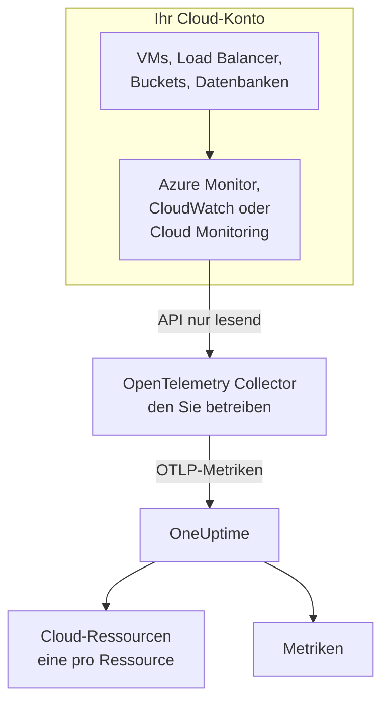
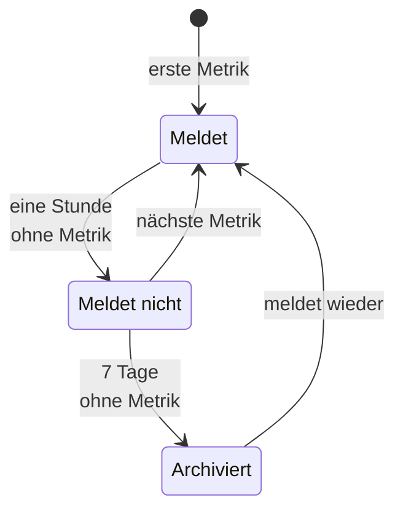

# Cloud-Ressourcen (IaaS & PaaS)

**Cloud-Ressourcen** listet die IaaS- und PaaS-Ressourcen in Ihren AWS-, Azure- und Google-Cloud-Konten auf: virtuelle Maschinen, Datenträger, Load Balancer, Buckets, verwaltete Datenbanken, Caches, Warteschlangen, API-Gateways und den Rest. Jede erhält eine eigene Seite, mit ihrem Typ, ihrer Region und ihrem Konto, der eigenen ID des Anbieters für sie, jeder Metrik, die der Anbieter über sie veröffentlicht, und Eigentümern und Beschriftungen wie jede andere Ressource in OneUptime. Sie finden sie unter **Cloud → Alle Ressourcen**.

:::cards
- [Azure verbinden](#azure-verbinden): Jede Ressource eines Abonnements aus Azure Monitor lesen.
- [AWS verbinden](#aws-verbinden): CloudWatch abfragen oder über Amazon Data Firehose streamen.
- [Google Cloud verbinden](#google-cloud-verbinden): Die Dienste eines Projekts aus Cloud Monitoring lesen.
- [Wie eine Ressource erkannt wird](#wie-eine-ressource-erkannt-wird): Jeder Ressourcentyp, den OneUptime erkennt, nach Anbieter.
:::

## So funktioniert es



- **Der Anbieter misst Ihre Ressourcen bereits.** Azure Monitor, Amazon CloudWatch und Google Cloud Monitoring veröffentlichen Metriken über jede Ressource, die sie für Sie betreiben.
- **Ein Collector, den Sie betreiben, liest sie.** Ein OpenTelemetry Collector mit Lesezugriff auf diesen Überwachungsdienst exportiert die Metriken an OneUptime. Auf den Ressourcen wird nichts installiert, und OneUptime hält nie Ihre Cloud-Zugangsdaten: Das tut der Collector, in Ihrer Umgebung.
- **Jede Ressource erscheint mit ihrer ersten Metrik.** OneUptime erkennt an jedem Datenpunkt, um welche Ressource es geht, und legt die Cloud-Ressource an, sobald es sie zum ersten Mal sieht.

Cloud-Ressourcen ist einer von mehreren Orten, an denen Ihre Cloud auftaucht:

| Sie betreiben | Wo es erscheint | Wie |
| --- | --- | --- |
| Container auf ECS, Cloud Run, Container Apps, App Service, … | **Cloud → Alle Umgebungen** | Die eigene Telemetrie Ihrer Workloads, nach ihrer `cloud.platform`. Siehe [Cloud-Umgebungen](/docs/telemetry/cloud-environments) |
| Jede IaaS- oder PaaS-Ressource, die der Anbieter überwacht | **Cloud → Alle Ressourcen** | Die Überwachungs-API des Anbieters, von einem Collector gelesen: diese Seite |
| Virtuelle Maschinen mit einem OpenTelemetry Collector darauf | **Hosts** | Die eigenen Metriken und Logs des Hosts. Siehe [Host-OpenTelemetry-Collector](/docs/telemetry/host-otel-collector) |
| Warteschlangen und Topics, die Ihre Anwendungen nutzen | **Warteschlangen** | Spans und dieselben Cloud-Metriken. Siehe [Warteschlangen](/docs/telemetry/queues) |

Eine Ressource kann an mehr als einem Ort erscheinen. Eine virtuelle Maschine mit dem Collector darauf ist ein **Host**, und ihre Plattformmetriken (CPU-Guthaben, Datenträger und Netzwerk aus Sicht des Hypervisors) machen sie zusätzlich zu einer **Cloud-Ressource**. Eine SQS-Warteschlange ist eine **Warteschlange** und eine **Cloud-Ressource**. Jede Ansicht zeigt, was ihre Quelle weiß.

## Bevor Sie beginnen

- **Ein Ingestion-Schlüssel.** Erstellen Sie einen **Server**-Schlüssel unter **Projekteinstellungen → Telemetrie & APM → Ingestion-Schlüssel**. Die Collectoren unten lesen ihn aus der Umgebungsvariablen `ONEUPTIME_TOKEN`, nie aus ihrer Konfigurationsdatei.
- **Ein Ort für den OpenTelemetry Collector**: die Distribution `otelcol-contrib`, Image `otel/opentelemetry-collector-contrib`, mit ausgehendem Zugriff auf Ihren Cloud-Anbieter und auf OneUptime. Eine kleine VM, ein Container oder Ihr Kubernetes-Cluster genügt, und ein Collector kann mehrere Konten und Anbieter lesen.
- **Lesezugriff auf die Überwachungs-API des Anbieters.** Der erste Schritt jedes Anbieters unten richtet ihn ein.

> [!TIP]
> Dieselben Schritte stehen auch im Dashboard, mit Ihrem Token bereits eingesetzt: unter **Cloud → Alle Ressourcen**, bis die erste Ressource eintrifft, und im Tab **Dokumentation** jeder Ressource, der beim eigenen Anbieter der Ressource öffnet.

Wenn Sie OneUptime selbst hosten, ersetzen Sie `https://oneuptime.com/otlp` durch `https://YOUR-ONEUPTIME-HOST/otlp`.

## Azure verbinden

Der `azure_monitor`-Receiver listet die Ressourcen eines Abonnements auf und liest jede Minute ihre Plattformmetriken. Ohne Liste `services` liest er jeden Ressourcentyp, sodass jede Ressource im Abonnement zu einer Cloud-Ressource wird.

:::steps
### Einen Service Principal mit Monitoring Reader anlegen

**Monitoring Reader** liest Metriken und listet Ressourcen auf und kann nichts ändern:

```bash
az ad sp create-for-rbac \
  --name oneuptime-cloud-collector \
  --role "Monitoring Reader" \
  --scopes /subscriptions/<SUBSCRIPTION_ID>
```

Er gibt eine `appId` (die Client-ID), ein `password` (das Client-Secret) und den `tenant` aus. Geben Sie demselben Service Principal die Rolle auf weiteren Abonnements, um sie mit demselben Collector zu lesen.

### Den Azure-Monitor-Receiver konfigurieren

Speichern Sie dies als `config.yaml`:

```yaml
extensions:
  azure_auth:
    service_principal:
      tenant_id: ${env:AZURE_TENANT_ID}
      client_id: ${env:AZURE_CLIENT_ID}
      client_secret: ${env:AZURE_CLIENT_SECRET}

receivers:
  azure_monitor:
    subscription_ids: ["${env:AZURE_SUBSCRIPTION_ID}"]
    auth:
      authenticator: azure_auth
    collection_interval: 60s
    # No `services` list: every resource type in the subscription.
    # Series Azure returns per metric and resource (default 10).
    maximum_number_of_records_per_resource: 50

processors:
  batch: {}

exporters:
  otlphttp/oneuptime:
    endpoint: https://oneuptime.com/otlp
    headers:
      x-oneuptime-token: ${env:ONEUPTIME_TOKEN}

service:
  extensions: [azure_auth]
  pipelines:
    metrics:
      receivers: [azure_monitor]
      processors: [batch]
      exporters: [otlphttp/oneuptime]
```

### Den Azure-Collector ausführen

```bash
docker run -d --name oneuptime-cloud-collector --restart unless-stopped \
  -e ONEUPTIME_TOKEN=YOUR_TELEMETRY_INGESTION_TOKEN \
  -e AZURE_TENANT_ID=<TENANT> \
  -e AZURE_CLIENT_ID=<APP_ID> \
  -e AZURE_CLIENT_SECRET=<PASSWORD> \
  -e AZURE_SUBSCRIPTION_ID=<SUBSCRIPTION_ID> \
  -v "$(pwd)/config.yaml:/etc/otelcol-contrib/config.yaml" \
  otel/opentelemetry-collector-contrib:latest
```

Ressourcen erscheinen innerhalb weniger Minuten unter **Cloud → Alle Ressourcen**.
:::

Optionen des `azure_monitor`-Receivers:

| Option | Was sie bewirkt |
| --- | --- |
| `resource_groups`, `services`, `resource_tags` | Weniger lesen: eine Liste von Ressourcengruppen, von Resource-Manager-Typen (`Microsoft.Compute/virtualMachines`) oder von Tags, die eine Ressource tragen muss |
| `metrics` | Beschränkt jeden Ressourcentyp auf die Metriken und Aggregationen, die Sie auflisten. Sobald ein Typ aufgeführt ist, werden nur seine aufgeführten Metriken gelesen |
| `discover_subscriptions: true` | Liest jedes Abonnement, das der Service Principal sehen kann, statt `subscription_ids` |
| `maximum_number_of_records_per_resource` | Wie viele Reihen Azure pro Metrik und Ressource zurückgibt (standardmäßig 10). Erhöhen Sie den Wert, wenn sich eine Metrik nach einer Dimension mit vielen Werten aufteilt |
| `use_batch_api: true` | Für große Abonnements. Der Receiver macht einen Resource-Manager-Aufruf pro Ressource und Stapel von 20 Metriken, und Resource Manager erlaubt etwa 12.000 Lesevorgänge pro Stunde; die Batch-API liest bis zu 50 Ressourcen pro Aufruf aus der Datenebene von Azure Monitor, deren Grenze weit höher liegt |
| `cache_resources` | Wie oft, in Sekunden, der Receiver die Ressourcen auflistet: standardmäßig einmal am Tag. Eine Ressource, die nach dem Start des Collectors angelegt wurde, kann bis zu einem Tag brauchen, um zu erscheinen; starten Sie den Collector neu, um sie sofort aufzulisten |

## AWS verbinden

CloudWatch-Metriken erreichen OneUptime auf einem von zwei Wegen:

| | Abfrage | Metric Streams |
| --- | --- | --- |
| Wie | Der `aws_cloudwatch`-Receiver des Collectors fragt CloudWatch ab | CloudWatch schiebt über Amazon Data Firehose an den `awsfirehose`-Receiver des Collectors |
| Nötig auf der AWS-Seite | Nur Zugangsdaten | Ein Firehose-Stream und ein Metric Stream in jeder Region |
| Der Collector muss von AWS aus erreichbar sein | Nein | Ja, über HTTPS auf Port 443 |
| Verzögerung | 10 bis 20 Minuten | Wenige Minuten |
| Geeignet für | Die meisten Konten | Große Konten |

### Abfrage mit dem aws_cloudwatch-Receiver

:::steps
#### Dem Collector das Lesen von CloudWatch erlauben

Hängen Sie diese Richtlinie an die Rolle an, unter der der Collector läuft (ein EC2-Instanzprofil, eine ECS-Task-Rolle, ein EKS-Dienstkonto), oder an einen IAM-Benutzer, dessen Zugriffsschlüssel Sie ihm geben:

```json
{
  "Version": "2012-10-17",
  "Statement": [
    {
      "Effect": "Allow",
      "Action": [
        "cloudwatch:ListMetrics",
        "cloudwatch:GetMetricData",
        "sts:GetCallerIdentity"
      ],
      "Resource": "*"
    }
  ]
}
```

`sts:GetCallerIdentity` lässt den Receiver die Konto-ID melden, die der ARN jeder Ressource braucht.

#### Die CloudWatch-Receiver konfigurieren

Ein Receiver liest einen Namespace in einer Region, also fügen Sie einen für jeden gewünschten Namespace und jede Region hinzu. Dieses Beispiel liest die gängigen; speichern Sie es als `config.yaml`:

```yaml
receivers:
  aws_cloudwatch/ec2:
    region: ${env:AWS_REGION}
    metrics:
      collection_interval: 5m
      period: 5m
      delay: 10m
      discovery:
        filters:
          namespace: AWS/EC2
        # Metrics read per scrape, at most. Each costs 4 GetMetricData queries.
        limit: 1000
  aws_cloudwatch/ebs:
    region: ${env:AWS_REGION}
    metrics:
      collection_interval: 5m
      period: 5m
      delay: 10m
      discovery:
        filters:
          namespace: AWS/EBS
        # Metrics read per scrape, at most. Each costs 4 GetMetricData queries.
        limit: 1000
  aws_cloudwatch/applicationelb:
    region: ${env:AWS_REGION}
    metrics:
      collection_interval: 5m
      period: 5m
      delay: 10m
      discovery:
        filters:
          namespace: AWS/ApplicationELB
        # Metrics read per scrape, at most. Each costs 4 GetMetricData queries.
        limit: 1000
  aws_cloudwatch/rds:
    region: ${env:AWS_REGION}
    metrics:
      collection_interval: 5m
      period: 5m
      delay: 10m
      discovery:
        filters:
          namespace: AWS/RDS
        # Metrics read per scrape, at most. Each costs 4 GetMetricData queries.
        limit: 1000
  aws_cloudwatch/lambda:
    region: ${env:AWS_REGION}
    metrics:
      collection_interval: 5m
      period: 5m
      delay: 10m
      discovery:
        filters:
          namespace: AWS/Lambda
        # Metrics read per scrape, at most. Each costs 4 GetMetricData queries.
        limit: 1000
  aws_cloudwatch/dynamodb:
    region: ${env:AWS_REGION}
    metrics:
      collection_interval: 5m
      period: 5m
      delay: 10m
      discovery:
        filters:
          namespace: AWS/DynamoDB
        # Metrics read per scrape, at most. Each costs 4 GetMetricData queries.
        limit: 1000

processors:
  batch: {}

exporters:
  otlphttp/oneuptime:
    endpoint: https://oneuptime.com/otlp
    headers:
      x-oneuptime-token: ${env:ONEUPTIME_TOKEN}

service:
  pipelines:
    metrics:
      receivers: [aws_cloudwatch/ec2, aws_cloudwatch/ebs, aws_cloudwatch/applicationelb, aws_cloudwatch/rds, aws_cloudwatch/lambda, aws_cloudwatch/dynamodb]
      processors: [batch]
      exporters: [otlphttp/oneuptime]
```

#### Den CloudWatch-Collector ausführen

```bash
docker run -d --name oneuptime-cloud-collector --restart unless-stopped \
  -e ONEUPTIME_TOKEN=YOUR_TELEMETRY_INGESTION_TOKEN \
  -e AWS_REGION=us-east-1 \
  -e AWS_ACCESS_KEY_ID=<ACCESS_KEY_ID> \
  -e AWS_SECRET_ACCESS_KEY=<SECRET_ACCESS_KEY> \
  -v "$(pwd)/config.yaml:/etc/otelcol-contrib/config.yaml" \
  otel/opentelemetry-collector-contrib:latest
```

Auf einer EC2-Instanz, einem ECS-Task oder einem EKS-Pod, der die Rolle hat, lassen Sie die beiden Schlüsselvariablen weg.
:::

- **Lassen Sie `stats` ungesetzt.** Jede Metrik wird dann als eine Zusammenfassung pro Periode gelesen: vier Statistiken, vier `GetMetricData`-Abfragen, und AWS berechnet `GetMetricData` pro angefragter Metrik. `discovery.limit` begrenzt die Metriken, die ein Receiver pro Abruf liest (setzen Sie es: Der eigene Standard des Receivers ist 100), und ein längeres `collection_interval` liest sie seltener.
- **Daten kommen verspätet an.** `delay` wartet, bis CloudWatch eine Periode veröffentlicht, daher kommen Datenpunkte 10 bis 20 Minuten nach dem Zeitpunkt an, den sie messen, und Ressourcen erscheinen innerhalb von etwa zwanzig Minuten.

### Streaming mit CloudWatch Metric Streams

:::steps
#### Den Firehose-Receiver konfigurieren

Der Collector braucht ein Zertifikat für seine Adresse: Firehose liefert nur an `https://` auf Port 443. Speichern Sie dies als `config.yaml`:

```yaml
extensions:
  awscloudwatchmetricstreams_encoding:
    format: opentelemetry1.0

receivers:
  awsfirehose:
    # Firehose delivers to HTTPS on port 443 only: expose this port as
    # 443, for example behind a load balancer.
    endpoint: 0.0.0.0:4433
    encoding: awscloudwatchmetricstreams_encoding
    access_key: ${env:FIREHOSE_ACCESS_KEY}
    tls:
      cert_file: /etc/otelcol-contrib/tls/server.crt
      key_file: /etc/otelcol-contrib/tls/server.key

processors:
  batch: {}

exporters:
  otlphttp/oneuptime:
    endpoint: https://oneuptime.com/otlp
    headers:
      x-oneuptime-token: ${env:ONEUPTIME_TOKEN}

service:
  extensions: [awscloudwatchmetricstreams_encoding]
  pipelines:
    metrics:
      receivers: [awsfirehose]
      processors: [batch]
      exporters: [otlphttp/oneuptime]
```

#### Den Firehose-Collector ausführen

```bash
docker run -d --name oneuptime-cloud-collector --restart unless-stopped \
  -e ONEUPTIME_TOKEN=YOUR_TELEMETRY_INGESTION_TOKEN \
  -e FIREHOSE_ACCESS_KEY=<A_LONG_RANDOM_SECRET> \
  -p 4433:4433 \
  -v "$(pwd)/tls:/etc/otelcol-contrib/tls:ro" \
  -v "$(pwd)/config.yaml:/etc/otelcol-contrib/config.yaml" \
  otel/opentelemetry-collector-contrib:latest
```

Das Zertifikat und sein Schlüssel kommen nach `tls/`, als `server.crt` und `server.key`. Veröffentlichen Sie Port 4433 hinter etwas, das auf 443 antwortet, etwa einem Load Balancer.

#### Den Firehose-Stream und den Metric Stream anlegen

1. **Amazon Data Firehose → Create Firehose stream**: Quelle **Direct PUT**, Ziel **HTTP Endpoint**. Die Endpunkt-URL ist die `https://`-Adresse des Collectors; der Zugriffsschlüssel ist `FIREHOSE_ACCESS_KEY`. Wählen oder erstellen Sie einen S3-Bucket für fehlgeschlagene Zustellungen.
2. **CloudWatch → Metrics → Streams → Create metric stream**: die einzuschließenden Namespaces (oder alle), der Firehose-Stream und das Ausgabeformat **OpenTelemetry 1.0**.
3. Wiederholen Sie das in jeder Region: Ein Metric Stream trägt die Metriken seiner eigenen Region.
:::

AWS berechnet einen Metric Stream pro Metrik-Update, das er liefert, zuzüglich der Datengebühren von Firehose, also schließen Sie nur die Namespaces ein, die Sie wollen. Ein Stream im Format **JSON** (`format: json` an der Kodierungserweiterung) benennt dieselben Ressourcen, schreibt aber zusätzlich jeden Namespace in `service.name`, sodass jeder Namespace auch unter **Dienste** auftaucht: Bevorzugen Sie **OpenTelemetry 1.0**.

## Google Cloud verbinden

Der `googlecloudmonitoring`-Receiver liest die Metriktypen, die seine `metrics_list` nennt, für ein Projekt.

:::steps
### Ein Dienstkonto mit Monitoring Viewer anlegen

**Monitoring Viewer** liest Metriken und kann nichts ändern:

```bash
gcloud iam service-accounts create oneuptime-cloud-collector \
  --project <PROJECT_ID>

gcloud projects add-iam-policy-binding <PROJECT_ID> \
  --member "serviceAccount:oneuptime-cloud-collector@<PROJECT_ID>.iam.gserviceaccount.com" \
  --role roles/monitoring.viewer

gcloud iam service-accounts keys create key.json \
  --iam-account oneuptime-cloud-collector@<PROJECT_ID>.iam.gserviceaccount.com
```

Auf Google Cloud selbst führen Sie den Collector unter diesem Dienstkonto aus, statt einen Schlüssel zu erstellen.

### Den Cloud-Monitoring-Receiver konfigurieren

Jeder Filter liest jeden Metriktyp eines Dienstes. Speichern Sie dies als `config.yaml`:

```yaml
receivers:
  googlecloudmonitoring:
    project_id: ${env:GCP_PROJECT_ID}
    collection_interval: 2m
    # Only the metric types these filters list are read.
    metrics_list:
      - metric_descriptor_filter: 'metric.type = starts_with("compute.googleapis.com/")'
      - metric_descriptor_filter: 'metric.type = starts_with("cloudsql.googleapis.com/")'
      - metric_descriptor_filter: 'metric.type = starts_with("loadbalancing.googleapis.com/")'
      - metric_descriptor_filter: 'metric.type = starts_with("storage.googleapis.com/")'
      - metric_descriptor_filter: 'metric.type = starts_with("redis.googleapis.com/")'
      - metric_descriptor_filter: 'metric.type = starts_with("run.googleapis.com/")'

processors:
  batch: {}

exporters:
  otlphttp/oneuptime:
    endpoint: https://oneuptime.com/otlp
    headers:
      x-oneuptime-token: ${env:ONEUPTIME_TOKEN}

service:
  pipelines:
    metrics:
      receivers: [googlecloudmonitoring]
      processors: [batch]
      exporters: [otlphttp/oneuptime]
```

### Den Google-Cloud-Collector ausführen

```bash
docker run -d --name oneuptime-cloud-collector --restart unless-stopped \
  -e ONEUPTIME_TOKEN=YOUR_TELEMETRY_INGESTION_TOKEN \
  -e GCP_PROJECT_ID=<PROJECT_ID> \
  -e GOOGLE_APPLICATION_CREDENTIALS=/etc/otelcol-contrib/key.json \
  -v "$(pwd)/key.json:/etc/otelcol-contrib/key.json:ro" \
  -v "$(pwd)/config.yaml:/etc/otelcol-contrib/config.yaml" \
  otel/opentelemetry-collector-contrib:latest
```
:::

- **Die Liste wird beim Start des Collectors gelesen:** Starten Sie ihn nach einer Änderung neu. `metric_name: compute.googleapis.com/instance/cpu/utilization` liest einen Typ statt aller Typen eines Dienstes.
- **Ein Receiver liest ein Projekt:** Fügen Sie einen pro Projekt hinzu.
- **Lesen hat Kosten und ein Kontingent.** Jeder Metriktyp ist ein Lesevorgang der Cloud-Monitoring-API pro Erfassungsintervall. Das Lesen der eigenen Metriken von Google Cloud ist innerhalb des monatlichen Freikontingents der API kostenlos; ein längeres `collection_interval` hält ein großes Projekt darin und innerhalb des Kontingents pro Minute.

## Die Pipeline frei von Ressourcenerkennung halten

> [!WARNING]
> Fügen Sie den `resourcedetection`-Prozessor nicht zu der Pipeline hinzu, die die Cloud-Überwachung liest. Er setzt `host.name` und `os.type` der Collector-Maschine auf jeden Datenpunkt, und OneUptime legt die Metriken Ihrer Cloud dann zusätzlich unter dieser Maschine in **Hosts** ab. Ein Collector, der auch seinen eigenen Host überwacht, sollte das in einer eigenen Pipeline tun.

## Wie eine Ressource erkannt wird

Jeder Datenpunkt dieser Receiver benennt eine Ressource, und OneUptime ordnet die Cloud-Ressource der Identität dieser Ressource zu, nie ihrem Namen, den Sie ändern können. Die Identität wird ohne Beachtung der Groß- und Kleinschreibung verglichen, sodass eine Ressource, die in zwei Schreibweisen gemeldet wird, eine Ressource ist.

### Azure

Jeder Datenpunkt trägt die Azure-Ressourcen-ID seiner Ressource (`azuremonitor.resource_id`), sodass jede Ressource, die der Receiver liest, zu einer Cloud-Ressource wird: die Typen unten unter einem lesbaren Namen, jeder andere unter seinem Resource-Manager-Typ. Ressourcen-ID, Region, Abonnement und Ressourcengruppe werden alle an der Ressource angezeigt.

:::details Die Azure-Ressourcentypen mit lesbarem Namen
| Ressourcentyp | Angezeigt als | Modell |
| --- | --- | --- |
| `Microsoft.Compute/virtualMachines` | Virtual Machine | IaaS |
| `Microsoft.Compute/virtualMachineScaleSets` | Virtual Machine Scale Set | IaaS |
| `Microsoft.Compute/disks` | Managed Disk | IaaS |
| `Microsoft.Network/loadBalancers` | Load Balancer | IaaS |
| `Microsoft.Network/applicationGateways` | Application Gateway | IaaS |
| `Microsoft.Network/publicIPAddresses` | Public IP Address | IaaS |
| `Microsoft.Network/natGateways` | NAT Gateway | IaaS |
| `Microsoft.Network/virtualNetworkGateways` | Virtual Network Gateway | IaaS |
| `Microsoft.Network/expressRouteCircuits` | ExpressRoute Circuit | IaaS |
| `Microsoft.Network/azureFirewalls` | Azure Firewall | IaaS |
| `Microsoft.Network/frontdoors` | Front Door (classic) | IaaS |
| `Microsoft.Cdn/profiles` | Front Door and CDN Profile | IaaS |
| `Microsoft.Network/trafficmanagerprofiles` | Traffic Manager Profile | IaaS |
| `Microsoft.Network/networkInterfaces` | Network Interface | IaaS |
| `Microsoft.Network/virtualNetworks` | Virtual Network | IaaS |
| `Microsoft.Network/privateEndpoints` | Private Endpoint | IaaS |
| `Microsoft.Network/dnszones` | DNS Zone | IaaS |
| `Microsoft.Network/bastionHosts` | Bastion | IaaS |
| `Microsoft.Storage/storageAccounts` | Storage Account | IaaS |
| `Microsoft.RecoveryServices/vaults` | Recovery Services Vault | PaaS |
| `Microsoft.Web/sites` | App Service or Function App | PaaS |
| `Microsoft.Web/serverfarms` | App Service Plan | PaaS |
| `Microsoft.Web/staticSites` | Static Web App | PaaS |
| `Microsoft.App/containerApps` | Container App | PaaS |
| `Microsoft.App/managedEnvironments` | Container Apps Environment | PaaS |
| `Microsoft.ContainerInstance/containerGroups` | Container Instance | PaaS |
| `Microsoft.ContainerService/managedClusters` | AKS Cluster | PaaS |
| `Microsoft.ContainerRegistry/registries` | Container Registry | PaaS |
| `Microsoft.SignalRService/SignalR` | SignalR Service | PaaS |
| `Microsoft.Sql/servers/databases` | SQL Database | PaaS |
| `Microsoft.Sql/servers/elasticpools` | SQL Elastic Pool | PaaS |
| `Microsoft.Sql/managedInstances` | SQL Managed Instance | PaaS |
| `Microsoft.DBforPostgreSQL/flexibleServers` | PostgreSQL Flexible Server | PaaS |
| `Microsoft.DBforMySQL/flexibleServers` | MySQL Flexible Server | PaaS |
| `Microsoft.DocumentDB/databaseAccounts` | Cosmos DB Account | PaaS |
| `Microsoft.Cache/redis` | Azure Cache for Redis | PaaS |
| `Microsoft.Cache/redisEnterprise` | Azure Managed Redis | PaaS |
| `Microsoft.ServiceBus/namespaces` | Service Bus Namespace | PaaS |
| `Microsoft.EventHub/namespaces` | Event Hubs Namespace | PaaS |
| `Microsoft.EventGrid/topics` | Event Grid Topic | PaaS |
| `Microsoft.EventGrid/systemTopics` | Event Grid System Topic | PaaS |
| `Microsoft.EventGrid/namespaces` | Event Grid Namespace | PaaS |
| `Microsoft.ApiManagement/service` | API Management | PaaS |
| `Microsoft.Logic/workflows` | Logic App | PaaS |
| `Microsoft.DataFactory/factories` | Data Factory | PaaS |
| `Microsoft.Synapse/workspaces` | Synapse Workspace | PaaS |
| `Microsoft.Kusto/clusters` | Data Explorer Cluster | PaaS |
| `Microsoft.StreamAnalytics/streamingjobs` | Stream Analytics Job | PaaS |
| `Microsoft.CognitiveServices/accounts` | Azure AI Services or OpenAI | PaaS |
| `Microsoft.Search/searchServices` | AI Search Service | PaaS |
| `Microsoft.MachineLearningServices/workspaces` | Machine Learning Workspace | PaaS |
| `Microsoft.KeyVault/vaults` | Key Vault | PaaS |
| `Microsoft.Insights/components` | Application Insights | PaaS |
| `Microsoft.OperationalInsights/workspaces` | Log Analytics Workspace | PaaS |
| `Microsoft.Automation/automationAccounts` | Automation Account | PaaS |
| `Microsoft.Devices/IotHubs` | IoT Hub | PaaS |
:::

### AWS

Eine CloudWatch-Metrik benennt ihre Ressource in einer Dimension, die vom Namespace abhängt. Ein Datenpunkt, der die Dimensionen unter **Identifiziert durch** trägt, gehört zu dieser Ressource, zusammen mit ihrem Konto und ihrer Region; zusätzliche Dimensionen grenzen die Reihe ein, nicht die Ressource (die Reihen eines Application Load Balancers pro Zielgruppe gehören zum Load Balancer). Ein Datenpunkt, der über etwas anderes aggregiert ist (`InstanceType`, `DatabaseClass`, eine Summe über das ganze Konto), benennt keine Ressource und wird nicht erkannt. Ebenso wenig ein Namespace, der nicht aufgeführt ist: Seine Metriken landen trotzdem unter **Metriken**.

Jede Ressource wird mit ihrem ARN angezeigt, wo ihre Metriken ihn vollständig nennen; wo nicht (der ARN einer Auto-Scaling-Gruppe enthält eine UUID, die keine Metrik meldet), mit ihrem Namespace und ihren Dimensionen.

:::details Die CloudWatch-Namespaces und die Dimensionen, die eine Ressource erkennen
| Namespace | Identifiziert durch | Angezeigt als | Ressourcentyp | Modell |
| --- | --- | --- | --- | --- |
| `AWS/EC2` | `InstanceId` | EC2 Instance | `AWS::EC2::Instance` | IaaS |
| `AWS/EC2` | `AutoScalingGroupName` (without `InstanceId`) | Auto Scaling Group | `AWS::AutoScaling::AutoScalingGroup` | IaaS |
| `AWS/AutoScaling` | `AutoScalingGroupName` | Auto Scaling Group | `AWS::AutoScaling::AutoScalingGroup` | IaaS |
| `AWS/EBS` | `VolumeId` | EBS Volume | `AWS::EC2::Volume` | IaaS |
| `AWS/ELB` | `LoadBalancerName` | Classic Load Balancer | `AWS::ElasticLoadBalancing::LoadBalancer` | IaaS |
| `AWS/ApplicationELB` | `LoadBalancer` | Elastic Load Balancer (ALB, NLB, GWLB) | `AWS::ElasticLoadBalancingV2::LoadBalancer` | IaaS |
| `AWS/NetworkELB` | `LoadBalancer` | Elastic Load Balancer (ALB, NLB, GWLB) | `AWS::ElasticLoadBalancingV2::LoadBalancer` | IaaS |
| `AWS/GatewayELB` | `LoadBalancer` | Elastic Load Balancer (ALB, NLB, GWLB) | `AWS::ElasticLoadBalancingV2::LoadBalancer` | IaaS |
| `AWS/NATGateway` | `NatGatewayId` | NAT Gateway | `AWS::EC2::NatGateway` | IaaS |
| `AWS/TransitGateway` | `TransitGateway` | Transit Gateway | `AWS::EC2::TransitGateway` | IaaS |
| `AWS/VPN` | `VpnId` | Site-to-Site VPN Connection | `AWS::EC2::VPNConnection` | IaaS |
| `AWS/DX` | `ConnectionId` | Direct Connect Connection | `AWS::DirectConnect::Connection` | IaaS |
| `AWS/CloudFront` | `DistributionId` | CloudFront Distribution | `AWS::CloudFront::Distribution` | IaaS |
| `AWS/GlobalAccelerator` | `Accelerator` (without `Listener`, `EndpointGroup`) | Global Accelerator | `AWS::GlobalAccelerator::Accelerator` | IaaS |
| `AWS/Route53` | `HealthCheckId` | Route 53 Health Check | `AWS::Route53::HealthCheck` | IaaS |
| `AWS/NetworkFirewall` | `FirewallName` | Network Firewall | `AWS::NetworkFirewall::Firewall` | IaaS |
| `AWS/WAFV2` | `WebACL` (without `Rule`, `RuleGroup`) | WAF Web ACL | `AWS::WAFv2::WebACL` | PaaS |
| `AWS/S3` | `BucketName` | S3 Bucket | `AWS::S3::Bucket` | IaaS |
| `AWS/EFS` | `FileSystemId` | EFS File System | `AWS::EFS::FileSystem` | IaaS |
| `AWS/FSx` | `FileSystemId` | FSx File System | `AWS::FSx::FileSystem` | IaaS |
| `AWS/ECS` | `ClusterName` + `ServiceName` | ECS Service | `AWS::ECS::Service` | PaaS |
| `AWS/ECS` | `ClusterName` (without `ServiceName`) | ECS Cluster | `AWS::ECS::Cluster` | PaaS |
| `AWS/AppRunner` | `ServiceName` | App Runner Service | `AWS::AppRunner::Service` | PaaS |
| `AWS/ElasticBeanstalk` | `EnvironmentName` | Elastic Beanstalk Environment | `AWS::ElasticBeanstalk::Environment` | PaaS |
| `AWS/Lambda` | `FunctionName` | Lambda Function | `AWS::Lambda::Function` | PaaS |
| `AWS/States` | `StateMachineArn` | Step Functions State Machine | `AWS::StepFunctions::StateMachine` | PaaS |
| `AWS/RDS` | `DBInstanceIdentifier` | RDS DB Instance | `AWS::RDS::DBInstance` | PaaS |
| `AWS/RDS` | `DBClusterIdentifier` (without `DBInstanceIdentifier`) | Aurora / RDS DB Cluster | `AWS::RDS::DBCluster` | PaaS |
| `AWS/DocDB` | `DBInstanceIdentifier` | DocumentDB Instance | `AWS::DocDB::DBInstance` | PaaS |
| `AWS/DocDB` | `DBClusterIdentifier` (without `DBInstanceIdentifier`) | DocumentDB Cluster | `AWS::DocDB::DBCluster` | PaaS |
| `AWS/Neptune` | `DBInstanceIdentifier` | Neptune Instance | `AWS::Neptune::DBInstance` | PaaS |
| `AWS/Neptune` | `DBClusterIdentifier` (without `DBInstanceIdentifier`) | Neptune Cluster | `AWS::Neptune::DBCluster` | PaaS |
| `AWS/DynamoDB` | `TableName` | DynamoDB Table | `AWS::DynamoDB::Table` | PaaS |
| `AWS/ElastiCache` | `CacheClusterId` | ElastiCache Cluster | `AWS::ElastiCache::CacheCluster` | PaaS |
| `AWS/ElastiCache` | `ReplicationGroupId` (without `CacheClusterId`) | ElastiCache Replication Group | `AWS::ElastiCache::ReplicationGroup` | PaaS |
| `AWS/ElastiCache` | `clusterId` (without `CacheClusterId`) | ElastiCache Serverless Cache | `AWS::ElastiCache::ServerlessCache` | PaaS |
| `AWS/MemoryDB` | `ClusterName` | MemoryDB Cluster | `AWS::MemoryDB::Cluster` | PaaS |
| `AWS/Redshift` | `ClusterIdentifier` | Redshift Cluster | `AWS::Redshift::Cluster` | PaaS |
| `AWS/ES` | `DomainName` | OpenSearch Domain | `AWS::OpenSearchService::Domain` | PaaS |
| `AWS/SQS` | `QueueName` | SQS Queue | `AWS::SQS::Queue` | PaaS |
| `AWS/SNS` | `TopicName` | SNS Topic | `AWS::SNS::Topic` | PaaS |
| `AWS/Kinesis` | `StreamName` | Kinesis Data Stream | `AWS::Kinesis::Stream` | PaaS |
| `AWS/Firehose` | `DeliveryStreamName` | Data Firehose Stream | `AWS::KinesisFirehose::DeliveryStream` | PaaS |
| `AWS/AmazonMQ` | `Broker` | Amazon MQ Broker | `AWS::AmazonMQ::Broker` | PaaS |
| `AWS/Kafka` | `Cluster Name` | MSK Cluster | `AWS::MSK::Cluster` | PaaS |
| `AWS/Events` | `RuleName` | EventBridge Rule | `AWS::Events::Rule` | PaaS |
| `AWS/ApiGateway` | `ApiName` | API Gateway REST API | `AWS::ApiGateway::RestApi` | PaaS |
| `AWS/ApiGateway` | `ApiId` (without `ApiName`) | API Gateway HTTP or WebSocket API | `AWS::ApiGatewayV2::Api` | PaaS |
| `AWS/AppSync` | `GraphQLAPIId` | AppSync GraphQL API | `AWS::AppSync::GraphQLApi` | PaaS |
| `AWS/CertificateManager` | `CertificateArn` | ACM Certificate | `AWS::CertificateManager::Certificate` | PaaS |
| `AWS/KMS` | `KeyId` | KMS Key | `AWS::KMS::Key` | PaaS |
| `AWS/Cognito` | `UserPool` | Cognito User Pool | `AWS::Cognito::UserPool` | PaaS |
| `AWS/SageMaker` | `EndpointName` | SageMaker Endpoint | `AWS::SageMaker::Endpoint` | PaaS |
| `AWS/Logs` | `LogGroupName` | CloudWatch Log Group | `AWS::Logs::LogGroup` | PaaS |
:::

### Google Cloud

Cloud Monitoring benennt die überwachte Ressource jeder Metrik mit einem Typ und Labels. Ein Datenpunkt eines Typs unten gehört zu dieser Ressource, erkannt an den aufgeführten Labels; die übrigen Labels der Ressource und ihre Metadaten-Labels teilen sie nie auf. Kubernetes-Typen (`k8s_container`, `k8s_pod`, …) bleiben dem Produkt [Kubernetes](/docs/telemetry/kubernetes-agent) überlassen.

:::details Die Ressourcentypen von Cloud Monitoring und die Labels, die sie erkennen
| Überwachter Ressourcentyp | Identifiziert durch | Angezeigt als | Modell |
| --- | --- | --- | --- |
| `gce_instance` | `project_id`, `zone`, `instance_id` | Compute Engine VM Instance | IaaS |
| `instance_group` | `project_id`, `location`, `instance_group_id` | Instance Group | IaaS |
| `gcs_bucket` | `project_id`, `bucket_name` | Cloud Storage Bucket | IaaS |
| `filestore_instance` | `project_id`, `location`, `instance_name` | Filestore Instance | IaaS |
| `https_lb_rule` | `project_id`, `url_map_name` | External Application Load Balancer | IaaS |
| `internal_http_lb_rule` | `project_id`, `region`, `url_map_name` | Internal Application Load Balancer | IaaS |
| `vpn_gateway` | `project_id`, `region`, `gateway_id` | Cloud VPN Gateway | IaaS |
| `nat_gateway` | `project_id`, `region`, `router_id`, `gateway_name` | Cloud NAT Gateway | IaaS |
| `gce_router` | `project_id`, `region`, `router_id` | Cloud Router | IaaS |
| `cloudsql_database` | `project_id`, `database_id` | Cloud SQL Instance | PaaS |
| `alloydb.googleapis.com/Instance` | `resource_container`, `location`, `cluster_id`, `instance_id` | AlloyDB Instance | PaaS |
| `redis_instance` | `project_id`, `region`, `instance_id` | Memorystore for Redis Instance | PaaS |
| `spanner_instance` | `project_id`, `instance_id` | Spanner Instance | PaaS |
| `bigtable_table` | `project_id`, `instance` | Bigtable Instance | PaaS |
| `bigquery_dataset` | `project_id`, `dataset_id` | BigQuery Dataset | PaaS |
| `cloud_function` | `project_id`, `region`, `function_name` | Cloud Run Function | PaaS |
| `cloud_run_revision` | `project_id`, `location`, `service_name` | Cloud Run Service | PaaS |
| `cloud_run_job` | `project_id`, `location`, `job_name` | Cloud Run Job | PaaS |
| `gae_app` | `project_id`, `module_id` | App Engine Service | PaaS |
| `pubsub_topic` | `project_id`, `topic_id` | Pub/Sub Topic | PaaS |
| `pubsub_subscription` | `project_id`, `subscription_id` | Pub/Sub Subscription | PaaS |
| `cloud_tasks_queue` | `project_id`, `location`, `queue_id` | Cloud Tasks Queue | PaaS |
| `cloud_composer_environment` | `project_id`, `location`, `environment_name` | Cloud Composer Environment | PaaS |
| `dataproc_cluster` | `project_id`, `region`, `cluster_name` | Dataproc Cluster | PaaS |
| `aiplatform.googleapis.com/Endpoint` | `resource_container`, `location`, `endpoint_id` | Vertex AI Endpoint | PaaS |
:::

### Namen

Eine Ressource wird nach dem benannt, wie ihr Anbieter sie nennt (`vm-prod-01`, `checkout`, `orders`). Namen sind innerhalb eines Projekts eindeutig, die des Anbieters nicht: Zwei Abonnements haben je ein `web-01`, und ein App-Service-Plan und seine App heißen beide `checkout`. Eine Ressource, deren Name vergeben ist, wird daher mit ihrem Typ benannt, dann mit ihrer Ressourcengruppe oder Region, dann mit ihrem Konto: `web-01 (Virtual Machine, rg-prod)`. Benennen Sie jede Ressource im Tab **Einstellungen** um: Metriken werden über ihre Identität zugeordnet, nicht über ihren Namen.

## Status, Archivierung und Grenzen



- **Meldet** bedeutet, dass der Anbieter in der letzten Stunde eine Metrik über die Ressource gesendet hat; nach einer Stunde ohne eine zeigt sie **Meldet nicht**. Manche Ressourcen sind von Natur aus ruhig, etwa ein Key Vault, den niemand aufgerufen hat, oder ein Bucket, dessen Speichermetriken CloudWatch einmal am Tag veröffentlicht, und kommen mit ihrem nächsten Datenpunkt zurück.
- Eine Ressource, die **7 Tage lang keine Metrik** sendet, wird automatisch archiviert: eine Instanz, die eine Auto-Scaling-Gruppe ersetzt hat, ein gelöschter Datenträger, ein Bucket, den es nicht mehr gibt. Sie behält ihre Beschriftungen, Eigentümer und ihren Verlauf unter **Cloud → Erweitert → Archiviert** und wird von selbst wiederhergestellt, sobald sie wieder meldet. Eine Ressource, die Sie selbst archivieren, bleibt archiviert; eine, die Sie wiederherstellen, während sie still ist, bleibt in der Liste, bis sie meldet.
- Eine Ressource zu löschen, die der Anbieter weiterhin meldet, hält nicht: Sie wird aus ihren nächsten Metriken erneut erkannt. Archivieren Sie sie stattdessen.
- Die Erkennung legt keine Ressourcen mehr an, wenn ein Projekt **5.000** aktive (nicht archivierte) hält, und protokolliert eine Warnung; archivierte Ressourcen zählen nicht.

Selbst gehostete Installationen können diese Werte mit Umgebungsvariablen an der App ändern:

| Variable | Standard | Bedeutung |
| --- | --- | --- |
| `CLOUD_RESOURCE_AUTO_ARCHIVE_DAYS` | `7` | Tage ohne Metrik, bevor eine Ressource archiviert wird (mindestens 1) |
| `CLOUD_RESOURCE_AUTO_CREATE_BUDGET` | `5000` | Aktive Ressourcen, die ein Projekt halten darf, bevor die Erkennung keine weiteren anlegt (`0` schaltet die Erkennung ab) |

## Auf eine Ressource alarmieren

:::steps
1. Öffnen Sie die Ressource und ihren Tab **Metriken**, der jede Metrik auflistet, die ihr Anbieter über sie meldet.
2. Öffnen Sie eine Metrik, um sie im Metrik-Explorer darzustellen, bereits auf die Ressource gefiltert.
3. Klicken Sie auf **Monitor aus dieser Ansicht erstellen**: Der Monitor überwacht diese Metrik für diese Ressource.
:::

> [!IMPORTANT]
> Die Cloud-Überwachung veröffentlicht jede Zahl Minuten nach dem Zeitpunkt, den sie misst: 10 bis 20 Minuten bei CloudWatch, wie oben abgefragt, wenige Minuten bei Azure Monitor und Cloud Monitoring. Sie wird unter dem Zeitpunkt gespeichert, den sie misst. Geben Sie einem Monitor über diese Metriken ein längeres Zeitfenster (30 Minuten für CloudWatch, 15 für die anderen), sonst sieht er keine Daten und löst nie aus.

## Inventar und Regeln

- **Inventar:** Cloud-Ressourcen werden im [Inventar](/docs/inventory/overview) als Einträge vom Typ **Cloud-Ressource** aufgeführt, mit der ID des Anbieters als `cloud.resource.id` und dem Typ als `cloud.resource.type`. Die Ressourcenwerkzeuge des KI-Agenten listen sie ebenfalls auf.
- **Regeln:** **Cloud → Einstellungen → Beschriftungsregeln** und **Eigentümerregeln** gelten für sie wie für Cloud-Umgebungen.

## Fehlerbehebung

### Es erscheinen keine Ressourcen

1. Prüfen Sie das Token: `curl -i https://oneuptime.com/otlp/v1/validate -H "x-oneuptime-token: YOUR_TELEMETRY_INGESTION_TOKEN"` muss mit `200` und `"valid": true` antworten.
2. Lesen Sie das Log des Collectors (`docker logs oneuptime-cloud-collector`). Ein Autorisierungsfehler nennt die fehlende Berechtigung: `AuthorizationFailed` (Azure: **Monitoring Reader** auf dem Abonnement), `AccessDenied` auf `cloudwatch:GetMetricData` (AWS: die Richtlinie oben), `PermissionDenied` (Google Cloud: **Monitoring Viewer**).
3. Suchen Sie unter **Metriken** nach den Metriken des Anbieters (`azure_…`, `amazonaws.com/aws/…`, `compute.googleapis.com/…`). Sind sie dort, aber keine Ressource, benennen die Datenpunkte keine Ressource, die OneUptime erkennt: einen AWS-Namespace oder Google-Cloud-Typ, der oben nicht aufgeführt ist, oder einen Datenpunkt, der über etwas anderes als eine Ressource aggregiert ist.
4. Warten Sie auf verspätete Daten: CloudWatch, wie oben abgefragt, liegt 10 bis 20 Minuten zurück.

### Eine Ressource fehlt

- **Azure:** Der Receiver listet Ressourcen einmal am Tag auf; starten Sie den Collector neu, um neue sofort aufzulisten. Ein Ressourcentyp ohne Plattformmetriken in Azure Monitor hat nichts zu melden.
- **AWS:** Jeder Receiver liest einen Namespace in einer Region, und `discovery.limit` begrenzt, wie viele Metriken er liest: Erhöhen Sie den Wert, wenn ein Konto mehr hat.
- **Google Cloud:** `metrics_list` muss den Dienst der Ressource nennen.
- **Jeder Anbieter:** Ein Projekt an der Obergrenze legt keine neuen Ressourcen an, bis einige archiviert sind. Siehe [Status, Archivierung und Grenzen](#status-archivierung-und-grenzen).

### Dieselbe Ressource erscheint doppelt

Eine AWS-Ressource, die einmal mit und einmal ohne ihre Konto-ID gelesen wird, sind zwei Ressourcen: Der Abfrage-Receiver meldet das Konto nur, wenn er `sts:GetCallerIdentity` aufrufen darf. Geben Sie jedem Collector diese Berechtigung und archivieren Sie die Kopie ohne Konto.

### Die Metriken meiner Cloud erscheinen unter einem Host

Die Pipeline hat einen `resourcedetection`-Prozessor. Siehe [Die Pipeline frei von Ressourcenerkennung halten](#die-pipeline-frei-von-ressourcenerkennung-halten).

## Einschränkungen

- **Nur Metriken.** Die Überwachungs-APIs der Anbieter veröffentlichen keine Logs oder Traces über eine Ressource. Senden Sie diese mit OpenTelemetry aus Ihren Workloads.
- **Die Erkennung folgt den Metriken.** Eine Ressource, über die der Anbieter keine Metriken veröffentlicht oder die der Collector nicht liest, wird nicht erkannt.
- **Keine eigene Aufbewahrungseinstellung.** Die Metriken einer Ressource werden so lange aufbewahrt wie die übrigen Metriken, die ihr Collector sendet.
- **Abfragen kostet Geld** und zählt gegen die Grenzen der Cloud-APIs: siehe die Hinweise jedes Anbieters oben.

## Nächste Schritte

:::cards
- [Cloud-Umgebungen](/docs/telemetry/cloud-environments): Ihre Container auf ECS, Cloud Run und Container Apps, aus ihrer eigenen Telemetrie.
- [Warteschlangen](/docs/telemetry/queues): SQS, Service Bus und Pub/Sub, mit denselben Cloud-Metriken.
- [Beschriftungs- und Eigentümerregeln](/docs/configuration/label-and-owner-rules): Ressourcen beim Erkennen beschriften und Eigentümern zuweisen.
- [Inventar](/docs/inventory/overview): Jeder Host, jedes Gerät und jede Cloud-Ressource in einer Liste.
:::
