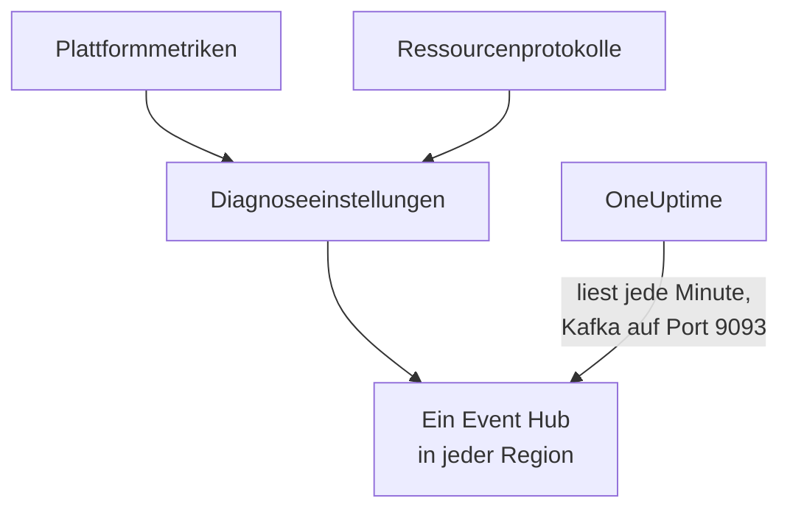

# Azure-Monitor-Metriken und -Protokolle streamen

Ein verbundenes Azure-Abonnement kann seine Azure-Monitor-Metriken und Ressourcenprotokolle an OneUptime streamen. Diagnoseeinstellungen senden sie an Event Hubs in Ihrem Abonnement, und OneUptime liest die Event Hubs jede Minute: Schlüsselmetriken kommen wenige Minuten, nachdem Azure Monitor sie hat, an statt erst beim nächsten Lesevorgang der Verbindung, und Ressourcenprotokolle kommen als OneUptime-Protokolle an, jedes unter der Ressource abgelegt, um die es geht. Ein Befehl in Azure Cloud Shell richtet alles ein, und es gibt nichts zu betreiben.

:::cards
- [So funktioniert es](#so-funktioniert-es): Diagnoseeinstellungen senden an einen Event Hub in jeder Region, und OneUptime liest sie.
- [Streaming einrichten](#streaming-einrichten): Wählen Sie, was gestreamt wird, schalten Sie das Lesen ein und führen Sie einen Befehl aus.
- [Was ankommt](#was-ankommt): Metriken an den Ressourcen, die sie messen, und Protokolle an den Ressourcen, von denen sie stammen.
- [Was der Befehl anlegt](#was-der-befehl-anlegt): Jede Ressource und jede Berechtigung, die der Befehl in Ihrem Abonnement anlegt.
- [Streaming beenden](#streaming-beenden): Beenden Sie das Lesen und löschen Sie dann, was der Befehl angelegt hat.
:::

## So funktioniert es



- **Ein Event Hub in jeder Region.** Eine Diagnoseeinstellung sendet nur an einen Event Hub in der eigenen Region ihrer Ressource, deshalb legt der Befehl in jeder Region, in der Ihre Ressourcen liegen, einen Event-Hubs-Namespace an, alle in einer Ressourcengruppe, und richtet die Diagnoseeinstellung jeder Ressource auf den Event Hub ihrer Region aus.
- **OneUptime liest sie.** Azure Monitor sendet nur an einen Event Hub, ein Speicherkonto oder einen Log-Analytics-Arbeitsbereich, nie an eine Adresse von Ihnen: Ein Event Hub, den OneUptime liest, ist der Weg, bei dem Sie nichts betreiben müssen. OneUptime meldet sich als die eigene App der Verbindung an, die diese Event Hubs lesen darf und sonst nichts.
- **Die Lesevorgänge überlassen gestreamte Metriken dem Stream.** Solange der Stream die Schlüsselmetriken eines Ressourcentyps in einer Region zustellt, schreiben die Lesevorgänge der Verbindung sie nicht mehr, sodass kein Datenpunkt doppelt gezählt wird. Die Lesevorgänge finden weiter Ressourcen, ihren Zustand und ihre Änderungen, und übernehmen die Metriken nach 15 Minuten ohne Ereignis wieder.
- **Nichts geht verloren, während OneUptime nicht lesen kann.** Ereignisse warten in den Event Hubs, bis OneUptime sie liest, so lange die Event Hubs sie aufbewahren, und OneUptime merkt sich, bis wohin es jede Partition gelesen hat, und macht dort weiter, wo es aufgehört hat.

## Bevor Sie beginnen

- **Ein verbundenes Azure-Abonnement.** Verbinden Sie es zuerst unter **Cloud → Verbinden**: siehe [Ein Cloud-Konto verbinden](/docs/telemetry/cloud-accounts).
- **Ein Projektinhaber oder Admin.** Nur sie können das Lesen einschalten und das Streaming beenden.
- **Azure Cloud Shell**, angemeldet als **Owner** der Abonnements oder als **Contributor**, der auch **User Access Administrator** ist: Der Befehl legt eine Ressourcengruppe und eine Rollenzuweisung an und ändert Diagnoseeinstellungen.
- **Ein Weg nach Azure, bei einem selbst gehosteten OneUptime.** OneUptime liest jeden Namespace unter `<namespace>.servicebus.windows.net` auf Port 9093, und die Namespaces nehmen Verbindungen aus dem Internet an.

## Streaming einrichten

:::steps
### Den Streaming-Dialog öffnen

Gehen Sie zu **Cloud → Verbinden** und wählen Sie in der Zeile des Azure-Abonnements **Metriken und Protokolle streamen**.

### Wählen, was gestreamt wird

**Metriken** streamt jede Schlüsselmetrik jeder Ressource, minutengenau: die Metriken, die OneUptime für jede Ressource darstellt und nach denen es sie bewertet. **Metriken und Protokolle** fügt die eigenen Protokolle jeder Ressource hinzu, jede Kategorie, die Azure für sie führt, und **Protokolle** streamt nur Ressourcenprotokolle.

### Das Lesen einschalten

Wählen Sie **Lesen einschalten**. OneUptime sucht jede Minute nach den Event Hubs und wartet auf sie, bis der Befehl sie angelegt hat.

### Den Befehl in Azure Cloud Shell ausführen

Kopieren Sie den Befehl, führen Sie ihn in Azure Cloud Shell aus und warten Sie, bis er fertig ist. Er nennt jede Region, in der er einen Event Hub angelegt hat, wie viele Ressourcen an sie senden und welche Ressourcen er ausgelassen hat, mit der Begründung von Azure.

### Auf die ersten Ereignisse warten

Der Dialog fragt alle paar Sekunden, was angekommen ist. Azure beginnt wenige Minuten nach Ende des Befehls zu senden; der Dialog sagt dann, was von wo kam, und die Zeile der Verbindung sagt **Streamt**.
:::

**Weitere Felder** enthält den Rest:

| Feld | Was es bewirkt |
| --- | --- |
| **Abonnements** | Die Abonnements, aus denen gestreamt wird: anfangs die, die die Verbindung liest. Das erste enthält die Event Hubs, und OneUptime liest sie dort. Höchstens 50 |
| **Auf andere Weise einrichten** | Die Namen, die der Befehl verwendet, um es mit Terraform oder dem Portal einzurichten |

Wenn das erste Abonnement nicht das ist, in dem OneUptime die Event Hubs liest, sagt der Dialog es: Wählen Sie **Dort lesen**, bevor Sie den Befehl ausführen.

## Was ankommt

| Was | Wo es landet |
| --- | --- |
| Schlüsselmetriken | An den Cloud-Ressourcen, die sie messen, in denselben Reihen, die die Lesevorgänge der Verbindung schreiben |
| Ressourcenprotokolle | Im Protokoll-Explorer, unter dem Telemetriedienst der Verbindung, mit Abonnement, Region und Kategorie als Attributen |
| Protokolle einer Ressource, die OneUptime kennt | Auch an dieser Ressource: Ihre Seite in Cloud erhält einen Tab **Protokolle** |

Der Stream trägt die Schlüsselmetriken, die die Verbindung minutengenau liest. Eine Metrik, die sie gröber liest, etwa die belegte Kapazität eines Speicherkontos, bleibt bei den Lesevorgängen. Ein Protokoll wird über die ARM-ID der Ressource unter ihr abgelegt, als `cloud.resource_id` mitgeführt, und behält Kategorie, Operation, Ergebnis und Eigenschaften als Attribute, etwa `azure.category`.

Virtuelle Computer, Skalierungsgruppen, Datenträger, Netzwerkschnittstellen, virtuelle Netzwerke, private Endpunkte, NAT-Gateways, DNS-Zonen und App-Service-Pläne senden keine eigenen Ressourcenprotokolle, deshalb haben ihre Seiten keinen Tab **Protokolle**. Die Protokolle eines Speicherkontos sind die seiner Dienste, und die einer Container-App die ihrer Umgebung.

## Was der Befehl anlegt

Die Ressourcengruppe heißt `oneuptime-stream-` und die ersten 8 Zeichen der ID der Verbindung. Sie gibt OneUptime keinen Zugriff auf Ihre Ressourcen: Die App der Verbindung darf die Event Hubs lesen, und mehr nicht.

| Ressource | Was sie darf |
| --- | --- |
| Eine Ressourcengruppe, `oneuptime-stream-<suffix>`, im ersten Abonnement | Enthält die Event Hubs, mit der ID der Verbindung als `oneuptime-connection` markiert |
| Ein Event-Hubs-Namespace in jeder Region, `oneuptime-<suffix>-<region>`, im Tarif Standard mit 1 Durchsatzeinheit | Nimmt an, was die Diagnoseeinstellungen seiner Region senden |
| Ein Event Hub in jedem, `oneuptime`, mit 2 Partitionen | Bewahrt die Ereignisse auf, bis OneUptime sie liest |
| Die Rolle **Azure Event Hubs Data Receiver** für die App der Verbindung, nur auf der Ressourcengruppe | Lässt die App die Event Hubs lesen, und sonst nichts |
| Eine Diagnoseeinstellung an jeder Ressource, `OneUptime-<suffix>` | Sendet die Metriken, die Protokolle oder beides der Ressource an den Event Hub ihrer Region |

Eine Ressource einer globalen Region, etwa Front Door, sendet an den Event Hub der ersten Region. Eine Ressource, von der Azure nur Metriken oder nur Protokolle führt, wird mit dem eingerichtet, was sie hat, und eine, die schon 5 Diagnoseeinstellungen hat, das Höchste, was Azure erlaubt, wird ausgelassen. Azure berechnet die Durchsatzeinheit jedes Namespace stundenweise und die Ereignisse, die die Diagnoseeinstellungen senden.

## Streaming beenden

:::steps
### Das Lesen beenden

Wählen Sie in der Zeile des Abonnements unter **Cloud → Verbinden** **Streaming beenden**. OneUptime hört sofort auf, die Event Hubs zu lesen, und die Verbindung liest alle ihre Metriken wieder nach ihrem Zeitplan. Was gelesen wurde, bleibt.

### Löschen, was der Befehl angelegt hat

Die Event Hubs und die Diagnoseeinstellungen bleiben in Azure, und Azure berechnet sie, bis sie gelöscht werden. Der Dialog zeigt den Befehl: Er löscht die Diagnoseeinstellung jeder Ressource und dann die Ressourcengruppe, in welchem Abonnement sie auch liegt.

```bash
oneuptime_stream_stop() {
  local SUB ID N=0
  for SUB in '11111111-aaaa-4aaa-8aaa-111111111111' '22222222-bbbb-4bbb-8bbb-222222222222'; do
    while IFS= read -r ID; do
      if [ -z "$ID" ]; then continue; fi
      az monitor diagnostic-settings delete --name OneUptime-6f1c3a2e --resource "$ID" --output none 2> /dev/null &
      N=$((N + 1))
      if [ $((N % 4)) -eq 0 ]; then wait; fi
    done < <(az resource list --subscription "$SUB" --query "[].id" --output tsv)
  done
  wait
  for SUB in '11111111-aaaa-4aaa-8aaa-111111111111' '22222222-bbbb-4bbb-8bbb-222222222222'; do
    if [ "$(az group exists --subscription "$SUB" --name oneuptime-stream-6f1c3a2e 2> /dev/null)" = true ]; then
      az group delete --subscription "$SUB" --name oneuptime-stream-6f1c3a2e --yes --no-wait && echo "Deleting oneuptime-stream-6f1c3a2e in $SUB."
    fi
  done
}
oneuptime_stream_stop
```
:::

Um zu ändern, was gestreamt wird, öffnen Sie erneut **Metriken und Protokolle streamen**, wählen Sie, was gestreamt wird, und führen Sie den neuen Befehl aus: Er aktualisiert, was der erste Lauf angelegt hat, und legt nichts doppelt an.

## Auf andere Weise einrichten

Legen Sie mit Terraform oder dem Portal an, was der Befehl anlegt, mit diesen Namen:

| Einstellung | Wert |
| --- | --- |
| Ressourcengruppe | `oneuptime-stream-<suffix>`, in dem Abonnement, in dem OneUptime die Event Hubs liest |
| Event-Hubs-Namespace | `oneuptime-<suffix>-<region>`, einer in jeder Region einer zu streamenden Ressource |
| Event Hub | `oneuptime`, in jedem Namespace |
| Diagnoseeinstellung | `OneUptime-<suffix>` an jeder Ressource, an den Event Hub ihrer Region, mit der Regel `RootManageSharedAccessKey` des Namespace |
| Rolle | **Azure Event Hubs Data Receiver** für die App der Verbindung, auf der Ressourcengruppe |

Schalten Sie dann das Lesen ein, mit diesem Abonnement als erstem unter **Abonnements**.

## Fehlerbehebung

:::details Der Dialog wartet weiter auf die ersten Ereignisse
Prüfen Sie, ob der Befehl fertig ist und gesagt hat, dass der Event Hub einer Region bereit ist: `az eventhubs namespace list --resource-group oneuptime-stream-6f1c3a2e` listet die Namespaces. Eine Diagnoseeinstellung sendet nur, was Azure Monitor hat, deshalb sendet eine Ressource, die nichts tut, wenig. Eine neue Rolle kann einige Minuten brauchen, bis sie wirkt: Bis dahin sehen die Lesevorgänge die Ereignisse nicht.
:::

:::details Die Verbindung sagt Stream schlägt fehl
Der Dialog und der Tooltip der Zeile sagen, warum. Wenn die App die Event Hubs nicht lesen darf, führen Sie den Befehl erneut aus: Er gibt der App ihre Rolle erneut. Wenn OneUptime sie nicht erreichen konnte, prüfen Sie, ob die Namespaces Verbindungen aus dem Internet annehmen und ob ein selbst gehostetes OneUptime Port 9093 erreichen darf.
:::

:::details Der Befehl hat Ressourcen ausgelassen
Er listet sie auf, jede mit der Begründung von Azure. Eine Ressource eines Typs ohne Diagnoseeinstellungen sendet nichts, und bei einer, die schon 5 Diagnoseeinstellungen hat, muss zuerst eine davon gelöscht werden. Führen Sie den Befehl dann erneut aus.
:::

## Nächste Schritte

:::cards
- [Ein Cloud-Konto verbinden](/docs/telemetry/cloud-accounts): Was eine Verbindung liest und wie oft.
- [Google-Cloud-Protokolle streamen](/docs/telemetry/cloud-streaming-google-cloud): Die Protokolle eines Google-Cloud-Projekts, über Pub/Sub gepusht.
- [CloudWatch-Metriken und -Protokolle streamen](/docs/telemetry/cloud-streaming): Die eines AWS-Kontos, zugestellt von Amazon Data Firehose.
- [Protokoll-Explorer](/docs/telemetry/logs-explorer): Durchsuchen und filtern Sie, was die Streams zugestellt haben.
:::
