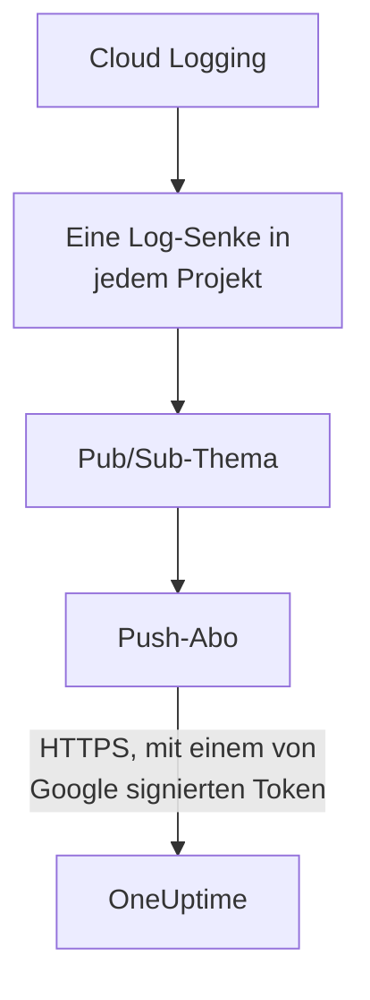

# Google-Cloud-Protokolle streamen

Ein verbundenes Google-Cloud-Projekt kann seine Protokolle an OneUptime streamen, sobald sie geschrieben werden. Cloud Logging leitet sie über eine Log-Senke in ein Pub/Sub-Thema, und das Push-Abo des Themas stellt jeden Eintrag innerhalb einer Minute an OneUptime zu, als OneUptime-Protokoll, abgelegt unter der Ressource, um die es geht. Ein Befehl in Google Cloud Shell richtet alles ein, und es gibt nichts zu betreiben. Cloud Monitoring hat keinen Export, der Metriken pusht, deshalb liest die Verbindung Metriken weiter nach ihrem Zeitplan.

:::cards
- [So funktioniert es](#so-funktioniert-es): Eine Log-Senke in jedem Projekt, ein Thema und sein Push-Abo.
- [Streaming einrichten](#streaming-einrichten): Wählen Sie die Protokolle, erstellen Sie einen Stream-Schlüssel und führen Sie einen Befehl aus.
- [Was ankommt](#was-ankommt): Protokolle an den Ressourcen, von denen sie stammen.
- [Was der Befehl anlegt](#was-der-befehl-anlegt): Jede Ressource und jede Berechtigung, die der Befehl in Ihren Projekten anlegt.
- [Streaming beenden](#streaming-beenden): Schalten Sie die Schlüssel ab und löschen Sie dann, was der Befehl angelegt hat.
:::

## So funktioniert es



- **Eine Log-Senke in jedem Projekt.** Die Senke jedes Projekts leitet die Einträge, auf die ihr Filter zutrifft, in ein einziges Pub/Sub-Thema, im Projekt des eigenen Dienstkontos der Verbindung.
- **Zwei Prüfungen bei jedem Push.** Pub/Sub signiert ein OpenID-Connect-Token für ein Dienstkonto, das nur für die Pushes angelegt wurde, und die Audience des Tokens ist der Stream-Schlüssel der Verbindung. OneUptime nimmt einen Push nur an, wenn Google sein Token für dieses Dienstkonto signiert hat und der Schlüssel einer der Verbindung ist. Der Schlüssel benennt die Verbindung und damit das Projekt: Nichts in einem Push entscheidet, wohin er geschrieben wird. OneUptime speichert nur den SHA-256 des Schlüssels.
- **Nichts geht verloren, während OneUptime es nicht annehmen kann.** Pub/Sub pusht einen abgelehnten Eintrag erneut, mit Pausen von 10 Sekunden bis zu 10 Minuten zwischen den Versuchen, und bewahrt ihn einen Tag lang auf.

## Bevor Sie beginnen

- **Ein verbundenes Google-Cloud-Projekt.** Verbinden Sie es zuerst unter **Cloud → Verbinden**: siehe [Ein Cloud-Konto verbinden](/docs/telemetry/cloud-accounts).
- **Ein Projektinhaber oder Admin.** Nur sie können einen Stream-Schlüssel erstellen und das Streaming beenden.
- **Google Cloud Shell**, angemeldet als **Owner** der Projekte oder als jemand, der darin Dienstkonten, Pub/Sub-Themen und Log-Senken anlegen darf.
- **Eine HTTPS-Adresse, bei einem selbst gehosteten OneUptime.** Pub/Sub pusht nur an `https://`-Adressen, mit einem Zertifikat, dem Google vertraut, und die Adresse muss von Google Cloud aus erreichbar sein.

## Streaming einrichten

:::steps
### Den Streaming-Dialog öffnen

Gehen Sie zu **Cloud → Verbinden** und wählen Sie in der Zeile des Google-Cloud-Projekts **Protokolle streamen**.

### Die Protokolle wählen

**Warnungen und Fehler** streamt jeden Eintrag mit Schweregrad `WARNING` oder höher: was schiefging, nicht jede Anfrage. **Jedes Protokoll** streamt jeden Eintrag außer den Data-Access-Audit-Logs, die jeden Lesezugriff festhalten und alles andere übertreffen können, was ein Projekt schreibt. **Ein eigener Filter** streamt die Einträge, auf die eine Cloud-Logging-Abfrage zutrifft, geschrieben im Feld **Filter**.

### Einen Stream-Schlüssel erstellen

Wählen Sie **Stream-Schlüssel erstellen**. Der Schlüssel wird nur dieses eine Mal angezeigt, im Befehl: OneUptime speichert nur seinen SHA-256.

### Den Befehl in Google Cloud Shell ausführen

Kopieren Sie den Befehl, führen Sie ihn in Google Cloud Shell aus und warten Sie, bis er fertig ist. Er nennt jedes Projekt, in dem er eine Senke eingerichtet hat, und hält beim ersten Schritt an, den Google ablehnt, mit der Begründung von Google.

### Auf den ersten Push warten

Der Dialog fragt alle paar Sekunden, was angekommen ist. Pub/Sub pusht einen Eintrag innerhalb einer Minute, nachdem ein Projekt einen geschrieben hat, den der Filter annimmt; der Dialog sagt dann, was von wo kam, und die Zeile der Verbindung sagt **Streamt**.
:::

**Weitere Felder** enthält den Rest:

| Feld | Was es bewirkt |
| --- | --- |
| **Projekte** | Die Projekte, aus denen Protokolle gestreamt werden: anfangs die, die die Verbindung liest. Das Thema wird im Projekt des Dienstkontos der Verbindung angelegt. Höchstens 100 |
| **Auf andere Weise einrichten** | Der Push-Endpunkt, das Push-Dienstkonto und der Schlüssel, um es mit Terraform oder der Konsole einzurichten |

## Was ankommt

| Was | Wo es landet |
| --- | --- |
| Protokolle | Im Protokoll-Explorer, unter dem Telemetriedienst der Verbindung, mit Projekt, Region und Protokollname als Attributen |
| Protokolle einer Ressource, die OneUptime kennt | Auch an dieser Ressource: Ihre Seite in Cloud erhält einen Tab **Protokolle** |

Jedes Protokoll behält die Zeit seines Eintrags auf die Nanosekunde, seinen Schweregrad, seinen Trace und Span und seine HTTP-Anfrage unter den Namen der semantischen Konventionen von OpenTelemetry. Es wird unter einer Ressource abgelegt, wenn seine überwachte Ressource eine Art ist, deren Metriken OneUptime liest, etwa eine VM (`gce_instance`), ein Cloud-Run-Dienst (`cloud_run_revision`) oder eine Cloud-SQL-Instanz (`cloudsql_database`), und trägt die ID der Ressource als `cloud.resource_id`. Die Anfrageprotokolle eines externen Load Balancers, geschrieben unter `http_load_balancer`, werden unter seiner URL-Zuordnung abgelegt, der `https_lb_rule`, unter der seine Metriken landen.

Die Protokolle einer Instanzgruppe sind die ihrer VMs, deshalb hat ihre Seite keinen Tab **Protokolle**. Ein Eintrag einer anderen Art wird trotzdem gestreamt, unter seinem Projekt.

## Was der Befehl anlegt

Seine Ressourcen sind nach den ersten 8 Zeichen der ID der Verbindung benannt. Er gibt OneUptime keinen Zugriff auf Ihre Projekte: Einträge fließen nur hinaus.

| Ressource | Was sie darf |
| --- | --- |
| Ein Dienstkonto, `oneuptime-push-<suffix>`, im Projekt des Dienstkontos der Verbindung | Hat keine Rolle: Pub/Sub signiert die Tokens seiner Pushes dafür |
| Die Rolle **Service Account OpenID Connect Identity Token Creator** für den Pub/Sub-Dienst-Agent, nur auf diesem Dienstkonto | Lässt Pub/Sub diese Tokens erstellen, und sonst nichts |
| Ein Pub/Sub-Thema, `oneuptime-stream-<suffix>` | Enthält die Einträge, die die Senken weiterleiten |
| Sein Push-Abo, `oneuptime-stream-<suffix>-push` | Pusht jeden Eintrag an OneUptime, mit einer Bestätigungsfrist von 60 Sekunden, und bewahrt einen Tag lang auf, was es nicht pushen konnte |
| Eine Log-Senke in jedem Projekt, `oneuptime-stream-<suffix>` | Leitet die Einträge, auf die ihr Filter zutrifft, in das Thema |
| Die Rolle **Pub/Sub Publisher** für den Writer jeder Senke, nur auf dem Thema | Lässt die Senke in das Thema veröffentlichen, und sonst nichts |

Der Befehl schaltet die APIs von Pub/Sub und Cloud Logging im Projekt des Themas ein, wenn sie aus sind. Google berechnet Pub/Sub für die zugestellten Protokolle: Streamen Sie nur die Protokolle, die Sie brauchen.

## Streaming beenden

:::steps
### Die Schlüssel abschalten

Wählen Sie in der Zeile des Projekts unter **Cloud → Verbinden** **Streaming beenden**. Jeder Stream-Schlüssel der Verbindung funktioniert sofort nicht mehr, und OneUptime lehnt ab, was Pub/Sub pusht. Was zugestellt wurde, bleibt.

### Löschen, was der Befehl angelegt hat

Die Senken, das Thema und sein Push-Abo bleiben in Google Cloud, und Pub/Sub pusht weiter, bis sie gelöscht werden. Der Dialog zeigt den Befehl, für die Projekte, die die Verbindung liest:

```bash
for SOURCE in 'acme-prod' 'acme-data'; do
  gcloud logging sinks delete oneuptime-stream-6f1c3a2e --project "$SOURCE" --quiet
done
gcloud pubsub subscriptions delete oneuptime-stream-6f1c3a2e-push --project 'acme-prod' --quiet
gcloud pubsub topics delete oneuptime-stream-6f1c3a2e --project 'acme-prod' --quiet
gcloud iam service-accounts delete 'oneuptime-push-6f1c3a2e@acme-prod.iam.gserviceaccount.com' --project 'acme-prod' --quiet
```
:::

Um zu ändern, welche Protokolle gestreamt werden, öffnen Sie erneut **Protokolle streamen**, wählen Sie **Neuen Schlüssel erstellen** und führen Sie den neuen Befehl aus. Der Schlüssel, den er ersetzt, funktioniert noch 24 Stunden lang, sodass kein Push abgelehnt wird, während das Abo aktualisiert wird. Höchstens 3 ersetzte Schlüssel funktionieren gleichzeitig.

## Auf andere Weise einrichten

Geben Sie einem Pub/Sub-Thema ein Push-Abo mit diesen Werten, und lassen Sie den Pub/Sub-Dienst-Agent Tokens für das Push-Dienstkonto erstellen:

| Einstellung | Wert |
| --- | --- |
| Push-Endpunkt | `https://oneuptime.com/telemetry/gcp-pubsub/v1/logs` |
| Authentifizierung | Ein OpenID-Connect-Token für `oneuptime-push-<suffix>@<project>.iam.gserviceaccount.com` |
| Audience | Der Stream-Schlüssel |
| Nutzlast | Umschlossen, wie Pub/Sub sie ohne andere Anweisung sendet |
| Bestätigungsfrist | 60 Sekunden |
| Nachrichtenaufbewahrung | 1 Tag |

Leiten Sie dann die Protokolle jedes Projekts mit einer Log-Senke in das Thema, und geben Sie dem Writer jeder Senke **Pub/Sub Publisher** auf dem Thema. Ersetzen Sie bei einem selbst gehosteten OneUptime `https://oneuptime.com` durch die HTTPS-Adresse Ihres OneUptime.

OneUptime beantwortet jeden Push so, wie Pub/Sub es erwartet:

| Antwort | Wann | Was Pub/Sub tut |
| --- | --- | --- |
| `204` | Der Eintrag wurde angenommen oder schon zuvor angenommen, oder die Nachricht ist kein Protokolleintrag | Macht weiter |
| `400` | Es ist kein Pub/Sub-Push, den OneUptime lesen kann | Pusht ihn erneut, mit jedes Mal längerer Pause, einen Tag lang |
| `401` | Das Token ist keines, das Google für das Push-Dienstkonto signiert hat, oder seine Audience ist kein Schlüssel der Verbindung | Pusht ihn erneut, mit jedes Mal längerer Pause, einen Tag lang |
| `402` | Das Projekt kann nicht für Telemetrie abgerechnet werden | Pusht ihn erneut, mit jedes Mal längerer Pause, einen Tag lang |
| `403` | Die Verbindung ist ausgeschaltet, oder das Projekt kann keine Telemetrie annehmen | Pusht ihn erneut, mit jedes Mal längerer Pause, einen Tag lang |
| `413` | Die Anfrage ist größer als 1 MiB, oder ihr Eintrag größer als 512 KiB | Pusht ihn erneut, mit jedes Mal längerer Pause, einen Tag lang |
| `429` | Das Abo der Verbindung hat in einer Minute mehr als 12.000 Einträge gepusht | Pusht ihn erneut, mit jedes Mal längerer Pause, einen Tag lang |
| `503` | OneUptime konnte das Token gerade nicht prüfen oder den Eintrag nicht in die Warteschlange stellen | Pusht ihn erneut, mit jedes Mal längerer Pause, einen Tag lang |

## Fehlerbehebung

:::details Der Dialog wartet weiter auf den ersten Push
Prüfen Sie, ob der Befehl ohne Halt fertig wurde und ob ein Projekt einen Eintrag geschrieben hat, den der Filter annimmt: Mit **Warnungen und Fehler** sendet ein ruhiges Projekt nichts. `gcloud pubsub subscriptions describe oneuptime-stream-6f1c3a2e-push --project acme-prod` zeigt den Endpunkt des Abos. Prüfen Sie bei einem selbst gehosteten OneUptime, ob Google Cloud seine Adresse über HTTPS erreicht.
:::

:::details Die Verbindung sagt Stream abgelehnt
Der Dialog und der Tooltip der Zeile sagen, warum. Ein falscher Schlüssel bedeutet, dass das Abo mit einem Schlüssel pusht, der nicht mehr funktioniert: Erstellen Sie einen neuen Schlüssel und führen Sie den Befehl erneut aus. Ein Push, der nicht für das Push-Dienstkonto signiert ist, bedeutet, dass das Abo als ein anderes signiert oder Pub/Sub nicht dafür signieren darf: Führen Sie den Befehl erneut aus.
:::

:::details Die Protokolle einer Ressource erscheinen nicht auf ihrer Seite
Die Seite zeigt die Protokolle, die Cloud Logging unter der überwachten Ressource der Ressource ablegt, mit den Labels, die ihre Metriken haben. Protokolle, die eine Arbeitslast unter einer anderen Ressource schreibt, etwa die eines Containers, werden nur unter ihrem Projekt gestreamt.
:::

## Nächste Schritte

:::cards
- [Ein Cloud-Konto verbinden](/docs/telemetry/cloud-accounts): Was eine Verbindung liest und wie oft.
- [Azure-Monitor-Metriken und -Protokolle streamen](/docs/telemetry/cloud-streaming-azure): Die eines Azure-Abonnements, aus Event Hubs gelesen.
- [CloudWatch-Metriken und -Protokolle streamen](/docs/telemetry/cloud-streaming): Die eines AWS-Kontos, zugestellt von Amazon Data Firehose.
- [Protokoll-Explorer](/docs/telemetry/logs-explorer): Durchsuchen und filtern Sie, was die Streams zugestellt haben.
:::
