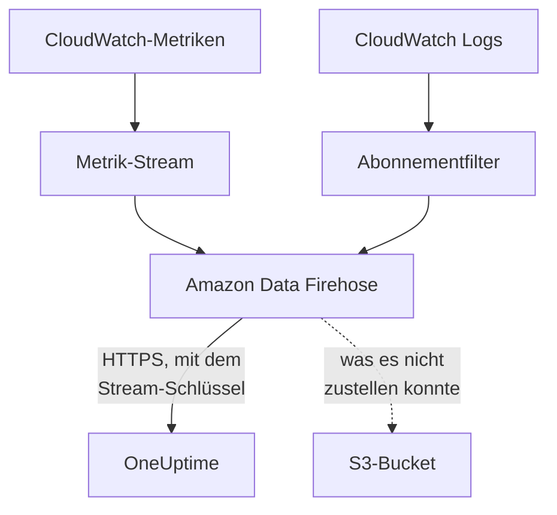

# CloudWatch-Metriken und -Protokolle streamen

Ein verbundenes AWS-Konto kann seine CloudWatch-Metriken und -Protokolle über Amazon Data Firehose an OneUptime streamen. Metriken kommen dann wenige Minuten, nachdem CloudWatch sie hat, an statt erst beim nächsten Lesevorgang der Verbindung, und CloudWatch Logs kommen als OneUptime-Protokolle an, jedes unter der Ressource abgelegt, um die es geht. Ein Befehl in AWS CloudShell richtet alles ein, und es gibt nichts zu betreiben.

:::cards
- [So funktioniert es](#so-funktioniert-es): Ein Metrik-Stream und Protokollabonnements in jeder Region, zugestellt von Firehose.
- [Streaming einrichten](#streaming-einrichten): Wählen Sie, was gestreamt wird, erstellen Sie einen Stream-Schlüssel und führen Sie einen Befehl aus.
- [Was ankommt](#was-ankommt): Metriken an den Ressourcen, die sie messen, und Protokolle an den Ressourcen, von denen sie stammen.
- [Was der Stack anlegt](#was-der-stack-anlegt): Jede Ressource und jede Berechtigung, die der Befehl in Ihrem Konto anlegt.
- [Streaming beenden](#streaming-beenden): Schalten Sie die Schlüssel ab und löschen Sie dann die Stacks.
:::

## So funktioniert es



- **Ein Stack in jeder Region.** Der Befehl stellt in jeder Region, aus der Sie streamen, einen CloudFormation-Stack bereit. Sein Metrik-Stream und seine Protokoll-Abonnementfilter übergeben alles an zwei Firehose-Streams, und Firehose stellt es über HTTPS an OneUptime zu.
- **Der Stream-Schlüssel sagt, wem es gehört.** Firehose sendet mit jeder Zustellung den Stream-Schlüssel der Verbindung. Der Schlüssel benennt die Verbindung und damit das Projekt: Nichts in einer Zustellung entscheidet, wohin sie geschrieben wird. OneUptime speichert nur den SHA-256 des Schlüssels.
- **Die Lesevorgänge überlassen gestreamte Metriken dem Stream.** Solange ein Stream einen Namespace einer Region zustellt, schreiben die Lesevorgänge der Verbindung die Metriken dieses Namespaces nicht mehr, sodass kein Datenpunkt doppelt gezählt wird. Die Lesevorgänge finden weiter Ressourcen, ihren Zustand und ihre Änderungen, und übernehmen einen Namespace nach 15 Minuten ohne Zustellung wieder.
- **Nichts geht verloren, während OneUptime es nicht annehmen kann.** Firehose sendet ein abgelehntes Paket bis zu eine Stunde lang erneut und bewahrt es dann 30 Tage lang im S3-Bucket des Stacks auf.

## Bevor Sie beginnen

- **Ein verbundenes AWS-Konto.** Verbinden Sie es zuerst unter **Cloud → Verbinden**: siehe [Ein Cloud-Konto verbinden](/docs/telemetry/cloud-accounts).
- **Ein Projektinhaber oder Admin.** Nur sie können einen Stream-Schlüssel erstellen und das Streaming beenden.
- **AWS CloudShell in diesem Konto**, angemeldet als jemand, der CloudFormation-Stacks und IAM-Rollen anlegen darf.
- **Eine HTTPS-Adresse, bei einem selbst gehosteten OneUptime.** Firehose stellt nur an `https://`-Adressen auf Port 443 zu, mit einem Zertifikat, dem AWS vertraut, und die Adresse muss von AWS aus erreichbar sein.

## Streaming einrichten

:::steps
### Den Streaming-Dialog öffnen

Gehen Sie zu **Cloud → Verbinden** und wählen Sie in der Zeile des AWS-Kontos **Metriken und Protokolle streamen**.

### Wählen, was gestreamt wird

**Metriken** streamt jede Schlüsselmetrik jeder Ressource, einmal pro Minute: die Metriken, die OneUptime für jede Ressource darstellt und nach denen es sie bewertet. **Metriken und Protokolle** fügt CloudWatch Logs hinzu, und **Protokolle** streamt nur CloudWatch Logs.

Für Protokolle geben Sie die **Protokollgruppen** an, eine pro Zeile, mit Namen in der **Region** daneben oder mit ARN in ihrer eigenen Region, oder wählen Sie **Jede Protokollgruppe des Kontos, auch neue**. Ein Befehl abonniert höchstens 50 Protokollgruppen mit Namen, in höchstens 10 Regionen.

### Einen Stream-Schlüssel erstellen

Wählen Sie **Stream-Schlüssel erstellen**. Der Schlüssel wird nur dieses eine Mal angezeigt, im Befehl: OneUptime speichert nur seinen SHA-256.

### Den Befehl in AWS CloudShell ausführen

Kopieren Sie den Befehl, führen Sie ihn in AWS CloudShell aus und warten Sie, bis er fertig ist. Er schreibt die Vorlage nach `oneuptime-stream.json` und stellt sie in jeder Region bereit, mit dem Schlüssel als Parameter, der nie wieder angezeigt wird.

### Auf die erste Zustellung warten

Der Dialog fragt alle paar Sekunden, was angekommen ist. Firehose stellt innerhalb weniger Minuten nach Abschluss des Befehls zu; der Dialog sagt dann, was woher kam, und die Zeile der Verbindung sagt **Streamt**.
:::

**Weitere Felder** enthält den Rest:

| Feld | Was es bewirkt |
| --- | --- |
| **Jede Metrik, nicht nur die Schlüsselmetriken** | Streamt jede Metrik, die CloudWatch für das Konto hat, auch Ihre eigenen. AWS berechnet jede Metrikaktualisierung, die ein Stream sendet, daher kann es ein Vielfaches kosten |
| **Regionen** | Woher gestreamt wird: zunächst die Regionen, in denen die Verbindung Ressourcen gefunden hat. Leer gelassen, streamt der Befehl aus der eigenen Region von AWS CloudShell. Höchstens 30 |
| **Auf andere Weise einrichten** | Die Endpunkte für Metriken und Protokolle und der Schlüssel, um die Streams mit Terraform oder der Konsole einzurichten |

**Vorlage herunterladen** speichert die Vorlage, die der Befehl bereitstellt, um sie auf Ihre eigene Weise bereitzustellen.

## Was ankommt

| Was | Wo es landet |
| --- | --- |
| Metriken | An den Cloud-Ressourcen, die sie messen, mit den Namen und Attributen, die ihnen die Lesevorgänge der Verbindung geben |
| Protokolle | Im Protokoll-Explorer, unter dem Telemetriedienst der Verbindung, mit Konto, Region und Protokollgruppe als Attributen |
| Protokolle einer Protokollgruppe, die AWS nach einer Ressource benennt | Auch an dieser Ressource: Ihre Seite in Cloud erhält einen Tab **Protokolle** |

Eine Protokollgruppe wird unter einer Ressource abgelegt, wenn AWS sie nach einer benannt hat:

| Protokollgruppe | Ressourcentyp |
| --- | --- |
| `/aws/lambda/<function>` | `AWS::Lambda::Function` |
| `/aws/rds/instance/<instance>/<log>` | `AWS::RDS::DBInstance` |
| `/aws/rds/cluster/<cluster>/<log>` | `AWS::RDS::DBCluster` |
| `/aws/docdb/<cluster>/<log>` | `AWS::DocDB::DBCluster` |
| `/aws/neptune/<cluster>/<log>` | `AWS::Neptune::DBCluster` |
| `/aws/redshift/cluster/<cluster>/<log>` | `AWS::Redshift::Cluster` |
| `/aws/OpenSearchService/domains/<domain>/<log>` | `AWS::OpenSearchService::Domain` |
| `/aws/aes/domains/<domain>/<log>` | `AWS::OpenSearchService::Domain` |
| `/aws/apprunner/<service>/<service-id>/<log>` | `AWS::AppRunner::Service` |
| `/aws/elasticbeanstalk/<environment>/<log>` | `AWS::ElasticBeanstalk::Environment` |
| `/aws/ecs/containerinsights/<cluster>/performance` | `AWS::ECS::Cluster` |

Jedes Protokoll trägt die ID der Ressource als `cloud.resource_id`, und die Protokolle einer Lambda-Funktion tragen zusätzlich `faas.name`, sodass sie auch an der Funktion unter Serverless erscheinen. Eine Protokollgruppe mit einem anderen Namen wird trotzdem gestreamt, unter ihrem Konto und ihrer Region. Der Schweregrad eines Protokolls ist der, den seine Nachricht nennt, so wie Lambda ihn schreibt.

## Was der Stack anlegt

Der Stack heißt `OneUptimeStream-` gefolgt von den ersten 8 Zeichen der ID der Verbindung. Er gibt OneUptime keinen Zugriff auf Ihr Konto: Daten fließen nur hinaus.

| Ressource | Was sie darf |
| --- | --- |
| Ein CloudWatch-Metrik-Stream im Format OpenTelemetry 1.0 | Nur Datensätze in den Firehose-Stream für Metriken schreiben |
| Protokoll-Abonnementfilter oder eine kontoweite Abonnementrichtlinie für jede Protokollgruppe | Nur Datensätze in den Firehose-Stream für Protokolle schreiben |
| Zwei Firehose-Streams, `OneUptime-<suffix>-metrics` und `OneUptime-<suffix>-logs` | An OneUptime zustellen, mit GZIP, einem Puffer von 1 MiB oder 60 Sekunden und einer Stunde Wiederholungen, und was sie nicht zustellen konnten, in den Bucket schreiben |
| Ein S3-Bucket für das, was nicht zugestellt werden konnte | Öffentlicher Zugriff blockiert, verschlüsselt, nach 30 Tagen geleert und beim Löschen des Stacks behalten |
| Eine Protokollgruppe, `/aws/kinesisfirehose/OneUptime-<suffix>` | Enthält die eigenen Zustellfehler von Firehose und wird nie gestreamt |
| Drei IAM-Rollen | Jede vertraut einem AWS-Dienst dieses Kontos und erlaubt nur, was die Zeilen darüber sagen |

AWS berechnet den Metrik-Stream für jede Metrikaktualisierung, die er sendet, und Firehose für das, was es zustellt. Streamen Sie nur die Metriken und Protokollgruppen, die Sie brauchen.

## Streaming beenden

:::steps
### Die Schlüssel abschalten

Wählen Sie in der Zeile des Kontos unter **Cloud → Verbinden** **Streaming beenden**. Jeder Stream-Schlüssel der Verbindung funktioniert sofort nicht mehr, OneUptime lehnt ab, was die Streams zustellen, und die Verbindung liest wieder alle Metriken nach ihrem Zeitplan. Was die Streams zugestellt haben, bleibt erhalten.

### Die Stacks löschen

Die Streams bleiben in AWS, und AWS berechnet sie, bis ihre Stacks gelöscht sind. Der Dialog zeigt den Befehl, für die Regionen, aus denen die Streams geliefert haben, und die, in denen die Verbindung Ressourcen gefunden hat:

```bash
for REGION in us-east-1 eu-west-1; do
  aws cloudformation delete-stack --region "$REGION" --stack-name OneUptimeStream-6f1c3a2e
done
```
:::

Um zu ändern, was ein Stack streamt, öffnen Sie erneut **Metriken und Protokolle streamen**, wählen Sie **Neuen Schlüssel erstellen** und führen Sie den neuen Befehl aus. Der Schlüssel, den er ersetzt, funktioniert noch 24 Stunden, sodass keine Zustellung abgelehnt wird, während die Stacks aktualisiert werden. Höchstens 3 ersetzte Schlüssel funktionieren gleichzeitig.

## Auf andere Weise einrichten

Geben Sie jedem Firehose-Stream ein HTTP-Endpunktziel mit diesen Werten und dem Metrik-Stream das Ausgabeformat OpenTelemetry 1.0:

| Einstellung | Wert |
| --- | --- |
| Metrik-Endpunkt | `https://oneuptime.com/telemetry/aws-firehose/v1/metrics` |
| Protokoll-Endpunkt | `https://oneuptime.com/telemetry/aws-firehose/v1/logs` |
| Zugriffsschlüssel | Der Stream-Schlüssel, gesendet als `X-Amz-Firehose-Access-Key` |
| Inhaltskodierung | `GZIP` |
| Puffer | 1 MiB oder 60 Sekunden |
| Wiederholungsdauer | 3600 Sekunden, mit einem S3-Bucket für das, was nicht zugestellt werden konnte |

Ersetzen Sie bei einem selbst gehosteten OneUptime `https://oneuptime.com` durch die HTTPS-Adresse Ihres OneUptime. Der Metrik-Endpunkt nimmt auch einen Metrik-Stream im JSON-Format an.

OneUptime beantwortet jede Zustellung so, wie Firehose es erwartet:

| Antwort | Wann | Was Firehose tut |
| --- | --- | --- |
| `200` | Die Zustellung wurde angenommen, oder sie wurde schon früher angenommen | Macht weiter |
| `400` | Es ist keine Firehose-Zustellung, die OneUptime lesen kann, etwa eine mit mehr als 10.000 Datensätzen | Sendet sie bis zu eine Stunde lang erneut |
| `401` | Der Schlüssel gehört nicht zu denen der Verbindung | Sendet sie bis zu eine Stunde lang erneut |
| `402` | Das Projekt kann nicht für Telemetrie abgerechnet werden | Sendet sie bis zu eine Stunde lang erneut |
| `403` | Die Verbindung ist ausgeschaltet, oder das Projekt kann keine Telemetrie annehmen | Sendet sie bis zu eine Stunde lang erneut |
| `413` | Die Anfrage ist größer als 4 MiB oder wird entpackt größer als 32 MiB | Bewahrt sie im Bucket auf |
| `429` | Die Streams der Verbindung haben mehr als 600 Zustellungen in einer Minute gesendet | Sendet sie später erneut |

## Fehlerbehebung

:::details Der Dialog wartet weiter auf die erste Zustellung
Prüfen Sie, ob der Befehl in jeder Region ohne Fehler fertig wurde: `aws cloudformation describe-stacks --stack-name OneUptimeStream-6f1c3a2e` nennt den Status des Stacks. Ein Metrik-Stream stellt nur Metriken zu, die CloudWatch hat, daher sendet eine Region ohne Ressourcen nichts. Prüfen Sie bei einem selbst gehosteten OneUptime, ob AWS seine Adresse über HTTPS auf Port 443 erreicht.
:::

:::details Die Verbindung sagt Stream abgelehnt
Der Dialog und der Tooltip der Zeile sagen, warum. Ein falscher Schlüssel bedeutet, dass die Stacks mit einem Schlüssel laufen, der nicht mehr funktioniert: Erstellen Sie einen neuen Schlüssel und führen Sie den Befehl erneut aus. Firehose sendet weiter, was es hält, und es wird angenommen, sobald der Schlüssel stimmt.
:::

:::details Die Protokolle einer Lambda-Funktion erscheinen nicht auf ihrer Seite
Die Seite zeigt die Protokolle der Protokollgruppe, die nach der Funktion benannt ist, `/aws/lambda/<function>`. Eine Funktion, die in eine Protokollgruppe mit einem anderen Namen schreibt, streamt ihre Protokolle nur unter ihrem Konto und ihrer Region.
:::

## Nächste Schritte

:::cards
- [Ein Cloud-Konto verbinden](/docs/telemetry/cloud-accounts): Was eine Verbindung liest, und wie oft.
- [Cloud-Ressourcen (IaaS & PaaS)](/docs/telemetry/cloud-resources): Jeder Ressourcentyp, den OneUptime erkennt.
- [Protokoll-Explorer](/docs/telemetry/logs-explorer): Durchsuchen und filtern Sie, was die Streams zugestellt haben.
:::
