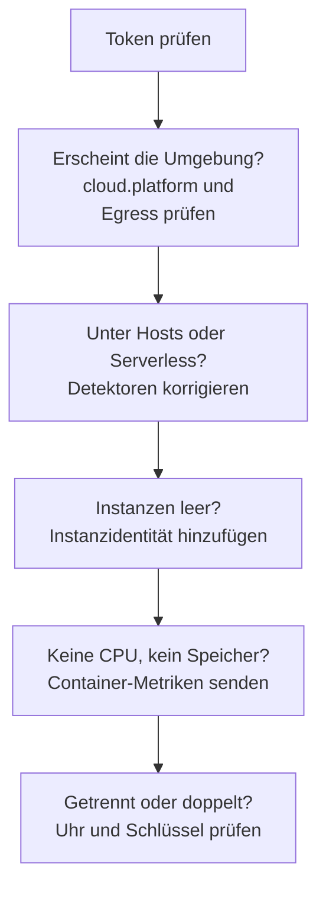

# Cloud-Fehlerbehebung

Finden Sie heraus, warum eine Cloud-Umgebung fehlt, am falschen Ort abgelegt, leer oder doppelt ist. Die Abschnitte folgen der Reihenfolge, in der diese Dinge scheitern, und jeder schließt eine Schicht aus, also arbeiten Sie sich von oben nach unten durch. Die Fehler, die zu einer einzelnen Plattform gehören, stehen am Ende ihrer Seite: [AWS ECS / Fargate](/docs/telemetry/cloud-aws-ecs), [Google Cloud Run](/docs/telemetry/cloud-gcp-cloud-run), [Azure Container Apps](/docs/telemetry/cloud-azure-container-apps) und [Weitere Cloud-Plattformen](/docs/telemetry/cloud-other-platforms).



## Zuerst das Token prüfen

Es ist die günstigste Prüfung, und ohne sie funktioniert nichts weiter unten:

```bash
curl -i https://oneuptime.com/otlp/v1/validate \
  -H "x-oneuptime-token: YOUR_TELEMETRY_INGESTION_TOKEN"
```

| Antwort | Was sie bedeutet |
| ------------------------- | -------------------------------------------------------------------------------------------------------------------------- |
| `200`, `"valid": true` | Das Token wird angenommen. Sein `keyType` sollte `Server` sein: Ein `Browser`-Schlüssel wird von einem Collector oder einem Backend-Dienst abgelehnt. |
| `401`, `"valid": false` | Das Token fehlt, ist unbekannt, widerrufen, deaktiviert oder abgelaufen, und die `message` der Antwort sagt, was davon. Erstellen Sie einen neuen Schlüssel unter **Projekteinstellungen → Telemetrie & APM → Ingestion-Schlüssel** und stellen Sie ihn erneut bereit. |

Wenn Sie OneUptime selbst hosten, verwenden Sie `https://YOUR-ONEUPTIME-HOST/otlp/v1/validate`. Führen Sie die Prüfung möglichst im Task, in der Instanz oder im Replikat aus (ECS Exec, `az containerapp exec`): Das beweist, dass der Workload selbst OneUptime erreicht, nicht nur Ihr Laptop.

## Die Umgebung erscheint nicht

Nichts unter **Cloud → Alle Umgebungen**, eine Minute nach der ersten Anfrage. Prüfen Sie diese drei, in dieser Reihenfolge.

**`cloud.platform` fehlt oder ist kein verwalteter Wert.** OneUptime legt Telemetrie nur dann unter Cloud-Umgebungen ab, wenn die Ressource einen dieser Werte trägt: `aws_ecs`, `aws_elastic_beanstalk`, `aws_app_runner`, `gcp_cloud_run`, `gcp_app_engine`, `azure_container_apps`, `azure_container_instances` oder `azure_app_service`. Die üblichen Ursachen:

- Der Ressourcendetektor ist im SDK ausgeschaltet (`OTEL_NODE_RESOURCE_DETECTORS`, `OTEL_EXPERIMENTAL_RESOURCE_DETECTORS`, `-Dotel.resource.providers.<cloud>.enabled=true`).
- Die Pipeline des Collectors überspringt den `resourcedetection`-Prozessor.
- Auf einer Plattform ohne Detektor hat `OTEL_RESOURCE_ATTRIBUTES` einen Tippfehler.

Die Azure-Detektoren für Node.js und .NET schreiben `azure.container_apps`, `azure.app_service` und `azure.functions`; OneUptime schreibt sie in die Werte mit Unterstrich um, sie zählen also. Um zu sehen, was Ihre Telemetrie trägt, öffnen Sie den Dienst unter **Dienste**, öffnen einen seiner Traces aus dem Tab **Traces** und lesen die Ressourcenattribute. Fehlt `cloud.platform` dort, ist das das ganze Problem.

**Das Token ist falsch.** Die Token-Prüfung hat mit `401` geantwortet. Der Collector protokolliert das als `Permanent error: ... 401`. Ein SDK protokolliert es einmal und versucht es nicht erneut, was korrektes OTLP-Verhalten ist und leicht übersehen wird.

**Ausgehender Verkehr ist blockiert.** Der Collector protokolliert `connection refused`, `context deadline exceeded`, `i/o timeout` oder einen DNS-Fehler:

- **ECS und Fargate:** Ein privates Subnetz braucht ein NAT-Gateway oder `assignPublicIp=ENABLED`, und die Sicherheitsgruppe muss ausgehenden Verkehr auf TCP 443 erlauben.
- **Cloud Run:** **VPC egress: All traffic** braucht Cloud NAT.
- **Container Apps:** Eine benutzerdefinierte Route zu einer Firewall muss den OneUptime-Host erlauben.
- **Überall:** Ein selbst gehostetes OneUptime hinter einem privaten DNS-Namen muss aus dem Netzwerk des Workloads auflösbar sein.

## Sie erscheint stattdessen unter Hosts

Die Ressource trägt die Plattform einer virtuellen Maschine (`aws_ec2`, `gcp_compute_engine` oder `azure_vm`), daher legt OneUptime sie unter **Hosts** ab: richtig für eine virtuelle Maschine, falsch für verwaltetes Computing. Der Detektor einer virtuellen Maschine hat sich gegen den verwalteten durchgesetzt: `detectors: [ec2, elastic_beanstalk]` in einem Collector, in dem der erste Detektor gewinnt, der `cloud.platform` setzt, oder ein SDK, dessen Reihenfolge den EC2-Detektor bevorzugt. Stellen Sie `elastic_beanstalk` an den Anfang, oder setzen Sie `cloud.platform` selbst in `OTEL_RESOURCE_ATTRIBUTES` und behalten Sie nur den `env`-Detektor.

## Sie erscheint nur unter Serverless-Funktionen

Die Ressource trägt `faas.name`, aber keine verwaltete `cloud.platform`. Cloud Run und App Engine setzen beides, wenn der GCP-Detektor läuft. Wenn Sie `faas.name` von Hand setzen oder ein Collector die Ressourcenattribute verwirft, die der Detektor des SDK gesetzt hat, ist nur die Serverless-Seite erfüllt. Schalten Sie den Detektor ein, oder setzen Sie `cloud.platform=gcp_cloud_run` (oder `gcp_app_engine`), `cloud.account.id` und `cloud.region` selbst.

> [!NOTE]
> Auf Cloud Run und App Engine soll ein Dienst an beiden Stellen erscheinen: Die Umgebung fasst Projekt und Region zusammen, und **Serverless-Funktionen** zeigt den einzelnen Dienst.

## Instanzen ist leer

Die Umgebung ist da, aber ihr Tab **Instanzen** listet nichts auf: Die Telemetrie trägt keine Instanzidentität. OneUptime benennt eine Instanz nach dem ersten dieser Ressourcenattribute, das es findet:

1. `aws.ecs.task.id`
2. `aws.ecs.task.arn` (gekürzt auf die Task-ID)
3. `faas.instance`
4. `azure.container_app.instance.id`
5. `service.instance.id`
6. `container.id`
7. `host.id`
8. `host.name`

Die eigene Identität der Plattform kommt vor `service.instance.id`, damit eine ID, die das SDK für jeden Prozess erfindet (das Node.js SDK tut das standardmäßig), einen Task nicht von CPU und Arbeitsspeicher seines Sidecars trennt. Was die Identität auf jeder Plattform setzt:

| Plattform | Was die Identität setzt |
| ----------------------------------------- | ------------------------------------------------------------------------------------------------------------------------------------------------ |
| ECS | Der `ecs`-Detektor setzt den Task-ARN |
| Cloud Run, App Engine | Der `gcp`-Detektor setzt `faas.instance` |
| Container Apps | Der `azurecontainerapps`-Detektor des Collectors setzt die Replikat-ID; oder setzen Sie `service.instance.id` aus `CONTAINER_APP_REPLICA_NAME`, oder führen Sie den Host-Detektor aus |
| App Runner, Container Instances | `host.name` des Host-Detektors |
| App Service, Elastic Beanstalk | Der Detektor der Plattform setzt `service.instance.id`; auf Beanstalk löschen Sie sie, damit `host.id` jede Instanz benennt |

Eine Instanz erscheint innerhalb einer Minute nach dem ersten Signal, das das Attribut trägt.

## CPU und Arbeitsspeicher sind leer

Die Instanzen sind aufgeführt, aber die Kacheln **CPU** und **Arbeitsspeicher** der Übersicht und die Spalten CPU und Arbeitsspeicher von **Instanzen** sind leer. Diese stammen aus Metriken, nicht aus Traces: Datenpunkte `container.cpu.utilization` und `container.memory.usage` (oder `container.memory.usage.total`), deren Ressource dieselbe Instanzidentität trägt wie die Traces, und `cloud.platform`.

- **Auf ECS** liefert sie der `awsecscontainermetrics`-Receiver in einem Sidecar-Collector als `ecs.task.cpu.utilized` und `ecs.task.memory.utilized`. Behalten Sie ihn in der `metrics`-Pipeline, und behalten Sie auch `resourcedetection` in dieser Pipeline, sonst kommen die Metriken ohne `cloud.platform` an und werden anderswo abgelegt.
- **Auf Cloud Run, Container Apps und den anderen Plattformen** zeigt die Plattform einem Sidecar die Container-Nutzung nicht. Die Kacheln bleiben leer, es sei denn, Sie senden diese Metriken selbst: Lesen Sie stattdessen die Anfrage-Kacheln.
- **Mit SDK direct** sendet nichts Container-Metriken, leere Kacheln sind also zu erwarten.

## Die Umgebung zeigt Getrennt

Eine Umgebung zeigt **Getrennt**, wenn 15 Minuten lang keine Telemetrie für sie eingetroffen ist, und der nächste Span, Log oder die nächste Metrik bringt sie zurück. Zeit, in der OneUptime selbst ausgefallen war oder aufgeholt hat, zählt nicht. Während Telemetrie fließt, kann der Zeitpunkt des letzten Kontakts bis zu fünf Minuten hinterherhinken, deshalb liegt die Schwelle bei 15.

- **Eine ausgelastete Umgebung zeigt Getrennt:** Der Exporter hat aufgehört. Prüfen Sie die Logs des Collectors auf die `401`- und Egress-Fehler von oben.
- **Eine Staging-Umgebung, die nachts auf null skaliert,** zeigt Getrennt bis zur ersten Anfrage am Morgen, was zutrifft.

Instanzen folgen zwei Uhren:

- **Veraltet:** Der Tab **Instanzen** markiert einen Task, eine Instanz oder ein Replikat als **Veraltet**, wenn er bzw. sie in den letzten 15 Minuten nichts gemeldet hat, und die Übersicht zählt nur die übrigen als aktiv.
- **Gelöscht:** Ein Bereinigungslauf löscht Instanzzeilen, die seit `CLOUD_INSTANCE_STALE_MINUTES` (Standard 15, mindestens 10) nicht gesehen wurden, gemessen ab der letzten eigenen Telemetrie der Umgebung, sodass ein Ausfall des Collectors diese Uhr anhält, statt die zuletzt bekannte Task-Liste zu löschen. Serverless-Funktionen verwenden `SERVERLESS_INSTANCE_STALE_MINUTES`. Eine höhere Schwelle behält Zeilen länger; sie ändert nicht, wann sie **Veraltet** werden.

## Zwei Umgebungen, wo eine sein sollte

Der Umgebungsschlüssel ist `cloud.platform|cloud.account.id|cloud.region`, Zeichen für Zeichen verglichen. Wenn manche Workloads `cloud.account.id` setzen und andere nicht, einer `eastus` schreibt und ein anderer `East US`, oder ein Collector den `ecs`-Detektor ausführt und ein anderer nicht, erhalten Sie `aws_ecs|123456789012|us-east-1` und `aws_ecs||us-east-1` nebeneinander.

Öffnen Sie die **Übersicht** jeder Umgebung: Ihr **Umgebungsschlüssel** zeigt, welcher Teil sich unterscheidet. Korrigieren Sie den Workload, dem der Wert fehlt. Die Umgebung mit dem leeren Teil erhält keine Telemetrie mehr, und Sie können sie archivieren.

## Eine von Hand angelegte Umgebung wird nie zugeordnet

Die Erfassung ordnet eine Umgebung allein über ihren Schlüssel zu, und der Schlüssel muss genau `platform|account|region` lauten, etwa `aws_ecs|123456789012|us-east-1`: derselbe Plattformwert, dieselbe Konto-ID und dieselbe Region, die die Telemetrie trägt. Das Erstellformular (**Cloud-Ressource erstellen** unter **Cloud → Alle Umgebungen**) bildet den Schlüssel aus seinen Feldern **Cloud-Plattform**, **Cloud-Konto-ID** und **Cloud-Region**, daher müssen diese drei Zeichen für Zeichen zur Telemetrie passen. Tun sie es nicht, legt die Erfassung eine zweite Umgebung mit dem Schlüssel an, den sie ermittelt hat, und Ihre bleibt leer. Archivieren Sie die von Hand angelegte Umgebung und lassen Sie die Erfassung die richtige anlegen, oder legen Sie sie mit den korrigierten Werten neu an.

## Immer noch nicht gelöst

Sammeln Sie Folgendes, bevor Sie um Hilfe bitten:

- Die Ressourcenattribute eines echten Spans oder Log-Eintrags des Workloads. Der `debug`-Exporter des Collectors gibt sie aus, oder öffnen Sie einen Trace des Dienstes unter **Dienste**.
- Die Antwort der Prüfung `/otlp/v1/validate`, aus dem Workload heraus ausgeführt.
- Die letzten 50 Zeilen des Collector-Logs oder das Diagnoselog des SDK mit `OTEL_LOG_LEVEL=debug`.
- Den **Umgebungsschlüssel** jeder Umgebung, die doch erschienen ist.

Wenden Sie sich dann an support@oneuptime.com, oder eröffnen Sie ein Issue auf [GitHub](https://github.com/OneUptime/oneuptime).

## Nächste Schritte

:::cards
- [Cloud-Umgebungen](/docs/telemetry/cloud-environments): Wie Umgebungen und Instanzen erkannt werden.
- [AWS ECS / Fargate](/docs/telemetry/cloud-aws-ecs): Die ECS-Einrichtung, mit einer vollständigen Task-Definition.
- [OpenTelemetry](/docs/telemetry/open-telemetry): Endpunkte, Grenzen und was jede Antwort bedeutet.
:::
