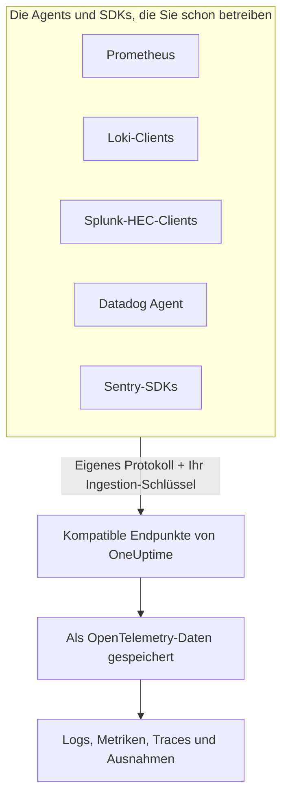

# Prometheus, Loki, Splunk, Datadog & Sentry

Sie betreiben schon Prometheus, einen Loki-Client, einen Splunk-Forwarder, den Datadog Agent oder ein Sentry-SDK? Dann bleibt es dabei. OneUptime nimmt an, was jedes dieser Werkzeuge sendet, unter den Pfaden, die das Werkzeug bereits verwendet, und speichert es als OpenTelemetry-Daten. Um OneUptime auszuprobieren, ändern Sie URL und Schlüssel, statt neu zu instrumentieren, und Ihre Drop-Filter, Scrub-Regeln, Protokoll-Pipelines, Datenaufbewahrung und Ingestion-Budgets gelten für diese Daten wie für alle anderen.

:::cards
- [Prometheus remote write](#prometheus-remote-write): Metriken aus Prometheus, Grafana Alloy oder jedem anderen Sender für remote write.
- [Loki](#loki): Logs aus Promtail, Grafana Alloy, Fluent Bit oder Vector.
- [Splunk HTTP Event Collector](#splunk-http-event-collector): Logs und Metrikereignisse von jedem HEC-Client.
- [Datadog Agent](#datadog-agent): Metriken und Logs aus dem Datadog Agent.
- [Sentry-SDKs](#sentry-sdks): Fehler, Transaktionen und Logs aus jedem Sentry-SDK.
:::

## So funktioniert es



Jeder Endpunkt antwortet so, wie es sein Werkzeug erwartet – ein `204` für Prometheus und Loki, das `{"text": "Success", "code": 0}` von HEC, das `202` von Datadog, die Event-ID von Sentry –, sodass das Werkzeug Erfolg und Fehler meldet wie bisher. Danach werden die Daten genau wie die Daten eines OpenTelemetry-SDKs verarbeitet.

## Bevor Sie beginnen

- **Ein OneUptime-Projekt** – in OneUptime Cloud wird Telemetrie pro aufgenommenem GB abgerechnet, und ein Projekt im Free-Plan braucht eine Zahlungsmethode, bevor es Telemetrie senden kann.
- **Telemetrie-Ingestion-Schlüssel** – erstellen Sie einen **Server**-Schlüssel unter **Produkte → Projekteinstellungen → Telemetrie & APM → Ingestion-Schlüssel** und kopieren Sie seinen **Geheimer Schlüssel**. Jedes Werkzeug sendet ihn dort, wo es seine eigenen Anmeldedaten sendet. Der Sentry-DSN einer Browser-App braucht stattdessen einen **Browser**-Schlüssel, der auf die Ursprünge Ihrer Website beschränkt ist.
- **Ihr Host** – die Beispiele verwenden `oneuptime.com`. Wenn Sie OneUptime selbst hosten, verwenden Sie Ihren eigenen Host.

> [!TIP]
> Der Tab Einrichtungsanleitung unter Protokolle, Metriken, Traces und Ausnahmen bietet jedes dieser Werkzeuge als eigene Art zu senden an, mit Ihrem Host und einem Schlüssel Ihrer Wahl bereits ausgefüllt.

## Endpunkte

| Werkzeug | Ziel | Wo der Schlüssel steht |
| --- | --- | --- |
| Prometheus remote write | `https://oneuptime.com/telemetry/prometheus/api/v1/write` | Ein Bearer-Token oder Basic-Auth mit dem Schlüssel als Passwort. |
| Loki | `https://oneuptime.com/telemetry/loki/api/v1/push` | Basic-Auth mit dem Schlüssel als Passwort oder ein Bearer-Token. |
| Splunk HTTP Event Collector | `https://oneuptime.com/telemetry/services/collector` | Das HEC-Token: `Authorization: Splunk <key>`. |
| Datadog Agent | `https://oneuptime.com/telemetry/datadog` | Der API-Schlüssel: `DD-API-KEY`. |
| Sentry-SDKs | Der DSN `https://<key>@oneuptime.com/telemetry/sentry/1` | Der öffentliche Schlüssel des DSN. |

Jeder Endpunkt nimmt den Schlüssel außerdem im Header `x-oneuptime-token` an, und ein Header `x-oneuptime-service-name` benennt den Dienst, zu dem alles gehört, was das Werkzeug sendet. Ein Schlüssel kann als seine 32 Hexadezimalziffern ohne Bindestriche geschrieben werden; im Sentry-DSN und als Datadog-API-Schlüssel muss er so geschrieben werden.

## Prometheus remote write

Fügen Sie OneUptime als Ziel für remote write hinzu. Prometheus scrapt weiter wie bisher und sendet eine Kopie jedes Samples:

```yaml title="prometheus.yml"
remote_write:
  - url: https://oneuptime.com/telemetry/prometheus/api/v1/write
    authorization:
      credentials: YOUR_TELEMETRY_KEY
```

Fügen Sie in Grafana Alloy eine Komponente `prometheus.remote_write` hinzu und leiten Sie Ihre Scrapes an sie weiter:

```text title="config.alloy"
prometheus.remote_write "oneuptime" {
  endpoint {
    url          = "https://oneuptime.com/telemetry/prometheus/api/v1/write"
    bearer_token = "YOUR_TELEMETRY_KEY"
  }
}
```

Remote write 1.0 und 2.0 werden beide angenommen, snappy-komprimiert, wie jeder Sender sie schickt.

### Was aus einer Serie wird

- **Name und Labels bleiben.** `http_requests_total{job="checkout", code="500"}` ist die Metrik `http_requests_total` mit den Attributen `job` und `code`, sodass eine aus Grafana übernommene Abfrage sie findet.
- **Der Job ist der Dienst.** Jeder `job` wird zu einem Dienst und jede `instance` zu dessen Dienstinstanz, so wie die Prometheus-Regeln von OpenTelemetry sie zuordnen.
- **Typen bleiben erhalten.** Zähler sowie Buckets und Anzahl eines Histogramms sind kumulative Summen, sodass ihre Raten im Diagramm stimmen. Der Typ stammt aus den Metadaten, die der Sender mitschickt; ohne sie ist ein Name auf `_total` ein Zähler und ein `_bucket` mit einem Label `le` ein Histogramm-Bucket.
- **Native Histogramme** werden zu exponentiellen Histogrammen, und native Histogramme mit benutzerdefinierten Buckets werden zu Histogrammen.
- **Nicht übernommen:** Staleness-Marker und andere NaN- oder unendliche Samples, die `_created`-Serien von Zählern und Exemplars.

## Loki

OneUptime nimmt die Push-API von Loki unter dem Pfad an, den auch Loki verwendet, als JSON oder als das snappy-komprimierte protobuf, das Promtail und Grafana Alloy senden. Fügen Sie es als Client hinzu:

```yaml title="promtail.yaml"
clients:
  - url: https://oneuptime.com/telemetry/loki/api/v1/push
    bearer_token: YOUR_TELEMETRY_KEY
```

Der `loki`-Output von Fluent Bit erwartet Host und Pfad getrennt:

```text title="fluent-bit.conf"
[OUTPUT]
    Name         loki
    Match        *
    Host         oneuptime.com
    Port         443
    Tls          On
    Uri          /telemetry/loki/api/v1/push
    Http_User    oneuptime
    Http_Passwd  YOUR_TELEMETRY_KEY
    Labels       job=fluent-bit
```

### Was aus einem Stream wird

- **Jeder Eintrag ist ein Log**, mit seinem eigenen, nanosekundengenauen Zeitstempel und seiner Zeile als Inhalt.
- **Labels und strukturierte Metadaten werden zu Attributen**, unter den Namen, die sie in Loki haben.
- **Der Dienst** ist der erste Wert, den ein Stream von `service_name`, `service`, `app`, `application`, `name`, `app_kubernetes_io_name`, `container`, `container_name`, `component`, `workload` und `job` hat, so wie Loki ihn ermittelt. Ein Label `host` oder `hostname` benennt den Host.
- **Das Log-Level** kommt aus einem Label oder Metadatum `level`, `detected_level` oder `severity`, sonst aus einem `level=` in logfmt oder dem Feld `level` einer JSON-Zeile.
- **Trace-Kontext:** Eine `trace_id` und eine `span_id` in den strukturierten Metadaten verknüpfen den Log mit seinem Trace.

## Splunk HTTP Event Collector

Verwenden Sie OneUptime als HTTP Event Collector, mit Ihrem Ingestion-Schlüssel als HEC-Token. Der Docker-Logging-Treiber von Splunk hängt den Pfad selbst an und braucht daher nur den Host:

```bash
docker run \
  --log-driver=splunk \
  --log-opt splunk-url=https://oneuptime.com \
  --log-opt splunk-token=YOUR_TELEMETRY_KEY \
  --log-opt splunk-format=json \
  your-image
```

Jeder andere HEC-Client sendet per POST an `/services/collector/event` oder `/services/collector/raw`. So senden Sie ein einzelnes Ereignis:

```bash
curl https://oneuptime.com/telemetry/services/collector/event \
  -H "Authorization: Splunk YOUR_TELEMETRY_KEY" \
  -d '{"event": "Payment failed for order 42", "sourcetype": "app", "fields": {"service": "checkout"}}'
```

Ein `200` mit `{"text": "Success", "code": 0}` bedeutet, dass das Ereignis angenommen wurde. Der Endpunkt antwortet auch mit den eigenen Codes von HEC – `No data` (5), `Invalid data format` (6) mit der Nummer des ungültigen Ereignisses und `Event field is required` (12) – und beantwortet `GET /services/collector/health` ohne Token.

### Was aus einem Ereignis wird

- **Ein Log**, mit seiner `time` als Zeitstempel. Ist das Ereignis ein String, wird er zum Inhalt; ist es ein Objekt, wird sein `message`, `msg`, `log`, `line` oder `text` zum Inhalt, und seine übrigen Felder werden zu Attributen.
- **Seine Metadaten bleiben:** `host` ist der Host, und `source`, `sourcetype` und `index` bleiben als `com.splunk.source`, `com.splunk.sourcetype` und `com.splunk.index` erhalten. `host`, `source`, `sourcetype` und `index` im Query-String ergänzen, was ein Ereignis auslässt.
- **Seine Felder werden zu Attributen.** Ein Feld `service.name` benennt den Dienst, ebenso das Feld `service` eines Logs.
- **Metrikereignisse** (`"event": "metric"`, mit `metric_name` und `_value` oder mit Feldern `metric_name:<name>`) werden als Metriken gespeichert, nie als Logs.
- **Nicht angeboten:** die Indexer-Bestätigung. Ein Client, der sie anfordert, erhält keine `ackId`.

## Datadog Agent

Richten Sie Metriken und Logs des Agents auf OneUptime, mit Ihrem Ingestion-Schlüssel als API-Schlüssel:

```yaml title="datadog.yaml"
api_key: YOUR_TELEMETRY_KEY_WITHOUT_HYPHENS
dd_url: https://oneuptime.com/telemetry/datadog
logs_enabled: true
logs_config:
  use_http: true
  logs_dd_url: oneuptime.com:443
apm_config:
  enabled: false
process_config:
  process_collection:
    enabled: false
```

Der Agent hängt seine eigenen Pfade an `dd_url` an und sendet Logs an `/api/v2/logs` auf dem Host und Port, die `logs_dd_url` nennt. Direkt unter dem Host beantwortet OneUptime diese Pfade nur für eine Anfrage, die einen Header `DD-API-KEY` trägt. Starten Sie den Agent nach der Änderung neu; `datadog-agent status` zeigt seinen API-Schlüssel als gültig an, sobald OneUptime ihn annimmt.

### Was aus den Daten des Agents wird

- **Metriken** behalten ihre Namen. Gauges bleiben Gauges, Zähler werden zu Summen und Raten zu Gauges ihres Werts pro Sekunde.
- **Verteilungen** werden zu Summaries mit Anzahl, Summe, Minimum und Maximum.
- **Service-Checks** werden zu einer Metrik, die nach dem Check benannt ist und deren Wert der Status des Checks ist: 0 OK, 1 Warnung, 2 kritisch, 3 unbekannt.
- **Logs** behalten Nachricht, Status, Host und Dienst, und ihre übrigen Felder werden zu Attributen.
- **Tags werden zu Attributen**, und die Tags `service`, `env` und `version` benennen den Dienst, seine Umgebung und seine Version.
- **Noch nicht gelesen:** APM-Traces, Prozesse, Container, Netzwerkdaten und Profile. Lassen Sie sie in `datadog.yaml` ausgeschaltet, wie oben.

Clients der HTTP-API von Datadog – eine Log-Bibliothek, die an `/api/v2/logs` sendet, ein Skript, das Serien sendet – können mit dem Header `DD-API-KEY` an denselben Endpunkt senden.

## Sentry-SDKs

Ersetzen Sie den DSN dort, wo Sie Sentry einrichten. Der Rest Ihres Sentry-Codes bleibt, wie er ist:

```javascript
Sentry.init({
  dsn: "https://YOUR_TELEMETRY_KEY_WITHOUT_HYPHENS@oneuptime.com/telemetry/sentry/1",
  release: "checkout@1.4.2",
  environment: "production",
});
```

```python
sentry_sdk.init(
    dsn="https://YOUR_TELEMETRY_KEY_WITHOUT_HYPHENS@oneuptime.com/telemetry/sentry/1",
    release="checkout@1.4.2",
    environment="production",
)
```

Die `1` am Ende des DSN verlangen die SDKs von Sentry; gelesen wird sie nicht. Der DSN einer Browser-App ist öffentlich, verwenden Sie dort also einen **Browser**-Ingestion-Schlüssel, der auf die Ursprünge Ihrer Website beschränkt ist.

### Was aus einem Umschlag wird

- **Fehler** erscheinen unter Ausnahmen, mit ihren Stack-Traces und den Ausnahmen, die sie verursacht haben, gruppiert wie jede andere Ausnahme. Jeder ist ein Span in seinem Trace, unter dem Span, der gerade aktiv war.
- **Transaktionen** und ihre Spans erscheinen unter Traces.
- **Sentry-Logs** und mit `capture_message` erfasste Nachrichten erscheinen unter Protokolle.
- **Der Dienst** ist ein Tag `service`, sonst der Name des Releases vor dem `@`: `checkout@1.4.2` ergibt `checkout`. Das Release ist die Dienstversion, und die Umgebung bleibt erhalten.
- **Nicht übernommen:** Sessions, Replays, Anhänge, Profile und Check-ins. Das SDK sendet sie weiterhin; OneUptime nimmt sie an und verwirft sie.

## Grenzen und Ingestion-Budgets

- **Anfragegröße** – der Ingress von OneUptime nimmt unter `/telemetry` Anfragen bis 4 MB an, und jeder Inhalt darf sich auf höchstens 64 MB entpacken.
- **Ingestion-Budgets** – Prometheus remote write und Loki werden vor dem Lesen ihres Inhalts gegen das Metrik- bzw. Log-Budget geprüft und mit `403` abgewiesen, wenn es aufgebraucht ist. Ein HEC-Batch, eine Datadog-Nutzlast oder ein Sentry-Umschlag kann mehrere Signale tragen, daher wird jedes Signal beim Speichern auf sein eigenes Budget angerechnet und verworfen, wenn dieses Budget aufgebraucht ist.

## Fehlerbehebung

### Jede Anfrage wird mit 401 abgewiesen

Der Schlüssel kam nicht dort an, wo der Endpunkt ihn sucht, oder er gehört nicht zu diesem Projekt. Vergleichen Sie die Einstellung für die Anmeldedaten im Werkzeug mit der Tabelle unter [Endpunkte](#endpunkte), und prüfen Sie, dass der Schlüssel weder ausgeschaltet noch abgelaufen ist.

### Ein Sentry-SDK meldet, der DSN sei ungültig

Die SDKs von Sentry lehnen einen DSN ab, dessen Schlüssel Bindestriche enthält. Schreiben Sie den Schlüssel als seine 32 Hexadezimalziffern, ohne die Bindestriche.

### Datadog-Metriken kommen an, Logs aber nicht

Prüfen Sie, dass `logs_config.use_http` auf `true` steht und `logs_config.logs_dd_url` ein Host mit Port ist, keine URL. Ist `use_http` nicht gesetzt, sendet der Agent Logs über TCP.

### Prometheus meldet 415

Der Sender hat ein Protokoll für remote write angefordert, das OneUptime nicht liest. Senden Sie remote write 1.0 oder 2.0.
