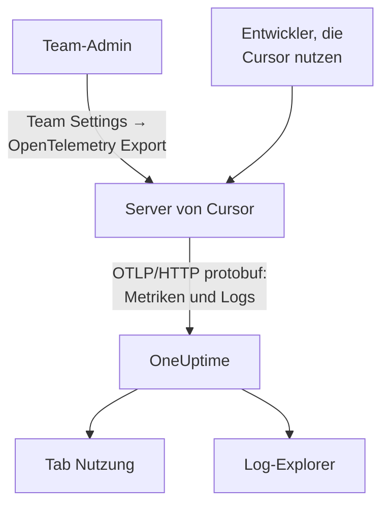

# Cursor

Cursor exportiert die Telemetrie seines Teams von den eigenen Servern von Cursor. Ein Team-Admin fügt OneUptime einmal als Ziel hinzu, im Dashboard von Cursor, und die Tokens, geschätzten Kosten und Tool-Aufrufe des ganzen Teams kommen an: Auf den Entwicklerrechnern ist nichts zu installieren oder einzustellen.

:::cards
- [Einrichten](#einrichten): Einen Schlüssel in OneUptime und ein Ziel in Cursor erstellen.
- [Was Sie bekommen](#was-sie-bekommen-und-was-nicht): Metriken und Logs; keine Traces.
- [Wer was ausgegeben hat](#zuordnung-zu-mitarbeitern): Personen kommen als Cursor-Benutzer-IDs an.
- [Fehlerbehebung](#fehlerbehebung): Was Sie prüfen, wenn nichts ankommt.
:::

## So funktioniert es



## Bevor Sie beginnen

- **Der Enterprise-Tarif von Cursor.** Der Bildschirm OpenTelemetry Export fehlt in anderen Tarifen.
- **Ein Endpunkt, den Cursor aus dem Internet erreicht.** Cursor verbindet sich mit Ihnen, von einer festen Menge von Adressen. OneUptime Cloud braucht nichts weiter; ein selbst betriebenes OneUptime hinter einer Firewall muss die Ausgangsadressen erlauben, die Cursor auf seiner Seite [OpenTelemetry Export](https://cursor.com/docs/enterprise/opentelemetry-export) auflistet.

## Einrichten

:::steps
### Einen Ingestion-Schlüssel erstellen

Öffnen Sie in OneUptime **Projekteinstellungen → Telemetrie & APM → Ingestion-Schlüssel**, klicken Sie auf **Aufnahmeschlüssel erstellen** und kopieren Sie den Schlüssel. Ihre OTLP-Basis-URL ist `https://oneuptime.com/otlp`, oder `https://YOUR-ONEUPTIME-HOST/otlp`, wenn Sie OneUptime selbst betreiben.

### Das Ziel in Cursor erstellen

Öffnen Sie im Web-Dashboard von Cursor als Team-Admin **Team Settings → OpenTelemetry Export** und erstellen Sie ein Ziel:

| Feld | Wert |
| --- | --- |
| Endpoint (base URL) | `https://oneuptime.com/otlp` |
| Header name | `x-oneuptime-token` |
| Header value | `YOUR_INGESTION_TOKEN` |

Geben Sie die Basis-URL ohne `/v1` ein: Cursor hängt `/v1/metrics` und `/v1/logs` selbst an, und `https://oneuptime.com/otlp/v1` würde an `/otlp/v1/v1/metrics` senden, wo nichts ankommt.

### Testen und aktivieren

Klicken Sie auf **Test connection**, um URL und Header zu prüfen, dann auf **Enable**. Der Export beginnt nach etwa einer Minute; spätere Änderungen am Header brauchen etwa 30 Sekunden.

### Prüfen, ob Daten ankommen

Nutzen Sie Cursor ein oder zwei Minuten, öffnen Sie dann in OneUptime **Protokolle** und filtern Sie auf den Dienstnamen `cursor`: Einträge `cursor.api.request` mit Token-Zahlen bedeuten, dass Schlüssel und URL stimmen.
:::

Cursor spricht OTLP über HTTP nur mit binärem Protobuf (kein gRPC, kein JSON), was OneUptime unverändert annimmt. Es speichert den Header verschlüsselt und sendet an ein Ziel pro Team: Um an OneUptime und noch woandershin zu senden, schalten Sie einen Collector davor.

## Was Sie bekommen und was nicht

| Signal | Von Cursor |
| --- | --- |
| Metriken: Tokens, geschätzte Kosten, Tool-Aufrufe | Ja, als Deltas |
| Log-Ereignisse: Anfragen, Fehler, Korrekturen, Skills, Hooks, Plugins, Cloud-Agenten | Ja |
| Text von Prompts und Antworten | Nur wenn Sie die Familie `conversation_content` einschalten |
| Traces | Nein |
| Alles von vor der Aktivierung des Ziels | Nein |

In OneUptime erscheint Cursor also im Tab **Nutzung** von **Produkte → KI / LLM**, aus `cursor.token.usage` und `cursor.cost.usage`, aber nie in **Aufrufe** oder **Unterhaltungen**, die aus Traces entstehen. Das Detail pro Anfrage ist das Ereignis `cursor.api.request` im Explorer **Protokolle**.

### Familien

Jedes Signal und jede Familie von Telemetrie hat ihren eigenen Schalter in den Einstellungen von Cursor:

| Familie | Umfasst |
| --- | --- |
| `model_usage` | `cursor.token.usage`, `cursor.cost.usage` und die Ereignisse `cursor.api.request`, `cursor.api.error` und `cursor.api.correction` |
| `tool_calls` | `cursor.tool.calls` |
| `skills_hooks_plugins` | Skill-, Hook- und Plugin-Ereignisse |
| `cloud_agents` | Ereignisse `cursor.cloud_agent.*` |
| `grok_bot_agent_actions` | Ereignisse `cursor.grok_bot.*`; braucht Action Recording |
| `conversation_content` | Nachrichtentext sowie Ein- und Ausgabe von MCP-Tools; standardmäßig aus |

Jede Familie außer `conversation_content` startet eingeschaltet. Familien, die Cursor später hinzufügt, starten ebenfalls eingeschaltet, außer Sie schalten `auto_enable_new_families` ab.

## Metriken und Ereignisse

Alle drei Metriken sind Delta-Summen:

| Metrik | Einheit | Attribute |
| --- | --- | --- |
| `cursor.token.usage` | `{token}` | `cursor.token.type`: `input`, `output`, `cache_read`, `cache_creation`; `cursor.model.name`; `cursor.api.status`: `success`, `errored`, `aborted`; `cursor.api.billable` |
| `cursor.cost.usage` | `USD` | `cursor.model.name` |
| `cursor.tool.calls` | `{call}` | `cursor.tool.kind`: `builtin`, `mcp`; `cursor.tool.name`; `cursor.tool.status`: `success`, `failure`, `aborted`; `cursor.mcp.server.name` |

Die Datenpunkte tragen keine Unterhaltungs- oder Anfrage-ID, Kosten pro Sitzung stehen also nicht in den Metriken. `cursor.model.name` ist das angefragte Modell, mit zusammengefassten Routing-Optionen: Eine Aufschlüsselung nach Modell hat eine Zeile namens `Auto`, die sich nicht in die Modelle aufteilen lässt, an die Cursor sie weitergeleitet hat.

Das Log-Ereignis, das Sie am häufigsten nutzen, ist `cursor.api.request`: eines pro Anfrage, mit ihren Eingabe-, Ausgabe- und Cache-Token-Zahlen, dem Modell und ob sie abgerechnet wurde. `cursor.api.error` zeichnet eine fehlgeschlagene Anfrage auf (ohne die Fehlermeldung), und `cursor.api.correction` kommt später, um mitzuteilen, dass eine Anfrage doch nicht abgerechnet wurde. Die [Wire-Referenz](https://cursor.com/docs/enterprise/opentelemetry-export/wire) von Cursor listet jedes Ereignis und Attribut.

Jeder Eintrag trägt diese Ressourcenattribute:

| Attribut | Was es ist |
| --- | --- |
| `service.name` | Immer `cursor`: filtern Sie die Explorer **Protokolle** und **Metriken** danach |
| `cursor.team.id` | Ihr Team, eine Ganzzahl; immer vorhanden |
| `cursor.user.id` | Die Person, eine Ganzzahl im Team-Bereich; optional |
| `cursor.surface` | Woher die Aktivität kam, etwa `desktop`, `cli`, `cloud_agent` oder `bugbot` |
| `cursor.entrypoint` | Wie sie begann, etwa `desktop`, `cli`, `web`, `api` oder `github_pr` |

## Zuordnung zu Mitarbeitern

**Cursor nennt eine Person über `cursor.user.id`, eine Ganzzahl, die nur Cursor in einen Namen umwandeln kann, und lässt sie bei Cloud-Agenten oft weg.** OneUptime liest sie als Mitarbeiter und `cursor.team.id` als Team, sodass der Tab **Nutzung** Personen und Teams ohne Einrichtung reiht, Personen aber als Ganzzahlen erscheinen.

- Beide kommen als Ressourcenattribute an (`resource.cursor.user.id`, `resource.cursor.team.id`), die OneUptime liest.
- Cursor kann auch `cursor.user.email` senden, aber OneUptime liest sie noch nicht, daher bleibt die Spalte mit der E-Mail des Mitarbeiters für Cursor leer.
- `gen_ai.user`, `llm.user` und die Endbenutzer-IDs von LiteLLM werden nie als Mitarbeiter gelesen: Sie nennen Ihre Kunden, nicht Ihre Belegschaft. Siehe [Zuordnung zu Mitarbeitern und Teams](/docs/telemetry/ai-coding-assistants#zuordnung-zu-mitarbeitern-und-teams).

### Wo Cursor im Tab Nutzung erscheint

Cursor sendet Metriken und keine GenAI-Spans, und die Metriken springen nur für Spans ein: **Wenn dasselbe Projekt GenAI-Spans mit Kosten empfängt, erscheinen die Ausgaben von Cursor nicht.** Senden Sie Cursor in ein eigenes Projekt. Siehe [Spans zuerst, Metriken springen ein](/docs/telemetry/ai-llm-observability#spans-zuerst-metriken-springen-ein).

| Aufschlüsselung | Für Cursor |
| --- | --- |
| **Mitarbeiter** | Ja, nach `cursor.user.id` |
| **Team** | Ja, nach `cursor.team.id` |
| **Modell** | Ja, nach `cursor.model.name` |
| **Anbieter** | Nein: Cursor sagt nie, welcher Anbieter einen Aufruf bedient hat |
| **Anwendung / Dienst** | Nein: Die Metriken von Cursor gehören zu keinem OneUptime-Dienst |

Eine Cursor-Zeile trägt nur Kosten: Ihre Zellen für Aufrufe und Tokens zeigen `—`, weil `cursor.cost.usage` keine Details pro Aufruf hat. `cursor.token.usage` speist weiterhin die Token-Summen über der Tabelle (seine Typen `input` und `output`; Cache-Tokens bleiben außen vor), und Sie können es in einem Dashboard nach `cursor.token.type` darstellen.

:::details Eine Cursor-Benutzer-ID einer Person zuordnen
Namen und abgerechnete Beträge stehen in der Admin-API von Cursor, die OneUptime nicht aufruft: Rufen Sie sie selbst auf, wenn Sie sie brauchen. Sie ist nur für Enterprise, unter `https://api.cursor.com`, und nimmt einen Admin-API-Schlüssel als Benutzernamen mit leerem Passwort:

```bash
curl -u YOUR_API_KEY: https://api.cursor.com/teams/members
```

`GET /teams/members` listet E-Mail und Namen jedes Mitglieds. `POST /teams/filtered-usage-events` liefert abgerechnete Nutzung pro Ereignis; addieren Sie für die Ausgaben ihre `chargedCents`. Ihre `conversationId` entspricht `cursor.conversation.id` in den Log-Ereignissen von Cursor, was eine Person und einen abgerechneten Betrag mit einer Sitzung verknüpft, die Sie schon sehen, wenn beide Seiten sie tragen. Cursor dokumentiert nicht, dass die Ganzzahl `cursor.user.id` und die Benutzer-IDs der Admin-API dieselben sind, prüfen Sie das also an Ihrem eigenen Team, bevor Sie jemandem danach etwas berechnen.
:::

## Wie Cursor liefert

Das verändert, was Sie in Diagrammen sehen, kennen Sie es also, bevor Sie eine Lücke melden:

- **Metriken werden höchstens einmal gesendet.** Ein fehlgeschlagener Export wird nicht wiederholt, eine kurze Lücke nach einem Fehler ist also zu erwarten: Alarmieren Sie nicht auf Lücken in den Metriken von Cursor.
- **Logs werden mindestens einmal gesendet**, dedupliziert über `cursor.event.id` und etwa 7 Tage lang automatisch wiederholt.
- **Es gibt keine Reihenfolge.** Ein `cursor.api.correction` kommt nach der Anfrage an, die es korrigiert: Sortieren Sie nach dem Zeitstempel des Eintrags, nie nach der Ankunft.
- **Nichts wird nachgeliefert.** Nichts von vor der Aktivierung des Ziels kommt an, und ein defekt gelassenes Ziel verliert, was Cursor nicht senden konnte.
- **Ein Ziel zu deaktivieren oder zu löschen, verwirft Daten unterwegs.** Um den Ingestion-Schlüssel zu ändern, bearbeiten Sie den Header des Ziels, statt es zu löschen und neu zu erstellen.

## Kosten sind eine Schätzung, keine Rechnung

Cursor dokumentiert `cursor.cost.usage` als bestmögliche Schätzung. Sie trennt enthaltene Nutzung nicht von nach Bedarf abgerechneter Nutzung; mit Ihren eigenen Modellschlüsseln spiegelt sie nur den Token-Tarif von Cursor wider, nicht die Rechnung Ihres Anbieters; und ein späteres `cursor.api.correction` kann bereits gezählte Nutzung zurücknehmen. Lesen Sie sie als Trend. Für eine Zahl, die zur Rechnung passt, addieren Sie `chargedCents` aus der Admin-API von Cursor.

## Fehlerbehebung

:::details Es kommt nichts an
Führen Sie in Cursor erneut **Test connection** aus. Prüfen Sie, dass die Basis-URL nicht auf `/v1` endet, dass der Header-Name `x-oneuptime-token` und sein Wert genau der Schlüssel ist und dass die Familie `model_usage` eingeschaltet ist. Der Export beginnt etwa eine Minute nach der Aktivierung des Ziels.
:::

:::details Bei einem selbst betriebenen OneUptime kommt nichts an
Cursor verbindet sich von seinen eigenen Servern: Ihr OTLP-Endpunkt muss aus dem Internet erreichbar sein, unter einem öffentlichen DNS-Namen, und die Ausgangsadressen von Cursor durch Ihre Firewall lassen.
:::

:::details Logs kommen an, aber der Tab Nutzung zeigt keine Ausgaben von Cursor
Das Projekt empfängt auch GenAI-Spans mit Kosten, daher werden die Metriken von Cursor nicht gelesen. Senden Sie Cursor in ein eigenes Projekt, mit eigenem Ingestion-Schlüssel.
:::

:::details Personen erscheinen als Zahlen
Das ist `cursor.user.id`: die einzige Personen-ID, die OneUptime heute von Cursor liest. Ordnen Sie sie mit der Admin-API von Cursor Namen zu.
:::

## Nächste Schritte

:::cards
- [KI-Coding-Assistenten](/docs/telemetry/ai-coding-assistants): Wie Ausgaben über alle Coding-Assistenten hinweg zugeordnet werden.
- [KI-Gateways](/docs/telemetry/ai-gateways): Vollständige Traces und Prompts für die Modellaufrufe Ihrer eigenen Apps.
- [Metriken-Überwachung](/docs/monitor/metrics-monitor): Auf `cursor.cost.usage`, `cursor.token.usage` oder `cursor.tool.calls` warnen.
:::
