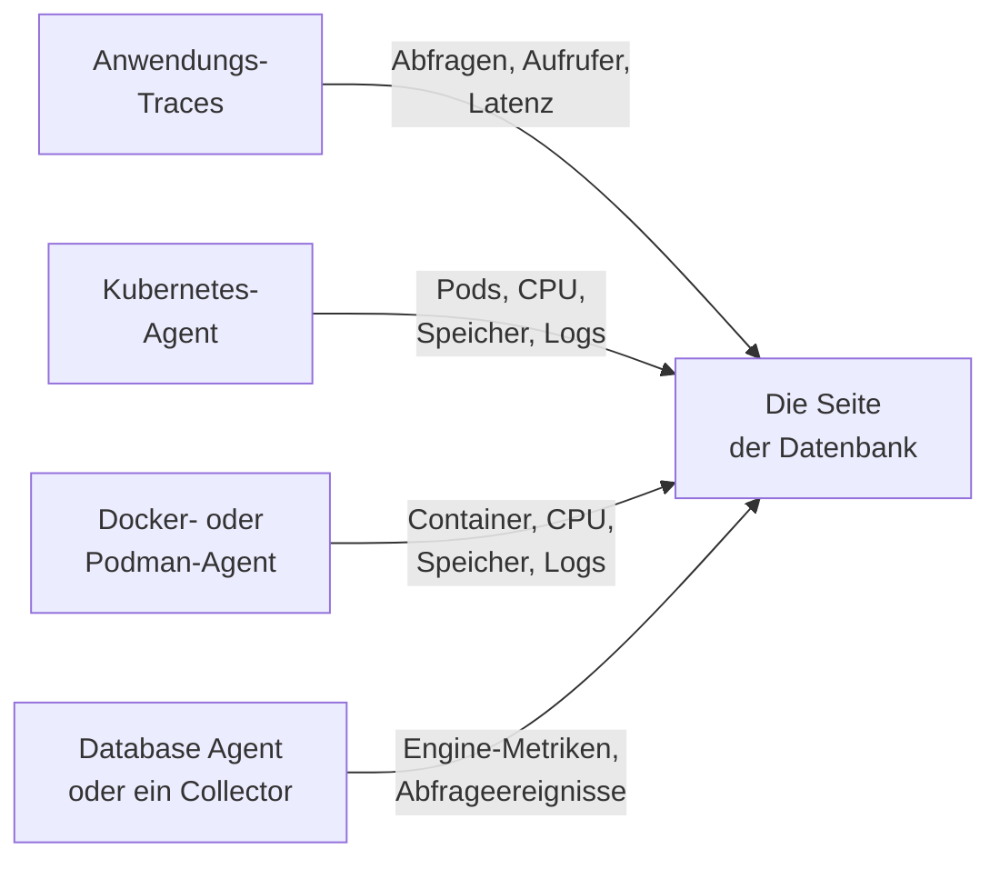

# Datenbanken

**Datenbanken** gibt jedem Datenbankserver, den Ihr Projekt betreibt oder anspricht, eine eigene Seite: wer ihn aufruft und wie schnell, wo er läuft, die eigenen Zustandsmetriken der Engine, seine Logs und Traces, die mit ihm verknüpften Vorfälle, Warnungen und geplanten Wartungen und die für seine Engine empfohlenen Warnungsmonitore. Datenbanken haben Labels, Eigentümer, Label- und Eigentümerregeln, eine Aufbewahrung pro Datenbank und Archivierung wie jede andere Ressource. Sie öffnen sie unter **Produkte → Ressourcen → Datenbanken**.

:::cards
- [Der Database Agent](#der-database-agent): Engine-Metriken für PostgreSQL, MySQL, SQL Server, Oracle, Redis, MongoDB, Elasticsearch und Memcached.
- [Wie Datenbanken erkannt werden](#wie-datenbanken-erkannt-werden): Aus Traces, Kubernetes, Docker, Podman und Collectors.
- [Warnungen zu einer Datenbank](#warnungen-zu-einer-datenbank): Empfohlene Monitore und Monitore, die Sie selbst bauen.
- [Fehlerbehebung](#fehlerbehebung): Ein Diagnoseskript und die üblichen Probleme.
:::

## So funktioniert es

Die meisten Datenbanken erscheinen von selbst. OneUptime setzt jede aus bis zu vier Quellen zusammen, und jede Quelle trägt etwas anderes bei:

| Quelle | Was sie von Ihnen braucht | Was sie zur Seite der Datenbank beiträgt |
| --- | --- | --- |
| **Anwendungs-Traces** | Instrumentierte Anwendungen (OpenTelemetry) | Abfragen von Anwendungen: Aufrufrate, Fehler, Latenz und die aufrufenden Dienste |
| **Kubernetes** | Der [OneUptime-Kubernetes-Agent](/docs/telemetry/kubernetes-agent) | Wo sie läuft: Pods, CPU und Speicher sowie die Logs der Pods |
| **Docker / Podman** | Der [Docker-Agent](/docs/telemetry/docker-host) oder der [Podman-Agent](/docs/telemetry/podman-host) | Wo sie läuft: die Container, ihre CPU und ihr Speicher sowie ihre Logs |
| **Database Agent** (ein OpenTelemetry Collector) | Der [Database Agent](#der-database-agent) oder Ihr eigener Collector | **Engine-Metriken** – Verbindungen, Durchsatz, Cache-Trefferquote, Sperren, Replikationsverzögerung, Speicher, soweit die Engine sie hat (siehe [Was erfasst wird](#was-erfasst-wird)) – dazu optional Abfrage-Stichproben, Top-Abfragen und die Logdatei der Engine |



Engine-Metriken kommen immer nur von einem Collector, der mit der Datenbank selbst spricht (oder, bei einer verwalteten Cloud-Datenbank, mit der Monitoring-API ihres Anbieters). Traces und Container-Inventare sagen OneUptime, dass eine Datenbank existiert und wie sie genutzt wird, aber nicht, wie es in ihr aussieht – der Status **Engine-Metriken** jeder Datenbank zeigt, ob dieser Teil verbunden ist.

Sie können eine Datenbank auch von Hand hinzufügen: **Datenbanken → Datenbank erstellen** mit ihrer Engine, Adresse und ihrem Port. Für eine Integritätsprüfung von einer Probe aus, die gar keinen Agent braucht, siehe die [Datenbank-Integritätsüberwachung](/docs/monitor/database-health-monitor).

## Unterstützte Datenbanken

OneUptime kennt die folgenden Engines beim Namen: Es normalisiert, was Instrumentierungen in `db.system.name` (oder das ältere `db.system`) schreiben, auf den Wert in der zweiten Spalte, zeigt den Namen der Engine, verwendet ihren Standardport, wenn ein Span oder eine Adresse keinen hat, erkennt ihre Container-Images und Helm-Charts und weiß, woher ihre Engine-Metriken kommen. Eine nicht aufgeführte Engine funktioniert trotzdem überall dort, wo eine Datenbank über ihre Adresse geschlüsselt wird – sie erscheint nur unter dem rohen Namen, den Ihre Spans melden, und wird nie allein aus Traces angelegt.

Eine **Familie** ist die Engine, über die ein Fork oder eine wire-kompatible Engine erreicht wird: Client-Bibliotheken können MariaDB nicht von MySQL und Valkey nicht von Redis unterscheiden, also sagt ein Span `mysql` oder `redis`, während ein Container-Image, ein Helm-Chart oder der Database Agent den Fork nennt. Beides landet auf derselben Datenbank, und die Datenbank zeigt die spezifischere Engine, sobald ihr Container-Image oder eine Quelle, die mindestens so stark ist wie die hinter ihrer aktuellen Engine, sie nennt (siehe [Welche Engine eine Datenbank zeigt](#welche-engine-eine-datenbank-zeigt)).

**Aus Traces erstellt** sagt, ob Client-Spans allein eine Datenbank dieser Engine anlegen (siehe [Aus Anwendungs-Traces](#aus-anwendungs-traces)): Ein verwalteter Dienst, der über den gemeinsamen API-Host seines Anbieters erreicht wird, und eine Engine, die im Prozess Ihrer Anwendung läuft, werden es nie. **Engine-Metriken** sagt, woher die eigenen Zustandsmetriken der Engine kommen: aus einer Konfiguration des Database Agent, einem collector-contrib-Receiver, den Sie Ihrem eigenen Collector hinzufügen, dem eigenen Prometheus-Endpunkt der Engine (`:port/path`, gescrapt mit dem Receiver `prometheus` des Collectors), der Monitoring-API des Cloud-Anbieters oder nichts Eingebautem. Der Tab **Dokumentation** jeder Datenbank macht daraus eine sofort nutzbare Collector-Konfiguration für diese Datenbank.

| Engine | `db.system.name` | Standardport | Familie | Aus Traces erstellt | Engine-Metriken |
| --- | --- | --- | --- | --- | --- |
| Actian Ingres | `actian.ingres` | — | — | Ja | Nichts eingebaut |
| Actian Zen (Pervasive PSQL) | `pervasive` | 1583 | — | Ja | Nichts eingebaut |
| Aerospike | `aerospike` | 3000 | — | Ja | Receiver `aerospike` |
| Amazon DocumentDB | `aws.documentdb` | 27017 | MongoDB | Ja | Receiver `awsfirehose` (Cloud-Monitoring) |
| Amazon DynamoDB | `aws.dynamodb` | 443 | — | Nein (Cloud-API) | Receiver `awsfirehose` (Cloud-Monitoring) |
| Amazon Neptune | `aws.neptune` | 8182 | — | Ja | Receiver `awsfirehose` (Cloud-Monitoring) |
| Amazon Redshift | `aws.redshift` | 5439 | PostgreSQL | Ja | Receiver `awsfirehose` (Cloud-Monitoring) |
| Apache Derby | `derby` | 1527 | — | Nein (In-Process) | Keine (In-Process) |
| Apache Doris | `doris` | 9030 | MySQL | Ja | Prometheus, `:8030/metrics` |
| Apache Druid | `druid` | 8888 | — | Ja | Nichts eingebaut |
| Apache Geode | `geode` | 10334 | — | Ja | Nichts eingebaut |
| Apache HBase | `hbase` | — | — | Ja | Nichts eingebaut |
| Apache Hive | `hive` | 10000 | — | Ja | Nichts eingebaut |
| Apache Ignite | `ignite` | 10800 | — | Ja | Nichts eingebaut |
| Apache Impala | `impala` | 21050 | — | Ja | Nichts eingebaut |
| Apache Pinot | `pinot` | 8099 | — | Ja | Nichts eingebaut |
| Apache Solr | `solr` | 8983 | — | Ja | Nichts eingebaut |
| ArangoDB | `arangodb` | 8529 | — | Ja | Prometheus, `:8529/_admin/metrics/v2` |
| Azure Cosmos DB | `azure.cosmosdb` | 443 | — | Nein (Cloud-API) | Receiver `azure_monitor` (Cloud-Monitoring) |
| Cassandra | `cassandra` | 9042 | — | Ja | Nichts eingebaut |
| Chroma | `chroma` | 8000 | — | Ja | Nichts eingebaut |
| Claris FileMaker | `filemaker` | 2399 | — | Ja | Nichts eingebaut |
| ClickHouse | `clickhouse` | 9000 | — | Ja | Prometheus, `:9363/metrics` |
| Cloud Bigtable | `gcp.bigtable` | 443 | — | Nein (Cloud-API) | Receiver `googlecloudmonitoring` (Cloud-Monitoring) |
| Cloud Firestore | `gcp.firestore` | 443 | — | Nein (Cloud-API) | Receiver `googlecloudmonitoring` (Cloud-Monitoring) |
| Cloud Spanner | `gcp.spanner` | 443 | — | Nein (Cloud-API) | Receiver `google_cloud_spanner` |
| CockroachDB | `cockroachdb` | 26257 | PostgreSQL | Ja | Prometheus, `:8080/_status/vars` |
| Couchbase | `couchbase` | 11210 | — | Ja | Prometheus, `:8091/metrics` |
| CouchDB | `couchdb` | 5984 | — | Ja | Receiver `couchdb` |
| Databricks | `databricks` | 443 | — | Ja | Nichts eingebaut |
| Dragonfly | `dragonfly` | 6379 | Redis | Ja | Database Agent (Receiver `redis`) |
| DuckDB | `duckdb` | — | — | Nein (In-Process) | Keine (In-Process) |
| Elasticsearch | `elasticsearch` | 9200 | — | Ja | Database Agent (Receiver `elasticsearch`) |
| etcd | `etcd` | 2379 | — | Ja | Prometheus, `:2379/metrics` |
| FerretDB | `ferretdb` | 27017 | MongoDB | Ja | Prometheus, `:8088/debug/metrics` |
| Firebird | `firebirdsql` | 3050 | — | Ja | Nichts eingebaut |
| FoundationDB | `foundationdb` | 4500 | — | Ja | Nichts eingebaut |
| Google BigQuery | `bigquery` | 443 | — | Nein (Cloud-API) | Receiver `googlecloudmonitoring` (Cloud-Monitoring) |
| Greenplum | `greenplum` | 5432 | PostgreSQL | Ja | Nichts eingebaut |
| H2 | `h2database` | 9092 | — | Nein (In-Process) | Keine (In-Process) |
| Hazelcast | `hazelcast` | 5701 | — | Ja | Nichts eingebaut |
| HyperSQL | `hsqldb` | 9001 | — | Nein (In-Process) | Keine (In-Process) |
| IBM Db2 | `ibm.db2` | 50000 | — | Ja | Nichts eingebaut |
| IBM Informix | `ibm.informix` | 9088 | — | Ja | Nichts eingebaut |
| IBM Netezza | `ibm.netezza` | 5480 | — | Ja | Nichts eingebaut |
| InfluxDB | `influxdb` | 8086 | — | Ja | Prometheus, `:8086/metrics` |
| InstantDB | `instantdb` | — | — | Nein (In-Process) | Keine (In-Process) |
| InterBase | `interbase` | 3050 | Firebird | Ja | Nichts eingebaut |
| InterSystems IRIS / Caché | `intersystems.cache` | 1972 | — | Ja | Prometheus, `:52773/api/monitor/metrics` |
| KeyDB | `keydb` | 6379 | Redis | Ja | Database Agent (Receiver `redis`) |
| MariaDB | `mariadb` | 3306 | MySQL | Ja | Database Agent (Receiver `mysql`) |
| Meilisearch | `meilisearch` | 7700 | — | Ja | Prometheus, `:7700/metrics` |
| Memcached | `memcached` | 11211 | — | Ja | Database Agent (Receiver `memcached`) |
| Milvus | `milvus` | 19530 | — | Ja | Prometheus, `:9091/metrics` |
| MongoDB | `mongodb` | 27017 | — | Ja | Database Agent (Receiver `mongodb`) |
| MySQL | `mysql` | 3306 | — | Ja | Database Agent (Receiver `mysql`) |
| Neo4j | `neo4j` | 7687 | — | Ja | Prometheus, `:2004/metrics` |
| OceanBase | `oceanbase` | 2881 | MySQL | Ja | Nichts eingebaut |
| OpenSearch | `opensearch` | 9200 | Elasticsearch | Ja | Database Agent (Receiver `elasticsearch`) |
| Oracle | `oracle.db` | 1521 | — | Ja | Database Agent (Receiver `oracledb`) |
| Pinecone | `pinecone` | 443 | — | Nein (Cloud-API) | Nichts eingebaut |
| PostgreSQL | `postgresql` | 5432 | — | Ja | Database Agent (Receiver `postgresql`) |
| Presto | `presto` | 8080 | — | Ja | Nichts eingebaut |
| Progress OpenEdge | `progress` | — | — | Ja | Nichts eingebaut |
| Qdrant | `qdrant` | 6333 | — | Ja | Prometheus, `:6333/metrics` |
| QuestDB | `questdb` | 8812 | PostgreSQL | Ja | Prometheus, `:9003/metrics` |
| RavenDB | `ravendb` | 8080 | — | Ja | Nichts eingebaut |
| Redis | `redis` | 6379 | — | Ja | Database Agent (Receiver `redis`) |
| Riak KV | `riak` | 8087 | — | Ja | Receiver `riak` |
| SAP ASE (Sybase) | `sybase` | 5000 | — | Ja | Nichts eingebaut |
| SAP HANA | `sap.hana` | 30015 | — | Ja | Receiver `saphana` |
| SAP MaxDB | `sap.maxdb` | 7210 | — | Ja | Nichts eingebaut |
| ScyllaDB | `scylladb` | 9042 | Cassandra | Ja | Prometheus, `:9180/metrics` |
| SingleStore | `singlestore` | 3306 | MySQL | Ja | Prometheus, `:9104/metrics` |
| Snowflake | `snowflake` | 443 | — | Ja | Receiver `snowflake` |
| Software AG Adabas | `softwareag.adabas` | — | — | Ja | Nichts eingebaut |
| SQL Server | `microsoft.sql_server` | 1433 | — | Ja | Database Agent (Receiver `sqlserver`) |
| SQLite | `sqlite` | — | — | Nein (In-Process) | Keine (In-Process) |
| StarRocks | `starrocks` | 9030 | MySQL | Ja | Prometheus, `:8030/metrics` |
| SurrealDB | `surrealdb` | 8000 | — | Ja | Nichts eingebaut |
| Teradata | `teradata` | 1025 | — | Ja | Nichts eingebaut |
| TiDB | `tidb` | 4000 | MySQL | Ja | Prometheus, `:10080/metrics` |
| Trino | `trino` | 8080 | — | Ja | Prometheus, `:8080/metrics` |
| Typesense | `typesense` | 8108 | — | Ja | Nichts eingebaut |
| Valkey | `valkey` | 6379 | Redis | Ja | Database Agent (Receiver `redis`) |
| Vertica | `vertica` | 5433 | — | Ja | Nichts eingebaut |
| Vitess | `vitess` | 3306 | MySQL | Ja | Prometheus, `:15000/metrics` |
| Weaviate | `weaviate` | 8080 | — | Ja | Prometheus, `:2112/metrics` |
| YugabyteDB | `yugabytedb` | 5433 | PostgreSQL | Ja | Prometheus, `:9000/prometheus-metrics` |

Auch die üblichen anderen Schreibweisen werden akzeptiert: `postgres` und `pg`, `mssql` und `sqlserver`, `oracle`, `mongo`, `scylla`, `dragonflydb`, `memsql` und jeder frühere `db.system`-Wert, den OpenTelemetry verwendet hat (`db2`, `hanadb`, `cosmosdb`, `dynamodb`, `spanner`, `redshift`, `informix`, `maxdb`, `cache`, `h2`, `firebird`, `edb`, `cloudscape`, …). Ein verwalteter Dienst, der das Protokoll einer Engine spricht – Amazon RDS und Aurora, Azure Database, Cloud SQL, AlloyDB, Neon, Supabase, PlanetScale, ElastiCache, Memorystore, MongoDB Atlas –, ist diese Engine.

## Wie Datenbanken erkannt werden

Jede Datenbank merkt sich die Quelle, die sie angelegt hat (die Spalte **Erkannt aus**), und der erste Eintrag in ihrem **Feed** sagt, was sie gefunden hat: der Kubernetes-Workload und sein Cluster, der Docker- oder Podman-Container – oder Compose- oder Swarm-Dienst – und sein Host, der Endpunkt, den Anwendungen aufgerufen haben, oder der Database Agent (mit seiner Version) bzw. der Collector, der sie gemeldet hat. Spätere Quellen ergänzen dieselbe Datenbank, statt eine weitere anzulegen, solange sie denselben Endpunkt beschreiben (siehe [Endpunkte](#endpunkte-und-die-ein-eigentümer-regel)).

### Aus Anwendungs-Traces

Alle 10 Minuten fasst OneUptime die CLIENT-Spans zusammen, die Ihre Anwendungen in den letzten 15 Minuten gesendet haben und die `db.system.name` (oder das ältere `db.system`) tragen. Der Server kommt aus `server.address` (oder dem älteren `net.peer.name`, dann `network.peer.address` / `net.sock.peer.addr`) und der Port aus `server.port` (oder `net.peer.port`, `network.peer.port`, `net.sock.peer.port`); hat der Span keinen Port, wird der Standardport der Engine angenommen. Engine-Namen werden normalisiert (siehe [Unterstützte Datenbanken](#unterstützte-datenbanken)), sodass `postgres`, `pg` und `postgresql` eine Engine sind, ebenso `mssql` und `microsoft.sql_server`; `mariadb` und `mysql` sind zwei Engines einer Familie.

Eine Datenbank wird nur dann aus Traces **angelegt**, wenn all dies zutrifft – alles andere zählt weiterhin für eine bereits vorhandene Datenbank, legt aber nie eine an:

- Die Adresse benennt projektweit einen einzigen Server: einen DNS-Namen – kein IP-Literal und keinen Namen, der nur auf einem Rechner oder innerhalb eines Netzwerks auflöst, es sei denn, der Kubernetes-Cluster des Aufrufers qualifiziert ihn (siehe [Endpunkte](#endpunkte-und-die-ein-eigentümer-regel));
- der Port ist einer, auf dem ein Server lauscht. Betriebssysteme vergeben das Client-Ende einer Verbindung ab Port 32768 aufwärts (der standardmäßige ephemere Bereich von Linux beginnt dort; Windows und macOS verwenden 49152–65535), daher legt ein Port ab 32768 nie eine Datenbank an, es sei denn, es ist der Standardport der Engine selbst (50000 bei IBM Db2). eBPF-Instrumentierung, auch die des Kubernetes-Agents, kann sich mitten in eine langlebige Verbindung einklinken und deren beide Enden vertauschen. Der Span nennt dann den eigenen Port des Clients als Server, und ohne diese Regel würde jede Verbindung zu einer eigenen Datenbank;
- die Engine ist eine, die OneUptime kennt, mit einer eigenen Adresse – die Spalte **Aus Traces erstellt** unter [Unterstützte Datenbanken](#unterstützte-datenbanken). Cloud-APIs, deren Host sich alle Kunden teilen (DynamoDB, BigQuery, Spanner, Firestore, Bigtable, Cosmos DB, Pinecone), Engines, die in Ihrer Anwendung laufen (SQLite, DuckDB, H2, HyperSQL, Derby), und Engines, die OneUptime nicht kennt, werden nie aus Traces angelegt – fügen Sie sie von Hand hinzu;
- der Endpunkt hat im 15-Minuten-Fenster, das ein Durchlauf betrachtet, mindestens 10 Abfragen erhalten, damit ein einmaliges Skript keine Datenbank anlegt. Die Spans der Verbindungsverwaltung einer Client-Bibliothek (`pg.connect` und `pg-pool.connect` aus node-postgres, `redis-connect`, `connect`, …) sind keine Abfragen: Sie zählen weder hier noch bei den **Abfragen** einer Datenbank;
- das Projekt liegt unter seinem [Budget für automatisches Anlegen](#das-budget-für-automatisches-anlegen).

Jeder Datenbank-CLIENT-Span wird beim Ingest zudem mit seinem Endpunkt markiert, sodass, sobald eine Datenbank einen Endpunkt besitzt, der Abschnitt **Abfragen von Anwendungen** und der Tab **Traces** jeden Aufruf an sie zeigen – auch Aufrufe von vor dem Anlegen der Datenbank. `db.client.*`-Metriken (zum Beispiel `db.client.operation.duration`), die eine `server.address` tragen, werden genauso markiert.

**Cluster und Host-Listen.** Eine Verbindungszeichenfolge, die mehrere Hosts aufführt (`m1:27017,m2:27017,m3:27017`), ist eine Datenbank, in welcher Reihenfolge ein Client sie auch aufführt. Mitglieder von MongoDB Atlas (`cluster0-shard-00-01.ab1cd.mongodb.net`) werden zu einer Datenbank, benannt nach ihrem Cluster (`cluster0.ab1cd.mongodb.net`), und jedes gesehene Mitglied wird einer ihrer Endpunkte. Treiber, die jedes Mitglied eines Cassandra-Rings, eines Redis Cluster, eines Elasticsearch-Clusters oder ElastiCache-Knoten einzeln melden, erzeugen weiterhin eine Datenbank pro Mitglied: Nichts in diesen Hostnamen sagt, zu welchem Cluster sie gehören. Behalten Sie eine und [führen](#endpunkte-und-die-ein-eigentümer-regel) Sie die anderen mit ihr zusammen.

### Aus Kubernetes

Alle 5 Minuten betrachtet OneUptime die Pods jedes verbundenen Kubernetes-Clusters und erkennt Datenbank-Workloads:

1. **Zuerst Operator- und Chart-Labels**: CloudNativePG, Zalando (Spilo), Crunchy PGO, Bitnami-Charts, ECK, Altinity ClickHouse, cass-operator, Percona, der Oracle-MySQL-Operator und der Vitess-Operator (seine `vtgate`-Pods sind die Datenbank; `vttablet`, `vtctld`, `vtorc` und `vtbackup` sind Teile davon, keine Mitglieder). Ein Operator-Cluster wird zu einer Datenbank. Der eigene vtgate-Service des Vitess-Clusters hat einen gehashten Namen; fügen Sie ihn daher im Tab **Endpunkte** der Datenbank hinzu, wenn Anwendungen sich darüber verbinden.
2. **Andernfalls Container-Images**, nach exaktem Image-Namen – die offiziellen, die Bitnami-Images (einschließlich der verlagerten Repositorys `bitnamilegacy` und `bitnamisecure`) und die Red-Hat-/OpenShift-Images jeder Engine unter [Unterstützte Datenbanken](#unterstützte-datenbanken), die eines ausliefert (`postgres`, `bitnami/postgresql`, `rhel9/postgresql-16`, `mysql`, `mariadb`, `mssql/server`, `gvenzl/oracle-free`, `redis`, `valkey/valkey`, `mongo`, `cockroachdb/cockroach`, `pingcap/tidb`, `clickhouse/clickhouse-server`, `qdrant/qdrant`, …). Ein Fork wird als er selbst erkannt: Ein `mariadb`-Image ist MariaDB, ein `valkey/valkey`-Image ist Valkey. Exporter, Operatoren, Admin-Oberflächen, Connection-Pooler (pgbouncer, pgpool, ProxySQL, HAProxy, Cloud SQL Proxy) und Backup-Werkzeuge sind keine Datenbanken. Ein Pod, der zusätzlich einen Anwendungscontainer ausführt, gilt ebenfalls nicht als Datenbank – eine App mit einem Datenbank-Sidecar bleibt die App –, wobei ein StatefulSet, dessen Datenbankcontainer den Standardport der Engine deklariert, einen zusätzlichen Container haben darf, den OneUptime nicht erkennt (etwa einen Log-Shipper).

Ein Datenbank-Image macht einen Pod nicht zum Datenbankserver, aber nur eindeutige Hinweise machen ihn zu etwas anderem. Ein Container, dessen Programm ein Client- oder Dump-Werkzeug ist (`psql`, `redis-cli`, `mongosh`, `pg_dump`, `mysql`), ein Keep-alive (`sleep infinity`, `tail -f /dev/null`) oder eine interaktive Shell – oder dessen `sh -c`-Skript nichts als solche Werkzeuge, Shell-Builtins und einfache Hilfsprogramme (`echo`, `cp`) ausführt –, ist ein Client- oder Debug-Lauf, keine Datenbank; ebenso ein Redis- oder Valkey-Sentinel (`redis-sentinel`, `redis-server --sentinel`). Das gilt auch hinter einem Starter: `env` (mit seinen `NAME=value`-Einstellungen), `nohup`, `setsid`, `tini`, `dumb-init` und das `docker-entrypoint.sh` eines Images werden bis zu dem Programm durchschaut, das sie starten, ebenso `exec`, `env` und `nohup` innerhalb eines Skripts; daher sind `env PGPASSWORD=… psql` und `tini -- redis-cli` Client-Läufe, während `tini -- docker-entrypoint.sh postgres` der Server ist – und ebenso `docker-entrypoint.sh -c max_connections=200`, der eigene Server des Images, mit einem Flag gestartet. Ein Skript, das danach noch etwas anderes startet (`sleep 5 && exec redis-server`, `bash -ecx 'exec cockroach start …'`), eine Skriptdatei (`sh /start.sh`), ein Wrapper, der vor dem Programm eigene Argumente nimmt (`gosu postgres …`, `timeout 30 …`), oder ein zu langes Skript gilt als möglicher Server. Beendete Pods, Batch-Jobs und einmalige `kubectl run`-Pods, die keinen Port deklarieren, sind ebenfalls keine Datenbanken.

Eine Datenbank erscheint, sobald einer ihrer Pods etwa 10 Minuten lang Ready war (wenn nur ein Sidecar den Pod daran hindert, Ready zu werden, zählt stattdessen ein bereiter Datenbankcontainer). Ein Pod in einer Absturzschleife wird bei jedem Neustart erneut Ready und wird daher nie zu einer Datenbank, ebenso wenig ein CI-Job oder ein Pod, der nach einer Minute abgestürzt ist. Einmal angelegt, wird eine Datenbank bei jedem Durchlauf aktualisiert.

Pods werden nach ihrem StatefulSet, Deployment oder Operator-Cluster gruppiert, sodass ein StatefulSet mit drei Mitgliedern eine Datenbank mit drei Mitgliedern ist. **Instanzen** auf ihrer Seite zählt die Pods, deren Datenbankcontainer läuft – nicht einen, der in `CrashLoopBackOff` oder `ImagePullBackOff` wartet, oder einen, der beendet ist, auch wenn Kubernetes einen solchen Pod noch als Running melden kann; ein auf null skalierter Workload zeigt 0 und behält seine Seite, bis die [automatische Archivierung](#lebenszyklus-archivierung-und-aufbewahrung) ihn ausmustert. Der Rückweg funktioniert ebenfalls: Die StatefulSet- oder Deployment-Seite des Workloads und die Seite jedes seiner Pods nennen die Datenbank, die er ausführt, mit einem Link **Open database** – auch bei einem StatefulSet oder Deployment, das anders heißt als seine Datenbank (Bitnamis `shop-redis-master` für `shop-redis`, Perconas `cluster1-pxc` für `cluster1`), während ein Pooler- oder Backup-Workload, den ein Operator als Teil eines Clusters labelt, angibt, Teil des Clusters dieser Datenbank zu sein.

Der Kubernetes-Agent meldet keine Service-Objekte, daher kommen die Service-Namen einer Datenbank aus den Konventionen, denen Charts und Operatoren folgen: der Name des besitzenden StatefulSets oder Deployments, der Headless-Service des StatefulSets (und jedes Mitglied dahinter, `<pod>.<headless-service>`) sowie die Proxy- und Pooler-Services der Operatoren – HAProxy und ProxySQL von Percona XtraDB Cluster, Router und HAProxy von Percona Server for MySQL, mongos von Percona Server for MongoDB, pgBouncer von Crunchy sowie die Pooler von Zalando und CloudNativePG. Jeder wird zu einem Endpunkt, der durch den Cluster qualifiziert ist – `postgres.prod.svc.cluster.local:5432@my-cluster` –, sodass derselbe Name in zwei Clustern zwei Datenbanken bleibt. Solange das Projekt genau einen Cluster hat, wird zusätzlich das unqualifizierte `postgres.prod.svc.cluster.local:5432` hinzugefügt und etwa 2 Stunden nach dem Erscheinen eines zweiten Clusters wieder freigegeben. Einen Service mit einem anderen Namen fügen Sie im Tab **Endpunkte** der Datenbank hinzu.

Anwendungen, deren Telemetrie über den Kubernetes-Agent läuft, tragen ihren Namespace und Cluster, sodass ihre Aufrufe so gelesen werden, wie der Resolver ihres Pods sie liest: `postgres` (aus demselben Namespace), `postgres.prod` (der Service `postgres` im Namespace `prod`), `postgres.prod.svc` und der vollständige Name werden alle der Datenbank zugeordnet, ebenso `mongo-0.mongo-headless`, ein StatefulSet-Mitglied im eigenen Namespace des Aufrufers.

OneUptime liest Pod-Metadaten, Labels, Images, deklarierte Ports und was die Befehlszeile eines Containers ausführt – den Namen des Programms, die Flags einer Shell und welche bekannten Client-, Keep-alive- und Shell-Befehle ihr Skript ausführt (jeder andere Befehl wird nur als unbekannt vermerkt) –, niemals Umgebungsvariablen, Argumentwerte, Skripttext oder Geheimnisse.

### Aus Docker und Podman

Alle 5 Minuten werden die Container jedes verbundenen Docker- oder Podman-Hosts auf dieselbe Weise nach Image klassifiziert und dann nach ihren Namen und ihren Compose-, Swarm- und Testcontainers-Labels gruppiert und gefiltert – nie nach dem Befehl, den sie ausführen (siehe unten). Container eines Compose-Dienstes (nach den Compose-Labels für Projekt und Dienst) oder eines Swarm-Dienstes sind eine Datenbank mit mehreren Mitgliedern, und ihr Workload ist dieser Dienst (`Compose service/<project>-<service>`, `Swarm service/<service>`). Jeder andere Container ist eine eigene Datenbank unter seinem exakten Namen (`Container/<name>`), sodass `redis-6379` und `redis-6380` zwei bleiben. Testcontainers, einmalige `docker compose run`-Läufe, Container, die das kubelet auf einem Docker-Knoten ausführt (die Kubernetes-Erkennung findet diese als Pods), und Container, die weniger als 10 Minuten laufen, werden nie zu Datenbanken. Das Alter eines Containers ist seine Laufzeit, sodass einer, der schon so lange läuft, beim ersten Durchlauf nach der Installation des Agents zu einer Datenbank wird. **Instanzen** zählt die laufenden Container, und die Seite jedes Containers verlinkt zurück auf seine Datenbank (**Open database**). Ein zweimal unter demselben Namen registrierter Host wird einmal gelesen, über die zuletzt gesehene Registrierung.

Der Agent sendet diese Labels mit den Metriken jedes Containers, sobald seine `otel-collector-config.yaml` sie kopiert (`container_labels_to_metric_labels`). Ein älterer Docker- oder Podman-Agent tut das nicht: Aktualisieren Sie ihn, sonst ist jeder Container eine eigene Datenbank, Testcontainers-Läufe und einmalige Läufe eingeschlossen.

Anders als in Kubernetes wird die Befehlszeile eines Containers nie gelesen – die Agents senden sie nicht, da sie Geheimnisse enthalten kann –, daher wird ein lang laufender Client- oder Debug-Container eines Datenbank-Images (`sleep infinity`, eine `psql`- oder `redis-cli`-Schleife) zu einer Datenbank, sobald er 10 Minuten gelaufen ist. Archivieren Sie ihn, um ihn loszuwerden: Eine Datenbank, die eine Person archiviert hat, bleibt archiviert. Unbeachtet wird sie 7 Tage nach dem Stopp des Containers [automatisch archiviert](#lebenszyklus-archivierung-und-aufbewahrung).

Container-Namen lösen nur innerhalb eines Docker-Netzwerks auf, daher bekommen diese Datenbanken automatisch **keine** Endpunkte; ihre Seite zeigt die eigenen Metriken und Logs der Container. Um die Abfragen Ihrer Anwendungen zusammenzuführen, fügen Sie die Adresse, die sie verwenden, im Tab [Endpunkte](#endpunkte-und-die-ein-eigentümer-regel) hinzu.

Für Engine-Metriken installieren Sie den [Database Agent](#der-database-agent) über den eigenen Tab **Dokumentation** der Datenbank: Sein Installationsbefehl und seine `.env` enthalten `DATABASE_SERVER_ID`, vorausgefüllt, sodass die Daten des Agents dieser Datenbank zugeordnet werden. Ein ohne sie installierter Agent wird stattdessen über seine `DATABASE_SERVER_ADDRESS` zugeordnet, die eine Container-Datenbank nicht besitzt: Ein DNS-Name registriert den Server als zweite Datenbank – eine Seite mit den Containern, eine andere mit den Engine-Metriken (siehe [Zwei Datenbanken für einen Server](#zwei-datenbanken-für-einen-server)) –, und eine private IP oder ein Container-Name wird nirgends zugeordnet.

### Aus dem Database Agent oder Ihrem eigenen Collector

Wenn Engine-Metriken oder Logs von einem Datenbank-Receiver eines Collectors eintreffen, ordnet OneUptime sie im Moment des Ingests einer Datenbank zu – direkt über die ID, wenn die Daten `oneuptime.database.server.id` tragen (die `DATABASE_SERVER_ID` des Agents), andernfalls über den Endpunkt, den die Daten nennen (`server.address` / `server.port`):

- Über die ID verknüpfte Daten werden dieser Datenbank zugeordnet und auf ihren Seiten gezeigt – und nur dort –, welche Adresse sie auch melden: eine private IP, einen clusterlokalen Namen, eine Adresse, die eine andere Datenbank besitzt, oder gar keine. Eine gemeldete Adresse, die projektweit einen Server benennt und noch keiner Datenbank gehört, wird der Datenbank als Endpunkt hinzugefügt, sodass auch Anwendungs-Traces an diese Adresse dort landen;
- andernfalls ordnet ein Endpunkt, den eine Datenbank bereits besitzt, die Daten dieser Datenbank zu, egal was sie angelegt hat;
- andernfalls wird eine Datenbank **angelegt**, aber nur aus einem Namen, der projektweit einen Server meint – einem DNS-Namen, einer öffentlichen IP oder einem clusterlokalen, `.internal`- oder `.local`-Namen, den die Daten mit ihrem Kubernetes-Cluster qualifizieren (`k8s.cluster.name`, das der Database Agent nie setzt) –, und nur für eine Engine, die selbstständig angelegt werden darf (die Spalte **Aus Traces erstellt** unter [Unterstützte Datenbanken](#unterstützte-datenbanken): nie eine geteilte Cloud-API, eine In-Process-Engine oder eine unbekannte). Private und Link-Local-IPs, einteilige Namen (`db`) sowie unqualifizierte clusterlokale (`postgres.prod.svc.cluster.local`), `.internal`- oder `.local`-Namen können in jedem Netzwerk einen anderen Server meinen; eine Pod-IP ändert sich bei jedem Neustart; und ein einteiliger Name, den der eigene Namespace des Collectors vervollständigt hat, kann ein Service oder der eigene Pod des Collectors sein. Daten, die einen davon nennen, werden nur einer Datenbank zugeordnet, die ihn bereits als Endpunkt hat – dem in Kubernetes erkannten Workload, für seine Service-Namen. Legen Sie diese Datenbank von Hand an (**Datenbanken → Datenbank erstellen**, gleiche Adresse und gleicher Port) oder verknüpfen Sie den Agent über `DATABASE_SERVER_ID` mit ihr. In einem Projekt mit einem Kubernetes-Cluster wird ein clusterlokaler Service-Name ohne seinen Cluster abgelehnt: Legen Sie die Datenbank als `postgres.prod.svc.cluster.local:5432@my-cluster` an und fügen Sie dann das unqualifizierte `postgres.prod.svc.cluster.local:5432` – das, was der Agent meldet – in ihrem Tab **Endpunkte** hinzu;
- ein Receiver-Batch, der überhaupt keinen Server nennt, wird ignoriert (siehe [Ihren eigenen OpenTelemetry Collector verwenden](#ihren-eigenen-opentelemetry-collector-verwenden)).

Datenbanken, die ein Collector anlegt, zählen wie jede andere erkannte Datenbank zum [Budget für automatisches Anlegen](#das-budget-für-automatisches-anlegen); eine Datenbank, die Sie von Hand angelegt und mit `DATABASE_SERVER_ID` verknüpft haben, braucht nie ein Anlegen. Siehe [Der Database Agent](#der-database-agent).

### Welche Engine eine Datenbank zeigt

Wenn Quellen sich über die Engine einer Datenbank uneinig sind, gewinnt der stärkere Hinweis: eine Engine, die eine Person gesetzt hat, dann ein Collector oder der Database Agent (die Engine, die über sich selbst berichtet), dann ein Container-Image oder Helm-Chart, dann Client-Spans – ein PostgreSQL-Treiber meldet `postgresql` auch dann, wenn er mit CockroachDB spricht. Eine Quelle verschiebt eine Datenbank nur dann in eine andere Engine-Familie, wenn ihr Hinweis stärker ist als das, was die aktuelle Engine benannt hat, und eine von einer Person gesetzte Engine wird von der Erkennung nie geändert. Innerhalb einer Familie verfeinert ein Fork die Engine, wenn die Quelle, die ihn nennt, mindestens so stark ist wie die, die die aktuelle Engine benannt hat, oder ein Container-Image ist: Ein Span sagt `redis`, das Image sagt `valkey`, und die Datenbank zeigt Valkey – selbst wenn der `redis`-Receiver eines Collectors `redis` gesagt hat, da er die beiden nicht unterscheiden kann. Anwendungs-Traces allein verfeinern nie eine Engine, die ein Image oder ein Collector bestimmt hat: Ein Client nennt das Protokoll, das er spricht, und MariaDB Connector/J meldet einem MySQL-Server gegenüber `mariadb`. Ein Collector nennt den Fork, wenn er ihn in `db.system.name` setzt (der Database Agent tut das, aus `DATABASE_SYSTEM`), oder wenn die `db.system.version` des Batches ihn nennt: eine Versionszeichenfolge, die den Namen des Forks trägt (`8.0.11-TiDB-v7.5.1`), oder eine Hauptversion, die nur der Fork veröffentlicht hat – MySQL hat kein 10.x oder 11.x, daher ist `mysql` mit `11.4.13`, der nackten Zahl, die der `mysql`-Receiver für MariaDB 11.4 meldet, MariaDB (siehe [Ihren eigenen OpenTelemetry Collector verwenden](#ihren-eigenen-opentelemetry-collector-verwenden)). Ein Fork wird nur durch ein Container-Image rückgängig gemacht, das die Engine seiner Familie nennt, und nur, wenn nicht mehr als Anwendungs-Traces den Fork benannt haben – ein Collector oder ein Trace, der die Familie nennt, macht nie einen rückgängig. Ein Kubernetes-Workload, dessen Image zu einem Fork derselben Familie wechselt (`redis` zu `valkey`), bleibt dieselbe Datenbank.

### Das Budget für automatisches Anlegen

Traces, Kubernetes, Docker, Podman und Collectors legen nur dann selbstständig Datenbanken an, solange das Projekt weniger als 500 aktive, nicht archivierte erkannte Datenbanken hat (`DATABASE_SERVER_AUTO_CREATE_BUDGET`, siehe [Abstimmung für Self-Hosting](#abstimmung-für-self-hosting)). Von Hand angelegte Datenbanken zählen nie und werden nie blockiert; archivierte Datenbanken zählen nicht, daher gibt die [automatische Archivierung](#lebenszyklus-archivierung-und-aufbewahrung) Budget frei; und bereits vorhandene Datenbanken werden weiter zugeordnet und aktualisiert. Ist das Budget erreicht, legen Collector-Daten für einen neuen Endpunkt nichts an – sie werden nur bereits vorhandenen Datenbanken zugeordnet –, und OneUptime protokolliert höchstens alle 10 Minuten pro Projekt eine Warnung.

## Der Database Agent

Der OneUptime Database Agent ist ein vorkonfigurierter OpenTelemetry Collector für **PostgreSQL**, **MySQL / MariaDB**, **SQL Server**, **Oracle**, **Redis / Valkey / KeyDB / Dragonfly**, **MongoDB**, **Elasticsearch / OpenSearch** und **Memcached**. Er besteht nur aus Konfiguration: ein unveränderter `otel/opentelemetry-collector-contrib`-Container, der den nativen Receiver des Collectors für Ihre Engine ausführt, mit einer Konfiguration, die jeden Batch mit der Identität der Datenbank versieht und ihn per OTLP an OneUptime sendet. Auf dem Datenbankserver wird nichts installiert. Dieselbe `docker-compose.yml` führt neben dem Collector auch den [Datenbank-KI-Agent](#ki-agent) für OneUptime AI aus. Für die anderen Engines unter [Unterstützte Datenbanken](#unterstützte-datenbanken) siehe [Ihren eigenen OpenTelemetry Collector verwenden](#ihren-eigenen-opentelemetry-collector-verwenden) – der Tab **Dokumentation** jeder Datenbank enthält die Konfiguration.

**Ein Agent überwacht einen Datenbankserver.** Die Identität wird auf alles gesetzt, was der Agent sendet; betreiben Sie daher einen Agent – ein Installationsverzeichnis – pro Server und einen pro Replikat, wenn Sie Replikate auf eigenen Seiten sehen möchten.

Der Agent liegt im [Verzeichnis DatabaseAgent](https://github.com/OneUptime/oneuptime/tree/master/agents/DatabaseAgent): `docker-compose.yml`, eine Collector-Konfiguration pro Receiver (`configs/postgresql.yaml`, `configs/mysql.yaml`, `configs/sqlserver.yaml`, `configs/oracledb.yaml`, `configs/redis.yaml`, `configs/mongodb.yaml`, `configs/elasticsearch.yaml`, `configs/memcached.yaml`), `install.sh`, `troubleshoot.sh` und eine systemd-Unit. Ein Fork oder Drop-in-Ersatz führt die Konfiguration seiner Familie aus und meldet seinen eigenen Namen: `DATABASE_SYSTEM=mariadb` führt `configs/mysql.yaml` aus, und die Datenbank erscheint als MariaDB.

### Bevor Sie beginnen

- Docker Engine 20.10 oder neuer mit dem Plugin Docker Compose v2, auf einem Rechner, der den Port der Datenbank erreicht (oder ein Kubernetes-Cluster: siehe [Kubernetes](#kubernetes)).
- Ein Login auf der Datenbank, der den Überwachungsbenutzer anlegen und ihm die unten genannten Statistikrechte erteilen kann.
- Ein Ingestion-Schlüssel. Legen Sie ihn unter **Projekteinstellungen → Telemetrie & APM → Ingestion-Schlüssel** an und kopieren Sie seinen Wert.

:::steps
### Einen Überwachungsbenutzer anlegen

Geben Sie dem Agent ein eigenes Login mit Lesezugriff auf die Statistiken der Engine – nie einen Administrator und nie das Login einer Anwendung. Wenn Sie bereits einen Überwachungsbenutzer für die [Datenbank-Integritätsüberwachung](/docs/monitor/database-health-monitor#überwachungsbenutzer-anlegen) angelegt haben, decken dessen Berechtigungen für PostgreSQL, MySQL und SQL Server auch den Agent ab.

:::tabs
@tab PostgreSQL
```sql
CREATE USER oneuptime_monitor WITH PASSWORD 'a-strong-password';
GRANT pg_monitor TO oneuptime_monitor;
```

`pg_monitor` ist eine eingebaute Rolle (PostgreSQL 10 und neuer), die Lesezugriff auf die Statistik- und Überwachungsansichten gewährt und keinen Zugriff auf Ihre Tabellen. Sie ist nicht optional: Ohne sie schlägt `pg_stat_activity` nicht fehl, sondern liefert nur die eigene Sitzung des Agents, sodass die Verbindungszahl `1` lautet, obwohl der Server in Wahrheit voll ist. Der Receiver verbindet sich mit jeder Datenbank, um Statistiken pro Datenbank zu lesen, daher braucht der Benutzer auch `CONNECT` auf jeder davon (`PUBLIC` hat es standardmäßig). Der PostgreSQL-Receiver startet nicht ohne Passwort.

Top-Abfragen (`DATABASE_QUERY_EVENTS=true`) lesen außerdem `pg_stat_statements`: Laden Sie es mit `shared_preload_libraries = 'pg_stat_statements'` (ein Neustart) und legen Sie es in jeder überwachten Datenbank an:

```sql
CREATE EXTENSION IF NOT EXISTS pg_stat_statements;
```

Ausführungspläne zu Top-Abfragen brauchen `SELECT` auf den Tabellen, die die Abfragen berühren, was `pg_monitor` nicht gewährt – erteilen Sie es pro Schema (`GRANT SELECT ON ALL TABLES IN SCHEMA app TO oneuptime_monitor`), wenn Sie Pläne möchten. Ohne dieses Recht kommen Top-Abfragen trotzdem an, mit leeren Plänen, und der Collector protokolliert für jede `failed to explain`; das Diagnoseskript meldet das als Warnung, nicht als fehlende Berechtigung.

Auf einem verwalteten Dienst, auf dem `pg_monitor` nicht verfügbar ist, deckt `pg_read_all_stats` dieselben Ansichten ab. Der Agent überspringt bereits die internen Datenbanken von Amazon RDS, Azure, Cloud SQL und AlloyDB, die kein Kunden-Login öffnen kann.
@tab MySQL / MariaDB
```sql
CREATE USER 'oneuptime_monitor'@'%' IDENTIFIED BY 'a-strong-password';
GRANT PROCESS, REPLICATION CLIENT ON *.* TO 'oneuptime_monitor'@'%';
GRANT SELECT ON performance_schema.* TO 'oneuptime_monitor'@'%';
```

`PROCESS` und `REPLICATION CLIENT` decken die globalen Statuszähler, den InnoDB-Status und den Replikatstatus ab; `performance_schema` (seit MySQL 5.6 standardmäßig aktiv) wird für Abfrage-Stichproben und Top-Abfragen gelesen. MariaDB 10.5.9 und neuer hat den Replikatstatus in ein eigenes Recht ausgelagert, führen Sie dort also zusätzlich `GRANT SLAVE MONITOR ON *.* TO 'oneuptime_monitor'@'%';` aus. Setzen Sie für einen MariaDB-Server `DATABASE_SYSTEM=mariadb`: Dieselbe Konfiguration überwacht ihn, und die Datenbank erscheint als MariaDB. Das ist der zuverlässige Weg. Ein als `mysql` installierter Agent landet bei MariaDB 10 oder neuer ebenfalls dort, über ihre Versionsnummer (`11.4.13` – MySQL hat nie ein 10.x oder 11.x veröffentlicht), aber ein MariaDB 5.5 bleibt MySQL.
@tab SQL Server
```sql
CREATE LOGIN oneuptime_monitor WITH PASSWORD = 'a-strong-password';
GRANT VIEW SERVER STATE TO oneuptime_monitor;
GRANT VIEW ANY DEFINITION TO oneuptime_monitor;
```

`VIEW SERVER STATE` (ab SQL Server 2022 genügt `VIEW SERVER PERFORMANCE STATE`) liest die dynamischen Verwaltungssichten, aus denen jede Metrik stammt, und gewährt keinen Zugriff auf Ihre Daten. Der Receiver setzt das Login ohne Anführungszeichen in eine Verbindungszeichenfolge ein, daher dürfen Benutzername und Passwort weder ein Semikolon (`;`) noch ein doppeltes Anführungszeichen (`"`) enthalten und nicht mit einem Leerzeichen beginnen oder enden – `install.sh` lehnt sie ab. Der Treiber handelt die Verschlüsselung selbst mit dem Server aus, daher gelten die TLS-Variablen nicht.

Richten Sie `DATABASE_ENDPOINT` für eine benannte Instanz (`sql1.corp\INST01`) auf den eigenen TCP-Port der Instanz – nie auf 1433 der Standardinstanz, über den Sie stattdessen die Standardinstanz erreichen. Der SQL Server-Konfigurations-Manager zeigt ihn an (das TCP/IP-Protokoll der Instanz, IPAll), oder führen Sie `SELECT local_tcp_port FROM sys.dm_exec_connections WHERE session_id = @@SPID;` auf der Instanz aus. `install.sh` lehnt `host\instance` ab und fragt nach `host:port`.
@tab Oracle
```sql
-- In the pluggable database the agent connects to, e.g. ALTER SESSION SET CONTAINER = FREEPDB1;
CREATE USER oneuptime_monitor IDENTIFIED BY "a-strong-password";
GRANT CREATE SESSION TO oneuptime_monitor;
GRANT SELECT_CATALOG_ROLE TO oneuptime_monitor;
```

`SELECT_CATALOG_ROLE` liest die `V$`- und `DBA_`-Ansichten, aus denen die Metriken, Abfrage-Stichproben und Top-Abfragen stammen, und gewährt keinen Zugriff auf Ihre Tabellen. `DATABASE_ORACLE_SERVICE` nennt den Dienst, mit dem sich der Agent verbindet (`FREEPDB1`, `ORCLPDB1`, …).
@tab Redis / Valkey / KeyDB / Dragonfly
```text
ACL SETUSER oneuptime_monitor on >a-strong-password -@all +info +ping
```

Der Receiver führt nur `INFO` aus. Speichern Sie den Benutzer dauerhaft mit `ACL SAVE` (oder einer `user`-Zeile in `redis.conf` / Ihrer ACL-Datei). Auf einem Server, der nur durch `requirepass` geschützt ist, lassen Sie `DATABASE_USERNAME` leer und setzen `DATABASE_PASSWORD`; auf einem Server ohne Authentifizierung lassen Sie beide leer. Setzen Sie für solche Server `DATABASE_SYSTEM` auf `valkey`, `keydb` oder `dragonfly`. Der Receiver liest die Version aus `redis_version` von `INFO`, die Valkey bei `7.2.4` belässt (die Redis-Version, von der es abgespalten wurde) und Dragonfly auf die Redis-Version setzt, die es emuliert. OneUptime ignoriert sie für diese Engines, daher zeigt eine Valkey- oder Dragonfly-Datenbank die Version ihres Container-Images, wenn Kubernetes, Docker oder Podman sie ausführt, und unter dem Agent allein keine.
@tab MongoDB
```js
db.getSiblingDB("admin").createUser({
  user: "oneuptime_monitor",
  pwd: "a-strong-password",
  roles: [{ role: "clusterMonitor", db: "admin" }],
});
```

`clusterMonitor` deckt jede Metrik ab. Ausführungspläne zu Top-Abfragen brauchen zusätzlich `{ role: "read", db: "<database>" }` für jede überwachte Datenbank; ohne das kommen Top-Abfragen trotzdem an, mit leeren Plänen. Der Agent verbindet sich mit genau einem Mitglied (`direct_connection`); betreiben Sie daher einen Agent pro Mitglied des Replica Sets.
@tab Elasticsearch / OpenSearch
```text
POST /_security/role/oneuptime_monitor
{ "cluster": ["monitor"], "indices": [{ "names": ["*"], "privileges": ["monitor"] }] }

POST /_security/user/oneuptime_monitor
{ "password": "a-strong-password", "roles": ["oneuptime_monitor"] }
```

Die `monitor`-Rechte lesen Knoten-, Cluster- und Indexstatistiken und keine Dokumente. Auf OpenSearch mit dem Security-Plugin erteilen Sie stattdessen die Cluster-Berechtigung `cluster_monitor` und die Index-Berechtigung `indices_monitor` auf `*`; auf einem Cluster ohne Security lassen Sie `DATABASE_USERNAME` und `DATABASE_PASSWORD` leer. Ein Agent überwacht den ganzen Cluster über einen Endpunkt, eine URL (`http://search.internal:9200` oder `https://` für TLS). Setzen Sie für einen OpenSearch-Cluster `DATABASE_SYSTEM=opensearch`.
@tab Memcached
Memcached hat keine Benutzer: Der Receiver führt `stats` über das Textprotokoll aus, lassen Sie `DATABASE_USERNAME` und `DATABASE_PASSWORD` also leer. Ein mit SASL-Authentifizierung (`-S`) gestarteter Server kann auf diese Weise nicht überwacht werden.
:::

### Den Agent installieren und starten

:::tabs
@tab install.sh
Laden Sie das Installationsskript herunter und führen Sie es auf dem Rechner aus, auf dem der Agent laufen soll:

```bash
curl -sSL https://raw.githubusercontent.com/OneUptime/oneuptime/master/agents/DatabaseAgent/install.sh -o install.sh
bash install.sh
```

Das Skript fragt nach Ihrer OneUptime-URL und Ihrem Ingestion-Schlüssel, der Engine, dem Endpunkt für die Verbindung und den Überwachungs-Anmeldedaten (das Passwort wird ohne Echo gelesen) – und, für eine Engine, die der [KI-Agent](#ki-agent) unterstützt, ob er Korrekturen anwenden darf und, falls ja, nach einem eigenen Login dafür. Es lädt `docker-compose.yml` und die passende `configs/<receiver>.yaml` (gespeichert als `otel-collector-config.yaml`) nach `/opt/oneuptime-database-agent` herunter, schreibt eine `.env`-Datei mit den Rechten `0600` und startet den Agent. Wenn der Endpunkt nur auf diesem Rechner etwas bedeutet (`localhost`, `host.docker.internal`), fragt es außerdem nach dem Hostnamen, den Ihre Anwendungen verwenden, weil dieser Name die Identität der Datenbank ist; löst dieser Name nur innerhalb eines Netzwerks auf – eine private oder Link-Local-IP, ein einteiliger Name, ein clusterlokaler, `.internal`- oder `.local`-Name –, fragt es nach der ID der Datenbank in OneUptime (`DATABASE_SERVER_ID`), weil ein solcher Name nie selbst eine anlegt.

Jede Abfrage lässt sich mit einer exportierten Variablen gleichen Namens beantworten, und `INSTALL_DIR` wählt das Verzeichnis – zum Beispiel `INSTALL_DIR=/opt/oneuptime-database-agent-orders bash install.sh` für eine zweite Datenbank. Ein erneuter Lauf des Skripts verwendet jeden Wert aus Ihrer vorhandenen `.env` wieder (siehe [Aktualisieren und deinstallieren](#aktualisieren-und-deinstallieren)).

Im Passwort ist jedes Zeichen erlaubt, abgesehen von den wenigen, die die Verbindungszeichenfolge von SQL Server nicht tragen kann (siehe den Tab SQL Server unter [Einen Überwachungsbenutzer anlegen](#einen-überwachungsbenutzer-anlegen)). Der Collector expandiert `$` in den gelesenen Werten ein weiteres Mal – `$$` wird zu `$` und `${NAME}` zu einer anderen Variablen –, daher schreibt das Skript jedes `$` in `DATABASE_USERNAME` und `DATABASE_PASSWORD` verdoppelt, zusätzlich zum Quoten der Werte für Docker Compose.
@tab Docker Compose
Laden Sie `docker-compose.yml` und die Konfiguration für Ihre Engine aus dem [Verzeichnis DatabaseAgent](https://github.com/OneUptime/oneuptime/tree/master/agents/DatabaseAgent) in einen Ordner herunter und speichern Sie die Konfiguration als `otel-collector-config.yaml`:

```bash
curl -fsSL https://raw.githubusercontent.com/OneUptime/oneuptime/master/agents/DatabaseAgent/docker-compose.yml -o docker-compose.yml
curl -fsSL https://raw.githubusercontent.com/OneUptime/oneuptime/master/agents/DatabaseAgent/configs/postgresql.yaml -o otel-collector-config.yaml
```

Legen Sie daneben eine `.env`-Datei an (`chmod 600 .env` – sie enthält ein Passwort):

```bash
# DATABASE_USERNAME and DATABASE_PASSWORD are escaped for the collector: every $ is written as $$.
ONEUPTIME_URL=YOUR_ONEUPTIME_URL
ONEUPTIME_TELEMETRY_INGESTION_KEY=YOUR_TELEMETRY_INGESTION_KEY
DATABASE_SYSTEM=postgresql
DATABASE_ENDPOINT=db.example.com:5432
DATABASE_ENDPOINT_HOST=db.example.com
DATABASE_ENDPOINT_PORT=5432
DATABASE_ORACLE_SERVICE=
DATABASE_SERVER_ADDRESS=db.example.com
DATABASE_SERVER_PORT=5432
DATABASE_USERNAME=oneuptime_monitor
DATABASE_PASSWORD='a-strong-password'
DATABASE_TLS_INSECURE=true
DATABASE_TLS_INSECURE_SKIP_VERIFY=false
DATABASE_COLLECTION_INTERVAL=30s
DATABASE_QUERY_EVENTS=false
DATABASE_SERVER_ID=
```

Setzen Sie das Passwort in einfache Anführungszeichen und schreiben Sie jedes `$` darin als `$$`. Die erste Zeile sagt das, mit den Worten der `.env`, die `install.sh` schreibt – und `install.sh` liest die Datei bei einem erneuten Lauf auf diesem Ordner (`INSTALL_DIR`) genauso. Starten Sie ihn:

```bash
docker compose up -d
```
:::

### Die Datenbank in OneUptime finden

Nach der ersten Erfassung erscheint die Datenbank unter **Datenbanken** – oder, falls OneUptime sie bereits aus Traces oder Containern unter derselben Adresse erkannt hatte, wechselt ihr Status **Engine-Metriken** auf Verbunden. Für eine private IP oder einen Namen, der nur innerhalb Ihres Netzwerks auflöst (`db.prod.internal`, ein clusterlokaler Name), legen Sie zuerst die Datenbank an oder setzen `DATABASE_SERVER_ID` (siehe [Aus dem Database Agent oder Ihrem eigenen Collector](#aus-dem-database-agent-oder-ihrem-eigenen-collector)).
:::

### Umgebungsvariablen

| Variable | Erforderlich | Beschreibung |
| --- | --- | --- |
| `ONEUPTIME_URL` | Ja | Die URL Ihrer OneUptime-Instanz (zum Beispiel `https://oneuptime.com` oder Ihr selbst gehosteter Host) |
| `ONEUPTIME_TELEMETRY_INGESTION_KEY` | Ja | Der Ingestion-Schlüssel aus **Projekteinstellungen → Telemetrie & APM → Ingestion-Schlüssel** |
| `DATABASE_SYSTEM` | Ja | Die Engine, gesetzt als `db.system.name`: `postgresql`, `mysql`, `mariadb`, `redis`, `valkey`, `keydb`, `dragonfly`, `mongodb`, `microsoft.sql_server`, `oracle.db`, `elasticsearch`, `opensearch` oder `memcached`. `install.sh` akzeptiert die üblichen Schreibweisen und lädt die passende Konfiguration herunter |
| `DATABASE_ENDPOINT` | Ja | `host:port`, mit dem sich der Agent verbindet. Verwenden Sie `host.docker.internal:<port>`, wenn der Agent auf dem Datenbankrechner läuft (siehe [Fehlerbehebung](#fehlerbehebung), falls das abgelehnt wird). Für Elasticsearch / OpenSearch eine URL: `http://host:9200` oder `https://` für TLS |
| `DATABASE_ENDPOINT_HOST` | SQL Server | Der Host von `DATABASE_ENDPOINT` für sich – der SQL Server-Receiver nimmt Host und Port getrennt. `install.sh` schreibt ihn |
| `DATABASE_ENDPOINT_PORT` | SQL Server | Der Port von `DATABASE_ENDPOINT` für sich. `install.sh` schreibt ihn |
| `DATABASE_ORACLE_SERVICE` | Oracle | Der Oracle-Dienst, mit dem verbunden wird, zum Beispiel `FREEPDB1` oder `ORCLPDB1` |
| `DATABASE_SERVER_ADDRESS` | Ja | Die Identität der Datenbank, gesetzt als `server.address`: der Hostname, über den Ihre **Anwendungen** sie erreichen. Nie `localhost` – OneUptime ignoriert Adressen, die nur auf einem Rechner etwas bedeuten. Ein Name, der nur innerhalb eines Netzwerks auflöst – eine private IP, ein einteiliger Name, ein clusterlokaler, `.internal`- oder `.local`-Name –, wird nur einer Datenbank zugeordnet, die ihn bereits als Endpunkt hat. Halten Sie ihn stabil; eine Änderung registriert eine zweite Datenbank |
| `DATABASE_SERVER_PORT` | Ja | Der Port, den Ihre Anwendungen verwenden, gesetzt als `server.port` |
| `DATABASE_USERNAME` | PostgreSQL, MySQL, SQL Server, Oracle | Der Überwachungsbenutzer. Optional für Redis-, MongoDB- und Elasticsearch-Server ohne Authentifizierung; für Memcached ungenutzt |
| `DATABASE_PASSWORD` | PostgreSQL, SQL Server, Oracle | Sein Passwort. Setzen Sie es in der `.env` in einfache Anführungszeichen und schreiben Sie jedes `$` als `$$` (`install.sh` erledigt beides für Sie) |
| `DATABASE_TLS_INSECURE` | Nein | `true` (Standard) verbindet ohne TLS; `false` schaltet TLS ein |
| `DATABASE_TLS_INSECURE_SKIP_VERIFY` | Nein | `true` akzeptiert ein Zertifikat, dem das Collector-Image nicht vertraut (selbstsigniert, private CA). Standard ist `false` |
| `DATABASE_COLLECTION_INTERVAL` | Nein | Wie oft die Statistiken der Engine gelesen werden. Standard ist `30s` |
| `DATABASE_QUERY_EVENTS` | Nein | `true` sendet Abfrage-Stichproben und Top-Abfragen als Logs (PostgreSQL, MySQL, MongoDB, SQL Server und Oracle). Sie enthalten Abfragetext. Standard ist `false` |
| `DATABASE_SERVER_ID` | Nein | Die ID einer Datenbank, die OneUptime bereits anzeigt (ihr Tab **Dokumentation** enthält sie, vorausgefüllt). Die Daten werden dann direkt dieser Datenbank zugeordnet und auf ihren Seiten gezeigt, welche Adresse sie auch melden (oder keine) – der Weg für Kubernetes und private IPs. Es muss eine Datenbank in dem Projekt sein, zu dem der Ingestion-Schlüssel gehört |

### Was erfasst wird

| Engine | Receiver | Zusätzlich vom Agent aktiviert (upstream aus) | Abfrageereignisse |
| --- | --- | --- | --- |
| PostgreSQL | `postgresql` – Verbindungen gegenüber `max_connections`, Commits und Rollbacks, Blocklesevorgänge, Datenbank- und Tabellengrößen, Zeilenoperationen, Replikationsverzögerung in Bytes, WAL-Alter, Checkpoints, Vacuums | `postgresql.blks_hit` / `postgresql.blks_read` (Cache-Trefferquote), `postgresql.deadlocks`, `postgresql.temp_files`, `postgresql.tup_*` (Zeilendurchsatz), `postgresql.database.locks`, `postgresql.wal.delay` (zeitliche Replikationsverzögerung) | Abfrage-Stichproben (`pg_stat_activity`), Top-Abfragen (`pg_stat_statements`) |
| MySQL / MariaDB | `mysql` – Threads und Verbindungen, Nutzung und Lesevorgänge des Buffer Pools, Zeilen- und Tabellensperren, Handler, Zeilenoperationen (nur MySQL), Uptime | `mysql.query.count`, `mysql.query.slow.count`, `mysql.commands`, `mysql.connection.count`, `mysql.connection.errors`, `mysql.max_used_connections`, `mysql.replica.time_behind_source`, `mysql.client.network.io` | Abfrage-Stichproben, Top-Abfragen (`performance_schema`) |
| SQL Server | `sqlserver` – Benutzerverbindungen, Batch-Anfragen, Kompilierungen, Buffer-Cache-Trefferquote, Page Life Expectancy, Sperrwartezeiten | `sqlserver.deadlock.rate`, `sqlserver.processes.blocked`, `sqlserver.memory.grants.pending.count`, `sqlserver.cpu.utilization`, `sqlserver.database.io`, `sqlserver.database.latency`, `sqlserver.availability_group.database_replica.secondary_lag` | Abfrage-Stichproben, Top-Abfragen (dynamische Verwaltungssichten) |
| Oracle | `oracledb` – Sitzungen, Ausführungen, Commits und Rollbacks, Parses, logische und physische Lesevorgänge, CPU-Zeit, PGA, Tablespace-Größen (eine Verbindung zu einer Pluggable Database meldet keine Prozesszahl und keine Sitzungs- oder Prozesslimits) | `oracledb.db.time`, `oracledb.tablespace.utilization`, `oracledb.sga.usage`, `oracledb.sga.limit` | Abfrage-Stichproben, Top-Abfragen (`V$SESSION`, `V$SQL`) |
| Redis / Valkey / KeyDB / Dragonfly | `redis` – Clients, Befehle pro Sekunde, Keyspace-Treffer und -Fehlschläge, Speicher, Verdrängungen, Ablaufvorgänge, Replikations-Offset, Uptime | `redis.maxmemory`, `redis.role`, `redis.replication.replica_offset`, `redis.cmd.latency` | — |
| MongoDB | `mongodb` – Verbindungen, Operationen und ihre Dauer, Cache-Operationen, Speicher, Daten-, Speicher- und Indexgrößen, Cursor, Sitzungen | `mongodb.uptime`, `mongodb.operation.latency.time`, `mongodb.page_faults`, `mongodb.lock.deadlock.count`, `mongodb.active.reads`, `mongodb.active.writes` | Abfrage-Stichproben (`$currentOp`), Top-Abfragen (Profiler oder `getLog`) |
| Elasticsearch / OpenSearch | `elasticsearch` – Clusterzustand, Shards und ausstehende Tasks, Dokumente pro Knoten, Operationen und ihre Dauer, Thread-Pools, Caches, Festplatte, JVM-Heap und GC, Größen und Operationen pro Index | `jvm.memory.heap.utilization`, `elasticsearch.process.cpu.usage`, `elasticsearch.node.operations.current` | — |
| Memcached | `memcached` – Verbindungen, Befehle, Treffer und Fehlschläge, Verdrängungen, Items, Bytes, Netzwerk, Threads, CPU (alle standardmäßig aktiv) | — | — |

Das Feature-Gate `postgresqlreceiver.preciselagmetrics` des PostgreSQL-Receivers, standardmäßig aktiv, erfasst die zeitliche Replikationsverzögerung als `postgresql.wal.delay` statt als `postgresql.wal.lag`, und diese Metrik ist upstream aus – deshalb schaltet der Agent sie ein. Jede Konfiguration führt in einem Kommentar weitere optionale Metriken auf; aktivieren Sie sie auf dieselbe Weise. Der Abschnitt **Engine-Metriken** der Übersicht einer Datenbank stellt für jede Engine in dieser Tabelle eine kuratierte Auswahl dar – für Elasticsearch / OpenSearch Clusterzustand, Knoten, nicht zugewiesene Shards, ausstehende Tasks, JVM-Heap, freien Festplattenplatz, Suchen und Indizierung; für Memcached Verbindungen, Speicher, Items, Get-Treffer und -Fehlschläge, Befehle und Verdrängungen –, und der Tab **Metriken** hat alles. Dort zeigt eine Metrik, die die Übersicht darstellt, den Wert der Übersicht – ihre Serien auf dieselbe Weise kombiniert, ein Zähler als Rate pro Sekunde – mit einer Beschriftung, die sagt, wie (_total of series_, _per second, all series_); jede andere Zeile zeigt den Durchschnitt ihrer Serien, und das tut auch jede Zeile, während Sie die Liste nach einem Attribut filtern. MariaDB meldet `mysql.buffer_pool.limit` als Seitenzahl des Buffer Pools statt in den Bytes, die der Receiver deklariert, daher lesen sich diese Zeile und ihr Diagramm bei einer MariaDB-Datenbank in Seiten. MariaDB hat keine `Innodb_rows_*`-Statuszähler, daher sendet der Receiver für sie kein `mysql.row_operations`, und eine MariaDB-Übersicht hat kein Diagramm **Row operations**; **Handler operations** zeigt ihre Zeilenlese- und -schreibvorgänge.

Die **Version** der Datenbank kommt vom Receiver, wo er eine meldet: `db.system.version` (MySQL / MariaDB, MongoDB), `redis.version` (Redis, KeyDB), `oracle.db.version` (Oracle) und `elasticsearch.node.version` (Elasticsearch / OpenSearch). Die Receiver für PostgreSQL, SQL Server und Memcached melden keine, daher zeigen diese Datenbanken unter dem Agent allein keine Version; eine, die zusätzlich in Kubernetes, Docker oder Podman läuft, zeigt die ihres Container-Images.

Abfrage-Stichproben und Top-Abfragen kommen im Tab **Protokolle** der Datenbank an, mit dem Abfragetext als Nachricht. Die Receiver senden sie mit leerem Body und der Abfrage in `db.query.text`; der Processor `transform/query_event_body` der Konfiguration kopiert sie in den Body, behält das Attribut und gibt einem Ereignis ohne Abfragetext seinen Ereignisnamen (`db.server.query_sample`, `db.server.top_query`).

Jeder Batch trägt `db.system.name` (aus `DATABASE_SYSTEM`), `server.address`, `server.port`, `oneuptime.database.agent` und `oneuptime.agent.version`, dazu `oneuptime.database.server.id`, wenn `DATABASE_SERVER_ID` gesetzt ist. Die Konfiguration löscht `service.name`, damit die Daten nie einen Phantom-Service registrieren können, die Konfigurationen für SQL Server und Oracle schalten das `host.name` ihrer Receiver ab (den Namen des Datenbankrechners), und keine Konfiguration hat einen `resourcedetection`-Processor, sodass nie ein Rechner an die Stelle der Identität der Datenbank tritt.

### Optional – die Logdatei der Datenbank senden

Die Konfigurationen für PostgreSQL, MySQL, Redis und MongoDB haben einen auskommentierten `filelog`-Receiver. Kommentieren Sie ihn ein, fügen Sie ihn der `logs`-Pipeline hinzu und mounten Sie das Logverzeichnis der Engine in `docker-compose.yml` unter `/var/log/database` (zum Beispiel `- /var/log/postgresql:/var/log/database:ro`). Der Collector läuft als Nicht-Root-Benutzer, daher müssen die Dateien für ihn lesbar sein. Der Processor `resource` setzt dieselbe Identität, sodass die Zeilen im Tab **Protokolle** der Datenbank landen.

### Als systemd-Dienst ausführen

```bash
sudo cp /opt/oneuptime-database-agent/systemd/oneuptime-database-agent.service /etc/systemd/system/
sudo systemctl daemon-reload
sudo systemctl enable --now oneuptime-database-agent
```

Die Unit setzt `/opt/oneuptime-database-agent` voraus (den Standard des Installationsskripts). Für eine zweite Datenbank kopieren Sie sie unter einem neuen Namen und ändern `WorkingDirectory`.

### Aktualisieren und deinstallieren

Führen Sie `install.sh` erneut aus: Es verwendet jeden Wert aus Ihrer vorhandenen `.env` wieder, ersetzt `docker-compose.yml`, `otel-collector-config.yaml` und die systemd-Unit durch die aktuellen Versionen und erstellt den Container des Agents neu, damit die neue Konfiguration wirkt. Eine Datei, die Sie bearbeitet hatten – `network_mode: host`, ein `filelog`-Receiver und sein Mount, zusätzliche Metriken –, wird neben der neuen als `<file>.bak.<timestamp>` aufbewahrt, und das Skript listet sie am Ende auf, damit Sie die Änderung erneut anwenden können. Wenden Sie jede Änderung an `.env` oder `otel-collector-config.yaml` mit `docker compose up -d --force-recreate` an: Der Collector liest seine Konfiguration nur beim Start, und ein einfaches `docker compose up -d` lässt den laufenden Container in Ruhe, wenn sich nur die Konfigurationsdatei geändert hat. Das Skript hält in `.agent-files.sha256` fest, was es installiert hat, sodass eine Datei, die niemand bearbeitet hat, ohne Kopie ersetzt wird, wie sehr sich die neue Version auch geändert hat; in einem Verzeichnis ohne diesen Eintrag (einem, das Sie von Hand eingerichtet haben) wird jede Datei, die sich von der neuen Version unterscheidet, aufbewahrt, da sie Änderungen enthalten kann. Um den Agent zu entfernen: `cd /opt/oneuptime-database-agent && docker compose down`, dann löschen Sie den Überwachungsbenutzer (und das eigene Login des KI-Agents, falls Sie eines angelegt haben).

Der Agent meldet die Collector-Version, die seine Dateien festlegen, als seine **Agent-Version**. Ist sie älter als die Version, die dieses OneUptime-Release festlegt, erscheint daneben auf der **Übersicht** der Datenbank ein Warnzeichen. Wählen Sie es aus, um zu sehen, wie Sie aktualisieren: über das Installationsskript, mit Docker Compose oder, für eine Datenbank in Kubernetes, mit dem Deployment aus der Einrichtungsanleitung.

## KI-Agent

Die `docker-compose.yml` des Database Agent führt auch den **Datenbank-KI-Agent** aus, den Dienst `oneuptime-database-ai-agent` (Image `oneuptime/resource-ai-agent:release`). Während OneUptime AI einen Vorfall oder eine Warnung zu dieser Datenbank untersucht, fragt es den Agent nach Diagnosen – `db sessions --limit 20`, `db long-queries --min-seconds 30`, `db locks`, `db replication`, `db settings work_mem` – und wendet nur, wenn Sie es erlauben, eine Korrektur an: das Abbrechen einer laufenden Abfrage oder das Beenden einer Sitzung. `db` ist kein SQL: Jeder Befehl ist eine Operation aus einem festen Katalog, die der Agent über den eigenen Treiber der Engine ausführt, in einer schreibgeschützten Sitzung mit einem Zeitlimit für jede Anweisung. OneUptime AI schreibt nie SQL, einen Redis-Befehl oder MongoDB-Shell-Code, und Abfragetext kommt mit jedem Literal durch `?` ersetzt zurück.

- **KI-Untersuchungen sind standardmäßig aktiviert.** Sobald der Agent sich verbindet, untersucht OneUptime AI damit Vorfälle und Warnungen zu dieser Datenbank, und die **Übersicht** der Datenbank zeigt den Status des Agents. Zum Abschalten setzen Sie `ONEUPTIME_AI_INVESTIGATION=false` dort, wo der Agent läuft (**Ändern** unter **Was die KI tun darf** auf der Seite des KI-Agents zeigt, wie), oder lassen den Agent weg.
- Er unterstützt PostgreSQL, MySQL (sowie MariaDB und Percona Server), Redis (sowie Valkey, KeyDB und Dragonfly) und MongoDB. Für SQL Server, Oracle, Elasticsearch / OpenSearch und Memcached führt er nichts aus und sagt das auf der Seite **KI → KI-Agent** der Datenbank.
- Er registriert sich als die Datenbank, die der Collector meldet – `DATABASE_SERVER_ID` oder `DATABASE_SYSTEM`, `DATABASE_SERVER_ADDRESS` und `DATABASE_SERVER_PORT` – und verbindet sich mit `DATABASE_ENDPOINT` über das Überwachungs-Login des Collectors aus derselben `.env`. **Das Login ist die harte Grenze**: Das Überwachungs-Login kann lesen und sonst nichts.
- Er ist **schreibgeschützt**, sofern Sie nicht `ONEUPTIME_AI_ALLOW_WRITES=true` setzen. Korrekturen brauchen ein eigenes Login des KI-Agents, das anderen Sitzungen Signale senden darf – `pg_signal_backend` auf PostgreSQL, das Recht `CONNECTION_ADMIN` auf MySQL 8, `+client|kill` für einen Redis-ACL-Benutzer, die Aktion `killop` auf MongoDB –, gesetzt als `ONEUPTIME_AI_DATABASE_USERNAME` / `ONEUPTIME_AI_DATABASE_PASSWORD` in derselben `.env`, damit das des Collectors schreibgeschützt bleibt (die README des Agents enthält die Berechtigungen, und [Anmeldedaten und minimale Rechte](/docs/ai/infrastructure-ai-agents#credentials-and-least-privilege) die der anderen Ressourcen). Er beendet nie seine eigene Sitzung. `ONEUPTIME_AI_FIXES` in derselben `.env` legt fest, wie Korrekturen laufen – `ask-for-approval` (eine Person genehmigt jede), `automatic` oder `bypass-approval` –, und die Seite des KI-Agents zeigt es schreibgeschützt an ([Was die KI tun darf, vom Agent festgelegt](/docs/ai/infrastructure-ai-agents#what-ai-may-do-set-by-the-agent)).
- Er läuft als UID 1000 ohne Capabilities. Löschen Sie den Dienst `oneuptime-database-ai-agent` aus `docker-compose.yml`, wenn Sie OneUptime AI nicht verwenden.

Seine eigenen Variablen, in derselben `.env` (die Compose-Datei gibt sie nur an den KI-Agent weiter; führen Sie nach einer Änderung `docker compose up -d` aus):

| Variable | Standard | Beschreibung |
| --- | --- | --- |
| `ONEUPTIME_AI_INVESTIGATION` | `true` | `false` hält OneUptime AI davon ab, während einer Untersuchung auch nur die schreibgeschützten Diagnosen auszuführen |
| `ONEUPTIME_AI_FIXES` | `ask-for-approval` mit `ONEUPTIME_AI_ALLOW_WRITES=true`, sonst `off` | Wie Korrekturen laufen: `off`, `ask-for-approval`, `automatic` oder `bypass-approval`. Jeder Modus außer `off` braucht zusätzlich `ONEUPTIME_AI_ALLOW_WRITES=true`. Die Seite des KI-Agents der Datenbank zeigt beides schreibgeschützt an |
| `ONEUPTIME_AI_ALLOW_WRITES` | `false` | `true` lässt ihn Korrekturen anwenden; alles andere hält ihn schreibgeschützt |
| `ONEUPTIME_AI_WRITE_TARGETS` | jede Sitzung | Kommagetrennte `session:<id>`-Globs, die eine Korrektur berühren darf |
| `ONEUPTIME_AI_PROTECTED_TARGETS` | — | Kommagetrennte `session:<id>`-Globs, die eine Korrektur nie berührt |
| `ONEUPTIME_AI_DATABASE_USERNAME` | das Überwachungs-Login | Ein eigenes Login des KI-Agents, verwendet statt `DATABASE_USERNAME` / `DATABASE_PASSWORD`, wenn eine dieser beiden Variablen gesetzt ist. So geschrieben, wie es ist: Anders als beim Login des Collectors werden seine `$` nicht verdoppelt |
| `ONEUPTIME_AI_DATABASE_PASSWORD` | — | Das Passwort dieses Logins; setzen Sie es in einfache Anführungszeichen |
| `ONEUPTIME_AI_DATABASE_NAME` | `postgres` / `admin` | PostgreSQL: die Datenbank, mit der sich der Agent verbindet. MongoDB: die Authentifizierungsdatenbank des Logins |
| `ONEUPTIME_AI_DATABASE_CA_FILE` | — | Ein PEM-CA-Bundle, in den Container gemountet (siehe die auskommentierten `volumes` von `oneuptime-database-ai-agent`), gegen das das Zertifikat des Servers geprüft wird, wenn `DATABASE_TLS_INSECURE=false` |
| `ONEUPTIME_AI_AGENT_RESOURCE_NAME` | die Identität des Collectors | Registriert den KI-Agent als eine andere Datenbank als die des Collectors: ihre ID in OneUptime oder `<engine>\|<address>:<port>`. Lassen Sie es leer |
| `LOG_LEVEL` | `info` | Die Log-Stufe des KI-Agents: `debug`, `info`, `warn` oder `error` |

Was er ausführen darf, wie Korrekturen funktionieren und wie Sie Fehler beheben: [Infrastructure AI Agents](/docs/ai/infrastructure-ai-agents#database-servers).

## Kubernetes

Datenbanken in einem Cluster mit dem OneUptime-Kubernetes-Agent werden mit ihren Pods, ihrer Ressourcennutzung und ihren Logs [automatisch erkannt](#aus-kubernetes). Engine-Metriken brauchen den Database Agent daneben: Führen Sie ihn als kleines Deployment im Namespace der Datenbank aus, über seine ID mit der erkannten Datenbank verknüpft.

Der In-App-Tab **Dokumentation** einer erkannten Datenbank rendert dieses Manifest für diese Datenbank vorausgefüllt – Namespace, Engine, Adresse und ID. Von Hand:

:::steps
### Konfiguration und Geheimnisse in den Namespace legen

Legen Sie die Konfiguration für Ihre Engine in eine ConfigMap und die Geheimnisse in ein Secret (schreiben Sie jedes `$` im Passwort als `$$` – der Collector expandiert es):

```bash
curl -fsSL https://raw.githubusercontent.com/OneUptime/oneuptime/master/agents/DatabaseAgent/configs/postgresql.yaml -o config.yaml
kubectl -n prod create configmap oneuptime-database-agent --from-file=config.yaml=config.yaml
kubectl -n prod create secret generic oneuptime-database-agent \
  --from-literal=ONEUPTIME_TELEMETRY_INGESTION_KEY='YOUR_TELEMETRY_INGESTION_KEY' \
  --from-literal=DATABASE_PASSWORD='a-strong-password'
```

### Das Deployment anwenden

```yaml
apiVersion: apps/v1
kind: Deployment
metadata:
  name: oneuptime-database-agent
  namespace: prod
spec:
  replicas: 1
  selector:
    matchLabels:
      app.kubernetes.io/name: oneuptime-database-agent
  template:
    metadata:
      labels:
        app.kubernetes.io/name: oneuptime-database-agent
    spec:
      containers:
        - name: otel-collector
          image: otel/opentelemetry-collector-contrib:0.161.0
          env:
            - name: ONEUPTIME_URL
              value: "YOUR_ONEUPTIME_URL"
            - name: ONEUPTIME_TELEMETRY_INGESTION_KEY
              valueFrom:
                secretKeyRef:
                  name: oneuptime-database-agent
                  key: ONEUPTIME_TELEMETRY_INGESTION_KEY
            - name: DATABASE_SYSTEM
              value: "postgresql"
            - name: DATABASE_ENDPOINT
              value: "postgres.prod.svc.cluster.local:5432"
            - name: DATABASE_ENDPOINT_HOST
              value: "postgres.prod.svc.cluster.local"
            - name: DATABASE_ENDPOINT_PORT
              value: "5432"
            - name: DATABASE_ORACLE_SERVICE
              value: ""
            - name: DATABASE_SERVER_ADDRESS
              value: "postgres.prod.svc.cluster.local"
            - name: DATABASE_SERVER_PORT
              value: "5432"
            - name: DATABASE_USERNAME
              value: "oneuptime_monitor"
            - name: DATABASE_PASSWORD
              valueFrom:
                secretKeyRef:
                  name: oneuptime-database-agent
                  key: DATABASE_PASSWORD
            - name: DATABASE_TLS_INSECURE
              value: "true"
            - name: DATABASE_TLS_INSECURE_SKIP_VERIFY
              value: "false"
            - name: DATABASE_COLLECTION_INTERVAL
              value: "30s"
            - name: DATABASE_QUERY_EVENTS
              value: "false"
            - name: DATABASE_SERVER_ID
              value: "YOUR_DATABASE_ID"
          volumeMounts:
            - name: config
              mountPath: /etc/otelcol-contrib
              readOnly: true
          resources:
            requests:
              cpu: 50m
              memory: 64Mi
            limits:
              memory: 320Mi
      volumes:
        - name: config
          configMap:
            name: oneuptime-database-agent
```
:::

Zwei Werte verbinden die Metriken mit der Datenbank, die OneUptime bereits erkannt hat:

- `DATABASE_SERVER_ID` – die ID der Datenbank aus ihrem Tab **Dokumentation**. Ein clusterlokaler Name ist nur innerhalb eines Clusters eindeutig und legt daher nie selbst eine Datenbank an; die ID ordnet die Daten direkt der erkannten Datenbank zu, und sie erscheinen auf deren Seiten, auch wenn das Projekt mehrere Cluster hat. Ohne sie werden die Daten nur einer Datenbank zugeordnet, die bereits das einfache `<service>.<namespace>.svc.cluster.local:<port>` als Endpunkt hat, das OneUptime automatisch nur hinzufügt, solange das Projekt genau einen Cluster hat.
- `DATABASE_SERVER_ADDRESS` – der vollständige Name des Service, `<service>.<namespace>.svc.cluster.local`, wobei `DATABASE_ENDPOINT` auf denselben Service zeigt. Für Metriken pro Mitglied führen Sie einen Agent pro Mitglied aus, mit beiden auf den Headless-Namen dieses Pods gesetzt (`<pod>.<headless-service>.<namespace>.svc.cluster.local`) und derselben `DATABASE_SERVER_ID`: Die Serien der Mitglieder bleiben dann über `server.address` getrennt.

Der Agent setzt nie `k8s.cluster.name`. OneUptime liest dieses Attribut als Heartbeat des Kubernetes-Agents selbst, sodass der Database Agent den Cluster weiter verbunden aussehen ließe – oder bei einem Tippfehler einen neuen Cluster registrieren würde.

Das Collector-Image mountet die ConfigMap an dem Pfad, den sein Standardbefehl bereits liest, daher sind keine `args` nötig. Es wird selbst nicht als Datenbank erkannt: Collectors werden als Infrastruktur erkannt.

## Ihren eigenen OpenTelemetry Collector verwenden

Wenn Sie bereits Collectors betreiben, fügen Sie den Receiver einem davon hinzu, statt den Agent auszuführen. OneUptime erkennt Daten der collector-contrib-Receiver `postgresql`, `mysql`, `sqlserver`, `oracledb`, `redis`, `mongodb`, `mongodbatlas`, `elasticsearch`, `memcached`, `couchdb`, `riak`, `saphana`, `snowflake`, `aerospike` und `googlecloudspanner` (aktuelle Collectors konfigurieren die für Atlas und Spanner als `mongodb_atlas` und `google_cloud_spanner`) sowie jeder Ressource, die sowohl `db.system.name` (oder das ältere `db.system`) als auch `server.address` trägt (zum Beispiel ein Prometheus-Scrape des eigenen Metrik-Endpunkts der Engine, den Sie selbst kennzeichnen). Der Tab **Dokumentation** jeder Datenbank rendert die vollständige Collector-Konfiguration für ihre Engine – Receiver oder Prometheus-Scrape, Identitätskennzeichnung, Exporter und Pipeline. Drei Regeln:

1. **Jeder Batch muss den Server nennen.** OneUptime liest `server.address` / `server.port`, dann ein `host:port` in `service.instance.id`, dann `mysql.instance.endpoint`, dann `mongodb_atlas.host.name` / `mongodb_atlas.process.port`, dann `saphana.host` (mit dem Standardport von SAP HANA, 30015); Werte, die nichts identifizieren (`unknown`, eine Container-ID, der eigene Name des Pods), gelten als fehlend. Receiver, die keinen davon melden – Redis, sofern nicht `resource_attributes.server.address` und `server.port` aktiviert sind, Memcached, Elasticsearch, CouchDB, Snowflake, Riak, Aerospike und Cloud Spanner –, werden ignoriert, bis Sie `server.address` und `server.port` mit einem `resource`-Processor setzen, wie es die Agent-Konfigurationen tun (oder `oneuptime.database.server.id` setzen). Die Batches des `saphana`-Receivers werden über den eigenen Hostnamen von HANA zugeordnet; setzen Sie `server.address` und `server.port` (oder die ID) trotzdem, wenn dieser Hostname ein einteiliger Name ist – der nur einer Datenbank zugeordnet wird, die ihn bereits hat, und nie eine anlegt – oder nicht die Adresse ist, die Ihre Anwendungen verwenden. Eine Receiver-Instanz pro Pipeline, sonst führt die Kennzeichnung sie zusammen. Ein auf einen Fork gerichteter Receiver meldet seine Familie – mit seinen Standardeinstellungen sagt der `mysql`-Receiver `mysql` für MariaDB und TiDB, der `redis`-Receiver `redis` für Valkey. Der `mysql`-Receiver nennt MariaDB selbst, sobald sein `resource_attributes.db.system.name` eingeschaltet ist (standardmäßig ist es aus): Dann meldet er `mariadb`. Eine `db.system.version`, die die eigene Versionszeichenfolge des Servers enthält, verfeinert die Engine ebenfalls, wenn sie MariaDB, TiDB, Vitess oder OceanBase nennt (`8.0.11-TiDB-v7.5.1` ist TiDB). Der `mysql`-Receiver meldet dort nur die Zahl (`11.4.13`, nie `11.4.13-MariaDB`); das nennt MariaDB 10 und neuer trotzdem, weil MySQL nie ein 10.x oder 11.x veröffentlicht hat, aber weder ein MariaDB 5.5 noch TiDB, Vitess oder OceanBase, deren Nummern die von MySQL sind. Den Namen des Forks in `db.system.name` zu setzen ist der zuverlässige Weg, ihn als er selbst zu sehen – der Database Agent tut das, aus `DATABASE_SYSTEM`.
2. **Halten Sie `service.name` aus der Ressource heraus.** Daten mit einem `service.name` werden zuerst diesem Service zugeordnet. Der Prometheus-Receiver setzt es immer (auf den Job-Namen), löschen Sie es daher – und `service.instance.id`, das Scrape-Ziel – im `resource`-Processor.
3. **Nennen Sie den Server, den Ihre Anwendungen verwenden.** Ein Loopback-Endpunkt (`localhost:5432`) nennt keinen Server. OneUptime greift nur dann auf den `host.name` des Collector-Rechners zurück, wenn der Collector direkt auf einer VM oder einem Bare-Metal-Host läuft (der `system`-Detector von `resourcedetection` meldet `os.type`, und nichts kennzeichnet ihn als Container, Pod oder Serverless-Task); überall sonst wird der Batch ignoriert. `server.address` mit dem Namen zu setzen, den Anwendungen verwenden, ist in jedem Fall zuverlässiger, und es ist das, was Engine-Metriken mit Anwendungs-Traces verbindet. Geben Sie Datenbank-Receivern eine eigene Pipeline, wie es die Agent-Konfigurationen tun: Die Daten des Receivers gehören so oder so zu seiner Datenbank (siehe [Die Metriken landen auf einem Host](#die-metriken-landen-auf-einem-host-oder-ein-neuer-service-erscheint)), aber ein `resource`-Processor, der die Identität einer Datenbank setzt, setzt sie auf jede Ressource in seiner Pipeline, Host-Metriken eingeschlossen.

Um einen Receiver einer Datenbank zuzuordnen, die OneUptime bereits anzeigt, welche Adresse sie auch hat, setzen Sie zusätzlich `oneuptime.database.server.id` auf die ID dieser Datenbank (ihr Tab **Dokumentation** enthält sie). Werte, die der Collector aus der Umgebung liest, werden ein weiteres Mal expandiert, schreiben Sie also jedes `$` in einem Passwort als `$$`.

Wenn Sie die Abfrageereignisse eines Receivers einschalten (`db.server.query_sample`, `db.server.top_query`), kopieren Sie den Abfragetext so in den Log-Body, wie es die Agent-Konfigurationen tun – die Receiver lassen den Body leer, und der Tab **Protokolle** würde als Nachricht jedes Ereignisses `{}` anzeigen:

```yaml
processors:
  transform/query_event_body:
    error_mode: ignore
    log_statements:
      - set(log.body, log.attributes["db.query.text"]) where (log.body == nil or log.body == "") and log.attributes["db.query.text"] != nil and log.attributes["db.query.text"] != ""
      - set(log.body, log.event_name) where (log.body == nil or log.body == "") and log.event_name != ""
```

Fügen Sie ihn der `logs`-Pipeline hinzu, vor `batch`.

## Endpunkte und die Ein-Eigentümer-Regel

Ein Endpunkt ist ein `host:port`, auf dem eine Datenbank antwortet. Der Tab **Endpunkte** einer Datenbank listet sie auf: den primären – den Endpunkt, aus dem die Datenbank angelegt wurde und der nicht entfernt werden kann – und alle Aliase. Alles, was einen Endpunkt nennt – ein Span, eine `db.client.*`-Metrik, ein Receiver-Batch, ein Monitor für Datenbank-Integrität oder SQL-Abfragen –, wird der Datenbank zugeordnet, die ihn besitzt; Endpunkte sind also das, was Traces, Kubernetes, Engine-Metriken und Warnungen zu einer Seite verbindet.

- **Ein Eigentümer.** Ein Endpunkt gehört in einem Projekt höchstens einer Datenbank. Das Hinzufügen eines Alias, den bereits eine andere Datenbank besitzt, wird abgelehnt, wobei diese Datenbank genannt wird, sofern Sie sie sehen können.
- **Einen Alias hinzuzufügen oder zu entfernen ist eine Bearbeitung.** Es braucht die Berechtigung, diese Datenbank zu bearbeiten – eine auf Labels oder Eigentümer beschränkte Bearbeitungsberechtigung deckt nur die Datenbanken ab, die sie erreicht –, und der primäre Endpunkt kann nie entfernt werden. Jeder so hinzugefügte oder entfernte Alias kommt in den **Feed** der Datenbank, mit dem Endpunkt und wer ihn geändert hat; die eigenen Endpunktänderungen der Erkennung nicht.
- **Zwei Datenbanken zusammenführen, die ein Server sind.** Notieren Sie die Endpunkte derjenigen, die Sie nicht behalten, löschen Sie sie und fügen Sie diese Endpunkte sofort als Aliase bei der anderen hinzu. Löschen gibt jeden Endpunkt der gelöschten Datenbank frei, auch ihren primären; Archivieren nicht – eine archivierte Datenbank behält ihre Endpunkte. Sobald die Aliase hinzugefügt sind, landet alles, was sie nennt, auf der Datenbank, die Sie behalten haben, sodass die gelöschte nicht zurückkommt.
- **Kanonische Formen.** Endpunkte werden kleingeschrieben mit einem Port gespeichert (dem Standardport der Engine, wenn keiner angegeben ist), IPv6 in eckigen Klammern. Kubernetes-Namen werden zu `<service>.<namespace>.svc.cluster.local` erweitert, und Namen, die nur innerhalb eines Netzwerks auflösen, bekommen den Cluster als Suffix – `postgres.prod.svc.cluster.local:5432@my-cluster` –, wann immer der Cluster bekannt ist. Eine Verbindungszeichenfolge, die mehrere Hosts aufführt, ist ein Endpunkt, in welcher Reihenfolge sie sie auch aufführt.
- **Benannte SQL Server-Instanzen.** Zwei benannte Instanzen auf einem Host sind zwei Datenbanken. Eine Adresse, die eine Instanz und keinen Port nennt – `sql1.corp\INST01` oder das `db.mssql.instance_name` eines Spans oder die Instanzhälfte eines `db.namespace` der Form `instance|database` –, wird zum Endpunkt `sql1.corp\inst01`, ohne Port. Ein bekannter Port identifiziert die Instanz bereits, daher braucht `sql1.corp:14330` keinen Instanznamen, und `MSSQLSERVER`, die Standardinstanz, ist überhaupt keine Instanz. Wenn manche Anwendungen eine Instanz und andere ihren Port nennen, führen Sie die beiden Datenbanken wie oben zusammen.
- **Nur lokal gültige Namen identifizieren nie eine Datenbank.** `localhost`, `127.0.0.1`, `::1`, `host.docker.internal`, `host.containers.internal`, jeder andere `*.docker.internal`-Name und die `host.<tool>.internal`-Namen von minikube, k3d, Lima, OrbStack und Rancher Desktop zeigen für jeden Aufrufer woandershin – meist auf einen Sidecar-Proxy wie den Cloud SQL Auth Proxy oder pgbouncer auf localhost. Aufrufe an sie werden keiner Datenbank zugeordnet, und sie können nicht als Aliase hinzugefügt werden.
- **Namen, die nur innerhalb eines Netzwerks auflösen** – ein einteiliger Name (`postgres`), ein clusterlokaler Name, ein `.internal`-, `.local`-, `.home.arpa`- oder `.localdomain`-Name, eine private IP (`10/8`, `172.16/12`, `192.168/16`, `100.64/10`, `fc00::/7`) –, werden mit dem Cluster des Aufrufers qualifiziert, wenn der Aufrufer in Kubernetes läuft. Ohne Cluster – ein Aufruf von einer VM, einem Laptop, einer Serverless-Funktion oder dem Database Agent – werden sie auf Spans und Receiver-Daten erfasst, legen aber nie eine Datenbank an: Sie werden nur einer Datenbank zugeordnet, die genau diesen Endpunkt bereits hat, einer, die Sie mit dieser Adresse angelegt haben, oder einer, der Sie sie als Alias hinzugefügt haben, weil der Name in Ihrem Projekt wirklich eindeutig ist. Link-Local-Adressen (`169.254/16`, `fe80::/10`) legen nie eine Datenbank an, auch nicht von einem Pod aus: Jede Netzwerkverbindung hat ihre eigenen.
- **Aufrufe aus Kubernetes tragen ihren Cluster.** Eine Anwendung, deren Telemetrie über den Kubernetes-Agent läuft, meldet ihren Namespace und Cluster, sodass ihre Aufrufe so gelesen werden, wie der Resolver ihres Pods sie liest – `postgres` als der Service in ihrem eigenen Namespace, `postgres.prod` als der Service `postgres` im Namespace `prod` –, und Namen, die nur innerhalb des Clusters auflösen, werden mit angehängtem Cluster erfasst. Ein zweiteiliger Name, der von einer VM aus aufgerufen wird, ist ein gewöhnlicher DNS-Name.
- **Den Cluster selbst angeben.** Wenn Sie einen Endpunkt eintippen – die Adresse einer Datenbank, die Sie anlegen, oder einen Alias in ihrem Tab Endpunkte –, schreiben Sie bei einem Namen, der nur innerhalb eines Clusters oder Netzwerks auflöst, den Cluster nach einem `@`: `postgres.prod.svc.cluster.local:5432@my-cluster` oder `postgres.prod:5432@my-cluster`, mit dem Clusternamen, mit dem Ihr Kubernetes-Agent installiert wurde; sonst passen Aufrufe aus diesem Cluster nicht dazu. Bei einer in Kubernetes erkannten Datenbank übernimmt ein ohne Cluster eingetippter Name den der Datenbank. Der Zusatz wird bei einem Namen abgelehnt, der überall gleich auflöst (`db.example.com@prod`), ein einteiliger Name braucht zuerst seinen Namespace (`postgres.prod@prod`, nicht `postgres@prod`), und `user@host` (`admin@10.0.0.5:5432`) wird abgelehnt: Der Datenbankbenutzer gehört nicht in einen Endpunkt.
- **Engine-unabhängig.** Endpunkte tragen keine Engine, daher werden wire-kompatible Engines zusammengeführt: Ein CockroachDB- oder YugabyteDB-Cluster, den Anwendungen mit einem PostgreSQL-Treiber erreichen, ein MariaDB-Server, den sie mit einem MySQL-Treiber erreichen, oder ein OpenSearch-Cluster, den Clients als Elasticsearch melden, landet trotzdem auf seiner Datenbank – die die spezifische Engine zeigt, sobald ein Image, ein Chart oder der Agent sie nennt.
- **Erkannte Endpunkte ziehen weiter.** Die Spalte **Hinzugefügt von** sagt, ob eine Person oder die Erkennung einen Endpunkt hinzugefügt hat. Die Erkennung pflegt ihre eigenen: Ein Kubernetes-Service-Name wird etwa 2 Stunden, nachdem der Workload ihn nicht mehr erzeugt, freigegeben (ein umbenannter Service oder die unqualifizierte Form, sobald das Projekt einen zweiten Cluster hat), und wenn ein Workload ersetzt wird – ein Deployment, das zu einem StatefulSet wurde, ein Image, das als andere Engine erkannt wird –, ziehen die Endpunkte der alten Datenbank zur neuen um, sobald der alte Workload eine Stunde lang nicht gesehen wurde. Sie ziehen auch von einem unberührten Duplikat weg, das Anwendungs-Traces angelegt haben, bevor der Workload erkannt wurde – einem, das in den letzten 30 Tagen niemand umbenannt, beschrieben, gelabelt, übernommen, mit einem Vorfall, einer Warnung oder einer geplanten Wartung verknüpft, um einen Endpunkt ergänzt, in seiner Aufbewahrung geändert oder aus dem Archiv wiederhergestellt hat. Endpunkte, die eine Person hinzugefügt hat, werden nie verschoben oder freigegeben. **Zuletzt getroffen** wird höchstens einmal pro Stunde aktualisiert; bei einem Kubernetes-Service-Namen ist es der Zeitpunkt, zu dem der Workload ihn zuletzt erzeugt hat.

Der Name einer Datenbank ist standardmäßig die Engine und ihr Endpunkt – `PostgreSQL db.example.com:5432` – oder, bei einer aus ihren Containern erkannten Datenbank, die Engine und ihr Workload: `<namespace>/<workload>` in Kubernetes (`PostgreSQL data/postgres`) und auf Docker oder Podman der Name des Containers, sein Compose-Dienst (`<project>-<service>`) oder sein Swarm-Dienst. Er lässt sich frei umbenennen; der Name ist nicht die Identität. Dieser Standard macht Label- und Eigentümerregeln nach Namen einfach: Ein Namensmuster `^PostgreSQL` trifft jede PostgreSQL-Datenbank und `^MariaDB` jede MariaDB-Datenbank.

## Warnungen zu einer Datenbank

Die Tabs **Warnungen** und **Vorfälle** einer Datenbank zeigen, was die Monitore geöffnet haben, die sie nennen. Solange sich die Datenbank in einem laufenden Fenster einer geplanten Wartung befindet, öffnen diese Monitore keine neuen Vorfälle oder Warnungen, es sei denn, sie nennen auch eine Ressource außerhalb des Fensters. Ihr Status wird trotzdem aktualisiert, und was sie vor dem Fenster geöffnet haben, wird weiterhin aufgelöst. Datenbanken lassen sich wie jede andere Ressource auch von Hand mit Vorfällen, Warnungen und geplanten Wartungen verknüpfen: Wenn Sie eine solche im eigenen Tab **Vorfälle**, **Warnungen** oder **Geplante Wartung** der Datenbank anlegen, ist die Datenbank bereits ausgewählt.

### Empfohlene Monitore

Der Tab **Empfehlungen** der Datenbank bietet fertige Metrik-Monitore für ihre Engine an – Verbindungen nahe am Limit, Replikationsverzögerung, Speicher- und Cache-Druck, blockierte Sitzungen, volle Tablespaces, Clusterzustand, Neustarts und eine Prüfung **Engine Metrics Stopped**, die auslöst, wenn die Metriken der Engine ausbleiben – für diese Engines: PostgreSQL, MySQL, MariaDB, SQL Server, Oracle, Redis, Valkey, KeyDB, Dragonfly, Memcached, MongoDB, CouchDB, Elasticsearch und OpenSearch. Sie lesen die Metriken, die der Collector-Receiver der Engine meldet, und werden daher angeboten, sobald eine dieser Metriken in den letzten 30 Tagen mit der `oneuptime.database.server.id` der Datenbank angekommen ist – ihre Logs, ein anderer Receiver (etwa der `mongodbatlas`-Receiver eines MongoDB-Atlas-Clusters) oder ein Exporter zählen nicht, und bis dahin sagt der Tab, warum er leer ist –, und jeder filtert auf die `oneuptime.database.server.id` der Datenbank. Das Abzeichen neben dem Tab zählt die noch nicht angelegten.

Die Dokumentation eines Receivers listet auf, was er melden kann, nicht was aus jeder Umgebung ankommt; daher lesen die Monitore für SQL Server und Oracle nur Metriken, deren Eintreffen aus den eigenen Konfigurationen des Database Agent beobachtet wurde. Deshalb hat SQL Server keinen Monitor für Transaktionslog oder Sperrwartezeit (nur Windows-Leistungsindikatoren melden sie, und der Agent verbindet sich direkt) und Oracle keinen für sein Sitzungs- oder Prozesslimit (eine Verbindung zu einer Pluggable Database meldet sie nicht).

### Monitore, die Sie selbst bauen

Ein selbst gebauter Monitor verknüpft seine Warnungen und Vorfälle mit einer Datenbank, wenn er die Datenbank nennt:

- **Über die ID.** Ein **Metriken**-Monitor über eine Engine-Metrik oder ein **Protokolle**-Monitor über ihre Abfrageereignisse und Logdatei, der auf `oneuptime.database.server.id` filtert – die ID im Tab **Dokumentation** der Datenbank. Um viele Datenbanken mit einem Monitor zu beobachten, gruppieren Sie die Abfrage stattdessen nach `oneuptime.database.server.id`: Jede Serie wird dann ihrer eigenen Datenbank zugeordnet und nur durch die geplante Wartung dieser Datenbank stummgeschaltet.
- **Über den Endpunkt.** Monitore für **Datenbank-Integrität** und **SQL-Abfrage** werden der Datenbank zugeordnet, deren Endpunkte den Host und Port enthalten, mit dem sie sich verbinden (bei einer benannten SQL Server-Instanz `host\instance`, ihr Host und ihre Instanz: Der Treiber ignoriert den Port bei einer benannten Instanz und fragt SQL Browser nach dem eigenen der Instanz), und ebenso Metrik- und **Traces**-Monitore, die auf `server.address` filtern – mit `server.port` oder sonst dem Standardport der Engine, die ein Filter auf `db.system.name` oder eine Receiver-Metrik (`postgresql.backends`) nennt. Ein Traces-Monitor auf die fehlgeschlagenen Aufrufe an `orders-db.example.com` gehört zu dieser Datenbank. Die Adresse wird so gelesen wie die eines Spans, daher vervollständigt und qualifiziert ein Filter auf `k8s.namespace.name` oder `k8s.cluster.name` neben einem clusterlokalen Namen diesen; eine Probe trägt keinen Cluster, daher passt sie auf einen Namen, der nur innerhalb eines Clusters auflöst, nur solange die Datenbank ihn auch unqualifiziert hat (ein Projekt mit einem Kubernetes-Cluster).

Am schnellsten bauen Sie einen aus dem Diagramm selbst: Ein aus dem Tab **Metriken** der Datenbank geöffnetes Diagramm hat **Monitor erstellen**, was einen neuen Metrik-Monitor über diese Metrik öffnet – mit der Aggregation, den Attributfiltern und dem Zeitraum des Diagramms –, gefiltert auf die `oneuptime.database.server.id` der Datenbank, sodass er von Anfang an zur Datenbank gehört. Eine kuratierte Gauge, die das Diagramm über Serien hinweg addiert – Verbindungen pro Datenbank, ein Agent pro Mitglied des Replica Sets –, wird zu einem Monitor, der für jede Serie warnt (ein Monitor kann Serien nicht addieren), und eine, deren Diagramm das Maximum oder Minimum ihrer Serien zeigt, wird mit Max oder Min gelesen; eine Zeile unter der Schaltfläche sagt das. Die Schaltfläche ist deaktiviert und sagt warum bei einem kumulativen Zähler (das Diagramm zeigt seine Rate, und ein Monitor hat keine Rate) und bei einer Metrik, die die ID der Datenbank nicht trägt: `db.client.*`-Metriken der Anwendungen, die sie aufrufen, oder CPU und Speicher der Pods und Container, als die sie läuft. Bauen Sie diese stattdessen im Metrik-Explorer.

Nach `server.address` zu gruppieren verknüpft nichts: Gruppieren Sie nach `oneuptime.database.server.id`. Diagramme blenden die Vorfälle und Warnungen einer Datenbank ein, wenn sie nach `oneuptime.database.server.id` gefiltert sind, nie nach `oneuptime.database.server.name`, das ein aus den Daten gebildeter Anzeigename ist und nicht der eigene Name der Datenbank.

### Worauf Sie warnen sollten

Schwellenwert-Gauges – Verbindungen gegenüber ihrem Limit, Speicher, Replikationsverzögerung, Cache-Trefferquote, blockierte Sitzungen – oder ein Verhältnis zweier Gauges aus demselben Scrape. Ein kumulativer Zähler (langsame Abfragen, Deadlocks, abgelehnte Verbindungen, Verdrängungen) wächst nur, und Monitore haben keine Ratenfunktion, daher löst ein Schwellenwert auf seinen Rohwert einmal aus und klingt nie ab; der Tab **Metriken** stellt ihn trotzdem als Rate dar. Um auf einen zu warnen, wandeln Sie ihn im Collector mit einem `cumulativetodelta`-Processor in Deltas um – jeder Punkt ist dann der Zuwachs seit dem vorigen, und eine Summe über das Fenster des Monitors setzt die Schwelle. Fügen Sie in der `otel-collector-config.yaml` des Agents den Processor hinzu und setzen Sie ihn in der `metrics`-Pipeline vor `batch`:

```yaml
processors:
  cumulativetodelta/alerting:
    include:
      metrics:
        - postgresql.deadlocks
        - postgresql.rollbacks
      match_type: strict

service:
  pipelines:
    metrics:
      processors: [memory_limiter, resource, transform/optional_identity, cumulativetodelta/alerting, batch]
```

Führen Sie nur die Zähler auf, auf die Sie warnen: Von da an zeigen die Diagramme der Datenbank diese Metriken pro Intervall. Ein Update ersetzt die Konfiguration und bewahrt Ihre bearbeitete Kopie daneben auf (siehe [Aktualisieren und deinstallieren](#aktualisieren-und-deinstallieren)); wenden Sie die Änderung danach also erneut an.

Die `sqlserver.*.rate`-Metriken von SQL Server (Batch-Anfragen, Kompilierungen, Sperrwartezeiten, Deadlocks) sind verkleidete Zähler: Über die direkte Verbindung des Agents tragen sie die Gesamtsumme des Zählers seit dem Serverstart statt einer Rate pro Sekunde (nur Windows-Leistungsindikatoren melden die Rate), und `cumulativetodelta` lässt sie in Ruhe, weil der Receiver sie als Gauges meldet. Warnen Sie stattdessen auf die Momentanwerte von SQL Server – blockierte Sitzungen, ausstehende Speicherzuteilungen, Page Life Expectancy, Buffer-Cache-Trefferquote.

Für eine Probe, die eine Datenbank ganz ohne Agent prüft, siehe die [Datenbank-Integritätsüberwachung](/docs/monitor/database-health-monitor).

## Lebenszyklus, Archivierung und Aufbewahrung

- **Zuletzt gesehen** wird von jeder Quelle aktualisiert, und die Plakette im Kopf einer Datenbank liest es: _Kürzlich gesehen_, solange eine Quelle die Datenbank in den letzten 30 Minuten gesehen hat, danach _Not seen recently_ und _Nie gesehen_, bevor überhaupt eine Quelle sie gesehen hat. Über Engine-Metriken sagt sie nichts; diese haben einen eigenen Status.
- **Engine-Metriken** lautet _Verbunden_, solange Collector-Daten weiter eintreffen, _Getrennt_, sobald ein Collector, der gemeldet hat, 15 Minuten lang aufhört, und _Nicht verbunden_, wenn noch nie ein Database Agent oder Collector gemeldet hat. Die 15 Minuten sind ein Minimum: OneUptime erfasst den Heartbeat eines Collectors nur etwa alle 5 Minuten, solange Daten fließen, wartet daher zusätzlich 7 Minuten, gezählt ab dem zuletzt erfassten Heartbeat, und prüft alle 5 Minuten – ein Collector, der aufhört, lautet zwischen 15 und etwa 27 Minuten nach seinem letzten Datenpunkt _Getrennt_. Der Filter **Engine-Metriken** der Liste bietet alle drei an.
- **Archivieren, um loszuwerden.** Das Löschen einer erkannten Datenbank entfernt sie nur, bis eine Quelle sie wieder sieht – der nächste Span oder Pod bringt sie als neue Datenbank zurück. Um eine endgültig loszuwerden, **archivieren** Sie sie: Eine archivierte Datenbank behält ihre Endpunkte, sodass alles, was auf sie passt, der archivierten Datenbank zugeordnet bleibt, statt eine neue anzulegen.
- **Datenbanken, die für den Port eines Clients angelegt wurden.** Eine Datenbank, die Anwendungs-Traces für einen Port ab 32768 angelegt haben (außer dem Standardport ihrer Engine), wird gelöscht, nicht archiviert, wenn niemand in sie investiert, sie umbenannt, beschrieben oder archiviert oder wiederhergestellt hat. Die Erkennung legt diese nicht mehr an (siehe [Eine Datenbank pro Verbindung](#eine-datenbank-pro-verbindung-jede-auf-einem-anderen-hohen-port)), und eine gelöschte kommt nicht zurück.
- **Automatische Archivierung.** Eine erkannte Datenbank, die 7 Tage lang keine Quelle gesehen hat, wird automatisch archiviert, es sei denn, jemand hat in sie investiert: Labels oder Eigentümer, die eine Person hinzugefügt hat, ein Vorfall, eine Warnung oder eine geplante Wartung, ein von einer Person hinzugefügter Endpunkt oder eine Aufbewahrungseinstellung. Labels und Eigentümer, die Label- oder Eigentümerregeln oder `oneuptime.label.*`-Attribute selbstständig angehängt haben, zählen nicht – eine Auffangregel würde sonst jede Datenbank für immer behalten –, bis eine Person sie an der Datenbank speichert. Datenbanken eines Kubernetes-Clusters oder eines Docker- oder Podman-Hosts, der selbst verstummt ist, werden nicht archiviert, solange er dunkel ist: Eine Datenbank gilt nur dann als ungesehen, wenn sie lange vor ihrem Cluster oder Host ungesehen blieb.
- **Wiederherstellen.** Eine automatisch archivierte Datenbank wird automatisch wiederhergestellt, sobald eine Quelle sie wieder sieht – außer der Datenbank eines Kubernetes-, Docker- oder Podman-Workloads, die nur ihr Workload oder ein Collector zurückbringt: Anwendungs-Traces, die ihren Service noch nennen, stellen sie weder wieder her noch zählen sie als Sichtung (ihr **Zuletzt gesehen** bewegt sich nicht). Datenbanken, die Sie angelegt haben, und Datenbanken, die eine Person archiviert hat, werden von der Erkennung nie archiviert oder wiederhergestellt. Eine Datenbank, die eine Person wiederherstellt, bleibt 30 Tage lang wiederhergestellt (oder für das Archivfenster, wenn das länger ist), auch wenn nichts sie sieht; ab ihrer nächsten Sichtung gilt wieder die 7-Tage-Regel.
- **Aufbewahrung.** Die Aufbewahrungseinstellung im Tab **Einstellungen** einer Datenbank gilt für Telemetrie, die ein Collector oder der Agent von der Datenbank selbst erfasst – Engine-Metriken, Abfrageereignisse und ihre Logdatei, einschließlich der Daten eines Datenbank-Receivers, der einen Collector mit Host- oder Kubernetes-Metriken teilt. Ohne Einstellung gilt der Standard des Projekts. Anwendungs-Traces folgen der Aufbewahrung des Dienstes, der sie gesendet hat, und Container-Logs und -Metriken der ihres Clusters oder Hosts.

## Abstimmung für Self-Hosting

Self-Hosting-Installationen können die Erkennung mit diesen Umgebungsvariablen in der OneUptime-App abstimmen:

| Variable | Standard | Was sie steuert |
| --- | --- | --- |
| `DATABASE_SERVER_MIN_CALLS` | `10` | Abfragen, die ein Endpunkt im 15-Minuten-Fenster jedes 10-minütigen Durchlaufs braucht, bevor Traces eine Datenbank für ihn anlegen (Verbindungs-Spans wie `pg.connect` zählen nicht) |
| `DATABASE_SERVER_AUTO_CREATE_BUDGET` | `500` | Aktive, nicht archivierte erkannte Datenbanken, die ein Projekt haben kann, bevor Traces, Kubernetes, Docker, Podman und Collectors keine neuen mehr anlegen. Nur von Hand angelegte Datenbanken sind ausgenommen; `0` schaltet das automatische Anlegen aus |
| `DATABASE_SERVER_AUTO_ARCHIVE_DAYS` | `7` | Tage ohne Sichtung, bevor eine unberührte erkannte Datenbank archiviert wird (mindestens 1) |
| `DATABASE_SERVER_COLLECTOR_STALE_MINUTES` | `15` | Minuten Collector-Stille, bevor Engine-Metriken Getrennt anzeigt (mindestens 10) – mindestens so lange nach den letzten Daten und bis zu etwa 12 Minuten länger (siehe [Lebenszyklus](#lebenszyklus-archivierung-und-aufbewahrung)) |

## Fehlerbehebung

### Zuerst das Diagnoseskript ausführen

```bash
curl -sSL https://raw.githubusercontent.com/OneUptime/oneuptime/master/agents/DatabaseAgent/troubleshoot.sh -o troubleshoot.sh
bash troubleshoot.sh    # add -d <dir> if you installed outside /opt/oneuptime-database-agent
```

Es prüft den Container, die Identität in `.env`, die TCP-Erreichbarkeit der Datenbank aus dem eigenen Netzwerk des Agents, Login-, Berechtigungs- und TLS-Fehler im Collector-Log (und nennt jeden anderen Receiver-Fehler, den es dort findet) sowie den Ingestion-Schlüssel. Die Schlüsselprüfung ist wichtig: Die OTLP-Endpunkte von OneUptime lehnen einen falschen Schlüssel mit `401` ab (`422` für einen deaktivierten Schlüssel oder einen Browser-Schlüssel), und der Collector verwirft jeden Batch, den er nicht zustellen kann, und protokolliert pro Batch eine `Exporting failed`-Zeile, die in der Ausgabe des Receivers leicht übersehen wird. Das Skript ruft `GET <url>/otlp/v1/validate` auf, das direkt `200` oder `401` antwortet. Es führt seine Proben von einem fest versionierten curl-Image aus und übergibt ihm den Schlüssel über stdin, nie auf einer Befehlszeile.

### Der Agent läuft, aber keine Datenbank erscheint

- `DATABASE_SERVER_ADDRESS` ist `localhost`, `127.0.0.1` oder `host.docker.internal` – nur lokal gültige Adressen werden ignoriert. Verwenden Sie den Namen, den Ihre Anwendungen verwenden.
- Es ist eine private IP, ein einteiliger Name oder ein clusterlokaler Name (`*.svc.cluster.local`) – solche Namen legen nie selbst eine Datenbank an. Legen Sie die Datenbank von Hand mit dieser Adresse und diesem Port an oder setzen Sie `DATABASE_SERVER_ID`. Legen Sie in einem Projekt mit einem Kubernetes-Cluster einen clusterlokalen Service-Namen mit seinem Cluster an (`postgres.prod.svc.cluster.local:5432@my-cluster`) – der unqualifizierte Name wird dort abgelehnt – und fügen Sie dann den unqualifizierten Namen, den der Agent meldet, im Tab **Endpunkte** der Datenbank hinzu.
- `DATABASE_SERVER_ID` ist nicht die ID einer Datenbank in dem Projekt, zu dem der Ingestion-Schlüssel gehört.
- Der Ingestion-Schlüssel ist falsch – führen Sie das Diagnoseskript aus.
- Ihr eigener Collector sendet Receiver-Batches ohne `server.address` – **Receiver-Batches, die ihren Server nicht nennen, werden ignoriert**. Aktivieren Sie `resource_attributes.server.address` / `server.port` (Redis) oder setzen Sie beides mit einem `resource`-Processor (Memcached, Elasticsearch, CouchDB, Snowflake, Riak, Aerospike, Cloud Spanner). Eine Ressource, die Sie selbst kennzeichnen, braucht `db.system.name` (oder das ältere `db.system`) neben `server.address`.
- Die Batches Ihres eigenen Collectors nennen einen Server nur über einen einteiligen Namen – etwa den eigenen Hostnamen von SAP HANA –, der nie eine Datenbank anlegt. Setzen Sie `server.address` / `server.port` auf den Namen, den Anwendungen verwenden, oder `oneuptime.database.server.id`.

### Der Collector kann sich nicht mit der Datenbank verbinden

Im Container des Agents ist `localhost` der Container selbst. Verwenden Sie `host.docker.internal:<port>` (die Compose-Datei bildet es auch unter Linux auf den Rechner ab), wobei die Datenbank auch auf der Adresse der Docker-Bridge lauschen muss – oder kommentieren Sie `network_mode: host` in `docker-compose.yml` ein und verwenden Sie `localhost:<port>`. Prüfen Sie bei entfernten Servern DNS, Firewalls und die eigene Zulassungsliste des Servers (`pg_hba.conf`, `bind-address`, `bind`, `net.bindIp`).

### Login-, Berechtigungs- oder TLS-Fehler im Collector-Log

- `password authentication failed`, `Access denied for user`, `Login failed for user`, `ORA-01017`, `WRONGPASS`, `Authentication failed`: Prüfen Sie die Anmeldedaten. Der Collector expandiert `$` darin ein weiteres Mal, daher muss jedes `$` in `.env` oder einem Kubernetes-Secret als `$$` geschrieben werden (`install.sh` erledigt das). Setzen Sie ein Passwort mit `#`, Leerzeichen oder Anführungszeichen in `.env` in Anführungszeichen. Auf SQL Server schlägt ein Login mit `;` oder `"` oder mit Leerzeichen am Rand immer fehl: Seine Verbindungszeichenfolge kann sie nicht tragen (siehe den Tab SQL Server unter [Einen Überwachungsbenutzer anlegen](#einen-überwachungsbenutzer-anlegen)).
- Verbindungen immer `1`, `permission denied`, `Access denied; you need … privilege(s)` (MySQL- / MariaDB-Fehler 1227: `PROCESS` oder `SLAVE MONITOR` bei MariaDB 10.5.9 und neuer), `NOPERM`, `not authorized`, `VIEW SERVER STATE`, `ORA-00942`: Dem Überwachungsbenutzer fehlt seine Berechtigung – siehe [Einen Überwachungsbenutzer anlegen](#einen-überwachungsbenutzer-anlegen).
- `ORA-12514` oder `ORA-12505`: Der Oracle-Listener antwortet – daher besteht die Verbindungsprüfung –, kennt aber den Dienst nicht, den `DATABASE_ORACLE_SERVICE` nennt; `lsnrctl services` auf dem Datenbank-Host listet die auf, die er kennt.
- `ORA-28000` oder `ORA-28001`: Der Oracle-Überwachungsbenutzer ist gesperrt oder sein Passwort abgelaufen.
- `failed to explain` bei PostgreSQL-Top-Abfragen ist keine fehlende Berechtigung: Ausführungspläne brauchen `SELECT` auf Ihren Tabellen, was `pg_monitor` bewusst nicht gewährt. Metriken und Top-Abfragen sind nicht betroffen; nur die Pläne bleiben leer.
- `SSL is not enabled on the server`: Setzen Sie `DATABASE_TLS_INSECURE=true`. Ein Server, der TLS verlangt: `DATABASE_TLS_INSECURE=false`, dazu `DATABASE_TLS_INSECURE_SKIP_VERIFY=true` für ein Zertifikat, dem das Image nicht vertraut. Bei Elasticsearch / OpenSearch entscheidet das `http://` oder `https://` von `DATABASE_ENDPOINT`.
- Fehler mit `pg_stat_statements`: Legen Sie die Erweiterung an oder setzen Sie `DATABASE_QUERY_EVENTS=false`.
- Bei jedem anderen Receiver-Fehler gibt das Diagnoseskript den häufigsten aus, so wie der Datenbanktreiber ihn formuliert hat (mit geschwärztem Passwort).

### Die Metriken landen auf einem Host, oder ein neuer Service erscheint

OneUptime ordnet einen Batch nur dann einer Datenbank zu, wenn der Batch den Server der Datenbank nennt oder ihre `oneuptime.database.server.id` trägt. Ein Batch, der das nicht tut, wird über seine anderen Attribute zugeordnet – dem Host des Collectors, wenn `resourcedetection` `host.name` hinzugefügt hat, oder einem Service, wenn er `service.name` trägt, das sogar über die Identität einer Datenbank gewinnt. Setzen Sie `server.address` / `server.port` (siehe [Ihren eigenen OpenTelemetry Collector verwenden](#ihren-eigenen-opentelemetry-collector-verwenden)) und löschen Sie `service.name` im `resource`-Processor.

Die Daten eines Datenbank-Receivers gehören zur Datenbank, auch wenn der Receiver einen Collector – und eine Pipeline – mit Host- oder Kubernetes-Metriken teilt: Jeder Receiver erzeugt seine eigene Ressource, daher wird ein PostgreSQL-Receiver, der einer Pipeline für Host-Metriken oder des Kubernetes-Agents hinzugefügt wurde, seiner Datenbank zugeordnet, nicht dem Host oder dem Cluster, und er registriert weder einen Inventar-Host noch hält er einen mit einem Heartbeat am Leben. Nur eine einzelne Ressource, die selbst zusätzlich `system.*`- oder `process.*`-Metriken trägt, bleibt ein Host. Collectors, die so eingerichtet wurden, bevor die Datenbank existierte, senden diese Daten jetzt an die Datenbank – automatisch angelegt, wenn ihre Adresse es zulässt –, daher:

- gilt für sie die Aufbewahrung der Datenbank (legen Sie sie im Tab **Einstellungen** der Datenbank fest) und, bis Sie eine festlegen, der Standard des Projekts – nicht der des Hosts oder des Clusters;
- tragen ihre Zeilen `oneuptime.database.server.id` statt `oneuptime.host.id`: Ein Monitor oder Dashboard, das solche Metriken nach `oneuptime.host.id` gruppiert hat, sollte stattdessen nach `oneuptime.database.server.id` filtern oder gruppieren.

### Zwei Datenbanken für einen Server

Die Quellen haben ihn unterschiedlich benannt – an einer Stelle eine IP und an einer anderen ein DNS-Name, zwei DNS-Namen, eine SQL Server-Instanz, an einer Stelle über ihre Instanz und an einer anderen über ihren Port benannt, oder ein Cluster-Mitglied, das ein Treiber einzeln gemeldet hat (Cassandra, Redis Cluster, Elasticsearch, ElastiCache). Löschen Sie die, die Sie nicht behalten, und fügen Sie ihre Endpunkte als Aliase bei der anderen hinzu (siehe [Endpunkte](#endpunkte-und-die-ein-eigentümer-regel)). Den Agent mit `DATABASE_SERVER_ID` auf die Datenbank zu richten, vermeidet das Problem für Engine-Metriken – insbesondere bei einer aus ihren Docker- oder Podman-Containern erkannten Datenbank, die keinen Endpunkt hat, auf den die Adresse des Agents passen könnte: Installieren Sie den Agent über den Tab **Dokumentation** dieser Datenbank, wo die ID vorausgefüllt ist.

### Eine Datenbank pro Verbindung, jede auf einem anderen hohen Port

Viele Datenbanken mit einem Host und verschiedenen Ports ab 32768, etwa `Redis my-worker.default.svc.cluster.local:46600`, `…:46482` und `…:60538`, alle gefunden durch **Anwendungs-Traces**, sind keine Datenbanken. Sie sind das eigene Ende des Clients jeder Verbindung. eBPF-Instrumentierung, die sich mitten in die Verbindungen eingeklinkt hat, hat deren beide Enden vertauscht, sodass jeder Span den aufrufenden Workload und seinen ephemeren Port als Server nannte. Die Erkennung legt für einen solchen Port keine Datenbank mehr an (siehe [Aus Anwendungs-Traces](#aus-anwendungs-traces)). Die zuvor angelegten werden innerhalb von 5 Minuten gelöscht, es sei denn, jemand hat eine umbenannt, beschrieben, gelabelt, übernommen, archiviert oder wiederhergestellt, sie mit einem Vorfall, einer Warnung oder einer geplanten Wartung verknüpft, ihr einen Endpunkt hinzugefügt oder ihre Aufbewahrung geändert. Löschen Sie diese selbst.

### Eine Datenbank, die meine Anwendungen verwenden, wurde nicht angelegt

Sie lag vermutlich außerhalb der [Anlegeregel](#aus-anwendungs-traces): eine IP-Adresse, ein nur lokal gültiger oder einteiliger Name, ein Name, der nur innerhalb eines Netzwerks auflöst (ein `.internal`- oder `.local`-Name, ein clusterlokaler Name), aufgerufen von außerhalb von Kubernetes, ein Port ab 32768, der nicht der Standardport der Engine ist (etwa ein zufällig veröffentlichter Docker-Port), weniger als 10 Abfragen in den letzten 15 Minuten (Verbindungs-Spans wie `pg.connect` und `pg-pool.connect` zählen nicht), eine Engine, die nie aus Traces angelegt wird (eine geteilte Cloud-API, eine In-Process-Engine oder eine, die OneUptime nicht kennt), oder das [Budget für automatisches Anlegen](#das-budget-für-automatisches-anlegen) des Projekts. Legen Sie sie von Hand mit der Adresse an, die Ihre Anwendungen verwenden – ihr Abschnitt **Abfragen von Anwendungen** füllt sich aus den bereits gespeicherten Spans.

### Eine Kubernetes-Datenbank wurde nicht erkannt

Der Cluster muss verbunden sein (der Kubernetes-Agent läuft), und einer der Pods der Datenbank muss etwa 10 Minuten lang Ready gewesen sein; ein Pod in `CrashLoopBackOff` wird bei jedem Neustart erneut Ready. Ein Pod, der zusätzlich einen Anwendungscontainer ausführt, ein Client- oder Debug-Lauf eines Datenbank-Images (direkt, über `sh -c` oder hinter `env`, `nohup`, `tini`, `dumb-init` oder `docker-entrypoint.sh`), ein `kubectl run`-Pod, der keinen Port deklariert, ein Image, das OneUptime nicht erkennt, oder ein Connection-Pooler ist keine Datenbank. Legen Sie sie von Hand an und fügen Sie ihre Service-Namen mit angehängtem Cluster als Endpunkte hinzu (`postgres.prod.svc.cluster.local:5432@my-cluster`), damit Aufrufe von Anwendungen im Cluster passen.

### Abfragen von Anwendungen ist leer

Den Spans fehlt `db.system.name` / `db.system` oder `server.address`, oder sie verwenden eine Adresse, die keiner der Endpunkte der Datenbank ist – vergleichen Sie den Tab **Endpunkte** mit der `server.address` eines Spans im Explorer **Traces** und fügen Sie den fehlenden Alias hinzu.

### Engine-Metriken zeigt Getrennt oder Nicht verbunden

_Nicht verbunden_: Für diese Datenbank hat noch nie ein Database Agent oder Collector gemeldet – installieren Sie den Agent über ihren Tab **Dokumentation**. _Getrennt_: Einer hat gemeldet und seit mindestens 15 Minuten nichts gesendet (siehe [Lebenszyklus](#lebenszyklus-archivierung-und-aufbewahrung)) – führen Sie das [Diagnoseskript](#zuerst-das-diagnoseskript-ausführen) dort aus, wo er läuft. Empfohlene Monitore erscheinen im Tab **Empfehlungen**, sobald die eigenen Metriken des Engine-Receivers angekommen sind.

### Die Warnungen eines Monitors erscheinen nicht bei der Datenbank

Der Monitor nennt die Datenbank nicht. Filtern oder gruppieren Sie einen Metrik- oder Log-Monitor nach `oneuptime.database.server.id`, oder prüfen Sie, ob Host und Port, die ein Monitor für Datenbank-Integrität, SQL-Abfragen, Metriken oder Traces nennt, einer der Endpunkte der Datenbank ist, genau so, wie der Tab **Endpunkte** ihn auflistet (siehe [Monitore, die Sie selbst bauen](#monitore-die-sie-selbst-bauen)).

## Nächste Schritte

:::cards
- [Metriken-Überwachung](/docs/monitor/metrics-monitor): Bei den Engine-Metriken einer Datenbank warnen, gefiltert auf ihre `oneuptime.database.server.id`.
- [Datenbank-Integritätsüberwachung](/docs/monitor/database-health-monitor): PostgreSQL, MySQL oder SQL Server von einer Probe aus prüfen, ohne Agent.
- [OpenTelemetry](/docs/telemetry/open-telemetry): Instrumentieren Sie Ihre Anwendungen, damit ihre Datenbankaufrufe **Abfragen von Anwendungen** füllen.
- [Infrastructure AI Agents](/docs/ai/infrastructure-ai-agents): Was der Datenbank-KI-Agent ausführen darf und wie Korrekturen funktionieren.
:::
