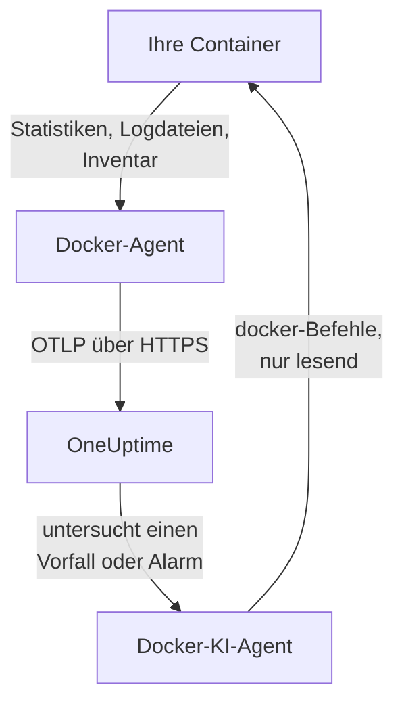

# Docker-Agent

Der OneUptime-Docker-Agent ist ein Container, den Sie auf einem Docker-Host ausführen. Er liest die Statistiken und Logdateien jedes Containers auf dem Host und sendet sie an OneUptime, wo der Host mit seinen Containern, Metriken und Logs erscheint. Ein zweiter Container, der Docker-KI-Agent, lässt OneUptime AI den Host untersuchen. [Docker-Monitore](/docs/monitor/docker-monitor) alarmieren anhand dessen, was der Agent sendet.

:::cards
- [Agent installieren](#agent-installieren): Zwei Container, mit `docker run` oder Docker Compose.
- [Was der Agent erfasst](#was-der-agent-erfasst): Metriken, Logs und ein Inventar aller Container.
- [Container-Logs brauchen json-file](#container-logs-brauchen-den-log-treiber-json-file): Den Log-Treiber eines Containers prüfen und wechseln.
- [Fehlerbehebung](#fehlerbehebung): Neustartschleifen, fehlende Metriken, fehlende Logs.
:::

## So funktioniert es

Der Agent ist ein OpenTelemetry Collector mit eingebauter OneUptime-Konfiguration. Über den Docker-Socket liest er alle 30 Sekunden die Statistiken jedes Containers und listet alle 5 Minuten jeden Container, jedes Image, jedes Netzwerk und jedes Volume auf. Er verfolgt die Logdateien der Container und sendet alles per OTLP mit dem Ingestion-Schlüssel, den Sie ihm geben, an Ihre OneUptime-URL.



Der Host registriert sich mit seinen ersten Daten unter dem Namen, den Sie ihm in `DOCKER_HOST_NAME` geben. Der KI-Agent ist optional: Lassen Sie ihn weg, und der Collector funktioniert genauso.

## Bevor Sie beginnen

- Docker Engine 20.10 oder neuer und Root-Zugriff auf dem Host: Der Agent liest `/var/run/docker.sock`.
- Docker Compose v2 (der Befehl `docker compose`), wenn Sie mit Docker Compose installieren.
- Ein Ingestion-Schlüssel. Legen Sie ihn unter **Projekteinstellungen → Telemetrie & APM → Ingestion-Schlüssel** an und kopieren Sie seinen Wert.
- Ausgehendes HTTPS vom Host zu Ihrer OneUptime-URL.
- Für Container-Logs Container, die den Log-Treiber `json-file` von Docker verwenden, den Standard von Docker. Siehe [Container-Logs brauchen den Log-Treiber json-file](#container-logs-brauchen-den-log-treiber-json-file).

## Agent installieren

:::steps
### Agent starten

Ersetzen Sie `YOUR_ONEUPTIME_URL` durch Ihre OneUptime-URL, `YOUR_TELEMETRY_INGESTION_TOKEN` durch den Ingestion-Schlüssel und `my-docker-host` durch einen Namen für diesen Host, etwa `prod-docker-01`. Unter diesem Namen erscheint der Host in OneUptime; halten Sie ihn also stabil: Ein neuer Name registriert einen neuen Host.

:::tabs
@tab Docker CLI
```bash
docker run -d \
  --name oneuptime-docker-agent \
  --user 0:0 \
  --restart unless-stopped \
  -v /var/run/docker.sock:/var/run/docker.sock:ro \
  -v /var/lib/docker/containers:/var/lib/docker/containers:ro \
  -e ONEUPTIME_URL="YOUR_ONEUPTIME_URL" \
  -e ONEUPTIME_SERVICE_TOKEN="YOUR_TELEMETRY_INGESTION_TOKEN" \
  -e DOCKER_HOST_NAME="my-docker-host" \
  oneuptime/docker-agent:release
```

Starten Sie dann den [KI-Agent](#ki-agent) daneben, mit denselben Werten. **KI-Untersuchungen sind standardmäßig aktiviert**: Während OneUptime AI einen Vorfall oder Alarm auf diesem Host untersucht, führt sie über den KI-Agent lesende `docker`-Befehle aus und ändert nichts, sofern Sie keine Korrekturen erlauben. Um ohne KI-Untersuchungen zu installieren, lassen Sie diesen Befehl weg.

```bash
docker run -d \
  --name oneuptime-docker-ai-agent \
  --user 0:0 \
  --restart unless-stopped \
  --read-only --tmpfs /tmp \
  -v /var/run/docker.sock:/var/run/docker.sock:ro \
  -e ONEUPTIME_URL="YOUR_ONEUPTIME_URL" \
  -e ONEUPTIME_SERVICE_TOKEN="YOUR_TELEMETRY_INGESTION_TOKEN" \
  -e ONEUPTIME_AI_AGENT_RESOURCE_TYPE=docker \
  -e DOCKER_HOST_NAME="my-docker-host" \
  oneuptime/resource-ai-agent:release
```
@tab Docker Compose
Speichern Sie dies als `docker-compose.yml` in einem Ordner auf dem Host. Der zweite Dienst ist der [KI-Agent](#ki-agent): Lassen Sie ihn weg, um den Collector ohne KI-Untersuchungen auszuführen.

```yaml title="docker-compose.yml"
services:
  oneuptime-docker-agent:
    image: oneuptime/docker-agent:release
    container_name: oneuptime-docker-agent
    user: "0:0"
    restart: unless-stopped
    volumes:
      - /var/run/docker.sock:/var/run/docker.sock:ro
      - /var/lib/docker/containers:/var/lib/docker/containers:ro
    environment:
      - ONEUPTIME_URL=YOUR_ONEUPTIME_URL
      - ONEUPTIME_SERVICE_TOKEN=YOUR_TELEMETRY_INGESTION_TOKEN
      - DOCKER_HOST_NAME=my-docker-host
    logging:
      driver: json-file
      options:
        max-size: "10m"
        max-file: "3"
  oneuptime-docker-ai-agent:
    image: oneuptime/resource-ai-agent:release
    container_name: oneuptime-docker-ai-agent
    user: "0:0"
    restart: unless-stopped
    read_only: true
    tmpfs:
      - /tmp
    volumes:
      - /var/run/docker.sock:/var/run/docker.sock:ro
    environment:
      - ONEUPTIME_URL=YOUR_ONEUPTIME_URL
      - ONEUPTIME_SERVICE_TOKEN=YOUR_TELEMETRY_INGESTION_TOKEN
      - ONEUPTIME_AI_AGENT_RESOURCE_TYPE=docker
      - DOCKER_HOST_NAME=my-docker-host
```

Starten Sie ihn in diesem Ordner:

```bash
docker compose up -d
```
:::

### Prüfen, ob der Agent läuft

```bash
docker ps --filter name=oneuptime-docker-agent
docker logs -f oneuptime-docker-agent
```

Sobald der Collector gestartet ist, sollten die Logs diese Zeile zeigen:

```text
Everything is ready. Begin running and processing data.
```

### Den Host in OneUptime finden

Öffnen Sie **Produkte → Infrastruktur → Docker → Alle Hosts**. Der Host erscheint innerhalb etwa einer Minute unter seinem `DOCKER_HOST_NAME`, mit seinen Containern, Metriken und Logs. Der KI-Agent wird auf der Seite **KI-Agent** des Hosts und unten in seiner **Übersicht** als verbunden angezeigt.
:::

## Umgebungsvariablen

| Variable | Erforderlich | Beschreibung |
| --- | --- | --- |
| `ONEUPTIME_URL` | Ja | Ihre OneUptime-URL, etwa `https://oneuptime.com` oder Ihre selbst gehostete Instanz. Verwenden Sie `http://` und ihren Port, wenn die Instanz nur HTTP spricht. |
| `ONEUPTIME_SERVICE_TOKEN` | Ja | Der Ingestion-Schlüssel aus **Projekteinstellungen → Telemetrie & APM → Ingestion-Schlüssel**. |
| `DOCKER_HOST_NAME` | Nein | Der Name des Hosts in OneUptime. Standard ist `docker-host`; geben Sie daher jedem Host einen eigenen. |
| `DOCKER_API_VERSION` | Nein | Die Version der Docker-Engine-API, die der Agent spricht. Standard ist `1.44`. Senken Sie sie bei einem älteren Daemon, oder setzen Sie einen leeren Wert, um sie mit dem Daemon auszuhandeln (siehe [Fehlerbehebung](#fehlerbehebung)). |

Um einen Wert zu ändern, entfernen Sie den Agent und führen seinen Befehl erneut aus (Docker CLI), oder Sie bearbeiten `docker-compose.yml` und führen `docker compose up -d` aus (Docker Compose).

## Was der Agent erfasst

| Daten | Was es ist |
| --- | --- |
| Container-Metriken | CPU (Nutzung, Prozentsatz, Drosselung), Speicher (Nutzung, Limit, Prozentsatz), Netzwerk- und Block-I/O, Betriebszeit, Neustarts und Prozessanzahl, pro Container, alle 30 Sekunden. |
| Container-Logs | stdout und stderr jedes Containers, aus seiner Logdatei `json-file`. |
| Inventar | Jeder Container in jedem Zustand sowie jedes Image, Netzwerk und Volume, alle 5 Minuten. |

Die Metriken und Logs jedes Containers werden unter einem Dienst abgelegt, der nach dem Container benannt ist. Jede Logzeile erhält einen Schweregrad aus der Stufe, die sie nennt, etwa `[ERROR]`, `level=warn` oder `{"level":"info"}`; eine Zeile ohne Stufe übernimmt die ihres Streams: stderr ist `ERROR`, stdout ist `INFO`. Zeilen, die mit Leerraum oder einer schließenden Klammer beginnen, werden an die vorherige Zeile angehängt, sodass ein Stacktrace als ein Datensatz ankommt. Die eigenen Logs des Agents werden weggelassen.

[Docker-Überwachung](/docs/monitor/docker-monitor#erfasste-metriken) listet jede Metrik und ihre Bedeutung auf.

## Container-Logs brauchen den Log-Treiber json-file

Der Agent verfolgt `/var/lib/docker/containers/*/*-json.log`, die Dateien, die der Log-Treiber `json-file` von Docker schreibt. Ein Container mit einem anderen Treiber hinterlässt keine Datei zum Lesen: `local` schreibt Binärdateien, und `journald`, `syslog`, `fluentd` und `gelf` senden die Logs anderswohin. Seine Metriken kommen weiterhin an, seine Logs nicht.

Prüfen Sie den Log-Treiber eines Containers und den Standard des Daemons:

```bash
docker inspect <container> --format '{{.HostConfig.LogConfig.Type}}'
docker info --format '{{.LoggingDriver}}'
```

Stellen Sie einen Compose-Dienst auf `json-file` um, mit Rotation:

```yaml
services:
  my-app:
    image: my-app:latest
    logging:
      driver: "json-file"
      options:
        max-size: "100m"
        max-file: "5"
```

Oder machen Sie ihn in `/etc/docker/daemon.json` zum Standard für jeden danach erstellten Container:

```json title="/etc/docker/daemon.json"
{
  "log-driver": "json-file",
  "log-opts": {
    "max-size": "100m",
    "max-file": "5"
  }
}
```

Starten Sie dann Docker neu und erstellen Sie die Container neu. Ein Container behält den Log-Treiber, mit dem er erstellt wurde; ein Neustart reicht daher nicht.

## Agent aktualisieren

Ist der Agent älter als Ihr OneUptime, erscheint ein Warnzeichen neben **Agent-Version** in der **Übersicht** des Hosts. Wählen Sie es aus, um diese Befehle zu sehen.

:::tabs
@tab Docker CLI
```bash
docker pull oneuptime/docker-agent:release
docker pull oneuptime/resource-ai-agent:release
docker rm -f oneuptime-docker-agent oneuptime-docker-ai-agent
```

Führen Sie dann beide `docker run`-Befehle aus [Agent starten](#agent-starten) erneut aus.
@tab Docker Compose
```bash
docker compose pull
docker compose up -d
```
:::

Das Tag `release` zeigt immer auf das neueste Release. Um eine Version festzulegen, verwenden Sie `oneuptime/docker-agent:<version>`, etwa `oneuptime/docker-agent:10.0.31`. Dasselbe Image liegt in der GitHub Container Registry als `ghcr.io/oneuptime/docker-agent:release`.

## Agent deinstallieren

:::tabs
@tab Docker CLI
```bash
docker rm -f oneuptime-docker-agent
docker rm -f oneuptime-docker-ai-agent
```
@tab Docker Compose
```bash
docker compose down
```
:::

Der Host bleibt mit den gesendeten Daten in OneUptime. Wenn Sie ihn nicht mehr brauchen, löschen Sie ihn mit **Host löschen** in seinem Menü.

## KI-Agent

Die Befehle und die Compose-Datei oben, das `install.sh` des Docker-Agents und die `docker-compose.yml` in seinem [Verzeichnis DockerAgent](https://github.com/OneUptime/oneuptime/tree/master/agents/DockerAgent) führen alle den **Docker-KI-Agent** aus: einen zweiten Container, `oneuptime-docker-ai-agent` (Image `oneuptime/resource-ai-agent:release`), der die lesenden `docker`-Befehle ausführt, die OneUptime AI anfordert, während sie einen Vorfall oder Alarm auf diesem Host untersucht — `docker ps -a`, `docker logs --tail 200 web`, `docker container inspect web`, `docker stats --no-stream` — und, nur wenn Sie es erlauben, Korrekturen anwendet, etwa einen benannten Container neu zu starten. Er liest dieselben Werte `ONEUPTIME_URL`, `ONEUPTIME_SERVICE_TOKEN` und `DOCKER_HOST_NAME` wie der Collector, bedient also genau diesen Host und erscheint in OneUptime auf der Seite **KI-Agent** des Hosts.

- **KI-Untersuchungen sind standardmäßig aktiviert.** Sobald der Agent verbunden ist, untersucht OneUptime AI Vorfälle und Alarme auf diesem Host mit ihm, und die **Übersicht** des Hosts zeigt den Status des Agents an. Zum Beenden setzen Sie `ONEUPTIME_AI_INVESTIGATION=false` dort, wo der Agent läuft (**Ändern** unter **Was die KI tun darf** auf der Seite des KI-Agents zeigt, wie), oder lassen den Agent weg.
- Er ist schreibgeschützt, sofern Sie ihn nicht mit `ONEUPTIME_AI_ALLOW_WRITES=true` starten; `ONEUPTIME_AI_WRITE_TARGETS` (zum Beispiel `web-*,api-*`) begrenzt, welche Container eine Korrektur antasten darf. Starten Sie ihn außerdem mit `ONEUPTIME_AI_FIXES`, um festzulegen, wie Korrekturen ablaufen — `ask-for-approval` (ein Mensch genehmigt jede), `automatic` oder `bypass-approval` —, und die Seite des KI-Agents zeigt es schreibgeschützt an ([Was die KI tun darf, vom Agent festgelegt](/docs/ai/infrastructure-ai-agents#what-ai-may-do-set-by-the-agent)).
- Er läuft als root mit eingehängtem Docker-Socket, weil der Socket root gehört — und wer den Socket nutzen kann, ist root auf diesem Host, ob mit `:ro` oder nicht. Die Grenze ist die Befehlsrichtlinie des Agents: Er führt nie `exec`, `run`, `rm` oder `prune` aus und ändert nie sich selbst, den Collector oder etwas in `ONEUPTIME_AI_PROTECTED_TARGETS` (Globs für Containernamen). Umgebungswerte in der Ausgabe von `docker inspect` werden maskiert, bevor etwas den Host verlässt.
- `install.sh --no-ai-agent` lässt ihn weg; `docker rm -f oneuptime-docker-ai-agent` entfernt ihn. Aktualisieren Sie ihn wie den Collector: `docker pull oneuptime/resource-ai-agent:release`, ihn entfernen und erneut starten.

Was er ausführen darf, wie Korrekturen funktionieren und wie Sie Fehler beheben: [Infrastructure AI Agents](/docs/ai/infrastructure-ai-agents#docker-and-podman-hosts).

## Fehlerbehebung

:::details Der Agent startet neu mit „client version is too new“
Die Logs des Agents zeigen:

```text
Error: cannot start pipelines: failed to start "docker_stats" receiver:
Error response from daemon: client version 1.44 is too new.
Maximum supported API version is 1.41
```

Ein Daemon lehnt einen Client ab, der neuer ist als sein eigenes Maximum; der Receiver startet daher nie, und der Collector beendet sich mit ihm. Ermitteln Sie das Maximum des Daemons:

```bash
docker version --format '{{ .Server.APIVersion }}'
```

Fügen Sie dann `-e DOCKER_API_VERSION=1.41` (oder den ermittelten Wert) zu `docker run` hinzu, oder setzen Sie `DOCKER_API_VERSION` in Compose. Neuere Daemons bedienen weiterhin ältere API-Versionen, daher bleibt die Einstellung nach einem Upgrade gültig.

Sie möchten die Zahl lieber nicht nachschlagen? Setzen Sie `DOCKER_API_VERSION` auf die leere Zeichenkette. Der Agent handelt die Version dann mit dem Daemon aus (ein `HEAD /_ping`, dann das eigene Maximum des Daemons), was mit alten wie neuen Daemons funktioniert:

```bash
docker run -d ... -e DOCKER_API_VERSION= ...
```
:::

:::details Docker-Socket: Zugriff verweigert
Der Agent muss als root laufen, um `/var/run/docker.sock` zu lesen. Prüfen Sie, ob `--user 0:0` in Ihrem `docker run`-Befehl steht oder `user: "0:0"` in Compose.
:::

:::details Der Host wird als getrennt angezeigt
1. Prüfen Sie, ob der Agent läuft: `docker ps --filter name=oneuptime-docker-agent`
2. Suchen Sie in seinen Logs nach Fehlern: `docker logs oneuptime-docker-agent 2>&1 | grep -i error`
3. Prüfen Sie `ONEUPTIME_URL` und `ONEUPTIME_SERVICE_TOKEN`: Der Schlüssel muss ein gültiger Ingestion-Schlüssel sein, der nicht deaktiviert wurde.
4. Prüfen Sie, ob der Host Ihre OneUptime-URL über das Netzwerk erreicht.
:::

:::details Es erscheinen keine Metriken
1. Prüfen Sie, ob der Docker-Socket in den Agent eingehängt ist. Sein Image hat keine Shell; sehen Sie daher aus einem Wegwerf-Container nach, der seine Mounts teilt: `docker run --rm --volumes-from oneuptime-docker-agent alpine:3.19 ls -la /var/run/docker.sock`
2. Suchen Sie in seinen Logs nach Exportfehlern: `docker logs oneuptime-docker-agent 2>&1 | tail -100`
3. Prüfen Sie, ob der Ingestion-Schlüssel gültig und nicht abgelaufen ist.
:::

:::details Metriken kommen an, aber keine Container-Logs
Ihre Container verwenden höchstwahrscheinlich einen anderen Log-Treiber als `json-file`. Prüfen Sie, welche Dateien der Agent beobachtet und welchen Treiber ein Container verwendet:

```bash
docker logs oneuptime-docker-agent 2>&1 | grep -E "Started watching file|no files match"
docker inspect <container> --format '{{.HostConfig.LogConfig.Type}}'
```

Meldet der Agent `no files match the configured criteria`, stellen Sie die Container auf `json-file` um und erstellen sie neu, wie [Container-Logs brauchen den Log-Treiber json-file](#container-logs-brauchen-den-log-treiber-json-file) zeigt.
:::

:::details Die Logs liegen bei einem anderen Host, oder der Host heißt docker-host
Der Name des Hosts kommt aus `DOCKER_HOST_NAME`. Ein ohne ihn gestarteter Agent meldet `docker-host`, sodass jeder so eingerichtete Host wie derselbe aussieht; ändern Sie den Namen später, registriert OneUptime einen zweiten Host, der dann die neuen Daten enthält. Setzen Sie `DOCKER_HOST_NAME` auf jedem Host auf einen eigenen Namen und erstellen Sie den Agent neu. So prüfen Sie den Namen, den der Agent meldet:

```bash
docker inspect oneuptime-docker-agent --format '{{range .Config.Env}}{{println .}}{{end}}' | grep DOCKER_HOST_NAME
```
:::

## Nächste Schritte

:::cards
- [Docker-Überwachung](/docs/monitor/docker-monitor): Alarmieren bei CPU, Speicher und Neustarts von Containern.
- [Datenbanken](/docs/telemetry/databases): Datenbank-Container auf dem Host werden gefunden und erhalten eigene Seiten.
- [Kubernetes-Agent](/docs/telemetry/kubernetes-agent): Stattdessen einen Kubernetes-Cluster überwachen.
- [Host-OpenTelemetry-Collector](/docs/telemetry/host-otel-collector): Den Rechner selbst überwachen: CPU, Datenträger, Prozesse und Logs.
:::
