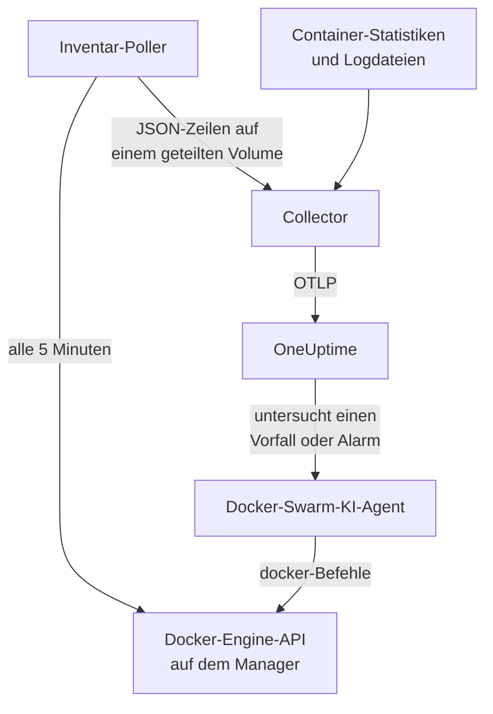

# Docker-Swarm-Agent

Der OneUptime-Docker-Swarm-Agent überwacht einen Docker-Swarm-Cluster: seine Knoten, Dienste, Tasks, Stacks, Overlay-Netzwerke, Secrets, Configs und Volumes sowie die Metriken und Logs jedes Containers. Sie führen ihn mit Docker Compose auf einem Swarm-Manager-Knoten aus, und der Cluster erscheint mit all dem in OneUptime. [Docker-Swarm-Monitore](/docs/monitor/docker-swarm-monitor) alarmieren anhand dessen, was ankommt.

:::cards
- [Agent installieren](#agent-installieren): Das Installationsskript oder Docker Compose, auf einem Manager-Knoten.
- [Was der Agent erfasst](#was-der-agent-erfasst): Das Inventar, die Cluster-Zählwerte sowie Container-Metriken und -Logs.
- [KI-Agent](#ki-agent): OneUptime AI den Swarm lesen lassen, während sie untersucht.
- [Fehlerbehebung](#fehlerbehebung): Ein Diagnoseskript und die üblichen Probleme.
:::

## So funktioniert es

Der Agent besteht aus drei Containern, alle in einer `docker-compose.yml` definiert:

1. **Collector**: ein OpenTelemetry Collector, der `docker_stats` für die Metriken jedes Containers liest, die Logdateien der Container verfolgt und die Datei mit dem Inventar-Snapshot verfolgt. Er versieht alles mit dem Namen Ihres Clusters (`docker.swarm.cluster.name`) und sendet es per OTLP an OneUptime.
2. **Inventar-Poller**: ein kleiner Sidecar mit `curl` und `jq`, der alle 5 Minuten die API des Swarm-Managers abläuft (`/nodes`, `/services`, `/tasks`, `/networks`, `/secrets`, `/configs`, `/volumes`) und die Stacks aus dem Service-Label `com.docker.stack.namespace` ableitet. Er schreibt eine JSON-Zeile pro Objekt, die der Collector weiterleitet.
3. **KI-Agent**: `oneuptime-docker-swarm-ai-agent`, der die `docker`-Befehle ausführt, um die OneUptime AI bittet, während sie einen Vorfall oder Alarm auf diesem Cluster untersucht. Er ist schreibgeschützt, sofern Sie keine Korrekturen erlauben (siehe [KI-Agent](#ki-agent)).



Der Cluster registriert sich mit seinen ersten Daten unter dem Clusternamen, den Sie konfigurieren.

## Bevor Sie beginnen

- Ein Swarm-**Manager**-Knoten, auf dem der Agent läuft: Der Inventar-Poller und der KI-Agent rufen API-Endpunkte auf, die nur Manager beantworten.
- Docker Engine 20.10 oder neuer mit dem Plugin Docker Compose v2.
- Ein Ingestion-Schlüssel. Legen Sie ihn unter **Projekteinstellungen → Telemetrie & APM → Ingestion-Schlüssel** an und kopieren Sie seinen Wert.
- Ausgehendes HTTPS vom Knoten zu Ihrer OneUptime-URL.

### Wo der Agent laufen sollte

Führen Sie ihn auf einem Manager-Knoten aus. Der Collector meldet die Container des Knotens, auf dem er läuft; für die Container-Metriken aller Knoten führen Sie den Collector daher auf jedem Knoten aus, alle mit demselben `DOCKER_SWARM_CLUSTER_NAME`. Der Inventar-Poller und der KI-Agent müssen nur auf einem Manager laufen. `install.sh` lässt den KI-Agent auf einem Knoten weg, der kein Manager ist (und entfernt einen, den es dort früher installiert hat). Ein KI-Agent, der trotzdem auf einem Worker gestartet wird, registriert sich nie für den Cluster: Er wartet, bis sein Knoten ein Manager ist, und kann daher den KI-Agent des Managers nicht verdrängen. Verteilen Sie den Agent als Swarm-Stack statt mit Compose? Halten Sie den Inventar-Poller und den KI-Agent mit der Einschränkung `node.role == manager` auf Managern.

## Agent installieren

:::steps
### Den Agent installieren und starten

:::tabs
@tab install.sh
Laden Sie das Installationsskript herunter und führen Sie es auf einem Manager-Knoten aus:

```bash
curl -sSL https://raw.githubusercontent.com/OneUptime/oneuptime/master/agents/DockerSwarmAgent/install.sh -o install.sh
sh install.sh
```

Das Skript fragt nach Ihrer OneUptime-URL, dem Ingestion-Schlüssel und einem Namen für den Cluster. Es installiert nach `/opt/oneuptime-docker-swarm-agent`, schreibt eine `.env`-Datei, die nur ihr Eigentümer lesen kann, und startet alle drei Container. Fügen Sie `--no-ai-agent` hinzu, um den KI-Agent wegzulassen.
@tab Docker Compose
Laden Sie `docker-compose.yml`, `otel-collector-config.yaml` und `inventory-snapshot.sh` aus dem [Verzeichnis DockerSwarmAgent](https://github.com/OneUptime/oneuptime/tree/master/agents/DockerSwarmAgent) in einen neuen Ordner auf einem Manager-Knoten herunter:

```bash
curl -fsSL https://raw.githubusercontent.com/OneUptime/oneuptime/master/agents/DockerSwarmAgent/docker-compose.yml -o docker-compose.yml
curl -fsSL https://raw.githubusercontent.com/OneUptime/oneuptime/master/agents/DockerSwarmAgent/otel-collector-config.yaml -o otel-collector-config.yaml
curl -fsSL https://raw.githubusercontent.com/OneUptime/oneuptime/master/agents/DockerSwarmAgent/inventory-snapshot.sh -o inventory-snapshot.sh
chmod +x inventory-snapshot.sh
```

Legen Sie daneben eine Datei `.env` an. Sie enthält den Ingestion-Schlüssel; schützen Sie sie daher mit `chmod 600 .env`:

```bash title=".env"
ONEUPTIME_URL=https://oneuptime.com
ONEUPTIME_SERVICE_TOKEN=your-telemetry-ingestion-key
DOCKER_SWARM_CLUSTER_NAME=my-swarm
```

Starten Sie den Agent:

```bash
docker compose up -d
```
:::

### Prüfen, ob der Agent läuft

```bash
docker compose ps
docker compose logs --tail 50 oneuptime-docker-swarm-agent oneuptime-docker-swarm-inventory
```

`docker compose ps` listet drei Container auf: den Collector (`oneuptime-docker-swarm-agent`), den Inventar-Poller (`oneuptime-docker-swarm-inventory`) und den KI-Agent (`oneuptime-docker-swarm-ai-agent`).

### Den Cluster in OneUptime finden

Öffnen Sie **Produkte → Infrastruktur → Docker Swarm → Alle Cluster**. Der Cluster erscheint innerhalb weniger Minuten, und seine Seiten **Knoten**, **Dienste**, **Aufgaben**, **Stacks**, **Netzwerke**, **Geheimnisse**, **Konfigurationen** und **Volumes** füllen sich nach dem ersten Inventar-Snapshot, innerhalb von 5 Minuten.
:::

## Umgebungsvariablen

Das Installationsskript schreibt die ersten drei nach `/opt/oneuptime-docker-swarm-agent/.env`; eine Docker-Compose-Installation liest sie aus der `.env` neben `docker-compose.yml`. Fügen Sie dort eine davon hinzu oder ändern Sie sie, und führen Sie dann in diesem Ordner `docker compose up -d` aus.

| Variable | Erforderlich | Beschreibung |
| --- | --- | --- |
| `ONEUPTIME_URL` | Ja | Ihre OneUptime-URL, etwa `https://oneuptime.com` oder Ihre selbst gehostete Instanz. Verwenden Sie `http://` und ihren Port, wenn die Instanz nur HTTP spricht. |
| `ONEUPTIME_SERVICE_TOKEN` | Ja | Der Ingestion-Schlüssel aus **Projekteinstellungen → Telemetrie & APM → Ingestion-Schlüssel**. |
| `DOCKER_SWARM_CLUSTER_NAME` | Ja | Der Name des Clusters in OneUptime und der Schlüssel, über den die Daten jedes Knotens zusammenfinden: an alles als Ressourcenattribut `docker.swarm.cluster.name` gehängt. Halten Sie ihn stabil: Eine spätere Änderung registriert einen zweiten Cluster. Standard ist `docker-swarm`. |
| `DOCKER_INVENTORY_INTERVAL_SECONDS` | Nein | Wie oft der Inventar-Poller einen Snapshot erstellt, in Sekunden. Standard ist `300`. |
| `DOCKER_API_VERSION` | Nein | Die Version der Docker-Engine-API, die der Collector und der Inventar-Poller sprechen. Standard ist `1.44`; leer handelt sie mit dem Daemon aus (siehe [Fehlerbehebung](#fehlerbehebung)). Der KI-Agent handelt sie aus, sofern Sie keine festlegen. |

Die eigenen Einstellungen des KI-Agents stehen unter [KI-Agent](#ki-agent).

## Was der Agent erfasst

| Signal | Quelle | Wo es erscheint |
| --- | --- | --- |
| Die Knoten, Dienste, Tasks, Stacks, Netzwerke, Secrets, Configs und Volumes | Der Inventar-Poller, aus der API des Swarm-Managers | Die Listen und Detailseiten des Clusters |
| Cluster-Zählwerte (bereite Knoten, laufende Tasks, Dienste, Stacks, …) | Derselbe Snapshot | Die Karten der Übersicht und die Badges im Seitenmenü |
| CPU, Speicher, Prozessanzahl und Laufzeit der Container | Der Receiver `docker_stats` | Die Seite **Metriken** |
| stdout- und stderr-Logs der Container | Der Receiver `filelog` | Die Seite **Protokolle** |

### Was ihn vom Docker-Agent unterscheidet

Der [Docker-Agent](/docs/telemetry/docker-host) bildet einen einzelnen Host ab und hängt `host.name` und `container.runtime=docker` an. Der Docker-Swarm-Agent hängt mit Absicht nur `docker.swarm.cluster.name` an: OneUptime ordnet die Daten dann dem Swarm-Cluster zu, statt jeden Knoten als eigenen Host zu registrieren.

## Den Cluster mit Projekt-Labels versehen

Ein Ressourcenattribut, das mit `oneuptime.label.` beginnt, wird zu einem Projekt-Label am Cluster: `oneuptime.label.<dimension>=<value>` ist das Label `<dimension>:<value>`. Fügen Sie die Attribute dem Processor `resource` in `otel-collector-config.yaml` hinzu, neben `docker.swarm.cluster.name`:

```yaml
processors:
  resource:
    attributes:
      # ...existing attributes...
      - key: oneuptime.label.team
        value: platform
        action: upsert
      - key: oneuptime.label.env
        value: production
        action: upsert
```

Der Collector liest seine Konfiguration nur beim Start: Führen Sie `docker compose restart oneuptime-docker-swarm-agent` aus. Der Cluster zeigt dann die Labels `team:platform` und `env:production`. Labels werden ohne Rücksicht auf Groß- und Kleinschreibung verglichen, daher wird ein vorhandenes Label `Production` wiederverwendet statt dupliziert, und der Agent entfernt nie ein Label, das jemand in OneUptime hinzugefügt hat.

## Als systemd-Dienst ausführen

Um den Agent mit dem Knoten zu starten und bei einem Fehler neu zu starten, installieren Sie seine systemd-Unit. Sie geht davon aus, dass der Agent in `/opt/oneuptime-docker-swarm-agent` liegt, wo das Installationsskript ihn ablegt:

```bash
sudo curl -fsSL https://raw.githubusercontent.com/OneUptime/oneuptime/master/agents/DockerSwarmAgent/systemd/oneuptime-docker-swarm-agent.service -o /etc/systemd/system/oneuptime-docker-swarm-agent.service
sudo systemctl daemon-reload
sudo systemctl enable --now oneuptime-docker-swarm-agent
```

## Agent aktualisieren

Der Agent meldet die Collector-Version, die er ausführt. Ist sie älter als die Version, die dieses OneUptime-Release festlegt, erscheint in der **Übersicht** des Clusters ein Warnzeichen neben der Version des Agents. Wählen Sie es aus, um diese Befehle zu sehen.

Führen Sie das Installationsskript erneut auf dem Manager-Knoten aus und beantworten Sie seine Fragen mit derselben URL, demselben Schlüssel und demselben Clusternamen. Es lädt die neuesten Dateien herunter, zieht die Images und startet den Agent neu:

```bash
curl -sSL https://raw.githubusercontent.com/OneUptime/oneuptime/master/agents/DockerSwarmAgent/install.sh -o install.sh
sh install.sh
```

Das Skript schreibt `.env` aus Ihren Antworten neu. Es behält nur die Ziellisten des KI-Agents und das, was die KI tun darf (`ONEUPTIME_AI_INVESTIGATION`, `ONEUPTIME_AI_FIXES`): Fügen Sie jede Variable, die Sie selbst gesetzt haben, wieder hinzu, etwa `DOCKER_API_VERSION`. Haben Sie KI-Korrekturen eingeschaltet? Führen Sie es als `ONEUPTIME_AI_ALLOW_WRITES=true sh install.sh` aus, damit sie eingeschaltet bleiben. Haben Sie den KI-Agent weggelassen? Übergeben Sie erneut `--no-ai-agent`.

Laden Sie mit Docker Compose die drei Dateien im Ordner des Agents erneut herunter (und nehmen Sie Ihre Änderungen an `docker-compose.yml` erneut vor), ziehen Sie dann die Images und starten Sie neu:

```bash
docker compose pull
docker compose up -d
```

Die Collector-Version ist in den Dateien festgelegt; ein Pull allein bringt den Agent daher nicht voran.

## Agent deinstallieren

```bash
cd /opt/oneuptime-docker-swarm-agent
docker compose down
```

## KI-Agent

Die `docker-compose.yml` des Swarms (und `install.sh`) führt außerdem den **Docker-Swarm-KI-Agent** aus: einen dritten Container, `oneuptime-docker-swarm-ai-agent` (Image `oneuptime/resource-ai-agent:release`), der die lesenden `docker`-Befehle ausführt, um die OneUptime AI bittet, während sie einen Vorfall oder Alarm auf diesem Cluster untersucht — `docker node ls`, `docker service ps web --no-trunc`, `docker service logs --tail 200 web` — und, nur wenn Sie es erlauben, Korrekturen anwendet, etwa einen rollierenden Neustart eines benannten Dienstes. Er liest dieselben `ONEUPTIME_URL`, `ONEUPTIME_SERVICE_TOKEN` und `DOCKER_SWARM_CLUSTER_NAME` wie der Collector, bedient also genau diesen Cluster, und erscheint in OneUptime auf der Seite **KI → KI-Agent** des Clusters.

- **KI-Untersuchungen sind standardmäßig aktiviert.** Sobald der Agent verbunden ist, untersucht OneUptime AI Vorfälle und Alarme auf diesem Cluster mit ihm, und die **Übersicht** des Clusters zeigt den Status des Agents an. Zum Beenden setzen Sie `ONEUPTIME_AI_INVESTIGATION=false` dort, wo der Agent läuft (**Ändern** unter **Was die KI tun darf** auf der Seite des KI-Agents zeigt, wie), oder lassen den Agent weg.
- Wie der Inventar-Poller **muss er auf einem Manager-Knoten laufen**: Befehle für Knoten, Dienste und Tasks gibt es nur auf Managern. Auf einem Worker führt er nichts aus und registriert sich nicht für den Cluster, bis der Knoten ein Manager ist (sein `/status` sagt, warum). Führen Sie einen pro Cluster aus.
- Er ist **schreibgeschützt**, sofern Sie nicht `ONEUPTIME_AI_ALLOW_WRITES=true` in `.env` setzen und `docker compose up -d` ausführen (oder `install.sh` damit ausführen; das Installationsskript schreibt `ONEUPTIME_AI_ALLOW_WRITES`, `ONEUPTIME_AI_INVESTIGATION`, `ONEUPTIME_AI_FIXES`, `ONEUPTIME_AI_WRITE_TARGETS` und `ONEUPTIME_AI_PROTECTED_TARGETS` aus seiner Umgebung in `.env`, und ein erneuter Lauf behält für die letzten vier, was `.env` bereits enthält, sofern Sie die Variable nicht übergeben, auch leer); `ONEUPTIME_AI_WRITE_TARGETS` (Globs für Dienst- und Knotennamen, zum Beispiel `web_*,api_*`) begrenzt, was eine Korrektur antasten darf. `ONEUPTIME_AI_FIXES` in derselben `.env` legt fest, wie Korrekturen ablaufen — `ask-for-approval` (ein Mensch genehmigt jede), `automatic` oder `bypass-approval` —, und die Seite des KI-Agents zeigt es schreibgeschützt an ([Was die KI tun darf, vom Agent festgelegt](/docs/ai/infrastructure-ai-agents#what-ai-may-do-set-by-the-agent)). Einen Knoten zu leeren braucht immer die Genehmigung eines Menschen, unabhängig vom Modus.
- Er läuft als root mit eingehängtem Docker-Socket, weil der Socket root gehört — und auf einem Manager kontrolliert, wer den Socket benutzen kann, den ganzen Swarm, ob `:ro` oder nicht. Die Befehlsrichtlinie des Agents ist die Grenze: Er erstellt oder entfernt nie Dienste oder Stacks, rührt nie Secrets oder Configs an und ändert nie sich selbst, den Collector, den Inventar-Poller oder irgendetwas in `ONEUPTIME_AI_PROTECTED_TARGETS` (Globs für Dienst- und Knotennamen).
- `install.sh --no-ai-agent` lässt ihn weg, oder löschen Sie den Dienst `oneuptime-docker-swarm-ai-agent` aus `docker-compose.yml`.

Was er ausführen darf, wie Korrekturen funktionieren und wie Sie Fehler beheben: [Infrastructure AI Agents](/docs/ai/infrastructure-ai-agents#docker-swarm-clusters).

## Fehlerbehebung

:::details Zuerst das Diagnoseskript ausführen
Der Agent bringt ein Skript mit, [`troubleshoot.sh`](https://github.com/OneUptime/oneuptime/blob/master/agents/DockerSwarmAgent/troubleshoot.sh), das die ganze Kette prüft: die Container, ob der Inventar-Poller auf einem Manager läuft (`docker node ls`), die Snapshot-Datei, den an alles gehängten Clusternamen, die Form des Tokens, die eigenen Metriken des Collectors und ob OneUptime den Ingestion-Schlüssel akzeptiert. Diese letzte Prüfung zählt am meisten. OneUptime lehnt einen falschen Schlüssel mit `401` ab (`422` für einen deaktivierten Schlüssel oder einen Browser-Schlüssel), und der Collector protokolliert das als eine Zeile `Exporting failed` pro Batch, die leicht zu übersehen ist. Das Skript fragt `GET <url>/otlp/v1/validate` ab, um direkt `200` (gültig) oder `401` (ungültig) zu erhalten. Führen Sie es auf dem Manager-Knoten aus:

```bash
curl -sSL https://raw.githubusercontent.com/OneUptime/oneuptime/master/agents/DockerSwarmAgent/troubleshoot.sh -o troubleshoot.sh
bash troubleshoot.sh    # add -d <dir> if you installed outside /opt/oneuptime-docker-swarm-agent
```
:::

:::details Der Cluster erscheint nie
Führen Sie zuerst das Diagnoseskript aus. Lesen Sie andernfalls die Logs des Collectors (`docker compose logs oneuptime-docker-swarm-agent`), prüfen Sie, ob `ONEUPTIME_SERVICE_TOKEN` und `ONEUPTIME_URL` in `.env` stimmen und ob der Knoten Ihre OneUptime-URL erreicht.
:::

:::details Es erscheint kein Inventar
Prüfen Sie, ob der Inventar-Poller auf einem Manager läuft: `docker node ls` muss dort gelingen. Suchen Sie dann in seinen Logs nach Zeilen `failed to emit ...`: `docker compose logs oneuptime-docker-swarm-inventory`.
:::

:::details Der Cluster springt auf getrennt
Ein Cluster wird als getrennt angezeigt, wenn OneUptime 15 Minuten lang nichts von ihm empfangen hat; OneUptime prüft alle 5 Minuten, und Zeit, in der es selbst keine Daten empfing, zählt nicht. Sorgen Sie dafür, dass der Collector-Container läuft: `docker compose ps` zeigt ihn.
:::

:::details Der Collector beendet sich mit "client version is too new"
Die Logs des Collectors zeigen:

```text
Error: cannot start pipelines: failed to start "docker_stats" receiver:
Error response from daemon: client version 1.44 is too new.
Maximum supported API version is 1.41
```

Die höchste API-Version des Daemons liegt unter dem Standard `1.44` (Docker Engine 20.10 endet bei `1.41`), daher kann der Receiver `docker_stats` nicht starten, und der Container startet in einer Schleife neu. Ermitteln Sie die höchste Version des Daemons:

```bash
docker version --format '{{ .Server.APIVersion }}'
```

Setzen Sie `DOCKER_API_VERSION` in `.env` auf diesen Wert und führen Sie `docker compose up -d` auf jedem Knoten aus, auf dem der Agent läuft. Neuere Daemons bedienen weiterhin ältere API-Versionen, daher funktioniert die Einstellung auch nach einem Docker-Upgrade weiter. Oder setzen Sie `DOCKER_API_VERSION=` (leer), damit der Collector die Version mit dem Daemon aushandelt, statt eine festzulegen.
:::

:::details Der Cluster erscheint unter dem falschen Namen
Der Name des Clusters kommt aus `DOCKER_SWARM_CLUSTER_NAME`. Ändern Sie ihn in `.env` und führen Sie `docker compose up -d` aus: Ein neuer Name registriert einen neuen Cluster, statt den alten umzubenennen.
:::

## Nächste Schritte

:::cards
- [Docker-Swarm-Überwachung](/docs/monitor/docker-swarm-monitor): Alarmieren bei Knoten, Diensten, Tasks und Containern.
- [Infrastructure AI Agents](/docs/ai/infrastructure-ai-agents): Was der Docker-Swarm-KI-Agent ausführen darf und wie Korrekturen funktionieren.
- [Docker-Agent](/docs/telemetry/docker-host): Stattdessen einen einzelnen Docker-Host überwachen.
:::
