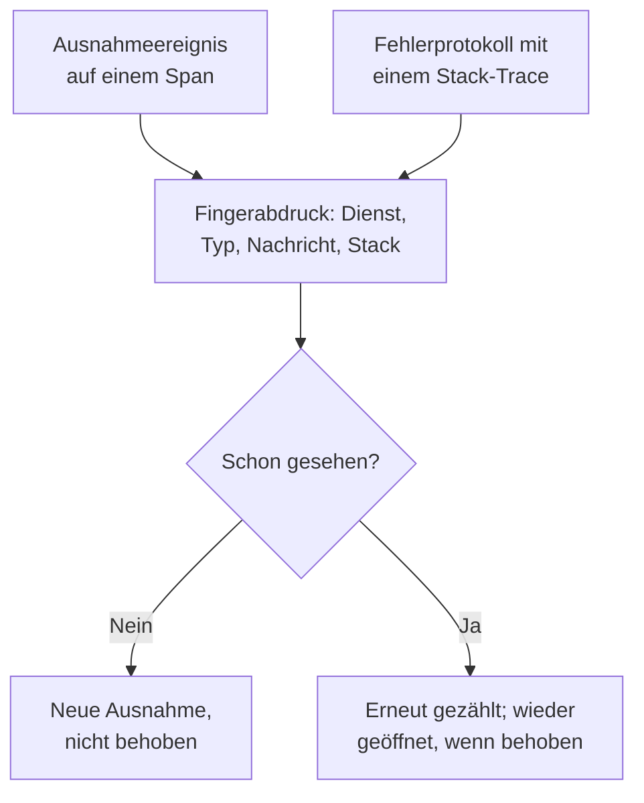

# Ausnahmenverfolgung

Die Ausnahmenverfolgung sammelt die Fehler, die Ihr Code wirft, und fasst jedes Vorkommen desselben Fehlers zu einer Ausnahme zusammen, mit ihrem Stack-Trace, ihrem Verlauf und den Anfragen, in denen sie auftrat. Arbeiten Sie sie wie eine Aufgabenliste ab: beheben, als behoben markieren oder das Rauschen archivieren, und lassen Sie die KI einen Pull Request für die öffnen, die sie beheben kann.

:::cards
- [Woher Ausnahmen kommen](#woher-ausnahmen-kommen): Spans und Protokolle, die Ihre Dienste bereits senden.
- [Die Liste sichten](#die-liste-sichten): Ungelöstes zuerst, Rauschen ausgeblendet.
- [Die Seite einer Ausnahme](#die-seite-einer-ausnahme): Stack-Trace, Vorkommen und Kontext.
- [Mit KI beheben](#mit-ki-beheben): Ein Pull Request mit der Korrektur oder einem Regressionstest.
- [Neue und zunehmende Ausnahmen mit KI finden und beheben](#neue-und-zunehmende-ausnahmen-mit-ki-finden-und-beheben): Pull Requests für die Ausnahmen, die OneUptime findet.
:::

## Woher Ausnahmen kommen

Sie senden Ausnahmen nicht gesondert. OneUptime findet sie in der Telemetrie, die Ihre Dienste bereits senden:

- ein Ausnahmeereignis auf einem Span, also das, was `recordException()` von OpenTelemetry schreibt;
- ein Protokoll mit den Attributen `exception.type`, `exception.message` oder `exception.stacktrace`;
- ein Protokoll mit dem Schweregrad Error oder Fatal, dessen Nachricht einen Stack-Trace enthält, wenn das Protokoll nicht innerhalb eines Spans geschrieben wurde (der Span meldet sie bereits).

Jedes Vorkommen wird mit den früheren Vorkommen desselben Fehlers zu einer Ausnahme zusammengefasst:

- **Eine Ausnahme pro Dienst und Fehler.** Der Fingerabdruck entsteht aus dem Dienst, dem Ausnahmetyp, der Nachricht und dem Stack-Trace. Werte, die sich von Aufruf zu Aufruf ändern, werden vorher entfernt: UUIDs und andere IDs, Zeitstempel, IP- und E-Mail-Adressen sowie Zahlen mit sieben oder mehr Ziffern. `Order id=1042 not found` und `Order id=2077 not found` sind also eine Ausnahme. Eine neue Ausnahme wird stattdessen nach ihrem Typ und den Funktionen und Dateien Ihres eigenen Codes im Stack-Trace gruppiert: Zeilennummern, Bibliotheks-Frames und die Nachricht bleiben außen vor, sodass Varianten aus demselben Code eine Ausnahme sind. Ohne Stack-Trace gruppiert sie ihre Nachricht, wie oben. Ausnahmen, die vor dieser Gruppierung erfasst wurden, behalten ihre.
- **Ein neues Vorkommen öffnet eine behobene Ausnahme wieder.** Tritt sie erneut auf, nachdem Sie sie als behoben markiert haben, hat die Korrektur nicht gehalten, und die Ausnahme wird als **Regression** markiert. Ein Vorkommen von vor der Behebung, das OneUptime erst später erreicht, öffnet sie nicht wieder.
- **Eine archivierte Ausnahme bleibt archiviert.** Ihre neuen Vorkommen werden weiter gezählt, lösen aber keine Benachrichtigungen mehr aus.

> [!TIP]
> Um einen erwarteten Fehler aus der Ausnahmenverfolgung herauszuhalten, etwa ungültige Eingaben, die Ihr Dienst abgelehnt hat, setzen Sie das Attribut `error.class` auf dem Ausnahmeereignis des Spans auf `user-error` oder `expected-denial`. OneUptime zeichnet dafür dann keine Ausnahme auf.

## Bevor Sie beginnen

- **Eintreffende Spans oder Protokolle.** Instrumentieren Sie Ihre Dienste mit [OpenTelemetry](/docs/telemetry/open-telemetry). Der Tab **Einrichtungsanleitung** zeigt den Code für Ihre Sprache.
- **Eine Rolle, die Telemetrie lesen darf.** Project Owner, Project Admin, Project Member, Viewer, Telemetry Admin, Telemetry Member oder Telemetry Viewer, oder eine eigene Rolle mit der Berechtigung Read Telemetry Service Exception. Beheben und Archivieren erfordern Project Owner oder Project Admin oder die Berechtigung Edit Telemetry Service Exception.

## Die Liste sichten

:::steps
### Ausnahmen öffnen

Öffnen Sie **Produkte → Observability → Ausnahmen**. Das Abzeichen am Tab **Ausnahmen** zählt die ungelösten Probleme, und die Liste öffnet mit den Ausnahmen unter **Nicht behoben**.

### Einen Status wählen

Wechseln Sie zwischen **Nicht behoben**, **Behoben**, **Archiviert** und **Alle**. Das Diagramm über der Liste zeigt, wie viele Vorkommen im Zeitverlauf **Nicht behandelt** und wie viele **Behandelt** waren. Eine mit **Regression** markierte Zeile ist nach der Behebung wieder aufgetreten, und eine mit **Neu** markierte wurde in den letzten 24 Stunden zum ersten Mal gesehen.

Jede Zeile zeigt außerdem, wie viele Benutzer die Ausnahme im gewählten Zeitraum betroffen hat, und ein kleines Diagramm ihrer Vorkommen in diesem Zeitraum. Ein Vorkommen nennt seinen Benutzer mit dem Attribut `user.id`, `enduser.id` oder `enduser.pseudo.id`, am Ausnahme-Ereignis, an seinem Span oder Log-Eintrag oder an seiner Ressource; Vorkommen, die keinen Benutzer nennen, werden nicht gezählt.

### Festlegen, was als Problem zählt

**Probleme**, der Standard, blendet Benutzerfehler und erwartete Ablehnungen aus, sodass die Liste zeigt, was eine Korrektur braucht. **User errors** zeigt nur diese, und **Alle** zeigt jede Ausnahme.

### Suchen und filtern

Geben Sie eine Abfrage wie `type:TypeError env:production` ein, siehe [Suchsyntax](/docs/telemetry/search-syntax#ausnahmen), oder klicken Sie auf einen Wert in der Seitenleiste **Filter**: einen Dienst, einen Host oder eine andere Ressource, einen **Ausnahmetyp**, eine **Umgebung** oder eine **Fehlerklasse**. **Mir zugewiesen** zeigt nur die Ihnen zugewiesenen Ausnahmen, und das Sortiermenü ordnet die Liste nach **Zuletzt gesehen**, **Zuerst gesehen** oder **Meiste Ereignisse**.

### Eine Ausnahme öffnen

Klicken Sie auf eine Zeile, um die Seite der Ausnahme zu öffnen.
:::

## Die Seite einer Ausnahme

Das Seitenmenü der Seite ordnet, was Sie mit einer Ausnahme tun:

| Seite | Was sie zeigt |
| --- | --- |
| **Übersicht** | Die Nachricht, den Dienst, wie oft sie auftrat und wann sie zuerst und zuletzt gesehen wurde, ihren Verlauf über die Zeit und ihr letztes Vorkommen: Release, Umgebung, Span, Trace und Benutzersitzung. Ganz oben die Erklärung von OneUptime AI, was passiert ist, wenn KI aktiviert ist. |
| **Stack-Trace** | Die Frames des Stacks. Bei Browser-Code die ursprünglichen Dateien und Zeilen, sobald Sie [Source Maps](/docs/telemetry/source-maps) für das Release hochladen. |
| **Vorkommen** | Jedes Vorkommen mit seiner Zeit, seiner Nachricht und dem Trace, in dem es auftrat. |
| **Kontext** | Die Attribute des letzten Vorkommens, seine Sitzungsaufzeichnung, wenn eine aufgenommen wurde, und die Schritte, die dazu führten. |
| **Protokolle** | Die Protokolle, die um das letzte Vorkommen herum geschrieben wurden. |
| **KI-Unterstützung** | KI-Aufgaben, die die Ausnahme beheben oder testen. |
| **Einstellungen** | Die Ausnahme beheben oder archivieren. Sie liegt unter **Verwalten**, das anfangs eingeklappt ist. |

## Beheben, wieder öffnen und archivieren

Die Schaltflächen oben auf der Seite der Ausnahme, ihre Seite **Einstellungen** und das Menü ⋯ in ihrer Zeile in der Liste ändern ihren Status:

| Aktion | Wann Sie sie nutzen | Was danach geschieht |
| --- | --- | --- |
| **Beheben** | Sie haben die Korrektur bereitgestellt. | Sie verlässt die Liste **Nicht behoben**. Ein neues Vorkommen öffnet sie wieder. |
| **Im nächsten Release beheben** | Die Korrektur kommt mit Ihrem nächsten Release. | Sie verlässt die Liste **Nicht behoben**. Vorkommen aus dem Release, in dem sie zuletzt gesehen wurde, öffnen sie nicht wieder, ein Vorkommen aus jedem anderen Release schon. |
| **Wieder öffnen** | Die Korrektur hat nicht gewirkt. | Sie ist wieder ungelöst. |
| **Archivieren** | Es ist Rauschen, das Sie nicht beheben wollen. | Sie verlässt die Liste. Neue Vorkommen werden gezählt, lösen aber keine Benachrichtigungen mehr aus. |
| **Aus Archiv entfernen** | Sie wollen wieder davon hören. | Sie steht wieder in der Liste, in die sie gehört. |

**Im nächsten Release beheben** steht im Menü neben **Beheben**, im Menü ⋯ der Zeile, unter **Massenaktionen** und auf **Einstellungen**, sofern die Vorkommen der Ausnahme ihr Release nennen: das Ressourcenattribut `service.version`.

**Einstellungen** zeigt, wer die Ausnahme zuletzt als behoben markiert oder archiviert hat, und wann. Ihre Schaltflächen lauten **Als gelöst markieren** oder **Als ungelöst markieren** und **Archivieren** oder **Aus Archiv entfernen**.

Um mehrere auf einmal zu ändern, haken Sie ihre Zeilen in der Liste an, oder das Kästchen über den Zeilen für alle Ausnahmen auf der Seite, und nutzen Sie dieselben Aktionen unter **Massenaktionen**. Das Ergebnis zeigt, welche Ausnahmen geändert wurden, welche unverändert blieben und warum.

**Zuweisen** im Kopf der Ausnahme gibt sie einer Person oder einem Team, und wer die Auswahl entfernt, hebt die Zuweisung auf. Jede Zeile zeigt, wem sie gehört, ihr Menü ⋯ bietet **Mir zuweisen**, und **Zuweisen an…** unter **Massenaktionen** weist mehrere auf einmal zu.

## Fehlerklassen

Jede Ausnahme hat eine Fehlerklasse, die sagt, wessen Problem sie ist. OneUptime AI setzt sie, wenn es einen Einblick zur Ausnahme sichtet, etwa zu einer neuen oder sprunghaft zunehmenden Ausnahme: siehe [AI SRE](/docs/ai/ai-sre#einblicke-proaktive-erkennung). Eine Ausnahme, die es nicht gesichtet hat, bleibt `unknown`.

| Klasse | Was sie bedeutet | In **Probleme** |
| --- | --- | --- |
| `code-fault` | Ein Fehler im Code. Die einzige Klasse, die die KI von sich aus behebt. | Ja |
| `infrastructure` | Ein Timeout, eine abgebrochene Verbindung oder erschöpfte Ressourcen. | Ja |
| `unknown` | Noch nicht eingeordnet. | Ja |
| `user-error` | Die Folge ungültiger Eingaben eines Benutzers. | Nein |
| `expected-denial` | Eine Prüfung, die ihre Arbeit tut, etwa eine abgelehnte Anmeldung. | Nein |

Ist **Erwartete Ausnahmen archivieren** in den Einstellungen der KI-Einblicke eingeschaltet, werden Ausnahmen, die die Sichtung als erwartete Ablehnungen einstuft, für Sie archiviert.

## Mit KI erklären

Oben auf der **Übersicht** einer Ausnahme fragt **Mit OneUptime AI erklären** OneUptime AI, was schiefgelaufen ist. Es liest den Stack-Trace, den Trace und die Protokolle des letzten Vorkommens sowie die Deployments des Dienstes um die Zeit, zu der die Ausnahme begann, und antwortet in der Karte **Hergang**:

| Teil | Was er sagt |
| --- | --- |
| **Hergang** | Ein, zwei Sätze, wie sicher OneUptime AI ist und wo der Fehler liegt: im Code, in einer Abhängigkeit, in der Infrastruktur, in fehlerhafter Eingabe oder in der Konfiguration. |
| **Wahrscheinliche Grundursache** | Die Ursache und der Frame, Span, die Protokollzeile oder das Deployment, die sie zeigen. |
| **Vorgeschlagene Korrektur** | Was zu ändern ist. |
| **Wo nachsehen** | Die Frames des Stack-Traces, die Sie zuerst öffnen sollten. |
| **Nächste Schritte** | Höchstens drei Schritte, um sie zu bestätigen oder zu beheben. |

Die Erklärung wird an der Ausnahme gespeichert, sodass die nächste Person, die sie öffnet, sie sofort liest, und **Erneut erklären** fordert eine neue an. **Pull Request mit Korrektur öffnen** öffnet die Seite **KI-Unterstützung** der Ausnahme, und **Nachfrage stellen** öffnet Ask AI zu der Ausnahme.

IDs, E-Mail- und IP-Adressen sowie Tokens werden aus allem entfernt, was gesendet wird, und von den Attributen eines Spans werden nur wenige gesendet, etwa seine Route und sein Statuscode. Die Erklärung nutzt den LLM-Anbieter und die KI-Guthaben des Projekts und wird nicht angeboten, solange **KI aktivieren** aus ist. Jeder, der die Ausnahme lesen kann, kann eine anfordern.

Unter den Karten listet **Ähnliche Ausnahmen** bis zu fünf andere Ausnahmen, die dieser ähneln: die **Gleiche Meldung**, sobald die Werte entfernt sind, die **Gleiche Codestelle** in Ihrem Code oder eine **Ähnliche Meldung** mit größtenteils denselben Wörtern. Eine Ursache kann in mehreren Ausnahmen landen, daher sagt **Mit OneUptime AI prüfen** zu jeder, ob sie **Wahrscheinlich derselbe Fehler**, **Ein verwandter Fehler** oder **Ein anderer Fehler** ist, und warum. Die Prüfung nutzt die KI-Guthaben des Projekts und wird nicht angeboten, solange **KI aktivieren** aus ist. Ihre Antwort wird bis zum nächsten Auftreten gespeichert.

Eine, die OneUptime AI **Wahrscheinlich derselbe Fehler** nennt und die zum selben Dienst gehört, führen Sie mit **Zusammenführen** daneben mit dieser Ausnahme zusammen: Ihre Vorkommen, die bisherigen und jedes neue, zählen von da an bei dieser Ausnahme und erscheinen auf ihrer Seite, und sie verschwindet aus der Liste. **Mit dieser Ausnahme zusammengeführt** darunter listet, was zusammengeführt wurde, und **Trennen** daneben, oder auf der eigenen Seite einer zusammengeführten Ausnahme, gibt ihr ihren eigenen Platz in der Liste zurück, samt ihrer Vorkommen seither. Zusammenführen und Trennen erfordern die Berechtigung, Ausnahmen zu bearbeiten.

## Mit KI beheben

Die Seite **KI-Unterstützung** bietet drei Aufgaben. Jede läuft als KI-Aufgabe, die einen Pull Request in Ihrem Code-Repository öffnet:

| Aufgabe | Was der Pull Request tut |
| --- | --- |
| **Diese Ausnahme mit KI beheben** | Behebt die Ursache. Starten Sie sie über **Mit KI beheben**. |
| **Regressionstest generieren** | Fügt einen Test hinzu, der fehlschlägt, bis der Fehler behoben ist. |
| **Fehlerbehandlung verbessern** | Für erwartete Fehler: prüft Eingaben früher, hält Benutzerdaten aus Meldungen heraus und markiert den Fehler als behandelt. |

Die KI braucht vorher drei Dinge: einen LLM-Anbieter, ein verbundenes Repository (auf GitHub, GitLab, Forgejo oder Gitea oder einem beliebigen Git-Server) und einen KI-Agenten, der online ist und die Aufgabe ausführt. Die Seite prüft jedes davon und verlinkt, was fehlt. Die Aufgaben pausieren, solange die Ausnahme behoben oder archiviert ist. Siehe [Code](/docs/ai/ai-agent). Eine Aufgabe zu starten erfordert die Berechtigung, das Repository zu bearbeiten, in dem sie arbeitet: Wer die Ausnahme nur lesen darf, sieht ihre Aufgaben, kann aber keine starten.

## Neue und zunehmende Ausnahmen mit KI finden und beheben

Alle 15 Minuten durchsucht OneUptime Ihre Ausnahmen nach neuen, nach solchen, die plötzlich weit häufiger auftreten, und nach Diensten, deren Ausnahmen keinen Stack-Trace haben, und legt seine Befunde mit den Belegen als KI-Einblicke an. OneUptime AI untersucht dann jeden Befund und öffnet für jeden, den es beheben kann, einen Pull Request. Nichts wird je zusammengeführt: Ihr Team prüft jeden Pull Request.

| Befund | Wann OneUptime ihn anlegt | Der Pull Request |
| --- | --- | --- |
| **Neue Ausnahme** | Eine Ausnahme, die in den letzten 24 Stunden zum ersten Mal gesehen wurde und bereits 3 Mal oder öfter aufgetreten ist. | Behebt die Ausnahme oder behandelt sie besser. |
| **Ausnahme-Anstieg** | Eine Ausnahme, die in der letzten Stunde 10 Mal oder öfter aufgetreten ist, mit dem 5-Fachen oder mehr ihrer stündlichen Rate in den 24 Stunden davor. | Behebt die Ausnahme oder behandelt sie besser. |
| **Fehlender Stack-Trace** | Die Ausnahmen, die ein Dienst am letzten Tag aufgezeichnet hat, haben keinen Stack-Trace und sind zusammen 20 Mal oder öfter aufgetreten. | Sorgt dafür, dass der Dienst mit jeder Ausnahme einen Stack-Trace aufzeichnet. |

Der Pull Request einer neuen oder zunehmenden Ausnahme ist die eigene KI-Aufgabe der Ausnahme, die ihre Seite **KI-Unterstützung** startet, und er wartet, bis OneUptime AI den Befund untersucht hat. Findet es den schuldigen Code (`code-fault`), behebt der Pull Request ihn, wie es **Diese Ausnahme mit KI beheben** tut. Findet es einen erwarteten Fehler (`user-error` oder `expected-denial`), behandelt der Pull Request den Fehler besser, wie es **Fehlerbehandlung verbessern** tut. Jedes andere Urteil öffnet von sich aus keinen Pull Request. Ist **Erwartete Ausnahmen archivieren** eingeschaltet, wird eine erwartete Ablehnung stattdessen archiviert und bekommt keinen Pull Request.

OneUptime AI öffnet ihn nur dann selbstständig, wenn die Ausnahme in Ihrem eigenen Code ausgelöst wurde: wenn ihr Stack-Trace einen Frame Ihres Codes enthält, nicht nur Frames von Bibliotheken oder der Laufzeitumgebung. Ein Pull Request, den jemand ohne Zusammenführen geschlossen hat, pausiert die automatischen für diese Ausnahme. Jeder kann trotzdem jeden davon mit **Mit KI beheben** am Befund anfordern.

### Einschalten

**Ausnahmen → KI → Einstellungen** enthält den Schalter **Neue und zunehmende Ausnahmen finden und beheben**, der für neue Projekte eingeschaltet ist. Solange er aus ist, gehören neue und zunehmende Ausnahmen wie bisher den KI-Einblicken: siehe [AI SRE](/docs/ai/ai-sre#einblicke-proaktive-erkennung). Ist **KI aktivieren** aus, werden sie weiterhin gefunden, aber OneUptime AI tut nichts damit. Um Pull Requests zu öffnen, braucht OneUptime AI ein in [Code](/docs/ai/ai-agent) verbundenes Repository: Die Seite sagt, was zuerst fehlt. Der Code eines Repositorys wird auf dem Runner geändert, den das Repository in Code auswählt.

OneUptime AI öffnet von sich aus höchstens 5 Pull Requests pro Tag (UTC), einen pro Befund, und nie mehr, als ein Repository an offenen KI-Pull-Requests zulässt.

### KI-Regeln

Ohne Regel untersucht OneUptime AI jede Ausnahme, die es findet, sofort und öffnet für jede, die es beheben kann, einen Pull Request. Die **KI-Regeln** unter **Weitere Einstellungen** schränken das in drei Schritten ein:

| Schritt | Was er entscheidet |
| --- | --- |
| **Übereinstimmung** | Welche Dienste: die ausgewählten, die mit bestimmten Labels oder die, deren Namen zu einem Muster passen. |
| **Untersuchen** | **Sofort** oder **Nur falls nach einer Wartezeit noch gefunden**: Eine Ausnahme, die während der Wartezeit verschwindet, wird nicht untersucht. |
| **Behebung** | **Nicht beheben**, **Vor dem Beheben fragen** oder **Ohne Nachfrage beheben**. Wer zuerst fragt, überlässt den Pull Request einer Person: Der Befund bietet **Mit KI beheben** an. |

Unter **Weitere Felder** wählt eine Regel die Code-Repositories, die MCP-Server und den LLM-Anbieter, die OneUptime AI für sie verwenden darf. Ist nichts ausgewählt, darf es alle verwenden, und den Standard-LLM-Anbieter des Projekts.

### Sehen, was es getan hat

- **Ausnahmen → KI → Einblicke** listet, was OneUptime gefunden hat, jeden Befund mit seinen Belegen, darunter die Frames Ihres Codes in seinem Stack-Trace. **Ausnahmegruppe anzeigen** öffnet die Ausnahme, und bei fehlenden Stack-Traces eines Dienstes öffnet **In Ausnahmen öffnen** seine nicht behobenen Ausnahmen vom letzten Tag.
- **Ausnahmen → KI → Protokolle** listet jede Untersuchung und jeden Pull Request, das Neueste zuerst, jeweils mit ihrem Stand und dem, was jede Untersuchung gefunden hat.
- Der Pull Request sagt, warum er geöffnet wurde, mit einem Link zu seinem Befund. Der einer neuen oder zunehmenden Ausnahme verlinkt auch die Ausnahme und erscheint auf ihrer Seite **KI-Unterstützung**. In Code nennt seine Aufgabe die Ausnahme, die sie behebt, oder den Befund, aus dem sie kam.

## Ausnahmen-Einblicke

Der Tab **Einblicke** zählt Ihre Ausnahmen unter **Nicht behoben**, **Behoben** und **Archiviert** sowie Ihre Behebungsquote und listet die häufigsten Ausnahmen, die Dienste, die sie betreffen, und die zuletzt gesehenen.

**Was ist neu** oben im Tab lässt OneUptime AI mit **Mit OneUptime AI zusammenfassen** die Ausnahmen zusammenfassen, die in den letzten 24 Stunden zum ersten Mal gesehen wurden, und die, die nach ihrer Behebung zurückkamen: ein paar Sätze über alle, dann jede in einer Zeile, die dringendste zuerst, mit einem Link zur Ausnahme. Die Zusammenfassung wird geschrieben, wenn Sie darum bitten, und bis zum nächsten Auftreten gespeichert, sodass erneutes Fragen nichts kostet; sie nutzt die KI-Guthaben des Projekts und wird nicht angeboten, solange **KI aktivieren** aus ist.

## Fehlerbehebung

:::details Eine Ausnahme, die ich gerade ausgelöst habe, fehlt in der Liste
Prüfen Sie zuerst die Ansicht: **Probleme** blendet Benutzerfehler und erwartete Ablehnungen aus, wählen Sie also **Alle**. Vergrößern Sie dann den Zeitraum und prüfen Sie, ob die Ausnahme auf einem Span oder in einem Protokoll mit Stack-Trace aufgezeichnet wurde.
:::

:::details Ein Fehler erscheint als mehrere Ausnahmen
Der Fingerabdruck umfasst die Nachricht und den Stack-Trace. Unterscheiden sie sich, etwa wenn eine Nachricht eine kurze Zahl oder einen Namen enthält, der sich bei jedem Aufruf ändert, ist jede Variante eine eigene Ausnahme. Neue Ausnahmen werden stattdessen nach den Funktionen Ihres eigenen Codes gruppiert, das betrifft also vor allem früher erfasste Ausnahmen; führen Sie zwei, die derselbe Fehler sind, über **Ähnliche Ausnahmen** zusammen.
:::

:::details Eine behobene Ausnahme kommt immer wieder
Ein neues Vorkommen öffnet eine behobene Ausnahme absichtlich wieder: Der Fehler tritt noch auf. Prüfen Sie, ob die Korrektur das Release erreicht hat, das ihn meldet, oder archivieren Sie die Ausnahme, wenn Sie nichts mehr davon hören wollen. Melden alte Pods des Releases sie während eines Rollouts weiter, nutzen Sie stattdessen **Im nächsten Release beheben**.
:::

## Nächste Schritte

:::cards
- [Ausnahmen-Überwachung](/docs/monitor/exceptions-monitor): Benachrichtigt werden, wenn Ausnahmen sprunghaft zunehmen.
- [Source Maps](/docs/telemetry/source-maps): Lesbare Stack-Traces für Browser-Code.
- [Code](/docs/ai/ai-agent): Wie die KI Code korrigiert und Pull Requests öffnet.
- [Trace-Explorer](/docs/telemetry/traces-explorer): Die Anfrage sehen, in der eine Ausnahme auftrat.
:::
