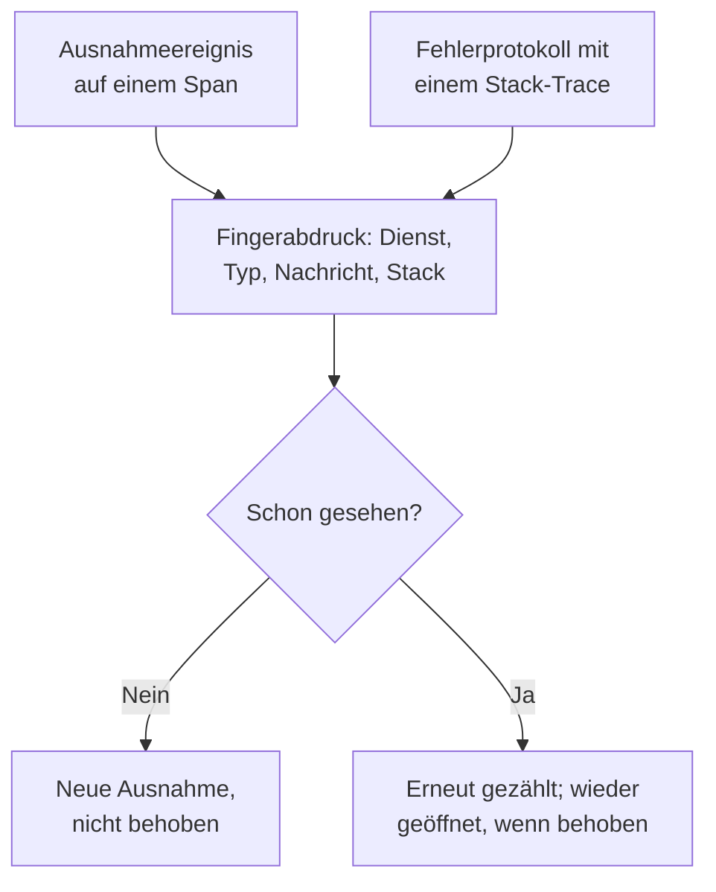

# Ausnahmenverfolgung

Die Ausnahmenverfolgung sammelt die Fehler, die Ihr Code wirft, und fasst jedes Vorkommen desselben Fehlers zu einer Ausnahme zusammen, mit ihrem Stack-Trace, ihrem Verlauf und den Anfragen, in denen sie auftrat. Arbeiten Sie sie wie eine Aufgabenliste ab: beheben, als behoben markieren oder das Rauschen archivieren, und lassen Sie die KI einen Pull Request für die öffnen, die sie beheben kann.

:::cards
- [Woher Ausnahmen kommen](#woher-ausnahmen-kommen): Spans und Protokolle, die Ihre Dienste bereits senden.
- [Die Liste sichten](#die-liste-sichten): Ungelöstes zuerst, Rauschen ausgeblendet.
- [Die Seite einer Ausnahme](#die-seite-einer-ausnahme): Stack-Trace, Vorkommen und Kontext.
- [Mit KI beheben](#mit-ki-beheben): Ein Pull Request mit der Korrektur oder einem Regressionstest.
:::

## Woher Ausnahmen kommen

Sie senden Ausnahmen nicht gesondert. OneUptime findet sie in der Telemetrie, die Ihre Dienste bereits senden:

- ein Ausnahmeereignis auf einem Span, also das, was `recordException()` von OpenTelemetry schreibt;
- ein Protokoll mit den Attributen `exception.type`, `exception.message` oder `exception.stacktrace`;
- ein Protokoll mit dem Schweregrad Error oder Fatal, dessen Nachricht einen Stack-Trace enthält, wenn das Protokoll nicht innerhalb eines Spans geschrieben wurde (der Span meldet sie bereits).

Jedes Vorkommen wird mit den früheren Vorkommen desselben Fehlers zu einer Ausnahme zusammengefasst:

- **Eine Ausnahme pro Dienst und Fehler.** Der Fingerabdruck entsteht aus dem Dienst, dem Ausnahmetyp, der Nachricht und dem Stack-Trace. Werte, die sich von Aufruf zu Aufruf ändern, werden vorher entfernt: UUIDs und andere IDs, Zeitstempel, IP- und E-Mail-Adressen sowie Zahlen mit sieben oder mehr Ziffern. `Order id=1042 not found` und `Order id=2077 not found` sind also eine Ausnahme.
- **Ein neues Vorkommen öffnet eine behobene Ausnahme wieder.** Tritt sie erneut auf, nachdem Sie sie als behoben markiert haben, hat die Korrektur nicht gehalten.
- **Eine archivierte Ausnahme bleibt archiviert.** Ihre neuen Vorkommen werden weiter gezählt, lösen aber keine Benachrichtigungen mehr aus.

> [!TIP]
> Um einen erwarteten Fehler aus der Ausnahmenverfolgung herauszuhalten, etwa ungültige Eingaben, die Ihr Dienst abgelehnt hat, setzen Sie das Attribut `error.class` auf dem Ausnahmeereignis des Spans auf `user-error` oder `expected-denial`. OneUptime zeichnet dafür dann keine Ausnahme auf.

## Bevor Sie beginnen

- **Eintreffende Spans oder Protokolle.** Instrumentieren Sie Ihre Dienste mit [OpenTelemetry](/docs/telemetry/open-telemetry). Der Tab **Einrichtungsanleitung** zeigt den Code für Ihre Sprache.
- **Eine Rolle, die Telemetrie lesen darf.** Project Owner, Project Admin, Project Member, Viewer, Telemetry Admin, Telemetry Member oder Telemetry Viewer, oder eine eigene Rolle mit der Berechtigung Read Telemetry Service Exception. Beheben und Archivieren erfordern Project Owner oder Project Admin oder die Berechtigung Edit Telemetry Service Exception.

## Die Liste sichten

:::steps
### Ausnahmen öffnen

Öffnen Sie **Produkte → Observability → Ausnahmen**. Das Abzeichen am Tab **Ausnahmen** zählt die ungelösten Probleme, und die Liste öffnet mit den Ausnahmen unter **Nicht behoben**.

### Einen Status wählen

Wechseln Sie zwischen **Nicht behoben**, **Behoben**, **Archiviert** und **Alle**. Das Diagramm über der Liste zeigt, wie viele Vorkommen im Zeitverlauf **Nicht behandelt** und wie viele **Behandelt** waren.

### Festlegen, was als Problem zählt

**Probleme**, der Standard, blendet Benutzerfehler und erwartete Ablehnungen aus, sodass die Liste zeigt, was eine Korrektur braucht. **User errors** zeigt nur diese, und **Alle** zeigt jede Ausnahme.

### Suchen und filtern

Geben Sie eine Abfrage wie `type:TypeError env:production` ein, siehe [Suchsyntax](/docs/telemetry/search-syntax#ausnahmen), oder klicken Sie auf einen Wert in der Seitenleiste **Filter**: einen Dienst, einen Host oder eine andere Ressource, einen **Ausnahmetyp**, eine **Umgebung** oder eine **Fehlerklasse**.

### Eine Ausnahme öffnen

Klicken Sie auf eine Zeile, um die Seite der Ausnahme zu öffnen.
:::

## Die Seite einer Ausnahme

Das Seitenmenü der Seite ordnet, was Sie mit einer Ausnahme tun:

| Seite | Was sie zeigt |
| --- | --- |
| **Übersicht** | Die Nachricht, den Dienst, wie oft sie auftrat und wann sie zuerst und zuletzt gesehen wurde, ihren Verlauf über die Zeit und ihr letztes Vorkommen: Release, Umgebung, Span, Trace und Benutzersitzung. |
| **Stack-Trace** | Die Frames des Stacks. Bei Browser-Code die ursprünglichen Dateien und Zeilen, sobald Sie [Source Maps](/docs/telemetry/source-maps) für das Release hochladen. |
| **Vorkommen** | Jedes Vorkommen mit seiner Zeit, seiner Nachricht und dem Trace, in dem es auftrat. |
| **Kontext** | Die Attribute des letzten Vorkommens, seine Sitzungsaufzeichnung, wenn eine aufgenommen wurde, und die Schritte, die dazu führten. |
| **Protokolle** | Die Protokolle, die um das letzte Vorkommen herum geschrieben wurden. |
| **KI-Unterstützung** | KI-Aufgaben, die die Ausnahme beheben oder testen. |
| **Einstellungen** | Die Ausnahme beheben oder archivieren. Sie liegt unter **Verwalten**, das anfangs eingeklappt ist. |

## Beheben, wieder öffnen und archivieren

Die Schaltflächen oben auf der Seite der Ausnahme und ihre Seite **Einstellungen** ändern ihren Status:

| Aktion | Wann Sie sie nutzen | Was danach geschieht |
| --- | --- | --- |
| **Beheben** | Sie haben die Korrektur bereitgestellt. | Sie verlässt die Liste **Nicht behoben**. Ein neues Vorkommen öffnet sie wieder. |
| **Wieder öffnen** | Die Korrektur hat nicht gewirkt. | Sie ist wieder ungelöst. |
| **Archivieren** | Es ist Rauschen, das Sie nicht beheben wollen. | Sie verlässt die Liste. Neue Vorkommen werden gezählt, lösen aber keine Benachrichtigungen mehr aus. |
| **Aus Archiv entfernen** | Sie wollen wieder davon hören. | Sie steht wieder in der Liste, in die sie gehört. |

**Einstellungen** zeigt, wer die Ausnahme zuletzt als behoben markiert oder archiviert hat, und wann. Ihre Schaltflächen lauten **Als gelöst markieren** oder **Als ungelöst markieren** und **Archivieren** oder **Aus Archiv entfernen**.

## Fehlerklassen

Jede Ausnahme hat eine Fehlerklasse, die sagt, wessen Problem sie ist. OneUptime AI setzt sie, wenn es einen Einblick zur Ausnahme sichtet, etwa zu einer neuen oder sprunghaft zunehmenden Ausnahme: siehe [AI SRE](/docs/ai/ai-sre#einblicke-proaktive-erkennung). Eine Ausnahme, die es nicht gesichtet hat, bleibt `unknown`.

| Klasse | Was sie bedeutet | In **Probleme** |
| --- | --- | --- |
| `code-fault` | Ein Fehler im Code. Die einzige Klasse, die die KI von sich aus behebt. | Ja |
| `infrastructure` | Ein Timeout, eine abgebrochene Verbindung oder erschöpfte Ressourcen. | Ja |
| `unknown` | Noch nicht eingeordnet. | Ja |
| `user-error` | Die Folge ungültiger Eingaben eines Benutzers. | Nein |
| `expected-denial` | Eine Prüfung, die ihre Arbeit tut, etwa eine abgelehnte Anmeldung. | Nein |

Ist **Erwartete Ausnahmen archivieren** in den Einstellungen der KI-Einblicke eingeschaltet, werden Ausnahmen, die die Sichtung als erwartete Ablehnungen einstuft, für Sie archiviert.

## Mit KI beheben

Die Seite **KI-Unterstützung** bietet drei Aufgaben. Jede läuft als KI-Aufgabe, die einen Pull Request in Ihrem Code-Repository öffnet:

| Aufgabe | Was der Pull Request tut |
| --- | --- |
| **Diese Ausnahme mit KI beheben** | Behebt die Ursache. Starten Sie sie über **Mit KI beheben**. |
| **Regressionstest generieren** | Fügt einen Test hinzu, der fehlschlägt, bis der Fehler behoben ist. |
| **Fehlerbehandlung verbessern** | Für erwartete Fehler: prüft Eingaben früher, hält Benutzerdaten aus Meldungen heraus und markiert den Fehler als behandelt. |

Die KI braucht vorher drei Dinge: einen LLM-Anbieter, ein verbundenes Repository (auf GitHub, GitLab, Forgejo oder Gitea oder einem beliebigen Git-Server) und einen KI-Agenten, der online ist und die Aufgabe ausführt. Die Seite prüft jedes davon und verlinkt, was fehlt. Die Aufgaben pausieren, solange die Ausnahme behoben oder archiviert ist. Siehe [Code](/docs/ai/ai-agent).

## Ausnahmen-Einblicke

Der Tab **Einblicke** zählt Ihre Ausnahmen unter **Nicht behoben**, **Behoben** und **Archiviert** sowie Ihre Behebungsquote und listet die häufigsten Ausnahmen, die Dienste, die sie betreffen, und die zuletzt gesehenen.

## Fehlerbehebung

:::details Eine Ausnahme, die ich gerade ausgelöst habe, fehlt in der Liste
Prüfen Sie zuerst die Ansicht: **Probleme** blendet Benutzerfehler und erwartete Ablehnungen aus, wählen Sie also **Alle**. Vergrößern Sie dann den Zeitraum und prüfen Sie, ob die Ausnahme auf einem Span oder in einem Protokoll mit Stack-Trace aufgezeichnet wurde.
:::

:::details Ein Fehler erscheint als mehrere Ausnahmen
Der Fingerabdruck umfasst die Nachricht und den Stack-Trace. Unterscheiden sie sich, etwa wenn eine Nachricht eine kurze Zahl oder einen Namen enthält, der sich bei jedem Aufruf ändert, ist jede Variante eine eigene Ausnahme.
:::

:::details Eine behobene Ausnahme kommt immer wieder
Ein neues Vorkommen öffnet eine behobene Ausnahme absichtlich wieder: Der Fehler tritt noch auf. Prüfen Sie, ob die Korrektur das Release erreicht hat, das ihn meldet, oder archivieren Sie die Ausnahme, wenn Sie nichts mehr davon hören wollen.
:::

## Nächste Schritte

:::cards
- [Ausnahmen-Überwachung](/docs/monitor/exceptions-monitor): Benachrichtigt werden, wenn Ausnahmen sprunghaft zunehmen.
- [Source Maps](/docs/telemetry/source-maps): Lesbare Stack-Traces für Browser-Code.
- [Code](/docs/ai/ai-agent): Wie die KI Code korrigiert und Pull Requests öffnet.
- [Trace-Explorer](/docs/telemetry/traces-explorer): Die Anfrage sehen, in der eine Ausnahme auftrat.
:::
