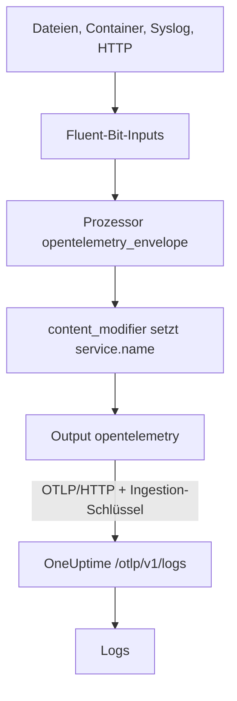

# Fluent Bit

[Fluent Bit](https://docs.fluentbit.io/manual) ist ein schlanker Agent, der Logs aus Dateien, systemd, Containern, Syslog, HTTP und vielen weiteren Quellen sammelt. Sein [OpenTelemetry-Output](https://docs.fluentbit.io/manual/pipeline/outputs/opentelemetry) sendet das Gesammelte an den OpenTelemetry-Endpunkt (OTLP) von OneUptime, wo die Logs unter **Produkte → Protokolle** durchsuchbar werden.

:::cards
- [Fluent Bit konfigurieren](#fluent-bit-konfigurieren): Den OpenTelemetry-Output hinzufügen und Ihren Dienst benennen.
- [Vollständiges Beispiel](#vollständiges-beispiel): Eine ganze Konfigurationsdatei als Ausgangspunkt.
- [Selbst gehostetes OneUptime](#selbst-gehostetes-oneuptime): Fluent Bit auf Ihre eigene Instanz richten.
:::

## So funktioniert es



Fluent Bit verpackt jeden Datensatz in einen OpenTelemetry-Umschlag, damit er Ressourcenattribute wie `service.name` tragen kann. Der OpenTelemetry-Output sendet die Datensätze dann an OneUptime, mit Ihrem Ingestion-Schlüssel im Header `x-oneuptime-token`. OneUptime legt sie unter dem Dienst ab, den `service.name` nennt, und legt diesen Dienst beim ersten Senden an.

## Bevor Sie beginnen

- **Fluent Bit installieren** – siehe die [Installationsanleitung](https://docs.fluentbit.io/manual/installation/getting-started-with-fluent-bit). Die Konfiguration auf dieser Seite verwendet das YAML-Format von Fluent Bit und den Prozessor `opentelemetry_envelope`; nutzen Sie also eine aktuelle Version.
- **Ein OneUptime-Projekt.** In OneUptime Cloud wird Telemetrie pro aufgenommenem GB abgerechnet – siehe [Preise](https://oneuptime.com/pricing) –, und ein Projekt im Free-Plan braucht eine Zahlungsmethode, bevor es Telemetrie senden kann.
- **Ein Telemetrie-Ingestion-Schlüssel.** Falls Sie noch keinen haben:

:::steps
### Die Ingestion-Schlüssel öffnen

Gehen Sie zu **Produkte → Projekteinstellungen**, öffnen Sie im Seitenmenü **Telemetrie & APM** und wählen Sie **Ingestion-Schlüssel**.


### Einen Schlüssel erstellen

Klicken Sie auf **Ingestion-Schlüssel erstellen**. Im Dialog ist der Name des Schlüssels schon ausgefüllt und **Server** gewählt – die Art von Schlüssel, mit der eine Anwendung oder ein Collector sendet. Klicken Sie also auf **Ingestion-Schlüssel erstellen**, um ihn zu erstellen, oder benennen Sie ihn vorher um.

### Das Geheimnis kopieren

Der neue Schlüssel öffnet sich auf einer eigenen Seite. Kopieren Sie seinen **Geheimer Schlüssel**: Das ist das `YOUR_TELEMETRY_INGESTION_TOKEN` in der Konfiguration unten.


:::

## Fluent Bit konfigurieren

Fluent Bit liest seine YAML-Konfiguration aus einer Datei wie `/etc/fluent-bit/fluent-bit.yaml`.

:::steps
### Den OpenTelemetry-Output hinzufügen

Fügen Sie einen `opentelemetry`-Output hinzu, der an OneUptime sendet. Behalten Sie beim Testen den `stdout`-Output, wenn Sie die Datensätze lokal sehen möchten:

```yaml title="fluent-bit.yaml"
service:
  # Keep the chunks still to send on disk: a restart of Fluent Bit loses none
  storage.path: /var/lib/fluent-bit/buffer
  storage.sync: normal
  # Try a chunk again about every 30 seconds
  scheduler.base: 30
  scheduler.cap: 30

pipeline:
  outputs:
    - name: stdout
      match: "*"
    - name: opentelemetry
      match: "*"
      host: "oneuptime.com"
      port: 443
      metrics_uri: "/otlp/v1/metrics"
      logs_uri: "/otlp/v1/logs"
      traces_uri: "/otlp/v1/traces"
      tls: On
      header:
        - x-oneuptime-token YOUR_TELEMETRY_INGESTION_TOKEN
      # Send a chunk again when OneUptime is busy or restarting, for about 72 hours
      retry_limit: 8640
      # At most 512 MB on disk: when it is full, the oldest chunks are dropped
      storage.total_limit_size: 512M
```

`retry_limit: 8640` sendet einen Chunk erneut, wenn OneUptime ausgelastet ist (`429`) oder neu startet (`502`, `503`, `504`), etwa alle 30 Sekunden (`scheduler.base` und `scheduler.cap`), rund 72 Stunden lang; die Voreinstellung von Fluent Bit ist, es einmal erneut zu versuchen und ihn dann zu verwerfen. `storage.path` hält die noch zu sendenden Chunks auf der Festplatte, sodass ein Neustart von Fluent Bit keinen davon verliert, für jeden Input mit `storage.type: filesystem`, wie im nächsten Schritt. Fluent Bit muss in diesen Ordner schreiben können: Der Dienst des Pakets läuft als root, und von Hand starten Sie es mit `sudo`. `storage.total_limit_size: 512M` hält für den Output höchstens 512 MB; ist das voll, werden die ältesten Chunks verworfen.

### Logs in einen OpenTelemetry-Umschlag verpacken und den Dienst benennen

Fügen Sie jedem Input den Prozessor `opentelemetry_envelope` hinzu, gefolgt von einem `content_modifier`, der `service.name` setzt. Ersetzen Sie `YOUR_SERVICE_NAME` durch den Namen, unter dem die Logs in OneUptime erscheinen sollen:

```yaml title="fluent-bit.yaml"
pipeline:
  inputs:
    - name: tail # or any other input
      path: /var/log/my-app/*.log
      # Keep its place in each file, so a restart reads on from there
      db: /var/lib/fluent-bit/tail.db
      # Keep its chunks on disk until OneUptime takes them
      storage.type: filesystem

      processors:
        logs:
          - name: opentelemetry_envelope

          - name: content_modifier
            context: otel_resource_attributes
            action: upsert
            key: service.name
            value: YOUR_SERVICE_NAME
```

`db` hält die Stelle des Tails in jeder Datei, sodass ein Neustart von dort weiterliest; ohne sie beginnt Fluent Bit wieder am Ende jeder Datei, und die Zeilen, die geschrieben wurden, während es nicht lief, werden nie gesendet. `storage.type: filesystem` hält die Chunks des Inputs in `storage.path`.

### Fluent Bit neu starten

Der Dienst des Pakets `fluent-bit` liest `/etc/fluent-bit/fluent-bit.conf`, das eigene Beispiel des Pakets, nicht diese Datei. Richten Sie ihn mit einem Drop-in auf `/etc/fluent-bit/fluent-bit.yaml` aus, und starten Sie ihn dann jetzt und bei jedem Systemstart:

```bash
sudo mkdir -p /etc/systemd/system/fluent-bit.service.d
printf '[Service]\nExecStart=\nExecStart=/opt/fluent-bit/bin/fluent-bit -c /etc/fluent-bit/fluent-bit.yaml\n' | sudo tee /etc/systemd/system/fluent-bit.service.d/fluent-bit-yaml.conf
sudo systemctl daemon-reload
sudo systemctl enable fluent-bit
sudo systemctl restart fluent-bit
```

Das leere `ExecStart=` löscht die eigene Startzeile des Pakets. Um die Datei zuerst im Vordergrund auszuprobieren, führen Sie `sudo /opt/fluent-bit/bin/fluent-bit -c /etc/fluent-bit/fluent-bit.yaml` aus: Das Paket legt das Programm nach `/opt/fluent-bit/bin`, das nicht im `PATH` liegt. Nach wenigen Sekunden erscheinen die Logs unter **Produkte → Protokolle**, und der Dienst wird unter **Produkte → Dienste** aufgeführt.
:::

## Vollständiges Beispiel

Diese Konfiguration empfängt Logs per HTTP auf Port `8888`, nur von diesem Host, und leitet sie an OneUptime weiter:

```yaml title="fluent-bit.yaml"
service:
  flush: 1
  log_level: info
  # Keep the chunks still to send on disk: a restart of Fluent Bit loses none
  storage.path: /var/lib/fluent-bit/buffer
  storage.sync: normal
  # Try a chunk again about every 30 seconds
  scheduler.base: 30
  scheduler.cap: 30

pipeline:
  inputs:
    - name: http
      # This host alone may send here
      listen: 127.0.0.1
      port: 8888
      storage.type: filesystem

      processors:
        logs:
          - name: opentelemetry_envelope

          - name: content_modifier
            context: otel_resource_attributes
            action: upsert
            key: service.name
            value: YOUR_SERVICE_NAME

  outputs:
    - name: stdout
      match: "*"
    - name: opentelemetry
      match: "*"
      host: "oneuptime.com"
      port: 443
      metrics_uri: "/otlp/v1/metrics"
      logs_uri: "/otlp/v1/logs"
      traces_uri: "/otlp/v1/traces"
      tls: On
      header:
        - x-oneuptime-token YOUR_TELEMETRY_INGESTION_TOKEN
      # Send a chunk again when OneUptime is busy or restarting, for about 72 hours
      retry_limit: 8640
      # At most 512 MB on disk: when it is full, the oldest chunks are dropped
      storage.total_limit_size: 512M
```

`listen: 127.0.0.1` nimmt Logs nur von diesem Host an: Der `http`-Input verlangt keinen Schlüssel, mit `listen: 0.0.0.0` könnte also jeder, der den Port erreicht, Logs unter Ihrem Ingestion-Schlüssel an OneUptime senden. Ersetzen Sie den `http`-Input durch die Inputs, die Sie brauchen – zum Beispiel `tail` für Logdateien oder `systemd` für das Journal –, und behalten Sie an jedem davon die beiden Prozessoren und `storage.type: filesystem`.

## Mit dem HTTP-Output senden

Der [HTTP-Output](https://docs.fluentbit.io/manual/pipeline/outputs/http) von Fluent Bit kann stattdessen an den Fluentd-Endpunkt von OneUptime senden, der jeden Datensatz so liest, wie es die [Fluentd-Seite](/docs/telemetry/fluentd) beschreibt. Setzen Sie `format` auf `json_lines` wie unten oder auf `json`: OneUptime liest beides, mit `compress: gzip` komprimiert oder nicht. Das Standardformat von Fluent Bit, `msgpack`, wird abgelehnt.

```yaml title="fluent-bit.yaml"
pipeline:
  outputs:
    - name: http
      match: "*"
      host: "oneuptime.com"
      port: 443
      uri: "/fluentd/logs"
      format: json_lines
      # Send each record's time where OneUptime reads it
      json_date_key: timestamp
      tls: On
      header:
        - x-oneuptime-token YOUR_TELEMETRY_INGESTION_TOKEN
        - x-oneuptime-service-name YOUR_SERVICE_NAME
      # Send a chunk again when OneUptime is busy or restarting, for about 72 hours
      retry_limit: 8640
      # At most 512 MB on disk: when it is full, the oldest chunks are dropped
      storage.total_limit_size: 512M
```

## Selbst gehostetes OneUptime

Setzen Sie `host` auf den Host Ihrer OneUptime-Instanz. Wird sie über einfaches HTTP statt HTTPS ausgeliefert, setzen Sie außerdem `port` auf den Port, auf dem sie lauscht (meist `80`), und entfernen Sie `tls`:

```yaml title="fluent-bit.yaml"
pipeline:
  outputs:
    - name: stdout
      match: "*"
    - name: opentelemetry
      match: "*"
      host: "your-oneuptime-instance.com"
      port: 80
      metrics_uri: "/otlp/v1/metrics"
      logs_uri: "/otlp/v1/logs"
      traces_uri: "/otlp/v1/traces"
      header:
        - x-oneuptime-token YOUR_TELEMETRY_INGESTION_TOKEN
      # Send a chunk again when OneUptime is busy or restarting, for about 72 hours
      retry_limit: 8640
      # At most 512 MB on disk: when it is full, the oldest chunks are dropped
      storage.total_limit_size: 512M
```

## Fehlerbehebung

:::details Fluent Bit protokolliert `401` vom OpenTelemetry-Output
Der Ingestion-Schlüssel fehlt, ist unbekannt oder abgelaufen. Prüfen Sie die `header`-Zeile: Sie lautet `x-oneuptime-token`, ein Leerzeichen, dann der **Geheimer Schlüssel** des Schlüssels.
:::

:::details Fluent Bit protokolliert `402` oder `422`
`402`: In OneUptime Cloud ist das Projekt im Free-Plan und hat keine Zahlungsmethode. Fügen Sie eine unter **Projekteinstellungen → Abrechnung und Rechnungen → Abrechnung** hinzu. `422`: Der Schlüssel ist deaktiviert, oder es ist ein Browser-Schlüssel. Schalten Sie **Aktiviert** in den Einstellungen des Schlüssels wieder ein, oder erstellen Sie einen **Server**-Schlüssel.
:::

:::details Logs kommen unter einem unerwarteten Dienst an
Der Dienst kommt aus `service.name`. Prüfen Sie, dass jeder Input den Prozessor `opentelemetry_envelope` hat, gefolgt von dem `content_modifier`, der ihn setzt.
:::

:::details Nichts kommt an, und Fluent Bit protokolliert Verbindungsfehler
Prüfen Sie, dass für einen HTTPS-Endpunkt `tls: On` und `port: 443` gesetzt sind und dass der Host, auf dem Fluent Bit läuft, Ihren OneUptime-Host auf diesem Port erreicht.
:::

:::details Fluent Bit protokolliert `cannot be retried`
Fluent Bit hat einen Chunk verworfen, den es nicht senden konnte. Mit `retry_limit: 8640`, wie in der Konfiguration oben, sendet es einen Chunk, auf den OneUptime mit `429`, `502`, `503` oder `504` antwortet, etwa alle 30 Sekunden erneut, rund 72 Stunden lang; mit der Voreinstellung von Fluent Bit versucht es es nur einmal erneut. Ein `400`, `401`, `402`, `413`, `422` oder `500` wird sofort verworfen, da die Antwort jedes Mal dieselbe ist: Prüfen Sie den Schlüssel, den Tarif und die Größe der Anfrage.
:::

Wenn Sie Fragen haben oder Hilfe bei der Konfiguration brauchen, schreiben Sie uns an support@oneuptime.com.

## Nächste Schritte

:::cards
- [Protokoll-Pipelines](/docs/telemetry/log-pipelines): Die Logs, die Fluent Bit sendet, parsen und anreichern.
- [Suchsyntax](/docs/telemetry/search-syntax): Die Logs im Protokoll-Explorer finden.
- [OpenTelemetry](/docs/telemetry/open-telemetry): Endpunkte, Schlüssel und Grenzen für alle Telemetrie.
- [Fluentd](/docs/telemetry/fluentd): Stattdessen Fluentd verwenden.
:::
