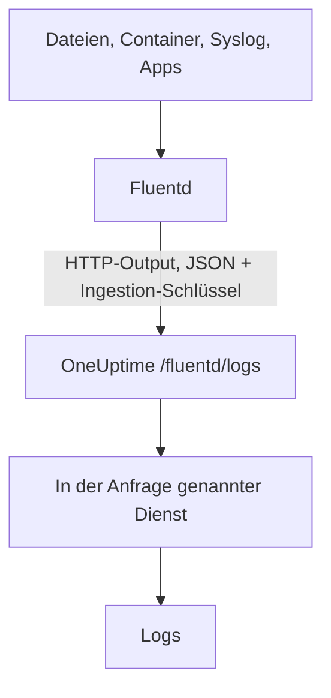

# Fluentd

[Fluentd](https://www.fluentd.org/) sammelt Logs aus Dateien, Containern, Syslog, Anwendungen und [vielen weiteren Quellen](https://www.fluentd.org/datasources). Sein eingebauter [HTTP-Output](https://docs.fluentd.org/output/http) sendet sie an den Fluentd-Endpunkt von OneUptime, wo sie unter **Produkte → Protokolle** durchsuchbar werden.

:::cards
- [Fluentd konfigurieren](#fluentd-konfigurieren): Einen HTTP-Output hinzufügen, der auf OneUptime zeigt.
- [Wie Datensätze gelesen werden](#wie-datensätze-gelesen-werden): Welche Felder zur Nachricht, zum Schweregrad und zu Attributen werden.
- [Selbst gehostetes OneUptime](#selbst-gehostetes-oneuptime): Fluentd auf Ihre eigene Instanz richten.
:::

## So funktioniert es



Fluentd sendet Datensätze gebündelt als JSON, mit Ihrem Ingestion-Schlüssel im Header `x-oneuptime-token` und dem Dienstnamen in `x-oneuptime-service-name`. OneUptime macht aus jedem Datensatz einen Log dieses Dienstes und legt den Dienst beim ersten Senden an.

## Bevor Sie beginnen

- **Fluentd installieren** – siehe die [Installationsanleitung](https://docs.fluentd.org/installation).
- **Ein OneUptime-Projekt.** In OneUptime Cloud wird Telemetrie pro aufgenommenem GB abgerechnet – siehe [Preise](https://oneuptime.com/pricing) –, und ein Projekt im Free-Plan braucht eine Zahlungsmethode, bevor es Telemetrie senden kann.
- **Ein Telemetrie-Ingestion-Schlüssel.** Falls Sie noch keinen haben:

:::steps
### Die Ingestion-Schlüssel öffnen

Gehen Sie zu **Produkte → Projekteinstellungen**, öffnen Sie im Seitenmenü **Telemetrie & APM** und wählen Sie **Ingestion-Schlüssel**.


### Einen Schlüssel erstellen

Klicken Sie auf **Ingestion-Schlüssel erstellen**. Im Dialog ist der Name des Schlüssels schon ausgefüllt und **Server** gewählt – die Art von Schlüssel, mit der eine Anwendung oder ein Collector sendet. Klicken Sie also auf **Ingestion-Schlüssel erstellen**, um ihn zu erstellen, oder benennen Sie ihn vorher um.

### Das Geheimnis kopieren

Der neue Schlüssel öffnet sich auf einer eigenen Seite. Kopieren Sie seinen **Geheimer Schlüssel**: Das ist das `YOUR_SERVICE_TOKEN` in der Konfiguration unten.


:::

## Fluentd konfigurieren

Die Konfigurationsdatei von Fluentd ist meist `/etc/fluent/fluentd.conf`, beim älteren Paket td-agent `/etc/td-agent/td-agent.conf`.

:::steps
### Einen HTTP-Output hinzufügen

Fügen Sie einen `<match>`-Abschnitt hinzu, der Datensätze an OneUptime sendet. Ersetzen Sie `YOUR_SERVICE_TOKEN` durch Ihren Ingestion-Schlüssel und `YOUR_SERVICE_NAME` durch den Namen, unter dem die Logs erscheinen sollen – einen beliebigen Namen:

```text title="fluentd.conf"
# Send the time Fluentd gave each event: the HTTP output sends only the record
<filter **>
  @type record_transformer
  enable_ruby true
  <record>
    fluentd_time ${time.utc.strftime("%Y-%m-%dT%H:%M:%S.%NZ")}
  </record>
</filter>

# Match all patterns
<match **>
  @type http

  endpoint https://oneuptime.com/fluentd/logs
  open_timeout 2

  headers {"x-oneuptime-token":"YOUR_SERVICE_TOKEN", "x-oneuptime-service-name":"YOUR_SERVICE_NAME"}

  content_type application/json
  json_array true

  # Send a batch again when OneUptime is busy (429) or restarting (502, 503, 504)
  retryable_response_codes 429,502,503,504

  <format>
    @type json
  </format>
  <buffer>
    # Keep the batches on disk until OneUptime takes them: a restart of Fluentd loses none
    @type file
    path /var/log/fluent/buffer/oneuptime
    total_limit_size 512m
    flush_interval 10s
    chunk_limit_size 900k
    # Try again at least every 30 seconds, for up to 72 hours
    retry_max_interval 30s
    retry_timeout 72h
  </buffer>
</match>

# Keep Fluentd's own logs out of OneUptime
<label @FLUENT_LOG>
  <match **>
    @type null
  </match>
</label>
```

`json_array true` sendet jeden Chunk des Puffers als ein JSON-Array, und `flush_interval 10s` sendet den Puffer alle 10 Sekunden. `chunk_limit_size 900k` hält jede Anfrage unter 1 MB, dem Höchstwert, den OneUptime an diesem Endpunkt annimmt.

Auch die Voreinstellung von Fluentd funktioniert: Ohne `content_type` und `json_array true` sendet Fluentd zeilengetrenntes JSON, einen Datensatz pro Zeile, und OneUptime liest jede Zeile als ihren Datensatz, mit `compress gzip` oder ohne.

`@type file` hält die noch zu sendenden Batches in dem Ordner, den `path` nennt, sodass ein Neustart von Fluentd keinen davon verliert; ein Puffer im Arbeitsspeicher, die Voreinstellung von Fluentd, verliert, was er hält. Der Benutzer von Fluentd muss in diesen Ordner schreiben können: `/var/log/fluent` ist der von fluent-package, `/var/log/td-agent` der von td-agent und `/fluentd/log` der des Images `fluent/fluentd`. `total_limit_size 512m` hält dort höchstens 512 MB; ist er voll, nimmt Fluentd keine Datensätze mehr an, bis ein Batch gesendet ist.

`retryable_response_codes 429,502,503,504` sendet einen Batch erneut, wenn OneUptime ausgelastet ist (`429`) oder neu startet (`502`, `503`, `504`); ohne diese Einstellung verwirft Fluentd einen Batch bei jeder Antwort außer `503`. `retry_max_interval 30s` wartet zwischen zwei Versuchen höchstens 30 Sekunden, und `retry_timeout 72h` verwirft einen Batch, der nach 72 Stunden noch immer nicht gesendet werden kann. Der Filter `record_transformer` fügt jedem Datensatz die Zeit hinzu, die Fluentd ihm gegeben hat, als `fluentd_time`: Der HTTP-Output sendet nur den Datensatz, und OneUptime liest die Zeit eines Logs daraus.

### Fluentd neu starten

Starten Sie den Fluentd-Dienst neu, damit er den neuen Output lädt.

### Prüfen, ob Logs ankommen

Wenige Sekunden nach dem nächsten Flush erscheinen die Logs unter **Produkte → Protokolle**. Der Dienst wird unter **Produkte → Dienste** aufgeführt – gab es ihn noch nicht, legt OneUptime ihn an.
:::

## Vollständiges Beispiel

Diese Konfiguration empfängt Datensätze über das Forward-Protokoll von Fluentd auf Port `24224`, nur von diesem Host, und sendet sie alle an OneUptime:

```text title="fluentd.conf"
####
## Source descriptions:
##

## built-in TCP input
## @see https://docs.fluentd.org/input/forward
<source>
  @type forward
  port 24224
  # This host alone: see "Take records from other hosts" to open it
  bind 127.0.0.1
</source>

# Send the time Fluentd gave each event: the HTTP output sends only the record
<filter **>
  @type record_transformer
  enable_ruby true
  <record>
    fluentd_time ${time.utc.strftime("%Y-%m-%dT%H:%M:%S.%NZ")}
  </record>
</filter>

<match **>
  @type http

  endpoint https://oneuptime.com/fluentd/logs
  open_timeout 2

  headers {"x-oneuptime-token":"YOUR_SERVICE_TOKEN", "x-oneuptime-service-name":"YOUR_SERVICE_NAME"}

  content_type application/json
  json_array true

  # Send a batch again when OneUptime is busy (429) or restarting (502, 503, 504)
  retryable_response_codes 429,502,503,504

  <format>
    @type json
  </format>
  <buffer>
    # Keep the batches on disk until OneUptime takes them: a restart of Fluentd loses none
    @type file
    path /var/log/fluent/buffer/oneuptime
    total_limit_size 512m
    flush_interval 10s
    chunk_limit_size 900k
    # Try again at least every 30 seconds, for up to 72 hours
    retry_max_interval 30s
    retry_timeout 72h
  </buffer>
</match>

# Keep Fluentd's own logs out of OneUptime
<label @FLUENT_LOG>
  <match **>
    @type null
  </match>
</label>
```

`bind 127.0.0.1` nimmt Datensätze nur von diesem Host an, etwa die des Docker-Logtreibers `fluentd`, der an `localhost:24224` sendet. Um verschiedene Quellen als verschiedene Dienste zu senden, verwenden Sie einen `<match>`-Abschnitt pro Tag, jeden mit seinem eigenen `x-oneuptime-service-name` und seinem eigenen Puffer-`path`: Mit zwei Puffern auf einem Pfad startet Fluentd nicht.

## Datensätze von anderen Hosts annehmen

Mit `bind 0.0.0.0` und ohne Abschnitt `<security>` kann jeder, der Port `24224` erreicht, Logs unter Ihrem Ingestion-Schlüssel an OneUptime senden. Um Datensätze von Fluentd oder Fluent Bit auf anderen Hosts anzunehmen, lauschen Sie auf jeder Adresse, verlangen von jedem Absender einen gemeinsamen Schlüssel und verwenden TLS. Ersetzen Sie den Abschnitt `<source>` des vollständigen Beispiels durch:

```text title="fluentd.conf on this host"
<source>
  @type forward
  port 24224
  bind 0.0.0.0
  <transport tls>
    cert_path /etc/fluent/certs/fluentd.crt
    private_key_path /etc/fluent/certs/fluentd.key
  </transport>
  <security>
    self_hostname fluentd.example.com
    shared_key YOUR_SHARED_KEY
  </security>
</source>
```

`cert_path` und `private_key_path` sind ein Zertifikat für den Namen dieses Hosts, hier `fluentd.example.com`, und sein Schlüssel, die der Benutzer von Fluentd lesen können muss. Fluentd warnt, wenn der Schlüssel keine Passphrase hat; `private_key_passphrase` setzt eine. Ersetzen Sie `YOUR_SHARED_KEY` durch ein langes zufälliges Geheimnis, etwa eines aus `openssl rand -base64 32`, und geben Sie jedem Absender dasselbe:

```text title="fluentd.conf on each sender"
<match **>
  @type forward
  transport tls
  # The certificate of the authority that signed this host's; not needed for a public one
  tls_cert_path /etc/fluent/certs/ca.crt
  <security>
    self_hostname app-1.example.com
    shared_key YOUR_SHARED_KEY
  </security>
  <server>
    host fluentd.example.com
    port 24224
  </server>
  <buffer>
    @type file
    path /var/log/fluent/buffer/forward
  </buffer>
</match>

# Keep Fluentd's own logs out of OneUptime
<label @FLUENT_LOG>
  <match **>
    @type null
  </match>
</label>
```

Der `forward`-Output von Fluent Bit nimmt dieselben Einstellungen: `Shared_Key`, `Self_Hostname`, `tls On` und `tls.ca_file`.

Ein Absender ohne den Schlüssel oder ohne TLS wird abgewiesen. Der Schlüssel selbst geht nie über das Netz: Jede Seite beweist, dass sie ihn hat. Ohne TLS kann jeder im Netz zwischen den Hosts die Datensätze lesen. Öffnen Sie Port `24224` in der Firewall des Hosts nur für die Hosts, die senden. Läuft Fluentd aus der Docker-Compose-Datei der Logs-Anleitung, veröffentlichen Sie den Port auch dort auf jeder Adresse, `"24224:24224"`, und binden Sie den Ordner des Zertifikats in den Container ein.

## Wie Datensätze gelesen werden

OneUptime liest diese Felder aus jedem Datensatz:

| Log-Feld | Gelesen aus dem ersten vorhandenen Feld von | Hinweise |
| --- | --- | --- |
| Inhalt | `message`, `log`, `msg`, `body`, `text` | Die Log-Zeile. Ein Datensatz ohne eines dieser Felder wird vollständig als JSON gespeichert. |
| Schweregrad | `level`, `severity`, `loglevel`, `log_level`, `priority`, `severityText`, `severity_text` | Namen wie `trace`, `debug`, `info`, `notice`, `warn`, `error`, `critical` und `fatal`, in beliebiger Schreibweise. Jeder andere Wert wird als `Unspecified` gespeichert. |
| Trace-ID | `trace_id`, `traceId`, `traceid` | Verknüpft den Log mit seinem Trace. |
| Span-ID | `span_id`, `spanId`, `spanid` | Verknüpft den Log mit seinem Span. |
| Dienst | der Header `x-oneuptime-service-name` | `Fluentd`, wenn der Header nicht gesetzt ist. |
| Zeit | `time`, `timestamp`, `@timestamp`, `ts`, `fluentd_time` | Eine Zeit nach ISO 8601, etwa `2026-11-14T08:00:00.123Z`, oder Sekunden, Millisekunden, Mikrosekunden oder Nanosekunden seit der Epoche; eine Zeit ohne Zeitzone gilt als UTC. Eine Zeit vor 2000 oder mehr als einen Tag in der Zukunft wird nicht gelesen. Das Feld, aus dem die Zeit gelesen wird, wird nicht als Attribut gespeichert. Ein Datensatz ohne Zeit wird zu dem Zeitpunkt gespeichert, zu dem OneUptime ihn empfängt. |

Jedes andere Feld wird zu einem Attribut, das `fluentd.` und den Namen des Feldes trägt und nach dem Sie suchen und filtern können: Ein Feld `container_name` ist im Protokoll-Explorer `@fluentd.container_name`. Ein verschachteltes Objekt wird mit Punkten abgeflacht, etwa zu `fluentd.kubernetes.pod_name`, und eine Liste wird als JSON gespeichert.

Fluentd-Logs durchlaufen Ihre [Protokoll-Pipelines](/docs/telemetry/log-pipelines), Drop-Filter und Bereinigungsregeln wie jeder andere Log.

## Selbst gehostetes OneUptime

Ersetzen Sie `https://oneuptime.com` in `endpoint` durch die URL Ihrer OneUptime-Instanz: `http(s)://YOUR_ONEUPTIME_HOST/fluentd/logs`.

## Fehlerbehebung

:::details Fluentd protokolliert `401` vom HTTP-Output
Der Ingestion-Schlüssel fehlt, ist unbekannt oder abgelaufen. Prüfen Sie den Wert von `x-oneuptime-token` in `headers`.
:::

:::details Fluentd protokolliert `402` oder `422`
`402`: In OneUptime Cloud ist das Projekt im Free-Plan und hat keine Zahlungsmethode. Fügen Sie eine unter **Projekteinstellungen → Abrechnung und Rechnungen → Abrechnung** hinzu. `422`: Der Schlüssel ist deaktiviert, oder es ist ein Browser-Schlüssel. Schalten Sie **Aktiviert** in den Einstellungen des Schlüssels wieder ein, oder erstellen Sie einen **Server**-Schlüssel.
:::

:::details Fluentd protokolliert `413`
Die Anfrage ist größer als 1 MB, der Höchstwert, den OneUptime an diesem Endpunkt annimmt. Setzen Sie `chunk_limit_size 900k` im Abschnitt `<buffer>`, wie in der Konfiguration oben.
:::

:::details Fluentd protokolliert `429`, `502`, `503` oder `504`
OneUptime ist ausgelastet oder startet neu. Mit `retryable_response_codes 429,502,503,504` im Abschnitt `<match>`, wie in der Konfiguration oben, behält Fluentd den Batch und sendet ihn erneut; ohne diese Einstellung verwirft Fluentd den Batch. Mit `@type file` im Abschnitt `<buffer>` behält Fluentd den Batch auch, wenn es neu startet.
:::

:::details Logs zeigen den Zeitpunkt, zu dem OneUptime sie empfangen hat, nicht ihre eigene Zeit
OneUptime liest die Zeit eines Logs aus seinem Datensatz, und der HTTP-Output von Fluentd sendet nur den Datensatz. Ein Abschnitt `<parse>` nimmt das Feld `time` als Zeit des Ereignisses aus dem Datensatz heraus: Fügen Sie ihm `time_key fluentd_time` hinzu, damit er die Zeit keines Datensatzes liest und `time` lässt, wie es ist. Fügen Sie außerdem den Filter `record_transformer` aus der Konfiguration oben hinzu: Er fügt jedem Datensatz die Zeit hinzu, die Fluentd ihm gegeben hat, als `fluentd_time`.
:::

:::details Eine JSON-Zeile, deren `time` `null`, `true`, eine Liste oder ein Objekt ist, kommt nie an
Der Parser `json` von Fluentd liest das Feld `time` einer Zeile als Zeit des Ereignisses und verwirft ohne Warnung eine Zeile, deren `time` weder Text noch eine Zahl ist. Fügen Sie seinem Abschnitt `<parse>` `time_key fluentd_time` hinzu, wie oben: Dann lässt Fluentd `time` im Datensatz, wie es ist. Mit dem Filter `record_transformer` oben speichert OneUptime den Log zu dem Zeitpunkt, zu dem Fluentd ihn gelesen hat, `fluentd_time`; ohne ihn zu dem Zeitpunkt, zu dem OneUptime ihn empfängt.
:::

:::details Logs kommen unter dem Dienst `Fluentd` an
Der Header `x-oneuptime-service-name` fehlt. Fügen Sie ihn in jedem `<match>`-Abschnitt zu `headers` hinzu.
:::

:::details Der Log-Inhalt zeigt den ganzen Datensatz als JSON
OneUptime nimmt den Inhalt aus dem ersten vorhandenen Feld von `message`, `log`, `msg`, `body` oder `text` und speichert den ganzen Datensatz, wenn er keines davon hat. Benennen Sie das Feld mit Ihrer Log-Zeile in eines davon um, zum Beispiel mit dem Filter `record_transformer` von Fluentd.
:::

Wenn Sie Fragen haben oder Hilfe bei der Konfiguration brauchen, schreiben Sie uns an support@oneuptime.com.

## Nächste Schritte

:::cards
- [Protokoll-Pipelines](/docs/telemetry/log-pipelines): Die Logs, die Fluentd sendet, parsen und anreichern.
- [Suchsyntax](/docs/telemetry/search-syntax): Die Logs im Protokoll-Explorer finden.
- [Fluent Bit](/docs/telemetry/fluentbit): Ein schlankerer Agent, der per OpenTelemetry sendet.
- [Logs-Überwachung](/docs/monitor/logs-monitor): Warnen, wenn passende Logs erscheinen.
:::
