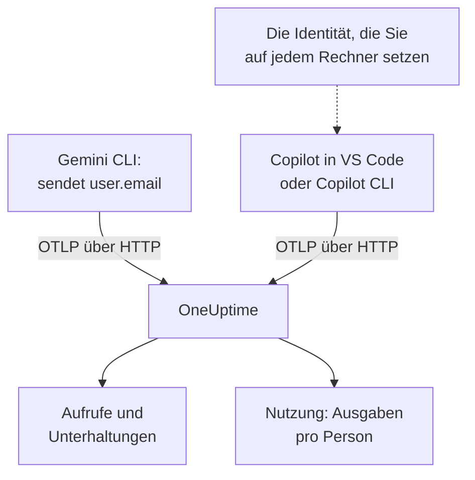

# Gemini CLI & GitHub Copilot

Gemini CLI und GitHub Copilot exportieren beide selbst OpenTelemetry: Richten Sie sie auf OneUptime, und ihre Modellaufrufe, Tokens, Kosten und Tool-Aufrufe kommen in [KI / LLM](/docs/telemetry/ai-llm-observability) an, neben den KI-Aufrufen Ihrer eigenen Apps. Sie unterscheiden sich in dem, was für die Kostenverrechnung am meisten zählt: Gemini CLI nennt bei jedem Datensatz die Person, Copilot nennt niemanden, also benennen Sie jeden Entwickler selbst.

:::cards
- [Gemini CLI](#gemini-cli-einrichten): Telemetrie mit Traces einschalten und direkt an OneUptime senden.
- [GitHub Copilot](#github-copilot-einrichten): Aus VS Code oder Copilot CLI exportieren.
- [Jeden Entwickler benennen](#jeden-entwickler-benennen): Die Identität, die Copilot weglässt.
- [Fehlerbehebung](#fehlerbehebung): Was Sie prüfen, wenn nichts ankommt.
:::

## So funktioniert es



| | Gemini CLI | GitHub Copilot |
| --- | --- | --- |
| Sendet | Traces, Metriken und Logs | Traces, Metriken und Events, nur von seinen Agent-Oberflächen |
| Nennt die Person | `user.email`, wenn angemeldet | Niemanden: Sie setzen `enduser.id` und `user.email` |
| Prompt-Text | Gesendet, sofern Sie `logPrompts` nicht abschalten | Nicht gesendet, sofern Sie `captureContent` nicht einschalten |
| Sendet ab Werk an | `http://localhost:4317`, über gRPC | `http://localhost:4318`, über HTTP |

## Bevor Sie beginnen

- Ein Ingestion-Schlüssel: Öffnen Sie **Projekteinstellungen → Telemetrie & APM → Ingestion-Schlüssel** und klicken Sie auf **Aufnahmeschlüssel erstellen**.
- Ihre OTLP-Basis-URL: `https://oneuptime.com/otlp`, oder `https://YOUR-ONEUPTIME-HOST/otlp`, wenn Sie OneUptime selbst betreiben.
- Der Schlüssel reist im Header `x-oneuptime-token` jeder Exportanfrage mit.

## Gemini CLI einrichten

Gemini CLI sendet Traces, Metriken und Log-Events und setzt bei jedem Datensatz `user.email`, wenn jemand angemeldet ist. OneUptime liest `user.email` als den Mitarbeiter, also erscheinen die Ausgaben jeder Person ohne Zuordnungstabelle und ohne Einrichtung pro Rechner.

:::steps
### Telemetrie einschalten

Fügen Sie der Benutzer-Einstellungsdatei jedes Rechners oder `.gemini/settings.json` in einem Repository einen Block `telemetry` hinzu:

```json title="~/.gemini/settings.json"
{
  "telemetry": {
    "enabled": true,
    "target": "local",
    "otlpEndpoint": "https://oneuptime.com/otlp",
    "otlpProtocol": "http",
    "otlpHeaders": {
      "x-oneuptime-token": "YOUR_INGESTION_TOKEN"
    },
    "traces": true,
    "logPrompts": false
  }
}
```

### Eine neue Sitzung starten

Gemini CLI liest seine Einstellungen beim Start, also starten Sie es neu und führen Sie einen Prompt aus.

### Prüfen, ob Daten ankommen

Öffnen Sie **Produkte → KI / LLM → Aufrufe**: Die Aufrufe stehen dort unter dem Dienst `gemini-cli`, mit dem Modell und den Tokens.
:::

Drei Einstellungen in diesem Block zählen mehr als der Rest:

- `otlpProtocol: "http"`. Ohne Angabe nutzt Gemini CLI gRPC. Über HTTP hängt es `/v1/traces`, `/v1/metrics` und `/v1/logs` selbst an die Basis-URL an. OneUptime nimmt auch gRPC auf Port 443 an (siehe [OTLP über gRPC](/docs/telemetry/open-telemetry#otlp-über-grpc)), aber HTTP ist einfacher.
- `traces: true`. Es ist standardmäßig aus, und ohne es tragen die Spans von Gemini CLI weder Modell noch Token-Zahlen, also lässt sich nichts bepreisen. Gemini CLI sendet auch keine Kostenmetrik: Schalten Sie Traces ein, um zu sehen, was seine Aufrufe kosten.
- `logPrompts: false`. Lesen Sie die Warnung unten.

> [!WARNING]
> `logPrompts` ist standardmäßig `true`, also sendet das Einschalten der Telemetrie den Text, den Ihre Entwickler tippen: oft Quellcode, Kundendaten und eingefügte Zugangsdaten. Setzen Sie es in derselben Änderung, die die Telemetrie einschaltet, auf `false`. Wenn Sie Prompts zur Fehlersuche wollen, entscheiden Sie das bewusst, und maskieren Sie, was nötig ist, mit Bereinigungsregeln unter **Traces → Einstellungen**.

### Einstellungen für eine Flotte

Jede Einstellung hat eine Umgebungsvariable, und die Variablen haben Vorrang vor einer `.gemini/settings.json` im Repository, was sie zum richtigen Ort für eine per MDM verteilte Flottenrichtlinie macht:

```bash
export GEMINI_TELEMETRY_ENABLED=true
export GEMINI_TELEMETRY_TARGET=local
export GEMINI_TELEMETRY_OTLP_ENDPOINT="https://oneuptime.com/otlp"
export GEMINI_TELEMETRY_OTLP_PROTOCOL=http
export GEMINI_TELEMETRY_OTLP_HEADERS="x-oneuptime-token=YOUR_INGESTION_TOKEN"
export GEMINI_TELEMETRY_TRACES_ENABLED=true
export GEMINI_TELEMETRY_LOG_PROMPTS=false
```

| Einstellung | Variable | Standard | Was sie tut |
| --- | --- | --- | --- |
| `enabled` | `GEMINI_TELEMETRY_ENABLED` | `false` | Schaltet die Telemetrie ein |
| `target` | `GEMINI_TELEMETRY_TARGET` | `local` | `local` sendet an den Endpunkt, den Sie festlegen; `gcp` sendet an Google Cloud |
| `otlpEndpoint` | `GEMINI_TELEMETRY_OTLP_ENDPOINT` | `http://localhost:4317` | Wohin die Telemetrie geht |
| `otlpProtocol` | `GEMINI_TELEMETRY_OTLP_PROTOCOL` | `grpc` | `grpc` oder `http` |
| `otlpHeaders` | `GEMINI_TELEMETRY_OTLP_HEADERS` | Keiner | Header bei jedem Export: ein Objekt in der Datei, `key=value`-Paare oder JSON in der Variable |
| `traces` | `GEMINI_TELEMETRY_TRACES_ENABLED` | `false` | Setzt Modell, Tokens und Inhalte an die Spans |
| `logPrompts` | `GEMINI_TELEMETRY_LOG_PROMPTS` | `true` | Setzt den Prompt-Text in Log-Events |
| `outfile` | `GEMINI_TELEMETRY_OUTFILE` | Keiner | Schreibt die Telemetrie stattdessen in eine Datei, um zu sehen, was gesendet würde |

Kommandozeilen-Flags haben Vorrang vor den Variablen `GEMINI_TELEMETRY_*`, diese vor den Standardvariablen `OTEL_EXPORTER_OTLP_*` und diese vor `settings.json`. Gemini CLI liest auch `OTEL_EXPORTER_OTLP_HEADERS`, also erreicht es ein Header, den Sie schon für andere Tools gesetzt haben.

:::details Stattdessen über einen OpenTelemetry Collector senden
Ein Collector auf jedem Rechner oder einer pro Team kann Telemetrie bündeln, wiederholen und weiterleiten, bevor sie OneUptime erreicht. Lassen Sie Gemini CLI bei seinen Standards, die gRPC an `http://localhost:4317` senden, und lassen Sie den Collector den Schlüssel hinzufügen:

```yaml title="otel-collector-config.yaml"
receivers:
  otlp:
    protocols:
      grpc:
        endpoint: 0.0.0.0:4317
      http:
        endpoint: 0.0.0.0:4318

exporters:
  otlphttp:
    endpoint: "https://oneuptime.com/otlp"
    headers:
      "x-oneuptime-token": "YOUR_INGESTION_TOKEN"

service:
  pipelines:
    traces:
      receivers: [otlp]
      exporters: [otlphttp]
    metrics:
      receivers: [otlp]
      exporters: [otlphttp]
    logs:
      receivers: [otlp]
      exporters: [otlphttp]
```

Siehe [OpenTelemetry](/docs/telemetry/open-telemetry) zum Betrieb eines Collectors.
:::

### Was Gemini CLI sendet

| Metrik | Was sie trägt |
| --- | --- |
| `gen_ai.client.token.usage` | Eingabe- und Ausgabe-Tokens: die Reihe, die OneUptime zählt |
| `gemini_cli.token.usage` | Dieselben Tokens unter dem eigenen Namen von Gemini CLI, dazu seine Tokens `thought`, `cache` und `tool`; nicht gezählt, damit Tokens nie doppelt zählen |
| `gen_ai.client.operation.duration` | Wie lange jeder Modellaufruf gedauert hat |
| `gemini_cli.api.request.count` | Modellaufrufe |
| `gemini_cli.tool.call.count` | Tool-Aufrufe |
| `gemini_cli.session.count` | Gestartete Sitzungen |
| `gemini_cli.lines.changed` | Vom Agenten geänderte Zeilen |

Zu seinen Log-Events gehören `gemini_cli.user_prompt`, `gemini_cli.api_request`, `gemini_cli.api_response`, `gemini_cli.api_error`, `gemini_cli.tool_call` und `gemini_cli.file_operation`. Jeder Datensatz trägt `session.id`, `installation.id`, `active_approval_mode` und, wenn jemand angemeldet ist, `user.email`. OneUptime liest `session.id` als Unterhaltungs-ID, also erscheint eine ganze Sitzung von Gemini CLI als eine Unterhaltung unter **Unterhaltungen**, wie viele Traces sie auch gebraucht hat.

Die Metriken sind gewöhnliche OpenTelemetry-Metriken: Stellen Sie jede davon auf einem Dashboard dar, oder warnen Sie mit einem [Metrics-Monitor](/docs/monitor/metrics-monitor) darauf.

## GitHub Copilot einrichten

GitHub dokumentiert OpenTelemetry nur für die Agent-Oberflächen von Copilot:

| Oberfläche | Sendet OpenTelemetry |
| --- | --- |
| Copilot Chat und Agent-Modus in VS Code | Ja |
| Copilot CLI | Ja |
| Copilot SDK | Ja |
| Agent-Workflows in JetBrains-IDEs | Ja, in den Einstellungen des Copilot-Plugins festgelegt |
| Inline-Vervollständigungen, Copilot auf github.com, Copilot-Code-Review | Nicht dokumentiert |

Ein Team, das vor allem Inline-Vervollständigungen nutzt, wirkt in OneUptime also untätig, wie auch immer der Export eingerichtet ist.

:::tabs
@tab VS Code
```json title="settings.json"
{
  "github.copilot.chat.otel.enabled": true,
  "github.copilot.chat.otel.exporterType": "otlp-http",
  "github.copilot.chat.otel.otlpEndpoint": "https://oneuptime.com/otlp",
  "github.copilot.chat.otel.captureContent": false
}
```
@tab Copilot CLI
```bash
export COPILOT_OTEL_ENABLED=true
export OTEL_EXPORTER_OTLP_ENDPOINT="https://oneuptime.com/otlp"
export OTEL_EXPORTER_OTLP_HEADERS="x-oneuptime-token=YOUR_INGESTION_TOKEN"
```
@tab Verwaltete Einstellungen
```json
{
  "telemetry": {
    "enabled": true,
    "endpoint": "https://oneuptime.com/otlp",
    "protocol": "http/protobuf",
    "serviceName": "github-copilot",
    "captureContent": false,
    "lockCaptureContent": true,
    "headers": {
      "x-oneuptime-token": "YOUR_INGESTION_TOKEN"
    }
  }
}
```
:::

- Die Einstellungen von VS Code haben keinen Schlüssel für Header: Setzen Sie `OTEL_EXPORTER_OTLP_HEADERS` in der Umgebung, aus der VS Code startet, wie bei Copilot CLI. Umgebungsvariablen haben Vorrang vor den Einstellungen von VS Code.
- Verwaltete Einstellungen, die ein Unternehmen an VS Code und Copilot CLI verteilt, tragen den Schlüssel in `headers` und haben Vorrang vor dem, was jeder Entwickler einstellt. `lockCaptureContent` hält die Prompt-Erfassung für alle aus. `protocol` ist dort das Übertragungsformat, `http/protobuf` oder `http/json`.
- `captureContent` ist standardmäßig aus, also werden Prompts und Antworten nicht gesendet, sofern Sie es nicht einschalten.

## Jeden Entwickler benennen

Copilot sendet keine Identität, die OneUptime nutzen kann. Seine Einstellung `captureIdentity` fügt `user.name` hinzu, und Copilot CLI fügt womöglich `enduser.pseudo.id` hinzu, aber OneUptime liest keines davon als den Mitarbeiter. Ohne Identität landen alle Ausgaben von Copilot in einer Zeile **Nicht zugeordnet** im Tab **Nutzung**.

Setzen Sie die Identität auf jedem Rechner, in der Umgebung, aus der VS Code und Copilot CLI starten: einem Shell-Profil oder einem Skript, das Ihr MDM ausführt.

```bash
export OTEL_RESOURCE_ATTRIBUTES="enduser.id=alice@example.com,user.email=alice@example.com,team.id=platform,cost_center=eng-tools"
```

| Attribut | OneUptime liest es als |
| --- | --- |
| `enduser.id` | Die ID des Mitarbeiters |
| `user.email` | Die E-Mail des Mitarbeiters: der Name, den der Tab **Nutzung** zeigt |
| `team.id`, `team`, `cost_center`, `department` | Das Team oder die Kostenstelle |

Das sind Ressourcenattribute, also kommen sie als `resource.enduser.id`, `resource.user.email` und so weiter an: OneUptime liest jeden Identitäts- und Team-Schlüssel mit oder ohne das Präfix `resource.`. Gemini CLI sendet `user.email` bereits; geben Sie ihm `OTEL_RESOURCE_ATTRIBUTES` nur für das Team.

- Setzen Sie die Identität vor dem ersten Aufruf: Aufrufe, die ohne Identität ankamen, lassen sich später nicht zuordnen.
- Lassen Sie `resourceAttributes` aus den verwalteten Einstellungen von Copilot weg: Sie haben Vorrang vor `OTEL_RESOURCE_ATTRIBUTES` und würden die Identität ersetzen, die Sie auf jedem Rechner setzen.
- Nutzen Sie nicht `gen_ai.user` oder `llm.user`. In einer App, die Kunden bedient, nennen sie den Kunden, also liest OneUptime sie nie als den Mitarbeiter.

## Wie die Daten von Copilot aussehen

Copilot folgt den GenAI-Konventionen von OpenTelemetry, also erscheinen seine Aufrufe in **Aufrufe**, **Unterhaltungen** und **Nutzung** wie die Aufrufe Ihrer eigenen Apps.

| Span | Einer pro |
| --- | --- |
| `invoke_agent` | Agent-Runde |
| `chat` | Modellaufruf |
| `execute_tool` | Tool-Aufruf |
| `execute_hook` | Hook-Ausführung |

Seine Spans tragen das Modell, `gen_ai.usage.input_tokens`, `gen_ai.usage.output_tokens` und `gen_ai.conversation.id`, also erscheint eine ganze Agent-Runde als eine Unterhaltung. Beide Oberflächen senden außerdem die Metriken `gen_ai.client.token.usage` und `gen_ai.client.operation.duration` sowie Events über das OTLP-Logs-Signal: Behalten Sie in jedem Collector, den Sie dazwischen setzen, eine Pipeline `logs`.

OneUptime bepreist jeden Aufruf anhand von Modell und Tokens, zu den Tarifen unter **Preise**. Das ist, was die Tokens zum Listenpreis kosten würden, nicht was GitHub Ihnen berechnet: Copilot wird pro Lizenz und pro Premium-Anfrage bezahlt.

Lizenzen, Lizenzaktivität und die Abrechnung von Premium-Anfragen sind überhaupt nicht in OpenTelemetry enthalten: Sie stehen in der REST-API von GitHub, die OneUptime nicht liest. Entnehmen Sie Lizenz- und Abrechnungszahlen GitHub.

## Fehlerbehebung

:::details Von Gemini CLI kommt nichts an
Die übliche Ursache ist `otlpProtocol`, das auf seinem Standard `grpc` geblieben ist, während der Endpunkt die HTTP-URL ist. Setzen Sie `otlpProtocol` auf `http` und prüfen Sie, dass `otlpEndpoint` die Basis-URL ist, die auf `/otlp` endet, und dass der Header `x-oneuptime-token` gesetzt ist. Setzen Sie kurz `outfile`, um zu sehen, was Gemini CLI senden würde.
:::

:::details Die Aufrufe von Gemini CLI kommen ohne Modell, Tokens oder Kosten an
`traces` ist aus. Schalten Sie es ein: Ohne es tragen die Spans von Gemini CLI weder Modell noch Token-Zahlen, und es sendet keine Kostenmetrik.
:::

:::details Die Ausgaben von Copilot erscheinen als Nicht zugeordnet
Die Identität hat den Exporter nicht erreicht. Prüfen Sie, dass `OTEL_RESOURCE_ATTRIBUTES` in der Umgebung gesetzt ist, aus der VS Code oder Copilot CLI gestartet wurde, und dass die verwalteten Einstellungen von Copilot kein `resourceAttributes` setzen, das sie ersetzen würde.
:::

:::details Copilot sendet überhaupt nichts
Prüfen Sie, dass die erwarteten Personen eine Agent-Oberfläche nutzen, keine Inline-Vervollständigungen, und dass `OTEL_EXPORTER_OTLP_HEADERS` den Schlüssel trägt: Die eigenen Einstellungen von VS Code können das nicht.
:::

:::details Der Schlüssel wird abgelehnt
OneUptime antwortet `401` bei einem fehlenden, unbekannten oder abgelaufenen Schlüssel und `422` bei einem deaktivierten Schlüssel oder einem Browser-Schlüssel. Nutzen Sie einen Server-Schlüssel, gesendet in `x-oneuptime-token`.
:::

## Nächste Schritte

:::cards
- [KI-Coding-Assistenten](/docs/telemetry/ai-coding-assistants): Wer welches Tool nutzt, und was jede Person und jedes Team ausgibt.
- [KI- / LLM-Observability](/docs/telemetry/ai-llm-observability): Die Attribute, die OneUptime liest, wie Kosten berechnet werden, und tägliche Budgets.
- [KI-Gateways](/docs/telemetry/ai-gateways): Tools ohne eigenen Export, über ein Gateway.
:::
