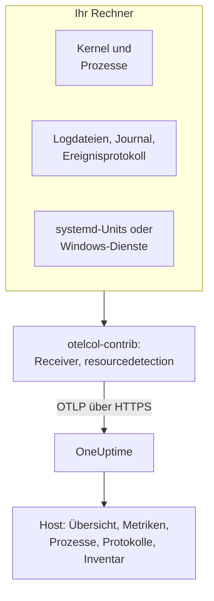

# Host-OpenTelemetry-Collector

Führen Sie den OpenTelemetry Collector auf einem Linux-, macOS- oder Windows-Rechner aus, um dessen Metriken, Prozesse, Logs und Dienstzustände an OneUptime zu senden. Der Rechner erscheint unter **Produkte → Infrastruktur → Hosts** mit eigenen Seiten, ohne dass ein OneUptime-Agent installiert werden muss: Der Collector ist das Upstream-Release `otelcol-contrib`. [Host-Monitore](/docs/monitor/host-monitor) alarmieren anhand dessen, was er sendet.

:::cards
- [Collector installieren](#collector-installieren): Drei Schritte unter Linux, macOS oder Windows.
- [Auswählen, was erfasst wird](#auswählen-was-erfasst-wird): Metriken, Logdateien, das Journal, Ereignisprotokolle und Dienstzustände.
- [Inventarattribute](#inventarattribute-ip-mac-seriennummer-hersteller-modell-firmware): IP, MAC, Seriennummer, Hersteller, Modell und Firmware für Ihre CMDB.
- [Weniger senden](#die-erfasste-datenmenge-verringern): Weniger Logzeilen, gröbere Intervalle, weniger Serien.
:::

## So funktioniert es

Der Collector liest den Rechner über seine Receiver, versieht jeden Datensatz mit der Identität des Rechners und sendet ihn mit Ihrem Ingestion-Schlüssel per OTLP an OneUptime. OneUptime registriert den Host anhand seiner ersten Metriken und füllt seine Seiten, sobald Daten eintreffen.



| Was Sie beim Host sehen | Woher es kommt |
| --- | --- |
| **Übersicht** und **Metriken** | Der Receiver `hostmetrics`: CPU, Speicher, Datenträger, Dateisysteme, Netzwerk, Last, Paging. |
| **Prozesse** | Der Scraper `process` von `hostmetrics`: ein Satz Serien pro Prozess. |
| **Protokolle** | Die Receiver `filelog`, `journald` und `windowseventlog`. |
| **Systemd-Units** (Linux) | Der Receiver `systemd`. |
| **Dienste** (Windows) | Der Receiver `windows_service`. |
| Das Inventarelement | Der Processor `resourcedetection` sowie die [Attribute, die Sie setzen](#inventarattribute-ip-mac-seriennummer-hersteller-modell-firmware). |
| **Agent-Version** | `oneuptime.agent.version` im Processor `resource`. |

Ein Host wird registriert, sobald ein Batch mit `host.name` auch Metriken von `hostmetrics` oder `process` oder ein Attribut `os.type` enthält. Der Processor `resourcedetection` setzt all diese Werte; deshalb steht er in jeder Konfiguration an erster Stelle. `host.id` oder `host.arch` allein registrieren keinen Host, und Telemetrie mit einer Kubernetes-Identität (`k8s.cluster.name`, `k8s.node.name`, `k8s.pod.name`) wird stattdessen ihrem Cluster zugeordnet: Überwachen Sie Kubernetes-Knoten mit dem [Kubernetes-Agent](/docs/telemetry/kubernetes-agent).

## Bevor Sie beginnen

- Ein Ingestion-Schlüssel. Legen Sie ihn unter **Projekteinstellungen → Telemetrie & APM → Ingestion-Schlüssel** an und kopieren Sie seinen Wert. Der Collector sendet ihn als Header `x-oneuptime-token`.
- Administratorrechte auf dem Rechner: `sudo` unter Linux und macOS, eine PowerShell mit erhöhten Rechten unter Windows.
- Ausgehendes HTTPS vom Rechner zu Ihrer OneUptime-URL.
- Die contrib-Distribution des Collectors, `otelcol-contrib`. Dem Core-Build `otelcol` fehlen die Receiver und Processors, die diese Konfigurationen nutzen. Der Receiver `systemd` (Linux) funktioniert ab v0.143.0 und der Receiver `windows_service` (Windows) ab v0.155.0; die folgenden Befehle installieren v0.161.0, das Release, das OneUptime festlegt.

## Collector installieren

:::steps
### Konfiguration speichern

Speichern Sie dies als `config.yaml` in dem Ordner, aus dem Sie die Installationsbefehle ausführen, und ersetzen Sie `YOUR_TELEMETRY_INGESTION_TOKEN` durch Ihren Ingestion-Schlüssel (und den Endpunkt durch Ihre eigene URL, wenn Sie selbst hosten).

:::tabs
@tab Linux
```yaml title="config.yaml"
receivers:
  hostmetrics:
    collection_interval: 30s
    scrapers:
      cpu:
        metrics:
          system.cpu.utilization:
            enabled: true
          system.cpu.logical.count:
            enabled: true
      memory:
        metrics:
          system.memory.utilization:
            enabled: true
      disk:
      filesystem:
        metrics:
          system.filesystem.utilization:
            enabled: true
      load:
      network:
      paging:
      processes:
      process:
        mute_process_name_error: true
        mute_process_exe_error: true
        mute_process_io_error: true
        metrics:
          process.cpu.utilization:
            enabled: true
          process.memory.utilization:
            enabled: true

  # The systemd journal: every unit's logs, info and above.
  journald:
    directory: /var/log/journal
    priority: info

  # Powers the Systemd Units tab (otelcol-contrib v0.143.0+).
  systemd:
    collection_interval: 30s
    units: ["*.service"]
    metrics:
      systemd.service.cpu.time:
        enabled: false

processors:
  # Stamps host.name, host.id and os.type: this is how OneUptime attaches
  # telemetry to the host. Without it the host's pages stay empty.
  resourcedetection:
    detectors: [system, env]
    system:
      hostname_sources: [os]
      resource_attributes:
        host.name:
          enabled: true
        host.id:
          enabled: true
        host.arch:
          enabled: true
        host.ip:
          enabled: true
        host.mac:
          enabled: true
        os.type:
          enabled: true
        os.description:
          enabled: true
        os.version:
          enabled: true
  # The collector release this config is for: the host's Agent Version.
  resource:
    attributes:
      - key: oneuptime.agent.version
        value: "0.161.0"
        action: upsert
  batch:

exporters:
  otlphttp/oneuptime:
    endpoint: https://oneuptime.com/otlp
    headers:
      x-oneuptime-token: YOUR_TELEMETRY_INGESTION_TOKEN

service:
  pipelines:
    metrics:
      receivers: [hostmetrics, systemd]
      processors: [resourcedetection, resource, batch]
      exporters: [otlphttp/oneuptime]
    logs:
      receivers: [journald]
      processors: [resourcedetection, resource, batch]
      exporters: [otlphttp/oneuptime]
```
@tab macOS
```yaml title="config.yaml"
receivers:
  hostmetrics:
    collection_interval: 30s
    scrapers:
      cpu:
        metrics:
          system.cpu.utilization:
            enabled: true
          system.cpu.logical.count:
            enabled: true
      memory:
        metrics:
          system.memory.utilization:
            enabled: true
      disk:
      filesystem:
        metrics:
          system.filesystem.utilization:
            enabled: true
      load:
      network:
      paging:
      processes:
      process:
        mute_process_name_error: true
        mute_process_exe_error: true
        mute_process_io_error: true
        metrics:
          process.cpu.utilization:
            enabled: true
          process.memory.utilization:
            enabled: true

  filelog/system:
    include:
      - /var/log/install.log
      - /var/log/wifi.log
    start_at: end

processors:
  # Stamps host.name, host.id and os.type: this is how OneUptime attaches
  # telemetry to the host. Without it the host's pages stay empty.
  resourcedetection:
    detectors: [system, env]
    system:
      hostname_sources: [os]
      resource_attributes:
        host.name:
          enabled: true
        host.id:
          enabled: true
        host.arch:
          enabled: true
        host.ip:
          enabled: true
        host.mac:
          enabled: true
        os.type:
          enabled: true
        os.description:
          enabled: true
        os.version:
          enabled: true
  # The collector release this config is for: the host's Agent Version.
  resource:
    attributes:
      - key: oneuptime.agent.version
        value: "0.161.0"
        action: upsert
  batch:

exporters:
  otlphttp/oneuptime:
    endpoint: https://oneuptime.com/otlp
    headers:
      x-oneuptime-token: YOUR_TELEMETRY_INGESTION_TOKEN

service:
  pipelines:
    metrics:
      receivers: [hostmetrics]
      processors: [resourcedetection, resource, batch]
      exporters: [otlphttp/oneuptime]
    logs:
      receivers: [filelog/system]
      processors: [resourcedetection, resource, batch]
      exporters: [otlphttp/oneuptime]
```
@tab Windows
```yaml title="config.yaml"
receivers:
  hostmetrics:
    collection_interval: 30s
    scrapers:
      cpu:
        metrics:
          system.cpu.utilization:
            enabled: true
          system.cpu.logical.count:
            enabled: true
      memory:
        metrics:
          system.memory.utilization:
            enabled: true
      disk:
      filesystem:
        metrics:
          system.filesystem.utilization:
            enabled: true
      load:
      network:
      paging:
      processes:
      process:
        mute_process_name_error: true
        mute_process_exe_error: true
        mute_process_io_error: true
        metrics:
          process.cpu.utilization:
            enabled: true
          process.memory.utilization:
            enabled: true

  windowseventlog/system:
    channel: System
    start_at: end

  windowseventlog/application:
    channel: Application
    start_at: end

  windowseventlog/security:
    channel: Security
    start_at: end

  # Powers the Services tab (otelcol-contrib v0.155.0+).
  windows_service:
    collection_interval: 30s

processors:
  # Stamps host.name, host.id and os.type: this is how OneUptime attaches
  # telemetry to the host. Without it the host's pages stay empty.
  resourcedetection:
    detectors: [system, env]
    system:
      hostname_sources: [os]
      resource_attributes:
        host.name:
          enabled: true
        host.id:
          enabled: true
        host.arch:
          enabled: true
        host.ip:
          enabled: true
        host.mac:
          enabled: true
        os.type:
          enabled: true
        os.description:
          enabled: true
        os.version:
          enabled: true
  # The collector release this config is for: the host's Agent Version.
  resource:
    attributes:
      - key: oneuptime.agent.version
        value: "0.161.0"
        action: upsert
  batch:

exporters:
  otlphttp/oneuptime:
    endpoint: https://oneuptime.com/otlp
    headers:
      x-oneuptime-token: YOUR_TELEMETRY_INGESTION_TOKEN

service:
  pipelines:
    metrics:
      receivers: [hostmetrics, windows_service]
      processors: [resourcedetection, resource, batch]
      exporters: [otlphttp/oneuptime]
    logs:
      receivers:
        - windowseventlog/system
        - windowseventlog/application
        - windowseventlog/security
      processors: [resourcedetection, resource, batch]
      exporters: [otlphttp/oneuptime]
```
:::

Jede Konfiguration ist die, die das Dashboard unter **Produkte → Infrastruktur → Hosts → Dokumentation** erzeugt, ergänzt um eine Logs-Pipeline: Ihre Processors sind `resourcedetection`, `resource` und `batch`, ihr Exporter ist `otlphttp/oneuptime`. Sie setzt kein `service.name`, daher gehört die Telemetrie des Hosts dem Host selbst und wird als `host/<hostname>` abgelegt. Fügen Sie dem Processor `resource` nur dann ein `service.name` hinzu, wenn sie stattdessen unter einem Telemetriedienst dieses Namens abgelegt werden soll.

### Collector installieren und starten

:::tabs
@tab Linux
Unter Debian oder Ubuntu:

```bash
VERSION=0.161.0                      # the release OneUptime pins
ARCH=$(dpkg --print-architecture)   # amd64 or arm64

curl -fL -o /tmp/otelcol-contrib.deb \
  "https://github.com/open-telemetry/opentelemetry-collector-releases/releases/download/v${VERSION}/otelcol-contrib_${VERSION}_linux_${ARCH}.deb"
sudo dpkg -i /tmp/otelcol-contrib.deb
```

Unter RHEL, CentOS, Fedora oder Amazon Linux:

```bash
VERSION=0.161.0
ARCH=$(uname -m | sed 's/x86_64/amd64/;s/aarch64/arm64/')

curl -fL -o /tmp/otelcol-contrib.rpm \
  "https://github.com/open-telemetry/opentelemetry-collector-releases/releases/download/v${VERSION}/otelcol-contrib_${VERSION}_linux_${ARCH}.rpm"
sudo rpm -Uvh /tmp/otelcol-contrib.rpm
```

Das Paket installiert `/usr/bin/otelcol-contrib` und eine systemd-Unit und startet sie mit einer Standardkonfiguration. Legen Sie Ihre an ihren Platz, erlauben Sie dem Benutzer des Collectors, das Journal zu lesen, und starten Sie ihn neu:

```bash
sudo install -m 0644 config.yaml /etc/otelcol-contrib/config.yaml
sudo usermod -aG systemd-journal otelcol-contrib
sudo systemctl enable otelcol-contrib
sudo systemctl restart otelcol-contrib
sudo systemctl status otelcol-contrib
```

Die paketierte Unit führt den Collector als unprivilegierten Benutzer `otelcol-contrib` aus. Die Gruppe `systemd-journal` erlaubt ihm, das Journal zu lesen; um Dateien in `/var/log` zu verfolgen (unter Debian und Ubuntu für die Gruppe `adm` lesbar), fügen Sie auch diese Gruppe hinzu. Damit der Scraper `process` die Prozesse anderer Benutzer sieht, geben Sie ihm die Capability `CAP_SYS_PTRACE`.
@tab macOS
```bash
VERSION=0.161.0
ARCH=$(uname -m | sed 's/x86_64/amd64/')   # arm64 on Apple silicon, amd64 on Intel

curl -fL -o /tmp/otelcol-contrib.tar.gz \
  "https://github.com/open-telemetry/opentelemetry-collector-releases/releases/download/v${VERSION}/otelcol-contrib_${VERSION}_darwin_${ARCH}.tar.gz"

sudo mkdir -p /usr/local/otelcol-contrib /usr/local/bin /etc/otelcol-contrib
sudo tar -xzf /tmp/otelcol-contrib.tar.gz -C /usr/local/otelcol-contrib
sudo ln -sf /usr/local/otelcol-contrib/otelcol-contrib /usr/local/bin/otelcol-contrib
sudo install -m 0644 config.yaml /etc/otelcol-contrib/config.yaml
```

Legen Sie `/Library/LaunchDaemons/com.oneuptime.otelcol-contrib.plist` an, damit launchd den Collector mit dem Mac startet und ihn neu startet, wenn er stoppt:

```xml title="/Library/LaunchDaemons/com.oneuptime.otelcol-contrib.plist"
<?xml version="1.0" encoding="UTF-8"?>
<!DOCTYPE plist PUBLIC "-//Apple//DTD PLIST 1.0//EN" "http://www.apple.com/DTDs/PropertyList-1.0.dtd">
<plist version="1.0">
<dict>
  <key>Label</key><string>com.oneuptime.otelcol-contrib</string>
  <key>ProgramArguments</key>
  <array>
    <string>/usr/local/bin/otelcol-contrib</string>
    <string>--config=/etc/otelcol-contrib/config.yaml</string>
  </array>
  <key>RunAtLoad</key><true/>
  <key>KeepAlive</key><true/>
  <key>StandardOutPath</key><string>/var/log/otelcol-contrib.out.log</string>
  <key>StandardErrorPath</key><string>/var/log/otelcol-contrib.err.log</string>
</dict>
</plist>
```

Laden Sie sie:

```bash
sudo launchctl load -w /Library/LaunchDaemons/com.oneuptime.otelcol-contrib.plist
sudo launchctl list | grep otelcol-contrib
```

Verwenden Sie dieses Tarball, nicht Homebrew: Die Homebrew-Formel ist der Core-Build, der mit dieser Konfiguration nicht startet.
@tab Windows
Führen Sie in einer PowerShell mit erhöhten Rechten, im Ordner mit `config.yaml`, diesen Block als Ganzes aus: Jede Zeile hängt von den Variablen darüber ab.

```powershell
$VERSION = "0.161.0"                          # the release OneUptime pins; v0.155.0+ has the Services tab
$ARCH    = "amd64"                            # use "arm64" on ARM hosts
$dest    = "C:\Program Files\otelcol-contrib"
$tar     = "$env:TEMP\otelcol-contrib.tar.gz"

# Note the "-contrib" in the asset name; otelcol_... is the wrong archive.
$url = "https://github.com/open-telemetry/opentelemetry-collector-releases/releases/download/v$VERSION/otelcol-contrib_${VERSION}_windows_${ARCH}.tar.gz"

New-Item -ItemType Directory -Force -Path $dest | Out-Null
Invoke-WebRequest -Uri $url -OutFile $tar
tar -xf $tar -C $dest                          # tar.exe ships with Windows 10 1803+ / Server 2019+
Get-ChildItem $dest                            # expect otelcol-contrib.exe, not otelcol.exe
Copy-Item config.yaml "$dest\config.yaml" -Force

# --% hands the rest of the line to sc.exe unchanged, so its quoting
# survives PowerShell — keep the command on one line.
sc.exe --% create "otelcol-contrib" binPath= "\"C:\Program Files\otelcol-contrib\otelcol-contrib.exe\" --config=\"C:\Program Files\otelcol-contrib\config.yaml\"" start= auto DisplayName= "OpenTelemetry Collector (OneUptime)"
sc.exe description "otelcol-contrib" "Collects host telemetry and forwards it to OneUptime over OTLP."
sc.exe start "otelcol-contrib"
sc.exe query "otelcol-contrib"
```

Der Dienst läuft als `LocalSystem` und kann damit das Ereignisprotokoll `Security` und jeden Windows-Dienst lesen. Unter Windows bildet der Scraper `load` einen Lastdurchschnitt nur aus dem Zähler *Processor Queue Length* nach und beginnt bei 0.

Der Name des Assets muss mit `otelcol-contrib_` beginnen. Das Core-Archiv `otelcol_<version>_windows_amd64.tar.gz` entpackt `otelcol.exe`, das keinen Receiver `windowseventlog` oder `windows_service` hat; eine Umbenennung in `otelcol-contrib.exe` fügt sie nicht hinzu. Lieber ein Installationsprogramm? Dieselbe [Release-Seite](https://github.com/open-telemetry/opentelemetry-collector-releases/releases) bietet ein signiertes `otelcol-contrib_<version>_windows_x64.msi`, das den Dienst für Sie registriert: Verweisen Sie es auf diese `config.yaml` und lassen Sie den Dienst unter `LocalSystem` laufen.
:::

### Prüfen, ob der Host erscheint

Öffnen Sie **Produkte → Infrastruktur → Hosts → Alle Hosts**. Der Host erscheint unter seinem Hostnamen, sobald die ersten Metriken eintreffen, meist innerhalb von 30 Sekunden, und seine Seiten **Übersicht**, **Metriken**, **Prozesse** und **Protokolle** füllen sich. Falls nicht, lesen Sie die Logs des Collectors selbst:

:::tabs
@tab Linux
```bash
sudo journalctl -u otelcol-contrib -f
```
@tab macOS
```bash
tail -f /var/log/otelcol-contrib.err.log
```
@tab Windows
```powershell
Get-WinEvent -LogName Application -MaxEvents 20 | Where-Object ProviderName -eq "otelcol-contrib"
```
:::
:::

Um eine Testlogzeile zu erzeugen, führen Sie `logger "hello from oneuptime"` (Linux, macOS) oder `eventcreate /T INFORMATION /ID 999 /L APPLICATION /SO OneUptimeTest /D "hello from oneuptime"` (Windows, mit erhöhten Rechten) aus und sehen Sie sich dann die Seite **Protokolle** des Hosts an.

## Auswählen, was erfasst wird

Jede Konfiguration folgt derselben Form: Receiver für das, was gelesen wird, die Processors `resourcedetection`, `resource` und `batch` und der Exporter `otlphttp/oneuptime`. Fügen Sie die folgenden Receiver unter `receivers:` und in ihre Pipeline ein und starten Sie den Collector neu (`sudo systemctl restart otelcol-contrib`, `launchctl unload` und `load` auf einem Mac, `Restart-Service otelcol-contrib` unter Windows). Führen Sie jedes Snippet mit den Abschnitten Ihrer Konfiguration zusammen: Ein zweiter Schlüssel `processors:` oder `service:` ersetzt den ersten.

### Host-Metriken

`hostmetrics` funktioniert auf jedem Betriebssystem. Er liest CPU, Speicher, Datenträger, Dateisysteme, Netzwerk, Last, Paging und Prozesse aus dem Kernel, jeweils im Abstand von `collection_interval`. Die Metriken `*.utilization` und `system.cpu.logical.count` sind im Receiver standardmäßig aus, die Diagramme des Hosts und die Host-Alarmvorlagen lesen sie aber, also lassen Sie sie wie in den Konfigurationen oben aktiviert. Der Scraper `process` speist die Seite **Prozesse**; er ist zugleich die größte Quelle von Serien (siehe [Weniger senden](#die-erfasste-datenmenge-verringern)).

Unter Linux liest der Collector `/proc` und `/sys`. Ein Collector in einem Container muss die des Hosts einhängen und `HOST_PROC` und `HOST_SYS` setzen (siehe [In einem Docker-Container](#in-einem-docker-container)); eine native Installation braucht nichts davon.

### Logdateien

Verfolgen Sie jede Logdatei auf der Festplatte mit einem Receiver `filelog` und fügen Sie ihn der Pipeline `logs` hinzu:

```yaml
receivers:
  filelog/app:
    include:
      - /var/log/myapp/*.log
    start_at: end
    multiline:
      # A new entry starts with a timestamp; continuation lines (the
      # "at ...", "File ...", "Caused by: ..." frames) are folded into it.
      line_start_pattern: '^\d{4}-\d{2}-\d{2}[ T]\d{2}:\d{2}:\d{2}'
```

`start_at: end` liest nur neue Zeilen; verwenden Sie `beginning`, um die Dateien beim ersten Lauf von Anfang an zu lesen. Der Collector merkt sich seine Position in jeder Datei und setzt daher nach einem Neustart korrekt fort.

OneUptime durchsucht Logzeilen der Stufen error und fatal nach Stacktraces und gruppiert sie unter **Ausnahmen**, beim Host. Dafür muss ein mehrzeiliger Stacktrace (Java, Python, .NET, Ruby) als ein Datensatz ankommen, was `multiline` leistet; ohne das wird jeder Frame zu einem eigenen Log. Wenn Ihre Anwendung die OpenTelemetry-Attribute `exception.type`, `exception.message` und `exception.stacktrace` selbst schreiben kann, ist das noch zuverlässiger.

Auf einem systemd-Host wiederholen `/var/log/syslog` und `/var/log/messages`, was das Journal bereits enthält; lesen Sie also das eine oder das andere.

### systemd-Journal

Auf einem systemd-Host liest der Receiver `journald` die Logs aller Units an einer Stelle, mit ihren strukturierten Feldern. Die Linux-Konfiguration oben liest sie alle ab `info`; beschränken Sie sie auf einige Units:

```yaml
receivers:
  journald:
    directory: /var/log/journal
    units:
      # Drop this list to ingest everything; restrict it to limit volume.
      - ssh.service
      - cron.service
      - nginx.service
    priority: info
```

Der Receiver führt `journalctl` aus, das jeder systemd-Host hat, und der Benutzer des Collectors muss in der Gruppe `systemd-journal` sein.

### Linux-Dienste (systemd-Units, Metriken)

Die Seite **Systemd-Units** des Hosts listet jede Unit und ihren Zustand auf, aus dem [`systemdreceiver`](https://github.com/open-telemetry/opentelemetry-collector-contrib/tree/main/receiver/systemdreceiver) (Konfigurationstyp `systemd`), dem Linux-Gegenstück zur Seite **Dienste** unter Windows. Die Linux-Konfiguration oben schaltet ihn ein:

```yaml
receivers:
  systemd:
    collection_interval: 30s
    # The service manager to read: "system" (default) or "user".
    scope: system
    # Which units to scrape, as systemctl unit patterns. The default is
    # every service; widen it to include timers, sockets or mounts, or
    # narrow it to cut volume on hosts with hundreds of units:
    units: ["*.service"]
    # units: [nginx.service, postgresql.service, "*.timer"]
    metrics:
      # Per-service CPU time is on by default and doubles this receiver's
      # datapoint count. The Systemd Units tab does not use it, so turn it
      # off unless you chart it. On v0.142.0 the key is
      # systemd.unit.cpu.time — naming a metric the running build does not
      # have stops the collector at startup.
      systemd.service.cpu.time:
        enabled: false

service:
  pipelines:
    metrics:
      receivers: [hostmetrics, systemd]
      processors: [resourcedetection, resource, batch]
```

Der Receiver erschien erstmals in `otelcol-contrib` v0.142.0, und v0.143.0 ist das erste Release, das sich lohnt. Bei allem Älteren scheitert das Hinzufügen von `systemd` beim Start mit `'receivers' unknown type: "systemd"`; allein v0.142.0 nennt seine CPU-Metrik `systemd.unit.cpu.time` und sucht auf jeder Unit nach cgroup-Statistiken, was für jede Unit, die nicht `.service` ist, einen Scrape-Fehler protokolliert.

Er gibt `systemd.unit.state` als State-Set aus: Bei jedem Scrape erhält jede Unit einen Datenpunkt pro möglichem Zustand (`active`, `reloading`, `inactive`, `failed`, `activating`, `deactivating`, `maintenance`, `refreshing`), `1` für den Zustand, in dem sie ist, und `0` für die übrigen. Der Unit-Name ist das Ressourcenattribut `systemd.unit.name` und der Zustand das Datenpunktattribut `systemd.unit.active_state`. Weil der Unit-Name ein Ressourcenattribut ist, muss `resourcedetection` in der Metrik-Pipeline bleiben: Er setzt `host.name` auf die Ressource jeder Unit, und ohne ihn werden die Samples nie einem Host zugeordnet.

Er liest den Unit-Zustand über den System-D-Bus, mit denselben lesenden Aufrufen wie `systemctl list-units`, die systemd ohne Privilegien erlaubt. Der paketierte Dienst, der als Benutzer `otelcol-contrib` und nicht als root läuft, braucht daher keine zusätzlichen Rechte. Er braucht aber den Bus: Ein Collector in einem Container hat kein `/run/dbus/system_bus_socket`, solange Sie nicht den des Hosts einhängen; verwenden Sie also eine native Installation. Der Receiver ist Alpha und nur für Linux.

> [!WARNING]
> Das State-Set kostet acht Datenpunkte pro Unit und Scrape, und das standardmäßig aktive `systemd.service.cpu.time` fügt zwei weitere hinzu (`user` und `system`): 10 Datenpunkte pro Unit und Scrape. Ein Host mit 300 Units, alle 30 Sekunden gescrapt, sendet allein aus diesem Receiver etwa 6.000 Datenpunkte pro Minute, oder etwa 4.800 mit abgeschalteter CPU-Metrik. Beschränken Sie `units:` auf die Dienste, für die Sie alarmieren, oder erhöhen Sie `collection_interval`, bevor Sie ihn für eine ganze Flotte einschalten.

### Apple Unified Log

macOS schreibt seine Systemlogs in das Apple Unified Log, das mit `log show` und `log stream` gelesen wird, statt nach `/var/log/system.log`. Um es zu erfassen, streamen Sie es mit einem kleinen Skript in eine Datei, `/usr/local/otelcol-contrib/log-stream.sh`:

```bash title="/usr/local/otelcol-contrib/log-stream.sh"
#!/bin/bash
exec /usr/bin/log stream --style ndjson --level info \
  --predicate 'subsystem != "com.apple.cfnetwork"' \
  >> /var/log/apple-unified.log
```

Machen Sie es ausführbar und führen Sie es unter launchd aus (oder mit `nohup` für einen schnellen Test), und verweisen Sie dann einen Receiver `filelog` auf die Datei:

```yaml
receivers:
  filelog/apple-unified:
    include:
      - /var/log/apple-unified.log
    start_at: end
    operators:
      - type: json_parser
        timestamp:
          parse_from: attributes.timestamp
          layout: "%Y-%m-%d %H:%M:%S.%f%j"
```

Viele Mac-Flotten kommen mit Host-Metriken und ein paar Logdateien gut aus, ohne das Unified Log.

### Windows-Ereignisprotokolle

Die Windows-Konfiguration oben abonniert die Kanäle `System`, `Application` und `Security`. Um den umfangreichen Kanal `Security` auf einige Ereignis-IDs zu beschränken:

```yaml
windowseventlog/security:
  channel: Security
  start_at: end
  query: "*[System[(EventID=4625 or EventID=4740)]]"
```

Um einen anderen Kanal zu lesen (alles unter *Event Viewer → Applications and Services Logs*), verwenden Sie seinen genauen Namen:

```yaml
windowseventlog/iis:
  channel: Microsoft-IIS-Logging/Logs
  start_at: end
```

### Windows-Dienste (Metriken)

Die Seite **Dienste** des Hosts listet jeden Windows-Dienst mit seinem Zustand und Starttyp auf, aus dem [`windowsservicereceiver`](https://github.com/open-telemetry/opentelemetry-collector-contrib/tree/main/receiver/windowsservicereceiver) (Konfigurationstyp `windows_service`). Er ist ab v0.155.0 in `otelcol-contrib` enthalten: In früheren Releases scheitert das Hinzufügen von `windows_service` beim Start mit `'receivers' unknown type: "windows_service"`. Die Windows-Konfiguration oben schaltet ihn ein:

```yaml
receivers:
  windows_service:
    collection_interval: 30s
    # Collect every service by default. To cut volume — and avoid the
    # "access denied" noise from services the collector can't open —
    # list just the ones you care about:
    # include_services: [Spooler, W3SVC, MSSQLSERVER]
    # Or collect everything except a few:
    # exclude_services: [TrustedInstaller]

service:
  pipelines:
    metrics:
      receivers: [hostmetrics, windows_service]
```

Er gibt pro Dienst eine Gauge `windows.service.status` aus, den Win32-Dienstzustand (`4` bedeutet läuft, `1` beendet), mit den Attributen `name` und `startup_mode`. Der Collector liest jeden Dienst als `LocalSystem` und überspringt alle, die er nicht öffnen kann. Der Receiver ist Alpha und nur für Windows; wenn ein Scrape-Fehler oder ein `access denied` bei einem Dienst die anderen beeinträchtigt, beschränken Sie ihn mit `include_services`.

`include_services` kann die Menge nur verkleinern. Wenn Sie Dienste auflisten und trotzdem alle sehen, hat die bearbeitete Konfiguration den laufenden Collector nicht erreicht: Starten Sie den Dienst neu, prüfen Sie, dass `include_services` eine gefüllte Liste auf derselben Einrückung wie `collection_interval` ist, und geben Sie der Seite **Dienste** ein paar Minuten, bis die vor der Änderung gemeldeten Dienste ihr rollierendes Fenster verlassen. Die Namen sind die exakten, groß-/kleinschreibungssensitiven Dienstschlüsselnamen (`Spooler`, `W3SVC`), die `Get-Service | Select-Object Name` auflistet.

### Labels

Jedes Ressourcenattribut, das mit `oneuptime.label.` beginnt, wird zu einem Projektlabel am Host: `oneuptime.label.<dimension>=<value>` ist das Label `<dimension>:<value>`. Fügen Sie dafür einen Processor hinzu und nennen Sie ihn in den Pipelines:

```yaml
processors:
  resource/oneuptime-labels:
    attributes:
      - key: oneuptime.label.team
        value: payments
        action: upsert
      - key: oneuptime.label.env
        value: production
        action: upsert

service:
  pipelines:
    metrics:
      processors: [resourcedetection, resource, resource/oneuptime-labels, batch]
```

Labels werden ohne Beachtung der Groß-/Kleinschreibung abgeglichen, daher wird ein vorhandenes Label `Production` wiederverwendet statt dupliziert, und in OneUptime hinzugefügte Labels entfernt der Collector nie.

### Inventarattribute (IP, MAC, Seriennummer, Hersteller, Modell, Firmware)

Jeder Host erhält außerdem ein Inventarelement: den Datensatz, den ein CMDB-Export liest. Seine Details werden direkt aus den Ressourcenattributen der Telemetrie gefüllt, die Sie senden; was ankommt, kann ein CMDB-Abgleich also abrufen.

| Was Sie möchten | Attribut | Woher es kommt |
| --- | --- | --- |
| IP-Adressen | `host.ip` | `resourcedetection`, kommagetrennt, wenn der Rechner mehrere hat |
| MAC-Adressen | `host.mac` | `resourcedetection`, eine pro aktiver Schnittstelle, kommagetrennt |
| Architektur | `host.arch` | `resourcedetection` |
| Maschinen-ID | `host.id` | `resourcedetection`: die Maschinen-GUID unter Windows, `/etc/machine-id` unter Linux |
| Betriebssystem | `os.type`, `os.description`, `os.version` | `resourcedetection` |
| Seriennummer | `host.serial_number` | Von Ihnen gesetzt, aus WMI oder DMI |
| Hersteller | `device.manufacturer` | Von Ihnen gesetzt, aus WMI oder DMI |
| Modell | `device.model.name` | Von Ihnen gesetzt, aus WMI oder DMI |
| Firmware-Version (BIOS oder UEFI) | `device.firmware.version` | Von Ihnen gesetzt, aus WMI oder DMI |

Die Konfigurationen oben aktivieren jedes erkannte Attribut: Im system-Detektor sind standardmäßig nur `host.name` und `os.type` aktiv, deshalb führen sie die übrigen unter `resource_attributes` auf. Wenn Sie eine eigene Konfiguration erstellen, behalten Sie diesen Block `resourcedetection`: Ohne ihn gibt es kein `host.name`, also keinen Host und überhaupt kein Inventarelement.

#### Seriennummer, Hersteller, Modell und Firmware-Version haben keinen Detektor

Sie stehen in der Firmware des Rechners, die der Collector nicht liest. Unter Linux lässt sich das nicht per Einstellung ändern: Der paketierte Collector läuft als unprivilegierter Benutzer `otelcol-contrib`, und `/sys/class/dmi/id/product_serial` ist nur für root lesbar. Lesen Sie die Werte daher einmal bei der Bereitstellung des Rechners aus und setzen Sie sie mit einem eigenen Processor auf die Ressource:

```yaml
processors:
  resource/oneuptime-hardware:
    attributes:
      - key: host.serial_number
        value: "7XYZ123"
        action: upsert
      - key: device.manufacturer
        value: "Dell Inc."
        action: upsert
      - key: device.model.name
        value: "OptiPlex 7090"
        action: upsert
      - key: device.firmware.version
        value: "1.21.0"
        action: upsert

service:
  pipelines:
    metrics:
      processors: [resourcedetection, resource, resource/oneuptime-hardware, batch]
```

Fügen Sie `resource/oneuptime-hardware` der vorhandenen Processor-Liste hinzu, statt diese Zeile darüber einzufügen: Fehlt `resource`, verliert der Host seine **Agent-Version**. Lassen Sie `resourcedetection` in jedem Fall vorne: Er ordnet den Batch überhaupt erst dem Host zu.

`host.manufacturer`, `host.model.name`, `host.firmware.version` und `host.bios.version` werden als alternative Schreibweisen akzeptiert und unter den obigen Schlüsseln `device.*` gespeichert, sodass eine Konfiguration in beiden Schreibweisen an einer Stelle landet; sind beide vorhanden, gewinnt der Wert `device.*`. Die Seriennummer geht den umgekehrten Weg: `device.serial_number` wird akzeptiert und als `host.serial_number` gespeichert.

> [!NOTE]
> Auf einer Ressource ohne Host-Identität bedeutet `device.manufacturer` „mobile App“: Es ist eines der Attribute, die einen Batch als mobiles Real User Monitoring kennzeichnen. Die Ressource eines Hosts trägt immer `host.name` oder `host.id`, daher wird eine Collector-Konfiguration wie die obige nie für ein Telefon gehalten; verwenden Sie denselben Block aber nicht in der SDK-Konfiguration einer mobilen App.

#### Die Werte auslesen

Unter Windows, in einer PowerShell mit erhöhten Rechten. Es gibt den YAML-Block für den Rechner aus, auf dem Sie es ausführen:

```powershell
$bios = Get-CimInstance -ClassName Win32_BIOS
$cs   = Get-CimInstance -ClassName Win32_ComputerSystem

# Quote for YAML: trim, escape any embedded quote, wrap in single quotes.
# The cast to string first is what keeps this working on machines whose
# firmware leaves a field empty — .Trim() on $null throws.
function Format-YamlValue($value) {
  "'" + ("$value".Trim() -replace "'", "''") + "'"
}

@"
  resource/oneuptime-hardware:
    attributes:
      - key: host.serial_number
        value: $(Format-YamlValue $bios.SerialNumber)
        action: upsert
      - key: device.manufacturer
        value: $(Format-YamlValue $cs.Manufacturer)
        action: upsert
      - key: device.model.name
        value: $(Format-YamlValue $cs.Model)
        action: upsert
      - key: device.firmware.version
        value: $(Format-YamlValue $bios.SMBIOSBIOSVersion)
        action: upsert
"@
```

Es gibt einen Processor-Eintrag aus, bereits eingerückt: Fügen Sie ihn in den vorhandenen Block `processors:` ein, nicht als zweiten Schlüssel `processors:`. Verwenden Sie `Get-CimInstance`, nicht das veraltete `Get-WmiObject`, das PowerShell 7 und neuer nicht mehr haben. Ein Feld, das die Firmware leer lässt, wird als `''` ausgegeben: Lassen Sie dieses Attribut weg, statt ein leeres zu senden. Virtuelle Maschinen haben oft gar keine Seriennummer.

Unter Linux, als root:

```bash
cat /sys/class/dmi/id/product_serial   # host.serial_number
cat /sys/class/dmi/id/sys_vendor       # device.manufacturer
cat /sys/class/dmi/id/product_name     # device.model.name
cat /sys/class/dmi/id/bios_version     # device.firmware.version
```

`bios_version` ist das einzige der vier Felder, das jeder Benutzer lesen kann. Auf Rechnern ohne `/sys/class/dmi` liefern `dmidecode -s system-serial-number`, `-s system-manufacturer`, `-s system-product-name` und `-s bios-version` dieselben Werte. Virtuelle Maschinen melden hier ihren Hypervisor (`QEMU`, `VMware, Inc.`, `Amazon EC2`), was in einer CMDB meist gewünscht ist.

Auf einem Mac:

```bash
ioreg -l | awk -F'"' '/IOPlatformSerialNumber/{print $4}'   # host.serial_number
sysctl -n hw.model                                          # device.model.name
system_profiler SPHardwareDataType | awk -F': ' '/System Firmware Version/{print $2}'   # device.firmware.version
```

Der Hersteller ist `Apple Inc.` `hw.model` liefert die Modellkennung, etwa `Mac14,7` oder `MacBookPro18,3`, nicht den Marketingnamen, den der Mac nicht meldet: Ordnen Sie die Kennung in Ihrer CMDB zu, wenn Sie einen brauchen. Setzen Sie sie trotzdem in `device.model.name`: `device.model.identifier` kennzeichnet einen Batch unabhängig von allem anderen als mobile App, sodass ein damit versehener Mac als Telefon abgelegt und von seinem Host getrennt wird.

#### Stattdessen Umgebungsvariablen verwenden

Der Detektor `env` ist aktiv, daher funktioniert `OTEL_RESOURCE_ATTRIBUTES` anstelle des Processors:

```text
OTEL_RESOURCE_ATTRIBUTES=host.serial_number=7XYZ123,device.manufacturer=Dell%20Inc.,device.model.name=OptiPlex%207090
```

Kodieren Sie jeden Wert per Prozentkodierung. Die Variable wird als W3C-Baggage-Liste `key=value` gelesen, in der `,` und `=` Einträge trennen und Leerzeichen zwischen Collector-Versionen nicht portabel sind; Anführungszeichen helfen nicht, und `device.manufacturer="Dell Inc."` kann mit den Anführungszeichen im Wert ankommen. Unter Windows kodiert `[System.Uri]::EscapeDataString($value)` einen Wert.

Setzen Sie sie am Dienst des Collectors selbst, nie rechnerweit:

- **Linux:** `sudo systemctl edit otelcol-contrib`, dann ein Abschnitt `[Service]` mit `Environment="OTEL_RESOURCE_ATTRIBUTES=…"`.
- **Windows:** der Wert `Environment` (Typ `REG_MULTI_SZ`) unter `HKLM\SYSTEM\CurrentControlSet\Services\otelcol-contrib`. `sc.exe create` kann keine Umgebungsvariablen für Dienste setzen, und `setx` setzt eine Variable, die der laufende Dienst nie wieder liest.

> [!WARNING]
> Setzen Sie sie nicht rechnerweit (`setx /M`, `/etc/environment`). Jeder OpenTelemetry-SDK-Prozess auf dem Rechner erbt `OTEL_RESOURCE_ATTRIBUTES`, sodass Ihre Anwendungen den `device.manufacturer` des Rechners als ihren eigenen melden würden, und eine Anwendungsressource mit `device.manufacturer` ohne `host.name` oder `host.id` wird als mobile App gelesen, was sie von ihrem Dienst trennt.

Der Processor ist leichter richtig hinzubekommen: Er gilt durch seine Bauart nur für den Collector, und die Werte ändern sich für einen Rechner nie. Bevorzugen Sie ihn, es sei denn, Sie arbeiten bereits mit Vorlagen für Umgebungsdateien.

#### Eine MAC-Adresse ist kein gesetzter Wert

`host.mac` kommt wie `host.ip` vom Detektor `system`: eine Adresse pro aktiver Netzwerkschnittstelle, ohne Loopback, in der von OpenTelemetry festgelegten IEEE-Form (`AC-DE-48-23-45-67`). Ein Rechner mit Docker oder Hyper-V meldet auch seine virtuellen Switches; deshalb ist der Wert eine Liste. Eine Schnittstelle, die den Nullplatzhalter (`00-00-00-00-00-00`) meldet, wird ausgelassen.

Nichts auf dem Rechner meldet eine als Upgrade verfügbare Firmware-Version, daher erfasst OneUptime die installierte Version.

#### Prüfen, ob es funktioniert hat

Öffnen Sie das Element des Hosts unter **Produkte → Inventar** und sehen Sie sich seine Karte **Asset-Details** an. Die Werte erscheinen innerhalb weniger Minuten nach dem nächsten Batch; ein Detail, das der Collector nicht gemeldet hat, wird als unbekannt angezeigt, mit einem Link zurück zu diesem Abschnitt. Da die Werte gesetzt und nicht erkannt werden, aktualisieren sie sich nicht selbst: Setzen Sie sie nach einem Mainboard-Tausch, einem Firmware-Update oder einer Neuinstallation erneut.

## Weitere Wege, den Collector auszuführen

### In einem Docker-Container

Führen Sie den Collector in einem Container aus, der die Prozesse und Dateisysteme des Hosts sieht, aus dem Ordner mit `config.yaml`:

```bash
docker run -d \
  --name otel-collector \
  --restart unless-stopped \
  --network host \
  --pid host \
  -v $(pwd)/config.yaml:/etc/otelcol-contrib/config.yaml:ro \
  --volume /:/hostfs:ro,rslave \
  -e HOST_PROC=/hostfs/proc \
  -e HOST_SYS=/hostfs/sys \
  -e HOST_ETC=/hostfs/etc \
  -e HOST_VAR=/hostfs/var \
  -e HOST_RUN=/hostfs/run \
  -e HOST_DEV=/hostfs/dev \
  otel/opentelemetry-collector-contrib:0.161.0 \
  --config /etc/otelcol-contrib/config.yaml
```

`--network host`, `--pid host`, der Mount `/hostfs` und die Variablen `HOST_*` lassen `hostmetrics` und `process` den Kernel des Hosts lesen statt den des Containers. Verwenden Sie nur die Metrik-Pipeline der Konfiguration: Das Image hat kein `journalctl`, und der Receiver `systemd` braucht den D-Bus des Hosts.

### Aus dem Release-Tarball

Wo Pakete keine Option sind, entpacken Sie die statische Binärdatei und geben ihr eine eigene systemd-Unit:

```bash
VERSION=0.161.0
ARCH=$(uname -m | sed 's/x86_64/amd64/;s/aarch64/arm64/')

curl -fL -o /tmp/otelcol.tar.gz \
  "https://github.com/open-telemetry/opentelemetry-collector-releases/releases/download/v${VERSION}/otelcol-contrib_${VERSION}_linux_${ARCH}.tar.gz"
sudo mkdir -p /opt/otelcol-contrib
sudo tar -xzf /tmp/otelcol.tar.gz -C /opt/otelcol-contrib
sudo install -m 0644 config.yaml /opt/otelcol-contrib/config.yaml
```

```ini title="/etc/systemd/system/otelcol-contrib.service"
[Unit]
Description=OpenTelemetry Collector
After=network.target

[Service]
ExecStart=/opt/otelcol-contrib/otelcol-contrib --config /opt/otelcol-contrib/config.yaml
Restart=on-failure
RestartSec=5s
User=root

[Install]
WantedBy=multi-user.target
```

```bash
sudo systemctl daemon-reload
sudo systemctl enable --now otelcol-contrib
```

`User=root` erlaubt dieser Unit, jede Logdatei und jeden Prozess zu lesen; die paketierte Installation oben ist die unprivilegierte Alternative.

### Auf Kubernetes-Knoten

Kubernetes-Knoten sind in OneUptime keine Hosts: Ihre Telemetrie trägt eine Kubernetes-Identität und wird dem Cluster zugeordnet. Installieren Sie den [Kubernetes-Agent](/docs/telemetry/kubernetes-agent): Jeder Knoten erscheint auf der Seite **Knoten** seines Clusters, neben seinen Pods.

## Collector aktualisieren

Jede Konfiguration auf dieser Seite vermerkt im Processor `resource` das Collector-Release, für das sie gedacht ist, als `oneuptime.agent.version`. OneUptime zeigt es als **Agent-Version** in der **Übersicht** des Hosts an, mit einem Warnzeichen daneben, wenn OneUptime ein neueres Release festlegt. Wählen Sie das Zeichen aus, um zu sehen, wie Sie auf die Art aktualisieren, auf die Sie installiert haben.

Um von Hand zu aktualisieren, installieren Sie das neue Release so, wie Sie dieses installiert haben, mit der neuen `VERSION` (unter Debian und Ubuntu behält `sudo dpkg -i --force-confold` Ihre Konfiguration ohne Rückfrage), setzen `oneuptime.agent.version` in `config.yaml` auf dieselbe Version und starten den Collector neu. Ein Collector, dessen Konfiguration keine Version vermerkt, zeigt keine an und nie ein Zeichen.

## Die erfasste Datenmenge verringern

Die Konfiguration gehört Ihnen, daher verlässt nichts den Rechner, was nicht ein von Ihnen hinzugefügter Receiver liest. Sendet ein Host mehr, als Sie möchten (sichtbar als mehr Ingestion und in OneUptime Cloud als höhere Kosten), kürzen Sie es hier. Die zwei größten Hebel sind, welche Logs Sie lesen und wie oft Sie Metriken scrapen; ein Processor `filter` erledigt den Rest. Ändern Sie jeweils einen Hebel und starten Sie den Collector nach jeder Änderung neu.

### Woher die Menge kommt

| Signal | Größter Treiber | Verringern mit |
| --- | --- | --- |
| Logs | Jede Zeile jeder Datei, jeder Journal-Unit oder jedes Ereigniskanals | Weniger Receivern, einem engeren `units:` oder `query:`, einem `filter` nach Schweregrad |
| Host-Metriken | Wie oft Sie scrapen, mal die Zahl der Serien | Einem längeren `collection_interval`, weniger Scrapern |
| Metrik-Kardinalität | Metriken pro Prozess: ein Satz Serien pro Prozess | Weglassen oder Einschränken des Scrapers `process` |
| systemd-Units | 10 Datenpunkte pro Unit und Scrape (State-Set und CPU) | Einem engeren `units:`, abgeschalteter CPU-Metrik, einem längeren `collection_interval` |

### Nur die Logs lesen, die Sie brauchen

Logs sind fast immer der größte Anteil, und der Collector liest nur, was Sie auflisten; listen Sie also weniger auf:

- Verweisen Sie `filelog` auf bestimmte Dateien, nicht auf breite Globs: `/var/log/myapp/error.log` statt `/var/log/**`.
- Beschränken Sie `journald` auf die Units, die Sie interessieren, und erhöhen Sie `priority`, um `info` und `debug` zu verwerfen, bevor sie den Rechner verlassen:

```yaml
receivers:
  journald:
    directory: /var/log/journal
    units:
      - ssh.service
      - nginx.service
    priority: warning # info and debug are dropped before export
```

- Beschränken Sie den umfangreichen Ereigniskanal `Security` mit einer `query:` auf die Ereignis-IDs, die Sie auditieren (wie unter [Windows-Ereignisprotokolle](#windows-ereignisprotokolle)), oder verzichten Sie auf den Kanal.

### Metriken seltener scrapen

Die Menge von `hostmetrics` skaliert mit `collection_interval`: Wenn Ihnen eine Auflösung von 30 Sekunden zu fein ist, halbieren 60 Sekunden die Datenpunkte.

```yaml
receivers:
  hostmetrics:
    collection_interval: 60s
```

### Den Scraper pro Prozess einschränken

Der Scraper `process` gibt für jeden laufenden Prozess einen Satz Serien aus und ist daher auf einem ausgelasteten Rechner die größte Quelle von Serien. Lassen Sie ihn weg, wenn Sie die Seite **Prozesse** nicht brauchen, oder beschränken Sie ihn auf die wichtigen Prozesse (behalten Sie `processes`, eine Handvoll Prozesszähler, in jedem Fall):

```yaml
receivers:
  hostmetrics:
    collection_interval: 60s
    scrapers:
      cpu:
      memory:
      disk:
      filesystem:
      network:
      load:
      paging:
      processes: # aggregate counts only — cheap
      process:
        mute_process_name_error: true
        mute_process_exe_error: true
        mute_process_io_error: true
        include:
          names: [nginx, postgres, node]
          match_type: strict
```

Damit fällt der Receiver auf seine Standardmetriken zurück: Setzen Sie die Blöcke `metrics:` der Konfigurationen oben wieder unter `cpu`, `memory`, `filesystem` und `process` ein, wenn Sie die Diagramme des Hosts und die Host-Alarmvorlagen nutzen.

### Die systemd-Units einschränken

Der Receiver `systemd` sendet bei jedem Scrape einen Datenpunkt pro Zustand und Unit, acht pro Unit, plus zwei für das standardmäßig aktive `systemd.service.cpu.time`; seine Menge hängt also davon ab, wie viele Units `units:` erfasst. Der Standard `["*.service"]` schließt Dutzende einmaliger Units ein, die ihren Zustand nie ändern. Listen Sie die Units auf, für die Sie alarmieren, und schalten Sie die CPU-Metrik ab, wenn Sie sie nicht in Diagrammen nutzen:

```yaml
receivers:
  systemd:
    collection_interval: 60s
    units: [nginx.service, postgresql.service, ssh.service]
    metrics:
      # On otelcol-contrib v0.142.0 this key is systemd.unit.cpu.time.
      systemd.service.cpu.time:
        enabled: false
```

Zusammen bringen diese Schritte einen Host mit 300 Units von etwa 6.000 Datenpunkten pro Minute auf deutlich unter 100. Units, die von der Liste entfernt werden, verschwinden einige Minuten später von der Seite **Systemd-Units**, sobald ihre letzten Samples aus deren rollierendem Fenster gefallen sind.

### Datensätze mit einem Filter-Processor verwerfen

Wenn Sie einen Receiver wollen, aber nicht seine ganze Ausgabe, fügen Sie einen Processor [`filter`](https://github.com/open-telemetry/opentelemetry-collector-contrib/tree/main/processor/filterprocessor) hinzu. Er wertet eine [OTTL](https://github.com/open-telemetry/opentelemetry-collector-contrib/blob/main/pkg/ottl/README.md)-Bedingung aus und verwirft jeden passenden Datensatz, bevor etwas gesendet wird.

Logs unterhalb eines Schweregrads verwerfen:

```yaml
processors:
  filter/drop-low-severity:
    error_mode: ignore
    logs:
      log_record:
        # Drop anything less severe than WARN (info, debug, trace).
        # The UNSPECIFIED guard is required — see the warning below.
        - "severity_number != SEVERITY_NUMBER_UNSPECIFIED and severity_number < SEVERITY_NUMBER_WARN"
```

> [!WARNING]
> Behalten Sie den Schutz `UNSPECIFIED`. `SEVERITY_NUMBER_UNSPECIFIED` ist `0` und `SEVERITY_NUMBER_WARN` ist `13`, daher ist ein nacktes `severity_number < SEVERITY_NUMBER_WARN` für jeden Datensatz wahr, dessen Schweregrad nie geparst wurde. Ein einfacher Receiver `filelog` parst keinen Schweregrad aus der Zeile; ohne den Schutz löscht die Bedingung also stillschweigend jede gelesene Zeile, ohne irgendwo einen Fehler. Mit dem Schutz bleiben ungeparste Datensätze erhalten und kommen mit dem Schweregrad `Unspecified` an, was Ihnen zeigt, dass Sie einen Schweregrad-Parser brauchen.

Um Logdateien richtig nach Schweregrad zu filtern, parsen Sie ihn zuerst mit einem Operator [`severity_parser`](https://github.com/open-telemetry/opentelemetry-collector-contrib/blob/main/pkg/stanza/docs/operators/severity_parser.md) am Receiver:

```yaml
receivers:
  filelog/app:
    include:
      - /var/log/myapp/*.log
    start_at: end
    operators:
      # Pull a level out of lines like "2026-01-01 ERROR something broke".
      - type: regex_parser
        regex: '(?i)(?P<level>TRACE|DEBUG|INFO|WARN(?:ING)?|ERROR|FATAL)'
        parse_from: body
        # Lines with no recognisable level fall through unparsed rather
        # than being discarded, and are then kept by the guard above.
        on_error: send
      - type: severity_parser
        parse_from: attributes.level
        preset: default
        mapping:
          warn: warning
          error: err
          fatal: panic
```

Auf einem systemd-Host braucht das Journal nichts davon: `priority:` von `journald` filtert in `journalctl` selbst nach Stufe.

Metriken verwerfen, die Sie nicht in Diagrammen nutzen, nach exaktem Namen oder nach Muster:

```yaml
processors:
  filter/drop-metrics:
    error_mode: ignore
    metrics:
      metric:
        # Exact metric name.
        - 'name == "system.paging.faults"'
        # Or a whole family. IsMatch is RE2 and UNANCHORED, so anchor it
        # yourself with ^ when you mean "starts with".
        - 'IsMatch(name, "^system\\.paging\\.")'
```

Um nur eine feste Menge von Metriken zu senden, kehren Sie die Bedingung um: `filter` verwirft, was passt, also verwirft `not (...)` alles, was Sie nicht genannt haben. Halten Sie die Bedingung in einer Zeile:

```yaml
processors:
  filter/allowlist:
    error_mode: ignore
    metrics:
      metric:
        - 'not (name == "system.cpu.utilization" or name == "system.memory.utilization" or name == "system.filesystem.utilization")'
```

Eine Allowlist ist ein grobes Werkzeug: Was Sie zu nennen vergessen, ist weg, samt den darauf aufbauenden Monitoren. Verwerfen Sie lieber die wenigen Metriken, die Sie nicht wollen, oder lassen Sie den Scraper weg, der sie erzeugt: Eine nie erfasste Metrik kostet nichts beim Filtern.

Fügen Sie den Processor dann seiner Pipeline hinzu, vor `batch`:

```yaml
service:
  pipelines:
    metrics:
      receivers: [hostmetrics]
      processors: [filter/drop-metrics, resourcedetection, resource, batch]
      exporters: [otlphttp/oneuptime]
    logs:
      receivers: [journald]
      processors: [filter/drop-low-severity, resourcedetection, resource, batch]
      exporters: [otlphttp/oneuptime]
```

Eine Pipeline, die einen Processor oder Exporter nennt, den die Konfiguration nicht definiert, verhindert den Start des Collectors. Behalten Sie `resourcedetection`, der die Telemetrie dem Host zuordnet, und `resource`, der die Version des Collectors meldet. `filter` ist ein contrib-Processor, daher lehnt der Core-Build diese Konfiguration ab.

### Ein schlanker Ausgangspunkt

Ein Host nur mit Metriken, mit grobem Intervall und ohne Serien pro Prozess, ist der kleinste sinnvolle Umfang:

```yaml title="config.yaml"
receivers:
  hostmetrics:
    collection_interval: 60s
    scrapers:
      cpu:
        metrics:
          system.cpu.utilization:
            enabled: true
          system.cpu.logical.count:
            enabled: true
      memory:
        metrics:
          system.memory.utilization:
            enabled: true
      disk:
      filesystem:
        metrics:
          system.filesystem.utilization:
            enabled: true
      load:
      network:
      paging:
      processes:

processors:
  # Stamps host.name, host.id and os.type: this is how OneUptime attaches
  # telemetry to the host. Without it the host's pages stay empty.
  resourcedetection:
    detectors: [system, env]
    system:
      hostname_sources: [os]
      resource_attributes:
        host.name:
          enabled: true
        host.id:
          enabled: true
        host.arch:
          enabled: true
        host.ip:
          enabled: true
        host.mac:
          enabled: true
        os.type:
          enabled: true
        os.description:
          enabled: true
        os.version:
          enabled: true
  # The collector release this config is for: the host's Agent Version.
  resource:
    attributes:
      - key: oneuptime.agent.version
        value: "0.161.0"
        action: upsert
  batch:

exporters:
  otlphttp/oneuptime:
    endpoint: https://oneuptime.com/otlp
    headers:
      x-oneuptime-token: YOUR_TELEMETRY_INGESTION_TOKEN

service:
  pipelines:
    metrics:
      receivers: [hostmetrics]
      processors: [resourcedetection, resource, batch]
      exporters: [otlphttp/oneuptime]
```

Fügen Sie eine Pipeline `logs` mit einem engen Receiver `filelog` oder `journald` wieder hinzu, wenn Sie sie brauchen.

> [!CAUTION]
> Achten Sie darauf, was Sie kürzen. Ein Log-Monitor braucht seine Logs; wer einen Schweregrad oder einen Kanal herausfiltert, bringt die Monitore zum Schweigen, die ihn beobachten, und die Host-Alarmvorlagen brauchen die Metriken `*.utilization`. Kürzen Sie die Daten, nach denen Sie nicht handeln, nicht die Daten, die ein Monitor beobachtet, und prüfen Sie den Rückgang ein, zwei Tage später unter **Projekteinstellungen → Nutzungsverlauf** (die Nutzung wird pro Tag gezählt), bevor Sie den nächsten Hebel ziehen.

## Selbst gehostetes OneUptime und Proxys

Bei einem selbst gehosteten OneUptime verweisen Sie den Exporter auf Ihre eigene Instanz; verwenden Sie `http://` und deren Port, wenn sie nur HTTP spricht:

```yaml
exporters:
  otlphttp/oneuptime:
    endpoint: https://your-oneuptime-host.example.com/otlp
    headers:
      x-oneuptime-token: YOUR_TELEMETRY_INGESTION_TOKEN
```

Hinter einem Proxy verwendet der Collector die Standardvariablen `HTTPS_PROXY`, `HTTP_PROXY` und `NO_PROXY`. Setzen Sie sie an seinem Dienst:

- **Linux:** ein Drop-in, `/etc/systemd/system/otelcol-contrib.service.d/proxy.conf`, mit einem Abschnitt `[Service]` und `Environment="HTTPS_PROXY=http://proxy.example.com:3128"`; danach `sudo systemctl daemon-reload` und den Collector neu starten.
- **macOS:** ein Dictionary `EnvironmentVariables` in der plist.
- **Windows:** der Wert `Environment` unter `HKLM\SYSTEM\CurrentControlSet\Services\otelcol-contrib`.

## KI-Agent

Der Collector sendet, was ein Host meldet; der **Host-KI-Agent** lässt OneUptime AI den Host selbst befragen, während sie dort einen Vorfall oder Alarm untersucht. Er führt lesende Befehle aus — `systemctl status nginx --no-pager -n 50`, `journalctl -u nginx -n 200 --no-pager`, `df -h`, `free -m`, `ps aux --sort=-%cpu`, `ss -tulpn` — und wendet nur mit Ihrer Erlaubnis Korrekturen an, etwa den Neustart einer benannten systemd-Unit. Er ist ein Linux-Container (Image `oneuptime/resource-ai-agent:release`) mit eigenem Installer, der Docker (die System-Engine, nicht rootless Docker) und das Docker-Compose-Plugin braucht:

```bash
curl -fsSL https://raw.githubusercontent.com/OneUptime/oneuptime/master/agents/HostAIAgent/install.sh -o install.sh
sudo bash install.sh
```

- **KI-Untersuchungen sind standardmäßig aktiviert.** Sobald der Agent verbunden ist, untersucht OneUptime AI Vorfälle und Alarme auf diesem Host mit ihm, und die **Übersicht** des Hosts zeigt den Status des Agents an. Zum Beenden setzen Sie `ONEUPTIME_AI_INVESTIGATION=false` dort, wo der Agent läuft (**Ändern** unter **Was die KI tun darf** auf der Seite des KI-Agents zeigt, wie), oder entfernen den Agent.
- Er registriert sich unter `HOST_NAME`; lassen Sie ihn leer, um den eigenen Hostnamen des Hosts zu verwenden, den dieser Collector als `host.name` meldet, sofern Sie keinen anderen Namen setzen. Beide müssen übereinstimmen, damit der Agent den Host bedient, den dieser Collector angelegt hat. Er erscheint in OneUptime auf der Seite **KI-Agent** des Hosts.
- Er führt die eigenen Programme des Hosts aus und betritt dazu mit `nsenter` die Namespaces des Hosts; deshalb läuft er privilegiert, als root, mit `pid: host`: Er ist root auf dem Host. Die Grenze ist die Befehlsrichtlinie des Agents: lesende Befehle, solange Sie nicht `ONEUPTIME_AI_ALLOW_WRITES=true` setzen, nie eine Shell, `sudo` oder ein Programm außerhalb seiner Liste und nie er selbst, die Unit dieses Collectors oder etwas in `ONEUPTIME_AI_PROTECTED_TARGETS`.
- Mit `ONEUPTIME_AI_ALLOW_WRITES=true` beschränkt `ONEUPTIME_AI_WRITE_TARGETS` (vollständige Unit-Namen wie `nginx.service,app-*`), welche Units eine Korrektur berühren darf. `ONEUPTIME_AI_FIXES` legt fest, wie Korrekturen laufen — `ask-for-approval` (eine Person genehmigt jede), `automatic` oder `bypass-approval` —, und die Seite des KI-Agents zeigt es schreibgeschützt an; der Installer schreibt beide aus seiner Umgebung in die `.env` des Agents ([Was die KI tun darf, vom Agent festgelegt](/docs/ai/infrastructure-ai-agents#what-ai-may-do-set-by-the-agent)).

Was er ausführen darf, wie Korrekturen funktionieren und wie Sie Fehler beheben: [Infrastructure AI Agents](/docs/ai/infrastructure-ai-agents#hosts).

## Fehlerbehebung

:::details Es erscheint kein Host in OneUptime
1. Lesen Sie die Logs des Collectors auf Exportfehler (siehe [Prüfen, ob der Host erscheint](#prüfen-ob-der-host-erscheint)). Fügen Sie der Konfiguration `service.telemetry.logs.level: debug` hinzu, um mehr Details zu erhalten.
2. Ein HTTP-`401` bedeutet, dass der Ingestion-Schlüssel fehlt, falsch oder abgelaufen ist; `422` bedeutet, dass er deaktiviert wurde oder ein Browser-Schlüssel ist, der keine Host-Telemetrie senden kann. Legen Sie unter **Projekteinstellungen → Telemetrie & APM → Ingestion-Schlüssel** einen Schlüssel an und aktualisieren Sie `x-oneuptime-token`.
3. Prüfen Sie, ob der Rechner OneUptime erreicht: `curl -v https://oneuptime.com/otlp` (oder Ihre selbst gehostete URL) vom selben Rechner aus.
4. Behalten Sie `resourcedetection` in der Metrik-Pipeline: Er setzt `host.name`, an dem OneUptime den Host erkennt.
:::

:::details Der Collector kann das Journal oder eine Logdatei nicht lesen
Der paketierte Collector läuft als unprivilegierter Benutzer `otelcol-contrib`. Fügen Sie ihn der Gruppe hinzu, die die Logs lesen darf, und starten Sie ihn dann neu: `sudo usermod -aG systemd-journal otelcol-contrib` für das Journal und die Gruppe `adm` für den größten Teil von `/var/log` unter Debian und Ubuntu. Für `journald` muss `journalctl` im `PATH` des Collectors liegen und `/var/log/journal` existieren (`sudo systemd-tmpfiles --create --prefix /var/log/journal` legt es an).
:::

:::details Der Windows-Dienst scheitert mit Error 2: The system cannot find the file specified
Der Service Control Manager findet das Programm nicht, mit dem der Dienst registriert wurde. Führen Sie `sc.exe qc "otelcol-contrib"` aus und vergleichen Sie `BINARY_PATH_NAME` mit dem Inhalt von `C:\Program Files\otelcol-contrib`. Fast immer wurde das Core-Archiv `otelcol_<version>_windows_amd64.tar.gz` heruntergeladen: Es entpackt `otelcol.exe`, während der Dienst `otelcol-contrib.exe` nennt, das nur das Archiv `otelcol-contrib_<version>_...` enthält. Laden Sie das contrib-Asset erneut herunter; benennen Sie `otelcol.exe` nicht um, das führt stattdessen zum `1064` unten. Die andere Ursache ist ein `binPath=` ohne Anführungszeichen: Ein Pfad durch `C:\Program Files` bricht am Leerzeichen, wenn er nicht genau wie im Installationsschritt in Anführungszeichen steht.
:::

:::details Der Windows-Dienst scheitert mit Error 1064
Der Dienstmanager hat das Programm gestartet, aber der Collector wurde beim Start beendet. Ein umbenanntes `otelcol.exe` verursacht das: Der Core-Build hat keinen Receiver `windowseventlog` oder `windows_service` und lehnt die Konfiguration ab. Ebenso ein `--config`-Pfad ohne Anführungszeichen, der am Leerzeichen in `Program Files` bricht. Prüfen Sie, was Sie haben:

- `otelcol-contrib.exe --version` sollte `otelcol-contrib version ...` ausgeben; `otelcol version ...` ist der umbenannte Core-Build.
- `otelcol-contrib.exe components` sollte `windowseventlog` und `windows_service` unter den Receivern auflisten (nicht `hostmetrics`, den auch der Core-Build hat).
- Führen Sie ihn im Vordergrund aus, um den eigentlichen Fehler zu sehen: `& "C:\Program Files\otelcol-contrib\otelcol-contrib.exe" --config="C:\Program Files\otelcol-contrib\config.yaml"`.
- *Event Viewer → Windows Logs → Application*, Quelle `otelcol-contrib`, verzeichnet den Startfehler, den der Dienstmanager verschluckt hat.
:::

:::details Das Security-Ereignisprotokoll meldet „Zugriff verweigert“
Dem Dienst fehlen die Rechte. Führen Sie ihn als `LocalSystem` aus (der Standard von `sc.exe create`) oder gewähren Sie seinem Konto das Benutzerrecht *Manage auditing and security log*.
:::

:::details Der systemd-Receiver meldet einen D-Bus-Fehler, oder die Seite Systemd-Units bleibt leer
- Der Collector erreicht den Systembus nicht: Prüfen Sie, dass `/run/dbus/system_bus_socket` existiert und der Benutzer des Collectors ihn öffnen kann; `systemctl list-units` als dieser Benutzer ist die schnellste Prüfung. Root ist nicht erforderlich. Ein Collector in einem Container sieht keinen Bus, solange Sie nicht den Socket des Hosts einhängen.
- Die Seite ist leer, obwohl der Receiver läuft: Behalten Sie `resourcedetection` in derselben Metrik-Pipeline. Der Receiver hängt an die Ressource jeder Unit nur `systemd.unit.name`, daher gibt es ohne `resourcedetection` kein `host.name`, und die Samples werden nie einem Host zugeordnet.
- Ein Scrape-Fehler pro Unit oder ein Collector, der wegen einer unbekannten Metrik nicht startet, ist ein Versionsunterschied: v0.142.0 liest cgroup-Statistiken auf jeder Unit und nennt seine CPU-Metrik `systemd.unit.cpu.time`; v0.143.0 und neuer lesen nur Dienste und nennen sie `systemd.service.cpu.time`. Verwenden Sie v0.143.0 oder neuer und nennen Sie in jeder Überschreibung `metrics:` den Schlüssel, den Ihr Build hat.
:::

:::details Die CPU- und Speicherdiagramme oder die Host-Alarmvorlagen zeigen keine Daten
Sie lesen `system.cpu.utilization`, `system.memory.utilization` und `system.filesystem.utilization`, die `hostmetrics` ausgeschaltet lässt, solange Sie sie nicht aktivieren. Kopieren Sie die Blöcke `metrics:` unter `cpu`, `memory` und `filesystem` aus den Konfigurationen oben in Ihre und starten Sie den Collector neu.
:::

:::details Zu viele Daten oder eine hohe Rechnung
Siehe [Die erfasste Datenmenge verringern](#die-erfasste-datenmenge-verringern): Schränken Sie die Receiver ein (Windows-Kanäle, systemd-Units, Logdateien), scrapen Sie seltener, schränken Sie den Scraper pro Prozess ein oder verwerfen Sie Datensätze mit einem Processor `filter`, bevor sie gesendet werden.
:::

## Nächste Schritte

:::cards
- [Host-Überwachung](/docs/monitor/host-monitor): Alarmieren bei CPU, Speicher, Datenträgern und Prozessen.
- [Logs-Überwachung](/docs/monitor/logs-monitor): Alarmieren bei Logmustern, etwa fehlgeschlagenen Anmeldungen in einem 5-Minuten-Fenster.
- [Export in eine CMDB](/docs/inventory/cmdb-sync): Die Inventarattribute an Ihre CMDB weitergeben.
- [Server- / VM-Überwachung](/docs/monitor/server-monitor): Die Erreichbarkeit eines Servers auch von außen überwachen.
:::
