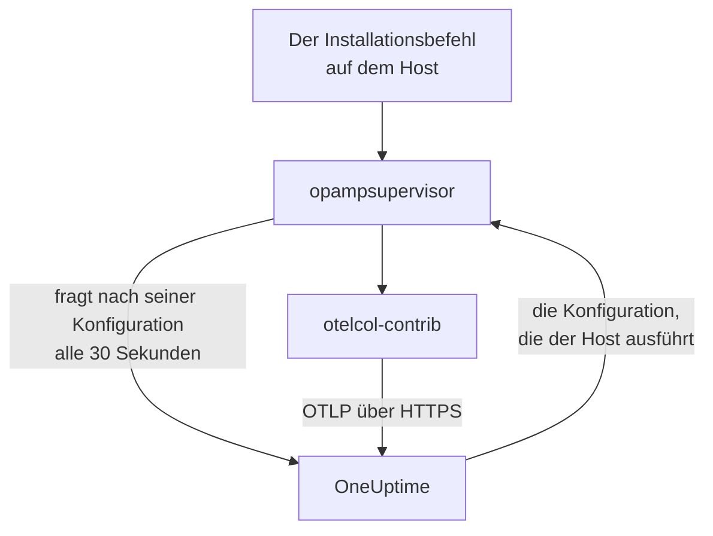

# Hosts

Fügen Sie OneUptime mit einem einzigen Befehl einen Linux-, Windows- oder macOS-Rechner hinzu. Der Befehl installiert den OpenTelemetry Collector auf dem Host, und OneUptime sendet dem Collector seine Konfiguration und hält sie aktuell: Es gibt keine `config.yaml`, die Sie schreiben, auf jeden Host kopieren oder abgleichen müssten. Um zu ändern, was Ihre Hosts erfassen, bearbeiten Sie eine Collector-Konfiguration einmal, und jeder Host, für den sie gilt, erhält die Änderung innerhalb einer Minute.

:::cards
- [Einen Host hinzufügen](#einen-host-hinzufügen): Ein Befehl unter Linux, Windows oder macOS.
- [Ändern, was Hosts erfassen](#ändern-was-hosts-erfassen): Collector-Konfigurationen nach System und Beschriftung, jede Version aufbewahrt.
- [Den Collector eines Hosts prüfen](#den-collector-eines-hosts-prüfen): Die Konfiguration, die er ausführt, ihre Version und warum eine Konfiguration nicht gestartet ist.
- [Was eine Konfiguration darf](#was-eine-konfiguration-darf): Den Host lesen und nur an diese OneUptime-Instanz senden.
:::

## So funktioniert es

Der Befehl installiert zwei Programme aus den Releases des OpenTelemetry Collector, jedes geprüft gegen den SHA-256, den sein Release veröffentlicht: `otelcol-contrib`, den Collector, der den Host liest, und `opampsupervisor`, der den Collector ausführt und ihn bei der Konfiguration hält, die OneUptime über OpAMP sendet, das OpenTelemetry Agent Management Protocol. Beide laufen als Dienst `oneuptime-collector`.



Der Supervisor fragt OneUptime etwa alle 30 Sekunden mit Ihrem Aufnahmeschlüssel nach der Konfiguration des Hosts und meldet, welche Konfiguration der Host ausführt und ob sie gestartet ist. Der Host wird unter **Hosts** registriert, sobald sich der Supervisor zum ersten Mal verbindet, benannt nach seinem Hostnamen, und seine Seiten füllen sich, während seine Metriken und Logs eintreffen.

Jeder Host führt eine Konfiguration aus, gewählt in dieser Reihenfolge:

| Der Host führt aus | Wann |
| --- | --- |
| Die Konfiguration, die auf seiner Seite **Collector** für ihn ausgewählt wurde | Jemand hat eine ausgewählt. |
| Die erste der **Collector-Konfigurationen**, die für ihn gilt | Eine Konfiguration gilt, wenn sie für das System des Hosts ist und, falls sie Beschriftungen nennt, der Host eine davon hat. |
| Den OneUptime-Standard für sein System | Keine Konfiguration gilt. |

Der OneUptime-Standard liest auf jedem System CPU, Arbeitsspeicher, Datenträger, Dateisysteme, Netzwerk und Prozesse; unter Linux das Journal und systemd-Units, wo der Host sie hat; unter Windows die Ereignisprotokolle System, Application und Security sowie die Windows-Dienste; und unter macOS die Install- und WLAN-Logs in `/var/log`. Er folgt den Releases von OneUptime, sodass ein Host mit dem Standard die Verbesserungen von OneUptime daran erhält.

## Bevor Sie beginnen

- Einen Aufnahmeschlüssel. **Host hinzufügen** erstellt einen für Sie, oder wählen Sie einen, den Sie unter **Projekteinstellungen → Telemetrie & APM → Ingestion-Schlüssel** angelegt haben.
- Administratorrechte auf dem Host: `sudo` unter Linux und macOS, PowerShell als Administrator unter Windows.
- Linux mit systemd, Windows 10 oder Windows Server 2019 und neuer, oder macOS auf Apple Silicon oder Intel.
- Ausgehendes HTTPS vom Host zu Ihrer OneUptime-URL, direkt oder über einen Proxy.

## Einen Host hinzufügen

:::steps
### Host hinzufügen öffnen

Öffnen Sie **Produkte → Infrastruktur → Hosts** und wählen Sie **Host hinzufügen**. Wählen Sie, was auf dem Host läuft: Linux, Windows oder macOS. Die Knoten eines Kubernetes-Clusters überwacht stattdessen der [Kubernetes Agent](/docs/telemetry/kubernetes-agent).

### Einen Aufnahmeschlüssel wählen

Wählen Sie einen Schlüssel oder erstellen Sie einen im Dialog. Der Befehl unten setzt ihn ein.

### Den Befehl auf dem Host ausführen

Kopieren Sie den Befehl aus dem Dialog und führen Sie ihn auf dem Host aus. Das dauert etwa eine Minute. Dies sind dieselben Befehle, mit Ihrer OneUptime-URL und Ihrem Schlüssel an Stelle der Beispiele:

:::tabs
@tab Linux
```bash
curl -fsSL https://oneuptime.com/docs/static/scripts/host-collector/install.sh | sudo sh -s -- --url https://oneuptime.com --key YOUR_INGESTION_KEY
```
@tab macOS
```bash
curl -fsSL https://oneuptime.com/docs/static/scripts/host-collector/install.sh | sudo sh -s -- --url https://oneuptime.com --key YOUR_INGESTION_KEY
```
@tab Windows
```powershell
[Net.ServicePointManager]::SecurityProtocol = [Net.ServicePointManager]::SecurityProtocol -bor [Net.SecurityProtocolType]::Tls12; & ([scriptblock]::Create((Invoke-RestMethod -Uri 'https://oneuptime.com/docs/static/scripts/host-collector/install.ps1'))) -Url 'https://oneuptime.com' -Key 'YOUR_INGESTION_KEY'
```
:::

Jede OneUptime-Instanz stellt ihre eigenen Installer bereit, sodass eine selbst gehostete Instanz den Installer ihres eigenen Releases ausgibt: Ersetzen Sie `https://oneuptime.com` an beiden Stellen durch Ihre URL.

### Auf den Host warten

Der letzte Schritt des Dialogs zeigt an, wann sich der Host verbindet, mit einem Link zu ihm. In der Liste erscheint er als **Wird gestartet**, bis seine ersten Metriken eintreffen, meist innerhalb einer Minute, danach als verbunden, mit dem Collector im Zustand **Wird ausgeführt**. Die Seite **Topologie** des Hosts zeichnet als eine Karte, was auf ihm läuft, was ihn aufruft und was er aufruft: siehe [Topologie](/docs/telemetry/topology#die-eigene-karte-einer-ressource-öffnen).
:::

## Hosts beschriften

Ergänzen Sie den Befehl um Beschriftungen, dann hat der Host sie ab dem Moment, in dem er sich verbindet:

:::tabs
@tab Linux
```bash
curl -fsSL https://oneuptime.com/docs/static/scripts/host-collector/install.sh | sudo sh -s -- --url https://oneuptime.com --key YOUR_INGESTION_KEY --label env=production --label team=payments
```
@tab macOS
```bash
curl -fsSL https://oneuptime.com/docs/static/scripts/host-collector/install.sh | sudo sh -s -- --url https://oneuptime.com --key YOUR_INGESTION_KEY --label env=production --label team=payments
```
@tab Windows
```powershell
[Net.ServicePointManager]::SecurityProtocol = [Net.ServicePointManager]::SecurityProtocol -bor [Net.SecurityProtocolType]::Tls12; & ([scriptblock]::Create((Invoke-RestMethod -Uri 'https://oneuptime.com/docs/static/scripts/host-collector/install.ps1'))) -Url 'https://oneuptime.com' -Key 'YOUR_INGESTION_KEY' -Label 'env=production','team=payments'
```
:::

Aus `env=production` wird die Beschriftung `env:production`. Beschriftungen werden hinzugefügt, nie entfernt: Führen Sie den Befehl mit einer weiteren Beschriftung erneut aus, und der Host hat beide. Sie können Hosts auch in der Liste **Hosts** oder mit **Beschriftungsregeln** beschriften. Eine Collector-Konfiguration, die Beschriftungen nennt, gilt nur für Hosts mit einer davon, sodass derselbe Befehl mit anderen Beschriftungen jeder Gruppe von Hosts ihre eigene Konfiguration gibt.

## Ändern, was Hosts erfassen

:::steps
### Eine Collector-Konfiguration erstellen

Öffnen Sie **Produkte → Infrastruktur → Hosts → Collector-Konfigurationen** und wählen Sie **Collector-Konfiguration erstellen**. Geben Sie ihr einen Namen, das System der Hosts, für die sie gilt, und, um nur einige davon zu erreichen, deren Beschriftungen. Ihre Konfiguration beginnt als OneUptime-Standard für dieses System.

### Ihre config.yaml bearbeiten

Wählen Sie auf der Seite der Konfiguration **Konfiguration bearbeiten**, ändern Sie das YAML und speichern Sie. OneUptime prüft es zuerst und lehnt eine Konfiguration, die es nicht senden kann, mit Begründung ab: siehe [Was eine Konfiguration darf](#was-eine-konfiguration-darf).

### Zusehen, wie sie die Hosts erreicht

Jede gespeicherte Änderung ist eine neue Version, und die Hosts, für die sie gilt, erhalten sie innerhalb einer Minute. Die Liste **Hosts** der Konfiguration zeigt jeden Host, den Zustand seines Collectors und die Version, die er ausführt.
:::

Ein Host führt die erste Konfiguration der Liste aus, die für ihn gilt: Ziehen Sie die Zeilen unter **Collector-Konfigurationen**, um die Reihenfolge zu ändern. Setzen Sie die engsten Konfigurationen nach oben, etwa eine für Webserver mit `env:production`, und breite, etwa eine für jeden Linux-Host, darunter. Die Karte **OneUptime-Standards** unter der Liste zeigt, was ein Host ausführt, wenn keine Konfiguration gilt.

### Versionen und Wiederherstellen

Die Liste **Versionen** einer Konfiguration bewahrt jede gespeicherte Änderung auf, die neueste zuerst, mit wer sie gespeichert hat und wann. Wählen Sie **Anzeigen**, um eine Version zu lesen, und **Wiederherstellen**, um sie erneut an die Hosts zu senden: Sie wird als neue Version gespeichert, die sagt, welche sie wiederhergestellt hat, sodass die Liste immer zeigt, was jeder Host erhalten hat.

### Eine Konfiguration für einen Host wählen

Wählen Sie auf der Seite **Collector** eines Hosts **Konfiguration ändern** und wählen Sie eine Konfiguration nur für diesen Host. Angeboten werden Konfigurationen für das System des Hosts und für jedes System. Wählen Sie Automatisch, um den Host wieder der Liste zu überlassen. Ein Host, dessen ausgewählte Konfiguration gelöscht wird, kehrt von selbst zur Liste zurück.

### Wenn eine Konfiguration nicht startet

Der Supervisor prüft eine neue Konfiguration mit dem Collector, bevor er zu ihr wechselt, und kehrt zur letzten funktionierenden Konfiguration zurück, wenn eine nicht startet. Der Host sendet die ganze Zeit weiter. Seine Seite **Collector** zeigt **Konfiguration fehlgeschlagen** mit der Begründung des Collectors, etwa eine Logdatei, die der Collector nicht lesen darf, und OneUptime sendet dem Host diese Konfiguration erst wieder, wenn sie sich ändert. Sobald Sie die Ursache auf dem Host behoben haben, wählen Sie **Erneut versuchen**, um sie noch einmal zu senden.

## Was eine Konfiguration darf

Eine Konfiguration, die OneUptime sendet, läuft auf jedem Host, für den sie gilt. Deshalb prüft OneUptime sie bei jedem Speichern und lehnt eine ab, die gegen eine Regel verstößt:

| Regel | Warum |
| --- | --- |
| Nur die Receiver, Processors, Exporter, Extensions und Connectors auf der Liste von OneUptime | Sie liest den Host und die Dienste darauf. Eine Komponente, die Programme ausführt oder Cloud- oder Cluster-Zugangsdaten liest, steht nicht auf der Liste. |
| Daten verlassen den Host nur über den Exporter `otlp_http`, an `${env:ONEUPTIME_URL}/otlp` mit dem Header `x-oneuptime-token: ${env:ONEUPTIME_INGESTION_KEY}` | Jeder Host sendet an diese OneUptime-Instanz, mit dem Schlüssel, mit dem er installiert wurde. Keine Konfiguration enthält einen Schlüssel. |
| `${env:NAME}` ist das einzige `${...}`, das sie verwenden darf | Ein `${file:...}` oder `${https:...}` würde auf jedem Host gelesen und könnte weitergesendet werden. |
| Keine Einstellung, die ein Programm ausführt oder eine gelesene Datei sendet, etwa `journalctl_path` von journald | Eine Konfiguration darf nicht weiter reichen, als den Host zu lesen. |

Eine Konfiguration kann trotzdem eine sein, die ein Host nicht ausführen kann, etwa ein Receiver für ein anderes System oder eine Logdatei, die dort nicht existiert. Der Collector auf jedem Host prüft das, bevor er wechselt, wie [Wenn eine Konfiguration nicht startet](#wenn-eine-konfiguration-nicht-startet) beschreibt.

## Den Collector eines Hosts prüfen

Öffnen Sie den Host und seine Seite **Collector**. Sie zeigt, wie es um den Collector steht, die Konfiguration, die er ausführt, und **Warum diese Konfiguration**, die Version, die er ausführt, seine **Letzte Meldung** und sein **Collector-Release**. Unter **Auf dem Host** stehen die Befehle, um ihn über eine Shell auf dem Host zu prüfen: ob sein Dienst läuft, sein Log und ein Neustart.

:::tabs
@tab Linux
```bash
sudo systemctl status oneuptime-collector
sudo journalctl -u oneuptime-collector -n 50
sudo systemctl restart oneuptime-collector
```
@tab macOS
```bash
sudo launchctl print system/com.oneuptime.collector
sudo tail -n 50 /usr/local/oneuptime-collector/log/collector.log
sudo launchctl kickstart -k system/com.oneuptime.collector
```
@tab Windows
```powershell
Get-Service oneuptime-collector
Get-WinEvent -FilterHashtable @{ LogName = 'Application'; ProviderName = 'oneuptime-collector' } -MaxEvents 50 | Format-List TimeCreated, Message
Restart-Service oneuptime-collector
```
:::

Unter Linux läuft der Collector als nicht privilegierter Benutzer `oneuptime-collector`, in den Gruppen `systemd-journal` und `adm`, damit er das Journal und die Logs in `/var/log` lesen kann. Unter macOS läuft er als root, wie launchd-Daemons, und unter Windows als LocalSystem, damit er jedes Ereignisprotokoll und jeden Windows-Dienst lesen kann.

## Von Hand eingerichtete Hosts

Ein Host, dessen Collector Sie selbst installiert haben, mit der Anleitung [Host-OpenTelemetry-Collector](/docs/telemetry/host-otel-collector), meldet weiter wie bisher, und OneUptime sendet ihm keine Konfiguration. Um ihn zu übergeben, öffnen Sie die Seite **Collector** des Hosts: Ihr Befehl fügt `--replace-existing` hinzu, das den von Hand installierten Collector (den Dienst `otelcol-contrib`) stoppt und deaktiviert, damit der Host nicht doppelt meldet. Der Host behält seinen Namen, seinen Verlauf und seine Beschriftungen.

## Installationsoptionen

Führen Sie den Befehl erneut aus, um eine davon zu ändern oder auf ein neueres Release zu wechseln: Er ersetzt, was er installiert hat, und lässt den Host in OneUptime, wie er ist.

| Linux und macOS | Windows | Was sie bewirkt |
| --- | --- | --- |
| `--url URL` | `-Url URL` | Wo OneUptime ist. |
| `--key KEY` | `-Key KEY` | Ein Telemetrie-Aufnahmeschlüssel Ihres Projekts. |
| `--label KEY=VALUE` | `-Label KEY=VALUE` | Beschriftet den Host. Wiederholen Sie sie für weitere Beschriftungen; unter Windows listen Sie sie mit Kommas auf. |
| `--env NAME=VALUE` | `-EnvVar NAME=VALUE` | Gibt dem Collector eine Umgebungsvariable, für Konfigurationen, die `${env:NAME}` lesen. |
| `--version VERSION` | `-Version VERSION` | Das zu installierende Collector-Release, standardmäßig 0.161.0. |
| `--download-url URL` | `-DownloadUrl URL` | Lädt die Releases von einem Spiegel mit derselben Ordnerstruktur wie bei GitHub. |
| `--proxy URL` | `-Proxy URL` | Leitet die Downloads und den gesamten Verkehr des Collectors über einen HTTP-Proxy. |
| `--replace-existing` | `-ReplaceExisting` | Stoppt und deaktiviert einen von Hand installierten Collector. |
| `--uninstall` | `-Uninstall` | Entfernt den Collector und alles, was der Befehl installiert hat. |

## Deinstallieren

:::tabs
@tab Linux
```bash
curl -fsSL https://oneuptime.com/docs/static/scripts/host-collector/install.sh | sudo sh -s -- --uninstall
```
@tab macOS
```bash
curl -fsSL https://oneuptime.com/docs/static/scripts/host-collector/install.sh | sudo sh -s -- --uninstall
```
@tab Windows
```powershell
& ([scriptblock]::Create((Invoke-RestMethod -Uri 'https://oneuptime.com/docs/static/scripts/host-collector/install.ps1'))) -Uninstall
```
:::

Der Host bleibt mit seinem Verlauf in OneUptime: Archivieren oder löschen Sie ihn in der Liste **Hosts**.

## Fehlerbehebung

:::details Der Befehl meldet, dass OneUptime den Schlüssel abgelehnt hat
HTTP `401`: Der Schlüssel ist falsch, abgelaufen oder wurde gelöscht. HTTP `422`: Er ist deaktiviert, ein Browser-Schlüssel oder an einen Dienst gebunden. Wählen Sie in **Host hinzufügen** einen aktivierten Server-Schlüssel und führen Sie den Befehl erneut aus: Er ersetzt den Schlüssel auf dem Host.
:::

:::details Der Host erscheint nicht
Prüfen Sie, ob der Host Ihre OneUptime-URL über HTTPS erreicht, und lesen Sie dann das Log des Collectors mit dem Befehl für sein System unter [Den Collector eines Hosts prüfen](#den-collector-eines-hosts-prüfen).
:::

:::details Der Host meldet, dass seine Konfiguration fehlgeschlagen ist
Seine Seite **Collector** zeigt, warum die Konfiguration nicht gestartet ist. Der Host führt weiter die letzte funktionierende Konfiguration aus und erhält die fehlgeschlagene erneut, wenn sich die Konfiguration ändert oder Sie **Erneut versuchen** wählen.
:::

:::details Der Host zeigt „Meldet nicht“
OneUptime hat seit mehr als 15 Minuten nichts vom Supervisor des Hosts gehört. Prüfen Sie, ob der Dienst `oneuptime-collector` läuft und ob der Host OneUptime noch erreicht.
:::

## Nächste Schritte

:::cards
- [Host-OpenTelemetry-Collector](/docs/telemetry/host-otel-collector): Den Collector stattdessen selbst installieren und seine Konfiguration schreiben.
- [Host-Monitor](/docs/monitor/host-monitor): Bei dem alarmieren, was Ihre Hosts melden.
- [Aufnahmeschlüssel](/docs/telemetry/ingestion-keys): Die Schlüssel erstellen, eingrenzen und rotieren, mit denen Hosts senden.
- [Kubernetes Agent](/docs/telemetry/kubernetes-agent): Die Knoten und Workloads eines Clusters überwachen.
:::
