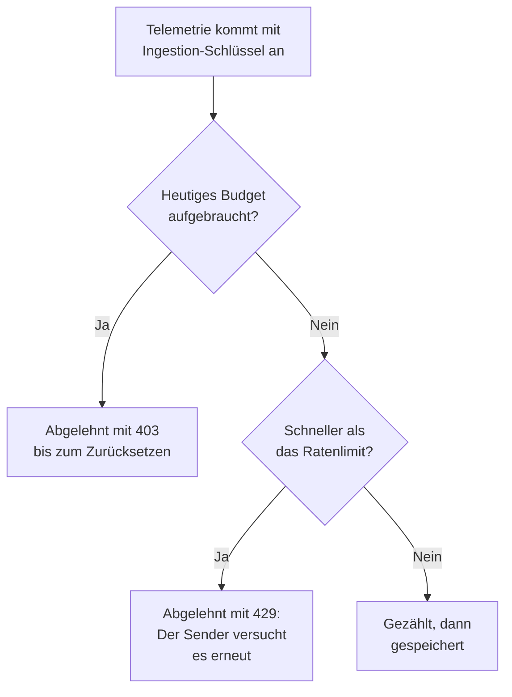

# Ingestion-Budgets

Ein Ingestion-Budget begrenzt, wie viel Telemetrie ein Projekt an einem Tag sendet, damit ein lauter Dienst oder eine außer Kontrolle geratene Protokollschleife Ihren Speicher nicht füllen kann. Der Instanzadministrator legt für jedes Signal ein Tagesbudget fest, für alle Projekte oder für ein einzelnes Projekt, und wer einen Ingestion-Schlüssel bearbeiten darf, kann dem Schlüssel ein kleineres eigenes Budget geben. Jedes Budget kann zusätzlich ein Ratenlimit pro Sekunde haben.

:::cards
- [Wie Budgets funktionieren](#wie-budgets-funktionieren): Drei Ebenen, gezählt, während Telemetrie eintrifft.
- [Die Standardbudgets aller Projekte festlegen](#die-standardbudgets-aller-projekte-festlegen): In den Einstellungen des Admin Dashboards.
- [Einem Ingestion-Schlüssel ein eigenes Budget geben](#einem-ingestion-schlüssel-ein-eigenes-budget-geben): Ein Anteil am Budget des Projekts.
- [Alarme für ein Budget einrichten](#alarme-für-ein-budget-einrichten): Bevor es aufgebraucht ist, und wenn es so weit ist.
:::

## Wie Budgets funktionieren

Telemetrie wird beim Eintreffen angerechnet: auf das Budget ihres Projekts für ihr Signal und, wenn ihr Ingestion-Schlüssel eines hat, auf das des Schlüssels. Sobald ein Tagesbudget aufgebraucht ist, wird dieses Signal abgelehnt, bis das Budget zurückgesetzt wird.



- **Drei Ebenen.** Der Standard der Instanz gilt für jedes Projekt. Der Instanzadministrator kann einem Projekt stattdessen ein eigenes Budget geben oder gar kein Limit. Das Budget eines Schlüssels unterteilt nur das seines Projekts: Es kann kleiner sein, nie größer.
- **Fünf Signale.** Protokolle, Traces, Metriken, Profile und Sicherheitsereignisse haben jeweils ein eigenes Budget. Sitzungswiedergaben haben eigene Limits: siehe [Sitzungswiedergabe](/docs/telemetry/session-replay).
- **Bytes werden dekomprimiert gezählt.** Eine Anfrage zählt mit der dekomprimierten Größe ihres Bodys, Komprimieren ändert also nichts daran, wie viel sie zählt. Ein GB sind 1024³ Bytes und ein MB 1024² Bytes.
- **Gezählt wird, was ankommt, nicht was gespeichert wird.** Telemetrie, die ein [Drop-Filter](/docs/telemetry/drop-filters-and-scrub-rules) später entfernt, zählt trotzdem, daher kann ein Budget mehr zeigen als die Seite [Telemetrie-Nutzung](/docs/telemetry/usage), die zählt, was gespeichert wurde.
- **Die letzte Anfrage wird vollständig gespeichert.** Eine Anfrage, die eintrifft, solange ein Budget noch Platz hat, wird ganz gespeichert, daher kann ein aufgebrauchtes Budget etwas über 100% zeigen.
- **Nichts wird begrenzt, bevor ein Budget festgelegt ist.** Jede Installation startet ohne Budgets, und ein Projekt ohne Budget wird gar nicht gezählt.
- **Änderungen erreichen jeden Server innerhalb einer Minute.**
- **Telemetrie wird angenommen, wenn sie nicht gezählt werden kann.** Die Budgets werden in Valkey gezählt. Solange Valkey nicht erreichbar ist, speichert OneUptime Telemetrie, ohne sie zu zählen, statt sie abzulehnen, und die Budgetseiten weisen darauf hin.

## Bevor Sie beginnen

- **Für die Budgets der Instanz und eines Projekts das Admin Dashboard.** Auf einer selbst gehosteten Installation legt nur der Instanzadministrator sie fest. Die Inhaber und Administratoren eines Projekts sehen seine Budgets, können sie aber nicht ändern.
- **Für das eigene Budget eines Schlüssels eine Rolle, die Ingestion-Schlüssel bearbeiten darf.** Project Owner oder Project Admin, oder eine eigene Rolle mit der Berechtigung Edit Ingestion Key.
- **Um die Budgets zu sehen, eine Rolle, die die Nutzung des Projekts sieht.** Die Rollen, die die Seite [Telemetrie-Nutzung](/docs/telemetry/usage) sehen, sehen dort auch die Budgets des Projekts.

## Die Standardbudgets aller Projekte festlegen

:::steps
### Ingestion-Budgets öffnen

Gehen Sie im Admin Dashboard zu **Einstellungen → Telemetrie → Ingestion-Budgets**. **Telemetrie** ist im Seitenmenü anfangs eingeklappt: Klicken Sie darauf, um es zu öffnen.

### Die Tagesbudgets festlegen

Klicken Sie auf der Karte **Standard-Tagesbudgets** auf **Standard-Tagesbudgets bearbeiten**, geben Sie für jedes zu begrenzende Signal eine Anzahl GB ein, etwa unter **Protokolle (GB pro Tag)**, und klicken Sie auf **Änderungen speichern**. Lassen Sie ein Signal für kein Limit leer.

### Die Ratenlimits festlegen, wenn Sie sie brauchen

Klicken Sie auf der Karte **Standard-Ratenlimits** auf **Standard-Ratenlimits bearbeiten** und geben Sie für ein Signal eine Anzahl MB pro Sekunde ein, etwa unter **Protokolle (MB pro Sekunde)**. Ein Ratenlimit verhindert, dass ein einzelner Schub das Budget eines Tages in Minuten aufbraucht.
:::

Die Karte **Warnung und Zurücksetzen** enthält die Warnschwelle und die Uhrzeit, zu der der Budgettag zurückgesetzt wird: siehe [Die Warnung und das Zurücksetzen](#die-warnung-und-das-zurücksetzen).

## Die Budgets eines Projekts festlegen

:::steps
### Das Projekt öffnen

Gehen Sie im Admin Dashboard zu **Projekte**, klicken Sie auf das Projekt und dann in seinem Seitenmenü auf **Ingestion-Budgets**. Die Seite öffnet mit dem, was das Projekt heute von seinen Budgets verbraucht hat.

### Seine Tagesbudgets festlegen

Klicken Sie auf der Karte **Tagesbudgets für dieses Projekt** auf **Tagesbudgets bearbeiten**. Geben Sie für ein Signal anstelle des Standards der Instanz eine Anzahl GB ein, oder 0 für gar kein Limit. Lassen Sie ein Signal leer, um den Standard der Instanz zu behalten.

### Seine Ratenlimits festlegen

Klicken Sie auf der Karte **Ratenlimits für dieses Projekt** auf **Ratenlimits bearbeiten** und legen Sie sie auf dieselbe Weise fest: eine Anzahl MB pro Sekunde, 0 für kein Limit oder leer für den Standard der Instanz.
:::

Die Mitglieder des Projekts sehen diese Budgets auf ihrer Seite [Telemetrie-Nutzung](/docs/telemetry/usage), nur lesend.

## Einem Ingestion-Schlüssel ein eigenes Budget geben

Das Budget eines Schlüssels ist ein Anteil am Budget seines Projekts: Ein Sender, der seinen eigenen Schlüssel flutet, stoppt am Budget des Schlüssels, während die anderen Schlüssel des Projekts weiter senden.

:::steps
### Den Schlüssel öffnen

Gehen Sie zu **Projekteinstellungen → Telemetrie & APM → Ingestion-Schlüssel** und klicken Sie auf den Schlüssel. **Telemetrie & APM** ist im Seitenmenü anfangs eingeklappt: Klicken Sie darauf, um es zu öffnen.

### Seine Budgets festlegen

Klicken Sie auf der Karte **Ingestion-Budgets** auf **Ingestion-Budgets bearbeiten**. Geben Sie im Schritt **Tagesbudgets** für jedes zu begrenzende Signal eine Anzahl GB pro Tag ein und im Schritt **Ratenlimits** eine Anzahl MB pro Sekunde. Lassen Sie ein Signal leer, damit der Schlüssel dafür kein eigenes Budget hat.

### Die Budgets speichern

Klicken Sie auf **Änderungen speichern**. Das Budget eines Schlüssels kann nicht höher sein als das seines Projekts: OneUptime lehnt es ab und nennt den höchstmöglichen Wert.
:::

- **Beide Budgets zählen.** Mit dem Schlüssel gesendete Telemetrie wird auf das Budget des Schlüssels und auf das des Projekts angerechnet, und das zuerst aufgebrauchte lehnt sie ab.
- **Ein gesenktes Projektbudget gilt auch für den Schlüssel.** Wird das Budget des Projekts unter das eines Schlüssels gesenkt, gilt für den Schlüssel das des Projekts.

## Was Sender sehen

| Wann | Über HTTP | Über OTLP/gRPC | Was der Sender tut |
| --- | --- | --- | --- |
| Ein Tagesbudget ist aufgebraucht | `403` | `RESOURCE_EXHAUSTED` | Verwirft den Batch: Ein erneuter Versuch hilft vor dem Zurücksetzen nicht |
| Ein Ratenlimit ist überschritten | `429` mit `Retry-After` | `RESOURCE_EXHAUSTED` mit einer Wartezeit bis zum erneuten Versuch | Sendet den Batch nach der Wartezeit erneut |

Jede Ablehnung nennt den Grund. Über OTLP/HTTP ist ihr Body ein `google.rpc.Status`, in protobuf oder JSON, je nachdem, wie die Anfrage gesendet wurde, daher zeigt das Protokoll des Senders einen Grund wie:

```text
This project's daily logs ingestion budget of 10 GB is used up, so OneUptime is not storing logs from this project until the budget resets at 2026-11-10 00:00 UTC.
```

- **Andere HTTP-Sender erhalten JSON.** Fluent Bit, Fluentd, Syslog und die anderen HTTP-Endpunkte erhalten `error`, `message` und `resetsAt`, bei einem Ratenlimit zusätzlich `retryAfterSeconds`.
- **Bei MQTT und Cloud-Streams erfährt der Sender nichts.** Telemetrie, die über MQTT oder aus dem Stream eines Cloud-Anbieters eintrifft, wird verworfen, sobald ihr Budget aufgebraucht ist. Für sie gilt kein Ratenlimit: Sie könnte nicht erneut gesendet werden.
- **Ablehnungen werden gezählt.** Was ein aufgebrauchtes Budget ablehnt oder verwirft, wird als verworfen gezählt, und jede Anfrage, die ein Ratenlimit ablehnt, als gedrosselt: siehe [Die heutige Nutzung und Verwerfungen ansehen](#die-heutige-nutzung-und-verwerfungen-ansehen).

## Die Warnung und das Zurücksetzen

- **Die Warnung.** Überschreitet ein Tagesbudget die Warnschwelle, 80%, sofern der Instanzadministrator sie nicht ändert, erhalten die Inhaber des Projekts eine E-Mail, und die Explorer zeigen über den Daten dieses Signals ein Banner. Eine weitere E-Mail erhalten sie, wenn das Budget aufgebraucht ist. Jedes Budget sendet jede E-Mail höchstens einmal am Tag.
- **Das Zurücksetzen.** Jeder Budgettag beginnt um 00:00 UTC neu, sofern der Instanzadministrator das nicht ändert. Auf der Karte **Warnung und Zurücksetzen** werden **Warnschwelle (%)**, von 1 bis 99, **Rücksetzzeit**, als HH:MM, und **Zeitzone der Rücksetzzeit** festgelegt: Klicken Sie auf **Warnung und Zurücksetzen bearbeiten**.
- **Sommerzeit.** Das Zurücksetzen folgt der Uhr der Zeitzone, daher ist der Budgettag, an dem die Uhren umgestellt werden, eine Stunde kürzer oder länger. Eine Rücksetzzeit, die bei der Umstellung übersprungen wird, tritt entsprechend lange nach dem Sprung ein.
- **Ein geändertes Zurücksetzen startet einen neuen Tag.** Eine Änderung der Rücksetzzeit oder der Zeitzone startet sofort einen neuen Budgettag, an dem noch nichts gezählt ist.

## Die heutige Nutzung und Verwerfungen ansehen

Gehen Sie zu **Projekteinstellungen → Telemetrie & APM → Nutzung**. Solange für das Projekt ein Budget oder ein Ratenlimit festgelegt ist, öffnet die Seite mit der Karte **Ingestion-Budgets**, und die Schlüssel mit eigenen Budgets stehen auf der Karte **Budgets der Ingestion-Schlüssel**:

| Spalte | Was sie zeigt |
| --- | --- |
| **Signal** | Das Signal, für das die Zeile gilt. |
| **Heute verbraucht** | Was seit Beginn des Budgettags gezählt wurde, und sein Anteil am Budget. |
| **Tagesbudget** | Das geltende Budget und wo es festgelegt wurde: **Standard der Instanz**, **Für dieses Projekt festgelegt** oder **Für diesen Schlüssel festgelegt**. |
| **Ratenlimit** | Das geltende Ratenlimit. |
| **Verworfen** | Was abgelehnt oder verworfen wurde, weil das Budget aufgebraucht war. |
| **Gedrosselt** | Wie viele Anfragen das Ratenlimit abgelehnt hat. |
| **Status** | **Im Budget**, **Warnschwelle überschritten** oder **Aufgebraucht**, **Kein Tagesbudget** für ein Signal mit nur einem Ratenlimit und **Unbekannt**, solange die Zählungen nicht lesbar sind. |

- **Auf der Seite eines Schlüssels** zeigt die Karte **Heutige Budgetnutzung**, was der Schlüssel von seinen eigenen Budgets verbraucht hat.
- **In den Explorern** zeigt ein Banner über den Daten von Protokollen, Traces, Metriken, Profilen und Sicherheitsereignissen an, wenn das Budget dieses Signals seine Warnschwelle überschritten hat oder aufgebraucht ist, mit **Budgets ansehen**, um die Seite Nutzung zu öffnen.
- **Im Admin Dashboard** zeigt die Seite **Ingestion-Budgets** eines Projekts dieselben Zahlen.

## Alarme für ein Budget einrichten

Alle 5 Minuten schreibt OneUptime die Tageszahlen jedes Budgets als Metriken des Projekts, und ein [Metriken-Monitor](/docs/monitor/metrics-monitor) alarmiert darauf wie auf jede andere Metrik:

| Metrik | Einheit | Was sie enthält |
| --- | --- | --- |
| `oneuptime.telemetry.budget.used.bytes` | `By` | Die Bytes, die seit Beginn des Budgettags auf das Tagesbudget angerechnet wurden. |
| `oneuptime.telemetry.budget.used.percent` | `%` | Dasselbe als Prozentsatz des Tagesbudgets. Ab 100 wird das Signal bis zum Zurücksetzen abgelehnt. |
| `oneuptime.telemetry.budget.dropped.bytes` | `By` | Die Bytes, die seit Beginn des Budgettags abgelehnt oder verworfen wurden, weil das Budget aufgebraucht war. |
| `oneuptime.telemetry.budget.throttled.requests` | `{request}` | Die Anfragen, die das Ratenlimit seit Beginn des Budgettags abgelehnt hat. |

Jeder Punkt trägt diese Attribute:

| Attribut | Wert |
| --- | --- |
| `projectId` | Die ID des Projekts. |
| `signal` | `logs`, `traces`, `metrics`, `profiles` oder `security-events`. |
| `scope` | `project`, oder `ingestion-key` beim eigenen Budget eines Schlüssels. |
| `ingestionKeyId` | Die ID des Schlüssels, beim eigenen Budget eines Schlüssels. |
| `ingestionKeyName` | Der Name des Schlüssels, als der Punkt geschrieben wurde, beim eigenen Budget eines Schlüssels. |

Um bei 90% des Protokollbudgets des Projekts benachrichtigt zu werden, erstellen Sie einen Metriken-Monitor auf `oneuptime.telemetry.budget.used.percent`, gefiltert nach `signal` `logs` und `scope` `project`, der alarmiert, wenn das Maximum über 90 liegt:

- **Mit dem Maximum aggregieren.** Jede Zahl steigt während eines Budgettags nur an.
- **Ein Zeitfenster von 15 Minuten oder mehr verwenden.** Alle 5 Minuten wird ein Punkt geschrieben, und ein Zeitfenster ohne Punkt löst den Alarm auf.
- **Mit Lücken rechnen, nicht mit Nullen.** Für eine Zahl, die 0 ist, wird nichts geschrieben, ebenso wenig, solange die Zählungen nicht lesbar sind.
- **Sie kosten nichts.** Diese Metriken werden auf kein Budget angerechnet und nicht als Telemetrie-Nutzung gezählt, und sie werden so lange aufbewahrt wie Monitor-Metriken: 30 Tage, sofern der Instanzadministrator das nicht ändert. Metriknamen, die mit `oneuptime.telemetry.budget.` beginnen, sind ihnen vorbehalten: Metriken, die Ihre Anwendungen unter einem solchen Namen senden, werden verworfen.

## Fehlerbehebung

:::details Ein Collector protokolliert 403 für seine Exporte
Das Tagesbudget des Projekts oder des Schlüssels für dieses Signal ist aufgebraucht, und der Collector verwirft, was er bis zum Zurücksetzen des Budgets nicht senden kann. Sehen Sie sich **Heute verbraucht** auf der Seite Nutzung an. Bitten Sie den Instanzadministrator, das Budget des Projekts zu erhöhen, oder senden Sie weniger: Ein Drop-Filter hilft hier nicht, da er Telemetrie erst entfernt, nachdem sie gezählt wurde.
:::

:::details Ein Collector protokolliert 429 und versucht es erneut
Er sendet schneller, als ein Ratenlimit erlaubt. Er versucht es nach der Wartezeit aus `Retry-After` erneut, daher geht nichts verloren, solange seine Warteschlange nicht voll wird. Erhöhen Sie das Ratenlimit oder verteilen Sie das Senden gleichmäßiger.
:::

:::details „Heute verbraucht“ zeigt mehr als die Seite Telemetrie-Nutzung
Ein Budget zählt Telemetrie beim Eintreffen, dekomprimiert, einschließlich dessen, was Drop-Filter später entfernen. Die Seite Nutzung zählt, was gespeichert wurde, und zwar am Tag danach.
:::

:::details Die Budgets melden, dass die heutigen Zählungen nicht gelesen werden konnten
OneUptime kann Valkey, wo die Budgets gezählt werden, nicht erreichen. Bis es wieder erreichbar ist, wird Telemetrie gespeichert, ohne gezählt zu werden, und kein Budget wird durchgesetzt.
:::

## Nächste Schritte

:::cards
- [Telemetrie-Nutzung](/docs/telemetry/usage): Sehen, was jedes Projekt und jeder Dienst sendet.
- [Drop-Filter & Scrub-Regeln](/docs/telemetry/drop-filters-and-scrub-rules): Die Telemetrie, die Sie nicht brauchen, gar nicht erst speichern.
- [Ingestion-Schlüssel](/docs/telemetry/ingestion-keys): Ein Schlüssel für jeden Sender, damit jeder ein Budget haben kann.
- [Metriken-Überwachung](/docs/monitor/metrics-monitor): Auf die Budgetmetriken alarmieren.
:::
