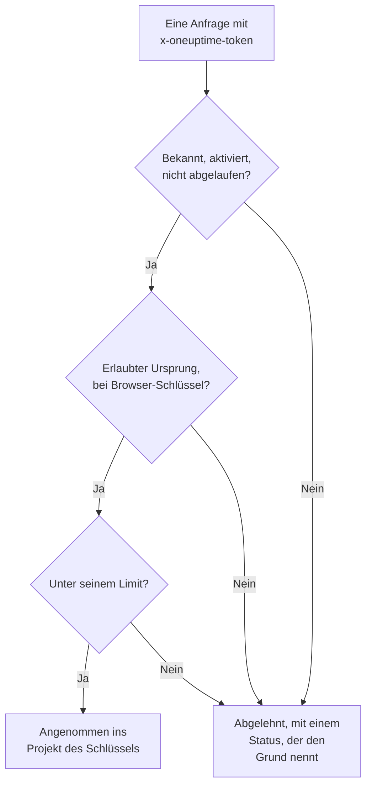

# Ingestion-Schlüssel

Ein Ingestion-Schlüssel verbindet Ihre Telemetrie mit Ihrem Projekt. Anwendungen, OpenTelemetry Collectors und Agenten senden ihn mit jeder Anfrage, und OneUptime legt ihre Protokolle, Traces und Metriken in dem Projekt ab, zu dem der Schlüssel gehört. Diese Seite zeigt, wie Sie einen Schlüssel anlegen, welche Art Sie wählen und wie Sie Schlüssel sicher halten.

:::cards
- [Einen Ingestion-Schlüssel anlegen](#einen-ingestion-schlüssel-anlegen): Ein Name, ein Typ und ein Geheimnis zum Kopieren.
- [Server oder Browser](#server-oder-browser): Welche Art von Schlüssel ein Sender braucht.
- [Einen Browser-Schlüssel absichern](#einen-browser-schlüssel-absichern): Ursprünge, ein Dienstname und ein Limit.
- [Einen Schlüssel rotieren, ausschalten oder löschen](#einen-schlüssel-rotieren-ausschalten-oder-löschen): Was zu tun ist, wenn ein Schlüssel nach außen gelangt.
:::

## Wie ein Schlüssel geprüft wird

Jede Anfrage trägt das Geheimnis des Schlüssels, meist in einem `x-oneuptime-token`-Header. OneUptime sucht den Schlüssel, prüft, ob er noch senden darf, und nimmt die Daten erst dann in das Projekt des Schlüssels auf.



- **Der Schlüssel bestimmt das Projekt.** Sie senden nie eine Projekt-ID: Daten, die mit einem Schlüssel gesendet werden, landen in dem Projekt, zu dem der Schlüssel gehört.
- **Änderungen erreichen jeden Server innerhalb einer Minute.** Einen Schlüssel ausschalten, sein Geheimnis zurücksetzen oder seine Ursprünge, sein Ablaufdatum oder sein Limit ändern wirkt nach etwa einer Minute.
- **Ein Server-Schlüssel ist ein Passwort.** Wer ihn hat, kann Telemetrie in Ihr Projekt senden. Bewahren Sie ihn in den Geheimnissen Ihrer Server auf, nie in der Versionsverwaltung oder auf einer Webseite.

## Server oder Browser

Wählen Sie den Typ danach, wo der Schlüssel liegen wird. Der Typ lässt sich nach dem Anlegen des Schlüssels nicht mehr ändern.

| | **Server** | **Browser** |
| --- | --- | --- |
| Für | Anwendungen, Collectors und Agenten auf Maschinen, die Sie betreiben | Webseiten, und React Native Session Replay |
| Sendet | Jede Art von Telemetrie, an jeden Endpunkt | Traces, Protokolle, Metriken und Session Replays |
| Ein Geheimnis | Ja: halten Sie ihn auf Ihren Servern | Nein: jeder, der die Seite ansieht, kann ihn lesen |
| Ursprünge | Nicht geprüft | Nur die aufgeführten Ursprünge werden angenommen |
| Anfragen pro Minute | Kein Limit, außer Sie setzen eines | 6.000, außer Sie setzen ein anderes Limit |

Überall sonst lehnt OneUptime einen Browser-Schlüssel ab, etwa über gRPC und MQTT, für Profile, Syslog, Fluent Bit und Fluentd sowie für das Hochladen von Source Maps. Um einen Sender auf den anderen Typ umzustellen, legen Sie einen Schlüssel dieses Typs an, stellen den Sender darauf um und löschen dann den alten Schlüssel.

## Bevor Sie beginnen

- **Eine Rolle, die Ingestion-Schlüssel verwalten darf.** Project Owner oder Project Admin, oder eine eigene Rolle mit der Berechtigung Create Telemetry Ingestion Key. Die Telemetrie-Rollen umfassen keine Ingestion-Schlüssel.
- **In OneUptime Cloud eine Zahlungsmethode.** Telemetrie wird nach Nutzung abgerechnet, daher braucht ein Projekt im Free-Plan eine Zahlungsmethode, bevor es einen Schlüssel anlegen kann. Der Dialog zum Anlegen endet dann mit einem Schritt **Abrechnung**, der die Preise zeigt.

## Einen Ingestion-Schlüssel anlegen

:::steps
### Ingestion-Schlüssel öffnen

Gehen Sie zu **Projekteinstellungen → Telemetrie & APM → Ingestion-Schlüssel**. **Telemetrie & APM** ist im Seitenmenü anfangs eingeklappt: Klicken Sie darauf, um es zu öffnen. Die Liste zeigt für jeden Schlüssel **Name**, **Typ**, **Zuletzt verwendet** und **Beschreibung**.

### Den Schlüssel benennen und seinen Typ wählen

Klicken Sie auf **Aufnahmeschlüssel erstellen**. Der Dialog beginnt mit dem Namen **Server-Schlüssel** und dem Typ **Server**. Wählen Sie den **Schlüsseltyp** und benennen Sie den Schlüssel nach dem, was ihn nutzen wird, etwa `checkout-collector`. Eine **Beschreibung** finden Sie unter **Erweitert**.

### Die Ursprünge eines Browser-Schlüssels hinzufügen

Ein **Browser**-Schlüssel fragt im nächsten Schritt, **Browser-Einstellungen**, nach dem Feld **Zulässige Ursprünge**, mit dem Feld **Festgelegter Dienstname** unter **Erweitert**. Siehe [Einen Browser-Schlüssel absichern](#einen-browser-schlüssel-absichern).

### Den Schlüssel anlegen und sein Geheimnis kopieren

Klicken Sie auf **Aufnahmeschlüssel erstellen**. Die eigene Seite des Schlüssels öffnet sich: Kopieren Sie den Wert unter **Geheimer Schlüssel** und geben Sie ihn Ihren Sendern.
:::

Die **Einrichtungsanleitung** jedes Produkts beginnt mit **Aufnahmeschlüssel auswählen**, wo Sie die Schlüssel sehen, die diese Anleitung nutzen kann, und direkt einen anlegen können. Die Code-Beispiele der Anleitung enthalten dann diesen Schlüssel.

## Telemetrie mit dem Schlüssel senden

Sender setzen das Geheimnis in einen `x-oneuptime-token`-Header:

```text
x-oneuptime-token: YOUR_ONEUPTIME_INGESTION_KEY
```

- OpenTelemetry-SDKs lesen es aus `OTEL_EXPORTER_OTLP_HEADERS`. Siehe den [OpenTelemetry-Schnellstart](/docs/telemetry/open-telemetry#schnellstart).
- Über OTLP/gRPC steht es in den Metadaten `x-oneuptime-token`.
- Ein MQTT-Gerät sendet es als sein Passwort. Siehe [IoT-Geräte](/docs/telemetry/iot-devices).
- OneUptime liest den Schlüssel auch aus einem Header `x-oneuptime-ingestion-key` oder `x-oneuptime-service-token`, den manche ältere Konfigurationen senden.

## Einen Browser-Schlüssel absichern

Ein Browser-Schlüssel steht in Ihrer Seite, wo ihn jeder kopieren kann. Diese Einstellungen begrenzen, was eine Kopie anrichten kann. Ändern Sie sie auf der Seite des Schlüssels mit **Telemetrie-Aufnahmeschlüssel bearbeiten**.

| Einstellung | Was sie bewirkt |
| --- | --- |
| **Zulässige Ursprünge** | Die einzigen Ursprünge, von denen der Schlüssel angenommen wird. Eine Anfrage von jedem anderen Ursprung, oder ganz ohne `Origin`-Header, wird abgelehnt. Ein Browser-Schlüssel muss mindestens einen behalten. |
| **Festgelegter Dienstname** | Legt alles, was der Schlüssel über OTLP/HTTP sendet, unter diesem einen Dienst ab, egal welchen `service.name` der Sender gesetzt hat. Eine Kopie des Schlüssels kann dann nur in diesen Dienst schreiben. |
| **Limit für Anfragen pro Minute** | Die meisten Anfragen, für die der Schlüssel pro Minute angenommen wird, geteilt von allen Besuchern. Ein Browser-Schlüssel bekommt 6.000, wenn Sie das Feld leer lassen. |
| **Läuft ab am** | Das Datum, nach dem der Schlüssel abgelehnt wird, damit eine veröffentlichte Kopie nicht mehr funktioniert. |

Ein Ursprung besteht aus Schema, Host und optionalem Port: `https://app.example.com` deckt `https://app.example.com:8443` nicht ab. Ein führendes `*.` deckt jede Subdomain ab, aber nicht die Domain selbst. React Native Session Replay sendet eine exakte `app://`-Identität, die keinen Platzhalter zulässt:

```json
[
  "https://app.example.com",
  "https://*.example.com",
  "app://com.example.mobile"
]
```

Der [Dienstkatalog](/docs/telemetry/services#wie-ein-dienst-in-den-katalog-kommt) zeigt, wie ein festgelegter Name den Dienst bestimmt. Runner und KI-Agent des Kubernetes-Agenten sowie die Infrastruktur-KI-Agenten registrieren sich nicht mit einem festgelegten Schlüssel: Geben Sie ihnen einen Server-Schlüssel ohne festgelegten Namen.

## Einen Schlüssel rotieren, ausschalten oder löschen

Die Seite eines Schlüssels zeigt **Status**, **Geheimer Schlüssel** hinter **Zum Anzeigen klicken** und **Zuletzt verwendet am**: den letzten Zeitpunkt, zu dem OneUptime damit gesendete Daten angenommen hat.

| Um | Tun Sie Folgendes | Was Sender sehen |
| --- | --- | --- |
| Einen Schlüssel sofort stoppen und es später rückgängig machen | Klicken Sie auf **Telemetrie-Aufnahmeschlüssel bearbeiten**, öffnen Sie **Zugriff & Limits** und schalten Sie **Aktiviert** aus. Der Status lautet **Deaktiviert — Telemetrie abgelehnt**. | `422`, bis Sie ihn wieder einschalten |
| Ein nach außen gelangtes Geheimnis ersetzen | Klicken Sie auf **Geheimen Schlüssel zurücksetzen** und bestätigen Sie. Der Schlüssel behält seine Einstellungen und bekommt ein neues Geheimnis. | `401`, bis sie das neue Geheimnis senden |
| Einen Schlüssel endgültig stoppen | Klicken Sie unten auf seiner Seite auf **Telemetrie-Aufnahmeschlüssel löschen**. | `401` |

Um ein Geheimnis ohne Datenverlust zu wechseln, legen Sie einen zweiten Schlüssel an, stellen Ihre Sender darauf um und löschen den alten Schlüssel, sobald sich **Zuletzt verwendet am** dort nicht mehr ändert. **Zuletzt verwendet am** wird alle paar Minuten aktualisiert, nicht bei jeder Anfrage.

## Fehlerbehebung

Eine abgelehnte Anfrage wird mit einem Status und einem Satz beantwortet, der den Grund nennt.

| Antwort | Was sie bedeutet |
| --- | --- |
| `401` mit `Missing ingestion token` | Die Anfrage hat keinen Schlüssel. Senden Sie ihn in `x-oneuptime-token`. |
| `401` mit `Invalid ingestion token` | Kein Schlüssel hat dieses Geheimnis: Es wurde falsch eingegeben, zurückgesetzt oder gelöscht. |
| `401` mit `This telemetry ingestion key expired.` | Das Datum unter **Läuft ab am** ist vorbei. Setzen Sie ein späteres Datum oder nutzen Sie einen anderen Schlüssel. |
| `402` mit `Add a payment method` | In OneUptime Cloud ist das Projekt im Free-Plan und hat noch keine Zahlungsmethode. |
| `422` mit `This telemetry ingestion key has been disabled.` | Jemand hat **Aktiviert** ausgeschaltet. |
| `422` mit `A browser ingestion key cannot be used for` | Ein Browser-Schlüssel hat einen Endpunkt erreicht, der nur Server-Schlüssel annimmt. |
| `422` mit `did not send an Origin header` | Ein Browser-Schlüssel wurde von außerhalb eines Browsers gesendet. Nutzen Sie dort einen Server-Schlüssel. |
| `422` mit `is not allowed for this browser ingestion key` | Der Ursprung der Seite steht nicht in **Zulässige Ursprünge**. |
| `422` mit `is pinned to a single service` | Ein Schlüssel, bei dem **Festgelegter Dienstname** gesetzt ist, wurde zum Registrieren eines Agenten verwendet. Nutzen Sie einen Server-Schlüssel ohne festgelegten Namen. |
| `429` mit `Too many telemetry requests for this ingestion key` | Der Schlüssel hat sein **Limit für Anfragen pro Minute** erreicht. Exporter versuchen es nach der `Retry-After`-Zeit erneut. |

Die übrigen Antworten, die ein OTLP-Exporter bekommen kann, finden Sie unter [Antworten](/docs/telemetry/open-telemetry#antworten).

:::details Eine Minute nach dem Ausschalten des Schlüssels kommen noch Daten an
Jeder OneUptime-Server merkt sich bis zu einer Minute lang, was er über einen Schlüssel weiß, daher erreicht eine Änderung alle Server innerhalb von etwa einer Minute. Anfragen danach werden abgelehnt.
:::

:::details Ein Browser-Schlüssel funktioniert auf meinem Laptop, aber nicht in Produktion
Ein Ursprung umfasst sein Schema und seinen Port. `http://localhost:3000` und `https://app.example.com` sind verschiedene Ursprünge: Führen Sie jeden auf, von dem die Seite ausgeliefert wird.
:::

:::details Zuletzt verwendet am zeigt weiterhin Nie
Seit OneUptime die Nutzung aufzeichnet, hat nichts Daten mit diesem Schlüssel gesendet. Prüfen Sie, ob Ihre Sender das Geheimnis dieses Schlüssels haben und ob ihre Anfragen OneUptime erreichen.
:::

## Nächste Schritte

:::cards
- [OpenTelemetry](/docs/telemetry/open-telemetry): Traces, Metriken und Protokolle mit Ihrem Schlüssel senden.
- [Dienstkatalog](/docs/telemetry/services): Die Dienste sehen, unter denen Ihre Telemetrie abgelegt wird.
- [Datenaufbewahrung](/docs/telemetry/data-retention): Festlegen, wie lange die Daten aufbewahrt werden.
- [Drop-Filter & Scrub-Regeln](/docs/telemetry/drop-filters-and-scrub-rules): Daten verwerfen oder maskieren, bevor sie gespeichert werden.
:::
